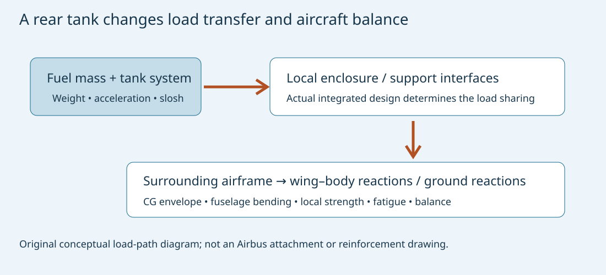
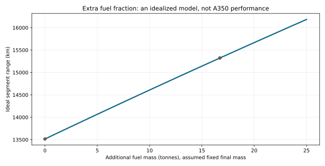
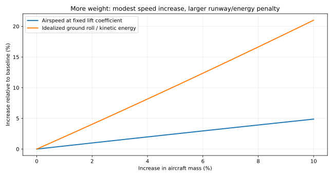

# A350-1000 to A350-1000ULR: what changed, and why a larger fuel tank is a structural problem

**MIE 446 · Aerospace Structures · UMass Amherst**  
Original engineering case study · Sources checked **11 November 2026**

[Course readings](READINGS.md) · [Illustrated web edition](https://ehsan-roohi.github.io/Aerospace-Structures/case-studies/a350-ulr/) · [BeamLab](https://ehsan-roohi.github.io/Aerospace-Structures/wing-lab.html)

## 1. Identify the aircraft before interpreting the headline

The [supplied Zoomit URL](https://www.zoomit.ir/aviation-aerospace/470965-skyways-skyreach-cargo-vtol-drone/) contains a Skyreach drone slug, but its retrieved title and article describe **Airbus A350-1000ULR and Qantas Project Sunrise**. The aircraft discussed here is the A350, not a Skyways V3 or a supposed V350. The comparison is with the **baseline A350-1000**, not with the shorter A350-900 or the separate -900ULR derivative.

Guinness records a Melbourne–Toulouse flight of **23,155.6 km**, completed over **27–28 July 2026** in **24 h 24 min**. Airbus announced recognition on **9 November 2026** and identifies this as an Airbus-operated test mission with **13 people aboard**. It was not a scheduled flight carrying the planned 238-passenger commercial load. The recorded route length is not the cities' shortest great-circle separation. [1,2]

Airbus's earlier July account gives a preliminary 12,460 nm, whereas the November announcement and record page give 12,503 nm. This reading uses the later formal record for distance and the detailed engineering account for systems information. As of the November announcement, first delivery was planned for April 2027; a record flight does not by itself establish unrestricted commercial readiness. [1,2,4]

## 2. The confirmed design changes

*Figure 1. Airbus's published ULR modification infographic, © Airbus, linked from its engineering overview [3]. It identifies an aft-fuselage Rear Centre Tank, higher takeoff weight and cabin/cooling changes. This external illustration is not an internal stress drawing.*

| Item | Baseline-to-ULR change supported by the sources | What this does not establish |
|---|---|---|
| Fuel storage | An additional Rear Centre Tank (RCT) integrated into the aft fuselage structure [3,4] | A tank added at a wing tip, a new wing, or a disclosed attachment drawing |
| Additional capacity | Approximately 20,000 L in public summaries; 20,900 L in Airbus's detailed July account [3,4] | Two separate tanks with these capacities |
| Fuel system | Revised transfer architecture and management, with pumps, indication and pressure functions tested [3] | A publicly disclosed complete transfer schedule |
| Allowable takeoff mass | Increased maximum takeoff weight is stated [3] | A universal numeric increment independent of weight variant |
| Propulsion | Two Trent XWB-97 engines, also used on the baseline -1000 [6,7] | A newly invented engine, larger fan or confirmed ULR-only thrust increase |
| Galley cooling | New Generation Air Chiller (NGAC), with approximately 300 kg system-level saving reported [3,5] | A 300 kg reduction in the complete aircraft's empty mass after all ULR modifications |
| Cabin and crew accommodation | 238 seats; a Wellbeing Zone; a new twin flight-crew rest module [4,8] | Equivalent payload between the record mission and airline operation |

**Important source limit:** the news article says the centre wing structure and landing gear were strengthened and the engines optimized for long-duration lower-thrust operation. The official sources checked here confirm a major RCT structural modification, fuel-system changes and increased takeoff weight, but do not provide enough detail to establish those particular reinforcement or engine-redesign claims. They are therefore not presented as verified changes.

The public baseline product page is itself updated as weight variants develop. Its current figures should not be subtracted from an older variant's figures and labeled the ULR-specific increase. Exact certified limits require the applicable aircraft configuration and approved documentation. [7]

The baseline A350 already uses substantial composite structure: Airbus identifies 53% composite content for the family [7]. This is inherited platform technology, not evidence of a new ULR-only material change. A carbon-fibre airframe still needs local load introduction, joint design, buckling and damage-tolerance assessment.

## 3. Why the extra tank is a major structural integration task

Adding fuel changes **mass, mass location and load transfer**, not only volume. A preliminary estimate using the explicitly assumed fuel density $\rho_f=0.80\,\mathrm{kg/L}$ gives

$$m_f=\rho_f V_f=0.80(20{,}900)=16{,}720\,\mathrm{kg}.$$

That is **16.72 tonnes of fuel** at the assumed density. It excludes the tank installation, plumbing, pumps, protection and other hardware, and is not a published installed-system mass. Usable quantity and operational filling restrictions need not equal geometric capacity.

At an illustrative vertical load factor $n=2$, its equivalent inertial load magnitude is

$$F=n m_f g\approx328\,\mathrm{kN}.$$

This is a classroom load case, not an A350 qualification load. The load must reach the primary airframe through the tank enclosure or supports and the surrounding structural interfaces. Actual sharing depends on the integrated design. It is not valid to divide the load equally between an invented number of brackets and call that a verified design.

For a conventional aircraft shell model, frames, stiffeners, skin and floor structures redistribute concentrated and distributed loads. A tank installation must be assessed for local bearing, shear, bending, buckling, fatigue and damage tolerance, as appropriate to its actual construction. These are engineering consequences of integrating a heavy fluid mass; they are **not a claim that Airbus published a particular new frame or laminate schedule**.

*Figure 2. Original teaching schematic. Arrows show required functional load transfer, not the proprietary A350 attachment arrangement.*

## 4. Longitudinal balance: why rear fuel affects the whole mission

For aircraft components at longitudinal coordinates $x_i$,

$$x_{CG}=\frac{\sum_i m_i x_i}{\sum_i m_i}.$$

An extra tank aft of the original centre of gravity shifts the combined CG aft when filled. As it empties or transfers fuel to other tanks, the aircraft's mass distribution changes again. An allowable takeoff CG is not sufficient: loading, climb, cruise, diversion and landing states must remain acceptable.

For a generic aircraft of mass $M$ and CG $x_0$, with added fuel $m$ at $x_t$,

$$\Delta x_{CG}=\frac{m(x_t-x_0)}{M+m}.$$

If **assumed** $M=300$ tonnes, $m=16.72$ tonnes and the tank fuel centroid is **assumed** 15 m aft of $x_0$, the shift is approximately **0.792 m aft**. These are not A350 tank-station or operating-mass data. The example demonstrates why placement and management matter. A real CG envelope is commonly expressed relative to mean aerodynamic chord, which also requires the aircraft's reference geometry.

Tail force and elevator trim respond to the required pitching-moment balance. Their effect on total drag is configuration-dependent; aft CG is not automatically a free efficiency gain. Stability margin, control authority, structural loads and certification requirements constrain the usable balance range.

Airbus identifies fuel-transfer sequencing as a tested function. It is reasonable engineering analysis that such sequencing must be evaluated together with balance and loads; the cited material does not disclose the operational control law. [3]

## 5. Why fuel in the fuselage and fuel in the wing load the wing differently

The wing carries upward aerodynamic lift while its own structure, engines and wing fuel generate downward inertial loads in a positive-g maneuver. Wing fuel can therefore provide **bending relief**. Fuel carried near the aircraft centreline increases the supported aircraft weight without providing the same outboard relief.

For one semispan $\ell$ and spanwise coordinate $y$, a simplified positive-g beam model is

$$q_{\rm net}(y)=l(y)-ng[\mu_s(y)+\mu_f(y)],$$

$$M_{\rm root}=\int_0^\ell yq_{\rm net}(y)\,dy-\sum_j y_j n m_j g.$$

Here $l$ is lift per unit span, $\mu_s$ structural mass per unit span, $\mu_f$ wing-fuel mass per unit span, and the sum represents separate concentrated masses. Do not count a mass in both the distributed and concentrated terms. The fuselage and its fuel enter the total lift requirement and wing–body reactions, not an invented outboard point load.

At **fixed total aircraft mass and prescribed lift distribution**, compare 16.72 tonnes of fuel in a centreline installation with the same mass split between the wings at an assumed 10 m spanwise arm. Moving it from the wings to the centreline removes a relief moment of

$$\Delta M_{\rm root}=n\frac{m_f}{2}g(10\,\mathrm m)
\approx0.820\,\mathrm{MN\,m}\quad(n=1)$$

on each wing. This comparison isolates fuel **location**, not the actual A350 tank layout. If fuel is added without removing other mass, the lift distribution also changes and must be recomputed.

A first stress estimate uses $\sigma_x=Mz/I$. Wing-box torsion, shear flow and panel buckling also matter; for a single-cell thin-walled closed section, $q_s=\mathcal T/(2A_m)$ under ideal Saint-Venant torsion. Neither that expression nor a one-dimensional beam establishes a real composite wing's margins.

This is why the educational answer is more precise than “a stronger wing.” The revised mass envelope must be analyzed across the aircraft, while the public sources do not specify which baseline components retain margin and which require physical changes.

## 6. Landing gear, brakes and the distinction between takeoff and landing mass

More permitted takeoff mass can affect taxi loads, gear reactions, takeoff performance and rejected-takeoff brake energy. But **higher MTOW does not imply the aircraft normally lands at that mass**. Much fuel is consumed before arrival; maximum landing mass is a separate limit.

For a deliberately simplified two-main-gear reaction model, with a main-gear-supported mass fraction $\beta$,

$$R_{\rm main,each}\approx\frac{\beta Mg}{2}.$$

The actual multibogie load distribution, CG position, runway irregularities, dynamic effects and nose-gear share require a more complete model. For stopping energy, the kinetic-energy scale is $E_k=MV^2/2$; not all of it necessarily enters the wheel brakes. Tire limits, brake temperatures and rejected-takeoff scenarios must be checked explicitly.

These are reasons to reassess landing-gear and braking capability. They do not prove that Airbus fitted a newly designed gear, stronger struts or larger brakes specifically for ULR. The public engineering sources used here do not disclose that hardware comparison.

## 7. Fluid mechanics inside a tank

A fuel system must work while the aircraft accelerates, changes attitude and consumes fuel. For a quasi-static fluid depth $h$ along an effective acceleration,

$$\Delta p\approx\rho_f g_{\rm eff}h.$$

At assumed $\rho_f=800$ kg/m³, $h=2$ m and $g_{\rm eff}=g$, the pressure difference is about **15.7 kPa**. This is an acceleration-induced fluid pressure difference, not cabin differential pressure or a specified tank design pressure. Real venting, pressure-control and external conditions also matter.

A partially filled tank can slosh. Fluid motion changes loads and transient moments, and can affect pickups and gauging. Baffles or other design provisions must be evaluated where used; the actual RCT's internal arrangement is not established by the published infographic. Added tank volume also creates requirements for drainage, thermal behavior, flammability protection, leak management and reliable transfer.

Airbus describes instrumenting the new tank for flow, temperature and oxygen concentration. That is evidence of what was measured; the complete protection-system design is not provided. [5]

## 8. Propulsion and aerodynamics: why more fuel helps, but has a cost

The ULR uses the same **Trent XWB-97 engine model** as the baseline -1000. Rolls-Royce discusses its long-haul reliability and efficiency, but the reviewed announcement does not give a ULR-specific new thrust rating or fuel-consumption improvement. A reduced thrust requirement late in a flight is a consequence of lower aircraft weight, not evidence of a different engine design. [6,7]

A simplified steady-level-flight model has

$$L\approx W,\qquad T\approx D,\qquad
C_D=C_{D0}+kC_L^2.$$

At fixed density, speed and wing area,

$$D_i=\frac{2kW^2}{\rho V^2S}.$$

Consequently, carrying extra fuel increases induced drag while it is aboard. An aircraft spends some fuel transporting its remaining fuel. Changing altitude and speed as weight decreases can improve the mission, within operating and air-traffic limits.

For a jet, a simplified Breguet range relation is

$$R=\frac{V}{c_T}\frac{L}{D}\ln\left(\frac{W_i}{W_f}\right),$$

where $c_T=\dot W_f/T$ has units of inverse time and $W_i,W_f$ are segment boundary weights. This convention must not be mixed with mass-flow-per-thrust without the appropriate gravitational conversion. The ideal formula assumes constant speed, lift-to-drag ratio and specific fuel consumption; real mission planning integrates changing performance and reserves.

For illustrative $V=250$ m/s, $c_T=0.00015$ s$^{-1}$ and $L/D=20$, changing a mass ratio from $300/200$ to $316.72/200$ increases the ideal segment range from about **13,516 km to 15,323 km**. This is not an A350 range reconstruction: installed-tank mass, actual drag and engine maps, payload, climb and reserves are excluded. It demonstrates why extra fuel fraction can improve range without improving basic engine efficiency.

*Figure 3. Original Breguet-model illustration with explicitly assumed parameters. No point is an A350 flight-test measurement.*

## 9. Cabin, cooling and endurance of people and systems

Qantas specifies **238 seats**: six First, 52 Business, 40 Premium Economy and 140 Economy, plus a dedicated movement area. A lower seat count can reduce passenger and baggage mass, but premium seats, extra catering and rest facilities also have mass. Seat-count reduction is not a direct measurement of the net payload saving. [8]

Airbus identifies a new twin flight-crew rest module [4]. Ultra-long missions also require reliable ventilation, food refrigeration, water, waste capacity and crew arrangements. Human endurance and aircraft fuel endurance are separate constraints.

The NGAC uses local galley cooling in place of the baseline centralized arrangement. Airbus reports an approximately **300 kg cooling-system saving** [3,5]. Less system mass can support fuel or payload, but this saving cannot be subtracted from all new tank-system mass without a complete weight statement.

## 10. What the tests demonstrate

Airbus distinguishes the July long flight as **development testing** from the wider certification program [4]. It also describes approximately five tonnes of monitoring equipment and over a thousand sensors for the instrumented airframe [5]. These are test-installation facts, not the intended passenger-service equipment load.

A demonstration of more than 24 hours airborne supports continuous-operation evidence. It does not by itself prove every diversion, loading, failure and environmental case needed for airline operation. Likewise, 23,155.6 km with a test crew must not be advertised as a full-passenger scheduled range.

The strongest verified engineering answer is therefore: an integrated aft fuel-storage modification, associated fuel controls, higher allowed takeoff mass, revised cooling and mission-specific accommodation extend the baseline platform's capability. Detailed reinforcement drawings, stress margins and proprietary engine schedules remain unavailable in the cited material.

## 11. BeamLab exercise: fuel location and bending relief

Use a **generic equivalent semispan**, not an Airbus structural model.

1. Select a 20 m cantilever with illustrative constant $EI=5\times10^9$ N m². Apply upward uniform lift $q=50$ kN/m. Check $V_{\rm root}=q\ell=1$ MN, $M_{\rm root}=q\ell^2/2=10$ MN m and tip displacement $q\ell^4/(8EI)=0.20$ m.
2. Put 8,360 kg of assumed fuel mass on this wing at 10 m from the root, represented by a downward 81.98 kN point force at 1g. Check that the root moment decreases by about 0.820 MN m.
3. Move that fuel to the aircraft centreline, holding total mass and the prescribed lift distribution constant for this comparison. Remove the outboard point force; explain why it must not be reinserted at an arbitrary location on the cantilever.
4. Repeat at a consistent 2g load factor, doubling both lift and inertial point loads. Discuss what the model omits: tail lift, structural/engine mass distribution, wing-box torsion and aeroelastic redistribution.
5. In a separate balance calculation, reproduce the 0.792 m illustrative aft CG shift and explain why it cannot be compared with a real aircraft limit without the actual mass stations and envelope.

Submit a free-body diagram, shear/moment plots and a short statement separating source-confirmed modifications from your model assumptions. This is optional course enrichment, not a new grading requirement.

## 12. Was there enough lift and engine thrust to take off at the higher weight?

### 12.1 Separate capacity, actual mass and dispatch limits

The new tank's 16.72-tonne illustrative fuel content is **not automatically the increase in certified MTOW or the increase in every flight's takeoff mass**. Passenger/baggage mass, other fuel loads, installed-system mass and reserves also change the loading budget. The actual mass and takeoff speeds of the record mission were not published in the sources examined. Neither its duration nor its 13-person complement identifies that mass.

The successful test flights demonstrate takeoff and flight in the tested configurations. They do not, alone, establish performance at every weight, temperature, airport elevation or runway condition. The public material does not supply the ULR's approved takeoff-performance database. Consequently, the defensible answer is **capability demonstrated at tested conditions, with operational weight limited by the complete performance envelope**, rather than an unqualified claim that maximum fuel is always usable.

### 12.2 Can an unchanged-size wing generate more lift?

Yes, within its aerodynamic, control and structural limits. At a fixed wing area $S$,

$$L=\tfrac12\rho V_a^2S C_L.$$

More lift can come from greater airspeed or a greater lift coefficient, within the available high-lift configuration. Slats/flaps increase lift capability but also alter drag. Raising incidence indefinitely is impossible because stall, rotation geometry and control margins constrain it. No reviewed source establishes a ULR-specific new wing area or high-lift redesign.

At a specified configuration and $C_{L,\max}$, the elementary stall-speed scaling is

$$V_s\approx\sqrt{\frac{2W}{\rho S C_{L,\max}}},\qquad
\frac{V_{s,2}}{V_{s,1}}=\sqrt{\frac{W_2}{W_1}}.$$

This is an aerodynamic scaling, not the certified definition or schedule for every takeoff V-speed. If characteristic lift-off speeds retain the same aerodynamic margin, a similar square-root trend applies. Actual $V_1$, $V_R$, $V_{LOF}$ and $V_2$ are separately established; they are not interchangeable. [10]

For a **generic loading example**, let mass increase from 300 to 316.72 tonnes, keeping density, wing area and lift coefficient fixed. The ratio is 1.05573, so the airspeed ratio is **1.02749**: approximately **2.75% more speed** supplies **5.57% more lift**. An assumed 170-knot characteristic speed would scale to about 174.7 knots. Neither speed is a published A350-ULR rotation speed.

At unchanged speed instead, $C_L$ would need to increase by 5.57%. Whether that margin exists cannot be established without the actual configuration's lift curve and margins. Thus a moderately heavier derivative does not necessarily need a larger wing, but its performance must be substantiated.

### 12.3 Was the engine powerful enough, and did Airbus install a stronger one?

Rolls-Royce gives the Trent XWB-97 a nominal rating of **97,000 lbf**, approximately **431.5 kN per engine**, and identifies it as the A350-1000 engine [11]. The ULR retains that model [6]. The reviewed evidence does not establish a new ULR-only thrust rating. The XWB-84-to-XWB-97 changes described in the 2018 engine announcement belong to the -900/-1000 engine distinction; they must not be misrepresented as changes made for Sunrise.

Using twice the nominal rating only as a reference, the generic 300-to-316.72-tonne example gives

$$\left(\frac{T}{W}\right)_{300t}\approx0.293,
\qquad
\left(\frac{T}{W}\right)_{316.72t}\approx0.278.$$

That is a **5.28% decrease** in thrust-to-weight ratio at unchanged thrust. A fixed-wing aircraft does not need $T/W>1$: the wing supplies the principal upward force; thrust provides acceleration and overcomes drag. However, these rating-based ratios do not prove takeoff performance. Installed thrust changes with airspeed and ambient conditions, and installation losses and system demands matter. [10]

A heavier configuration can therefore use the same engine model if it remains inside demonstrated/approved limits, perhaps with less allowable thrust reduction or more runway required. This is an engineering possibility, not evidence of a particular Qantas thrust-setting procedure.

### 12.4 Acceleration and runway length are often the harder questions

For a simplified level, still-air ground roll,

$$m\frac{dV_g}{dt}=T-D-\mu_r(W-L),$$

where $\mu_r$ is an effective rolling-resistance coefficient. In this still-air model $V_a=V_g$; with wind, aerodynamic forces depend on air-relative velocity while distance traveled along the runway depends on groundspeed.

A corresponding ground-roll model is

$$s_g=\int_0^{V_{g,LOF}}
\frac{m V_g}{T-D-\mu_r(W-L)}\,dV_g.$$

Mass increases inertia. Lift and drag change during acceleration, and the available net force must remain sufficient to reach lift-off speed. Rotation and the airborne segment add distance beyond this simplified roll.

If the net accelerating force were constant and unchanged, $s_g\approx mV_{LOF}^2/(2F_{\rm net})$. Combining that approximation with $V_{LOF}^2\propto W$ gives $s_g\propto W^2$. The example's 5.57% mass increase would then imply approximately **11.46% more ground-roll distance**. This is a sensitivity illustration, **not** an A350 runway prediction; real thrust, drag and lift histories invalidate the constant-force assumption.

At a correspondingly scaled speed, kinetic energy $mV^2/2$ also rises by 11.46%. Rejected-takeoff capability must consider the actual decision speed, brakes, tires, runway and stopping assumptions; it cannot be inferred from the lift equation.

*Figure 4. Original analytical sensitivities at fixed aerodynamic configuration. The square-of-mass curve is an idealized constant-net-force ground-roll/energy scaling, not certified takeoff distance.*

### 12.5 The decisive test includes losing one engine

For a shallow, approximately steady climb,

$$\sin\gamma\approx\frac{T-D}{W}.$$

With one engine inoperative, use the surviving installed thrust and the appropriate drag, including failure/configuration effects. Applying a clean cruise $L/D$ to takeoff would miss flap, gear and failure-related drag.

EASA CS 25.121(b) specifies a minimum **2.4% steady climb gradient** for a twin in the defined gear-retracted takeoff configuration at $V_2$, with the critical engine inoperative. This is a gradient, not a 2.4-degree climb angle, and other segments and net flight-path/obstacle requirements also matter. This reading uses the published CS-25 text to explain the performance question, not to certify the derivative or determine its exact amendment basis. [10]

More weight reduces excess-thrust margin. On a hot day or at a high-elevation airport, lower density raises the required true airspeed for a given lift state and available engine thrust may also be lower. A runway adequate on a cool sea-level day is not automatically adequate elsewhere. Headwind, slope, runway condition and obstacles further change the allowable loading.

### 12.6 What would close the numerical aircraft-specific question?

A real calculation needs the approved flight-manual/performance data for the precise variant, actual takeoff mass and CG, flap/bleed/anti-ice configuration, runway lengths and slope, pressure altitude, temperature, wind, surface condition, obstacles and applicable engine-failure cases. Airbus's airport-planning material is useful context but is not a substitute for dispatch performance data [12].

For a given flight, the allowable takeoff mass is constrained by the most restrictive applicable structural, runway, climb/obstacle, brake and tire limit. If the desired fuel-plus-payload exceeds it, the operator must change loading or operating conditions, or use a different mission plan. Additional tank volume does not override those constraints.

**Answer to the original question:** the same-size wing can generate the extra lift at a modestly higher airspeed, and the existing XWB-97 can serve the ULR without a demonstrated new engine rating. What cannot be inferred from the headline is the remaining margin at maximum loading or the exact required runway. Those are performance-envelope questions, not consequences of the range record alone.

## References and media

Sources accessed 11 November 2026. Bracketed numbers identify aircraft-specific evidence. All structural/fluid/performance calculations above are original idealized teaching analysis; their stated inputs are not proprietary aircraft data.

1. **Airbus, 9 November 2026.** [A350-1000ULR for Qantas breaks world distance record](https://www.airbus.com/en/newsroom/press-releases/2026-11-airbus-a350-1000ulr-for-qantas-breaks-world-distance-record). Record context, people aboard and latest delivery outlook.
2. **Guinness World Records.** [Farthest flight by a commercial aircraft](https://www.guinnessworldrecords.com/world-records/farthest-flight-by-a-commercial-aircraft). Formal record distance and date; not a detailed aircraft engineering specification.
3. **Airbus, June 2026.** [Countdown to the world's longest commercial flights](https://www.airbus.com/en/newsroom/stories/2026-06-countdown-to-the-worlds-longest-commercial-flights-the-airbus-a350-1000ulr). Structural RCT integration, MTOW direction, FQMS, NGAC; official infographic and first-flight video on the source page.
4. **Airbus, July 2026.** [Inside the A350-1000ULR's longest development flight](https://www.airbus.com/en/newsroom/stories/2026-07-extending-the-horizon-inside-the-a350-1000ulrs-longest-development-flight). Detailed 20,900 L capacity, development-test distinction and crew-rest module. Its preliminary route-distance figure is superseded here by [1,2]. The source also hosts landing footage.
5. **Airbus, June 2026.** [Flight testing the A350-1000ULR](https://www.airbus.com/en/newsroom/stories/2026-06-flight-testing-the-a350-1000ulr). Tank instrumentation, test equipment and localized galley cooling.
6. **Rolls-Royce, 2026.** [The Trent XWB-97 joins Ultra Long Range operations](https://www.rolls-royce.com/media/our-stories/discover/2026/powering-new-horizons-the-trent-xwb-97-joins-ultra-long-range-operations). Engine identity and operating context. Its earlier delivery-year wording is superseded by [1].
7. **Airbus.** [A350-1000 product information](https://www.aircraft.airbus.com/en/aircraft/a350/a350-1000). Baseline engine, configuration-dependent weights and geometry. Live specifications evolve; no unverified baseline-to-ULR numerical weight delta is asserted.
8. **Qantas, June 2026.** [Project Sunrise onboard experience](https://www.qantasnewsroom.com.au/media-releases/project-sunrise-onboard-experience-june-2026). Seat allocation, Wellbeing Zone and passenger-service context.
9. **Zoomit, 11 November 2026.** [Starting article: Airbus distance record](https://www.zoomit.ir/aviation-aerospace/470965-skyways-skyreach-cargo-vtol-drone/). Retrieved directly; its aircraft identity comes from page content, not the misleading URL slug. Used as the news prompt, not as proof of undisclosed structural or engine changes.

10. **EASA.** [Easy Access Rules for Large Aeroplanes, CS-25, performance provisions](https://www.easa.europa.eu/en/document-library/easy-access-rules/online-publications/easy-access-rules-large-aeroplanes-cs-25?page=6), published revision January 2023. Sections 25.101, 25.107, 25.109, 25.113 and 25.121 provide the performance framework discussed here. The aircraft-specific certification basis and approved limitations remain separate.
11. **Rolls-Royce, 4 February 2018.** [Trent XWB-97 prepares for entry into service](https://www.rolls-royce.com/media/press-releases/2018/04-02-2018-rr-trent-xwb-97-prepares-for-entry-into-service.aspx). Manufacturer source for the 97,000 lbf nominal thrust and the historical -84/-97 distinction.
12. **Airbus.** [Aircraft Characteristics: Airport and Maintenance Planning, A350](https://mediaassets.airbus.com/pm_38_787_787482-4sir0n2x4f.pdf?fileName=a350-aircraft-characteristics-airport-and-maintenance-planning.pdf). Public planning reference located through Airbus's indexed documentation. No ULR-specific runway distance is extracted or claimed from it here.

**Theory background:** T. H. G. Megson, *Aircraft Structures for Engineering Students* (load paths, bending and thin-walled structures); J. D. Anderson, *Introduction to Flight* (aircraft performance); Breguet's relation and the balance/beam models are explicitly defined above. No reproduction of textbook figures is included.
