# Active wheel shutters: rotating structures, brake cooling and aerodynamic tradeoffs

**MIE 446 · Aerospace Structures · UMass Amherst**  
Independent illustrated patent case study · 7 November 2026

**12 figures · 16 numbered equations · worked structural and thermal examples**

[Course readings](README.md) · [Illustrated chapter](https://ehsan-roohi.github.io/Aerospace-Structures/case-studies/active-wheel-shutters/) · [Official granted-patent notice](https://patentsgazette.uspto.gov/week44/OG/html/1552-1/US12779902-20261103.html)

This chapter is a separate case study from the reading on leaves and railway adhesion. It uses a vehicle-wheel mechanism to investigate structural stiffness, rotating mass, actuation, thermal clearance and the conflict between aerodynamic closure and brake cooling. The governing calculations below are original teaching models with declared inputs; they are not results reported by Hyundai or Kia.

**Learning objectives.** Identify the primary wheel load path and the movable shutter load path; distinguish a rotating reference frame from relative actuation; calculate blade bending and centrifugal loading; construct a thermal and clearance budget; and specify evidence needed before claiming a performance improvement. Suggested use: one 75-minute engineering discussion plus a numerical design exercise.

## 1. Identify the document before interpreting the mechanism

The supplied USPTO notice identifies **US 12,779,902 B2**, *Wheel and vehicle including the same*, dated 3 November 2026. The named inventors are Ju Ho Kim and Eun Sik Kim; assignees are Hyundai Motor Company and Kia Corporation. It records U.S. application 18/668,409, filed 20 May 2024, Korean priority of 13 December 2023 and prior publication **US 2025/0196531 A1** dated 19 June 2025 [1].

| Document | What was directly checked | How it is used here |
|---|---|---|
| Official USPTO grant notice [1] | Bibliographic record, exemplary image and displayed claim 1; notice states 17 claims | Establish the grant identity and summarize the displayed independent claim |
| Published application A1 [2] | Description and drawings | Explain illustrated embodiments and provide the source drawings |
| NASA SMA engineering study [3] | Technical abstract | Context for actuator design and the need for material-specific modeling |

The A1 application is a different document stage from the B2 grant. The chapter does not assume that every original application claim survived unchanged, reproduce a complete B2 claim set that was not retrieved, or use a database's stale “pending” label to override the official grant notice. A patent disclosure is also not an independent experimental validation of aerodynamic benefit, durability or production readiness.

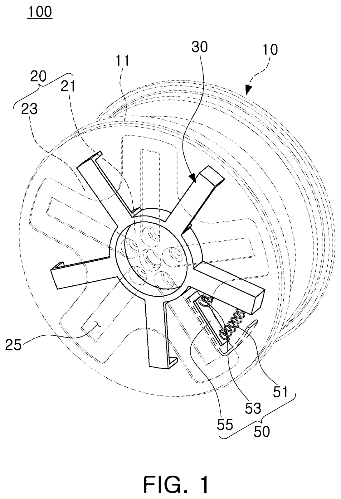

*Patent drawing A. Figure 1 from application US20250196531A1 [2], open state. Original identifiers retained. Patent figures are conceptual engineering disclosures, not photographs or manufacturing drawings.*

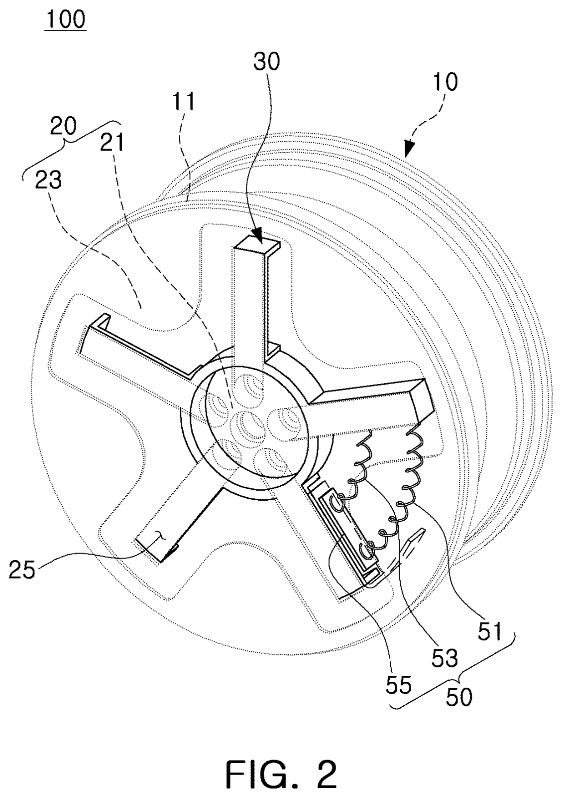

*Patent drawing B. Application Figure 2, closed state. Compare positions of the covering members relative to the openings, rather than interpreting the wheel as changing its load-bearing spoke pattern.*

## 2. What the disclosed design contains

The displayed grant claim describes a hub–spoke–rim wheel, an aperture-covering member, a drive with a pushing portion, and a rotatable ring carrying radial blades with bent outer portions [1]. The application illustrates a ring guide/bearing, fixed and moving ribs, return elements and an embodiment using shape-memory-alloy actuation. Its stated motivation is to balance aerodynamic closure against brake ventilation [2].

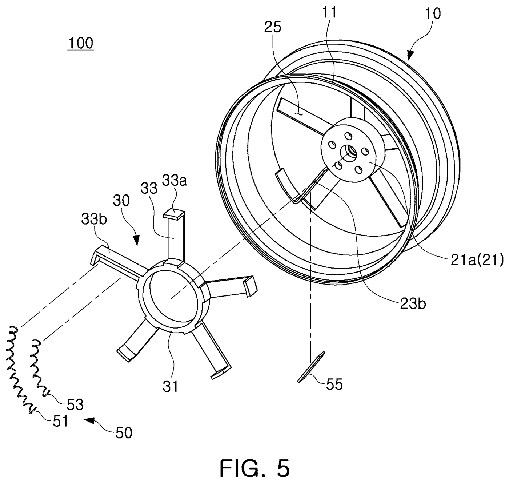

*Patent drawing C. Application Figure 5, exploded view. Components separated for identification are not shown at their operating clearances. Do not infer tolerances from the perspective view.*

The application drawings provide the following reference map [2]:

| Identifier | Disclosed component |
|---|---|
| 10 / 20 | Rim / wheel disk |
| 21 / 23 / 25 | Hub / spokes / openings |
| 30 / 31 / 33 | Covering assembly / ring / blades |
| 33a / 33b | Bent portion / moving rib |
| 40 / 50 | Bearing / drive |
| 51 / 53 / 55 | Pushing element / return element / control board |
| 200 / 300 / G | Caliper / brake disc / clearance |

The remainder of the chapter develops **independent engineering implications**. It does not treat those implications as additional patent claims, measured capabilities or a reconstruction of proprietary dimensions. All numerical values are chosen educational inputs.

## 3. Two rotations and two structural load paths

A shutter wheel has a large rotation associated with vehicle motion and a smaller relative movement that changes aperture coverage. Let the wheel angle be $\phi(t)$ and let the covering ring rotate relative to it by $\theta(t)$. The covering assembly's absolute angle is

$$\psi(t)=\phi(t)+\theta(t).\tag{1}$$

In steady travel with a stationary shutter setting, $\dot\theta=0$ but $\dot\psi=\dot\phi\ne0$. The blades still experience rotational loading even when the actuator is not moving them relative to the wheel. A static mechanism drawing can conceal that distinction.

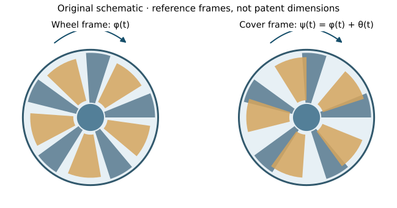

*Figure 1. Original reference-frame schematic. The arrows distinguish absolute wheel rotation from relative shutter adjustment; angles and blade counts are illustrative.*

The primary wheel load path carries tire contact reactions through rim, wheel structure, hub and bearing/axle attachment. The shutter's path carries its own inertia, pressure, guide reactions and actuation forces through blades, ring, bearings and attachments. An aperture cover should not automatically be credited with supporting road loads merely because it lies near a structural spoke.

| Load source | Likely structural question in an independent design study |
|---|---|
| Tire forces | Does the primary rim–spoke–hub structure maintain strength and fatigue life? |
| Shutter rotation | Can blades, ring and attachments carry centrifugal loading and imbalance? |
| Pressure / suction | Does out-of-plane deformation violate clearance or fatigue requirements? |
| Actuation | Can ribs and attachment points transmit force without local yielding or excessive compliance? |
| Brake heating | Do thermal expansion and gradients consume the running clearance? |
| Road contamination | Can debris jam guides or change balance and operating torque? |

The wheel and shutter are coupled through attachments, deformation and heat transfer. Separating the paths is a modeling step, not a claim that they operate independently.

## 4. Why the aerodynamic benefit depends on speed

For a vehicle-level drag-area change $\Delta(C_DA)$ between two tested configurations, an elementary aerodynamic estimate gives

$$\Delta F_D=\tfrac12\rho V^2\Delta(C_DA),\qquad
\Delta P_D=\tfrac12\rho V^3\Delta(C_DA).\tag{2}$$

The quantity $C_DA$ has units of area; it is not a local blade coefficient. It should be obtained from comparable vehicle tests or a validated vehicle-level flow simulation. Rotating wheels, ground motion, wheel houses and ventilation flows make isolated still-wheel calculations an imperfect substitute.

Choose illustrative $\rho=1.225$ kg/m³ and $\Delta(C_DA)=0.015$ m² for the **whole vehicle**, not per wheel. The implied power difference is approximately 117 W at 84 km/h and 340 W at 120 km/h. These values demonstrate speed-cubed scaling; neither is a measured benefit of the patent.

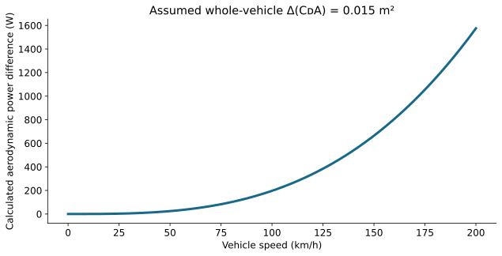

*Figure 2. Original calculation from Eq.(2). Assumed whole-vehicle drag-area change; no efficiency, range or production-vehicle claim is inferred.*

A power difference becomes an energy difference only after specifying duration or distance. At constant speed over distance $d$,

$$\Delta E_D=\Delta F_Dd.\tag{3}$$

This aerodynamic saving must be compared with actuator energy, extra mass, maintenance burden and any cooling penalty. A benefit during high-speed cruising does not establish a net benefit over every driving cycle. Quoting a universal percentage contribution from wheels without identifying the vehicle and test configuration would conceal those dependencies.

## 5. Brake heat and a transparent lumped model

The aerodynamic objective competes with a thermal requirement. A first model of one thermally effective brake assembly is

$$C_{\mathrm{th}}\frac{dT}{dt}=\dot Q_b(t)-H(\alpha,V)(T-T_\infty).\tag{4}$$

Here $C_{\mathrm{th}}$ is effective heat capacity in J/K, $\dot Q_b$ the heat entering that modeled assembly, $H=hA$ an effective heat-rejection conductance in W/K, and $\alpha$ an aperture parameter. Radiation, multiple thermal masses and conduction can be included later. This simplified equation is useful because every term has a measurable unit; it is not a calibrated brake model.

For constant input and $H$, the solution is

$$T(t)=T_{\mathrm{eq}}+[T(0)-T_{\mathrm{eq}}]e^{-t/\tau},
\quad T_{\mathrm{eq}}=T_\infty+\frac{\dot Q_b}{H},
\quad \tau=\frac{C_{\mathrm{th}}}{H}.\tag{5}$$

Consider $C_{\mathrm{th}}=2500$ J/K, $T_\infty=25$°C, initial temperature 100°C and constant heat input 3000 W. Compare assumed open conductance 15 W/K with closed conductance 7.5 W/K. Their equilibrium temperatures are 225°C and 425°C, and their time constants are 166.7 s and 333.3 s. The assumed 180°C threshold is reached in approximately 170.3 s and 94.2 s respectively. The threshold is a classroom input, not a brake temperature limit specified by the patent.

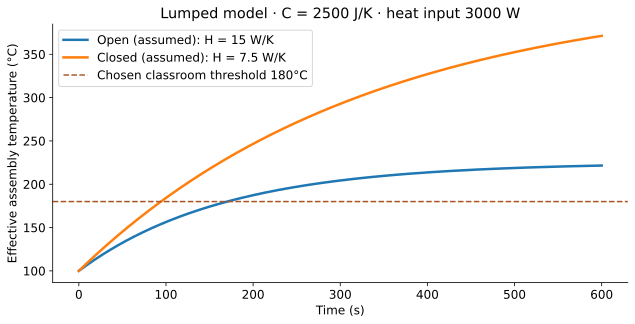

*Figure 3. Independent lumped thermal calculation. Neither curve is measured patent performance. A spatially resolved brake/caliper/wheel model is needed if temperature gradients or local limits drive the design.*

A real stopping event has a time-varying heat input and a speed-dependent cooling flow. A brake allocation factor, rotating disc mass, regenerative braking, radiative losses and conduction into adjacent parts alter the response. This model supports a tradeoff discussion; it cannot establish a safe switching schedule.

For one hypothetical 1800 kg vehicle decelerating from 100 km/h, the initial translational kinetic energy is about 694 kJ. If a chosen fraction $\eta_b$ is dissipated in friction brakes and a chosen fraction $\beta_i$ reaches brake assembly $i$,

$$E_i=\beta_i\eta_b\frac{mV_0^2}{2},\qquad
\Delta T_i\approx\frac{E_i}{C_{\mathrm{th},i}}\quad\text{(short, adiabatic approximation).}\tag{6}$$

The sum of the $\beta_i$ values is one over the modeled friction-brake assemblies. These fractions must be specified rather than silently assigning all vehicle energy to each wheel.

## 6. Rotating mass: centrifugal load and imbalance

For an added component of mass $m_b$ centered at radius $r_c$, a basic steady-rotation attachment load estimate is

$$F_c=m_br_c\Omega^2,\qquad \Omega=V/R_t.\tag{7}$$

With illustrative $m_b=0.030$ kg, $r_c=0.18$ m and rolling tire radius $R_t=0.33$ m, the resulting magnitude is approximately 55.1 N at 120 km/h and 153 N at 200 km/h. The load increases with speed squared. It acts radially in the rotating-component free-body interpretation; it is not automatically a tangential actuation load.

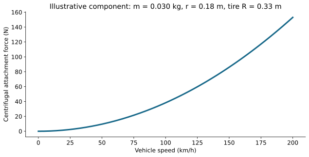

*Figure 4. Original speed sweep using declared component mass and radius. The mass, radius and speed limits are not dimensions or operating limits extracted from the patent.*

A blade modeled as a uniform radial strip of density $\rho_s$ and constant cross-section has centrifugal body force per unit length $\rho_s A\Omega^2r$. With an unsupported outer end at radius $r_o$, the axial force at section $r$ is

$$N_c(r)=\int_r^{r_o}\rho_sA\Omega^2s\,ds
=\frac{\rho_sA\Omega^2}{2}(r_o^2-r^2).\tag{8}$$

Thus $\sigma_c(r)=N_c(r)/A$ for this restricted constant-section model. Taper, bent edges, ring support and attachments alter the distribution. Centrifugal tension may also change bending stiffness and vibration frequencies; a nonrotating beam solution omits that geometric-stiffness contribution.

If a small unbalanced mass $m_u$ remains at eccentricity $e$, its rotating forcing amplitude is

$$F_u=m_ue\Omega^2.\tag{9}$$

An assembly can contain individually adequate blades yet still generate unacceptable vibration through mass asymmetry, unequal deposits or a loose component. Balance must be considered for every operating aperture position, including a partially deployed or jammed position.

## 7. Blade bending, ribs and the cubic thickness effect

Use a radial blade as an illustrative cantilever strip of length $L$, width $b$, thickness $t$ and modulus $E$. An axial pressure difference $\Delta p$ normal to its surface gives line load $q=\Delta p b$. For a uniform flat strip,

$$I=\frac{bt^3}{12},\quad
V_0=qL,\quad M_0=\frac{qL^2}{2},\quad
\delta_{\mathrm{tip}}=\frac{qL^4}{8EI}.\tag{10}$$

The maximum elementary bending stress is

$$\sigma_{\mathrm{max}}=\frac{M_0(t/2)}{I}
=\frac{3\Delta p L^2}{t^2}.\tag{11}$$

Choose $L=0.12$ m, $b=0.05$ m, $t=0.002$ m, $E=70$ GPa and $\Delta p=1500$ Pa. The resultant distributed force is 9 N, root moment 0.54 N·m, tip deflection 0.833 mm and peak bending stress 16.2 MPa. These values exclude centrifugal stress, local attachment stresses, thermal distortion and plate effects.

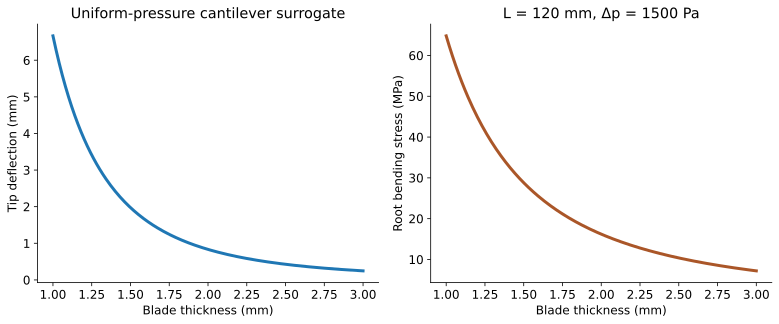

*Figure 5. Independent beam sensitivity. Deflection falls as thickness cubed in this surrogate. The plot does not establish allowable dimensions or the actual stiffness of a bent or ribbed patent blade.*

Halving thickness increases predicted deflection eightfold, from 0.833 to 6.67 mm. A component can therefore satisfy a nominal stress criterion and still interfere with a neighboring part. The patent's bent/ribbed geometry motivates this structural question; the numerical benefit of any particular bend must be calculated from its cross-section and boundary conditions rather than assumed.

A rib or return flange moves material away from a section's neutral axis. The parallel-axis theorem,

$$I_{\mathrm{assembled}}=\sum_j(I_j+A_jd_j^2),\tag{12}$$

explains why cross-section shape can provide stiffness without a proportional mass increase. In an actual thin-walled part, torsion, local buckling, warping, forming radii and attachment constraints require additional checks. Increasing a flange also changes mass distribution and potentially clearance.

## 8. Actuator force, return torque and material behavior

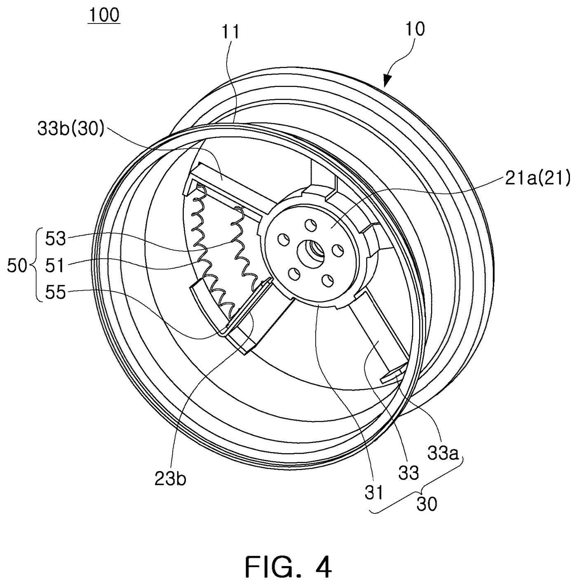

*Patent drawing D. Application Figure 4. It locates the internal mechanism; relative rib and spring positions are not a calibrated force–stroke diagram.*

A force applied at radius $r_a$ produces useful ring torque only through its tangential component:

$$T_a=F_ar_a\sin\gamma.\tag{13}$$

The angle $\gamma$ is between the force line and the radius vector. A design operating near $\gamma=0$ can have very little rotational authority despite a large actuator force. Guide friction, manufacturing variation and end-stop loads must be included in a torque budget.

For an independent small-motion model,

$$J\ddot\theta+c\dot\theta+k_\theta(\theta-\theta_0)
=T_a-T_f-T_{\mathrm{external}}.\tag{14}$$

A hypothetical actuator delivering 15 N at 0.06 m with a tangential line of action gives 0.9 N·m. If return, friction and other resisting torques sum to 0.42 N·m at one configuration, the static nominal margin there is 0.48 N·m. This single-point margin cannot demonstrate operation throughout the stroke, at temperature extremes or after contamination.

A shape-memory-alloy element requires a temperature-, load- and history-dependent force–stroke description. NASA's CASMART engineering study discusses wire, spring and torque-tube configurations and a material-to-component design workflow [3]. Its designs are context for the engineering method, not validation of the Hyundai/Kia embodiment.

An elementary thermal bookkeeping equation for electrically heated actuation is

$$C_a\dot\Theta_a=I_e^2R_e-H_a(\Theta_a-T_{\mathrm{env}}),\tag{15}$$

before adding transformation energy and temperature-dependent properties. Here $\Theta_a$ is actuator temperature and $I_e$ electrical current. Temperature and mechanical torque are distinct states.

Heating and cooling paths need not produce the same displacement at the same temperature. Therefore, command current alone is not proof of position, and loss of electrical power is not proof of instantaneous return. A proposed return element needs sufficient authority over the full thermomechanical cycle. These are design questions for any such implementation; the chapter does not assume an experimentally demonstrated fail-safe response.

## 9. Clearance is a budget, not a line in a drawing

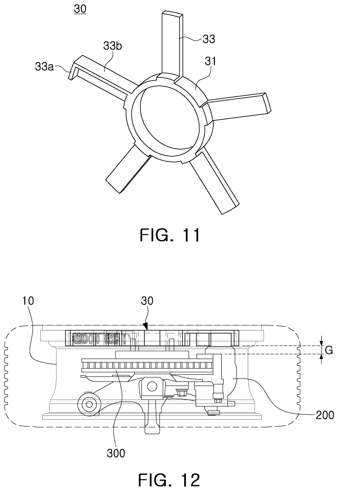

*Patent drawing E. Source sheet includes application Figures 11 and 12. Figure 12 identifies caliper 200, disc 300 and gap G. Perspective and section graphics are not a substitute for tolerance and deformation analysis.*

An independent worst-case clearance model can be written

$$G_{\mathrm{remaining}}=G_0-
(\delta_{\mathrm{pressure}}+\delta_{\mathrm{thermal}}+
\delta_{\mathrm{runout}}+\delta_{\mathrm{tolerance}}+\delta_{\mathrm{other}}).\tag{16}$$

Terms must represent relative approach of the relevant surfaces in a common direction, rather than adding unrelated scalar deflections. If pressure deflection is 0.833 mm, thermal approach 0.2 mm, runout 0.5 mm and tolerance stack 0.8 mm against an illustrative nominal gap of 5 mm, the remaining nominal worst-case allowance is 2.67 mm before other effects.

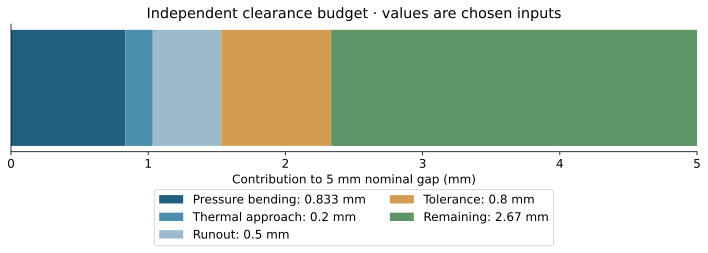

*Figure 6. Teaching clearance budget. Values are independent chosen inputs; the 5 mm nominal gap is not read from the patent. Remaining allowance is not a certified minimum.*

The 1 mm-thick beam surrogate in §7 would predict about 6.67 mm pressure deflection, exhausting this example's entire gap before other contributions. This illustrates why a shutter design is a stiffness and kinematics problem as well as a strength problem. At high speed, balance and vibration can consume a clearance that looked adequate in a static CAD image.

A thermal expansion estimate $\Delta L=\alpha_TL\Delta T$ can bound one contribution, but uniform growth of a free component differs from restrained thermal stress or curvature caused by a through-thickness gradient. A full clearance assessment requires deformation fields for both neighboring structures and their attachment motion.

## 10. What should be tested before making a performance claim?

An engineering validation matrix follows directly from the load cases. It is an independent proposed study plan, not a report of tests performed by the patent applicants.

| Test or analysis | Key controlled conditions | Useful outputs |
|---|---|---|
| Aperture kinematics | Open, closed and intermediate positions; tolerance extremes | Coverage, stroke, end stops and interference |
| Static blade loading | Pressure sign, magnitude, temperature and support condition | Deflection, local strain and margin to contact |
| Spin testing | Speed sweep, state transitions and balance errors | Vibration, attachment loads and retained clearance |
| Actuator cycling | Electrical input, mechanical load and thermal environment | Position, switching time, force/stroke drift and energy |
| Brake thermal testing | Repeated heat input and representative airflow | Temperatures and recovery with shutter state recorded |
| Vehicle aerodynamics | Moving ground, rotating wheels, matching geometry | Comparable drag-area difference with uncertainty |
| Debris and environmental exposure | Water, dust, deposits, temperature cycling | Jamming, corrosion, drainage and balance changes |
| Fault injection | Power loss, stuck blade/ring, sensor fault | Detectability and resulting mechanism state |

The central comparison must preserve the same vehicle, tires, speed, ambient conditions and measurement procedure when evaluating aperture states. A photograph of a moving mechanism, a patent grant and a reduction in isolated-component drag are three different forms of evidence. None by itself demonstrates a measured whole-vehicle range gain.

## 11. Aerospace connections that preserve the differences

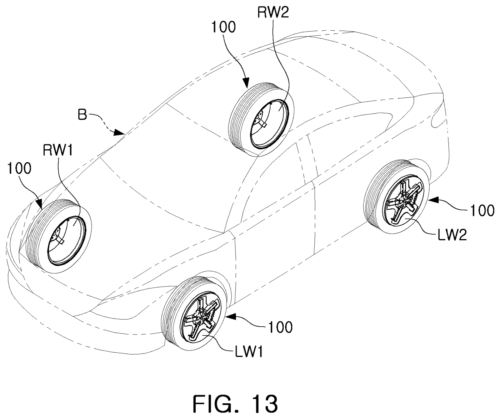

*Patent drawing F. Application Figure 13 gives a vehicle-level context. It does not demonstrate an installed aircraft application.*

This design is useful in an aerospace structures course because it combines lightweight moving surfaces with stiffness, actuation, heat and clearance. Aircraft cooling doors, variable inlets, deployable surfaces and payload mechanisms raise similar questions about load paths and unintended contact. Their actual loads, redundancy requirements and environments differ substantially from automotive wheels.

A rotating blade's centrifugal load has a direct structural analogy to other rotating machinery, while a shutter's aperture-setting motion resembles a small deployment mechanism. The comparison does not make a thin wheel cover a propeller or establish aerodynamic similarity. The useful common method is to define coordinates, free-body diagrams, material behavior, operating envelope and acceptance criteria before choosing a solver.

In a finite-element project, begin with a nonrotating elastic blade benchmark using Eq.(10). Add ribs and compare stiffness at equal mass. Then introduce centrifugal loading, realistic connections, thermal expansion and neighboring surfaces. Use mesh refinement to assess output convergence, and inspect reaction-force balance. A visually smooth deformed shape without scale, loads or verification is not evidence of a reliable result.

## 12. Team design exercise

Work in teams of three or four. Submit a 5–6 page report plus a calculation appendix and an annotated CAD or beam model. Distinguish patent facts from chosen dimensions and computed results in every figure.

1. **Document map:** identify which source establishes the grant identity, which supplies the drawings, and which portions of this lesson are independent analysis. Explain why the A1 drawings do not establish the full granted claim scope.
2. **Kinematics:** draw the wheel and ring frames; label $\phi$, $\theta$ and $\psi$. Explain why a closed stationary-relative shutter is still centrifugally loaded.
3. **Mechanical benchmark:** reproduce the 2 mm blade calculation, then vary thickness from 1 to 3 mm. Report force, root moment, stress and displacement. Compare a ribbed alternative at equal mass.
4. **Rotating loads:** reproduce the 120 and 200 km/h examples, then increase the blade center radius by 20%. Identify which quantities scale linearly and which quadratically.
5. **Thermal study:** reproduce the open/closed temperature histories. Change heat input to 2000 W and explain whether the open configuration ever reaches 180°C in this model.
6. **Integrated budget:** use the gap model to find the minimum flat-strip thickness satisfying a 1 mm residual-clearance target under the stated assumptions. Explain which omitted effects could invalidate that result.
7. **Evidence statement:** propose one aerodynamic and one thermal experiment that would test the intended benefit without confusing mechanism operation with measured vehicle performance.

**Instructor checks.** At 2000 W and 15 W/K, the modeled equilibrium is 158.3°C, so the trajectory starting at 100°C never reaches 180°C. The example gap permits 2.5 mm of pressure deflection if 1 mm residual clearance and the other stated allowances are retained. Cubic beam scaling gives an approximate thickness lower bound of 1.39 mm for that restricted criterion; it is not a final design recommendation.

| Assessment component | Weight |
|---|---:|
| Traceable mechanics, units and numerical checks | 35% |
| Load paths, reference frames and clearance reasoning | 25% |
| Thermal/aerodynamic tradeoff and evidence quality | 20% |
| Figures, source attribution and reproducibility | 20% |

## References, drawings and reproducibility

1. USPTO. [US 12,779,902 B2 — Wheel and vehicle including the same](https://patentsgazette.uspto.gov/week44/OG/html/1552-1/US12779902-20261103.html), Official Gazette notice, 3 November 2026. Official supplied link; displayed claim 1 and bibliography checked.
2. Kim, J.H. & Kim, E.S. [US20250196531A1 — Wheel and vehicle including the same](https://patents.google.com/patent/US20250196531A1/en), application publication, 19 June 2025. [Published application PDF](https://patentimages.storage.googleapis.com/fe/42/39/0ca318ace6183b/US20250196531A1.pdf). Description and drawings used for embodiment context; the A1 is not substituted for a complete granted B2 claim set.
3. NASA / CASMART. [Engineering Design Tools for Shape Memory Alloy Actuators: Collaborative Best Practices and Case Studies](https://ntrs.nasa.gov/api/citations/20170000945/downloads/20170000945.pdf), 2017. Technical context for SMA actuator design; not testing of this patent.

Six original application drawings retain their figure numbers and component identifiers; source URLs are listed in [drawing-sources.json](docs/case-studies/active-wheel-shutters/drawing-sources.json). Six additional figures are original course schematics and calculations. [calculations.py](docs/case-studies/active-wheel-shutters/calculations.py) regenerates numerical figures and checked examples. All engineering sample dimensions, materials, coefficients, temperatures and thresholds are explicitly hypothetical. No hardware was tested in preparing this case study.

## خلاصهٔ فارسی

این پتنت مربوط به چرخ خودرویی است که با چرخاندن یک مجموعهٔ حلقه و پره، بازشوهای میان پره‌های اصلی چرخ را می‌پوشاند یا باز می‌کند. هدف مطرح‌شده، موازنه میان کاهش مقاومت هوا و خنک‌کاری ترمز است. تحلیل آموزشی این فصل مستقل از ادعاهای پتنت است و نشان می‌دهد چرا سختی پره، نیروی گریز از مرکز، بالانس، رفتار محرک و فاصله از کالیپر باید هم‌زمان بررسی شوند. ثبت پتنت به‌تنهایی به معنی اثبات کاهش مصرف انرژی، دوام یا استفاده در محصول تجاری نیست. این مطلب مستقل از مطلب زومیت دربارهٔ برگ و اصطکاک ریل تهیه شده است.
