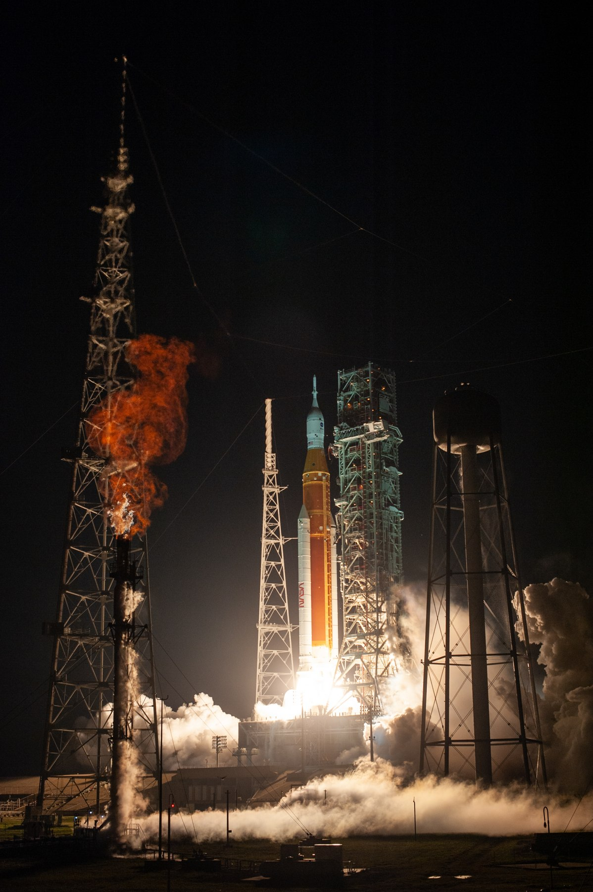
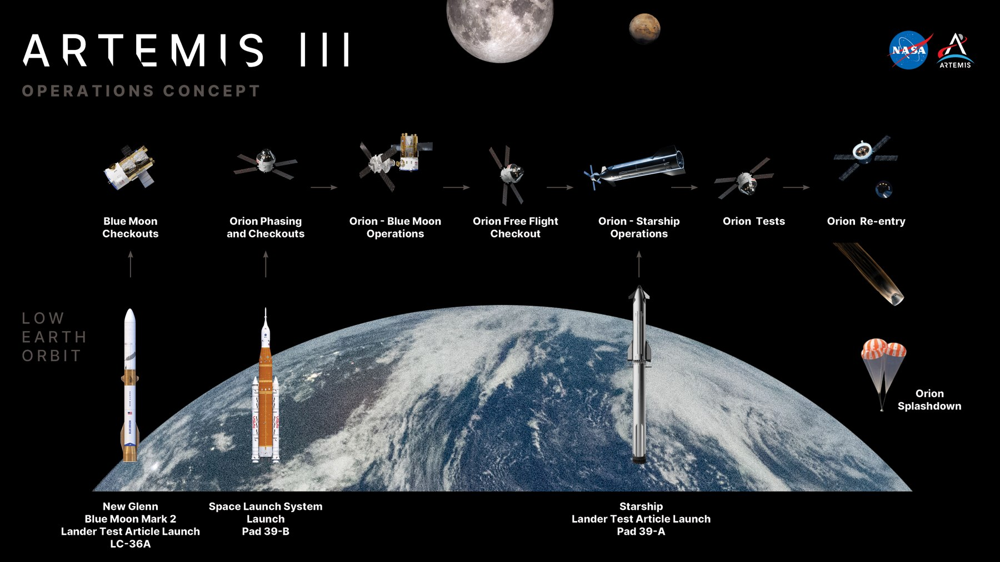
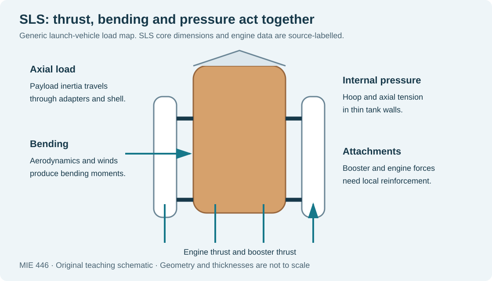
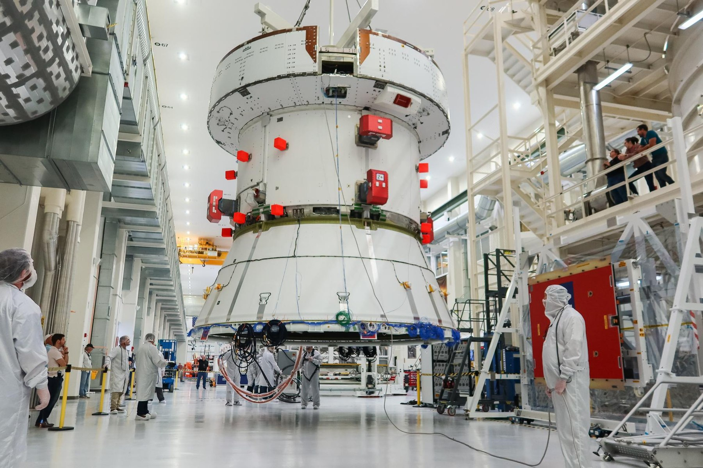
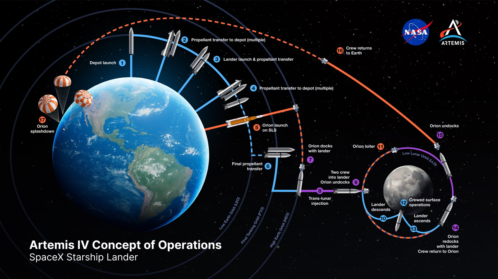
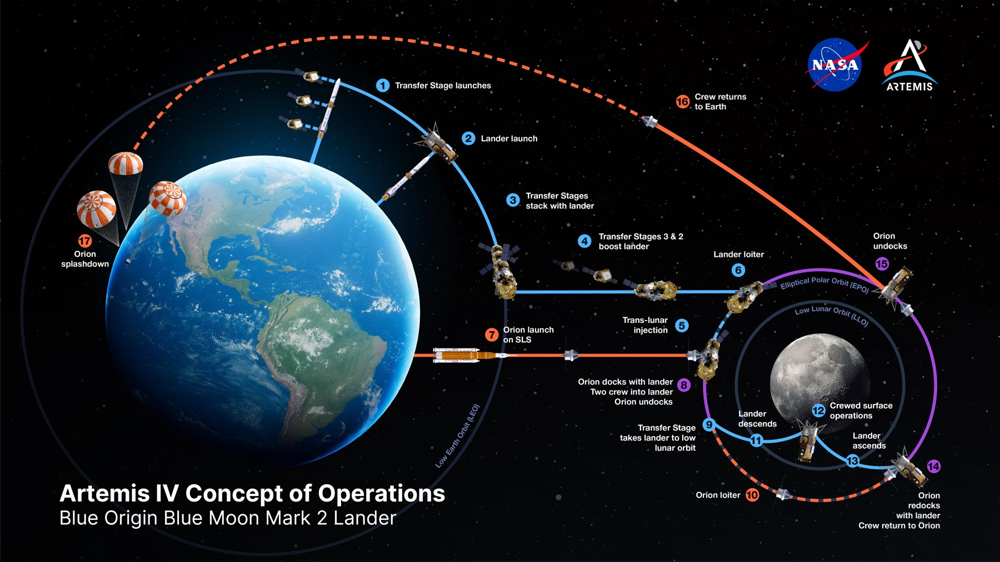
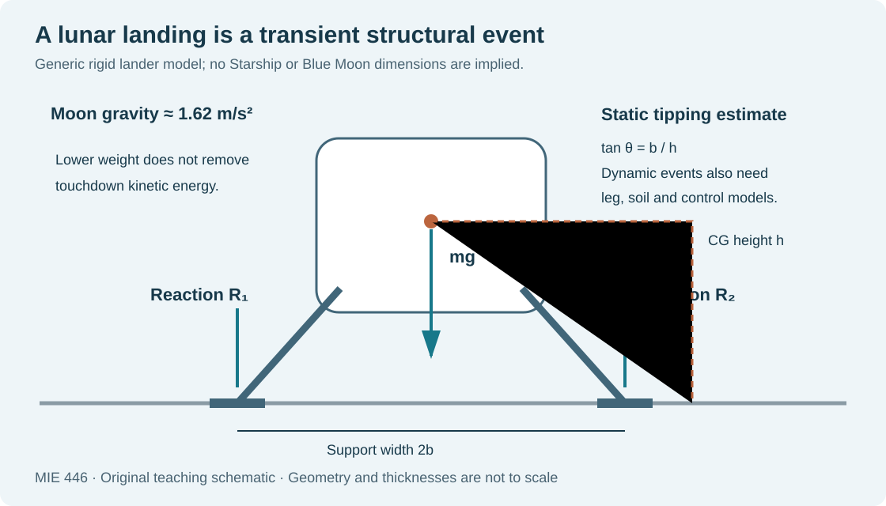
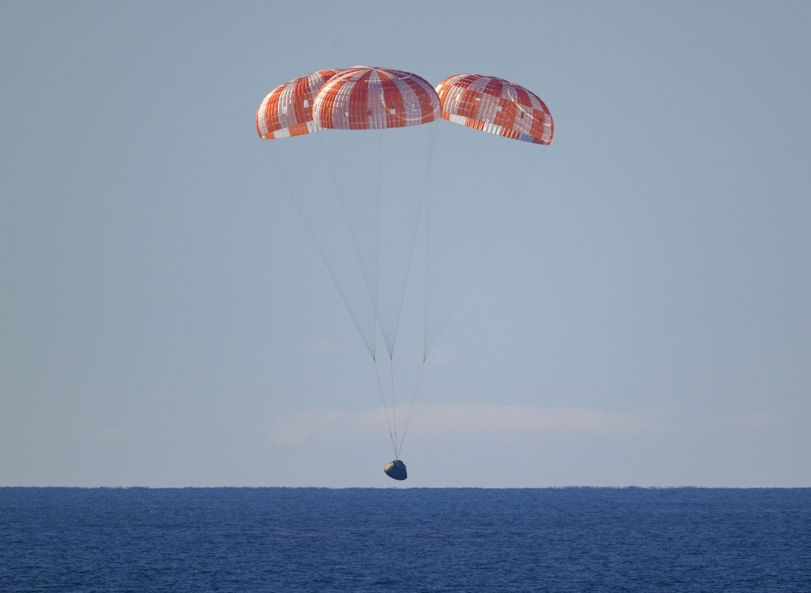
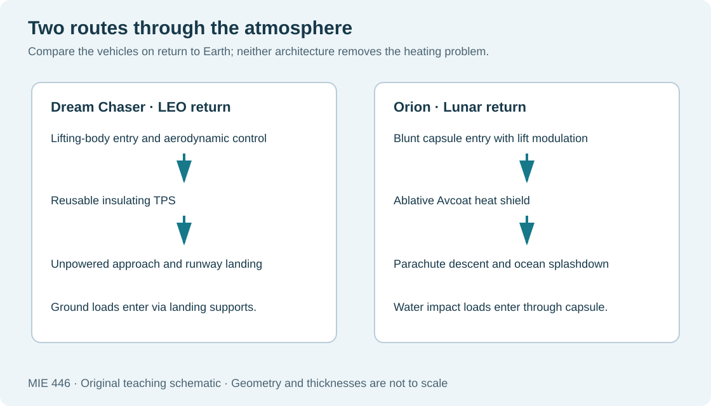

# Artemis: The Structures, Engines and Mission Architecture Behind a Lunar Return

**MIE 446 · Aerospace Structures · University of Massachusetts Amherst**  
Independent engineering reading · Evidence checked **17 November 2026**

[Illustrated web reading](https://ehsan-roohi.github.io/Aerospace-Structures/case-studies/artemis/) · [All readings](READINGS.md) · [Companion: Dream Chaser](DREAM_CHASER_SPACEPLANE.md)

Artemis is a transportation and surface-exploration program made of several separately developed vehicles. Its engineering challenge is to connect a heavy launcher, a crew spacecraft, commercial landers, pressure suits, navigation and surface systems into a mission that returns people safely. This independent lesson expands [the Zoomit article supplied by the reader](https://www.zoomit.ir/space/385574-nasas-artemis-program-return-astronauts-moon/) with NASA, ESA and manufacturer references.

**Learning goals:** distinguish demonstrated missions from plans; follow launch, pressure, thermal and landing loads; compare cryogenic and storable propulsion; explain why refueling, docking and surface infrastructure affect structural design; evaluate simple quantitative models without mistaking them for vehicle specifications.

*NASA photograph: Artemis I launch on 16 November 2022 [A3]. This is a completed uncrewed flight, not an image of a future lunar landing.*

## 1. Start with the current mission sequence

NASA's October and November 2026 updates are essential because the program no longer follows the widely reproduced older sequence. **Artemis III is now an Earth-orbit demonstration planned for 2027; Artemis IV targets the first Artemis lunar landing in 2028** [A1–A2]. Dates below are the plans at the evidence date, not guaranteed launch commitments.

| Mission | Demonstrated outcome or current objective | Date / status | Primary reference |
|---|---|---|---|
| Artemis I | Uncrewed integrated SLS–Orion flight, lunar flybys and Earth return | Launched 16 November 2022; returned 11 December; about 25.5 days | A3 |
| Artemis II | Four-person lunar flyby and return | Launched 1 April 2026; splashdown 10 April 2026 | A4 |
| Artemis III | Crewed low-Earth-orbit rendezvous/docking and lander operations demonstrations | Planned 2027; approximately 14 days | A2 |
| Artemis IV | First Artemis crewed lunar-surface landing | Target early 2028; two crew descend and spend about a week near the south pole | A5 |
| Artemis V and later | Further surface missions and increasing operational capability | Future campaign; schedule and architecture can evolve | A6 |

NASA names Randy Bresnik, Frank Rubio, Andre Douglas and ESA astronaut Luca Parmitano for Artemis III in its October 2026 mission announcement [A2]. The flight is intended to exercise rendezvous, docking, habitation and operations with commercial lander test vehicles. An Earth-orbit test can reduce interface risk without demonstrating every lunar-descent, surface or ascent condition.

*NASA planning graphic [A1]. The sequence is a mission concept, not a record of completed dockings. Open the image for full-size labels.*

## 2. Who carries what?

| Element | Function | Main structural environment | Important boundary |
|---|---|---|---|
| SLS | Launch Orion and crew; deliver the required departure capability | Cryogenic pressure, thrust, acceleration, acoustics and aerodynamic bending | It does not land on the Moon |
| Orion crew module | Pressurized crew cabin and Earth-entry capsule | Pressure, launch/abort loads, entry heating and splashdown | It does not land on the lunar surface |
| European Service Module | Orion propulsion, electricity, thermal control and consumables | Tank pressure, thrust reactions, solar-array loads and thermal cycling | Separates before Earth entry |
| Starship HLS / Blue Moon Mark 2 | Transfer crew to and from the lunar surface | Cryogenic storage, docking, powered descent/ascent, landing and dust | Development architectures; do not substitute cargo or Earth-return variants |
| Spacesuit and surface systems | Support work outside a vehicle | Internal pressure, joints, dust, abrasion and thermal extremes | A suit is a small pressure vessel with mobility constraints |
| Surface infrastructure | Power, communications, mobility, habitats and logistics | Launch loads followed by lunar deployment, temperature cycling and regolith interaction | A transportation mission alone does not establish a permanent base |

This allocation creates interfaces: mechanical attachment, pressure seals, docking alignment, fluid transfer, electrical power, data and emergency procedures. A component can work individually while the integrated mission still fails at an interface. Configuration control and operational demonstrations therefore matter as much as headline thrust or payload numbers.

## 3. SLS Block 1: dimensions and propulsion

The reference vehicle for the first three Artemis missions is **SLS Block 1**. The table combines NASA's core-stage and engine references with its Block 1 reference guide [A7–A9]. Do not transfer proposed future-stage dimensions to an already flown configuration.

| Quantity | Published Block 1 value / arrangement | Interpretation |
|---|---|---|
| Integrated crew-launch height | About 322 ft / 98 m | Complete stack, not just the core |
| Core-stage height | About 212 ft / 64.6 m | Tank and engine-section structure |
| Core-stage diameter | 27.6 ft / 8.4 m | Useful for structural scale |
| Core structural material | Aluminum 2219 | NASA core-stage reference |
| Core propulsion | Four RS-25 engines | Liquid hydrogen fuel / liquid oxygen oxidizer |
| Side boosters | Two five-segment solid rocket boosters | Solid propellant; not throttleable like the liquid engines |
| Total liftoff thrust | About 8.8 million lbf / 39.1 MN | Complete vehicle at launch |
| RS-25 thrust, each | About 418,000 lbf / 1.86 MN at launch; about 512,300 lbf / 2.28 MN maximum vacuum figure at 109% rated level | Sea-level and vacuum values are different conditions |
| Block 1 departure capability | More than 27 metric tonnes beyond the Moon | Not a low-Earth-orbit payload rating |
| Block 1 upper stage | ICPS with one RL10B-2 | Cryogenic oxygen/hydrogen stage; about 110 kN engine thrust |

The RS-25 uses high-performance, staged-combustion cryogenic propulsion. Turbopumps supply propellants at high pressure; the thrust chamber and nozzle must manage severe heat while preserving material and joint margins. The engine mounts transfer thrust into the vehicle, while steering forces introduce additional moments. The percentage rating is relative to the engine's original rated reference, not thermodynamic efficiency.

A fair comparison must specify altitude, throttle setting and installed configuration. Adding four **vacuum** RS-25 values to booster **liftoff** thrust is not a consistent launch-thrust calculation.

## 4. The core stage is a loaded shell, not a solid beam

The core carries the upper stack's inertia and transfers engine and booster forces. Its tanks are thin-walled, pressurized structures, and its geometry includes joints, domes, intertank structure and concentrated attachment regions [A7]. NASA's manufacturing records describe friction-stir welding of core-stage structures [A10].

For a thin circular tube of mean radius $r$ and wall thickness $t$,

$$A\simeq2\pi rt,\qquad I\simeq\pi r^3t,\qquad
\sigma_x\simeq\frac{N}{A}\pm\frac{Mr}{I}.$$

Here compression and tension must be assigned a consistent sign. Internal pressure adds membrane stresses; local booster and engine attachments create effects that these section-average equations omit.

**Classroom illustration:** use $r=4.2$ m, $t=10$ mm, compressive $N=20$ MN and bending moment $M=100$ MN·m. These force, moment and thickness values are assumed, not SLS design loads. The nominal axial term is **75.8 MPa** and the bending term is **180.4 MPa**, giving extreme axial stresses of approximately **256.2 MPa compression** and **104.7 MPa tension**, before pressure, local reinforcement and other effects.

Passing a simple yield comparison would not establish safety. Shell buckling depends on imperfections, stiffeners, end constraints, pressure stabilization, geometry and combined loading. Cryogenic temperatures, weld properties and the actual flight environment belong in the model. The point of the example is to identify omitted physics before trusting a convenient beam result.

## 5. Upper stages: freeze the date and configuration

The RL10-powered ICPS belongs to the Block 1 reference architecture. NASA's November 2026 update says it is pursuing **two upper-stage options for Artemis IV**: ICPS and a stretched version of ULA's Centaur V [A1].

Older documents describe an Exploration Upper Stage and Block 1B progression. Those documents remain useful design history, but they do not establish the upper stage that will actually fly Artemis IV under the present plan. Changes in upper-stage length, propellant mass, stiffness and interfaces require renewed coupled-load, guidance and ground-integration work.

Translunar injection is an energy and trajectory requirement. Specifying “a more powerful engine” alone is insufficient: stage dry mass, propellant mass, specific impulse, ignition conditions and payload all matter. The ideal rocket equation is

$$\Delta v=g_0I_{\rm sp}\ln\!\left(\frac{m_0}{m_f}\right).$$

It omits finite-burn effects, steering and gravity losses, margins and reserves [A22]. The presence of $g_0$ is a units convention for specific impulse in seconds; it is not the local lunar gravitational acceleration.

## 6. Orion: pressure vessel, protective shell and Earth-return system

NASA describes Orion as supporting **four crew for up to 21 days without docking**, with about **330 ft³ / 9.3 m³ habitable cabin volume** [A11]. Its crew module is a pressure vessel surrounded by additional protection and equipment.

| Crew-module feature | Published description | Structural significance |
|---|---|---|
| Main pressure vessel | Seven large aluminum-alloy elements | Carries pressure and supports integrated equipment |
| Major pressure-vessel welds | Seven in the Artemis I-and-later design | Fewer joints than early design iterations |
| Heat-shield diameter | 16.5 ft / approximately 5 m | Broad blunt entry surface |
| Heat-shield outer material | 186 shaped Avcoat blocks | Ablative thermal-protection system |
| Crew-module reaction control | Twelve thrusters | Controls the capsule after service-module separation |
| Parachute system | Eleven parachutes in the full deployment sequence | Includes cover, drogue, pilot and main functions |

Sources: NASA's crew-module reference [A12] and overview [A11].

Pressure produces membrane loads; hatches and windows produce local stress concentrations. Seats and restraints transfer crew deceleration into the structure. The heat shield has its own supporting framework and must tolerate both aerothermal conditions and later water-impact loading. These load cases overlap in the same flight article but do not necessarily peak at the same time.

Orion is a **lifting capsule** during entry: its aerodynamic lift can be modulated through attitude control. It still returns under parachutes to the ocean rather than flying a winged runway approach.

## 7. European Service Module: the engines and utilities behind Orion

*NASA/Amanda Stevenson, 22 May 2023 [A13]. Ground handling itself requires qualified lifting fixtures, interfaces and procedures.*

The European Service Module supplies propulsion, power, thermal control, water and gases. NASA describes an unpressurized cylindrical module, about 13 ft high including its engine and tanks, with a structure built by Thales Alenia Space and integration led by Airbus [A13]. ESA's propulsion and power pages provide the engine architecture and electrical figures [A14–A15].

| Service-module parameter | Published arrangement / value | Keep distinct from |
|---|---|---|
| Engine count | 33 total: one main, eight auxiliary and 24 reaction-control | The crew module's separate 12 thrusters |
| Main engine | Shuttle-heritage OMS engine; NASA quotes about 6,000 lbf / 26.7 kN | RS-25 is a different, much larger engine |
| Auxiliary engines | Eight, about 490 N each | Main-engine thrust |
| Propellant family | Monomethylhydrazine and mixed oxides of nitrogen | SLS cryogenic hydrogen/oxygen |
| Main-engine steering | Gimballed in pitch and yaw | Fixed attitude-control thrusters |
| Solar arrays | Four wings | Number of engines |
| Nominal total solar power | About 11.2 kW | Propulsive power or stored battery energy |

Sources: [A13–A16]. Different reference vintages round the main-engine thrust differently; the value above follows NASA's 6,000-lbf statement.

Storable hypergolic propellants ignite on contact and avoid the same long-duration cryogenic storage problem as liquid hydrogen. They introduce demanding handling, sealing and compatibility requirements. Cryogenic propulsion offers different performance advantages while requiring insulation, thermal management and careful fluid control.

Solar-array hinges and panel flexibility must survive deployment and spacecraft maneuvers. Thruster plumes, structural deflection, thermal distortion and line-of-sight constraints can influence the allowable array configuration. Electrical output is useful only if distribution, batteries and thermal control support the mission's load profile.

## 8. Two commercial routes to the lunar surface

NASA's November 2026 update describes **revised** concepts from SpaceX and Blue Origin [A1]. Both target support for a crewed landing in 2028; neither should be presented as a completed operational lander.

| Design question | SpaceX Starship HLS route | Blue Origin Blue Moon Mark 2 route |
|---|---|---|
| Current mission concept | Refuel Starship in Earth orbit; rendezvous with Orion; carry the spacecraft toward the Moon | Transfer stages in Earth orbit send the lander toward the Moon; rendezvous with Orion in a closer lunar orbit |
| Propellant family | Methane and oxygen for Raptor propulsion | Hydrogen and oxygen for BE-7 propulsion |
| Critical systems challenge | Orbital propellant transfer, storage, rendezvous, crew interfaces and lunar operations | Cryogenic storage, transfer-stage integration, rendezvous, crew interfaces and lunar operations |
| Structural questions | Tank/shell load paths, lander configuration, landing support, access to surface | Tank/support integration, landing support, cryogenic interfaces and surface access |
| Public-data limit | Final lunar configuration, installed thrust schedule and flight mass are not specified by this lesson | Do not assign Mark 1 cargo specifications to Mark 2 |

Sources: current NASA concepts [A1], NASA's Starship flight-test account [A17] and Blue Origin's engine information [A18].

*NASA planning graphic: revised SpaceX route [A1]. This is a proposed mission sequence.*

*NASA planning graphic: revised Blue Origin route [A1]. The two concepts are alternatives, not successive mandatory legs of a single flight.*

NASA's Starship flight-test account identifies liquid methane and liquid oxygen as Raptor's propellants [A17]. A launch-system engine family specification is not automatically the throttle schedule or landing-engine inventory of HLS. Public images of other Starship variants cannot establish the final HLS heat shield, control surfaces, interior or structural reinforcement.

Blue Origin lists **BE-7** as a hydrogen–oxygen, dual-expander-cycle engine with **10,000 lbf / 44.5 kN** thrust and deep throttling to **2,000 lbf / 8.9 kN** [A18]. In an expander concept, heat picked up by the propellant provides energy for turbomachinery. Stable throttling, restart, mixture control and the usable thrust range matter during landing. One engine's maximum thrust is not the complete vehicle's landing capability.

## 9. Why orbital refueling is also a structural problem

Propellant transfer requires more than plumbing. A receiving vehicle must dock or connect, manage relative motion, settle or control liquid, measure inventory and maintain acceptable temperatures. Fluid motion shifts the center of mass and can couple to attitude control. Docking and transfer loads pass through interfaces that must tolerate misalignment and repeated operations.

The ideal rocket equation shows why “just add fuel” is incomplete. **Classroom assumptions:** at $I_{\rm sp}=450$ s and required ideal $\Delta v=3.0$ km/s,

$$m_0/m_f=1.973,\qquad (m_0-m_f)/m_0=0.493.$$

Nearly half the initial mass is expended propellant even before this simple example adds mission reserves or extra losses. If the dry mass increases, more initial propellant is needed for the same ideal $\Delta v$. Tank insulation, docking hardware and structural reinforcement therefore affect mission performance, even when each addition is individually justified.

These assumed values are not a Starship or Blue Moon mission budget. NASA's current alternatives should be evaluated using their own complete mass and maneuver sequences.

## 10. Lunar landing loads: lower gravity does not remove impact energy

On the Moon, gravity is approximately **1.62 m/s²**, compared with 9.81 m/s² on Earth [A23]. Vehicle weight is lower, but an arriving mass still has vertical and horizontal kinetic energy.

For an engine-off, vertical stopping-stroke illustration,

$$\bar R=mg_{\rm Moon}+\frac{mv_z^2}{2s}.$$

**Assume** $m=20{,}000$ kg, $v_z=2$ m/s and $s=0.30$ m. Lunar weight is **32.4 kN**, the inertial stopping term is **133.3 kN**, and average total support reaction is **165.7 kN**. The average reaction is **5.12 times lunar weight**, while corresponding average upward net deceleration is about **6.67 m/s²**. A large ratio to lunar weight is not the same as a large ratio to Earth weight.

Real touchdown models must include residual engine thrust, leg stroke and damping, asynchronous contact, surface slope, soil response and attitude. Dividing total load equally among supports is an assumption, not an established result.

For a generic rigid lander on a plane, a static tipping estimate is $\tan\theta_{\rm tip}=b/h$, where $b$ is half the effective support width and $h$ is center-of-mass height. It says nothing about landing shock, footpad sinking or lateral momentum. Plume–regolith interaction can also eject abrasive particles and alter the local surface.

## 11. Orion entry: energy, ablation and splashdown

*NASA photograph, 10 April 2026 [A24]. This is actual mission imagery.*

At equal mass, entry kinetic energy scales with $V^2$. Comparing assumed representative speeds of **11.0 km/s** and **7.8 km/s** gives an energy ratio of **1.99**. Under the same density and nose-radius assumptions, the simple $V^3$ convective-heating trend gives a ratio of **2.80** [A25]. These ratios are sensitivities, not a comparison of the actual peak environments of Orion and Dream Chaser, which have different shapes and trajectories.

Orion uses **ablative Avcoat** on its main heat shield [A12]. Material decomposition, gas flow and recession help manage heating. A reusable insulating TPS instead aims to preserve its external geometry and limit heat penetration across repeated flights. Both approaches still need adequate attachment strength, controlled manufacturing and inspection.

After entry, Orion's staged parachute sequence reduces speed before ocean impact. Water impact introduces rapid, uneven loads and depends on attitude, waves and local geometry. Structural qualification must connect the hot entry history with the later mechanical loading; a heat shield and its support are part of that sequence.

## 12. Gateway and the surface-base strategy

The familiar older architecture used **Gateway**, a small lunar-orbit station, as a major campaign element. NASA's **24 March 2026** announcement says it intends to pause Gateway in its current form and shift focus toward infrastructure enabling sustained lunar-surface operations [A6].

Consequently, Gateway should not be shown as a mandatory stop in the current first-landing diagram. Older Gateway drawings remain useful history, but the current commercial-lander concepts in Section 8 should be used when discussing the near-term landing plan.

A surface strategy requires power, thermal control, communications, mobility, spares and repeated logistics. Habitats must survive launch, deployment, pressure cycles, dust exposure and temperature gradients. “Establishing a presence” is therefore an accumulating infrastructure capability, not a consequence of one successful landing.

## 13. Why the south pole changes the engineering

NASA reports evidence of water ice in permanently shadowed regions, while nearby terrain can have very different illumination [A19–A20]. Ice detection does not establish a ready-to-use resource supply: concentration, depth, excavation, energy cost and contamination require measurement.

Low Sun angles create long shadows and strong contrasts, making optical navigation and terrain assessment difficult. Ridges can offer useful sunlight while neighboring crater interiors remain extremely cold. A power system must be sized for the actual landing site and illumination cycle; “the south pole has sunlight” is not a site-specific energy budget.

Thermal distortion affects precision interfaces and deployment. Dust can abrade seals, foul mechanisms and change radiator or optical-surface behavior. Communications visibility, walking distance, slopes and emergency access also influence the landing-site decision.

## 14. Spacesuits are mobile pressure structures

A pressure suit must preserve a breathable interior while allowing bending at shoulders, elbows, hips, knees and hands. Pressure resists joint motion and loads seals and bearings; mobility and fatigue interact with structural integrity.

Axiom Space announced completion of the **AxEMU critical design review on 13 November 2026**, followed by production and qualification work [A21]. A completed design review is a development milestone, not flight certification. NASA's November update also describes a separate, lighter **Sortie suit**, roughly half the mass of the larger suit, for initial shorter surface outings [A1]. Do not assign that relative mass statement to the main AxEMU or infer an absolute suit mass.

Suit–lander interfaces include hatches, handrails, restraints, ladders or lifts and emergency ingress. A suitable isolated suit design is insufficient if a suited astronaut cannot safely use those interfaces.

## 15. Official films and animations

### Video 1 · Artemis I: launch to splashdown

<iframe loading="lazy" src="https://www.youtube-nocookie.com/embed/jrDv0OdMt5s" title="NASA Artemis I Moon Mission: Launch to Splashdown Highlights" allow="accelerometer; clipboard-write; encrypted-media; gyroscope; picture-in-picture; web-share" allowfullscreen referrerpolicy="strict-origin-when-cross-origin"></iframe>

[Watch on YouTube](https://www.youtube.com/watch?v=jrDv0OdMt5s) · [NASA source and description](https://science.nasa.gov/resource/nasas-artemis-i-moon-mission-launch-to-splashdown-highlights/). Identify the separation events and distinguish powered flight, atmospheric entry and parachute descent.

### Video 2 · The south pole's changing illumination

<video controls preload="none" playsinline aria-label="NASA visualization of shadows near the Moon's south pole">

<source src="https://assets.science.nasa.gov/content/dam/science/psd/lunar-science/2023/09/ShadowsMoonSouthPole.mp4" type="video/mp4">
Your browser cannot play this video. Use the NASA link below.

</video>

[NASA animation source](https://science.nasa.gov/resource/shadows-near-the-moons-south-pole/). This is a terrain/illumination visualization, not astronaut footage. Observe the moving shadows and identify why a habitat and a permanently shadowed science target need different thermal and power provisions.

### Video collection · Artemis II, actual flight

[NASA's Artemis II image-and-video recap](https://www.nasa.gov/centers-and-facilities/johnson/artemis-ii-mission-milestones-an-image-and-video-recap/) contains the launch, onboard views, lunar observations and recovery. Use the dated footage to distinguish measured mission experience from illustrations of later landers.

## 16. Classroom exercises

1. **Architecture check.** Redraw the current SpaceX and Blue Origin routes from NASA's October graphics. Mark refueling, crew transfer, lunar descent and Earth return. Explain which article or vehicle performs each function.
2. **Thrust accounting.** Convert 8.8 million lbf to MN. Explain why sea-level and vacuum engine ratings cannot be mixed in a liftoff total.
3. **Shell loading.** Reproduce the axial-plus-bending example. Halve wall thickness while keeping loads fixed. Identify which missing effects prevent a safety determination from those numbers alone.
4. **Rocket equation.** Compare $I_{\rm sp}=350$ and 450 s for an ideal 3 km/s requirement. Find mass ratios and propellant fractions. Use Earth-standard $g_0$ in both cases.
5. **Landing impact.** Repeat the lunar example at 1 m/s. Add an assumed constant residual upward thrust of 20 kN and determine its effect on average support reaction. Discuss why peak load remains unknown.
6. **Static stability.** For a generic lander with $b=4$ m and $h=12$ m, calculate the geometric tipping angle. List three effects excluded from that estimate.
7. **Thermal comparison.** Explain why the same entry-energy ratio cannot predict both vehicles' heat-shield mass. Identify geometry, duration, trajectory and material-response data that would be needed.
8. **Choose the next test.** Propose one test each for a docking seal, a landing support, a cryogenic transfer interface and a dust-exposed suit joint. State the measured quantity and acceptance evidence, rather than just naming the test.

**Selected checks:** 8.8 million lbf = **39.1 MN**. At 350 s, mass ratio is about **2.397** and ideal propellant fraction **0.583**; at 450 s, **1.973 / 0.493**. At 1 m/s, the engine-off lunar average reaction is **65.7 kN**. With the original 2 m/s and an upward 20 kN residual thrust, average support reaction is **145.7 kN**. The static tipping angle is **18.4°**.

The [reproducible calculation script](docs/case-studies/spaceflight_calculations.py) supplies these values. The examples are deliberately generic; they are not SLS qualification loads or lander performance claims.

## 17. خلاصهٔ فارسی

آرتمیس مجموعه‌ای از چند فضاپیما و زیرساخت است: SLS اوراین و فضانوردان را پرتاب می‌کند، ماژول سرویس اروپایی پیشرانش و برق و مواد مصرفی اوراین را فراهم می‌کند، و ماه‌نشین تجاری انتقال به سطح و بازگشت از آن را انجام می‌دهد. طبق آخرین برنامهٔ بررسی‌شده، آرتمیس ۲ در آوریل ۲۰۲۶ پرواز سرنشین‌دار دور ماه و بازگشت را انجام داده است؛ آرتمیس ۳ برای آزمایش اتصال و عملیات در مدار زمین در ۲۰۲۷ برنامه‌ریزی شده و نخستین فرود برنامه به آرتمیس ۴ در ۲۰۲۸ مربوط می‌شود. گیت‌وی در شکل پیشین متوقف شده و ناسا بر زیرساخت سطح ماه تمرکز کرده است. از نظر سازه، مخازن برودتی، فشار کابین، کمانش پوسته، اتصال فضاپیماها، بار فرود، سپر حرارتی و لباس فضایی به هم وابسته‌اند. اعداد آموزشی این صفحه، مشخصات نهایی یا بارهای تأییدشدهٔ هیچ ماه‌نشینی نیستند.

## 18. Sources and media credits

The current mission sequence follows late-2026 primary sources. Earlier documents support specified hardware facts and flight history; obsolete mission assignments are not carried forward. Sources checked 17 November 2026.

**A1.** [NASA, plans to accelerate Artemis, 4 November 2026](https://www.nasa.gov/missions/artemis/nasa-shares-plans-to-accelerate-artemis-return-to-moon/). Current alternative architectures, upper stages, Sortie suit and three October planning graphics.

**A2.** [NASA, Artemis III mission to test future lander operations, 23 October 2026](https://www.nasa.gov/missions/artemis/nasas-artemis-iii-mission-to-test-future-moon-lander-operations/). Crew, duration and Earth-orbit test objectives.

**A3.** [NASA, Artemis I mission record](https://www.nasa.gov/mission/artemis-i/) and [launch photograph](https://www.nasa.gov/image-article/one-year-ago-artemis-i-lifts-off/).

**A4.** [NASA, Artemis II mission record](https://www.nasa.gov/mission/artemis-ii/). Completed flight dates and crew.

**A5.** [NASA, Artemis IV mission](https://www.nasa.gov/mission/artemis-iv/). Planned early-2028 surface mission.

**A6.** [NASA, national space-policy initiatives, 24 March 2026](https://www.nasa.gov/news-release/nasa-unveils-initiatives-to-achieve-americas-national-space-policy/). Gateway pause and surface-infrastructure direction.

**A7.** [NASA, SLS core-stage reference](https://www.nasa.gov/reference/sls-space-launch-system-core-stage/). Dimensions, material, load-carrying role and departure capability.

**A8.** [NASA, RS-25 core-stage engines](https://www.nasa.gov/reference/space-launch-system-rs-25-core-stage-engine/).

**A9.** [NASA, SLS reference guide, 2022, PDF](https://www.nasa.gov/wp-content/uploads/2022/03/sls-reference-guide-2022-v2-508-0.pdf). Block 1 ratings and ICPS; future-stage statements are historical.

**A10.** [NASA, SLS hydrogen-tank barrel fabrication and friction-stir welding](https://www.nasa.gov/centers-and-facilities/marshall/first-liquid-hydrogen-tank-barrel-segment-for-the-sls-core-stage-completed-at-michoud/).

**A11.** [NASA, Orion overview](https://www.nasa.gov/humans-in-space/orion-spacecraft/orion-overview/). Crew capacity and mission support; cabin volume is also detailed in A12.

**A12.** [NASA, Orion crew-module reference](https://www.nasa.gov/reference/crew-module/). Pressure vessel, heat shield, thrusters and parachutes.

**A13.** [NASA, European Service Module reference](https://www.nasa.gov/reference/european-service-module/). Hardware arrangement and photograph.

**A14.** [ESA, European Service Module propulsion](https://www.esa.int/Science_Exploration/Human_and_Robotic_Exploration/Orion/European_Service_Module_Propulsion).

**A15.** [ESA, European Service Module power](https://www.esa.int/Science_Exploration/Human_and_Robotic_Exploration/Orion/European_Service_Module_Power).

**A16.** [NASA, Orion facts including 6,000-lbf OMS thrust](https://www.nasa.gov/reference/orion-fun-facts/) and [Airbus, European Service Module](https://www.airbus.com/en/products-services/space/space-exploration/moon-missions/orion-european-service-module).

**A17.** [NASA, Starship test flight and Raptor propellants](https://www.nasa.gov/directorates/esdmd/artemis-campaign-development-division/human-landing-system-program/nasa-artemis-mission-progresses-with-spacex-starship-test-flight/). Historical flight-test hardware; its older mission assignments are superseded by A1–A5, and launch-vehicle figures are not final HLS specifications.

**A18.** [Blue Origin, engine reference](https://www.blueorigin.com/engines) and [BE-7 test account](https://www.blueorigin.com/news/be7-engine-testing). BE-7 propellants, cycle, thrust and throttling.

**A19.** [NASA Science, Moon water and ices](https://science.nasa.gov/moon/moon-water-and-ices/). Resource evidence and its environmental context.

**A20.** [NASA Science, south-pole shadow visualization](https://science.nasa.gov/resource/shadows-near-the-moons-south-pole/). Terrain/illumination animation.

**A21.** [Axiom Space, AxEMU critical design review, 13 November 2026](https://www.axiomspace.com/release/axiom-space-completes-nasas-critical-design-review-for-next-generation-spacesuit).

**A22.** [NASA Glenn, ideal rocket equation](https://www1.grc.nasa.gov/beginners-guide-to-aeronautics/ideal-rocket-equation/).

**A23.** [NASA, Moon facts](https://science.nasa.gov/moon/facts/). Lunar environment and gravitational scale.

**A24.** [NASA, Artemis II splashdown photograph, 10 April 2026](https://www.nasa.gov/image-article/artemis-ii-splashes-down/) and [mission image/video recap](https://www.nasa.gov/centers-and-facilities/johnson/artemis-ii-mission-milestones-an-image-and-video-recap/).

**A25.** [Sutton and Graves, NASA TR R-376, 1971, PDF](https://ntrs.nasa.gov/api/citations/19720003329/downloads/19720003329.pdf). Stagnation-point convective-heating correlation.

**A26.** [NASA Science, Artemis I launch-to-splashdown highlights](https://science.nasa.gov/resource/nasas-artemis-i-moon-mission-launch-to-splashdown-highlights/). Official video and embed.

**A27.** [Zoomit, the Persian Artemis article supplied by the reader](https://www.zoomit.ir/space/385574-nasas-artemis-program-return-astronauts-moon/). Starting point for this independent lesson.

**Media:** three photographs and three mission-planning graphics are reproduced from the credited NASA pages and resized for reading. The three SVG diagrams are original teaching schematics, not flight drawings. Video remains externally hosted. Mission graphics are labeled as plans, and photographs are identified by their actual mission dates. No agency or manufacturer endorsement is implied.
