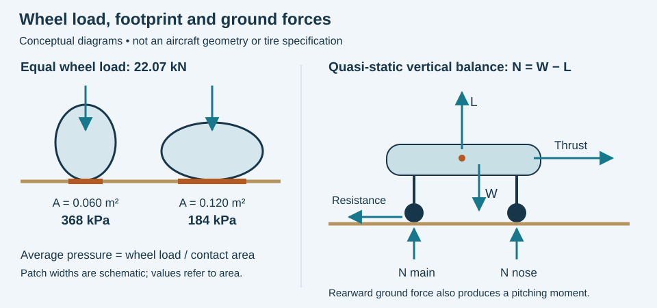
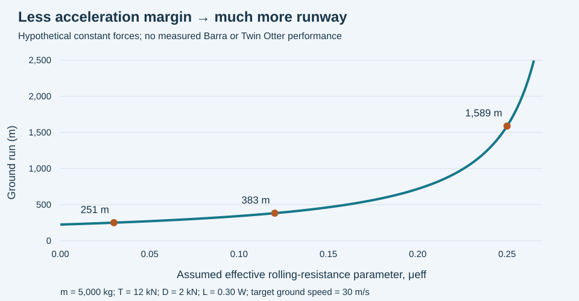

# Barra Airport: How an Aircraft Lands on a Beach

**MIE 446 · Aerospace Structures · University of Massachusetts Amherst**  
Independent engineering case study · 12 November 2026

[Illustrated web reading](https://ehsan-roohi.github.io/Aerospace-Structures/case-studies/barra-beach/) · [Course readings](READINGS.md) · [BeamLab](https://ehsan-roohi.github.io/Aerospace-Structures/wing-lab.html)

## 1. The engineering question

An aircraft touches down on a Scottish beach, rolls through wet sand, and taxis toward a terminal. Later, the sea covers the runway. Why do the wheels not disappear into the sand? What prevents the nose gear from digging in? Can any small aircraft do this—and could an airliner do it?

Barra works because the aircraft, beach, operating window and maintenance system are considered together. Short takeoff and landing capability is valuable, but it is only one part of the answer. A surface that supports a stationary aircraft may still produce excessive rolling resistance, damaging impact loads or inadequate directional control.

This original lesson was prompted by [Zoomit's article on Barra's tidal runway](https://www.zoomit.ir/aviation-aerospace/471013-barra-airport-tidal-beach-runway/), retrieved on 12 November 2026. It extends the topic using airport publications, manufacturer data and engineering analysis; it is not a translation or reproduction. All numerical examples below are explicitly hypothetical unless a source is identified.

**Learning goals:** connect wheel loading to ground pressure; distinguish firm coastal sand from loose sand; explain touchdown and takeoff force balances; trace landing loads into the airframe; evaluate aircraft suitability; and separate a classroom model from operational performance data.

**Scope:** this is a structures and mechanics lesson, not a flying procedure. Aircraft flight manuals, operator procedures, the current AIP/NOTAMs and airport permission determine an actual flight.

## 2. What is unusual about Barra?

Barra Airport, ICAO **EGPR**, uses the tidal beach of Traigh Mhòr in Scotland's Outer Hebrides. HIAL describes it as the world's only airport where scheduled flights use a tidal beach runway. The distinction concerns **scheduled service on a tidal beach**, not the claim that aircraft never land on beaches elsewhere. Three marked runway axes offer choices for changing winds. HIAL records the first arrival in 1933 and the first scheduled service on 7 August 1936; Loganair operates the Glasgow connection with Twin Otters [1,2].

The UK AIP edition effective 29 October 2026 gives the following dimensions and declared distances [3]. These are a dated teaching snapshot, not a current dispatch table.

| Runway direction | Physical length × width | TORA | TODA | ASDA | LDA |
|---|---:|---:|---:|---:|---:|
| 07 | 799 × 60 m | 799 m | 799 m | 799 m | 799 m |
| 25 | 799 × 60 m | 799 m | 799 m | 799 m | 799 m |
| 11 | 680 × 46 m | 667 m | 667 m | 667 m | 617 m |
| 29 | 680 × 46 m | 667 m | 667 m | 667 m | 597 m |
| 15 | 846 × 46 m | 799 m | 799 m | 799 m | 796 m |
| 33 | 846 × 46 m | 799 m | 799 m | 799 m | 776 m |

TORA is takeoff run available; TODA is takeoff distance available; ASDA is accelerate-stop distance available; LDA is landing distance available. **Visible beach length, physical runway length and declared usable distance are different quantities.** Marker posts, displaced thresholds and obstacle clearance matter. The 846 m physical runway is not an 846 m landing allowance in both directions.

More consequential than the dimensions is the AIP's warning that beach support, braking and contamination cannot be assumed constant or predictable. Hard sand ridges and standing water can also be present [3, §2.20]. Thus, “firm sand” describes a possible operating condition, not a guaranteed pavement specification.

## 3. Why some beach sand can support an aircraft

### Grains carry loads through a skeleton

Sand consists of grains with voids between them. Load is transmitted through grain contacts. Packing density, grain size distribution, drainage, water-table position and loading history affect the resulting strength and deformation. The surface color or the fact that it is wet does not supply a bearing-capacity value.

For a saturated soil, effective stress is

$$\sigma'=\sigma-u,$$

where $\sigma$ is total compressive stress and $u$ is pore-water pressure. A simple drained shear-strength model is

$$\tau_f=c'+\sigma'_n\tan\phi'.$$

For clean sand, effective cohesion $c'$ is commonly approximated as zero; friction and confinement are central. Increased pore pressure reduces effective contact stress for a fixed total stress. USACE discusses these effective-stress and drained-strength principles [8]. This model does not establish the local parameters at Barra.

### Damp is not the same as submerged

Partially saturated sand can develop capillary suction, adding apparent strength. Fully saturated sand below the water table does not receive the same air–water meniscus contribution. Research on sandy coastal soils explicitly relates bearing capacity to moisture, suction and sediment characteristics [9]. That study concerns a North Carolina beach, not a measurement campaign at Barra.

Tidal processes can redistribute and rearrange sediment, but a receding tide is not an inspection certificate. A relatively dense, drained patch and a soft waterlogged patch can coexist. An apparently firm crust can also hide weaker material. It is therefore incorrect to say either “wet sand is always stronger” or “the tide compresses the entire runway to a known strength.”

### Bearing capacity is not the whole question

The soil must resist local shear failure, but acceptable operation also requires limited rutting, adequate traction, manageable rolling resistance and tolerable roughness. A soil can avoid catastrophic bearing failure yet deform enough to make takeoff impossible. Conversely, a hard ridge can carry the wheel easily while delivering an unacceptable shock.

## 4. Why tire size, wheel load and lift matter

For one wheel, the average contact pressure is

$$\bar p=\frac{N_w}{A_c},$$

where $N_w$ is wheel normal load and $A_c$ is the actual tire–ground contact area. Pressure varies across the patch. Inflation pressure helps set tire deformation and patch size, but carcass stiffness, wheel load, tire geometry and soil deformation prevent a universal equality between inflation pressure and ground pressure.

Large tires can spread load and negotiate small irregularities more effectively. Lower inflation pressure may enlarge a footprint **within the approved tire and aircraft limits**; arbitrarily deflating tires is not a solution. Excessive deflection can create heat, sidewall damage, bead problems and reduced clearance. Tire size also adds mass and aerodynamic drag.

**Illustrative example—not Twin Otter tire data:** take $m=5,000$ kg, $g=9.81$ m/s², and two main wheels carrying 90% of the stationary weight equally. Each main wheel carries

$$N_w=0.45mg=22.07\ \mathrm{kN}.$$

| Assumed contact patch per main wheel | Average pressure |
|---|---:|
| 0.060 m² | 368 kPa |
| 0.120 m² | 184 kPa |

Doubling footprint halves average pressure at fixed load. This comparison does **not** mean that changing inflation pressure always doubles the real footprint.

During approximately level ground motion,

$$N_{total}\approx W-L.$$

If lift still carries 60% of weight, and we retain the same assumed load fractions and 0.120 m² patches, pressure falls to about 73.6 kPa per main wheel. Real patches and gear load fractions change with lift, attitude, pitching moment and braking; the fixed-patch calculation isolates the effect of unloading. During touchdown, vertical acceleration must be included instead of using this quasi-static equation.

*Figure 1. Original schematic. A wider footprint reduces average pressure at the same load. Lift unloads the wheels during the ground run; rearward ground forces introduce pitching moments as well as slowing the aircraft.*

## 5. How arrival on sand works: the physical sequence

### Approach: airspeed and ground speed do different jobs

The wing responds to airspeed; the distance covered along the beach depends on ground speed. In a simplified aligned headwind,

$$V_g=V_a-U_h,\qquad L=\tfrac12\rho V_a^2SC_L.$$

At an illustrative $V_a=30$ m/s, a steady 5 m/s headwind reduces ground speed from 30 to 25 m/s. Translational kinetic energy relative to the ground changes by $(25/30)^2=0.694$, about a **31% reduction**. This is an energy comparison, not a prediction of landing-distance reduction: gusts, touchdown position and braking also change performance.

For wind speed $U$ making angle $\theta$ to the runway direction, the aligned and crosswind components are $U\cos\theta$ and $U\sin\theta$. Several runway orientations improve the available choice, although they do not eliminate crosswind, terrain-induced turbulence or surface limitations.

### Flare and touchdown: limit vertical energy

Touchdown must manage downward velocity as well as forward speed. The vertical kinetic energy is

$$E_z=\tfrac12m v_z^2.$$

Doubling sink speed quadruples that energy. It must be handled through tire deflection, landing-gear compliance and damping, airframe deformation, and some soil deformation. The purpose is not simply a comfortable arrival: excessive local wheel load promotes rutting and large attachment loads.

The FAA's general soft-field discussion explains the value of a gentle transfer from wing support to wheel support, with particular care for nose-gear loading [6]. It supplies general principles, not a Twin Otter-specific power, flap or touchdown procedure. Prolonging a float to achieve a soft touchdown can consume too much runway; softness and stopping distance must be satisfied together.

### Rollout: protect the nose gear and maintain directional control

As lift decays, the ground supports more weight. A small, heavily loaded nosewheel can sink or encounter a ridge. The associated rearward force creates a nose-down pitching tendency and increased drag. Unequal resistance beneath the left and right main wheels produces yaw. A wheel entering a soft patch is therefore a coupled vertical, longitudinal and directional event.

Approved reverse-pitch operation can provide deceleration without depending entirely on tire–ground braking. It does not remove spray, ingestion or directional-control concerns. A blanket instruction to use maximum reverse, avoid all braking, or apply a generic soft-field technique is inappropriate: the aircraft's approved procedure governs.

### Taxi: lower speed is not zero risk

Once the wing carries little weight, wheel loading approaches its static level. Soft patches can increase breakaway resistance after a stop; tight turns introduce scrub and side load. The aircraft must follow suitable assessed ground routes, not merely aim for the shortest route to the building. A safe touchdown does not prove that taxiing and the subsequent departure are feasible.

## 6. Where the landing loads go

At touchdown, the load path starts at the tire contact patch, passes through the wheel and axle into the landing-gear members and attachments, then enters local frames, bulkheads and skin. Inertial loads from the fuselage, passengers, engines and wings balance these reactions throughout the aircraft. **A vertical force at a wheel does not travel only vertically:** offsets create bending and torsion.

For a vertical one-degree-of-freedom model, an average-force energy balance over downward stopping distance $s$ gives

$$\bar N\approx W-\bar L+\frac{m v_z^2}{2s}.$$

Assumptions: negligible rebound, an effective mass $m$ translating vertically, lift represented by its displacement-average, and $s$ including the modeled system's stopping displacement. This is **not peak force**, a certification load case, or permission to count uncertain sand sinkage as reliable shock absorption.

With the hypothetical 5,000 kg aircraft, $\bar L=0.6W$ and $s=0.30$ m:

| Sink speed | Vertical kinetic energy | Average total ground reaction |
|---|---:|---:|
| 1.0 m/s | 2.50 kJ | 27.95 kN |
| 2.0 m/s | 10.0 kJ | 52.95 kN |

Notice that **energy quadruples, but total reaction does not** because the $W-\bar L$ term remains. Peak load depends on the force–deflection history, damping, tire behavior and pitch/roll response. A hard ridge can shorten the effective stopping time and raise peak loads substantially.

A rearward wheel force $F_x$ acting a height $h$ below the center of mass creates a pitching moment of magnitude approximately $F_xh$. In a simplified level braking model with wheelbase $\ell$, no aerodynamic pitching moment and negligible pitch acceleration,

$$\Delta N_{nose}\approx\frac{m a h}{\ell}.$$

For $a=2$ m/s², $h=1.5$ m and $\ell=4$ m, the hypothetical aircraft transfers about **3.75 kN** onto the nose gear. These are assumed geometry values, not Twin Otter dimensions. Aerodynamic drag, thrust-line height, elevator forces and actual gear geometry modify the result.

For a gear member, an elementary first screen is

$$\sigma\approx\frac{N}{A_s}\pm\frac{Mc}{I},\qquad M=Fe.$$

Here $A_s$ is structural area, $e$ the load offset, $I$ the appropriate second moment and $c$ the extreme-fiber distance. This screen must eventually be supplemented by joint bearing, bolt shear, local buckling, fatigue, torsion and multiaxial stress assessment.

## 7. Why getting airborne again may be harder than landing

Soft ground dissipates energy and can help slow a landing aircraft. During takeoff that same dissipation opposes acceleration. A useful ground-run balance is

$$m\dot V_g=T-D-R_s,\qquad R_s\approx\mu_{eff}(W-L),$$

where $\mu_{eff}$ is an **effective rolling-resistance parameter**, not a measured braking-friction coefficient. It lumps tire rolling losses and soil deformation into a deliberately crude model. A deeper rut, plowing soil ahead of a tire and repeated passage can make resistance nonlinear and history-dependent. It is not generally proportional to normal load with a constant coefficient.

If forces were constant from rest to target ground speed $V_*$,

$$s_g\approx\frac{mV_*^2}{2[T-D-\mu_{eff}(W-L)]}.$$

The expression is meaningful only when the denominator is positive. Real takeoff requires integrating changing thrust, drag, lift and soil forces, followed by assessing climb and obstacle clearance.

**Toy sensitivity example:** $m=5,000$ kg, $T=12$ kN, $D=2$ kN, $L=0.30W$, $V_*=30$ m/s. These constants are selected to reveal sensitivity, not to represent Barra or the Twin Otter.

| Assumed $\mu_{eff}$ | Soil/rolling resistance | Net accelerating force | Constant-force ground run |
|---|---:|---:|---:|
| 0.03 | 1.03 kN | 8.97 kN | 251 m |
| 0.12 | 4.12 kN | 5.88 kN | 383 m |
| 0.25 | 8.58 kN | 1.42 kN | 1,589 m |

Within this toy model, $\mu_{eff}=(T-D)/(W-L)\approx0.291$ removes the positive acceleration margin. That is a mathematical threshold for these assumed constants, not a soil criterion or a usable aircraft limit.

*Figure 2. Original calculation using the stated constant-force model. Near zero net force, predicted distance becomes extremely sensitive. No measured Barra surface coefficient is implied.*

The FAA explains that soft surfaces can seriously impair acceleration [7]. Becoming airborne briefly in ground effect is also not proof of adequate climb capability: the aircraft must sustain flight beyond the near-ground aerodynamic benefit and clear obstacles. An attractive landing video does not demonstrate the return-flight performance margin.

## 8. Why the Twin Otter fits this mission

HIAL identifies the Twin Otter as the aircraft used on Barra's scheduled connection [2]. Transport Scotland's procurement announcement specified two **DHC-6-400** aircraft for the island routes [5]. The manufacturer publishes the following representative Series 400 landplane data [4].

| Feature | Manufacturer information | Engineering relevance |
|---|---|---|
| Configuration | Twin turboprop utility aircraft, up to 19 passengers | Useful transport capacity in a relatively small aircraft |
| Engines | Two PT6A-34; 620 shp flat-rated per engine | Shaft power drives propellers; power alone does not establish takeoff distance |
| Maximum takeoff mass | 5,670 kg | Upper aircraft mass specification, not an allowable mass for every beach condition |
| Propellers | Reversible pitch | Provides an additional means of ground deceleration within approved procedures |
| Ground-roll reference | 244 m takeoff; 169 m landing | Illustrates short-field capability, but excludes part of a complete field-length calculation |
| Field length at 50 ft | 455 m takeoff at MTOW; 460 m landing at MLW, labeled SFAR 23 | Shows why ground roll and total distance must not be interchanged |

The same sheet gives separate STOL figures subject to local regulatory approval. None of these advertised values is a wet-sand correction, a current AFM dispatch calculation or proof that the aircraft can operate at maximum mass on every Barra runway.

Several physical design choices are useful. A high wing with elevated engines gives clearance between propulsion components and the ground, although it does not prevent spray ingestion. Low-speed capability reduces the speed and energy that must be managed near touchdown. Fixed landing gear provides accessible components without retracting contaminated wheels into wheel wells. The HITRANS engineering study explicitly identifies the maintenance advantage of fixed gear in this environment [10].

Twin engines provide redundancy, but “two engines” does not mean unrestricted engine-out climb at any weight or condition. Runway performance, obstacle clearance, loading and approved operational requirements must still be satisfied.

## 9. What other aircraft can land on sand?

There is no universal list of aircraft that can land on any beach. The correct question is: **which aircraft, in which configuration and loading, on which assessed surface, under which operating approval?**

| Aircraft or category | What the evidence supports | What it does not establish |
|---|---|---|
| **DHC-6 Twin Otter** | Documented scheduled Barra service; manufacturer STOL and utility-aircraft characteristics [2,4,5] | Permission for arbitrary beaches, weights or tides |
| **BN-2 Islander** | Manufacturer describes unprepared-surface capability [11]; a 2013 HITRANS study considered an Oban–Barra service using the Islander [10] | That it is today's scheduled Barra aircraft or that every variant has identical beach capability |
| **Light bush aircraft with approved large tires** | Low mass, low speed and a suitable footprint can be favorable by the mechanics developed here | A generic “bush aircraft” label is not a Barra approval or verified performance dataset |
| **Ordinary light nosewheel trainers** | Low total mass may help | Small tires, nosewheel loading, propeller clearance and absent surface-specific data can still prevent suitability |
| **Larger regional turboprops** | Some designs have capabilities on particular unpaved surfaces | Gravel or grass capability does not automatically demonstrate wet tidal-sand capability |
| **Conventional passenger jets, such as A320/737 classes** | Multiple wheels distribute substantial loads on designed pavement systems | Their normal runway performance and configurations do not establish suitability for Barra's short tidal beach |
| **Floatplanes / amphibians** | Approved float configurations support water operations | A wheeled beach landing and a water landing are different operations; installing floats does not bypass airport or sea-state constraints |

Except for the specifically cited aircraft evidence, the table is an **engineering screening discussion**, not a type-approval register.

Why not simply bring a larger aircraft with more wheels? A multi-wheel gear can reduce load per tire, but total mass, speed, footprint dimensions, subsurface stress overlap, turning forces and required runway distance remain important. In elementary elastic half-space reasoning, stress spreads deeper as a loaded area gets wider. Matching average surface pressure alone therefore does not reproduce the same subsurface response.

Likewise, a powerful engine cannot compensate for every unsuitable surface. It may overcome some drag but cannot guarantee nose-gear survival, directional control, acceptable rut depth, adequate stopping distance or freedom from debris ingestion. Short-field capability and soft-field capability overlap, but they answer different questions.

## 10. Water, sand and salt attack different parts of the aircraft

**Water** can add splash and displacement drag, alter tire contact and conceal surface depressions. Water-related loss of friction is not captured by a single dry-sand coefficient. Simple hydroplaning-speed formulas developed for particular pavement and tire conditions should not be treated as universal thresholds for an irregular permeable beach.

**Sand** can abrade coatings, propeller leading edges and exposed components. When carried by spray it reaches areas far beyond the contact patch. Debris ingestion can damage engines; ground clearance reduces some exposure paths but does not eliminate them.

**Salt** promotes corrosion in susceptible materials and joints when moisture is present. Pitting, crevices and dissimilar-metal connections deserve attention. A small pit can become a fatigue stress concentration, so an aircraft that remains strong enough after one landing may still accumulate important life-cycle damage.

The 2013 HITRANS report documents an intensive cleaning, inspection and lubrication burden for the Barra operation, including airframe and engine washing [10, Appendix D]. This is historical engineering evidence, not a claim that a particular 2013 wash frequency is today's maintenance instruction. Current approved maintenance documents govern methods and intervals.

## 11. A runway that appears and disappears

A tide table predicts water level. An airport operating decision must also account for the actual surface, weather, visibility, obstacles, available services and the time needed to complete the movement. HIAL makes opening availability tide-dependent, requires advance coordination and lists no refuelling service at Barra [12].

For teaching, define usable operation as the intersection of several conditions:

$$\mathcal O=\mathcal T\cap\mathcal S\cap\mathcal W\cap\mathcal A,$$

where $\mathcal T$ is the acceptable tidal interval, $\mathcal S$ the acceptable surface state, $\mathcal W$ acceptable weather, and $\mathcal A$ aircraft/operator/airport availability and approval. This set notation explains why exposed sand alone is insufficient.

Without local refuelling, aircraft may need to arrive carrying fuel for further flight and reserves. That raises landing mass and reduces payload allowance. In mass accounting,

$$m_{aircraft}+m_{crew}+m_{payload}+m_{fuel}\leq m_{allowable},$$

with consistent empty/operating-mass definitions. The allowable mass may be lower than the structural maximum because of landing, takeoff or climb performance. Carrying 19 seats does not promise 19 saleable seats on every flight.

A delay can consume the available tidal window. Increasing thrust or accepting a more forceful touchdown does not restore a runway that is becoming unavailable. Reliable service comes from scheduling and contingency margins as well as aircraft design.

## 12. Worked structural exercise: a landing-gear attachment

Use a **hypothetical** cantilever representing a gear attachment, not the actual Twin Otter gear. Take length $\ell=0.40$ m, a solid rectangular section $b=0.060$ m, $h=0.10$ m, elastic modulus $E=70$ GPa and end load $F=20$ kN, acting in the direction that bends about $I=bh^3/12$.

$$I=5.0\times10^{-6}\ \mathrm{m^4},\quad M_{root}=F\ell=8.0\ \mathrm{kN\,m},$$

$$\sigma_{max}=\frac{M_{root}(h/2)}{I}=80\ \mathrm{MPa},\qquad
\delta_{tip}=\frac{F\ell^3}{3EI}=1.22\ \mathrm{mm}.$$

1. In [BeamLab](https://ehsan-roohi.github.io/Aerospace-Structures/wing-lab.html), model the cantilever with these values and compare reactions, bending moment and deflection with the equations. If the interface expects $EI$, enter $350,000$ N·m². Keep all dimensions in consistent units.
2. Double the force. Explain why the linear model doubles stress and deflection, while a real tire–soil–gear system may not remain linear.
3. Add an independent 4 kN end load in the weak-axis direction. Calculate $I_{weak}=hb^3/12$, the second bending stress, and the largest corner normal stress. State explicitly that this is two-plane bending, not torsion unless a load offset is introduced.
4. Reduce the section height by 10% while retaining the original vertical load. Predict the change in stress and deflection before running the model.
5. Discuss the missing physics: joint flexibility, shock-absorber behavior, transient impact, corrosion pits, fatigue, tire compliance and spatially variable soil.

**Check values:** the weak-axis contribution is 26.7 MPa, giving a maximum combined corner magnitude of about 106.7 MPa when the bending contributions add. Reducing height to 90 mm raises primary bending stress to 98.8 MPa and deflection to 1.67 mm. These are elastic calculations; no yield strength or allowable fatigue stress has been assigned, so they do not demonstrate structural safety.

## 13. Discussion questions

1. Two aircraft have equal average tire contact pressure but different mass and footprint dimensions. Why might their rutting and subsurface stresses differ?
2. How can a wet beach be firm in one location and weak only a few metres away? Identify the measurements needed before assigning soil parameters.
3. Why can retaining aerodynamic lift reduce wheel pressure yet complicate braking and directional control?
4. Why does twice the touchdown sink speed produce four times the vertical energy but not necessarily four times the total gear reaction?
5. Could a powerful aircraft land successfully but be unable to depart? Use the takeoff equation to distinguish thrust, surface resistance and climb requirements.
6. Why is an advertised 169 m landing ground roll not evidence that any 169 m patch of beach is adequate?
7. Why might a fixed-gear aircraft be preferable despite its aerodynamic drag penalty?
8. How do fuel reserves and a missing refuelling facility couple runway performance to passenger capacity?

## 14. Evidence boundaries and references

Airport facts come from HIAL and the dated UK AIP. Aircraft specifications come from a manufacturer landplane sheet. HITRANS supplies historical service and maintenance context. The pressure, impact, acceleration, wind-energy and beam examples are original teaching calculations with stated assumptions; no local sand strength, tire pressure, approved aircraft operating weight or proprietary flight-manual correction is inferred.

1. **HIAL**, [About Barra Airport](https://www.hial.co.uk/barra-airport/airport-information-4). Tidal-beach operation and public-beach context.
2. **HIAL**, [Barra Airport's History](https://www.hial.co.uk/hial-group/airport-history-pages/3) and [90 years on the sand, 7 August 2026](https://www.hial.co.uk/news/article/267/barra-celebrates-90-years-on-the-sand). History, runway arrangement and Twin Otter service.
3. **NATS UK AIP**, [EGPR, edition effective 29 October 2026](https://www.aurora.nats.co.uk/htmlAIP/Publications/2026-10-29-AIRAC/html/eAIP/EG-AD-2.EGPR-en-GB.html), §§2.3, 2.12, 2.13 and 2.20. Retrieved directly from the official HTML publication. For operations consult the [UK AIS publication service](https://nats-uk.ead-it.com/), its effective edition and NOTAMs; later editions may revise runway identifiers and other information.
4. **De Havilland Canada**, [DHC-6 Twin Otter Series 400—Wheels specification sheet, October 2023](https://dehavilland.events/wp-content/uploads/2023/10/DHC_Twin_Otter_WHEELS_Spec_Sheet_v13.pdf). Manufacturer reference figures, not an AFM.
5. **Transport Scotland**, [Contract award for replacement PSO planes](https://www.transport.gov.scot/news/contract-award-for-replacement-pso-planes/). DHC6-400 procurement for island routes.
6. **FAA**, [Airplane Flying Handbook, Chapter 9: Approaches and Landings](https://www.faa.gov/sites/faa.gov/files/regulations_policies/handbooks_manuals/aviation/airplane_handbook/10_afh_ch9.pdf), soft-field approach and landing discussion. General training principles.
7. **FAA**, [Airplane Flying Handbook, Chapter 6: Takeoffs and Departure Climbs](https://www.faa.gov/sites/faa.gov/files/regulations_policies/handbooks_manuals/aviation/airplane_handbook/07_afh_ch6.pdf). Soft-field acceleration and ground-effect considerations.
8. **US Army Corps of Engineers**, [EM 1110-2-2502: Flood Walls and Other Hydraulic Retaining Walls](https://www.publications.usace.army.mil/Portals/76/Users/182/86/2486/EM%201110-2-2502.pdf), Chapter 5. General effective-stress and soil-strength background; not an airport pavement design manual.
9. **ASCE, Journal of Geotechnical and Geoenvironmental Engineering**, [A Framework for Assessing the Bearing Capacity of Sandy Coastal Soils from Remotely Sensed Moisture Contents](https://doi.org/10.1061/JGGEFK.GTENG-11339). Moisture/suction/bearing-capacity framework; a different coastal site. Abstract and indexed technical excerpts consulted.
10. **HITRANS**, [Regional Air Service Development Opportunities Study, December 2013](https://hitrans.org.uk/wp-content/uploads/2014/01/Regional_Air_Opportunities_Study.pdf), §2.4.2, discussion of Oban–Barra, and Appendix D. Historical aircraft-suitability and corrosion/maintenance evidence.
11. **Britten-Norman**, [New lighter Islander delivered to FLN](https://britten-norman.com/lighter-islander-delivered-to-fln/). Manufacturer account of unprepared-surface capability.
12. **HIAL**, [General Aviation at Barra](https://www.hial.co.uk/barra-airport/general-aviation-1), [general aviation permission information](https://www.hial.co.uk/general-aviation-7/general-aviation-4) and [opening hours](https://www.hial.co.uk/barra-airport/airport-information-4/2). Contact, permission, tide-dependent availability and lack of refuelling.

Sources checked 12 November 2026. The linked Zoomit article is the topic prompt; the engineering explanation and illustrations are original.
