# The Blue LED: Thirty Years of Materials, Manufacturing and Multiphysics Engineering

**MIE 446 · Aerospace Structures · University of Massachusetts Amherst**  
Supplementary engineering reading · 4 November 2026

[Course home](README.md) · [Illustrated reading with large equations](https://ehsan-roohi.github.io/Aerospace-Structures/case-studies/blue-led/)

## 1. The engineering problem behind a familiar light

A blue LED is an electrically driven semiconductor light source. Its importance extends beyond blue indicator lamps: it makes efficient phosphor-converted white lighting possible. The long delay between practical red LEDs and bright blue LEDs illustrates a recurring engineering problem: a material can have the right intrinsic property while its manufacturing process, interfaces and device architecture remain inadequate.

This original English lesson was prompted by [Pooyesh Pourmohammad's Zoomit article, “Why did building the blue LED take 30 years?”](https://www.zoomit.ir/science/470489-30-years-blue-led-featured/), published 4 November 2026. The article motivates the topic; the technical development, original diagrams and classroom calculations here form an independent treatment based on the primary references below. It is optional interdisciplinary enrichment, not a change to the course syllabus.

For structures students, the central connection is **interfaces**. A useful device must accommodate incompatible crystal lattices, retain electrically active impurities, confine carriers, release photons, remove heat and survive thermal cycling. These requirements connect semiconductor engineering to residual stress, bonded joints, thin films and the thermal design of aircraft electronics. A successful blue emitter is not, by itself, a qualified aircraft lighting assembly.

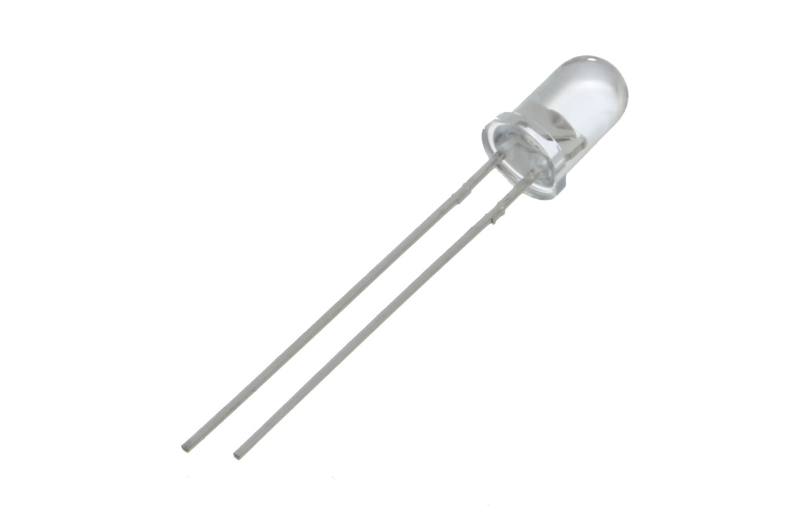

*Photo A. A real packaged 5 mm blue LED, shown unpowered. The clear lens and two leads are visible; the package itself need not be blue. This is a later component example, not Nakamura's original prototype. Photo: oomlout, [source](https://commons.wikimedia.org/wiki/File:5mm_Super_Bright_Blue_LED.jpg), [CC BY-SA 2.0](https://creativecommons.org/licenses/by-sa/2.0/).*

**Learning goals.** Explain why blue photons demand different materials; distinguish doping from dopant activation; identify what buffer layers and heterostructures accomplish; calculate photon and energy efficiencies; estimate package temperatures and thermal mismatch; and explain where each simplified model stops being credible.

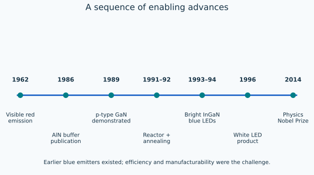

*Figure 1. Selected milestones, not a claim that no blue-emitting device existed before 1993. Discovery dates, publication dates and product announcements are different events.*

## 2. History: several bottlenecks, several contributors

The 2014 Physics Nobel Prize recognized **Isamu Akasaki, Hiroshi Amano and Shuji Nakamura** for efficient blue LEDs enabling bright, energy-saving white light [1]. The achievement depended on complementary advances rather than a single change in chemical composition.

### The researchers: three real photographs

| Isamu Akasaki | Hiroshi Amano | Shuji Nakamura |
|---|---|---|
|  |  |  |
| Advanced GaN growth and p-type nitride research. Portrait: MEXT, Minister's Secretariat Personnel Division; [source](https://commons.wikimedia.org/wiki/File:Isamu_Akasaki_201111_(cropped).jpg), [CC BY 4.0](https://creativecommons.org/licenses/by/4.0/). | Co-developed the buffer-layer and p-type-conduction breakthroughs. Portrait: MEXT, Minister's Secretariat Personnel Division; [source](https://commons.wikimedia.org/wiki/File:Hiroshi_Amano_20141007.jpg), [CC BY 4.0](https://creativecommons.org/licenses/by/4.0/). | Advanced reactor design, thermal activation and efficient InGaN emitters. Photograph at UCSB, 30 October 2014: Glenn Beltz; [source](https://commons.wikimedia.org/wiki/File:Professor_Shuji_Nakamura_(Cropped).jpg), [CC BY 2.0](https://creativecommons.org/licenses/by/2.0/). |

*Photos B–D. All three researchers shared the 2014 Physics Nobel Prize. These are real sourced photographs, not generated likenesses. The two files whose source names include “cropped” were already cropped in the credited Commons versions; this report applies no additional crop.*

| Period | Advance | Engineering significance | Evidence |
|---|---|---|---|
| 1962 | Holonyak and Bevacqua's visible red emission in GaAsP | Practical visible semiconductor emission established an important starting point | Original paper [2] |
| 1970s–1980s | Earlier blue emitters, including GaN and SiC approaches | Producing blue light and producing efficient, bright blue light are distinct achievements | Nobel scientific background [3] |
| 1986 publication | Amano, Sawaki, Akasaki and Toyoda: AlN buffer for GaN growth | A growth-interface strategy improved crystal quality | Original paper [4] |
| 1989 | Amano, Kito, Hiramatsu and Akasaki: electron-beam-treated Mg-doped GaN | Demonstrated p-type conduction | Original paper [5] |
| 1991 | Nakamura, Harada and Senoh: modified MOCVD system | Reactor flow became a controllable part of materials processing | Original paper [6] |
| 1992 | Nakamura and colleagues: thermal activation of Mg-doped GaN | A scalable route to low-resistivity p-type material | Original paper [7] |
| 1992–1994 | InGaN growth and increasingly effective heterostructure LEDs | Joined carrier injection with a useful blue-emitting active region | Publications [8,9] |
| 1996 | Nichia white LED commercialization | Blue excitation plus wavelength conversion opened a lighting route | Manufacturer history [10] |
| 2014 | Nobel recognition | Recognized the combined scientific and technological achievement | [1] |

The phrase “thirty years” is an approximate comparison between practical visible red emission in 1962 and the bright-blue breakthrough of the early 1990s. It should not erase earlier blue devices or the work of other research groups. Similarly, a 1993 announcement and a 1994 journal paper may describe closely related product development without being the same dated event.

Nakamura's autobiographical lecture [11] discusses the contrast between popular ZnSe research and the less fashionable GaN route. It is a valuable first-person account, but personal recollections and demonstrations are not substitutes for measured device specifications. This lesson uses the original papers to anchor the quantitative milestones and does not treat an overnight endurance anecdote as a lifetime qualification test.

## 3. Why the color sets a materials requirement

Light consists of photons. For a photon of wavelength $\lambda$ in vacuum,

$$E_\gamma=h\nu=\frac{hc}{\lambda}. \tag{1}$$

With energy expressed in electronvolts and wavelength in nanometres,

$$E_\gamma[\mathrm{eV}]=\frac{1239.842}{\lambda[\mathrm{nm}]}. \tag{2}$$

A 650 nm red photon carries 1.907 eV; a 450 nm blue photon carries 2.755 eV. The blue photon therefore carries about 44.4% more energy. Raising the current in a red LED does not simply turn it blue: the radiative transition energies are set principally by the semiconductor's electronic structure.

For a simple near-band-edge transition, the first estimate is

$$E_\gamma\approx E_g,\qquad \lambda\approx\frac{hc}{E_g}. \tag{3}$$

Here $E_g$ is the band gap. Alloy composition, temperature, strain, quantum confinement, polarization fields and localized states modify this approximation. GaN has a room-temperature gap of roughly 3.4 eV, corresponding to near-ultraviolet emission around 365 nm. InGaN permits lower transition energies in the visible range. Thus “GaN makes blue” is a useful family name, not a complete description of the active layer.

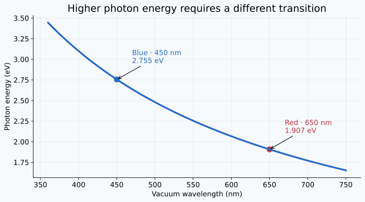

*Figure 2. Exact photon-energy relation using the constants in the calculation script. The approximate color labels do not define sharp boundaries of human perception.*

### Direct and indirect band gaps

A useful LED needs an efficient radiative transition, not merely an appropriate gap magnitude. Electrons in crystals are described by energy and crystal momentum. A photon transfers relatively little crystal momentum. In a direct-gap material, conduction-band and valence-band extrema occur at approximately the same wave vector; an indirect transition also requires momentum exchange with the lattice, typically through a phonon. This reduces the likelihood of a simple radiative transition.

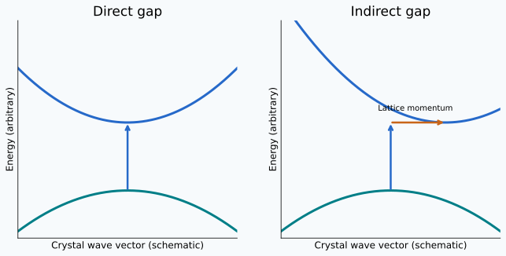

*Figure 3. Qualitative energy–wave-vector diagrams. Curves, offsets and arrows are illustrative, not calculated band structures. The extra momentum step helps explain why an early blue SiC emitter could be much less efficient than a suitable direct-gap nitride device.*

This is the first design filter. The next filters concern whether the material can actually be grown, doped, contacted and operated reliably.

## 4. The p–n junction: supplying both carriers

An n-type region has electrons as its majority mobile carriers; a p-type region has holes. A hole represents a missing electron in an otherwise nearly filled set of states and behaves as a positive mobile charge. Doping controls carrier populations; it does not mean that a macroscopic p-type specimen must carry a net positive charge.

At equilibrium, diffusion across a junction leaves an ionized-dopant depletion region. The resulting electric field opposes further diffusion. Forward bias reduces the injection barrier and supplies electrons and holes to the active region. A textbook diode relation is

$$I=I_s\left[\exp\left(\frac{qV}{n_d k_B T}\right)-1\right]. \tag{4}$$

The ideality factor $n_d$ is dimensionless; $I_s$ is a saturation-current scale. Equation (4) is a teaching model, not a complete fit for a high-current LED with contact resistance, leakage and self-heating. A real driver must control current; optical output cannot be inferred from the battery voltage alone.

Electrical conductivity is

$$\sigma=q(n_e\mu_e+p\mu_h),\qquad \rho_e=\frac{1}{\sigma}. \tag{5}$$

Here $n_e,p$ are carrier number densities, $\mu_e,\mu_h$ are mobilities, and $\rho_e$ is electrical resistivity, not mass density. A p-type layer can contain many Mg atoms yet have poor conductivity if most acceptors are inactive or compensated.

## 5. Crystal growth: why an interface could block an invention

Epitaxy grows a crystalline layer on a crystalline substrate. If their preferred atomic spacings differ, the interface cannot remain coherent indefinitely without strain relaxation. A common mismatch definition is

$$f=\frac{a_f-a_s}{a_s}. \tag{6}$$

The lattice parameters must refer to compatible interface directions and crystallographic relationships. The frequently quoted roughly 16% GaN/sapphire mismatch [3,11] is not a universal scalar that can be inserted into any elastic formula. Sapphire and wurtzite GaN require attention to orientation and the interface coincidence geometry.

For a small-strain coherent film, an isotropic equibiaxial approximation would give

$$\sigma_\parallel=M_f\epsilon_\parallel,\qquad M_f=\frac{E_f}{1-\nu_f}. \tag{7}$$

This relation is useful for genuinely small residual strains. **Do not use 0.16 as the elastic strain of a thick GaN film**: relaxation, nucleation, coalescence and dislocations invalidate that interpretation. In thin-film engineering, knowing when not to use Hooke's law is as important as knowing the equation.

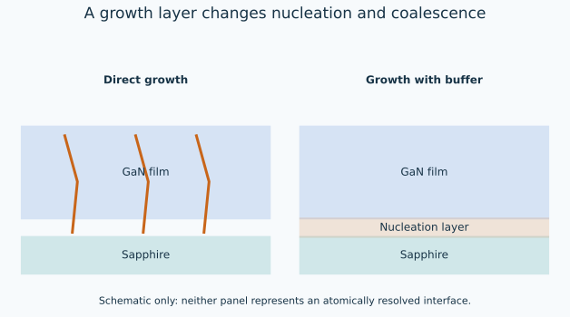

*Figure 4. Conceptual interface comparison. A buffer changes the growth pathway; it does not magically make sapphire and GaN have identical lattice constants. Atom rows and defect symbols are schematic and not to scale.*

Amano and colleagues' 1986 AlN-buffer paper [4] established that a thin intermediary growth layer could improve the resulting GaN. Nakamura's later low-temperature GaN-buffer work provided another important route [8]. The layers support nucleation and subsequent coalescence under a suitable thermal sequence. Better surface morphology and improved electrical behavior are useful outputs; “perfect crystal” is not the acceptance criterion.

A rough geometric interpretation of threading-dislocation density $N_D$ is a characteristic spacing

$$\ell_D\sim N_D^{-1/2}. \tag{8}$$

For an assumed $N_D=10^9\ \mathrm{cm^{-2}}$, the spacing scale is 316 nm. This is not an exact nearest-neighbor distribution and does not prove that every dislocation intersects a recombining carrier. Defect type, carrier localization, diffusion length and operating conditions all matter.

**Structures connection.** A crack in a spar, a dislocation in a crystal and a void in an adhesive are different defects. Each requires a mechanism connecting its size and location to the relevant failure or performance mode. A generic “defect count” is insufficient to predict either strength or light output.

## 6. Reactor engineering: transport is part of the material

MOCVD supplies reactive precursors to a heated substrate, where chemical reactions and surface processes produce the film. Gas flow controls precursor delivery, residence time and parasitic reactions. Nakamura, Harada and Senoh's 1991 reactor paper [6] made flow configuration an explicit part of the solution.

For a deliberately simplified steady boundary-layer model, the reactant flux to the surface is

$$J=k_m(C_b-C_s). \tag{9}$$

If the surface-consumption rate is first order,

$$J=k_sC_s,\qquad J=\frac{k_m k_s}{k_m+k_s}C_b. \tag{10}$$

Here both $k_m$ and $k_s$ have units of velocity, and concentration is amount per volume. When $k_s\ll k_m$, surface kinetics limit growth; when $k_s\gg k_m$, delivery limits growth. The ratio

$$\mathrm{Da}=\frac{k_s}{k_m} \tag{11}$$

separates these limits in this particular reduced model. Real nitride deposition involves multiple species, temperature-dependent chemistry and complex surface incorporation; the model is a tool for reasoning, not a recipe.

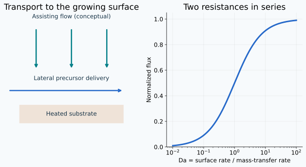

*Figure 5. Left: conceptual lateral delivery and downward assisting flow. Right: normalized flux $J/(k_mC_b)=\mathrm{Da}/(1+\mathrm{Da})$. This is not a dimensional reconstruction of the historical reactor.*

Changing the reactor can improve the surface concentration even if the bulk feed rate is unchanged. This is a familiar fluid-mechanics lesson: a boundary condition on a remote inlet is not the same as a boundary condition at the reacting surface.

## 7. Magnesium: adding the atom was not enough

Mg can act as an acceptor in GaN, but hydrogen incorporated during growth can passivate acceptors. A schematic representation is

$$\mathrm{Mg}_{\mathrm{Ga}}^-+\mathrm{H}^+\rightleftharpoons(\mathrm{Mg}_{\mathrm{Ga}}-\mathrm H)^0. \tag{12}$$

This depicts charge compensation, not a complete reaction network or proof of a unique kinetic pathway. Electron-beam treatment demonstrated p-type conduction in 1989 [5]. Thermal annealing subsequently provided an important activation route [7]. Dopant concentration, electrically active acceptor concentration and free-hole concentration remain three different quantities.

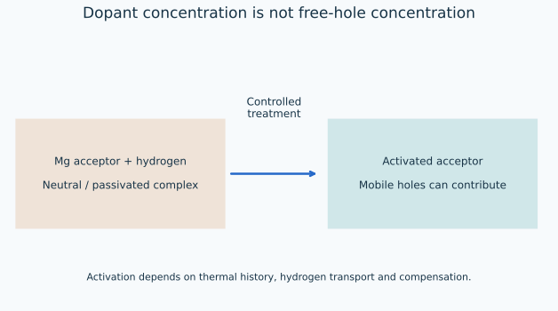

*Figure 6. Conceptual Mg–H passivation and activation. Heating conditions affect hydrogen transport and acceptor activity; the diagram does not imply that arbitrary heating will improve a finished device.*

For transport intuition only, a diffusion distance scale and an activated diffusivity are

$$L_H\sim\sqrt{Dt},\qquad D=D_0\exp\left(-\frac{E_a}{k_BT}\right). \tag{13}$$

The geometric prefactor depends on the diffusion problem. No $D_0$ or $E_a$ is fitted here. Surface escape, trapping and dissociation can control the actual activation rate. This explains why “heat it longer” is not a complete process specification.

For a hole-dominated illustrative film with $p=3\times10^{17}\ \mathrm{cm^{-3}}$ and $\mu_h=10\ \mathrm{cm^2/(V\,s)}$, equation (5) gives 2.08 $\Omega\,\mathrm{cm}$. These values are consistent with the order of magnitude reported in the annealing paper [7]; the calculation is a conductivity check, not a new measurement.

## 8. InGaN and confinement: make recombination happen in the right place

An alloy adds a composition variable. A common interpolation model is

$$E_g(x)=(1-x)E_g^{\mathrm{GaN}}+xE_g^{\mathrm{InN}}-b x(1-x). \tag{14}$$

The indium fraction $x$ and bowing parameter $b$ are dimensionless and energy-valued, respectively. Using assumed room-temperature endpoints 3.4 eV and 0.7 eV with $b=1.4$ eV gives a rough composition near 0.17 for a 450 nm target. This estimate ignores strain, polarization, confinement and localization; it is **not a fabrication composition prescription**.

A lower-gap active region between wider-gap layers confines carriers. Without adequate confinement, carriers can leak or recombine at unhelpful locations. The early double heterostructures and later quantum wells are related developments, but are not identical structures. The 1994 device [9] should not be silently redrawn as a modern multiple-quantum-well stack.

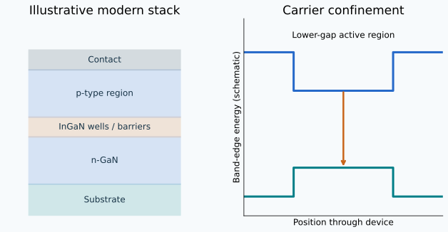

*Figure 7. Qualitative band-edge confinement and an illustrative modern layer stack. Flat edges omit depletion, bias-induced bending and polarization fields. The layer drawing is not the historical 1994 structure.*

For intuition, an infinite one-dimensional quantum well has energy levels

$$E_n=\frac{n^2\pi^2\hbar^2}{2m^*L^2}. \tag{15}$$

Reducing well width $L$ raises confinement energy. A real finite InGaN well has finite barriers, coupled electron/hole states and internal fields; this formula is not a complete emission-wavelength model. Thickness variation and alloy variation can therefore both affect observed color.

A carrier-balance model makes the efficiency tradeoff visible:

$$\frac{dn}{dt}=\frac{\eta_{\mathrm{inj}}I}{qV_a}-An-Bn^2-Cn^3. \tag{16}$$

Here equal electron/hole density is assumed; $V_a$ is active volume; $A$, $B$ and $C$ parameterize effective nonradiative, radiative and cubic loss terms. Their units are $\mathrm{s^{-1}}$, $\mathrm{m^3/s}$ and $\mathrm{m^6/s}$. At steady state,

$$\eta_{\mathrm{IQE}}=\frac{Bn^2}{An+Bn^2+Cn^3}. \tag{17}$$

The ABC model illustrates low-density loss and possible high-density droop. It does not uniquely identify the microscopic cause of droop in a measured device; leakage, heating and nonuniform carrier distributions may matter. If the assumptions hold and all coefficients are positive, differentiating (17) gives

$$n_{\mathrm{peak}}=\sqrt{A/C}. \tag{18}$$

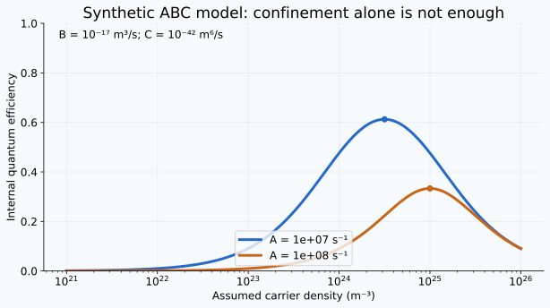

*Figure 8. Synthetic model curves, not experimental device data. The coefficients are explicitly recorded in the generator. Reducing the effective linear loss improves low-density performance, while the modeled cubic term eventually reduces efficiency.*

## 9. A photon made inside the crystal may not escape

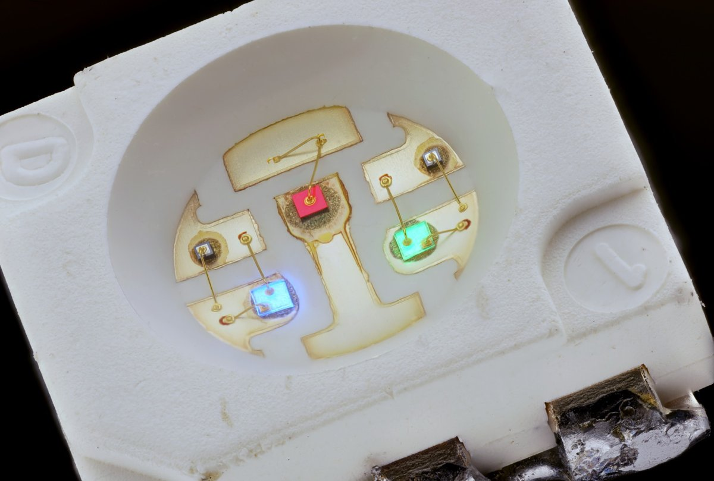

*Photo E. A real close-up of a 5050 RGB surface-mount LED. Three emitting dies and fine bond-wire connections are visible. The photograph shows a packaged device, not an atomic cross-section or a direct view of its quantum wells. Photo: Mister rf, [source](https://commons.wikimedia.org/wiki/File:5050_SMD_RGB_LED.png), [CC BY-SA 4.0](https://creativecommons.org/licenses/by-sa/4.0/). Proportionally reduced and converted to JPEG for web delivery; no crop or retouching.*

Internal quantum efficiency counts photons generated in the active region relative to recombining carriers. External quantum efficiency counts photons leaving the device relative to supplied electrons. A useful bookkeeping model is

$$\eta_{\mathrm{EQE}}=\eta_{\mathrm{inj}}\eta_{\mathrm{IQE}}\eta_{\mathrm{ext}}. \tag{19}$$

Definitions differ across publications: check whether injection efficiency is already included in a stated internal efficiency before multiplying it again. Interfaces cause total internal reflection. For an illustrative index $n_1=2.4$ into air $n_2=1$,

$$\theta_c=\sin^{-1}(n_2/n_1)=24.6^\circ. \tag{20}$$

A single flat escape-cone solid-angle fraction, relative to all isotropic ray directions, is

$$F_\Omega=\frac{1-\cos\theta_c}{2}\approx0.0455. \tag{21}$$

This fraction is **not a device extraction efficiency**: Fresnel transmission, multiple reflections, absorption, encapsulation and surface texture change the outcome. It simply shows why optical packaging matters after the semiconductor is working.

The historical 1994 report [9] gives approximately 1.5 mW at 20 mA, 450 nm and 2.7% EQE. Reconstructing the photon count,

$$\eta_{\mathrm{EQE}}=\frac{P_{\mathrm{opt}}/E_\gamma}{I/q}\approx0.0272. \tag{22}$$

Rounding accounts for the small difference from 2.7%. Electrical-to-optical conversion is a different quantity:

$$\eta_{\mathrm{WPE}}=\frac{P_{\mathrm{opt}}}{IV_f}=\eta_{\mathrm{EQE}}\frac{E_\gamma}{qV_f}. \tag{23}$$

If we assume $V_f=3.2$ V for an exercise, the historical optical/current values give 2.34% wall-plug efficiency. That voltage is an exercise assumption, not a value extracted from the 1994 report.

## 10. From blue to white: spectrum and energy bookkeeping

White is a visual response to a spectrum, not one monochromatic wavelength. One route mixes red, green and blue emitters; another converts part of the blue light to longer wavelengths in phosphors [12]. The latter can combine a remaining blue peak with a broad converted band. Different spectra that look white can render object colors differently.

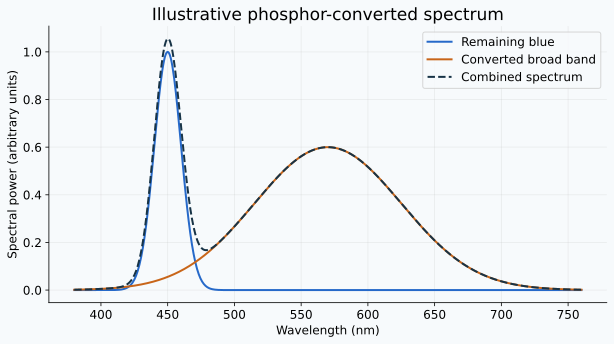

*Figure 9. Synthetic spectral components and their sum; areas and peak heights are arbitrary, with no colorimetric white-point calculation. A broad phosphor band does not make the output identical to sunlight.*

For one absorbed blue photon producing one longer-wavelength photon, the maximum radiant-energy ratio is

$$\frac{E_{\mathrm{out}}}{E_{\mathrm{in}}}=\frac{\lambda_b}{\lambda_p}. \tag{24}$$

At 450 nm excitation and 560 nm emission, this ratio is 0.804. Even with unit photon quantum yield, about 19.6% of the absorbed radiant energy becomes a conversion loss in this simplified single-wavelength model. If an assumed fraction $a$ of blue photons is absorbed and the phosphor quantum yield is $\eta_p$, then

$$P_{\mathrm{after}}=P_b\left[(1-a)+a\eta_p\frac{\lambda_b}{\lambda_p}\right]. \tag{25}$$

For assumed $a=0.70$ and $\eta_p=0.90$, the retained radiant-power fraction is 0.806. This neglects reabsorption, scattering and package absorption. A real phosphor emits a distribution of wavelengths, requiring spectral integration.

Photometric quantities weight that spectrum by human vision:

$$\Phi_v=683\int V(\lambda)P_\lambda(\lambda)\,d\lambda,\qquad K=\frac{\Phi_v}{P_{\mathrm{electrical}}}. \tag{26}$$

$\Phi_v$ is luminous flux in lumens; $K$ is efficacy in lm/W; $V(\lambda)$ is the dimensionless photopic response. Integrate consistently with the wavelength units used in $P_\lambda$. A candela is luminous intensity in a direction, not total optical power. A lens can increase peak candela by narrowing the beam without creating more photons. Consequently, “one candela,” “2.7% EQE,” “one milliwatt” and “100 lm/W” describe different properties.

## 11. Heat flow: a light source is also a thermal load

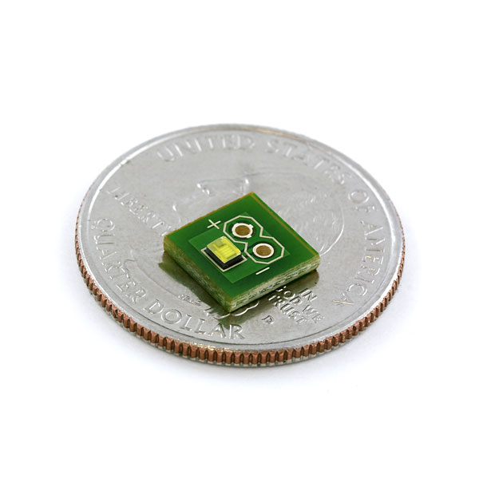

*Photo F. A Luxeon white-LED breakout module, with a coin providing physical scale. The emitter, mounting board and contact pads show the assembly level at which heat conduction and electrical attachment become design issues. The photograph does not establish the internal thermal resistance or the device's operating temperature. Photo: SparkFun Electronics, [source](https://commons.wikimedia.org/wiki/File:Luxeon_Portable_LED_-_White_1_Watt_Breakout_08673-04-L.jpg), [CC BY 2.0](https://creativecommons.org/licenses/by/2.0/).*

The first package-level balance is

$$P_h=IV_f-P_{\mathrm{opt}},\qquad T_j=T_a+P_hR_{\theta,ja}. \tag{27}$$

$T_j$ is junction temperature, $T_a$ ambient temperature and $R_{\theta,ja}$ junction-to-ambient thermal resistance. This steady linear approximation assumes the stated thermal boundary conditions and an optical power crossing the chosen package boundary. When analyzing a white package, include conversion and absorption losses inside that boundary.

For an assumed 350 mA, 3.0 V emitter producing 0.35 W of optical output, heat generation is 0.70 W. At $T_a=40^\circ$C and $R_{\theta,ja}=30$ K/W, $T_j=61^\circ$C. At 60 K/W it becomes $82^\circ$C. Neither value establishes acceptable lifetime without device-specific limits and tests.

A slab contribution to thermal resistance is

$$R_\theta=\frac{t}{kA},\qquad R_{\theta,\mathrm{series}}=\sum_i R_{\theta,i}. \tag{28}$$

Reducing thickness and increasing conductivity or effective area help, but spreading resistance and contact resistance can dominate. An electrically insulating adhesive may be the largest thermal bottleneck. Changing the aluminum housing can therefore change optical output even with exactly the same LED chip.

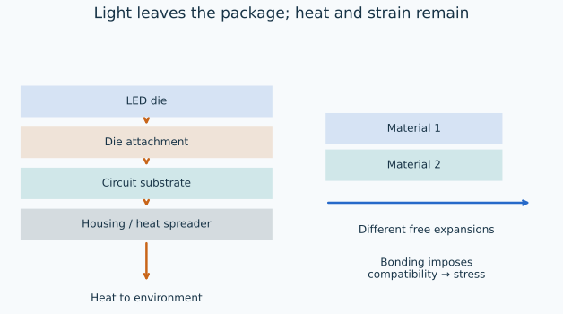

*Figure 10. Heat follows a path through die attachment, substrate and housing. A separate bonded-pair sketch illustrates differential expansion. Dimensions, material properties and temperature swings in the examples are assumed teaching values.*

## 12. Structures connection: constrained expansion and fatigue

For two bonded materials subject to a uniform temperature change, their free thermal-strain mismatch is

$$\Delta\epsilon_{\mathrm{th}}=(\alpha_s-\alpha_f)\Delta T. \tag{29}$$

If a thin isotropic film is fully constrained equibiaxially by a much thicker substrate, its approximate stress is

$$\sigma_f=\frac{E_f}{1-\nu_f}(\alpha_s-\alpha_f)\Delta T. \tag{30}$$

For assumed $E_f=300$ GPa, $\nu_f=0.20$, $\alpha_s-\alpha_f=2\times10^{-6}\ \mathrm{K^{-1}}$ and heating by 100 K, the model gives +75 MPa tension. Cooling reverses the stress sign. This is a small-strain, perfectly bonded, linear-elastic estimate. It omits anisotropy, film curvature, plasticity, creep and process relaxation; it is not the stress state of the historical GaN/sapphire interface.

The elastic energy per interface area in the same equibiaxial film model is

$$U_A=\frac{\sigma_f^2t_f}{M_f}. \tag{31}$$

For a 5 $\mu$m assumed film, the example gives 0.075 J/m². This is stored elastic energy, **not automatically an interfacial crack energy-release rate**. Delamination requires a fracture model, geometry and interfacial toughness. A real layered assembly can bend to reduce mismatch stress; a thin-film-on-thick-substrate idealization suppresses that degree of freedom.

For a simplified die attachment, differential free edge displacement is

$$\Delta u\approx(\alpha_1-\alpha_2)\Delta T\frac{L}{2},\qquad \gamma\approx\frac{\Delta u}{t_a}. \tag{32}$$

Assume a 2 mm die, mismatch $15\times10^{-6}$ K⁻¹, 100 K excursion and 50 $\mu$m attachment thickness. The estimate is $\Delta u=1.5\ \mu$m and $\gamma=0.03$. It is an order-of-magnitude compatibility estimate, not a uniform shear solution or a linear-elastic strength prediction. A soft attachment can relieve stress while impairing heat conduction; a stiff conductive attachment may improve cooling but transfer larger local loads.

For a cantilevered fixture under base acceleration, a first inertial-load estimate is

$$F=ma,\quad M_{\mathrm{root}}=ma\ell,\quad \sigma_b=\frac{M_{\mathrm{root}}c}{I_b}. \tag{33}$$

A 20 g module, assumed 10g acceleration and 30 mm moment arm yield 1.96 N and 0.0588 N·m. Dynamic amplification near resonance, fastener preload and local housing stress still require separate analysis. A cool and efficient semiconductor can fail as a system through a cracked solder joint or vibrating mounting tab.

### Where the aerospace relevance is direct

*Photo G. Blue LED cabin lighting in a Delta Boeing 717, as identified by the photographer. It illustrates an actual aircraft lighting application, not a structural qualification test or evidence about the particular emitters used. Photo: N717JG, [source](https://commons.wikimedia.org/wiki/File:Blue_LED_Lighting_on_Delta’s_717.jpg), [CC BY-SA 4.0](https://creativecommons.org/licenses/by-sa/4.0/).*

| Assembly question | Suitable first model | What further evidence is needed |
|---|---|---|
| Is the optical power creating excessive junction temperature? | Energy balance and thermal resistance | Device limits, measured interface resistance, environmental conditions |
| Will a bonded die/board interface cycle safely? | Differential expansion and joint mechanics | Creep, fatigue data, cycling tests and local geometry |
| Does a housing transmit vibration into an attachment? | Inertial loads and structural modes | Actual vibration spectrum, damping and attachment test results |
| Will the illumination support an inspection camera? | Radiometry, exposure and geometry | Calibrated images, surface reflectance, motion blur and lighting uniformity |
| Is a replacement aircraft light acceptable? | Integrated optical/electrical/thermal/structural assessment | Applicable aircraft-specific approval and qualification evidence |

These connections are teaching applications, not evidence that a particular LED design is approved for flight. In the course's non-contact wing inspection activity, repeatable illumination can improve measurement consistency, but light intensity alone does not establish camera calibration or dimensional accuracy.

## 13. Worked numerical record and reproducibility

Run the dependency-free [calculation script](docs/case-studies/blue-led/teaching_calculations.py) with Python 3. It reproduces this table and writes [calculations.json](docs/case-studies/blue-led/calculations.json). All quantities other than the explicitly identified historical optical/current/wavelength data are constants or declared classroom inputs.

| Calculation | Result | Meaning |
|---|---:|---|
| 450 nm photon | 2.7552 eV | Optical quantum energy |
| Blue/red photon energy ratio, 450/650 nm | 1.4444 | Energy ratio, not perceived brightness ratio |
| Historical 1.5 mW / 20 mA / 450 nm | 2.722% EQE | Reconstructed external photon count |
| Same values with assumed 3.2 V | 2.344% WPE | Electrical-to-optical energy fraction |
| GaN/air critical angle with assumed index 2.4 | 24.624° | Flat-interface ray escape boundary |
| Assumed Mg-film carrier data | 2.081 $\Omega\,\mathrm{cm}$ | Hole-dominated resistivity |
| Assumed 0.70 W heat, 30 K/W, 40°C ambient | 61°C | Steady junction estimate |
| Assumed constrained 100 K film excursion | +75 MPa | Equibiaxial tensile estimate for heating |
| Assumed 5 $\mu$m film | 0.075 J/m² | Stored elastic energy per area |
| Assumed 2 mm die/50 $\mu$m attachment | 0.03 shear strain | Compatibility scale |

The [figure generator](docs/case-studies/blue-led/generate_figures.py) uses Matplotlib and NumPy for reproducible vector artwork. The ten numbered figures are original teaching graphics. They contain no digitized experimental data. Seven additional real photographs (A–G) show the components, the three researchers and an aircraft application; their captions identify the photographer/source, license and any format changes. Numerical plots identify their governing formulas or assumed coefficients. Full image credits are recorded in [PHOTO_CREDITS.md](docs/case-studies/blue-led/PHOTO_CREDITS.md), with machine-readable [source metadata](docs/case-studies/blue-led/photos/sources.json). Each photograph retains its stated license.

## 14. Predict, derive, compute, compare, explain

**Activity A — color and power.** Predict whether a 450 nm LED or a 650 nm LED produces more photons at equal optical power. Derive photon rate from (1). At 1 mW, the rates are approximately $2.27\times10^{15}$ and $3.27\times10^{15}$ photons/s, respectively. Explain why photon count, power and perceived brightness need separate comparisons.

**Activity B — audit the historical numbers.** Use equation (22) to reconstruct 2.7% EQE. Then assume the device's beam is narrowed by a lens. State which of optical watts, total lumens, peak candela and EQE might change in a lossless idealization. Answer: angular intensity can increase while the totals and photon efficiency remain unchanged.

**Activity C — a better heat path.** Start with the 350 mA classroom emitter. Compare 30 and 60 K/W; then double the optical output while keeping electrical input fixed. Recompute heat before recomputing temperature. Do not assume that the package heat equals electrical power when a substantial optical flux escapes.

**Activity D — bond design tradeoff.** Double attachment thickness in equation (32). The simple shear-strain estimate halves; the slab thermal resistance in equation (28) doubles if area and conductivity stay fixed. Explain why a choice that helps compatibility can harm cooling. Propose measurements that would reveal whether spreading resistance or joint creep invalidates the estimate.

**Activity E — defect tolerance.** Compare the statement “the material has dislocations” with “dislocations determine the measured failure.” Sketch an evidence chain for a semiconductor and another for a wing joint. Include location, loading/operating condition, the relevant transport or stress field, and the measured output. State one mechanism that could make defect density alone misleading.

**Activity F — process control.** With equation (10), compare $\mathrm{Da}=0.1,1,10$. The normalized fluxes are 0.091, 0.5 and 0.909. Predict whether increasing the surface reaction rate has a large effect in each regime. Explain why a uniform inlet mixture need not create a uniform film.

## 15. Claim checks and limits

| Short claim | More precise interpretation |
|---|---|
| “Blue LEDs were impossible before the 1990s” | Earlier blue emitters existed; efficient, bright and manufacturable devices were the breakthrough. |
| “A larger current changes a red LED into a blue LED” | The active material and transition energies chiefly set the color; current also affects temperature and carrier distribution. |
| “A buffer eliminates lattice mismatch” | A buffer changes nucleation and growth; relaxation and residual defects remain relevant. |
| “Adding Mg makes the layer conductive” | Activation, compensation, ionization and mobility determine free-hole conductivity. |
| “All defects are fatal” | Effects depend on defect mechanisms, locations and carrier transport; tolerating some defects does not make defects harmless. |
| “2.7% quantum efficiency means 2.7% electrical energy efficiency” | Photon efficiency and energy efficiency differ by the photon-energy/electrical-energy ratio. |
| “White is a single LED wavelength” | White describes a visual response to a spectrum. |
| “LEDs produce no heat” | Electrical losses, nonradiative recombination and conversion/absorption losses require a heat path. |
| “A 16% mismatch means a 16% elastic strain” | Crystallographic mismatch is not the residual elastic strain in a relaxed film. |
| “One successful light-on test proves service life” | Lifetime depends on operating conditions, degradation criteria, statistics and assembly reliability. |

## 16. Glossary

| Term | Meaning |
|---|---|
| Band gap | Energy separation between valence- and conduction-band edges |
| Hole | Mobile unoccupied electronic state behaving as a positive carrier |
| Epitaxy | Crystal growth with an orientation relationship to a substrate |
| Buffer / nucleation layer | Intermediary layer that changes how subsequent crystal growth begins |
| Dislocation | Line defect in a crystal lattice |
| Acceptor activation | Making an acceptor electrically effective; distinct from merely adding dopant atoms |
| Passivation | Suppression of an electrically active center, here including Mg–H compensation |
| Heterostructure | Assembly of semiconductors with different electronic properties |
| Quantum well | Thin lower-energy region producing confined carrier states |
| EQE / IQE | External / internal quantum efficiency, with definitions checked for injection accounting |
| Wall-plug efficiency | Escaping optical power divided by electrical input power |
| Phosphor | Material absorbing excitation light and re-emitting at other wavelengths |
| Thermal resistance | Temperature difference per unit heat flow under specified conditions |
| Thermomechanical mismatch | Different preferred thermal expansions in a constrained assembly |

## 17. Primary references and reading route

Start with [1,3] for the recognized achievement, [4–9] for the original device/process evidence, [12] for white-light terminology, and the worked models for course mechanics. URLs were checked or bibliographic metadata verified on 4 November 2026. Publisher access may vary.

1. **Nobel Foundation (2014).** [Physics Nobel Prize: summary and laureates](https://www.nobelprize.org/prizes/physics/2014/summary/). Official award attribution and scope.
2. **N. Holonyak Jr. and S. F. Bevacqua (1962).** “Coherent (visible) light emission from Ga(As1−xPx) junctions.” *Applied Physics Letters* 1, 82–83. [doi:10.1063/1.1753706](https://doi.org/10.1063/1.1753706). Historical visible-emission milestone; laser emission and ordinary spontaneous LED emission must be distinguished.
3. **Royal Swedish Academy of Sciences (2014).** [Scientific Background: Efficient Blue Light-Emitting Diodes](https://www.nobelprize.org/uploads/2018/06/advanced-physicsprize2014.pdf). Historical context, early emitters, growth and heterostructures.
4. **H. Amano, N. Sawaki, I. Akasaki and Y. Toyoda (1986).** “Metalorganic vapor phase epitaxial growth of a high quality GaN film using an AlN buffer layer.” *Applied Physics Letters* 48, 353–355. [doi:10.1063/1.96549](https://doi.org/10.1063/1.96549).
5. **H. Amano, M. Kito, K. Hiramatsu and I. Akasaki (1989).** “P-Type Conduction in Mg-Doped GaN Treated with Low-Energy Electron Beam Irradiation (LEEBI).” *Japanese Journal of Applied Physics* 28, L2112–L2114. [doi:10.1143/JJAP.28.L2112](https://doi.org/10.1143/JJAP.28.L2112).
6. **S. Nakamura, Y. Harada and M. Senoh (1991).** “Novel metalorganic chemical vapor deposition system for GaN growth.” *Applied Physics Letters* 58, 2021–2023. [doi:10.1063/1.105239](https://doi.org/10.1063/1.105239).
7. **S. Nakamura, T. Mukai, M. Senoh and N. Iwasa (1992).** “Thermal Annealing Effects on P-Type Mg-Doped GaN Films.” *Japanese Journal of Applied Physics* 31, L139–L142. [doi:10.1143/JJAP.31.L139](https://doi.org/10.1143/JJAP.31.L139).
8. **UCSB Solid State Lighting & Energy Electronics Center.** [Nakamura publication bibliography](https://www.ssleec.ucsb.edu/nakamura/publications), especially the 1991 GaN-buffer and 1992 InGaN-growth papers. Primary author bibliography used to distinguish the sequence of publications.
9. **S. Nakamura, T. Mukai and M. Senoh (1994).** “Candela-class high-brightness InGaN/AlGaN double-heterostructure blue-light-emitting diodes.” *Applied Physics Letters* 64, 1687–1689. [doi:10.1063/1.111832](https://doi.org/10.1063/1.111832). Source for the historical 450 nm, 20 mA, 1.5 mW and approximately 2.7% EQE figures.
10. **Nichia Corporation.** [Company history](https://www.nichia.co.jp/en/about_nichia/history.html). Manufacturer's account of product milestones, including white LEDs.
11. **S. Nakamura (2015).** “Background story of the invention of efficient blue InGaN light emitting diodes (Nobel Lecture).” *Annalen der Physik* 527, 335–349. [doi:10.1002/andp.201500801](https://doi.org/10.1002/andp.201500801). First-person research context; quantitative claims above are separately anchored to original papers.
12. **U.S. Department of Energy.** [LED Basics](https://www.energy.gov/cmei/ssl/led-basics). Official explanation of phosphor conversion and color mixing.
13. **U.S. Environmental Protection Agency, ENERGY STAR.** [Learn About LED Lighting](https://www.energystar.gov/products/learn-about-led-lighting). Package-level thermal management and light-output maintenance.

**Topic prompt, not a technical authority:** Pooyesh Pourmohammad, [Zoomit article](https://www.zoomit.ir/science/470489-30-years-blue-led-featured/), 4 November 2026. No article photographs or long passages are reproduced.

## خلاصهٔ فارسی

ساخت LED آبیِ پربازده فقط به پیدا کردن ماده‌ای با گاف انرژی مناسب وابسته نبود. پژوهشگران باید رشد بلور نیترید گالیم روی زیرلایه، رسانایی نوع p، غیرفعال‌شدن منیزیم توسط هیدروژن و طراحی ناحیهٔ نورزا را حل می‌کردند. آکاساکی و آمانو در رشد بلور و رسانایی نوع p نقش اساسی داشتند؛ ناکامورا نیز با مهندسی راکتور، فعال‌سازی حرارتی و ساختارهای InGaN به پیشرفت دستگاه کمک کرد. جایزهٔ نوبل ۲۰۱۴ به هر سه تعلق گرفت.

در این درس، انرژی فوتون، بازدهٔ کوانتومی، بازدهٔ انرژی و شدت نور از هم تفکیک می‌شوند. سپس تولید نور سفید با پوشش نورگسیل و اتلاف انرژی آن توضیح داده می‌شود. ارتباط مستقیم با سازه‌های هوایی در تنش حرارتی، اتصال مواد با انبساط متفاوت، خستگی اتصالات و مسیر دفع حرارت است. اعداد مربوط به تنش و بسته‌بندی، مثال‌های آموزشی با فرض‌های مشخص‌اند و مشخصات یک چراغ تأییدشدهٔ هواپیما محسوب نمی‌شوند.
