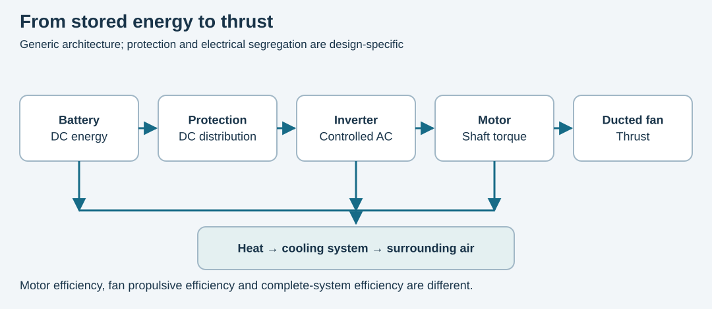
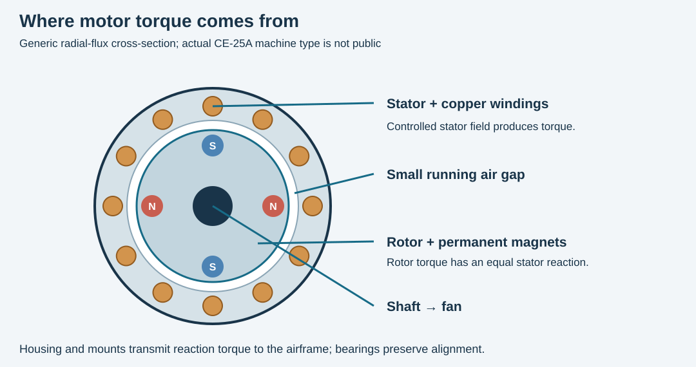
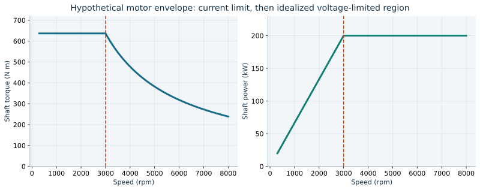
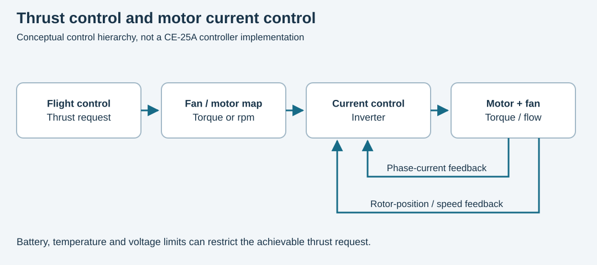
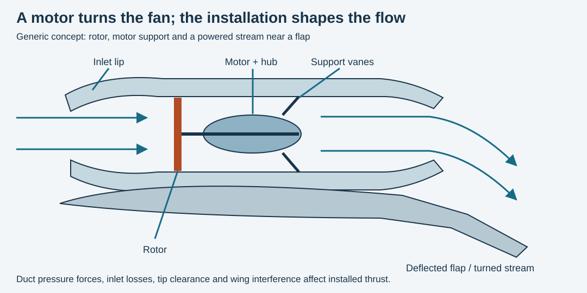
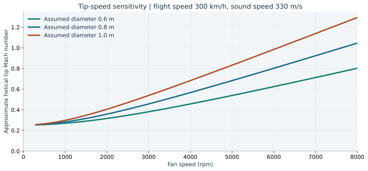
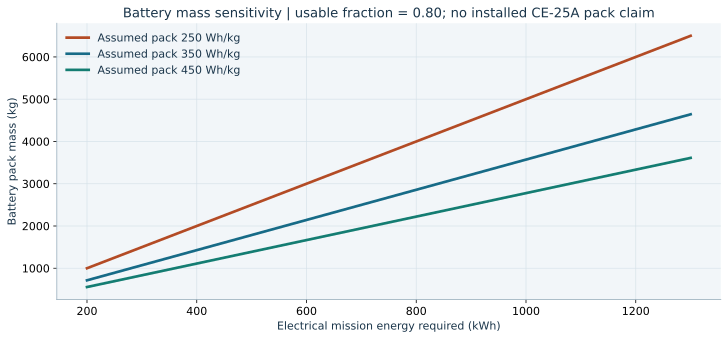
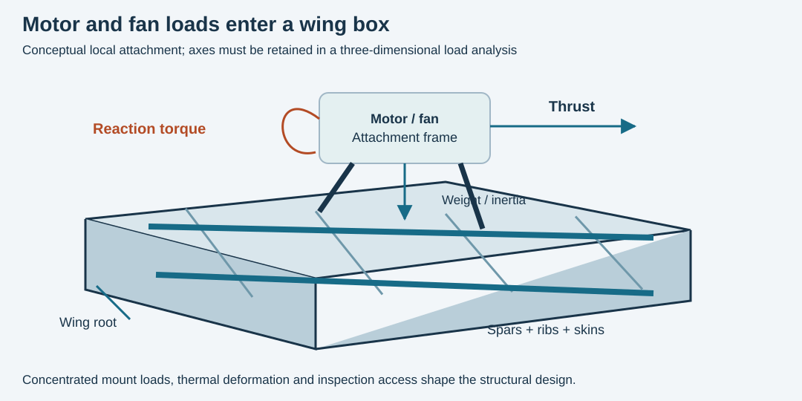
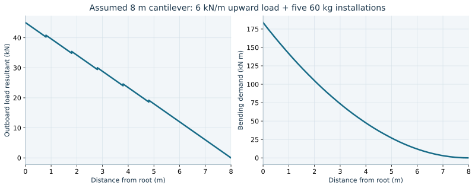

# COMAC CE-25A: Electric Motors, Ducted Fans and the Structure That Carries Them

**MIE 446 · Aerospace Structures · University of Massachusetts Amherst**  
Independent engineering reading · Evidence checked 15 November 2026

[Illustrated web reading](https://ehsan-roohi.github.io/Aerospace-Structures/case-studies/ce25a/) · [All course readings](READINGS.md) · [Wing Lab](https://ehsan-roohi.github.io/Aerospace-Structures/wing-panel-stress-analyzer/#wing)

## 1. The engineering question

The CE-25A puts an unusual propulsion system on a familiar kind of vehicle: a wingborne passenger aeroplane. Its electric motors turn ducted fans distributed across the wings. Understanding this aircraft therefore requires three linked explanations: how electrical energy becomes shaft torque, how the fan converts that torque into thrust, and how the wing carries both aerodynamic and propulsion loads.

This original lesson was prompted by [Pedal's Persian report](https://www.pedal.ir/flight/748315-ce-25a-electric-plane/), which was read directly. It develops the engineering independently rather than reproducing the article. The latest programme announcement, COMAC's published patent, motor manufacturers' data and NASA research are the supporting sources.

**How to read the numbers:** aircraft facts are identified as reported programme information; generic diagrams explain engineering principles; every calculation using undisclosed quantities is labelled a **classroom assumption**. A worked example is not a reverse-engineered CE-25A specification.

*Figure 1. Real CE-25A photograph supplied by COMAC and published by Science and Technology Daily [R2]. The image is externally hosted; credit and rights remain with its owner. Visible shape does not reveal the internal motor, battery or wing construction.*

## 2. What is known about the aircraft?

COMAC's announcement of 14 November 2026, reproduced with COMAC attribution by Zijing [R1], describes the first crewed flight in Binzhou: two pilots and a flight-test engineer were aboard. It reports 16 min 38 s airborne and 60.4 km, following an uncrewed maiden flight on 2 February and 19 uncrewed autonomous validation flights. These are flight-test milestones, not a demonstration of a full passenger mission at the advertised range.

| Quantity | Latest reported value or status | Meaning |
|---|---|---|
| Developer and partners | COMAC, CATL, Shanghai Jiao Tong University and other partners | Programme participants |
| Passenger capacity | 19 | Intended capacity; the reported crewed test carried three crew members |
| Maximum takeoff mass | 10,000 kg | A mass limit, not the published mass of that test flight |
| Cruise speed | 300 km/h = 83.33 m/s | Reported cruise figure |
| Cruise altitude | 2,400 m | Reported figure |
| Range | 400 km | Programme figure; payload, reserves and weather conditions are not itemized |
| Propulsion | Above-wing distributed electric ducted fans | Ten visible fan units, five per side, in the released photographs |
| Certification | Type-certificate application accepted, according to the announcement | Acceptance is not issuance of a type certificate |

Source: [R1–R2]. The designation's “25” refers to the intended CCAR-25 transport-category framework. It does not prove completed compliance testing or airline-service approval.

**A correction to the headline:** CE-25A is not the world's first all-electric aeroplane to fly. EASA certified the two-seat Pipistrel Velis Electro in June 2020 [R3]. CE-25A's significance is its larger, 19-passenger intended role and distributed ducted-fan integration.

| Important unpublished information | Why it matters |
|---|---|
| Motor maker/model, topology, continuous/peak ratings, speed and cooling maps | Determines available shaft power and thermal endurance |
| Inverter ratings, bus voltage and electrical segregation | Determines current, losses and fault tolerance |
| Fan dimensions, blade number, pressure ratio and installed efficiency maps | Determines thrust, noise and inlet sensitivity |
| Installed battery capacity, pack mass and usable energy | Determines payload and mission endurance |
| Structural materials, laminate schedules, spar geometry and allowables | Determines stress, stiffness, fatigue and mass |
| Flight-test payload, energy consumption and measured range | Needed to validate mission claims |

No exact motor or battery rating is assigned to CE-25A in this lesson. In particular, a widely repeated **200 kW per motor** estimate and a **500 Wh/kg installed pack** should not be presented as confirmed aircraft specifications.

## 3. Follow the energy, force and heat

*Figure 2. Generic engineering architecture. This is not CE-25A's wiring diagram. Energy passes through protection, power electronics, the motor and the fan; losses leave as heat.*

A battery supplies direct current. Protection and distribution hardware connect it to an inverter. The inverter switches that DC supply into controlled multiphase currents. The motor converts electrical power into mechanical torque. The shaft turns a fan, which adds momentum to air. The resulting aerodynamic forces act on the fan, duct, motor support and wing.

Three efficiencies must remain distinct:

$$
\eta_m=\frac{P_{\rm shaft}}{P_{\rm motor,in}},\qquad
\eta_i=\frac{P_{\rm motor,in}}{P_{\rm DC}},\qquad
\eta_p=\frac{TV}{P_{\rm shaft}}.
$$

Here $T$ is installed thrust and $V$ is flight speed. At steady cruise, the approximate useful-thrust power is $TV$. Thus, ignoring auxiliary loads and wiring losses, useful propulsive power divided by DC input is $\eta_i\eta_m\eta_p$. A 96% efficient motor does not make the complete aircraft 96% efficient. At zero flight speed, $TV=0$ even though a running fan produces static thrust; this definition of propulsive efficiency is not a static-thrust merit figure.

## 4. Inside an electric motor: where torque comes from

CE-25A's internal motor design is unpublished. A permanent-magnet synchronous motor (PMSM) is a useful teaching example because it shows the main electromagnetic and mechanical issues. Other choices include induction and reluctance machines. None is identified here as the installed CE-25A type.

In a PMSM, current in stator windings creates a rotating magnetic field. Permanent magnets on or inside the rotor supply rotor flux. The controller places the stator field at an angle relative to the rotor field so that electromagnetic forces generate torque. There are no piston strokes, combustion chamber or turbine hot section. There are still bearings, insulation, rotating hardware and substantial thermal constraints.

*Figure 3. Generic radial-flux PMSM cross-section, not a CE-25A cutaway. Real pole/slot counts, magnet arrangements and cooling passages vary.*

The rotor receives driving torque; the stator experiences equal and opposite reaction torque. That reaction reaches the motor housing, mounts and airframe. A motor may have fewer moving components than a combustion engine, but its attachment still has to carry shaft torque, fan thrust, maneuver loads and vibration.

### Radial flux, axial flux and induction

| Candidate machine | Electromagnetic arrangement | Structural and integration tradeoff |
|---|---|---|
| Radial-flux PMSM | Flux crosses a cylindrical air gap | Cylindrical packaging; rotor retention, bearing alignment and radial gap control matter |
| Axial-flux PMSM | Flux crosses a disc-shaped air gap | Short axial length; disc stiffness, axial magnetic forces and gap uniformity matter |
| Induction motor | Stator field induces rotor currents | Avoids permanent magnets; rotor loss and cooling require attention |
| Reluctance-based motor | Torque follows rotor magnetic anisotropy | Magnet-free variants are possible; torque ripple, acoustics and control depend on design |

Flux direction is not a measure of efficiency by itself. Winding utilization, saturation, leakage, rotor stress, losses, manufacturing and cooling determine the complete result. A high advertised kW/kg also depends on whether the quoted mass includes the controller, coolant, housing and mechanical attachments.

## 5. Torque, speed and the continuous rating

The mechanical identity is

$$P_{\rm shaft}=Q\omega,\qquad \omega=\frac{2\pi n}{60},$$

where $Q$ is shaft torque in N·m and $n$ is rotational speed in rpm. **Classroom example:** a 200 kW shaft output needs approximately 637 N·m at 3,000 rpm, or 318 N·m at 6,000 rpm. These are two possible operating points, not a CE-25A motor rating.

Increasing speed can reduce the torque required for a given power. It can also raise iron losses, bearing demands, rotor stress, fan tip speed and acoustic frequency. Reducing motor diameter may help packaging while making rotor cooling or torque production harder. Motor and fan therefore have to be selected together.

The most useful motor specification is a map, not one power number. It should show continuous and time-limited output versus speed, supply voltage and cooling conditions. A short peak rating can support acceleration or takeoff; cruise and prolonged climb must respect continuous thermal limits.

*Figure 4. Hypothetical envelope: 200 kW at a 3,000 rpm base speed, with idealized constant power above base speed. Actual voltage, thermal and mechanical limits can shorten this region. This is not a CE-25A performance map.*

Real comparator data help explain this distinction. EMRAX's current 268 product page lists 210 kW peak at 4,500 rpm and up to 101 kW continuous, explicitly dependent on duty cycle, cooling and controller capability [R5]. Safran's ENGINeUS 100 announcement lists 125 kW maximum, integrated electronics, air cooling and 5 kW/kg [R6]. Neither product is identified as CE-25A equipment. Neither maximum figure should be silently re-labelled as continuous output.

## 6. What the inverter and controller actually do

An inverter is an active power converter, not merely an on/off switch. Its semiconductor bridges switch the DC bus rapidly; motor inductance and control determine the resulting phase currents. Pulse-width modulation controls their effective voltages. The DC-link capacitor, gate drivers, current sensors, rotor-position measurement and protection logic are part of the system.

For a generic three-phase PMSM, electrical frequency is

$$f_e=p\frac{n}{60},$$

where $p$ is pole-pair count. At 6,000 rpm, a hypothetical four-pole-pair motor has 400 Hz electrical frequency. This differs from the inverter's switching frequency and the fan's blade-passing frequency.

Field-oriented control describes currents on axes rotating with the rotor. The $d$ axis aligns with rotor magnetic flux and the $q$ axis lies perpendicular to it. With a conventional amplitude-invariant transformation and peak-valued $d$–$q$ currents, electromagnetic torque is

$$
Q_e=\frac32p\left[\psi_f i_q+(L_d-L_q)i_di_q\right].
$$

The first term is magnet torque; the second is reluctance torque when the axis inductances differ. For a nearly non-salient surface-magnet machine, $L_d\approx L_q$, so torque mainly follows $i_q$. This standard motor model is introduced in MIT's electric-machines notes [R7]; no CE-25A parameter values are assumed.

*Figure 5. Conceptual control hierarchy. The flight controller requests thrust; an intermediate model or schedule converts this into a motor operating command. Motor current control does not directly measure aircraft thrust.*

The corresponding simplified voltage relations are

$$
v_d=R_s i_d+L_d\dot i_d-\omega_eL_qi_q,
$$
$$
v_q=R_s i_q+L_q\dot i_q+\omega_e(L_di_d+\psi_f).
$$

At high speed, back electromotive force increases. The available bus voltage then limits achievable current and torque. Applying negative $i_d$ can weaken the net flux and extend the speed range, but it uses current capacity, changes losses and must respect magnet-demagnetization limits. It is not free extra power.

Aircraft control adds another layer: it must coordinate motor limits with fan behavior, airspeed, inlet distortion, battery state and cooling. A request for more thrust may encounter a current limit, a temperature limit, a minimum safe battery voltage or an aerodynamic limit. The supervisory controller has to manage the resulting shortfall predictably.

## 7. High voltage, current and why wiring belongs in the mass budget

For a DC branch, $I\approx P_{\rm DC}/V_{\rm DC}$. **Classroom example:** a 2 MW electrical demand draws 4,000 A at 500 V or 2,000 A at 1,000 V. These are total-system examples, not CE-25A voltages or measured power.

At unchanged conductor resistance, Joule heating is

$$P_{\rm cable}=I^2R.$$

Doubling voltage for fixed power halves current and reduces that resistance's loss by a factor of four. But insulation, clearances, connectors, contactors and arc control become more demanding. At reduced ambient pressure, electrical insulation behavior and partial-discharge susceptibility require specific testing. A design cannot choose voltage from cable mass alone.

The aircraft-level mass budget includes the motor, inverter, cables, protection, sensors, cooling hardware and mechanical installation. Moving electronics into the nacelle shortens phase wiring but exposes the controller to vibration and local thermal conditions. Locating it centrally changes cable losses, electromagnetic interference and maintenance access. No location is universally superior.

NASA's X-57 controller research provides a concrete component-level reference: a 14 kW, approximately 1 kg SiC-based high-lift inverter/controller with a measured 98.3% efficiency is described in [R8]. Its rating applies to that tested device. It does not establish CE-25A efficiency, and NASA's X-57 programme closed before first flight [R9].

## 8. Cooling: a few percentage points become kilowatts

Suppose a hypothetical motor delivers 200 kW at $\eta_m=0.96$, and its inverter has $\eta_i=0.98$. Then

$$P_{m,\rm in}=\frac{200}{0.96}=208.33\ {
\rm kW},$$

$$\dot Q_m=8.33\ {\rm kW},\qquad
\dot Q_i=\frac{208.33}{0.98}-208.33=4.25\ {\rm kW}.$$

Ten such units, if simultaneously at that operating point, reject approximately **126 kW** from the motors and inverters alone. Battery and cable losses add to this. The arithmetic is illustrative; it is not a CE-25A heat budget.

Copper loss approximately follows $3I_{\rm rms}^2R_s$ for balanced phase windings. Iron loss depends on magnetic flux variation, electrical frequency and material. Bearings, seals, windage and rotor losses add heat. Winding insulation and magnets have temperature limits, and the hottest spot may be far above the housing temperature.

A first thermal model is

$$C_{\rm th}\frac{dT_m}{dt}=\dot Q_{\rm loss}-hA(T_m-T_\infty),$$

where $C_{\rm th}$ is lumped heat capacity. It explains why a brief high-power operation may be acceptable while the same power is unsustainable continuously. Real design needs separate thermal nodes for windings, rotor, housing, coolant and electronics.

Fan airflow can help cooling, but the difficult case may be a hot-day ground hold, low-speed climb, reduced fan operation after a fault or a blocked cooling path. Liquid cooling can improve heat transfer but adds coolant, pumps, heat exchangers, plumbing and additional failure modes. CE-25A's actual motor cooling method remains unspecified in the reviewed sources.

## 9. From shaft torque to thrust: the ducted fan

An electric ducted fan is an air-moving propulsor powered by an electric motor. Its appearance does not make it a gas-turbine engine. In an idealized one-dimensional control volume,

$$T=\dot m(V_e-V_0)+(p_e-p_0)A_e.$$

Thrust depends on mass flow, velocity change and exit pressure. The rotor adds energy and swirl; downstream vanes may recover part of the swirl and also support the hub. The duct has its own pressure forces and aerodynamic drag, which must be included when measuring installed thrust.

*Figure 6. Generic fan–wing interaction. The drawing explains a design mechanism; it does not specify CE-25A's fan dimensions or flap mechanism.*

For an ideal, pressure-matched actuator disc at forward speed,

$$T=2\rho A v_i(V_0+v_i),\qquad
P_{\rm ideal}=T(V_0+v_i),$$

so ideal propulsive efficiency is $V_0/(V_0+v_i)$. At static conditions, $P_{\rm ideal}=T^{3/2}/\sqrt{2\rho A}$. These relations show why accelerating a larger mass flow by a smaller velocity increment can be efficient. They exclude profile loss, swirl, inlet losses, tip clearance, duct drag and wing interaction.

Splitting one total disc area into ten equal discs does not by itself lower ideal induced power. Increasing total effective area can help; additional ducts, surfaces, supports and electrical hardware can offset that gain. Installed performance needs a coupled aerodynamic and powertrain assessment.

### Fan speed is a structural and acoustic choice

The approximate helical tip Mach number is

$$M_{\rm tip}\approx\frac{\sqrt{(\pi Dn/60)^2+V_0^2}}{a}.$$

For a hypothetical 0.8 m diameter fan at 6,000 rpm, $V_0=83.33$ m/s and $a=330$ m/s, this gives approximately **0.80**. The diameter and speed are assumptions. Compressibility and noise can become significant even when the aircraft itself is flying slowly.

*Figure 7. Independent sensitivity calculation with assumed diameters. This is a kinematic estimate, not an acoustic prediction or a fan certification limit.*

Blade-passing frequency is $f_{\rm BPF}=Bn/60$. Eight hypothetical blades at 6,000 rpm give 800 Hz. Electric operation eliminates combustion noise, while fan tones, inlet turbulence, stator interaction and airframe vibration remain. Ten sources can interact acoustically; low noise requires measurement rather than inference from the absence of combustion.

## 10. What COMAC's patent tells us—and its limit

COMAC's patent CN115489716B [R4], with a 2022 priority date, describes a wing integrated with ducted fans. Its examples include five units per side, motor support through a hub and vanes, smooth wing–duct interfaces, and blown flaps. It also discusses a T-tail and differential propulsion for control.

This is primary evidence of COMAC's published design thinking. It is not a released CE-25A production drawing, proof that every claimed feature was built, or measured evidence for the patent's performance claims. Patent embodiments and the flying prototype must be kept separate.

The underlying lift mechanism is understandable without treating the patent as test data. A powered stream can raise local velocity and change wing circulation and separation. Turning a jet downward creates a reaction component upward. Flap angle, jet attachment and duct–wing geometry influence the result. Simply replacing freestream velocity by fan-exit velocity in the entire wing's lift equation would overpredict lift because only part of the wing sees the powered stream and the flow is nonuniform.

NASA's review of distributed electric propulsion [R10] describes the opportunities in propulsion–airframe coupling, including blown surfaces and control authority. Those are design opportunities, not guaranteed percentage improvements for CE-25A. Boundary-layer ingestion and upper-surface blowing are also different mechanisms; an above-wing fan installation does not automatically establish useful boundary-layer ingestion.

## 11. Motor mechanics: rotor, bearings, shaft and containment

An aircraft motor designer must account for more than electromagnetic torque:

| Component | Main demand | Consequence of inadequate design |
|---|---|---|
| Rotor and magnet retention | Centrifugal loading, temperature and overspeed | Magnet release, rotor damage or imbalance |
| Shaft | Torque, bending and transient loads | Excess stress or fatigue |
| Bearings and supports | Radial/axial loads, alignment, lubricant condition | Wear, heat, seizure or vibration |
| Motor housing | Reaction torque, mount forces and thermal deformation | Cracking or loss of air-gap control |
| Fan blades and hub | Centrifugal force, aerodynamic bending and foreign-object loads | Fatigue or blade damage |
| Duct and installation | Pressure loads, stiffness, clearance and debris trajectory | Rubbing, secondary damage or inadequate protection |

For a solid circular shaft carrying pure torque,

$$\tau_{\max}=\frac{16Q}{\pi d^3}.$$

Using $Q=637$ N·m and an assumed allowable shear stress of 100 MPa gives a torsion-only diameter near **31.9 mm**. That is not a finished shaft design: bending, keyways, hollow construction, fatigue, material scatter, temperature and safety margins can govern.

Rotor centrifugal stresses scale broadly with $\rho_{\rm material}\omega^2r^2$. Doubling speed can multiply characteristic centrifugal stress by four. Differential thermal expansion changes fits and running clearances. A duct intended for aerodynamic efficiency must not be assumed to contain a released blade or rotor fragment; containment and trajectory protection need their own substantiation.

## 12. Can the motors supply enough power to fly?

The useful cruise estimate begins with the whole aircraft, not motor advertising. In steady level flight, $L\approx W$ and $T\approx D$. If lift-to-drag ratio is $K=L/D$,

$$D\approx\frac{mg}{K},\qquad
P_{\rm shaft}\approx\frac{mgV}{K\eta_p}.$$

**Classroom assumptions:** $m=10,000$ kg, $V=300$ km/h, $K=14$, $\eta_p=0.80$, $\eta_m=0.96$, $\eta_i=0.98$, and 20 kW of auxiliary DC load. Only the mass limit and nominal speed are published programme figures; the other inputs are illustrative. Using maximum mass does not assert that the aircraft flew at that mass.

| Calculated quantity | Illustrative result |
|---|---:|
| Weight | 98.07 kN |
| Required thrust in level cruise | 7.00 kN |
| Useful aerodynamic power, $DV$ | 583.7 kW |
| Total fan shaft power | 729.7 kW |
| Battery-terminal demand including auxiliaries | 795.6 kW |
| Equal-share shaft power per unit, if all ten share equally | 73.0 kW |
| Still-air time for 400 km at 300 km/h | 1.333 h |
| Cruise-only electrical energy for that time | 1,060.8 kWh |

These numbers are internally consistent consequences of the assumptions. They cannot determine actual motor ratings. Takeoff, climb, cooling, control margin and failure conditions may set higher requirements. If $K$ is 10 rather than 14, the same model raises battery demand to about 1,106 kW; at $K=18$, it falls to about 623 kW.

For a steady climb, an additional useful term is $W\dot h$:

$$P_{\rm shaft}\approx\frac{DV+W\dot h}{\eta_p}.$$

At 10 tonnes and an assumed 3 m/s climb rate, $W\dot h\approx294$ kW. Holding the other illustrative conditions constant adds about 368 kW of shaft power. Actual climb speed, drag and efficiency differ from cruise; this is a scaling argument, not a climb-performance prediction.

## 13. Battery technology: cell performance is not pack performance

CATL's 2023 announcement described a condensed battery with up to 500 Wh/kg and development work with electric-aircraft partners [R11]. That statement does not identify the installed CE-25A cell, pack energy, usable fraction, lifetime or thermal performance. The term “condensed” also should not automatically be replaced by “all-solid-state.”

For analysis, define $e_{\rm cell}$ as cell specific energy and $f_{\rm cell}$ as the fraction of complete pack mass occupied by those cells. Then, approximately,

$$e_{\rm pack}=f_{\rm cell}e_{\rm cell}.$$

Enclosures, interconnects, cooling, monitoring, mounting and propagation protection occupy the remaining mass. With a purely illustrative $f_{\rm cell}=0.70$, a 500 Wh/kg cell would produce 350 Wh/kg at pack level before accounting for usable-energy limits. Neither value is an established CE-25A pack specification.

If a mission needs $E_{\rm mission}$ and the allowable usable fraction is $f_u$,

$$m_b=\frac{E_{\rm mission}}{f_u e_{\rm pack}}.$$

For a hypothetical **600 kWh** mission and $f_u=0.80$:

| Assumed pack specific energy | Required battery mass |
|---|---:|
| 250 Wh/kg | 3,000 kg |
| 350 Wh/kg | 2,143 kg |
| 450 Wh/kg | 1,667 kg |

The 600 kWh exercise is separate from the previous 400 km cruise example. Using that example's 1,060.8 kWh cruise energy at 350 Wh/kg and $f_u=0.80$ would require approximately **3,788 kg**, before adding the mission's climb, taxi and explicit reserve energy. A remaining energy fraction and a regulatory mission reserve are different concepts; both must be defined without double counting.

*Figure 8. Independent mass sensitivity for assumed usable fraction 0.80. Curves describe a calculation, not available CE-25A batteries or a verified payload–range diagram.*

Specific energy alone is insufficient. Peak power, voltage sag, temperature, aging and cell-to-cell variation matter. A simple loaded-voltage relation $V\approx V_{\rm oc}-IR_{\rm int}$ explains why a battery with energy remaining can still be unable to meet a high-power request. Internal resistance also generates $I^2R_{\rm int}$ heat. Repeated high-power cycles can therefore impose a more restrictive operating envelope than stored energy alone suggests.

## 14. Why battery mass stays with the aircraft

Discharging a battery does not remove an operationally meaningful amount of its mass. Unlike fuel burn, electrical energy use therefore does not substantially reduce landing mass or wing loading. Battery housings and supports must also carry landing and crash loads throughout the mission.

For an idealized battery aircraft at constant mass, with auxiliaries and reserve energy omitted,

$$R\approx\frac{e_{\rm pack}f_u\eta_i\eta_m\eta_p}{g}
\frac{L}{D}\frac{m_b}{m},$$

where $e_{\rm pack}$ is in **J/kg**, so Wh/kg must be multiplied by 3,600. This follows from usable battery energy divided by electrical energy per metre of level flight. It is not the fuel-burning Breguet logarithmic range formula.

Increasing battery fraction raises available energy but competes with payload and structure. If additional batteries raise total mass, drag and climb energy also increase. The simple formula assumes fixed aerodynamic efficiency and does not close that design loop. A credible mission model must iterate mass, structural sizing, thermal management and energy.

Climbing 10 tonnes through 2,400 m adds about **65.4 kWh** of gravitational potential energy. At the example's combined efficiency, the associated electrical contribution is about 86.9 kWh, before drag during climb. Descent can trade altitude for reduced propulsion demand; it should not be assumed to regenerate all that energy through an aircraft fan.

## 15. Structure: the wing is an electrical propulsion platform

The released photographs show an integrated installation; they do not disclose whether a particular load-bearing part is aluminium, carbon composite or another material. A defensible structural explanation starts from loads and load paths.

Wing pressure loads pass through skins and ribs to spars and the wing–fuselage connection. Each fan installation adds thrust, weight, reaction torque, inertial forces and vibration. Cables and cooling equipment need supports and access. Removing or reshaping structural material for ducts can reduce the depth and continuity available to carry bending and torsion.

*Figure 9. Generic load path: fan/hub and duct forces → attachment structure → ribs and spars → wing root → fuselage. Geometry and materials are illustrative.*

For span coordinate $y$, a simplified net upward line load is

$$q(y)=\ell(y)-n_zg\,m'(y),$$

with local propulsion installation masses included in $m'$ or applied separately as point loads. Root bending moment is obtained from the net load's moment about the root. Outboard installation mass can relieve some positive-maneuver bending while still adding ground, landing, negative-load and dynamic demands. It is not correct to conclude that every added fan always increases every wing-bending case.

An offset force creates torsion about the shear center. For a local chordwise structural coordinate $x$, vertical coordinate $z$ and spanwise torsion axis $y$,

$$M_y=r_zF_x-r_xF_z.$$

Thus thrust applied above the relevant axis and lift applied away from the shear center can both twist a wing section. Shaft reaction torque acts about the shaft axis, generally close to the flight direction; it should not automatically be added to spanwise wing torsion as a scalar. A three-dimensional mount load set preserves the axes.

Elementary stress estimates remain useful:

$$\sigma\approx\frac{Mz}{I},\qquad
\tau_{\rm closed\ cell}\approx\frac{M_t}{2A_m t}.$$

The second expression assumes a thin-walled, single-cell closed section with uniform thickness. Cut-outs, joints, multi-cell wings, local buckling and anisotropic composite behavior require a more detailed analysis. NASA's distributed-propulsion structural study [R12] illustrates why propulsion integration and structural mass must be assessed together; it does not provide CE-25A structural dimensions.

## 16. A small beam model with a large lesson

Consider an **assumed** 8 m cantilever half-wing with a uniform upward load of 6 kN/m. Place five **assumed** 60 kg complete fan installations at 0.8, 1.8, 2.8, 3.8 and 4.8 m. At a 1 g inertia factor, the root moment is

$$M_0=\frac{wL^2}{2}-\sum_j m_jgy_j.$$

The uniform-load contribution is 192.0 kN·m; the installation contribution is 8.24 kN·m in the opposite direction, giving **183.76 kN·m**. The root vertical reaction magnitude follows from 48.0 kN upward loading minus 2.942 kN installation weight: **45.06 kN**.

*Figure 10. Elementary cantilever model. Moments are plotted as bending demand from outboard loads; shear uses the same upward-positive outboard-load convention. This is not CE-25A geometry, a complete maneuver load case, or an airworthiness calculation.*

For fixed thickness and similar material distribution, reducing beam depth lowers bending stiffness strongly. Duct integration therefore requires attention to spar continuity and section depth, not simply stronger material. An original wing box with continuous closed cells can be structurally preferable to an equally light arrangement interrupted by repeated openings. The actual topology must be inspected before drawing a conclusion.

## 17. Vibration, aeroelasticity and small clearances

Distributed propulsion creates several excitation families: rotor imbalance at shaft frequency, electromagnetic harmonics, fan blade-passing tones, unsteady inlet forces and maneuver transients. Each can couple to a mount, duct, wing or control-surface mode.

An illustrative single-mode equation is

$$m_{\rm eff}\ddot x+c\dot x+kx=F_0\cos(\Omega t).$$

Moving a natural frequency away from one operating speed is not sufficient when the motor sweeps through a broad speed range. Damping, excitation amplitude, transient crossings and fatigue accumulation also matter. Added propulsor mass changes mode shapes and frequencies; aerodynamic coupling and control response can change damping.

A spinning rotor has angular momentum. A maneuver can impose a gyroscopic moment with magnitude of order $I_r\omega\Omega_{\rm maneuver}$, depending on axis orientation. Rotor balance and bearing support influence both vibration and required clearance. Thermal expansion, wing bending, mount deformation and rotor runout all contribute to the minimum running gap.

Structural flexibility can also change fan-inlet alignment and blown-wing loading, which in turn changes deformation. Assessing this feedback requires aeroelastic and propulsion interaction models. A static stress margin alone cannot establish flutter clearance or rotor–duct clearance through the operating envelope.

## 18. Ten motors: useful redundancy with shared dependencies

If ten units initially supply equal thrust, losing one removes 10% of nominal thrust before redistribution. The remaining nine must each increase thrust by $10/9$, or 11.1%, merely to restore the original total. Whether they can do so depends on operating margins and fan performance, not the arithmetic alone.

For a fan at lateral offset $y$, a thrust change gives a yaw-moment magnitude approximately

$$|\Delta N|=|y\,\Delta T|.$$

A failed unit can also alter local blown lift, creating roll and a changed stall margin. A seized fan, freely windmilling fan and electrically braked fan have different drag. Restoring total thrust does not necessarily restore the original wing flow or handling qualities.

| Fault | Local effect | Wider dependency to examine |
|---|---|---|
| One inverter trips | One motor loses commanded torque | Shared bus disturbance; braking and windmilling behavior |
| Motor bearing seizure | Drag and local mechanical loading | Rotor/duct damage and adjacent installations |
| Battery-zone fault | Lost energy or power | Which motors share that source and protection zone? |
| Common controller or command fault | Incorrect or absent commands | Independence of control and power supply |
| Cooling-system fault | Power derating | Number of units sharing the cooling path |

The table is a generic engineering analysis, not a report of CE-25A failures or its redundancy design. NASA's published X-57 motor/inverter failure-mode presentation is a useful primary starting point for deeper study [R13]. Demonstrating continued safe flight requires the actual power architecture, isolation logic and flight dynamics.

## 19. Materials and manufacturing choices

No substantiated CE-25A wing material breakdown was found in the reviewed primary material. The practical choices can still be taught:

- **Metal wing boxes:** familiar joining and inspection methods; local stress concentration, fatigue, corrosion and electrical bonding need attention.
- **Composite wing boxes:** directional stiffness can be tailored; joints, impact damage, delamination, electrical paths and thermal behavior need explicit design.
- **Metal/composite interfaces:** thermal expansion mismatch, galvanic isolation, fastener preload and load transfer can govern the joint.
- **Duct construction:** aerodynamic shape must remain stable while providing access, erosion resistance, acoustic treatment and any separately required fragment protection.
- **Battery enclosures:** load retention, electrical isolation, heat transfer and vent routing compete with mass and maintenance requirements.

Integration quality matters more than a material label. A light component can demand a heavy supporting structure; a slightly heavier motor with better cooling and lower installation loads can sometimes reduce total aircraft mass.

## 20. Mission operations and the evidence still needed

A practical route analysis needs more than nominal range: passenger and baggage mass, ambient temperature, wind, climb, diversion, holding, battery aging, minimum state of charge and turnaround infrastructure all affect dispatch.

**Classroom charging example:** replenishing 600 kWh in 30 minutes requires an average 1.2 MW into the battery. At an assumed 95% charger efficiency, average grid input is about 1.26 MW, before site auxiliaries. That does not demonstrate a battery can accept this charging rate or maintain it near full charge. Multiple aircraft can multiply airport demand, and cooling can constrain turnaround time.

The programme announcement's accepted type-certificate application is an early certification status, not a completed approval. The actual certification basis and compliance programme must govern. FAA AC 20-184A is a current **US comparator** for rechargeable-lithium-battery installation guidance [R14], not proof of CE-25A compliance or the Chinese programme's applicable requirements.

For a technically persuasive public demonstration, the most useful next disclosures would be a defined payload–range mission, measured battery energy and temperature histories, continuous propulsion ratings, installed fan maps, fault-case performance, and substantiated structural/fatigue evidence. These would let engineers test the architecture's advantages quantitatively.

## 21. Classroom calculations and Wing Lab activity

[Download the calculation script](docs/case-studies/ce25a/calculations.py) · [Calculated results with input assumptions](docs/case-studies/ce25a/calculations.json)

Run the standard-library script with `python calculations.py`. It reproduces the torque, thermal, tip-speed, cruise-energy, battery-mass, shaft and beam examples. It is a teaching model, with no CE-25A calibration or performance-validation claim. The figure/page builder is [scripts/build_ce25a_reading.py](scripts/build_ce25a_reading.py), requiring NumPy, Matplotlib and Pandoc.

1. In [Wing Lab](https://ehsan-roohi.github.io/Aerospace-Structures/wing-panel-stress-analyzer/#wing), build a cantilever beam or wing with a clearly documented assumed span and load. Save a baseline before adding propulsion loads.
2. Add the five installation masses from Section 16 if the selected model supports point loads. Otherwise reproduce the supplied script's beam results; document any distributed-load approximation used in the app.
3. Compare root reaction and bending with the hand calculation. Explain why this particular positive-lift case shows bending relief.
4. Introduce a separate mount load case for thrust offset and shaft reaction torque. State the axes; do not replace all three-dimensional loads with a single vertical force.
5. Increase installation mass, vary location, and examine stiffness sensitivity. Compare operating, ground and landing cases separately.
6. Explain which results a static beam model cannot supply: local joints, duct distortion, fragment containment, thermal expansion, electromagnetic behavior and flutter.

**Questions for discussion:** Why can an electric aircraft have a highly efficient motor and a short range? Why is continuous power more informative than peak power for cruise? Can a duct act as a fan guard without being fragment containment? Why can losing one motor affect both yaw and lift? Which public measurement would most reduce uncertainty in a 400 km mission assessment?

## 22. خلاصهٔ فارسی

هواپیمای CE-25A کامک برای حمل ۱۹ مسافر در مسیرهای کوتاه طراحی شده و از فن‌های برقی کانال‌دار روی بال استفاده می‌کند. پرواز سرنشین‌دار اعلام‌شده در ۱۴ نوامبر ۲۰۲۶ یک مرحلهٔ آزمایشی است؛ برد ۴۰۰ کیلومتر با ظرفیت کامل مسافر در این پرواز اثبات نشده است.

در موتور برقی، میدان مغناطیسی استاتور و روتور گشتاور می‌سازند. اینورتر برق مستقیم باتری را به جریان‌های کنترل‌شدهٔ موتور تبدیل می‌کند و فن با شتاب‌دادن به هوا رانش تولید می‌کند. توان اوج با توان پیوسته فرق دارد؛ حتی چند درصد تلفات در موتورهای پرتوان، گرمای زیادی ایجاد می‌کند. مدل، سازنده، توان، دور و روش خنک‌کاری موتورهای واقعی CE-25A در منابع بررسی‌شده اعلام نشده است؛ توضیحات موتور آهنربای دائم و اعداد ۲۰۰ کیلووات در این متن آموزشی هستند.

بال علاوه بر برآ، وزن تجهیزات، رانش، گشتاور عکس‌العمل موتور و ارتعاشات را تحمل می‌کند. پوستهٔ فن نیز صرفاً به‌دلیل کانال‌بودن، محفظهٔ تأییدشدهٔ مهار شکست پره محسوب نمی‌شود. وجود ده موتور فرصت افزونگی فراهم می‌کند، اما باتری، کابل، کنترل و خنک‌کاری مشترک می‌توانند وابستگی مشترک ایجاد کنند.

چگالی انرژی سلول با باتری نصب‌شده برابر نیست. ظرفیت قابل‌استفاده، جرم محفظه و خنک‌کاری، توان لحظه‌ای و ذخیرهٔ انرژی مأموریت هم اهمیت دارند. محاسبات و شکل‌های این درس برای فهم این روابط هستند و مشخصات محرمانهٔ هواپیما را بازسازی نمی‌کنند.

## 23. Sources and figure credits

All links checked or retrieved on 15 November 2026. Primary technical sources are used for engineering comparisons. Photographs remain externally hosted with source attribution. All nine engineering diagrams/plots are original teaching illustrations; none is a COMAC drawing.

**R1. COMAC programme announcement, 14 November 2026**, reproduced by Zijing with source explicitly identified as COMAC: [我国10吨级电动商用飞机完成首次有人驾驶智能飞行](https://zijing.com.cn/web/article/1571164301130391552/web/content_1571164301130391552.html). Source for the current programme figures and reported flight milestones; not a flight-test data package.

**R2. Science and Technology Daily, 14 November 2026.** [COMAC-supplied photographs and report](https://www.stdaily.com/web/gdxw/2026-11/14/content_613218.html). [Flight photograph from the COMAC release, hosted by Zijing](https://res.bauhk.com/contentcloud/44/REPRINT/MEDIA/PICTURE/2026/11/14/30e91e7bde63412baee3c7f8491a1012_wh1080x678.webp). Images are credited to COMAC, not released as course-owned photography. [COMAC-supplied flight video carried by China News Service](https://www.chinanews.com/sh/shipin/cns-d/2026/11-14/news1074887.shtml).

**R3. EASA, 10 June 2020.** [Velis Electro type certification](https://www.easa.europa.eu/en/newsroom-and-events/press-releases/easa-certifies-electric-aircraft-first-type-certification-fully). Historical correction to the “first electric aeroplane” claim.

**R4. COMAC patent CN115489716B.** [Wings and electric aircraft with integrated distributed ducted fans](https://patents.google.com/patent/CN115489716B/en). Priority 22 September 2022; granted publication 29 December 2023. English text is machine-translated; a patent embodiment is not confirmation of prototype implementation.

**R5. EMRAX.** [EMRAX 268 current product data](https://emrax.com/e-motors/emrax-268/). Comparator only; peak and continuous values depend on operating conditions. No CE-25A supplier relationship is asserted.

**R6. Safran, 3 February 2025.** [ENGINeUS 100 certification announcement](https://www.safran-group.com/pressroom/safran-obtains-easa-certification-first-electric-motor-new-air-mobility-2025-02-03). Comparator only; no CE-25A supplier relationship is asserted.

**R7. James L. Kirtley Jr., MIT OpenCourseWare, 6.685 Electric Machines.** [Course Notes 7: Permanent Magnet “Brushless DC” Motors](https://ocw.mit.edu/courses/6-685-electric-machines-fall-2013/c5edfb0f28f7c1b1b4d1588f179074c6_MIT6_685F13_chapter7.pdf). Background on machine models and current/voltage operating limits; diagrams and worked examples here are independently constructed.

**R8. Kowalewski et al., NASA, 2024.** [NASA's X-57 High Lift Motor Controller: Detailed Design, Test Results, and Outcomes](https://ntrs.nasa.gov/citations/20240006334). Primary experimental controller reference, not CE-25A data.

**R9. NASA.** [X-57 Maxwell programme overview](https://www.nasa.gov/x-57-maxwell/). Confirms programme closeout before first flight; useful context when comparing electric-aircraft demonstrations.

**R10. Kim, Perry and Ansell, 2018.** [A Review of Distributed Electric Propulsion Concepts for Air Vehicle Technology](https://ntrs.nasa.gov/citations/20180004729). NASA/academic technical paper on propulsion–airframe coupling.

**R11. CATL, 19 April 2023.** [Condensed-battery announcement](https://www.catl.com/en/news/6015.html). Manufacturer technology claim; not an installed CE-25A pack specification.

**R12. Mukhopadhyay, Ozoroski and McMillin, AIAA SciTech 2018.** [Structural Configuration Analysis of Advanced Flight Vehicle Concepts with Distributed Hybrid-Electric Propulsion](https://ntrs.nasa.gov/citations/20190000712). Primary structural study of other concepts; not a CE-25A structural report.

**R13. Clarke and Terry, NASA, 2024.** [X-57 Cruise Motor and Inverter Failure Modes](https://ntrs.nasa.gov/citations/20240003366). Primary failure-mode presentation for a different programme.

**R14. FAA AC 20-184A**, issued 18 September 2026. [Guidance on Testing and Installation of Rechargeable Lithium Battery and Battery Systems on Aircraft](https://www.faa.gov/regulations_policies/advisory_circulars/index.cfm/go/document.information/documentID/1045700). US guidance comparator; not CE-25A's Chinese certification basis.

*Figure 11. Flight photograph from the COMAC release [R1–R2], externally hosted by Zijing. A real aircraft image provides configuration context; internal structure cannot be inferred from paint or external panels.*
