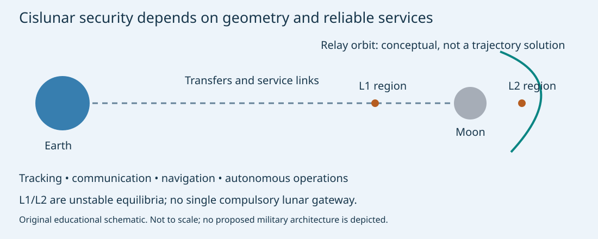

# The Moon, cislunar infrastructure and future space security

**MIE 446 · Aerospace Structures · Engineering case study**  
Evidence checked: **11 November 2026** · [Course readings](READINGS.md) · [Illustrated web edition](https://ehsan-roohi.github.io/Aerospace-Structures/case-studies/cislunar-security/)

## 1. What the news actually establishes

The [Zoomit article supplied for this reading](https://www.zoomit.ir/space/470966-us-military-satellite-constellation-cislunar-space/) raises an important question: why is the region between Earth and the Moon attracting military attention? Its full text could not be retrieved during preparation. The factual account below therefore rests on independently checked public sources, rather than treating the headline as evidence of an operational constellation.

The Department of the Air Force published **Cislunar Space System (CSS) RFI 10302026-01** on SAM.gov; the indexed record shows a 3 November 2026 publication and a 24 November response deadline. An RFI collects market information for a possible acquisition. It is not a procurement award, a launch, or a deployed capability. [1]

Reporting on the notice describes interest in **up to five initial spacecraft**, a **late-2029 objective**, and possible follow-on expansion. Those details are corroborated by a public reproduction of the notice, but its technical attachment was not independently downloaded here. They should be read as preliminary planning, not a guaranteed schedule. The government-provided payload should not be relabeled an offensive weapon without evidence. [2,3]

| Evidence category | What can be said | What cannot be inferred |
|---|---|---|
| Official CSS market research | DAF is exploring a potential cislunar acquisition | A deployed fleet or funded final architecture |
| Reported initial scale and date | Up to five seed vehicles; late 2029 is a planning objective | Five operational satellites already around the Moon |
| Official Oracle descriptions | AFRL is developing mobility and space-awareness experiments | Oracle is identical to CSS or an announced weapon |
| Engineering interpretation | Communications and tracking infrastructure can have strategic value | Lunar occupation automatically controls Earth orbit |

## 2. The strategically useful region is larger than the lunar surface

Here **cislunar** means the Earth–Moon operating region, including transfer trajectories and orbits influenced strongly by both bodies. It is not synonymous with a low lunar orbit. A spacecraft can serve lunar traffic without landing, and an orbital service does not establish ownership of terrain.

The more useful analogy is a developing transportation and information network. Spacecraft need communications, position estimates, time synchronization, traffic information and reliable power. Whoever supplies dependable services may acquire economic and operational influence. That influence remains contingent on customers, interoperability, redundancy, cost and lawful access; it is not territorial sovereignty.

*Figure 1. Original conceptual schematic. Separations and symbols are not to scale. L1/L2 neighborhoods are useful geometries, not mandatory gateways or stable parking lots.*

## 3. Why the Moon could matter in a future conflict

The following are **strategic inferences**, not claims about a disclosed CSS payload.

| Function | Potential strategic importance | Engineering limitation |
|---|---|---|
| Space domain awareness | Detecting and following traffic helps distinguish routine activity from unusual behavior | Detection is not identification; unfavorable illumination, range and occlusion leave gaps |
| Communications relay | Supports operations beyond direct Earth visibility, including far-side users | Relay failure or poor geometry can interrupt service; redundancy matters |
| Position, navigation and timing | Enables autonomous navigation and coordination of distributed assets | Timing errors and sparse measurements can make orbit estimation poorly conditioned |
| Infrastructure continuity | Reliable services can sustain civil, commercial and government operations during disruption | Service dependencies can become shared failure points |
| Logistics and resources | Local water-derived products could eventually reduce imported consumables | Extraction, processing, storage and transport must first become practical |
| Standards and partnerships | Shared interfaces can shape which systems interoperate | Influence through standards does not confer ownership or lawful exclusion |

A serious security discussion therefore concerns **visibility, service assurance, resilience and escalation management** before it concerns cinematic battles on the surface. Civil and military systems may share technologies, but shared technology is not proof that a particular civil mission has an offensive role.

Nor is the Moon a convenient substitute for nearby Earth-orbit infrastructure. It is distant, moving, expensive to reach and unable to see all directions continuously. Long range, lunar terrain, the Sun and the Moon itself constrain observations. Occupying a location does not remove those constraints.

## 4. What Oracle demonstrates—and what remains separate

AFRL distinguishes **Oracle-Mobility (Oracle-M)** from **Oracle-Prime (Oracle-P)**. In its public account, the former investigates movement, navigation and tracking of known objects; the latter investigates discovery and tracking, including onboard processing. These are research foundations for awareness beyond geosynchronous orbit. Their public description does not establish that CSS uses the same architecture or payload. [4]

The official page links this educational video: [AFRL: Oracle Satellite — Cislunar Space](https://www.youtube.com/watch?v=sDPBaetbKE4). It explains the program concept; illustrations are not flight footage establishing deployment. Playback was not independently tested during preparation.

Do not equate monitoring with hostile intent. Awareness supports collision avoidance and attribution, while a surveillance capability may also create security concerns for other operators. An engineering assessment should state the demonstrated function, the evidence and the uncertainty separately.

## 5. The physics of distance: delay, links and detection

For a representative mean Earth–Moon separation $R=384{,}400\,\mathrm{km}$, using $c=299{,}792.458\,\mathrm{km/s}$,

$$t_{\rm one-way}=R/c\approx1.282\,\mathrm{s},\qquad t_{\rm round-trip}\approx2.564\,\mathrm{s}.$$

These are propagation times only, not full command-response latency. Routing, computation, interruptions and a different spacecraft location add delay. This favors onboard fault protection and autonomous navigation, rather than continuous immediate control from Earth.

For an ideal free-space radio link,

$$P_r=P_tG_tG_r\left(\frac{\lambda}{4\pi R}\right)^2.$$

With fixed frequency and antenna gains, ten times the range means one hundredth of the received power: a **20 dB** additional path loss. At 384,400 km versus 40,000 km, the illustrative penalty is $20\log_{10}(384400/40000)\approx19.65$ dB. This is a radio-link calculation, not a complete optical tracking model.

For reflected-light detection, brightness also depends on object size, surface scattering, solar illumination, phase angle, background and sensor properties. A passive optical observation must not be assigned the two-way radar $R^{-4}$ scaling indiscriminately. More spacecraft may improve viewing diversity, but spacecraft count alone does not prove continuous coverage. [4]

## 6. Three-body motion: useful geometry without a magic chokepoint

A two-body Kepler orbit is often insufficient near the Moon. A simplified rotating-frame circular restricted three-body model writes

$$\ddot x-2\dot y=\partial_x\Omega,\quad
\ddot y+2\dot x=\partial_y\Omega,\quad
\ddot z=\partial_z\Omega,$$

$$\Omega=\frac{x^2+y^2}{2}+\frac{1-\mu}{r_1}+\frac{\mu}{r_2},\qquad
\mu=\frac{m_{\rm Moon}}{m_{\rm Earth}+m_{\rm Moon}}.$$

Distances are normalized by the primary separation and time by the inverse orbital angular rate. The model assumes circular primary orbits and neglects solar perturbations and other forces. It explains equilibrium regions and families of trajectories; precision navigation needs a higher-fidelity model.

**L1 and L2 are unstable equilibria in this ideal model.** Orbits in their neighborhoods require navigation and stationkeeping. NASA's explanation supports this distinction, despite occasional promotional language about gravitational stability. There is no single narrow passage through which all Earth–Moon traffic must pass. [5]

NASA's CAPSTONE validated operations in a near-rectilinear halo orbit and navigation technology involving Lunar Reconnaissance Orbiter. NASA reports that its activities concluded in June 2026, with subsequent technology use by the operator. It is a civil technology demonstration, not evidence of military deployment. [6]

## 7. Propulsion, power and thermal design

For a propulsion system described by an effective exhaust velocity $v_e=g_0 I_{sp}$,

$$\Delta v=g_0I_{sp}\ln(m_0/m_f).$$

For an **illustrative**, unassigned $\Delta v=100\,\mathrm{m/s}$ and $I_{sp}=220\,\mathrm{s}$, the ideal propellant fraction is $1-\exp[-100/(9.80665\times220)]\approx4.53\%$. This is not an Oracle/CSS specification and excludes tanks, margins, reserves and losses. An efficient trajectory may reduce propellant requirements while increasing transfer time or operational complexity. Electric propulsion trades high specific impulse against low thrust and electrical-power demand.

A spacecraft's lifetime is limited by more than fuel. Batteries age, sensors degrade, radiation affects electronics, and eclipses interrupt solar generation. A first-order radiator model is

$$Q_{\rm rad}=\epsilon\sigma A(T^4-T_{\rm env}^4).$$

Here $T_{\rm env}$ is an effective radiative environment, not an atmospheric temperature. A real energy balance includes absorbed solar radiation, planetary radiation, internal dissipation, conduction and changing view factors. Deep space does not automatically keep a spacecraft cool.

These constraints connect mission endurance to deployable structure area, pointing, thermal distortion and power-system mass.

## 8. Why this belongs in Aerospace Structures

Large communication antennas and solar arrays are flexible structures. Launch loads, deployment reliability and thermal cycling matter even if the operational environment has negligible aerodynamic pressure.

For a simplified cantilever appendage with constant bending stiffness $EI$, length $L$ and transverse end force $F$,

$$\delta_{\rm tip}=\frac{FL^3}{3EI},\qquad M_{\rm root}=FL,\qquad
\sigma_{\max}=\frac{M_{\rm root}y_{\max}}{I}.$$

For a uniform Euler–Bernoulli cantilever,

$$f_1=\frac{1.875^2}{2\pi L^2}\sqrt{\frac{EI}{\rho_s A_s}}.$$

The material density $\rho_s$ and cross-sectional area $A_s$ should not be confused with atmospheric density or antenna aperture. Attached tip mass, joints, deployment mechanisms and spacecraft coupling change this estimate.

With $L=2$ m, $EI=100$ N m$^2$, $F=1$ N and $\rho_s A_s=1$ kg/m, the ideal model gives **26.7 mm tip deflection, 2 N m root moment and 1.40 Hz first bending frequency**. Doubling length at fixed section increases static deflection eightfold and reduces this frequency fourfold.

Why care? Antenna or optical-sensor pointing may be limited by structural jitter. A larger aperture improves capability only if deployment, thermal stability and attitude control preserve alignment. Attitude-control disturbances can excite appendage modes; simply making a structure lighter can worsen the pointing problem.

## 9. Water, infrastructure and the limits of the resource argument

NASA summarizes evidence for lunar water and ice, including permanently shadowed polar environments. Evidence of a resource is not evidence of an economically operating mine. Water may eventually supply life support or feedstock for oxygen/hydrogen production, but excavation, energy, purification, cryogenic storage and transport determine usefulness. [7]

Thus resource access could matter strategically **if** infrastructure matures. It is premature to treat every identified deposit as usable propellant, or first arrival as legal ownership. Technical reliability and interoperable services may create influence well before extraction becomes economical.

## 10. Law and escalation: the Moon is not an unrestricted battlefield

The Outer Space Treaty must be distinguished from predictions about conflict. Article II rejects national appropriation. Article IV prohibits nuclear weapons and other weapons of mass destruction in the specified space settings and requires peaceful use of the Moon and other celestial bodies; military bases, fortifications, weapon testing and military maneuvers on celestial bodies are forbidden. Peaceful scientific use of military personnel is permitted. [8]

These provisions do not amount to a blanket ban on every military-operated satellite in space. Conversely, a military institution's interest in lunar services does not make a lunar military base lawful. Article IX adds due-regard and consultation obligations concerning potentially harmful interference. This is an educational reading of treaty text, not a resolution of every contested legal interpretation.

Strategic risk may arise from ambiguous intent, mistaken attribution or service disruption as much as physical attack. Redundant links, transparent operations and shared safety information can reduce accident and escalation risks. These are policy and engineering considerations, not evidence that a lunar war is inevitable.

## 11. Classroom exercise: build a resilient service, not a battle plan

1. Sketch a civil lunar communications chain with direct-to-Earth and relay paths. Identify occlusion and a single-point failure. Explain why five vehicles do not automatically ensure continuous service.
2. Recalculate propagation delay and relative radio path loss for 300,000, 384,400 and 450,000 km. State every fixed assumption.
3. Model the 2 m cantilever in [BeamLab](https://ehsan-roohi.github.io/Aerospace-Structures/wing-lab.html). Compare 1, 2 and 4 m lengths with the same section; check the $L^3$ and $L^{-2}$ scaling. The static load is an illustrative equivalent load, not a measured spaceflight load.
4. Propose a stiffness-versus-mass trade study. Explain what additional measurements are required to connect beam motion to antenna pointing.
5. Label each major claim in a one-page mission brief as **observed**, **officially planned**, **reported**, or **inferred**. Include the RFI-versus-award distinction and the treaty's surface-versus-orbit distinction.

## References and evidence trail

All links were checked or retrieved through search on 11 November 2026. A news link is context; official mission pages, physical derivations and treaty text carry the technical claims. Status statements describe that date only.

1. **Department of the Air Force / SAM.gov.** *Request for Information (RFI) for a Cislunar Space System (CSS)*, notice 10302026-01. [Official record](https://sam.gov/workspace/contract/opp/578f3342f18a4088b0b9dbab12bdb4d4/view). The indexed official description establishes market research. The interactive page may require a browser.
2. **Courtney Albon, Air & Space Forces Magazine**, 2 November 2026. [Space Force Weighs Proliferated Cislunar Satellite Constellation](https://www.airandspaceforces.com/space-force-weighs-proliferated-cislunar-satellite-constellation/). Secondary reporting for initial scale and schedule.
3. **Public reproduction of DAF notice**, [CSS RFI 10302026-01](https://proposalworkspace.com/federal-opportunities/10302026-01-request-for-information-rfi-for-a-cislunar-space-system-578f3342f18a4088b0b9dbab12bdb4d4). Corroboration of procurement language; not an independently authenticated technical attachment.
4. **AFRL.** [Oracle Family of Systems](https://afresearchlab.com/cislunar-highway-patrol-system-chps-2/). Public program description and [linked official video](https://www.youtube.com/watch?v=sDPBaetbKE4). The analysis above uses mission-function descriptions; no exact launch date is inferred from older program pages.
5. **NASA Science.** [What are Lagrange Points?](https://science.nasa.gov/solar-system/resources/faq/what-are-lagrange-points/). Equilibrium and stability concepts; the reading specifies the Earth–Moon system separately from common Sun–Earth examples.
6. **NASA.** [CAPSTONE](https://www.nasa.gov/mission/capstone/) and [completion of extended mission testing](https://www.nasa.gov/technology/space-comms/nasas-capstone-completes-extended-mission-testing-lunar-technologies/), 6 July 2026.
7. **NASA Science.** [Moon Water and Ices](https://science.nasa.gov/moon/moon-water-and-ices/). Resource evidence; not an economic extraction assessment.
8. **United Nations / UNOOSA.** [United Nations Treaties and Principles on Outer Space](https://www.unoosa.org/pdf/publications/STSPACE11E.pdf), Outer Space Treaty Articles II, IV and IX. [Alternative official treaty text](https://www.acq.osd.mil/asda/ssipm/sdc/tc/ost/OSTtext.html).
9. **NASA SCaN.** [Lunar networking / LunaNet](https://www.nasa.gov/communicating-with-missions/lunanet/) and [LunaNet Interoperability Specification](https://www.nasa.gov/directorates/somd/space-communications-navigation-program/lunanet-interoperability-specification/). Civil communications, navigation and interoperability context; not a military constellation specification.

The distance, radio-link, propulsion, radiator and beam equations are standard idealized engineering models derived or defined in the text. Numerical examples are original teaching calculations, not measured program performance. Figure 1 is original course artwork.
