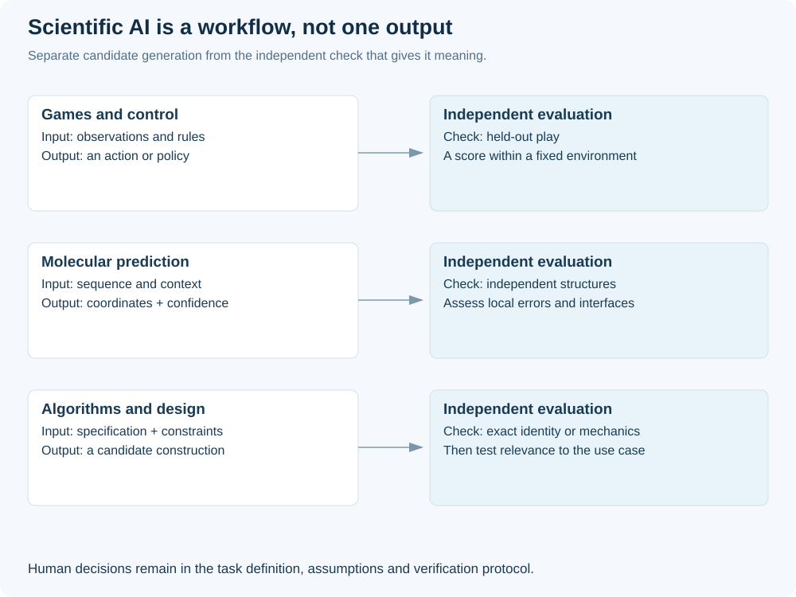
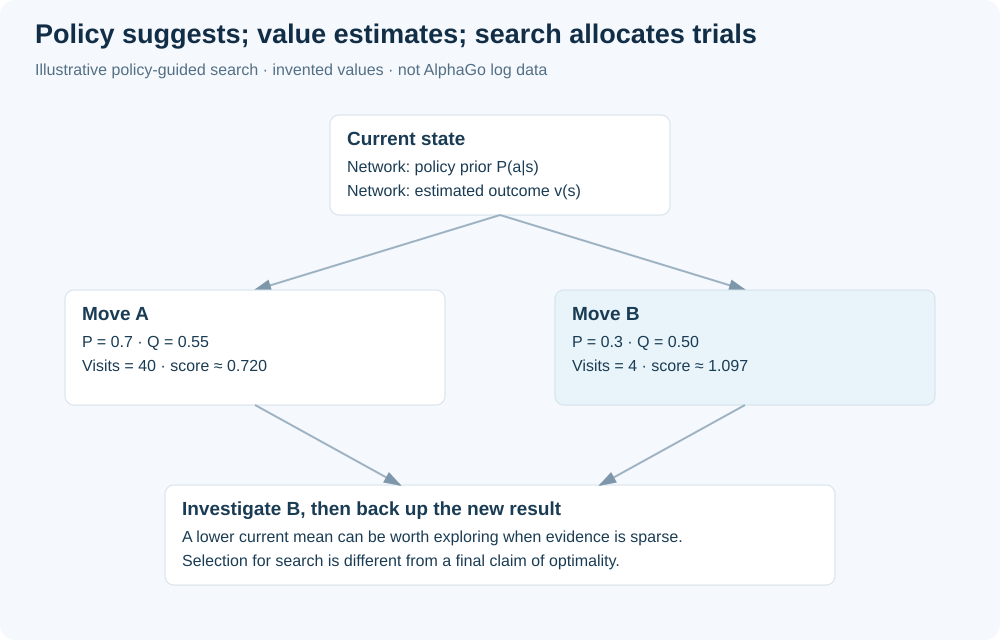
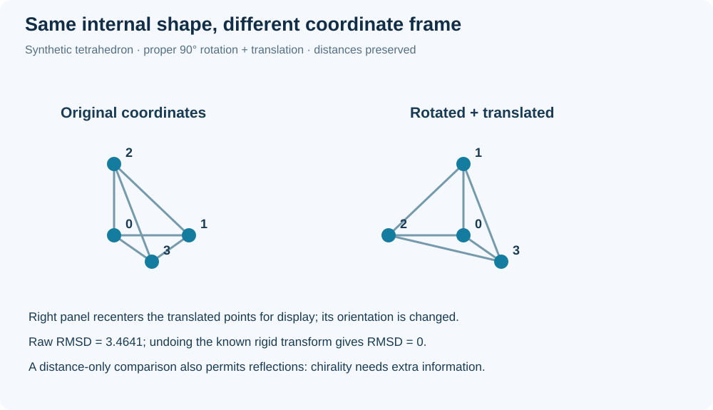
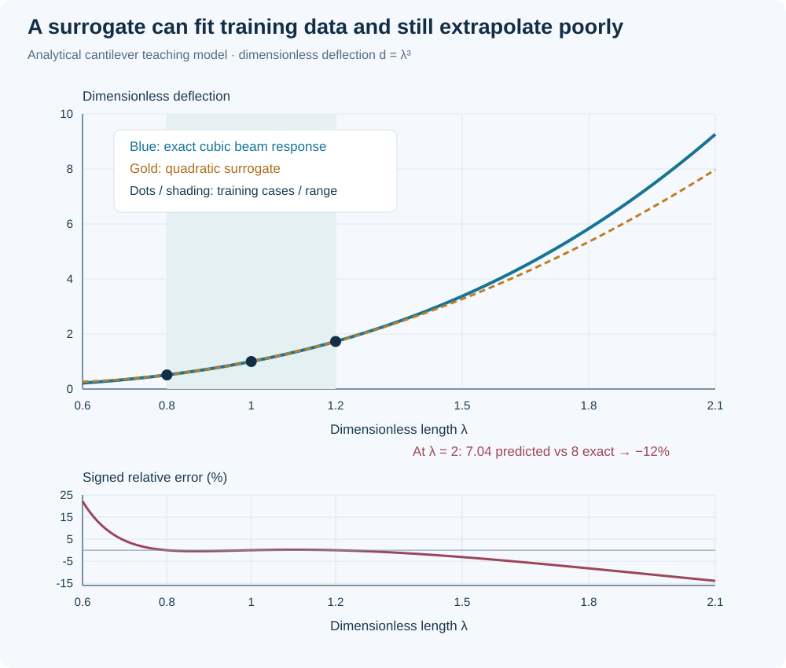
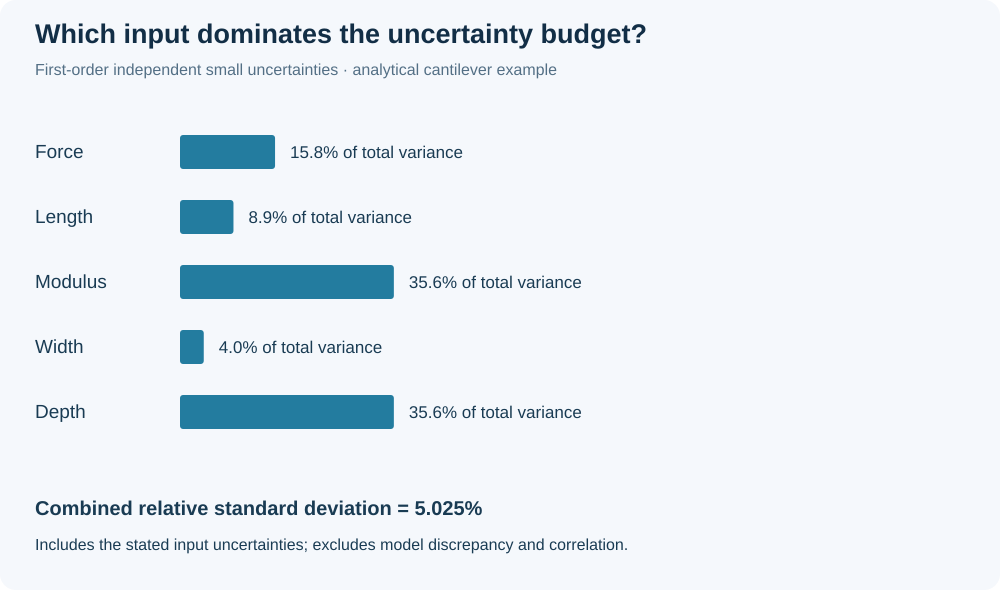

# Demis Hassabis and AI for science: from games to validated discovery

MIE 446 · Aerospace Structures · Extended interdisciplinary reading · 31 October 2026

[Course home](README.md) · [Illustrated reading](https://ehsan-roohi.github.io/Aerospace-Structures/case-studies/hassabis/) · [Reproducible calculations](docs/case-studies/hassabis/calculations.py)

### خلاصهٔ فارسی و نقشهٔ مطالعه

دمیس هاسابیس هوش مصنوعی را ابزاری برای حل مسائل علمی می‌بیند. مسیر کاری او از بازی و علوم اعصاب به یادگیری تقویتی، AlphaGo و پیش‌بینی ساختار پروتئین رسیده است. جایزهٔ نوبل شیمی ۲۰۲۴، دستاوردی مشخص در پیش‌بینی ساختار پروتئین را تأیید می‌کند؛ این دستاورد به معنای حل همهٔ زیست‌شناسی، کشف داروی تأییدشده یا دستیابی به هوش عمومی نیست.

این گزارش با الهام از مقالهٔ زومیت، توضیح مستقلی دربارهٔ مبانی ریاضی این مسیر ارائه می‌کند. یادگیری تقویتی، معادلهٔ بلمن، شبکهٔ سیاست و ارزش، جست‌وجوی درختی، هندسهٔ سه‌بعدی، توجه، انتشار، عدم‌قطعیت و طراحی آزمایش را قدم‌به‌قدم بررسی می‌کنیم. سپس یک مثال تحلیلی تیر نشان می‌دهد که مدل می‌تواند در بازهٔ آموزش دقیق باشد و بیرون آن به‌شدت خطا کند. همهٔ اعداد مثال‌های آموزشی از فرض‌های مشخص به دست آمده‌اند و نتیجهٔ آزمایش واقعی یا اجرای AlphaFold نیستند.

شکل‌ها شامل عکس واقعی هاسابیس با مجوز مشخص، نمودارهای توضیحی و نمودارهای محاسباتی است. پیش‌بینی زمانی AGI، فرضیه‌ای دربارهٔ آینده باقی می‌ماند؛ برای داوری علمی باید آزمون، دادهٔ مستقل، بازتولید و محدودیت‌ها را بررسی کرد.

## 1. What the starting article contributes

The supplied feature by Pooyesh Pourmohammad [[1]](#ref-1) presents Hassabis as a researcher whose interests in games, cognition and scientific discovery converge on building more general intelligence. It discusses AlphaGo, AlphaFold, Isomorphic Labs and his proposed “Einstein test”: whether a system restricted to historical knowledge could independently produce major new physics. It also reports an optimistic two-to-three-year AGI forecast and recent organizational changes.

This reading uses that narrative as a starting point and develops an independent technical tutorial. It does not reproduce the full article or treat its future predictions as experimental findings. Figure 1 introduces the scientist; the subsequent sections focus on mechanisms and evidence that students can analyze rather than personal anecdotes that cannot be checked from the supplied research papers.

**Figure 1.** Photograph by Arthur Petron, 8 December 2024, via [Wikimedia Commons](https://commons.wikimedia.org/wiki/File:Demis_Hassabis,_2024_Nobel_Prize_Laureate_in_Chemistry.jpg), [CC BY-SA 4.0](https://creativecommons.org/licenses/by-sa/4.0/). Redistributed from the source without intentional image edits. This historical photograph does not establish his current organizational title.

The Nobel committee awarded half the 2024 Chemistry Prize jointly to Hassabis and John Jumper for protein structure prediction, and the other half to David Baker for computational protein design [[2]](#ref-2). The scope matters: the citation recognizes particular contributions, not a certificate that every prediction from these systems is correct. Collaborative authorship also matters. The scientific achievements discussed below resulted from large teams, accumulated biological data, experimental structures and sustained computational work.

A useful reading strategy is to ask three questions throughout: What exactly is the input and output? What objective was optimized? What independent check determines whether the output is useful? These questions work equally well for a game-playing agent, a protein predictor and a structural surrogate. They expose both the transferable ideas and the differences that a broad phrase such as “AI solves science” can conceal.

## 2. A map of distinct scientific tasks

Figure 2 organizes the research trajectory around task types rather than a single universal algorithm. Reinforcement learning chooses actions from feedback. Structure prediction estimates a configuration from molecular information. Algorithm discovery searches symbolic constructions that can be checked. Engineering design selects an artifact under physical and practical constraints. Shared computational ingredients do not erase these differences.

**Figure 2.** Original conceptual map. The diagram groups tasks by their verification process; arrows indicate a proposed research workflow rather than a claim that one published system already performs every stage autonomously.

| Task | Representative input | Output | Meaningful independent check |
|---|---|---|---|
| Game control | Observation, legal actions, score history | Next action or policy | Held-out games under fixed rules |
| Protein structure prediction | Sequence and molecular context | Atomic coordinates and confidence estimates | Structures unavailable during prediction |
| Algorithm search | Formal specification and allowed operations | Candidate computation | Algebraic identity or exhaustive exact verification |
| Structural surrogate | Geometry, loads, boundary conditions, material | Approximate response field or quantity | Independent solver, analytical limit and experiments as appropriate |
| Scientific discovery | Existing evidence and an unresolved question | New explanatory hypothesis | New predictions, discriminating tests and replication |

A model can succeed at one row without satisfying the others. Predicting a coordinate set does not automatically explain a folding pathway. Finding a powerful game strategy does not imply causal understanding of a laboratory intervention. Producing an unusual hypothesis does not establish that the hypothesis is true. The table is therefore a guide to claim precision, not a ranking of which research field is more important.

For students, the most productive connection is methodological. State a task tightly enough that failure is observable. Preserve a way to evaluate a candidate without relying entirely on the mechanism that proposed it. If the same learned evaluator both produces and certifies a design, a shared blind spot can appear twice and look like independent agreement. A separate calculation or physical measurement can break that circularity.

## 3. Why games are attractive research environments

Games offer a relatively clean interface between an agent and a world. An action changes a state; a rule determines legal transitions; an outcome provides a reward. Many experiments can be repeated cheaply, and the environment often supplies an unambiguous terminal result. This makes games valuable for testing learning algorithms even when the final scientific ambition lies elsewhere.

A standard mathematical description is a Markov decision process with states $s$, actions $a$, transition kernel $P(s'\mid s,a)$, reward $r(s,a,s')$ and discount factor $0\le\gamma<1$. A policy $\pi(a\mid s)$ specifies action probabilities. The discounted return from time $t$ is

$$G_t=\sum_{k=0}^{\infty}\gamma^k r_{t+k+1}.$$

The Markov assumption says the next-state distribution depends on the current state and action, rather than the complete earlier history once that state is known. A single video frame may not contain such a state: velocity, hidden objects or earlier actions can matter. Engineers meet the same issue when a displacement snapshot omits velocity or material history. A useful state representation must retain the information needed for prediction.

An optimal policy maximizes expected return, not necessarily immediate reward. A move that loses points now may open a route to a larger later reward. Conversely, an immediate gain can lead to a terminal loss. This is the mathematical reason planning and evaluation must consider consequences across time. It is also why a reward function is a substantial modeling decision: the agent optimizes the specified objective, which may differ from the human designer's informal intention.

When transferring this framework to science, the clean properties of games must be reconsidered. A laboratory experiment can be costly, slow, noisy and irreversible. Rules may be incompletely known. Some actions may be unacceptable despite high predicted reward. A simulator can provide unlimited synthetic experience while sharing errors with the learned policy. Successful transfer therefore requires a new environment model and new validation, not merely a new label on the reward.

## 4. Bellman equations and a worked action-value update

For a fixed policy, the state value is $V^\pi(s)=E_\pi[G_t\mid s_t=s]$. Separate the first reward from the future return to obtain

$$V^\pi(s)=\sum_a\pi(a\mid s)\sum_{s'}P(s'\mid s,a)\left[r(s,a,s')+\gamma V^\pi(s')\right].$$

The action value $Q^\pi(s,a)$ conditions additionally on the first action. The optimal action value satisfies the Bellman optimality relation

$$Q^*(s,a)=\sum_{s'}P(s'\mid s,a)\left[r(s,a,s')+\gamma\max_{a'}Q^*(s',a')\right].$$

This equation is a consistency condition: an optimal action accounts for the best attainable continuation. It is not a claim that all states can be enumerated in a complex environment. Approximation enters when a network represents $Q$, samples estimate expectations, or a finite search substitutes for complete planning. Each approximation creates another opportunity for error that should be evaluated separately.

Consider a toy update with current estimate $Q(s,a)=2$, observed reward 1, next-state maximum value 3, discount 0.9 and learning rate 0.1. The temporal-difference target is $1+0.9\times3=3.7$. The update

$$Q_{\rm new}=Q_{\rm old}+\alpha\left[r+\gamma\max_{a'}Q(s',a')-Q_{\rm old}\right]$$

gives $2+0.1(3.7-2)=2.17$. The target is an estimate using another value estimate, not a directly observed complete return. This bootstrapping helps propagate information through long sequences, but errors can also propagate. A numerical update being internally consistent does not establish that its future-value estimate is accurate.

Under the usual discounted finite-state setting, the Bellman optimality operator is a contraction in the sup norm with factor $\gamma$. Intuitively, changing all future values by at most $\varepsilon$ changes a one-step discounted target by at most $\gamma\varepsilon$. This supports convergence arguments for exact value iteration. It does not automatically prove convergence for arbitrary neural-network training, changing data distributions or a partially observed environment.

A useful engineering analogy is iterative equilibrium solution. An iteration can have a clean fixed-point equation while a particular numerical implementation still diverges, converges slowly or reaches an inaccurate approximation. Distinguish the governing relation, the approximation space and the solver. The same three-way distinction is essential when evaluating a machine-learning method built around a physically meaningful objective.

## 5. What deep Q-learning added

The 2015 Atari work [[3]](#ref-3) demonstrated that a deep network could learn useful action values from image-based game input across a collection of tasks. Important practical ingredients included replaying stored transitions and using a separate target network to stabilize target construction. The result was a major advance in control from high-dimensional observations; its title should not be read as a demonstration of unrestricted human intelligence.

For a generic squared temporal-difference objective, one writes

$$L(\theta)=E_{(s,a,r,s')\sim\mathcal D}\left[\left(r+\gamma\max_{a'}Q_{\bar\theta}(s',a')-Q_\theta(s,a)\right)^2\right],$$

where $\mathcal D$ is a replay distribution and $\bar\theta$ denotes fixed or slowly refreshed target parameters. This is a pedagogical expression of the central idea rather than a complete reproduction of every preprocessing and optimization detail in the original experiment. A faithful replication requires those details, including action handling, reward processing and evaluation protocol.

The gradient changes the current prediction toward the target, while the target parameters remain fixed during that gradient step. Stored transitions reduce the immediate dependence on consecutive observations, although they do not make all samples perfectly independent or representative. A replay memory can also preserve experiences generated under older policies, so the learning problem includes a distinction between the behavior that collected data and the policy being improved.

For structural machine learning, replay has a loose analogue in retaining diverse solved cases instead of training only on the newest geometry. But structural cases do not become a Markov decision process merely because they are stored in a buffer. The analogy concerns data coverage and reuse. A design dataset must still represent load, geometry, material and boundary-condition variations relevant to its intended application.

A further lesson is that an aggregate performance statement hides variability across tasks. A model can perform exceptionally in some games and poorly in others. Likewise, an average field error across many simulations can conceal a poor lower-corner vortex prediction or a large local stress error. Report task-specific and region-specific results when the use case depends on them. A single average should not erase the cases that determine failure.

## 6. Policy, value and search in AlphaGo

The 2016 AlphaGo paper [[4]](#ref-4) combined learned policy and value models with tree search. A policy suggests promising moves; a value estimate predicts the eventual outcome of a position; search examines possible continuations. The system's success shows how learned approximations and explicit computation can reinforce one another. It does not imply that the search examines every possible game.

A policy can be written as $p_\theta(a\mid s)$, a probability distribution over legal actions. A value network $v_\phi(s)$ returns an estimated outcome score. If outcomes are encoded as wins and losses, the value must be interpreted according to the training target and player perspective. Mixing the current player's perspective with an opponent's perspective creates a sign error that can invalidate an otherwise plausible implementation.

An illustrative tree-selection score has the form

$$S(s,a)=Q(s,a)+c\,P(s,a)\frac{\sqrt{N(s)}}{1+N(s,a)},$$

where $Q$ is the current mean backed-up value, $P$ is a learned prior, and the visit counts control exploration. This is a common policy-guided exploration form used here to explain the principle; it is not asserted to be the exact expression of every AlphaGo version. The exploration term becomes smaller for frequently visited moves and can promote a promising but underexplored alternative.

Suppose move A has value estimate 0.55, prior 0.7 and 40 visits; move B has value 0.50, prior 0.3 and four visits. With parent count 44 and $c=1.5$, their scores are approximately 0.720 and 1.097. Search selects B for further investigation despite its lower present mean value. Exploration can be rational because the current estimate has been supported by less evidence.

Figure 3 separates the learned components from the search bookkeeping. Policy and value networks are not final certificates of a move's quality. Their predictions guide finite computation, whose outcomes are then backed up to update action evaluations. This feedback explains why a weaker evaluator plus useful search can outperform an evaluator used greedily. It also explains why search quality depends on the accuracy of the environment model.

**Figure 3.** Original explanatory schematic. Node values and visits in the worked example are invented for teaching and are not recorded AlphaGo search statistics.

## 7. Self-play and the difference between improvement and proof

Self-play generates training experience by letting a system compete with versions of itself. The AlphaGo Zero work [[5]](#ref-5) showed a later approach that learned from self-play without human game examples. Human contributions still included the rules, learning architecture, computational resources and training procedure. “Without human examples” is therefore a specific data statement, not the absence of human design.

A simplified joint objective for a network producing policy $p_\theta$ and value $v_\theta$ is

$$\ell(\theta)=(z-v_\theta(s))^2-\sum_a\pi(a\mid s)\log p_\theta(a\mid s)+\lambda\|\theta\|_2^2,$$

where $z$ is a realized game outcome and $\pi$ is a search-improved action distribution. The value term fits outcomes, the cross-entropy term fits the search target, and the last term regularizes parameters. This equation is a useful conceptual template; implementation details determine exactly which states, outcomes and search distributions enter a given training run.

The policy target can be stronger than the raw network because search uses additional computation. Training then compresses some of that improvement back into the network. Repeating this cycle can improve play. But the target distribution is produced by a finite process, and self-play may visit a restricted subset of situations. Improvement against earlier versions is evidence of progress under that comparison, not a universal proof of optimal play.

For scientific design, an analogous proposal would generate candidate structures, evaluate them, improve a policy and repeat. The crucial difference is the evaluator. A game engine usually enforces exact rules and determines a winner. A structural surrogate may be inaccurate precisely where optimization searches most aggressively. Repeatedly optimizing against that surrogate can amplify its mistakes, even while the nominal score improves.

A defensible engineering loop therefore includes independent checks and explicit limits on where the learned evaluator can be trusted. Candidate rejection is useful evidence rather than an inconvenience. Keep records of infeasible, unstable and nonmanufacturable proposals, because they reveal which part of the loop needs revision. Successive best scores alone can conceal a growing gap between the modeled objective and the actual design problem.

## 8. Protein structure prediction is a geometric inference problem

AlphaFold2's 2021 paper [[6]](#ref-6) describes a method that achieved strong blind-assessment performance for protein structure prediction. Its inputs use sequence information and evolutionary relationships, together with learned structural representations. The central output is a three-dimensional structural prediction with confidence information. This is a different task from simulating every molecular motion along a physical folding trajectory.

For a pedagogical abstraction, let a sequence be $s=(s_1,\ldots,s_L)$ and let the output coordinates be $X=(x_1,\ldots,x_N)$ with $x_i\in\mathbb R^3$. A learned predictor has the form $X=f_\theta(s,\mathrm{context})$. The context may contain aligned sequences, templates or other permitted inputs. Calling the problem “sequence to structure” is a useful shorthand, but an evaluation must state the actual input information available.

Atomic coordinates have an important symmetry: translating or rotating an entire molecule does not change its internal shape. Comparing two structures directly in an arbitrary laboratory frame can therefore assign a large error to physically identical configurations. A sensible comparison must account for rigid-body alignment or use invariant internal geometry. This is closely related to choosing consistent reference frames when comparing finite-element displacement fields or reconstructed aircraft geometries.

Interatomic distances $d_{ij}=\|x_i-x_j\|$ are invariant under a common translation and orthogonal transformation. However, distances alone do not distinguish a configuration from its mirror image. Biological chirality and orientation-sensitive geometric information are therefore essential. A model that matches a distance table can still violate a property not encoded by that table. Mathematical invariance should be chosen to match the physics rather than applied indiscriminately.

A simple pairwise loss for a teaching model is

$$L_{\rm dist}=\frac{1}{|\mathcal P|}\sum_{(i,j)\in\mathcal P}\left(\|x_i-x_j\|-d_{ij}^{\rm target}\right)^2.$$

This is not the full AlphaFold2 loss. It illustrates how geometry can enter training, and also why one scalar objective is rarely sufficient: local bond geometry, steric plausibility, orientation, missing atoms and uncertain regions can all matter. The structural analogue is a model that fits displacements while violating equilibrium or predicts stresses without respecting material admissibility.

## 9. Rigid alignment and an exact coordinate example

To compare predicted coordinates $X$ with reference coordinates $Y$, a common metric is aligned root-mean-square deviation:

$$\mathrm{RMSD}=\min_{R\in SO(3),\,t\in\mathbb R^3}\sqrt{\frac1N\sum_i\|Rx_i+t-y_i\|^2}.$$

Here $SO(3)$ permits proper rotations, not reflections. First subtract the centroids to remove translation. The remaining least-squares rotation can be obtained from a singular-value decomposition of a cross-covariance matrix, with a determinant correction to prevent a mirror transformation. These details matter because unconstrained orthogonal alignment can hide a chirality error.

The supplied calculation uses four noncoplanar points, applies a known 90-degree rotation and a translation, and verifies that pair distances remain unchanged. The raw coordinate RMSD is large because the frames differ. Undoing the known rigid transformation yields zero error to numerical precision. We use a known transform so the check remains transparent; the source does not claim to implement or benchmark a full molecular-alignment package.

Figure 4 plots the teaching configuration before and after transformation. The points are a synthetic tetrahedron, not a protein backbone or an AlphaFold prediction. Its purpose is to show a geometric invariance in a small case that can be inspected exactly. A real protein comparison involves many more points, possible missing residues, domain motion and a carefully specified atom-selection rule.

**Figure 4.** Original synthetic geometry illustration generated from the supplied coordinate calculation. Connecting lines identify the same point pairs; they do not represent molecular bonds or measured protein structure.

A single global RMSD can also conceal local problems. A large flexible loop may dominate the number while a binding pocket is accurate, or a globally plausible fold may contain a consequential local error. Conversely, a low global average can hide one wrong interface. For engineering applications, compare global norms with local quantities that determine the decision, such as maximum stress, joint clearance or mode localization. The appropriate metric follows the intended use.

## 10. Attention as a mechanism for relating distant elements

Attention allows a model to construct representations using weighted combinations of other elements. For query, key and value matrices $Q,K,V$, the familiar scaled dot-product expression is

$$\mathrm{Attention}(Q,K,V)=\mathrm{softmax}\!\left(\frac{QK^T}{\sqrt{d_k}}\right)V.$$

The softmax is applied row by row. Each row of weights sums to one, but those weights are computational mixing coefficients, not automatically calibrated probabilities that a physical hypothesis is true. Their interpretation depends on the representation, task and training procedure. A visually strong attention map is therefore not, by itself, a causal explanation of a prediction.

For a toy query with unscaled scores $(2,1,0)$ and unit scaling, softmax weights are approximately $(0.66524,0.24473,0.09003)$. Applying them to values $(10,0,-10)$ gives about 5.75210. The output is a context-dependent weighted combination. Changing a distant key can change the result even if the query element itself remains fixed. This property helps explain why attention is useful for relationships that are not local in a sequence index.

In molecular models, residues distant in the amino-acid sequence may be close in three-dimensional space. In a wing, distant mesh nodes may be connected through load paths or constraints. Attention can represent nonlocal relationships, but it does not automatically know which relationships satisfy mechanics. Physical constraints, suitable training coverage and independent evaluation remain necessary.

Computational scaling is also relevant. A dense $L\times L$ attention matrix uses storage proportional to $L^2$ before implementation-specific savings. Doubling sequence length roughly quadruples the number of pairwise entries, not merely doubles it. For large meshes or long molecular systems, representation and algorithm choices can dominate feasibility. A conceptual architecture must eventually be assessed in memory, runtime and numerical accuracy as well as predictive score.

This section explains a general mechanism, not a claim that every AlphaFold module is an ordinary language-model transformer. Scientific architectures often modify attention, pair representations and geometric operations substantially. The right comparison is between documented modules and their roles, rather than assuming that one familiar equation reproduces the entire system.

## 11. Diffusion, noise and biomolecular interaction models

AlphaFold3 [[7]](#ref-7) expanded the prediction setting to complexes involving multiple molecular types and used a diffusion-based approach in its architecture. Its paper also explicitly discusses limitations, including the distinction between static predicted structures and molecular dynamics. This makes it a useful example of both increasing model scope and maintaining boundaries around what the output means.

To introduce diffusion mathematically, consider a generic forward corruption process

$$x_t=\sqrt{\bar\alpha_t}\,x_0+\sqrt{1-\bar\alpha_t}\,\varepsilon,\qquad\varepsilon\sim\mathcal N(0,I).$$

A generic denoising model learns to estimate noise or recover an underlying clean configuration from a noisy one, conditioned on relevant inputs. An illustrative noise-prediction objective is

$$L_{\rm noise}=E_{t,x_0,\varepsilon}\left[\|\varepsilon-\varepsilon_\theta(x_t,t,c)\|^2\right].$$

These are standard teaching equations for diffusion modeling, not a literal reconstruction of all AlphaFold3 training and sampling equations. Coordinate parameterizations, noise schedules, conditioning and geometry handling matter in an actual implementation. A model's output quality cannot be inferred from the generic loss alone.

The noise process is an artificial computational device. Its time index is not automatically physical molecular time, and a denoising trajectory is not automatically a folding pathway. This distinction is especially important when animated samples look like a molecule moving. Visual motion can suggest mechanistic explanation even when the algorithm is producing a conditional sample through an auxiliary process.

Multiple generated samples may reveal alternative plausible outputs, but sample spread is not guaranteed to equal the true physical uncertainty. It depends on the learned distribution, conditioning, sampling settings and missing modes. A narrow group of samples can still be confidently wrong. Validation must compare predictions to information unavailable during model construction, with metrics that reflect the proposed scientific or practical use.

## 12. Why a predicted protein is not an approved drug

Structure prediction can inform biological hypotheses, binding-site analysis and molecular design. Drug development additionally requires evidence about binding, selectivity, activity, toxicity, exposure, manufacturing and clinical effects. Success at one stage does not multiply into certainty across the whole chain. This logical distinction is sufficient to evaluate grand claims without assuming that the underlying research has little value.

Isomorphic Labs' own announcement states that it raised $2.1 billion in May 2026 to expand its AI drug-design work and move therapeutic programs toward the clinic [[8]](#ref-8). Funding and a candidate pipeline are organizational facts; they are not evidence that a treatment has completed clinical validation or cured a disease. This report makes no claim that the company's specific candidates have passed any particular clinical stage.

A generic probability chain makes the issue concrete. If four necessary development stages have conditional success probabilities $p_1,p_2,p_3,p_4$, then

$$P(\mathrm{all\ stages\ succeed})=p_1p_2p_3p_4,$$

where each factor is conditioned on reaching that stage. No independence assumption is needed for this chain-rule expression when the conditioning is correct. Using an illustrative value 0.7 at each stage gives $0.7^4=0.2401$. These numbers are invented for teaching, not estimates of pharmaceutical success rates or any particular company's program.

Improving an early-stage prediction can increase the number or quality of candidates entering the chain, but the overall effect depends on bottlenecks elsewhere. A faster first stage may have limited value if a later stage remains slow or if early optimization selects candidates that fail later. The appropriate evaluation is therefore a complete workflow comparison with relevant denominators and costs, not just a compelling molecular image.

The engineering parallel is straightforward. A wing that scores well in a surrogate analysis still needs a consistent load definition, material characterization, joint assessment, manufacturing inspection and appropriate validation. A successful visualization or simulation is one piece of evidence. It does not replace every downstream check merely because it was generated by a sophisticated model.

## 13. A claim audit for the 2026 narrative

| Statement encountered in the feature | Evidence category | How to use it responsibly |
|---|---|---|
| Hassabis and Jumper received the 2024 Chemistry Nobel for protein prediction | Official historical record [[2]](#ref-2) | State the award's actual scope |
| AlphaFold2 achieved a major structure-prediction advance | Peer-reviewed blind-assessment study [[6]](#ref-6) | Discuss its task, metrics and limitations |
| Isomorphic raised $2.1 billion in May 2026 | Company funding announcement [[8]](#ref-8) | Separate capital raised from scientific or clinical outcomes |
| Hassabis moved from daily DeepMind management to chairman and Alphabet chief scientist | Contemporary reporting [[9]](#ref-9) | Attribute the organizational report and date it |
| AGI may arrive in two to three years | Forecast reported by the supplied feature [[1]](#ref-1) | Treat as an opinion about an uncertain future |
| AI could independently make Einstein-level discoveries | Proposed capability criterion [[1]](#ref-1) | Specify a test and guard against historical data leakage |

Contemporary reporting describes an August 2026 move from day-to-day DeepMind leadership to chairman and Alphabet chief scientist [[9]](#ref-9). That is a change in role, not evidence that Hassabis severed all relationships with DeepMind. We do not infer a scientific conclusion from an organizational title. Nor do we infer that one company's competitive position determines the general feasibility of scientific discovery by AI.

The table deliberately leaves several colorful anecdotes and personnel details out of the technical argument. They may be interesting biography, but they are unnecessary to derive Bellman equations, evaluate coordinate accuracy or assess an engineering surrogate. This keeps the report's evidentiary burden aligned with the teaching goal. A compelling life story can motivate a question without serving as proof of its answer.

## 14. What would an Einstein test need to control?

A historical-discovery benchmark proposes restricting a model to knowledge available before a cutoff date and asking it to derive later discoveries. The attraction is clear: reproducing an important result would be more informative than answering a modern textbook question. But a valid test must distinguish independent inference from memorization, indirect leakage and modern problem framing.

First define the allowed corpus and every source used during training, tuning and tool use. A model exposed to later physics cannot be made historically ignorant merely by prompting it to pretend the year is 1901. Later knowledge can influence vocabulary, representation, intermediate hints and evaluation preferences. A convincing experiment therefore needs a controlled training history or a design that measures and constrains leakage explicitly.

Second, specify what counts as success. Repeating a famous formula is weaker than deriving its assumptions, making quantitative predictions and identifying an experiment that separates it from alternatives. A model might reconstruct part of a theory while missing the operational meaning of its variables. Conversely, it might generate a useful new prediction without reproducing the historical discoverer's exact reasoning. The scoring rule should reflect the intended capability.

Third, control the role of human assistance. A sequence of carefully chosen prompts may encode the missing insight. Record prompts, selected attempts, tool calls and rejected outputs. If a hundred candidate arguments were generated and only one displayed, the selection process belongs in the result. The evaluator should not quietly rescue an incomplete derivation and then attribute the repaired conclusion entirely to the model.

Finally, use more than one historical episode and include questions whose answer is not already famous. General scientific competence requires robustness across different kinds of evidence, not success on a single celebrated story. An Einstein test can be a thought-provoking research proposal, but a benchmark becomes evidence only through an operational protocol and a transparent record of what the system actually did.

## 15. Discovery as an inverse problem

A scientific model often starts with a forward relation $y=F(\theta,x)+\eta$, where $x$ describes an experiment, $\theta$ represents unknown parameters or a model, and $\eta$ describes measurement discrepancy. Prediction evaluates $F$ for a specified model. Inference uses observed $y$ to constrain $\theta$. Discovery can require changing the model class itself, not merely estimating parameters inside a fixed class.

For example, fitting a modulus in a known linear beam equation is different from discovering that shear deformation must be included. Both are valuable tasks, but the second changes the explanatory model. A machine-learning system that fits parameters extremely well within a misspecified equation can still miss the phenomenon of interest. Small training residuals cannot repair a missing mechanism by themselves.

A local identifiability check examines the sensitivity matrix

$$J_{ij}=\frac{\partial F_i}{\partial\theta_j}.$$

If its columns are linearly dependent over the available experiments, some parameter combinations cannot be distinguished locally from those observations. A neural network or optimizer can still return numbers, but uniqueness is unsupported. More observations at the same uninformative condition may reduce noise without resolving the missing direction.

The simplest remedy can be a different experiment. Vary the geometry, loading or measurement location so the competing mechanisms produce distinguishable responses. This is where intelligent experimental design can contribute to science: choosing informative evidence rather than only fitting existing evidence. The goal is not to maximize visual novelty but to reduce uncertainty about a clearly stated scientific question.

Model discrepancy must also be separated from measurement noise. A constitutive approximation can produce systematic error even with a perfectly calibrated sensor. Fitting that discrepancy entirely into an apparent material parameter can make the parameter depend on the experiment. Such dependence is a diagnostic clue. A model intended to generalize should explain why its inferred parameters remain meaningful across the conditions where it will be used.

## 16. A fully specified aerospace example: cantilever compliance

Consider a straight, prismatic, slender cantilever under a static transverse tip force $F$. Under small-deflection Euler–Bernoulli assumptions, with constant Young's modulus $E$ and second moment of area $I$,

$$\delta=\frac{FL^3}{3EI},\qquad I=\frac{bh^3}{12}$$

for a rectangular cross-section of width $b$ and bending depth $h$. This is a teaching model. It omits shear deformation, geometric nonlinearity, anisotropy, local joints, damage and dynamic effects. Its value here is that the exact relationship is simple enough to serve as an independent reference for a surrogate experiment.

Set $E=70$ GPa, $b=0.04$ m, $h=0.006$ m, $F=10$ N and reference length $L_0=0.30$ m. Then $I=7.2\times10^{-10}$ m$^4$, $EI=50.4$ N m$^2$, and the predicted tip deflection is about 1.786 mm. Units provide an immediate check: force times length cubed divided by force times length squared leaves length.

Define dimensionless length $\lambda=L/L_0$ and dimensionless deflection $d=\delta/\delta_0$, where $\delta_0=FL_0^3/(3EI)$. The relationship becomes

$$d(\lambda)=\lambda^3.$$

This normalization removes unit scale from the surrogate fit and exposes the governing dependence. It also shows why changing geometry outside a narrow training interval can be dangerous: a model that approximates a cubic locally may extrapolate poorly. The independent exact relation makes that danger measurable without training a large network.

The next sections use a quadratic interpolant through three prescribed training points. This is deliberately a small surrogate, not a reproduction of DeepMind's models and not evidence that every neural network must fail in the same way. Its purpose is to isolate one failure mechanism in a system where the correct answer can be calculated independently and the experiment can be repeated in seconds.

## 17. Fit a surrogate and expose its extrapolation error

Choose training lengths $\lambda=0.8,1.0,1.2$. The exact dimensionless responses are 0.512, 1 and 1.728. A quadratic interpolant through these points is

$$\widehat d(\lambda)=3\lambda^2-2.96\lambda+0.96.$$

Its error is known exactly because the difference between the cubic and the interpolating quadratic is a monic cubic with roots at the three training points:

$$d(\lambda)-\widehat d(\lambda)=(\lambda-0.8)(\lambda-1.0)(\lambda-1.2).$$

The training error is zero by construction. At $\lambda=1.1$, the reference is 1.331 and the surrogate is 1.334, a relative error of approximately 0.225%. At $\lambda=2$, the reference is 8 and the surrogate is 7.04, a 12% underprediction. The exact physics did not change; the approximation was asked to operate farther from its interpolation data.

Figure 5 displays both the training region and the larger evaluation interval. The lower panel plots signed relative error so the direction of the mistake is visible. Underpredicting deflection can be consequential in a design constraint, while an equally sized overprediction might lead to excess material. Both are errors, but their decision consequences differ.

**Figure 5.** Original synthetic computation from the analytical cantilever relationship. Shading marks the training interval. The calculation fits no measured data and makes no claim about the performance of a particular AI product.

A meaningful report should therefore distinguish training fit, interpolation accuracy, extrapolation accuracy and physical-model validity. Passing the first category says little about the fourth. Even a surrogate that exactly reproduces the beam equation can be wrong for a thick beam, a large deflection or a compliant clamp because the reference equation itself is then incomplete. Verification of approximation and validation of modeling assumptions answer different questions.

## 18. Physics-informed constraints and dimensional reasoning

One response is to encode known structure in the approximation. If the governing dependence $d=\lambda^3$ is known and only a multiplicative compliance parameter is unknown, a model $\widehat d=c\lambda^3$ has a more suitable hypothesis class than an unconstrained polynomial. With noiseless reference data from the stated beam model, fitting gives $c=1$. This is a transparent example of reducing the learning problem using mechanics.

However, inserting an incorrect physical assumption can create a confident and systematic error. Suppose real data include shear compliance so that a normalized response has both cubic and linear terms. A pure cubic model may fit one length exactly while giving length-dependent apparent stiffness elsewhere. The remedy is not always a larger network; it may be a better physical model and a more informative range of experiments.

Dimensional analysis offers a related check. A prediction should respect how units and scales transform. If a network maps dimensional values directly, changing metres to millimetres without consistent preprocessing can produce nonsense. Nondimensional groups make assumptions visible and often simplify interpolation. They do not guarantee accuracy, but they prevent some failures that no amount of training can justify physically.

A useful generic constrained objective is

$$L(\theta)=L_{\rm data}(\theta)+\lambda_{\rm eq}L_{\rm equilibrium}(\theta)+\lambda_{\rm bc}L_{\rm boundary}(\theta).$$

The weights determine a tradeoff; a small total loss does not prove that every constraint is satisfied at every point. Inspect each term in meaningful units or clearly defined normalizations. A scalar aggregate can hide a badly violated boundary condition behind many easy interior samples. Hard constraints can eliminate some violations by construction, but they can also restrict the admissible representation and must be checked for consistency.

This lesson applies beyond physics-informed neural networks. A conventional response surface, reduced-order basis or numerical optimizer also benefits from explicit equilibrium, compatibility and dimensional checks. The issue is the relationship between the representation and the governing problem, not whether the implementation uses a particular machine-learning label.

## 19. Sensitivity, uncertainty and the geometry of error

For the rectangular cantilever,

$$\delta=\frac{4FL^3}{Ebh^3}.$$

Taking logarithmic differentials gives

$$\frac{d\delta}{\delta}=\frac{dF}{F}+3\frac{dL}{L}-\frac{dE}{E}-\frac{db}{b}-3\frac{dh}{h}.$$

This expression shows why a small error in bending depth can matter strongly: the relative sensitivity coefficient is minus three. A 1% thickness decrease produces approximately a 3% deflection increase locally, with other quantities fixed. This is a first-order approximation; finite changes should be evaluated with the full equation when accuracy matters.

If small input uncertainties are independent and approximately described by standard deviations, a first-order variance estimate is

$$\left(\frac{\sigma_\delta}{\delta}\right)^2\approx\left(\frac{\sigma_F}{F}\right)^2+9\left(\frac{\sigma_L}{L}\right)^2+\left(\frac{\sigma_E}{E}\right)^2+\left(\frac{\sigma_b}{b}\right)^2+9\left(\frac{\sigma_h}{h}\right)^2.$$

Correlated errors add covariance terms, so independent quadrature is not a universal rule. Systematic model bias also does not become independent measurement noise merely because it is expressed as a percentage. A complete uncertainty statement should identify the sources included and those left out. Otherwise a precise-looking interval can be much narrower than the actual uncertainty relevant to a decision.

For illustrative relative input standard deviations of 2% in force, 0.5% in length, 3% in modulus, 1% in width and 1% in depth, the first-order relative deflection standard deviation is about 5.02%. These are chosen classroom inputs, not measured properties of a particular material or printed wing. The supplied source verifies the calculation and records the assumptions.

Figure 6 compares the squared contributions. The thickness and modulus terms dominate this particular budget. Better prediction of one less-important input may produce little reduction in total uncertainty. This is a practical reason to analyze sensitivity before investing heavily in a more elaborate model. Improving the bottleneck can matter more than improving the most fashionable computational component.

**Figure 6.** Original calculation under independent small-input uncertainty assumptions. Bars represent contributions to relative variance, not percentages of material failure probability or measured manufacturing variation.

## 20. Calibration, confidence and failure-aware evaluation

A confidence score is useful only if its meaning is specified and checked. In a generic binary prediction system, calibration asks whether events assigned probability 0.8 occur about 80% of the time in an appropriate evaluation population. Accuracy and calibration differ: a model can rank cases correctly while expressing overly extreme probabilities, or produce cautious probabilities while making poor decisions at a chosen threshold.

A simple reliability study groups held-out predictions into probability bins and compares mean forecast probability with observed event frequency. Report the number of cases per bin; a bin with three observations cannot support the same precision as one with several thousand. Avoid selecting binning rules after inspecting the plot to make a result look better. Calibration can also change when the deployment population differs from the test population.

For continuous structural predictions, intervals require an equally clear target. Does a stated interval concern sensor noise, uncertainty in a material parameter, variation across manufactured parts or model error? These sources are not interchangeable. Repeating the same deterministic solver with different random network initializations measures a particular algorithmic variation, not automatically the uncertainty in the physical system.

A useful failure-aware evaluation reports maximum and regional errors, constraint violations, out-of-distribution cases and sensitivity to numerical resolution. An average norm can remain small while one critical component is wrong. When a model is used for design selection, evaluate the selected designs specifically: optimization changes the distribution of inputs and may concentrate on the surrogate's weakest region.

Independent evidence is strongest when it can fail for a different reason from the original method. Two networks trained on the same data can share a bias. Two numerical solvers using the same incorrect boundary condition can agree closely. An analytical limiting case, a mesh refinement study and a suitable experiment each contribute different information. Agreement should be interpreted through those dependencies rather than counted as a simple vote.

## 21. Active learning and choosing the next experiment

Scientific progress can involve choosing which observation to collect next. In a Bayesian formulation, an experiment $e$ has possible outcomes $y$ and current uncertainty about parameters $\theta$. A generic expected information gain is

$$\mathrm{EIG}(e)=E_{y\mid e,\mathcal D}\left[\mathrm{KL}\bigl(p(\theta\mid y,e,\mathcal D)\,\|\,p(\theta\mid\mathcal D)\bigr)\right].$$

This expression rewards experiments expected to change the parameter distribution substantially. It is a mathematical objective, not a guarantee that the assumed model class contains the truth. A highly informative experiment about the wrong model can estimate misleading parameters very precisely. Model checking remains necessary alongside information-based selection.

For the beam example, measuring only one length cannot distinguish several compliance mechanisms that coincide there. Measuring multiple lengths can separate a cubic bending term from a linear shear term. Selecting lengths where the candidate models differ can be more informative than collecting many nearly identical measurements at the reference length. Practical constraints such as sensor range, specimen availability and acceptable deformation must also enter the choice.

Optimization for information can conflict with optimization for immediate performance. A test that is unlikely to produce the best design may still discriminate between competing explanations. This is analogous to exploration in reinforcement learning, but laboratory decisions need explicit costs and constraints. There is no obligation to reproduce a game agent's trial-and-error freedom in a physical environment.

A good experimental record states why a condition was selected, what competing outcomes would imply, and which analysis will follow each result. This prevents every observation from being interpreted retrospectively as confirmation. AI can help propose discriminating conditions, but the protocol should remain inspectable and the observations should retain their independence from the proposal mechanism.

## 22. Algorithm discovery and exact verification

AlphaTensor [[10]](#ref-10) provides an instructive example of learned search combined with a formal target. Its research concerns matrix-multiplication algorithms, including results over specified arithmetic domains. A candidate algorithm can be checked against the multiplication tensor or an equivalent exact algebraic identity. The verification question is more sharply defined than whether a broad natural-language scientific explanation sounds convincing.

A simple matrix product has entries $C_{ij}=\sum_kA_{ik}B_{kj}$. An algorithm discovery system searches ways to reorganize the required bilinear operations. Fewer multiplications can be valuable, but arithmetic domain, additions, numerical stability, memory movement and hardware implementation affect actual usefulness. An identity over a finite field is not automatically the same algorithmic result over real floating-point numbers.

The general workflow is worth transferring: propose a candidate using a flexible learned process, then check it using a separate exact or independently controlled mechanism. Search can be heuristic while verification is decisive for a stated property. A proof of algebraic equivalence does not certify runtime or conditioning, so those properties need their own evaluation. Claim precision remains essential even in a formally checkable domain.

In structural analysis, some analogous checks are exact equilibrium identities, symmetry constraints, dimensional consistency or positive definiteness under stated assumptions. Other questions, such as the adequacy of a constitutive model for a manufactured joint, require experimental evidence. Knowing which properties admit exact checks helps allocate effort: do not replace a cheap decisive check with a persuasive learned score.

## 23. From discovery claims to a usable classroom rubric

A useful assessment rubric separates the scientific question from the computational achievement. Begin with a claim written in one sentence. Identify the input information, the output and the condition under which the claim would fail. Then list the evidence that was genuinely unavailable to the method when it produced the result. A successful calculation becomes more convincing when its opportunity to be wrong is explicit.

Next inspect the denominator and selection process. How many tasks, candidate designs or attempted derivations were considered? Were failures excluded? Were hyperparameters selected using the final test set? A selected best example can demonstrate possibility without establishing typical reliability. Both kinds of result can be useful, provided they are labeled accurately and do not substitute for one another.

Then examine reproducibility. Another reader should be able to recover the model version, data split, numerical settings and evaluation rule. If external data cannot be redistributed, a manifest and documented access route can still help. For a small teaching calculation such as the present beam example, the full source and exact input values should be provided directly because there is little reason to hide them behind a summary.

Finally assess relevance to the decision. A lower average error may be irrelevant if the model still misses the only constraint that determines whether a design is feasible. A more complicated explanation may add little if a simple analytical limit already resolves the question. Engineering judgment includes choosing an appropriate level of model complexity and recognizing when additional evidence would change the decision.

This rubric does not require skepticism about every advance. It provides a way to value substantial achievements without enlarging their scope beyond the evidence. AlphaGo, AlphaFold and algorithm-discovery systems are scientifically important precisely because their particular tasks and evaluations can be examined. The same discipline should accompany claims about future general intelligence and automated scientific discovery.

## 24. Worked activities and answer checks

**Activity A: Temporal difference.** Change the toy update's discount from 0.9 to 0.5 while keeping the reward, value estimate and learning rate fixed. The target becomes 2.5 and the updated action value becomes 2.05. Explain why a smaller discount reduces the contribution of estimated future reward but does not necessarily improve the representation of the real task.

**Activity B: Search allocation.** Keep the example's priors and visit counts but set the exploration coefficient to zero. The search selects A because 0.55 exceeds 0.50. With a positive coefficient, it may select B to obtain more information. Describe the difference between selecting a move to play immediately and selecting a branch to investigate during search.

**Activity C: Coordinate invariance.** Add the same translation to every point in the tetrahedron. Pair distances remain unchanged. Reflect the coordinates through a plane instead of rotating them: distances also remain unchanged, but orientation changes. Explain why a distance-only loss cannot distinguish these two kinds of transformation and why the permitted alignment group matters.

**Activity D: Surrogate extrapolation.** Evaluate the polynomial at $\lambda=1.5$. The exact response is 3.375 and the surrogate is 3.27, a relative underprediction of approximately 3.11%. Use the factored error expression to verify the numerator 0.105 without refitting the polynomial. State whether this point lies inside the training interval.

**Activity E: Uncertainty reduction.** Halve the assumed relative modulus uncertainty from 3% to 1.5% while keeping the other inputs fixed. The relative variance decreases by $0.03^2-0.015^2=0.000675$. The resulting combined standard deviation is approximately 4.30%. Explain why the total uncertainty does not halve and identify which remaining contribution now limits further improvement.

**Activity F: Historical discovery.** Design a one-page Einstein-test protocol that records the allowed knowledge, training cutoff, tool permissions, prompt sequence, selection rule and success criteria. Include a negative control that could detect leakage. There is no single numerical answer; the quality of the design depends on whether it distinguishes independent reasoning from access to a later solution.

For all activities, state the governing assumptions before giving the number. The goal is not to memorize an equation associated with a famous AI system. It is to understand how a model, an objective and a verification process fit together, and to recognize which conclusion follows from the actual evidence.

## 25. Reproduction, sources and limits

Run `python docs/case-studies/hassabis/calculations.py`. The source uses only the Python standard library and generates the numerical record and the computed SVG figures. It checks the action-value update, search scores, softmax normalization, rigid-transform distance invariance, interpolation identity, dimensional beam values and uncertainty budget. No GPU, network access, machine-learning training or external dataset is required for these classroom calculations.

The report's diagrams are original explanatory graphics. The portrait is a licensed historical photograph with explicit attribution. No generated image is used to impersonate a scientific measurement, a protein prediction or a real experiment. The coordinate and beam examples are synthetic and intentionally small enough for independent hand calculations. They illustrate mechanisms and verification habits rather than reproducing the cited large-scale research results.

Forecasts remain forecasts. A two-to-three-year AGI estimate is not a confidence interval derived in this report, and “AGI” has no operational definition here that would justify converting that statement into a numerical probability. Likewise, investment announcements are not clinical evidence and organizational changes are not tests of scientific validity. Keeping these categories distinct allows the reader to appreciate genuine progress without substituting narrative confidence for validation.

## References

Every entry is cited in the body. Mathematical tutorials and the beam example are independently developed educational material; they should not be attributed as experimental findings of the listed papers.

1.  Pooyesh Pourmohammad, [Zoomit feature on Demis Hassabis and scientific AI](https://www.zoomit.ir/ai-articles/470245-demis-hassabis-ai-deepmind-featured/), 31 October 2026. Starting narrative, including the reported AGI forecast and Einstein-test proposal.
2.  Royal Swedish Academy of Sciences, [The Nobel Prize in Chemistry 2024: official announcement](https://www.nobelprize.org/uploads/2024/10/press-chemistryprize2024-3.pdf), 9 October 2024.
3.  Volodymyr Mnih et al., “Human-level control through deep reinforcement learning,” *Nature* **518**, 529–533 (2015). [doi:10.1038/nature14236](https://doi.org/10.1038/nature14236).
4.  David Silver et al., “Mastering the game of Go with deep neural networks and tree search,” *Nature* **529**, 484–489 (2016). [doi:10.1038/nature16961](https://doi.org/10.1038/nature16961).
5.  David Silver et al., “Mastering the game of Go without human knowledge,” *Nature* **550**, 354–359 (2017). [doi:10.1038/nature24270](https://doi.org/10.1038/nature24270).
6.  John Jumper et al., “Highly accurate protein structure prediction with AlphaFold,” *Nature* **596**, 583–589 (2021). [doi:10.1038/s41586-021-03819-2](https://doi.org/10.1038/s41586-021-03819-2).
7.  Josh Abramson et al., “Accurate structure prediction of biomolecular interactions with AlphaFold 3,” *Nature* **630**, 493–500 (2024). [doi:10.1038/s41586-024-07487-w](https://doi.org/10.1038/s41586-024-07487-w).
8.  Isomorphic Labs, [Funding announcement](https://www.isomorphiclabs.com/press/isomorphic-labs-funding), 12 May 2026. Company statement, not independent clinical evidence.
9.  Reuters, [Google shakes up AI leadership as DeepMind chief shifts role](https://www.reuters.com/business/google-shakes-up-ai-leadership-deepmind-chief-shifts-role-2026-08-05/), 5 August 2026. Organizational news, separate from technical research claims.
10.  Alhussein Fawzi et al., “Discovering faster matrix multiplication algorithms with reinforcement learning,” *Nature* **610**, 47–53 (2022). [doi:10.1038/s41586-022-05172-4](https://doi.org/10.1038/s41586-022-05172-4).
