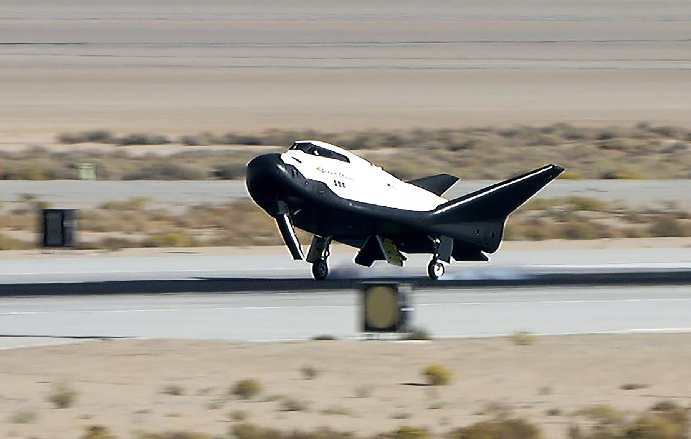
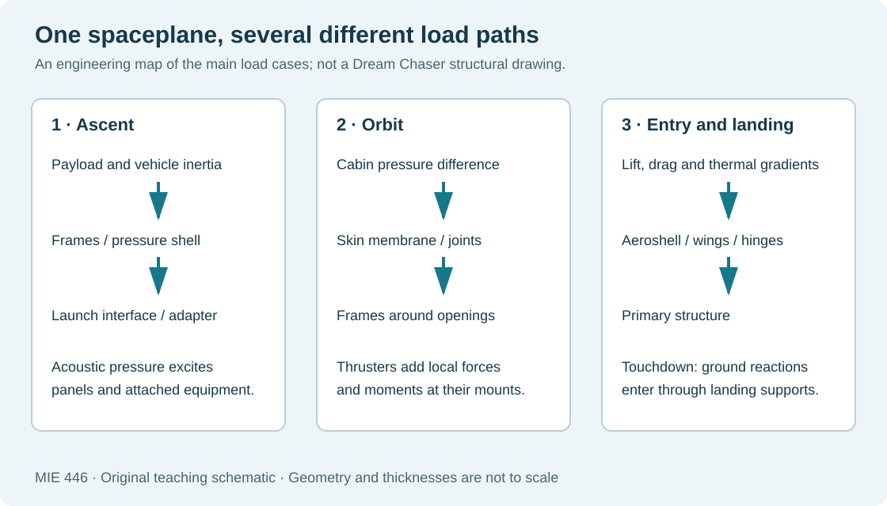
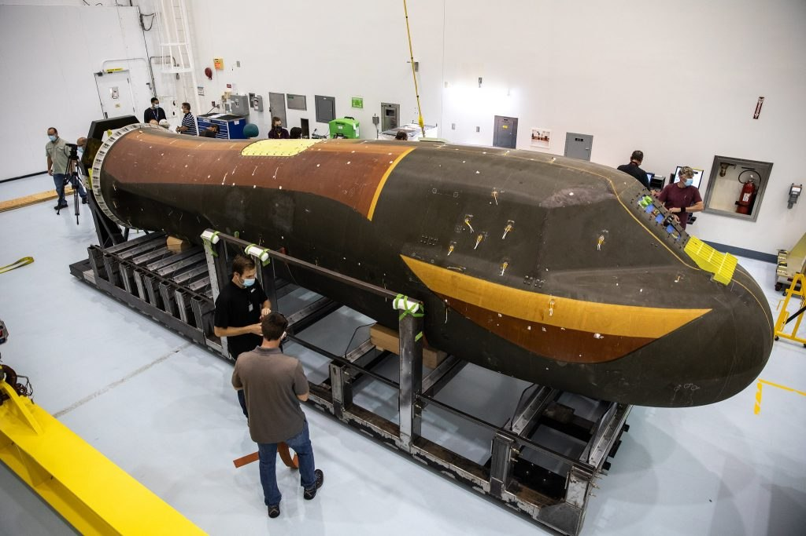
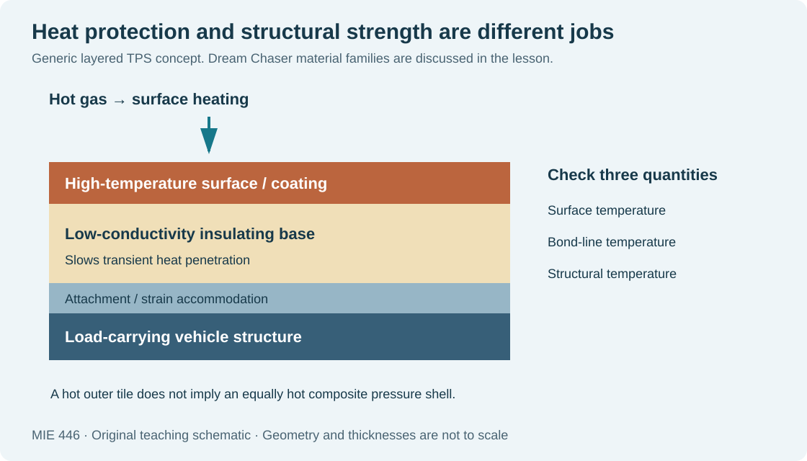
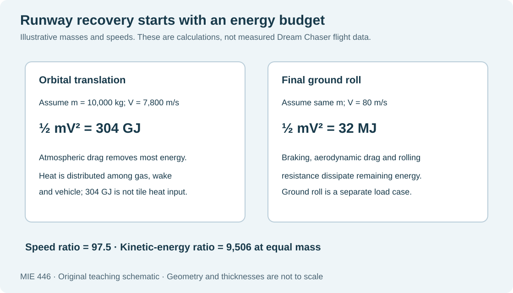
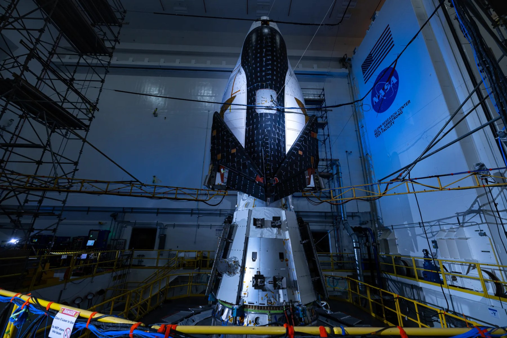

# Dream Chaser: A Spaceplane Built Around the Return Journey

**MIE 446 · Aerospace Structures · University of Massachusetts Amherst**  
Independent engineering reading · Evidence checked **17 November 2026**

[Illustrated web reading](https://ehsan-roohi.github.io/Aerospace-Structures/case-studies/dream-chaser/) · [All readings](READINGS.md) · [Companion: Artemis](ARTEMIS_MOON_ARCHITECTURE.md)

Dream Chaser combines a pressurized cargo vehicle, a reusable thermal-protection system and an unpowered runway recovery system. Its value proposition depends on all three working together: carrying useful payload, surviving orbital entry, and returning experiments to an accessible runway. This lesson develops the engineering behind [the linked Zoomit report](https://www.zoomit.ir/aviation-aerospace/471284-dream-chaser-space-plane-faa-landing-approval/) independently, using FAA, NASA and manufacturer sources.

**Learning goals:** trace launch and landing forces through a spaceplane; distinguish hot-surface protection from load-carrying structure; explain orbital thrusters and lifting-body flight; calculate illustrative entry energy and landing reactions; assess what a licensing milestone actually demonstrates.

*Historical test photograph: NASA, 11 November 2017 [D12]. This atmospheric approach-and-landing article is not a photograph of Tenacity returning from orbit.*

## 1. What the new FAA approval means

The FAA's **9 November 2026** statement identifies a Part 450 vehicle-operator license for Dream Chaser to reenter and land at **Vandenberg Space Force Base, California**. It gives a five-year term and permits up to four reentries annually, provided the vehicle configuration and mission profile remain the same. The FAA describes spring 2027 as Sierra Space's target for the first mission [D1].

That is a reentry authorization, not an announcement of an orbital flight already completed, a passenger certification, or approval for arbitrary airport operations. Environmental review and vehicle licensing are distinct steps. The FAA environmental page considers both Florida's Shuttle Landing Facility and Vandenberg; this wider study scope should not be substituted for the location specified in the new licensing statement [D1–D2].

The first mission is now a **free-flying demonstration**, rather than the originally advertised first delivery to the International Space Station. NASA's September 2025 contract modification removed its obligation to order a fixed number of resupply flights. NASA may still order station missions after a successful demonstration [D3]. Sierra Space subsequently announced national-security and commercial payload contracts for the inaugural flight in September 2026 [D4].

| Question | Status at the evidence date | Engineering implication |
|---|---|---|
| First orbital flight completed? | No completed orbital flight is established by the cited announcements | Runway tests cannot establish orbital TPS performance |
| First-flight target | Spring 2027, according to FAA [D1] | A target remains contingent on readiness and launch arrangements |
| First-flight purpose | Free-flyer demonstration [D3–D5] | Station proximity and berthing operations require their own evidence |
| New license location | Vandenberg [D1] | Do not extend this approval to every compatible runway |
| Reentry license term / frequency | Five years; up to four per year under stated conditions [D1] | Authorization is not a prediction of utilization |
| NASA resupply commitment | No fixed flight-count obligation after the modification [D3] | Historical “at least six missions” statements are superseded |

## 2. Specifications: identify the configuration before comparing numbers

Cargo **Tenacity** is uncrewed. Earlier crew-transport concepts and their abort systems should not be treated as the equipment installed on this vehicle. NASA describes the cargo system as two elements: the returning Dream Chaser and the expendable **Shooting Star** module [D5].

| Item | Publicly documented value or arrangement | Scope / source |
|---|---|---|
| Vehicle class | Reusable lifting-body spaceplane for low Earth orbit | Cargo architecture [D5] |
| Returning vehicle length | Approximately 30 ft / 9.1 m | Published primary-structure description [D6] |
| Bare primary structure dimensions | About 30 × 15 × 6 ft / 9.1 × 4.6 × 1.8 m | Structure description, not an operational deployed wingspan [D6] |
| Bare primary structure mass | Approximately 2,200 lb / 998 kg | Does not include the fully equipped vehicle or payload [D6] |
| Primary structural material | Carbon-fiber-reinforced polymer, with advanced woven construction | Manufacturer's structural account [D6] |
| Cargo launch packaging | Wings folded inside a five-meter fairing | Published Vulcan cargo integration concept [D5] |
| Launch architecture | Rocket ascent, followed by autonomous spacecraft operations | Not horizontal takeoff [D5] |
| Companion cargo module | Shooting Star; disposed of before entry | One-use module in the station-resupply architecture [D5] |
| Recovery | Atmospheric glide to runway | Unpowered approach demonstrated by an earlier article [D12] |
| Reuse objective | Up to 15 missions in NASA's 2023 description | Design objective; not a demonstrated service life [D5] |
| Advertised low-g return | About 1.5 g | Sierra Space capability claim; not a complete load spectrum [D7] |
| Advertised payload access | Approximately one hour after runway landing | Manufacturer logistics target [D7] |
| Recent acoustic test | April 2026; 90-speaker arrangement, wings stowed | Manufacturer test report [D8] |
| Final flight mass, laminate schedule, allowables | Not specified in the primary sources used here | Not inferred from photographs |

**Payload figures need particular care.** NASA's December 2023 station-mission description gives a future delivery capability of up to **11,500 lb (about 5,216 kg)**, return of **over 3,500 lb (over 1,588 kg)** and disposal of **over 8,700 lb (over 3,946 kg)** [D5]. Sierra Space's current Tenacity page displays **8,000 lb upmass**, **2,245 lb return** and **7,365 lb disposal**, while its prose also advertises “6+ tons” of delivery capacity [D7]. These statements do not form a single consistent mass budget.

| Published figure set | Upmass | Return | Disposal |
|---|---:|---:|---:|
| NASA, 15 December 2023; station architecture | Up to 11,500 lb ≈ 5,216 kg | Over 3,500 lb ≈ 1,588 kg | Over 8,700 lb ≈ 3,946 kg |
| Sierra Space live Tenacity display, checked 17 November 2026 | 8,000 lb ≈ 3,629 kg | 2,245 lb ≈ 1,018 kg | 7,365 lb ≈ 3,341 kg |

Use each set with its date and configuration. Do not add delivery, return and disposal capacities together, assume they are simultaneously attainable, or assign them to the first free-flyer mission. No public reconciliation of the differing figures is supplied by these pages.

## 3. Why a lifting body has wings

A lifting body obtains a substantial part of its lift from the shape of the fuselage. Small wings and control surfaces still help manage stability, trim and maneuvering. NASA identifies the HL-20 as a predecessor of the Dream Chaser concept [D5, D13].

In atmosphere, lift and drag can be written

$$L=\tfrac12\rho V^2SC_L,\qquad D=\tfrac12\rho V^2SC_D.$$

The reference area and coefficient definitions must accompany a reported value of $C_L$ or $C_D$. A photograph does not supply either. At a specified flight condition, bank angle rotates the lift vector and helps control the ground track; angle of attack changes aerodynamic forces and heating. In thin upper-atmosphere conditions, aerodynamic surfaces become weak, so reaction-control thrusters provide attitude authority. During descent, aerodynamic control becomes more effective as dynamic pressure grows.

More lift can increase crossrange and shape deceleration, but does not give an unlimited choice of landing sites. Orbital plane, available energy, weather, range constraints and landing authorization all matter.

## 4. The load-carrying structure

*Original conceptual diagram. It identifies engineering load cases, not the locations of actual Dream Chaser frames or fasteners.*

The manufacturer's primary-structure account describes a pressurized CFRP structure manufactured by Lockheed Martin, including advanced three-dimensional woven construction and reduced penetrations through the hot lower aeroshell [D6]. NASA separately reports pressure testing of the composite and bonded structure [D9]. Those are meaningful pieces of evidence; they do not disclose ply-by-ply design data.

The key structural questions change throughout a mission:

| Load case | Applied loading | Components that must transfer it | Failure mechanisms to investigate |
|---|---|---|---|
| Launch | Acceleration, acoustic pressure, interface vibration | Payload mounts, shell, frames, launch adapter | Panel vibration, local bearing failure, buckling, joint damage |
| Pressurized orbit | Cabin-to-vacuum pressure difference | Pressure skin, bonded joints, hatch and window surrounds | Leakage, joint peel, delamination, stress concentration |
| Maneuver | Thruster forces and control moments | Engine attachments and supporting structure | Local fatigue, eccentric loading, distortion |
| Entry | Distributed aerodynamic pressure and thermal gradients | Aeroshell, control surfaces, wing hinges, frames | Thermal mismatch, bond degradation, aeroelastic response |
| Landing | Vertical impact, braking, side loads | Landing supports, attachments, fuselage and cargo restraints | Local overload, load redistribution, cumulative damage |

A pressure vessel wants a smooth, nearly closed load path. Cargo hatches, landing-support attachments and wing interfaces interrupt that path. CFRP permits directional stiffness and strength, but “composite” alone does not specify a pressure-shell allowable. Fiber orientation, resin temperature capability, joint design, manufacturing defects and repeated environmental exposure matter.

For a classroom cylindrical-shell approximation,

$$\sigma_\theta=\frac{\Delta p\,r}{t},\qquad
\sigma_x=\frac{\Delta p\,r}{2t}.$$

This explains why pressure produces circumferential and axial tension. A noncircular, stiffened, anisotropic lifting-body shell needs a more complete analysis; these expressions are not Dream Chaser stress predictions.

*NASA photograph, June 2020 [D9]. A pressure-test article validates selected structural behavior; it is not a complete flight-qualified spacecraft.*

## 5. Foldable wings are structural joints

Stowing wings helps fit a payload fairing. After deployment, the joints must carry aerodynamic loads with adequate strength, stiffness and alignment. As an engineering inference, any such mechanism needs verified deployment, load transfer and acceptable free play throughout its intended life. The cited public sources do not disclose Tenacity's detailed latch geometry or hinge allowables.

For a generic outboard panel with a resultant lift $F$ acting a distance $\ell$ from a joint, the joint bending moment is $M=F\ell$. A small lift resultant acting over a large arm can therefore govern local reinforcement. Actuator torque needed to deploy a wing and the moment carried by its locked joint are different design requirements.

Hinge flexibility also affects control-surface effectiveness and vibration. A rigid-wing aerodynamic model cannot by itself establish the aeroelastic stability of a deployed assembly.

## 6. Thermal protection: preserve a cooler primary structure

NASA describes reusable silica-based insulation and **TUFROC-derived** protection for several Dream Chaser regions [D10–D11]. TUFROC combines a high-temperature surface system with an insulating base. Its published material capability is not the allowable temperature of the underlying CFRP shell, and a test-coupon limit is not a guarantee for every flight location.

The TPS has to tolerate aerodynamic loading, oxidation, vibration, attachment strain and inspection. A tile can remain intact while an attachment or underlying region becomes too hot; conversely, the outer surface can be extremely hot while insulation keeps the load-carrying structure far cooler.

A useful **trend model**, at fixed gas and correlation assumptions, is

$$\dot q_{\rm stag}\propto \sqrt{\frac{\rho}{R_n}}\,V^3.$$

It links stagnation-region convective heating to density, nose radius and velocity [D18]. It is not a whole-vehicle temperature calculation. Laminar-to-turbulent transition, local shape, catalytic properties, radiation and the time history of the trajectory need separate treatment.

For free thermal expansion, $\Delta L=\alpha L\Delta T$. Differential expansion between a tile, attachment and shell can produce local stress even without a large external force. This is why material selection, gap design and attachment compliance belong in the structural lesson.

## 7. Propulsion: rocket ascent, orbital thrusters, then a glide

Dream Chaser does not use an air-breathing jet engine to accelerate to orbit. Its launch vehicle supplies ascent energy. Onboard propulsion supports attitude changes, orbital maneuvers and deorbit; the final runway approach is a glide.

Sierra Space's hardware catalogue identifies the **VRP110-B**, initially developed for Dream Chaser, as a high-test-peroxide/kerosene thruster with three advertised thrust levels [D14].

| Catalogue parameter | Published value | Interpretation |
|---|---|---|
| Propellants | High-test peroxide, plus kerosene in bipropellant operation | A spacecraft thruster family, not a turbofan |
| Thrust levels | 42, 65 and 113 lbf ≈ 187, 289 and 503 N | Catalogue values; installation count is not specified here |
| Lower-thrust mode | Catalytic peroxide decomposition | Monopropellant operation |
| Higher-thrust mode | Kerosene injection with peroxide-derived oxidizing flow | Bipropellant operation |
| Chamber concept | VORTEX flow arrangement | Manufacturer design description |

These catalogue facts are not a verified inventory of the first-flight propulsion installation. Older crew-abort engine concepts and other engines on the same catalogue page must not be added to Tenacity's specifications.

For peroxide decomposition, the conceptual chemical relation is $2H_2O_2\rightarrow2H_2O+O_2$ with heat release. The hot products can expand through a nozzle. Introducing fuel permits a different operating mode. The manufacturer's “non-toxic” terminology is a comparison with conventional toxic spacecraft propellants; concentrated peroxide remains a reactive oxidizer.

The general rocket-thrust equation is

$$F=\dot m V_e+(p_e-p_a)A_e.$$

No atmospheric oxygen is required for a rocket carrying its oxidizer [D17]. An off-center thruster also produces $\boldsymbol{\tau}=\mathbf r\times\mathbf F$, so attitude control is a structural mounting and mass-properties problem as well as a guidance problem.

## 8. Entry energy and the runway load case

**Classroom assumptions, not Dream Chaser flight data:** take $m=10{,}000$ kg, orbital speed $V_o=7{,}800$ m/s and runway speed $V_r=80$ m/s. Then

$$E_o=\tfrac12mV_o^2=304.2\ {\rm GJ},\qquad
E_r=\tfrac12mV_r^2=32.0\ {\rm MJ}.$$

The ratio is about 9,506 at equal mass. The first number is translational kinetic energy, not the heat absorbed by the tiles. Atmospheric gas, wake, radiation and vehicle heating share the energy budget; gravitational potential and changing mass also belong in a full trajectory analysis.

For a simple vertical touchdown model with downward speed $v_z$, effective stopping stroke $s$, and approximately constant aerodynamic lift $\bar L$ during the stroke,

$$\bar R=mg-\bar L+\frac{mv_z^2}{2s}.$$

It follows from vertical work–energy with ground reaction $\bar R$. Neglecting residual lift gives a deliberately simplified classroom example: $v_z=1$ m/s, $s=0.20$ m and $m=10{,}000$ kg produce **123.1 kN average total ground reaction**, or **1.255 times weight**. It does not establish peak force or an individual landing-support load.

Doubling $v_z$ quadruples the impact-energy term. Unequal support timing, local stiffness, side loads and cargo location can increase a particular attachment's demand. The advertised 1.5 g return figure cannot replace these calculations.

## 9. What testing has demonstrated

*NASA photograph of the flight-system stack during ground environmental testing, reproduced in the September 2025 contract update [D3]. This is hardware testing, not an orbital flight.*

NASA's 2017 account establishes successful autonomous atmospheric approach and landing by a test article [D12]. NASA's 2024 environmental-test report describes the stacked system being shaken at its Ohio test facility [D15]. Sierra Space's April 2026 report describes acoustic testing with the wings stowed in the launch configuration [D8].

These tests answer different questions. Pressure tests address the pressure structure; vibration and acoustic tests address specified environmental loads; a drop test addresses the last phase of atmospheric flight. An orbital demonstration must connect ascent, deployment, navigation, spacecraft operation, deorbit, entry and recovery in one mission. Repeated flights and inspections are then needed to establish operational life and turnaround effort.

## 10. Watch the hardware and the landing

### Video 1 · NASA atmospheric free-flight test, 2017

<video controls preload="none" playsinline poster="docs/case-studies/dream-chaser/flight-2017.jpg" aria-label="NASA Dream Chaser approach and landing test, 2017">

<source src="https://images-assets.nasa.gov/video/AFRC-2017-11649-1-DreamChaser_ALT-2_FreeFlight_music/AFRC-2017-11649-1-DreamChaser_ALT-2_FreeFlight_music~medium.mp4" type="video/mp4">
Your browser cannot play this video. Use the NASA video link below.

</video>

[Open NASA's free-flight video](https://images.nasa.gov/details/AFRC-2017-11649-1-DreamChaser_ALT-2_FreeFlight_music) · [NASA test explanation](https://www.nasa.gov/humans-in-space/commercial-space/free-flight-completes-crucial-milestone-for-dream-chaser/). Observe the helicopter release, glide and touchdown. This is atmospheric test footage, not reentry from orbit.

### Video 2 · NASA runway tow tests, 2017

<video controls preload="none" playsinline aria-label="NASA Dream Chaser ground tow tests, 2017">

<source src="https://images-assets.nasa.gov/video/AFRC-2017-11526-DreamChaserTaxiTest-5-20-2017/AFRC-2017-11526-DreamChaserTaxiTest-5-20-2017~medium.mp4" type="video/mp4">
Your browser cannot play this video. Use the NASA video link below.

</video>

[Open NASA's tow-test video](https://images.nasa.gov/details/AFRC-2017-11526-DreamChaserTaxiTest-5-20-2017). Watch ground tracking and landing-support behavior. A tow test does not test orbital entry heating.

## 11. Exercises and engineering decisions

1. **Read a specification critically.** Convert both payload sets in Section 2 to kilograms. Write the clarification you would request before accepting a mass budget. Distinguish vehicle dry mass, cargo mass and total system mass.
2. **Pressure-shell model.** Assume $\Delta p=70$ kPa, $r=1.2$ m and $t=4$ mm. Calculate cylindrical membrane stresses, then list three reasons the model is insufficient for a composite lifting-body shell.
3. **Heating sensitivity.** At fixed density and nose radius, increase speed by 10%. Use the trend relation to find the heating-rate ratio. Then double nose radius at fixed speed and density.
4. **Landing reaction.** Repeat the no-lift example for $v_z=0.5,1,2$ m/s and $s=0.10,0.20,0.40$ m. Identify which assumption would matter most before using the result for design.
5. **Wing-joint exercise.** Model a generic outboard panel in [Wing Lab](https://ehsan-roohi.github.io/Aerospace-Structures/wing-panel-stress-analyzer/#wing) as a 1.5 m cantilever carrying a 5 kN tip load. Calculate root moment, then explain what hinge flexibility and torsion add to the problem. These are assumed teaching dimensions.
6. **Qualification decision.** Choose the next evidence required to substantiate each claim: reusable for 15 missions, one-hour payload access, acceptable bond-line temperature, and reliable wing deployment. Name a measurable quantity for every claim.

**Selected checks:** cylindrical hoop/axial stresses are **21 / 10.5 MPa**; the heating ratios are **1.331** and **0.707**; generic wing-root moment is **7.5 kN·m**. Run the accompanying [calculation script](docs/case-studies/spaceflight_calculations.py) to reproduce these and the energy/landing examples. None is a certified vehicle load.

## 12. خلاصهٔ فارسی

دریم‌چیسر یک فضاپیمای باری بدون سرنشین است که با موشک به مدار می‌رود و در بازگشت، مانند گلایدر روی باند می‌نشیند. بدنهٔ کامپوزیتی آن باید فشار داخلی و بارهای پرتاب و فرود را تحمل کند؛ سامانهٔ حفاظت حرارتی نیز وظیفه دارد دمای سازه را در محدودهٔ مجاز نگه دارد. تا تاریخ بررسی، نخستین پرواز مداری هنوز انجام نشده و بهار ۲۰۲۷ هدف اعلام‌شده است. مجوز جدید FAA مشخصاً بازگشت به وندنبرگ را پوشش می‌دهد. مأموریت اول اکنون یک پرواز مستقل آزمایشی است و تضمین قدیمی تعداد پروازهای تدارکاتی ناسا دیگر معتبر نیست. اعداد ظرفیت بار در منابع رسمی یکسان نیستند و باید همراه تاریخ و پیکربندی نقل شوند؛ محاسبات این درس نیز مثال آموزشی‌اند، نه مشخصات تأییدشدهٔ پرواز.

## 13. Sources and media credits

Primary sources are used for the engineering and program claims. Older documents are retained for hardware history, with their obsolete schedules excluded. All sources were checked on 17 November 2026.

**D1.** [FAA, General Statements: “FAA Issues Reentry License for Sierra Space Dream Chaser,” 9 November 2026](https://www.faa.gov/newsroom/statements/general-statements). License scope, frequency, duration and spring-2027 target.

**D2.** [FAA, Sierra Space at Shuttle Landing Facility and Vandenberg: environmental-review record](https://www.faa.gov/space/stakeholder_engagement/Sierra_at_SLF_VSFB). Environmental alternatives and the distinction between review and licensing; older Atlas V text is historical.

**D3.** [NASA, commercial resupply contract modification, 25 September 2025](https://www.nasa.gov/missions/station/nasa-sierra-space-modify-commercial-resupply-services-contract/). Current ordering framework and free-flight transition; its former late-2026 target is superseded by D1.

**D4.** [Sierra Space, inaugural-flight payload contracts, 2 September 2026](https://www.sierraspace.com/press-releases/sierra-space-secures-national-security-and-commercial-payload-contracts-for-dream-chaser-inaugural-flight/).

**D5.** [NASA, Dream Chaser station-resupply architecture, 15 December 2023](https://www.nasa.gov/missions/station/commercial-resupply/sierra-spaces-dream-chaser-new-station-resupply-spacecraft-for-nasa/). Cargo architecture and dated capacity figures; its ISS debut schedule is obsolete.

**D6.** [SNC, primary structure arrives in Colorado, 15 October 2019](https://www.sncorp.com/news-archive/dream-chaser-spacecraft-primary-structure-arrives-in-colorado). CFRP structure, approximate bare-structure size/mass and woven construction; old launch dates are obsolete.

**D7.** [Sierra Space, Tenacity uncrewed cargo vehicle](https://www.sierraspace.com/dream-chaser-spaceplane/uncrewed-cargo-spacecraft/). Live capability claims and internally differing payload descriptions.

**D8.** [Sierra Space, acoustic-test milestone, 14 April 2026](https://www.sierraspace.com/press-releases/sierra-spaces-dream-chaser-spaceplane-successfully-completed-milestone-at-nasas-kennedy-space-center/).

**D9.** [NASA, pressure-test article at Kennedy, 11 June 2020](https://www.nasa.gov/blogs/kennedy/2020/06/11/dream-chaser-spaceplane-pressure-test-article-arrives-at-kennedy-space-center/). Composite/bonded pressure structure and photograph.

**D10.** [NASA Ames, reusable thermal-protection materials](https://www.nasa.gov/general/thermal-protection-materials-branch-reusable-materials/). TUFROC system and Dream Chaser applicability.

**D11.** [NASA, TUFROC technical presentation, 2019, PDF](https://ntrs.nasa.gov/api/citations/20190030273/downloads/20190030273.pdf). Surface/base construction and test context.

**D12.** [NASA, successful atmospheric free flight, 13 November 2017](https://www.nasa.gov/humans-in-space/commercial-space/free-flight-completes-crucial-milestone-for-dream-chaser/). Historical test and photograph; NASA video identifiers are linked above.

**D13.** [NASA Langley, HL-20 lifting-body history](https://www.nasa.gov/hl-20-2/). Design ancestry, not certification of the later vehicle.

**D14.** [Sierra Space, propulsion hardware catalogue](https://www.sierraspace.com/space-technology/spaceflight-hardware/propulsion/). VRP110-B and dual-mode/tri-mode thruster descriptions.

**D15.** [NASA, spaceplane stacked and shaken, 2024](https://www.nasa.gov/missions/station/first-look-spaceplane-stacked-and-shaken-at-nasa-test-facility/). Environmental-test context.

**D16.** [NASA TechPort, low-cost high-temperature reusable TPS development](https://techport.nasa.gov/projects/147005). Development work is not evidence that every material is installed on Tenacity.

**D17.** [NASA Glenn, rocket-thrust equation](https://www1.grc.nasa.gov/beginners-guide-to-aeronautics/rocket-thrust-equation/).

**D18.** [Sutton and Graves, NASA TR R-376, 1971, *A General Stagnation-Point Convective-Heating Equation for Arbitrary Gas Mixtures*, PDF](https://ntrs.nasa.gov/api/citations/19720003329/downloads/19720003329.pdf). Basis of the heating trend; a trajectory-specific model still requires the applicable correlation assumptions.

**D19.** [Zoomit, the Persian report supplied by the reader](https://www.zoomit.ir/aviation-aerospace/471284-dream-chaser-space-plane-faa-landing-approval/). Starting point for this independent course reading.

**Media:** the three photographs are credited to NASA at their original source pages. They are resized for web reading. The three SVG engineering diagrams are original course schematics; they are not manufacturer drawings. Videos stream from NASA and remain externally hosted. No NASA or manufacturer endorsement is implied.
