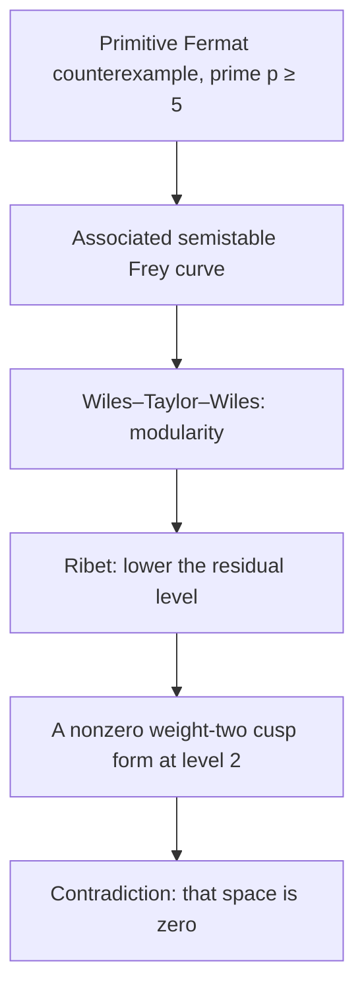

# Fermat’s Last Theorem: From Integer Triangles to Modularity and Machine-Checked Proof

**An extended mathematical reading for MIE 446 · Aerospace Structures · University of Massachusetts Amherst**  
**Published: October 27, 2026 · Audience: engineering students and mathematically curious readers**

> **What this reading provides.** A precise statement, elementary derivations, a complete proof for exponent four, an explanation of the modern proof’s architecture, and an assessment of AI-assisted formal verification. The advanced sections explain the logical dependencies; they do **not** reproduce the full Wiles–Taylor–Wiles proof. The engineering examples are teaching connections, not claims that Fermat’s theorem is an aircraft-design method.

This original English course reading was prompted by [Pooyesh Pourmohammad’s October 27, 2026 Zoomit feature](https://www.zoomit.ir/fundamental-science/469911-fermat-last-theorem-featured/). It develops the mathematics independently rather than reproducing or translating that article. Original derivations, worked examples, computational activities, and engineering discussions below supplement a source-linked account of the research. No photographs or text from the feature are reproduced.

## Reading paths

- **First encounter:** Sections 1–5, 12, and 16. Focus on what the theorem says and what counts as evidence.
- **Mathematical route:** Sections 6–11. Follow the move from factorization to elliptic curves, modular forms, and Galois representations.
- **Computation and AI:** Sections 13–15 and the [companion Python activities](computational/fermat/fermat_activities.py).
- **Classroom discussion:** Sections 16–19. Distinguish mathematical correctness, software correctness, and physical adequacy.

## 1. One equation, carefully stated

Fermat’s Last Theorem states that for every integer exponent $n>2$, there are no **positive integers** $a,b,c$ satisfying

$$a^n+b^n=c^n.$$

Every word matters. “Positive” excludes zero, which would give trivial examples such as $0^n+1^n=1^n$. “Integers” excludes the real solutions that are easy to construct: choose positive real numbers $a,b$ and set $c=(a^n+b^n)^{1/n}$. “Every” means the result holds across an unbounded collection of exponents and an unbounded collection of triples.

The exponent-two equation behaves completely differently:

$$3^2+4^2=5^2,\qquad 5^2+12^2=13^2.$$

There are infinitely many positive integer solutions for exponent two, but none for any integer exponent greater than two. The distinction is arithmetic: the real-valued equation remains solvable. The theorem does not say that adding two cubes is impossible; it says that the sum cannot itself be a positive integer cube when both summands are positive integer cubes.

It is also different from **Fermat’s little theorem**, which concerns congruences such as $a^p\equiv a\pmod p$. The two results share a name but have different statements, uses, and proofs.

An equivalent formulation rules out nonzero integer solutions. For even exponents, taking absolute values gives positive entries. For odd exponents, a negative term can be moved to the other side and the equation rearranged into a positive solution. Stating the positive-integer version avoids unnecessary sign conventions at the outset.

## 2. Why squares work: build the solutions yourself

Choose integers $m>r>0$. Then

$$a=m^2-r^2,\qquad b=2mr,\qquad c=m^2+r^2$$

satisfy the exponent-two equation because

$$
(m^2-r^2)^2+(2mr)^2
=m^4+2m^2r^2+r^4
=(m^2+r^2)^2.
$$

For $(m,r)=(2,1)$, the result is $(3,4,5)$; for $(3,2)$, it is $(5,12,13)$. If $m,r$ are relatively prime and of opposite parity, the resulting triple is primitive: its entries have no common factor greater than one. Multiplying every entry by the same positive integer produces further, nonprimitive triples.

The formula has a geometric explanation. Divide the equation by $c^2$: a Pythagorean triple gives a rational point on

$$x^2+y^2=1.$$

Draw a line of rational slope $t$ through the known point $(-1,0)$:

$$y=t(x+1).$$

Substituting into the circle equation produces a quadratic with one root already known, $x=-1$. The other intersection is

$$x=\frac{1-t^2}{1+t^2},\qquad y=\frac{2t}{1+t^2}.$$

Writing $t=r/m$ recovers the integer formula after clearing denominators. This is a constructive explanation, not a table of lucky examples. It tells us how to generate solutions and why the construction succeeds.

For higher powers, replacing the circle by $x^n+y^n=1$ does not preserve this rational parametrization. A method that succeeds for one equation is not automatically available for a slightly different equation. That warning will recur when unique factorization fails in a larger number system.

### A useful dimensional caution

The familiar exponent-two relation is connected with lengths in Euclidean geometry. Raising all three numbers to a new power does not describe the same geometric operation. In engineering, a change from length to area to volume changes both dimensions and physical meaning. Here the variables are dimensionless integers, but the same habit is useful: identify what an algebraic change actually changes before extending an interpretation.

## 3. Near misses, exact equality, and floating-point traps

Consider

$$6^3+8^3=728,\qquad 9^3=729,$$

and

$$9^3+10^3=1729,\qquad 12^3=1728.$$

These are close, but neither is a solution. The integer residual

$$R=a^n+b^n-c^n$$

is respectively $-1$ and $+1$. No tolerance can turn either into an exact identity.

Scaling the first triple by an integer $k$ gives

$$R_k=(6k)^3+(8k)^3-(9k)^3=-k^3.$$

Its residual grows in absolute magnitude, while its residual relative to $(9k)^3$ stays exactly $1/729$. Thus neither a large absolute residual nor a small-looking relative residual can be interpreted without normalization. More importantly, an exact integer question is not answered by accepting an engineering tolerance.

A famous television near miss is

$$3987^{12}+4365^{12}\mathrel{?}=4472^{12}.$$

The equality is false. A short calculator display can nevertheless make the twelfth root of the left side look like 4472. The companion activity evaluates the integer difference and the floating-point root separately. This is a demonstration of limited displayed precision, not a counterexample to the theorem.

Python’s ordinary integers have arbitrary precision, so `a**n + b**n == c**n` performs an exact integer comparison for integer inputs, subject to available resources. Replacing the calculation with floating-point powers or a fractional root changes the computation. A floating-point number cannot represent every sufficiently large integer, and a rounded display contains even less information than the stored number.

**Prediction before computation:** Would a relative residual of $10^{-12}$ establish an integer identity? No. It can be strong numerical agreement while the exact integer difference is nonzero. Conversely, a useful structural approximation need not produce an exactly zero residual. The acceptance criterion must match the question.

## 4. An infinite problem with fewer exponents

The theorem can be reduced to exponent four and odd prime exponents. This is an elementary but powerful reduction.

Suppose a counterexample exists for $n>2$. If an odd prime $p$ divides $n$, write $n=pk$. Then

$$A=a^k,\quad B=b^k,\quad C=c^k$$

would satisfy $A^p+B^p=C^p$. Therefore a proof for exponent $p$ rules out every exponent divisible by $p$.

If $n$ has no odd prime factor, it is a power of two. Since $n>2$, four divides $n$, and the same construction reduces the equation to exponent four. Every case is therefore covered by

$$n=4\quad\text{or}\quad n=p\text{ for an odd prime }p.$$

Examples make the direction of the implication clear:

| Hypothetical exponent | Group the powers as | Reduced exponent |
|---|---|---|
| 6 | $(a^2)^3+(b^2)^3=(c^2)^3$ | 3 |
| 12 | $(a^3)^4+(b^3)^4=(c^3)^4$ | 4 |
| 15 | $(a^5)^3+(b^5)^3=(c^5)^3$ | 3 |
| 32 | $(a^8)^4+(b^8)^4=(c^8)^4$ | 4 |

This does not reduce the theorem to a finite set of tests: there are infinitely many odd primes. It reduces the *structure* of the proof. Once the classical cases three and four are available, the modern modular argument may focus on primes $p\ge5$.

We can also reduce a hypothetical solution to a primitive one by dividing by the common greatest common divisor. If a prime divides two entries of a Fermat triple, the equation forces it to divide the third. A primitive solution is consequently pairwise coprime. These observations remove redundant cases before more advanced machinery is introduced.

## 5. A complete elementary result: exponent four

The full theorem is advanced, but one important case can be proved here. We prove the stronger statement

$$x^4+y^4=z^2$$

has no solution in positive integers. The exponent-four Fermat equation is a special case, since $c^4=(c^2)^2$.

### 5.1 The descent principle

A nonempty set of positive integers has a least element. Consequently, if every proposed solution produces another solution with a smaller positive integer size, no solution exists. This is **infinite descent**. The proof must identify the size and actually construct the smaller solution; merely saying “repeat forever” is insufficient.

### 5.2 Start with a smallest solution

Assume a solution exists and choose one with $z$ least. It must have $\gcd(x,y)=1$, since otherwise dividing $x,y$ by their greatest common divisor and $z$ by its square gives a smaller solution. Both $x,y$ cannot be odd: an odd fourth power is 1 modulo 16, while a square cannot be 2 modulo 16. They cannot both be even either. Relabel so that $x$ is odd and $y$ is even.

The numbers $(x^2,y^2,z)$ form a primitive right triangle. The primitive Pythagorean parametrization gives coprime, opposite-parity integers $m>r>0$ with

$$x^2=m^2-r^2,\qquad y^2=2mr,\qquad z=m^2+r^2.$$

The integer $m$ must be odd. If it were even, then $r$ would be odd and $x^2\equiv-1\equiv3\pmod4$, impossible for a square. Thus $r$ is even.

### 5.3 Extract the square factors

Write $r=2s$. Then $(y/2)^2=ms$. Since $\gcd(m,s)=1$, every prime exponent in each of $m,s$ is even. Hence

$$m=u^2,\qquad s=v^2,\qquad r=2v^2.$$

Here we used unique factorization in the ordinary integers, with coprimality explicitly established. We are not assuming the same conclusion in an arbitrary number system.

Next,

$$x^2+r^2=m^2.$$

This is another primitive Pythagorean triple, again with the even leg $r$. Therefore there are coprime, opposite-parity integers $h>k>0$ such that

$$x=h^2-k^2,\qquad r=2hk,\qquad m=h^2+k^2.$$

Since $r=2v^2$, we obtain $hk=v^2$. Coprimality again forces $h=\alpha^2$ and $k=\beta^2$. Substitution yields

$$\alpha^4+\beta^4=m=u^2.$$

We have produced another positive integer solution to the original, stronger equation, with the new right-hand square root equal to $u$.

### 5.4 Verify strict decrease

Because $m=u^2$ and $z=m^2+r^2$, we have

$$0<u<z.$$

The new solution contradicts the minimality of $z$. Therefore the assumed solution does not exist, proving the stronger statement and hence Fermat’s Last Theorem for exponent four.

**Check the proof:** parity, primitivity, both parametrizations, both coprime-product arguments, positivity, and strict decrease are all necessary. Dropping any one of these checks can turn a persuasive outline into an incomplete proof. [Keith Conrad’s descent notes](https://kconrad.math.uconn.edu/blurbs/ugradnumthy/descent.pdf) provide further examples and alternative presentations.

## 6. Historical milestones without the legend replacing the mathematics

Fermat’s marginal claim is conventionally dated around 1637. His son published the annotated edition of Diophantus in 1670, after Fermat’s death in 1665. The original general proof has not survived; we cannot establish that Fermat possessed a valid one. The familiar 358-year interval counts from 1637 to the 1995 publication, not to the initial 1993 announcement.

Progress was not simply a sequence of failed attempts. Euler’s work addressed exponent three, with a gap in the historical presentation; Dirichlet and Legendre established exponent five in 1825, and Lamé exponent seven in 1839. Sophie Germain introduced conditions addressing families of prime exponents, especially the first case, where the exponent does not divide the product of the variables. Kummer’s work brought algebraic number theory into the problem. For historical context, see [MacTutor’s account](https://mathshistory.st-andrews.ac.uk/HistTopics/Fermat%27s_last_theorem/); for the mathematics, consult the original research and expository sources in Section 20.

The decisive modern milestones are these:

| Period | Development | What it changed |
|---|---|---|
| 1950s onward | Modularity ideas associated with Taniyama, Shimura, and Weil | Connected elliptic curves with modular forms |
| 1980s | Frey’s construction and Serre’s formulation | Turned a hypothetical Fermat solution into a constrained arithmetic object |
| 1986 | Ribet established the needed level-lowering implication | Made semistable modularity sufficient for Fermat |
| June 1993 | Wiles announced his argument | Presented a proposed completion, subsequently found to contain a gap |
| 1994–1995 | Repair with Taylor; publication of the two papers | Established the accepted proof |
| 2001 | Breuil, Conrad, Diamond, and Taylor completed modularity over $\mathbb Q$ | Extended the result beyond the semistable case needed for Fermat |
| September 2026 | Anthropic reported a complete Lean formalization | Added a machine-checked reconstruction of the established argument |

The timeline does not imply that the theorem was open until 2026. Mathematical discovery and formal reconstruction are different achievements. Nor should personal tragedies or dramatic anecdotes be offered as explanations for why a theorem is true. The mathematical evidence is in the arguments.

## 7. Factorization: a familiar tool can fail in a new domain

For an odd prime $p$, one can factor

$$a^p+b^p=\prod_{j=0}^{p-1}(a+\zeta_p^j b),\qquad \zeta_p=e^{2\pi i/p}.$$

This suggests working in a ring containing $\zeta_p$. The temptation is immediate: if the product is a perfect $p$-th power, perhaps its factors are also $p$-th powers. But even in the integers, this inference needs coprimality: $2\cdot4=8$ is a cube although neither factor is a cube. In a larger ring, unique factorization itself can fail.

### 7.1 A concrete failure

Consider the ring $\mathbb Z[\sqrt{-5}]$. In this ring,

$$6=2\cdot3=(1+\sqrt{-5})(1-\sqrt{-5}).$$

To see why this represents a genuine problem, use the multiplicative norm

$$N(a+b\sqrt{-5})=a^2+5b^2.$$

There is no element of norm 2 or 3: setting $b=0$ would require an integer square equal to 2 or 3; setting $|b|\ge1$ makes the norm at least 5. A nontrivial factorization of 2, whose norm is 4, would require factors of norm 2, so 2 is irreducible. Similarly, a nontrivial factorization of 3 would require norm-3 factors, so 3 is irreducible. Each of $1\pm\sqrt{-5}$, of norm 6, is irreducible because a factorization would require norms 2 and 3.

The only units have norm 1, hence are $\pm1$. None of the four displayed irreducibles is a unit multiple of the others. Thus 6 has two inequivalent factorizations into irreducibles. This example illustrates failure of unique factorization; it is not the actual cyclotomic ring used for every Fermat exponent.

### 7.2 What Kummer’s change of viewpoint achieved

The repair involved tracking factorization more subtly, through ideal-theoretic ideas and class groups. For a regular prime, the relevant class-group obstruction does not contain the problematic prime factor, enabling a proof of the Fermat case. “Regular” is an arithmetic condition, not another word for “prime.” The primes 37, 59, and 67 are the irregular primes below 100, so this route did not automatically settle all exponents.

The lesson is precise: an identity may survive a change of domain while a theorem used to interpret that identity does not. An engineering parallel is extending a linear elastic formula into a regime with plasticity or large rotations. The algebra can still be evaluated; its justification has changed. This is an analogy about assumptions, not an equivalence between algebraic number theory and constitutive modeling.

## 8. Elliptic curves: what they are and what can be counted

Over the rationals, a short Weierstrass equation has the form

$$E:\ y^2=x^3+Ax+B,\qquad A,B\in\mathbb Q,$$

with

$$\Delta=-16(4A^3+27B^2)\ne0.$$

The nonzero discriminant excludes singular curves. One also includes a point at infinity, denoted $O$. The adjective “elliptic” does not mean the graph is an ellipse. A smooth cubic together with its distinguished point supports a group law, and this arithmetic structure is central to the theory.

The same equation can be studied over different fields. A real graph shows real points; rational points require rational coordinates; reduction modulo a prime gives a finite counting problem. These are related viewpoints, not interchangeable sets of solutions.

### 8.1 A point-counting example, done by hand

Take

$$E:\ y^2=x^3-x.$$

Its discriminant is 64, so the model has good reduction at odd primes. Modulo 5, the quadratic residues are 0, 1, and 4. Count solutions for each $x$:

| $x\pmod5$ | $x^3-x\pmod5$ | Number of $y$ values |
|---|---|---|
| 0 | 0 | 1 |
| 1 | 0 | 1 |
| 2 | 1 | 2 |
| 3 | 4 | 2 |
| 4 | 0 | 1 |

There are seven affine points and the point at infinity, giving $\#E(\mathbb F_5)=8$. Define

$$a_\ell=\ell+1-\#E(\mathbb F_\ell)$$

at a good prime $\ell$. Here $a_5=6-8=-2$. The companion script also obtains $\#E(\mathbb F_3)=4$, $\#E(\mathbb F_7)=8$, and $\#E(\mathbb F_{11})=12$, so the corresponding coefficients are zero.

Counting includes $O$. Omitting it would shift every coefficient and corrupt the comparison with modular forms. This is a small example of how a convention in a definition affects a large theorem downstream.

### 8.2 Good reduction, bad reduction, and semistability

At a prime of good reduction, the reduced curve is still nonsingular. At bad primes, a suitable integral model becomes singular after reduction. Bad reduction may be multiplicative or additive. An elliptic curve is semistable if every prime has either good or multiplicative reduction. This property is arithmetic and local at primes; it is unrelated to dynamic stability of an airframe.

The **conductor** records local arithmetic behavior, including bad reduction. It is not generally the same integer as the discriminant. Changing the equation can change its displayed discriminant; the conductor belongs to the curve. These distinctions matter because the proof uses a tightly controlled conductor, not simply a visually unusual cubic graph. [MIT’s elliptic-curve course](https://math.mit.edu/classes/18.783/2023/lectures.html) offers a systematic route beyond this introduction.

## 9. Modular forms: symmetry with arithmetic coefficients

A modular form is a holomorphic function on the upper half complex plane, subject to transformation and boundary conditions. A schematic weight-$k$ transformation rule is

$$f\!\left(\frac{a\tau+b}{c\tau+d}\right)=(c\tau+d)^k f(\tau),$$

for matrices in a specified subgroup of $\mathrm{SL}_2(\mathbb Z)$. The subgroup and behavior at the cusps are essential parts of the definition. An arbitrary function with a suggestive symmetry is not automatically a modular form.

Periodicity leads to an expansion in

$$q=e^{2\pi i\tau},\qquad f(\tau)=\sum_{n\ge0}a_nq^n.$$

A cusp form vanishes at the cusps; at infinity its constant coefficient is zero. The modular forms relevant to elliptic curves over $\mathbb Q$ are particular normalized weight-two newforms of an appropriate level. The level is not the exponent in Fermat’s equation.

The striking connection is that coefficients of such a form can agree with the arithmetic numbers obtained by counting points on an elliptic curve:

$$a_\ell(f)=\ell+1-\#E(\mathbb F_\ell)$$

at good primes. The relation concerns an exact, structured correspondence across primes, not a fitted curve through a finite dataset. Matching a handful of point counts can suggest which form to investigate; it does not prove modularity by itself.

An engineering comparison can clarify the limitation. Two descriptions of a structure may predict identical frequencies for several measured modes. That is evidence of agreement for those observables, but it does not establish that the descriptions are identical in every loading regime. The modularity theorem supplies an exact mathematical bridge under specified definitions, much stronger than such empirical agreement.

The general theorem states that every elliptic curve over $\mathbb Q$ is modular. Wiles’s semistable case was enough for Fermat. The later completion by Breuil, Conrad, Diamond, and Taylor should not be described as a theorem about every elliptic curve over every possible field. The base field is part of the statement. See their [original paper](https://math.stanford.edu/~conrad/papers/tswfinal.pdf).

## 10. The contradiction: a Fermat solution would force a nonexistent form

Assume a primitive counterexample exists for a prime $p\ge5$:

$$a^p+b^p=c^p.$$

After the necessary sign and parity normalization, associate a Frey curve whose convenient displayed equation is

$$E:\ y^2=x(x-a^p)(x+b^p).$$

The three roots are distinct for a nonzero counterexample, so this is nonsingular. The discriminant of this displayed equation is

$$\Delta=16a^{2p}b^{2p}(a^p+b^p)^2=16(abc)^{2p}.$$

This formula can be checked directly from the squared differences of the cubic’s roots. It is not a formula for the minimal discriminant at every prime; integral changes of variables, especially at 2, require care.

The important point is not the curve’s visual shape. The powers in its arithmetic invariants, coprimality of the hypothetical triple, and local behavior at primes make the associated representation unusually constrained.



Ribet’s theorem, applied with the other required results, turns modularity of the hypothetical Frey curve into a level-two consequence that is impossible:

$$S_2(\Gamma_0(2))=\{0\}.$$

The representation would require a nonzero form in a zero-dimensional space. Therefore the original counterexample cannot exist. Classical results cover exponents three and four, and Section 4 covers composite exponents.

The arrows in the diagram are deep theorems, not algebraic substitutions proved by the diagram. In particular, irreducibility and local hypotheses cannot be discarded. [Ribet’s own exposition](https://math.berkeley.edu/~ribet/Articles/toulousela.pdf) explains the modularity-to-Fermat implication. The contradiction is more precise than saying that the Frey curve would be “too strange to exist”: a curve from a counterexample would impose incompatible mathematical requirements.

## 11. What Wiles had to establish

The central task was proving modularity for semistable elliptic curves, rather than directly searching for $a,b,c$. Three ideas explain the architecture, provided their hypotheses are kept visible.

### 11.1 Galois representations retain arithmetic structure

For a prime $\ell$, the points of order dividing $\ell$ on an elliptic curve over an algebraic closure form a two-dimensional vector space over $\mathbb F_\ell$. Galois symmetries act on this space, producing

$$\bar\rho_{E,\ell}:G_{\mathbb Q}\longrightarrow\mathrm{GL}_2(\mathbb F_\ell).$$

The $\ell$-adic Tate module organizes compatible torsion points at all powers of $\ell$, giving a richer representation over $\mathbb Z_\ell$. This is not merely evaluating the original equation modulo $\ell$; it records how arithmetic symmetries act on torsion points.

### 11.2 Residual modularity is a starting point, not a universal guarantee

A residual representation is a reduction of richer information. Modularity-lifting theorems establish, **under specific hypotheses**, that a suitable lift of a modular residual representation is modular. They do not say that any two objects sharing a coarse shadow must be identical.

The logical distinction matters. Many continuous functions share the same value at one point, and many matrices share a determinant. Matching reduced information alone does not generally recover the whole object. A lifting theorem is powerful precisely because it identifies extra conditions that make a conclusion possible.

### 11.3 Why $R=\mathbb T$ is more than notation

In broad terms, a deformation ring $R$ organizes allowed deformations of a residual Galois representation, while a Hecke algebra $\mathbb T$ organizes corresponding modular information. A natural map connects them. Proving an appropriate $R=\mathbb T$ theorem shows that the permitted deformation information is captured by the modular side.

This is a structural argument about whole families, not an interpolation of a few measured coefficients. Taylor–Wiles patching is part of the machinery making the comparison possible. The [1995 Wiles paper](https://annals.math.princeton.edu/1995/141-3/p01) and the [Taylor–Wiles companion paper](https://annals.math.princeton.edu/1995/141-3/p02) are the primary publications. A more accessible technical roadmap is the [Darmon–Diamond–Taylor exposition](https://www.math.mcgill.ca/darmon/pub/Articles/Expository/05.DDT/paper.pdf).

### 11.4 The 3–5 switch

The residual representation at 3 provides a useful entry point through Langlands–Tunnell in the applicable irreducible setting. When that entry point fails, an auxiliary elliptic curve can connect the problem at 5 to one with a usable mod-3 representation. Modularity is established for the auxiliary curve and then transferred through the mod-5 relationship and a lifting theorem.

This does not mean “try the same arithmetic with 5 instead of 3.” The existence and properties of the auxiliary curve are essential. Likewise, an informal picture of falling dominoes does not replace the local hypotheses or ring-theoretic arguments. This section names the objects and explains their roles; it is not a substitute for a graduate treatment of deformation theory.

## 12. The 1993 gap and the 1995 publications

The initial announcement occurred in Cambridge in June 1993. Scrutiny uncovered a gap, and the argument was repaired through work involving Wiles and Richard Taylor. The definitive publications appeared in May 1995: Wiles’s *Modular elliptic curves and Fermat’s Last Theorem*, pages 443–551, and Taylor and Wiles’s *Ring-theoretic properties of certain Hecke algebras*, pages 553–572, in volume 141 of the *Annals of Mathematics*.

The gap should not be minimized as a typographical error. A missing justification in a central inference can invalidate the claimed conclusion even if much surrounding work is correct. Equally, finding a gap does not mean that every ingredient of a large project is worthless. It identifies an unmet proof obligation.

For students, this suggests a productive review practice: name the exact inference that needs justification, state the assumptions it requires, and distinguish an actual repair from restating the desired conclusion. In a finite-element report, for example, a plausible stress contour does not repair an unsupported boundary condition. In a proof, a convincing final theorem does not repair an unsupported lemma.

The 2016 [Abel Prize award to Wiles](https://abelprize.no/abel-prize-laureates/2016) recognizes the depth and influence of this work. Its significance includes the methods and connections it established, not only the settlement of a famous equation.

## 13. The 2026 development: formalization, not a newly discovered theorem

On September 4, 2026, [Anthropic reported](https://www.anthropic.com/research/formalizing-fermats-last-theorem) that Claude agents had produced a complete Lean formalization in an 11-day campaign: approximately 13 million lines, with about 29,500 intermediate theorems used in the final proof. These are the organization’s reported figures, not counts independently measured for this course reading. They describe one large reconstruction, not a minimum complexity or a theorem about how much code Fermat inherently requires.

The work built on established human mathematics, Lean, Mathlib, and previous formalization projects. It therefore should not be described as rediscovering Fermat’s theorem from nothing or replacing Wiles’s discovery. The released code and documentation are available in [anthropics/fermats-last-theorem](https://github.com/anthropics/fermats-last-theorem).

### 13.1 What to inspect in the artifact

The repository’s README reports a Lean build, a comparator check of the final statement and its definitions, and a check with a second kernel implementation. It also states the expected axiom dependencies and explains the checking procedure. This reading has inspected the documentation; **we have not rebuilt or independently kernel-checked the complete artifact**.

The published [proof-path document](https://github.com/anthropics/fermats-last-theorem/blob/main/PROOF-PATH.md) is particularly useful because it distinguishes versions of named classical results proved for this application from more general theorems that the artifact does not claim to formalize. A theorem name alone is not an adequate description of its precise strength.

### 13.2 Three distinct achievements

| Activity | Main question | What success establishes |
|---|---|---|
| Discover a proof | What new argument resolves the problem? | A mathematical route to the result |
| Formalize a proof | Can the argument be expressed in a checkable foundational language? | A fully explicit formal derivation |
| Check the formal proof | Does the proof term satisfy the formal rules and permitted assumptions? | Correctness relative to those rules, definitions, and trusted implementation |

The same project can involve all three activities, but the historical novelty of the 2026 Fermat announcement is formalization and verification of an established result. Writing many lines is not itself evidence of correctness. The relevant evidence is what statement was checked, what it depends on, and how it was checked.

## 14. What Lean checks—and what still needs judgment

Lean represents propositions as types and proofs as terms inhabiting those types. Automation can help build a term; a small kernel checks it. This separates the process that proposes an argument from the process that validates its formal inferences. See the [Lean language reference](https://lean-lang.org/doc/reference/latest/) and [its introduction to theorem proving](https://lean-lang.org/theorem_proving_in_lean4/Introduction/).

An illustrative statement signature is:

```lean
-- A statement only: this excerpt deliberately supplies no proof.
-- It is not a self-contained Lean file to compile.
theorem fermat_last_theorem
    (n : ℕ) (hn : 3 ≤ n)
    (a b c : ℕ)
    (ha : 0 < a) (hb : 0 < b) (hc : 0 < c) :
    a ^ n + b ^ n ≠ c ^ n
```

Read the hypotheses before the conclusion. They specify the exponent and positivity. A superficially similar statement could accidentally omit a condition, use the wrong operation, or concern a different number system.

### 14.1 An admitted gap is not a completed proof

Lean permits unfinished development through `sorry`, which introduces an admitted proof dependency. A meaningful audit must check that the final theorem does not depend on `sorryAx` or inappropriate additional assumptions. The command `#print axioms theoremName` helps inspect dependencies. Standard classical developments may legitimately depend on `Classical.choice`, `propext`, and `Quot.sound`; they should not be called assumption-free in the literal sense. The [official axiom documentation](https://lean-lang.org/theorem_proving_in_lean4/Axioms-and-Computation/) explains these foundations.

### 14.2 Formal correctness is a conditional statement

If the accepted definitions express the intended mathematics, the permitted axioms are accepted, and the trusted checker operates correctly, a checked proof establishes the formal conclusion. A checker cannot decide whether the author chose the scientific question worth asking. It also does not guarantee that a generated English explanation accurately describes every formal lemma.

There is a useful distinction between an incorrect inference and an incorrect specification. A kernel is designed to reject the former. The latter may still be a perfectly provable statement that is not the one the reader wanted. Inspecting the final theorem’s definitions is therefore as important as inspecting a green build status.

### 14.3 Why this matters for AI-generated work

A language model can produce a fluent argument with an invalid step. Formalization creates explicit obligations that another system can check. It can also expose ambiguity hidden by prose. Yet an AI-generated explanation of a formal proof is still an explanation requiring review; it does not inherit correctness simply because related code compiled.

For a course submission, a useful practice is to keep separate records of the proposed claim, the actual checked statement, the tool version, permitted assumptions, and unresolved interpretation issues. This is much more informative than “the AI said it was correct.”

## 15. Computational activities: explore without confusing exploration with proof

The [companion script](computational/fermat/fermat_activities.py) uses only Python’s standard library. It demonstrates exact arithmetic, finite search, point counting, and a structural verification example. Run it locally with:

```bash
python computational/fermat/fermat_activities.py
```

The activities are intentionally small. They do not search the astronomical ranges appearing in historical number-theory computations, and they do not rebuild the Lean formalization.

### 15.1 Search a finite box correctly

For fixed $n$ and bound $B$, precompute a dictionary from $c^n$ to $c$, then inspect pairs $1\le a\le b\le B$. This uses exact comparisons and approximately $B^2/2$ pair checks. Storing a dictionary avoids recomputing a root for every pair.

The program reports exponent-two solutions and no exponent-three or exponent-four solutions within its chosen box. The latter output means exactly “none in this finite box.” The theorem establishes the unbounded result independently; the finite search is not its proof.

Changing $B$ changes the tested population. Any report should retain $B$, the exponents, the treatment of symmetry, and the allowed range for $c$. A search bounding all three variables differs from one bounding only $a,b$. A vague phrase such as “checked all small cases” is not reproducible.

### 15.2 Use congruences as filters

Fourth powers are 0 or 1 modulo 16. Consequently, if both inputs are odd, their fourth powers sum to 2 modulo 16, which is not a square. This eliminates a class of cases in Section 5. It does not eliminate all possible parities and hence is not a complete proof by itself.

More generally, a modular filter can reject candidate triples efficiently. Passing a filter means only that the candidate survived that necessary condition. It does not mean the equation holds. Distinguish **necessary**, **sufficient**, and **equivalent** tests before interpreting a program’s output.

### 15.3 Reproduce the point counts

For each odd prime in the activity, enumerate all $(x,y)$ modulo the prime satisfying $y^2=x^3-x$, then add one for $O$. Compare the resulting count with the hand table at 5. This intentionally elementary $O(\ell^2)$ algorithm is suitable for small classroom primes; it is not a modern large-prime point-counting algorithm.

The exercise demonstrates an exact arithmetic observable appearing in modularity. It does not construct the associated modular form, verify an infinite coefficient correspondence, or prove a modularity-lifting theorem.

### 15.4 Keep predictions and evidence separate

Before running the script, write what each function can establish. After running it, record the output and one conclusion it cannot justify. For example, a successful finite check can confirm that the implementation finds $(3,4,5)$, but cannot show it would never miss a different kind of solution without analysis of the algorithm. This habit is useful whenever generated code is involved.

## 16. A concrete connection to aerospace structures

Fermat’s theorem is not needed to compute a wing’s bending stress. Its relevance here is methodological: precise statements, explicit assumptions, independent checks, and appropriate confidence.

Consider a prismatic Euler–Bernoulli cantilever of length $L$, flexural rigidity $EI$, and tip force magnitude $P$. In the usual small-deflection model, the tip displacement magnitude is

$$\delta=\frac{PL^3}{3EI}.$$

Take an illustrative rectangular section with

$$b=0.020\text{ m},\quad h=0.004\text{ m},\quad E=70\text{ GPa},\quad L=0.20\text{ m},\quad P=1\text{ N}.$$

Then

$$I=\frac{bh^3}{12}=1.066666\ldots\times10^{-10}\text{ m}^4,$$

$$EI=7.466666\ldots\text{ N m}^2,\qquad \delta=3.571428\ldots\times10^{-4}\text{ m}.$$

The displacement is approximately 0.357 mm. These are invented teaching inputs, not measurements or a material card for a particular printed wing.

### 16.1 An independent energy derivation

Using a coordinate $x$ from the fixed end, the bending moment magnitude is $M(x)=P(L-x)$. The bending strain energy is

$$\mathcal U=\int_0^L\frac{M(x)^2}{2EI}\,dx=\frac{P^2L^3}{6EI}.$$

Differentiating with respect to the applied force gives

$$\frac{\partial\mathcal U}{\partial P}=\frac{PL^3}{3EI}=\delta.$$

This confirms consistency between two calculations within the same beam model. It does not show that a real joint is perfectly clamped, that the material is isotropic, or that shear deformation is negligible. The energy check shares model assumptions with the differential-equation derivation; it is independent algebraic evidence, not independent physical evidence.

The companion script compares an exactly integrated two-point Gauss evaluation with the closed form and also demonstrates the predictable error from midpoint integration. This makes a useful numerical distinction: a correct model can still be implemented with insufficient quadrature.

### 16.2 Sensitivity is not a proof of adequacy

For a rectangular section,

$$\delta=\frac{4PL^3}{Ebh^3}.$$

Its first-order logarithmic sensitivity is

$$\frac{d\delta}{\delta}=\frac{dP}{P}+3\frac{dL}{L}-\frac{dE}{E}-\frac{db}{b}-3\frac{dh}{h}.$$

A one-percent thickness error therefore produces approximately a three-percent displacement change in the opposite direction, with other quantities fixed. A one-percent length error produces approximately a three-percent change in the same direction. These are local, first-order estimates; large changes require evaluating the full formula.

Now compare the acceptance questions:

| Question | Appropriate evidence | What it does not establish |
|---|---|---|
| Is an integer equality exact? | Exact arithmetic or proof | Physical usefulness |
| Does a derivation follow from assumptions? | Mathematical argument, possibly formal proof | Truth of the physical assumptions |
| Is the beam formula implemented correctly? | Analytical benchmarks, units, limits, independent numerical checks | Accuracy for an actual wing |
| Does the model describe the specimen? | Relevant measurements with uncertainty and controlled conditions | Adequacy outside the tested regime |
| Is a design acceptable? | Requirements, load cases, margins, manufacturing and inspection evidence | Universal safety under unspecified conditions |

The lesson is not that every engineering result needs a number-theory proof. It is that different claims require different evidence. Formal verification can certify a stated property of a model or program; physical validation requires a connection to the world.

## 17. Claim audit: phrases to replace with precise statements

| Tempting phrase | More defensible statement |
|---|---|
| “The equation has no solutions.” | “It has no positive integer solutions for integer exponents greater than two.” |
| “We tested millions of triples, so it is proved.” | “No solution was found in the stated finite search domain.” |
| “Fermat definitely had a proof.” | “Fermat claimed a proof; no valid general proof by him is known.” |
| “Wiles finished it in 1993.” | “He announced an argument in 1993; the repaired proof was published in 1995.” |
| “Wiles proved every elliptic curve is modular.” | “His semistable result sufficed for Fermat; general modularity over the rationals was completed later.” |
| “An elliptic curve is an ellipse.” | “It is a nonsingular genus-one curve with a distinguished point; the name has a different origin.” |
| “The residual shadow determines everything.” | “A lifting theorem gives a conclusion under explicit hypotheses.” |
| “Claude solved the centuries-old open problem in 11 days.” | “Anthropic reported an 11-day formalization of the already established theorem.” |
| “Thirteen million lines prove the result.” | “The checked statement, proof dependencies, and verification procedure are the evidence.” |
| “A machine-checked proof has no assumptions.” | “It proves a specified statement relative to explicit foundations and a trusted checker.” |
| “The code compiled, so the model is physically correct.” | “Compilation and formal checks address specified software or mathematical properties; physical adequacy needs separate evidence.” |

## 18. Discussion questions and exercises

1. **Generate, then explain.** Produce five primitive Pythagorean triples with the formula in Section 2. Explain why choosing coprime parameters of opposite parity matters. Give an example violating each condition.
2. **Track the quantifiers.** Write the logical negation of Fermat’s Last Theorem. Which objects must a counterexample supply? Why does a single verified triple suffice to disprove a universal statement, whereas a million failed triples do not prove it?
3. **Reduce the exponent.** For each of 18, 20, 28, 45, and 64, identify a reduction to four or an odd prime. Explain why exponent two is not enough.
4. **Audit the descent.** Identify every use of positivity and coprimality in Section 5. Show why the new right-hand square root is smaller. What would fail if the “size” were allowed to be a positive real number?
5. **Find the hidden assumption.** A proposed proof says that if a product is a cube then each factor is a cube. Give an integer counterexample, then state a condition making the claim valid in the positive integers.
6. **Check the norm argument.** Complete the irreducibility checks for the two factorizations of 6 in $\mathbb Z[\sqrt{-5}]$. Why must units be considered before declaring two factorizations different?
7. **Count carefully.** Reproduce the point count at 5 without code. Modify the script to count at 13. State why the point at infinity must be included and why prime 2 was excluded for this model.
8. **Read a dependency diagram.** In Section 10, identify which steps are elementary calculations and which require major theorems. What would remain unproved if the semistable modularity step were removed?
9. **Audit a formalization claim.** From the linked artifact, locate the final statement, expected axioms, pinned toolchain, and checking instructions. Do not report that you rebuilt the proof unless you actually did.
10. **Check the beam model.** Recompute the illustrative displacement in SI units. Double the thickness and predict the factor change before evaluating. Then explain why the same rule may fail for a layered printed section or a flexible root attachment.
11. **Separate shared assumptions.** The differential-equation and energy routes agree for the cantilever. List at least three physical assumptions they share. Propose a measurement that would test one of those assumptions.
12. **Write an evidence statement.** In 150–200 words, compare a finite arithmetic search, a Lean-checked proof, a mesh study, and a laboratory test. State what each supports and one limitation of each.

### Short answer checks

For Exercise 3, suitable reduced exponents are respectively 3, 4, 4 or 7, 3 or 5, and 4. For Exercise 10, doubling thickness reduces displacement by a factor of eight under the stated model. For Exercise 4, positive real numbers do admit infinite strictly decreasing sequences, such as $1,1/2,1/4,\ldots$; the descent contradiction relies on a positive integer measure.

These checks are starting points. A numerical answer without the assumptions and reasoning is not a complete response.

## 19. Glossary

| Term | Meaning in this reading |
|---|---|
| Diophantine equation | A polynomial equation investigated with integer or rational solutions |
| Primitive solution | One with no common integer factor greater than one |
| Infinite descent | Constructing a smaller positive integer solution from any alleged solution to obtain a contradiction |
| Ring | A number system with addition and multiplication satisfying specified algebraic laws |
| Unit | An element invertible within the ring |
| Irreducible | A nonzero nonunit that cannot be factored into two nonunits |
| Elliptic curve | A smooth genus-one curve with a distinguished point |
| Discriminant | An invariant of an equation detecting singularity; its value depends on the chosen model |
| Conductor | An arithmetic invariant recording local reduction behavior |
| Semistable elliptic curve | One with good or multiplicative reduction at every prime |
| Modular form | A holomorphic function with specified transformation and cusp conditions |
| Cusp form | A modular form vanishing at the cusps |
| Galois representation | A linear action encoding arithmetic symmetries |
| Residual representation | A representation obtained by reduction modulo a prime or prime ideal |
| Modularity lifting | A theorem promoting residual modularity under explicit hypotheses |
| Formalization | Recasting mathematical definitions and arguments in a formal proof language |
| Kernel | The trusted core checking formal proof terms |
| Verification | Checking a stated mathematical, numerical, or software property; the object being checked must be specified |
| Physical validation | Assessing agreement of a model with relevant observations for an intended use |

## 20. Sources and further study

The references are separated by role. The news feature motivated the reading; the research papers and official software documentation support the mathematical and formal-verification account. Links were consulted for this October 27, 2026 edition. The activities and engineering numerical examples are original teaching material.

1. **Starting feature:** Pooyesh Pourmohammad, [Zoomit: the history of Fermat’s Last Theorem](https://www.zoomit.ir/fundamental-science/469911-fermat-last-theorem-featured/), October 27, 2026. Persian popular account; not the source of the proofs presented here.

2. **Original proof:** Andrew Wiles, [“Modular elliptic curves and Fermat’s Last Theorem”](https://annals.math.princeton.edu/1995/141-3/p01), *Annals of Mathematics* **141** (1995), 443–551. [DOI: 10.2307/2118559](https://doi.org/10.2307/2118559).

3. **Companion research paper:** Richard Taylor and Andrew Wiles, [“Ring-theoretic properties of certain Hecke algebras”](https://annals.math.princeton.edu/1995/141-3/p02), *Annals of Mathematics* **141** (1995), 553–572. [DOI: 10.2307/2118560](https://doi.org/10.2307/2118560).

4. **Technical exposition by researchers involved in the mathematics:** Henri Darmon, Fred Diamond, and Richard Taylor, [*Fermat’s Last Theorem*](https://www.math.mcgill.ca/darmon/pub/Articles/Expository/05.DDT/paper.pdf). The linked version supplies a detailed route through the historical background, modular forms, Galois representations, and modularity lifting. Read the introduction before the technical chapters.

5. **The implication from modularity:** Kenneth A. Ribet, [“From the Taniyama–Shimura Conjecture to Fermat’s Last Theorem”](https://math.berkeley.edu/~ribet/Articles/toulousela.pdf). A research-level exposition of the connection; not an elementary proof.

6. **General modularity over the rationals:** Christophe Breuil, Brian Conrad, Fred Diamond, and Richard Taylor, [“On the modularity of elliptic curves over Q: wild 3-adic exercises”](https://math.stanford.edu/~conrad/papers/tswfinal.pdf), *Journal of the American Mathematical Society* **14** (2001), 843–939. This is the later result extending beyond the semistable case.

7. **Elementary descent:** Keith Conrad, [*Proofs by Descent*](https://kconrad.math.uconn.edu/blurbs/ugradnumthy/descent.pdf). Further descent examples and the exponent-four case.

8. **Elliptic-curve teaching materials:** Andrew Sutherland, [MIT 18.783 lecture notes](https://math.mit.edu/classes/18.783/2023/lectures.html). Topics include elliptic-curve arithmetic, point counting, modular forms, and L-functions.

9. **Historical reference:** J. J. O’Connor and E. F. Robertson, [MacTutor: “Fermat’s last theorem”](https://mathshistory.st-andrews.ac.uk/HistTopics/Fermat%27s_last_theorem/). Use historical accounts together with the definitive publications when checking dates and proof status.

10. **Recognition and research significance:** [The Abel Prize: Andrew Wiles, 2016](https://abelprize.no/abel-prize-laureates/2016).

11. **2026 announcement:** Anthropic, [“Formalizing Fermat’s Last Theorem”](https://www.anthropic.com/research/formalizing-fermats-last-theorem), September 4, 2026. Source for the reported campaign duration and approximate code/theorem counts.

12. **Released formal artifact:** [anthropics/fermats-last-theorem](https://github.com/anthropics/fermats-last-theorem), particularly its README, [proof path](https://github.com/anthropics/fermats-last-theorem/blob/main/PROOF-PATH.md), [FinalCheck.lean](https://github.com/anthropics/fermats-last-theorem/blob/main/FinalCheck.lean), and verification directory. Reported verification has not been independently rerun for this reading.

13. **Community formalization project:** [Imperial College London FLT](https://github.com/ImperialCollegeLondon/FLT). A separate project with its own scope and development goals; do not infer its status from another project’s announcement.

14. **Lean foundations:** [The Lean Language Reference](https://lean-lang.org/doc/reference/latest/), [Theorem Proving in Lean: Introduction](https://lean-lang.org/theorem_proving_in_lean4/Introduction/), and [Axioms and Computation](https://lean-lang.org/theorem_proving_in_lean4/Axioms-and-Computation/).

15. **Statement comparison tooling:** [leanprover/comparator](https://github.com/leanprover/comparator). Consult the documentation before treating a compiled solution as a proof of the intended challenge.

---

**Course use:** Optional enrichment reading, not a change to the syllabus or assigned workload. For structural modeling practice, return to [Wing Lab](https://ehsan-roohi.github.io/Aerospace-Structures/wing-lab.html), the [lecture notebooks](notebooks/README.md), and the course’s **Claim — Evidence — Check — Confidence — Limitation** workflow.
