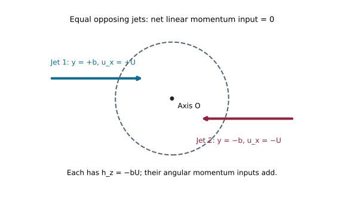
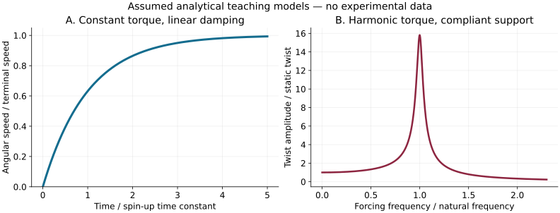

# Feynman's Reverse Sprinkler: Momentum Flux, Geometry and Structural Reaction Loads

**MIE 446 · Aerospace Structures · University of Massachusetts Amherst**  
Supplementary engineering reading · 3 November 2026

[Course home](https://github.com/Ehsan-Roohi/Aerospace-Structures) · [Large-equation reading view](https://ehsan-roohi.github.io/Aerospace-Structures/case-studies/feynman-sprinkler/)

## 1. A small device that tests a large principle

An ordinary sprinkler expels water through curved arms and rotates. Submerge it, withdraw water through the central hub, and ask what happens when the arms become inlets. Does the device stop, turn the same way, or reverse? The interesting engineering question is not simply which answer sounds plausible. It is which fluid boundary, momentum transport and structural reactions make that answer defensible.

This reading was prompted by the [supplied Zoomit article](https://www.zoomit.ir/science/470421-feynman-diverse-sprinklers-featured/). It is an original English teaching treatment, rather than a translation or reproduction of that article. The derivations and numerical examples below are classroom models; they are not fitted reproductions of the research experiments.

For an aerospace structures course, the sprinkler provides a compact route from a measured flow field to a torque, an attachment reaction, a shaft stress and a dynamic response. Similar accounting is needed for bent fuel lines, rotating machinery and propulsion mounts. A structural solver cannot repair a load that was derived from an incomplete fluid free-body diagram.

### What the recent research establishes

Wang, Sprinkle, Zuo and Ristroph [1] reported sustained reverse rotation using a very low friction apparatus in 2024. Their flow measurements connected the response to angular-momentum transport and curved internal passages. Smith, Zuo, Kuhlke, Sprinkle and Ristroph [2] extended the experimental inquiry in 2026 using different arm geometries and measurements of motion, torque and flow. The reported geometry comparisons support momentum flux into the device over explanations based only on the outer portions of the arms or total fluid angular momentum.

Those results concern the tested devices and conditions. They do not establish a universal speed ratio or rotation direction for every geometry and flow regime. In particular, a small measured speed does not imply a small internal pressure load. The following equations are standard conservation and structural mechanics developed independently for teaching, not transcriptions of the authors' detailed models.

## 2. Define the experiment before predicting its outcome

There are three distinct measurements:

| Experiment | Mechanical condition | Observable | Interpretation |
|---|---|---|---|
| Locked rotor | Angular velocity is zero | Support torque | Fluid forcing at zero rotor speed |
| Free rotor | No torsional restraint | Angular speed and acceleration | Forcing balanced by inertia and resistance |
| Compliant support | Finite torsional stiffness | Twist and vibration | Coupled forcing, stiffness, inertia and damping |

A photograph of rotation cannot distinguish a start-up impulse from a persistent mean torque. Record the pump history, flow rate, bearing resistance, arm geometry and observation duration. Locking the rotor can also change the flow, so a measured locked torque should not automatically be used as the forcing at every free-running speed.

### Notation and sign convention

Use a fixed inertial origin on the rotation axis, with positive $z$ upward. Positive torque and angular speed are counterclockwise when viewed from above. The outward unit normal of a fluid control surface is $\mathbf n$. Fluid velocity $\mathbf u$ is absolute velocity; control-surface velocity is $\mathbf v_s$. Define specific axial angular momentum by

$$
h_z=(\mathbf r\times\mathbf u)\cdot\mathbf e_z=xu_y-yu_x=r u_\theta. \tag{1}
$$

Thus $h_z$ has units $\mathrm{m^2/s}$. Let $Q>0$ denote the magnitude of the throughput, not a signed inlet flux. Inlet/outlet signs enter through $(\mathbf u-\mathbf v_s)\cdot\mathbf n$.

## 3. Mass and linear momentum: the foundation

For a moving control volume $V(t)$, mass conservation is

$$
\frac{d}{dt}\int_{V(t)}\rho\,dV+
\int_{S(t)}\rho(\mathbf u-\mathbf v_s)\cdot\mathbf n\,dA=0. \tag{2}
$$

For incompressible steady flow, the total volume inflow equals the total outflow. With $N$ identical arms of area $A$ and equal flow division,

$$
q=\frac{Q}{N},\qquad U=\frac{q}{A}=\frac{Q}{NA},\qquad \dot m=\rho Q. \tag{3}
$$

The linear momentum equation, with no omitted surface cuts, is

$$
\sum\mathbf F_{\mathrm{ext}\to f}=
\frac{d}{dt}\int_{V(t)}\rho\mathbf u\,dV+
\int_{S(t)}\rho\mathbf u[(\mathbf u-\mathbf v_s)\cdot\mathbf n]\,dA. \tag{4}
$$

Here the force sum includes wall traction, pressure traction on open cuts and body forces. For uniform steady fixed ports,

$$
\mathbf F_{w\to f}+\mathbf F_{p,\mathrm{cuts}}+\mathbf F_b
=\sum_{\mathrm{out}}\dot m_j\mathbf u_j-
\sum_{\mathrm{in}}\dot m_j\mathbf u_j. \tag{5}
$$

The fluid force on the solid wall is the negative of $\mathbf F_{w\to f}$, not necessarily the negative of the entire left-hand side. Pressure forces at artificial control-surface cuts must first be accounted for. This distinction is important for a curved pipe: a pressure-only estimate can be wrong even when its units are correct.

## 4. The angular-momentum theorem

Taking moments about the same fixed inertial origin gives

$$
\sum T_{z,\mathrm{ext}\to f}=
\frac{d}{dt}\int_{V(t)}\rho h_z\,dV+
\int_{S(t)}\rho h_z[(\mathbf u-\mathbf v_s)\cdot\mathbf n]\,dA. \tag{6}
$$

The first term is angular-momentum **storage**; the second is its **flux** through the boundary. A flow can have constant stored angular momentum and continuously transport angular momentum. Conversely, a large stored swirl does not by itself determine the torque.

For a stationary, steady control volume, define the signed net outward flux

$$
\Phi_H=\int_S\rho h_z(\mathbf u\cdot\mathbf n)\,dA. \tag{7}
$$

Then

$$
T_{w\to f}+T_{p,\mathrm{cuts}}+T_b=\Phi_H,
\qquad
T_{f\to w}=-\Phi_H+T_{p,\mathrm{cuts}}+T_b. \tag{8}
$$

Pressure-cut torque is

$$
T_{p,\mathrm{cuts}}=-\int_{S_{\mathrm{cuts}}}
[\mathbf r\times(p\mathbf n)]\cdot\mathbf e_z\,dA. \tag{9}
$$

It vanishes for some carefully chosen boundaries, not for every convenient pipe cut. Gravity has zero axial moment when it acts parallel to $z$. Ambient pressure may be subtracted consistently over a closed boundary; subtracting it on only selected surfaces creates spurious forces.

### A useful port approximation

If each port can be represented by a mass-flux-weighted radius and tangential velocity,

$$
\Phi_H\simeq\sum_{\mathrm{out}}\dot m_j r_j u_{\theta j}
-\sum_{\mathrm{in}}\dot m_j r_j u_{\theta j}. \tag{10}
$$

A nonuniform profile requires the integral in (7). Averaging velocities first can discard the correlation between local throughput and angular momentum.

**Do not double count.** One valid route integrates all wall stresses. Another uses control-volume fluxes plus the remaining surface forces. Adding a momentum-flux estimate to the already integrated complete wall torque counts the same interaction twice.

## 5. Why simply reversing the arrows fails

For a conventional idealized rotor at rest, take $N$ tangential outlets at radius $R$, negligible inlet swirl near the axis, equal outlet speed $U$ and negligible pressure-cut moment. Let $s=+1$ denote counterclockwise ejected fluid and $s=-1$ clockwise ejected fluid. Equations (3), (8) and (10) give

$$
\Phi_H=s\rho Q R U,
\qquad T_{f\to w}=-s\rho Q R U
=-s\frac{\rho R Q^2}{NA}. \tag{11}
$$

The two diametrically opposite jet forces can cancel as a net force while adding as a couple. A zero net force therefore does not imply zero torque.

In suction, water converges from the surrounding reservoir; it is not generally an identical narrow jet played backward. Internal curvature, velocity profiles, viscous layers and hub flow differ. A precise time reversal would require reversing the full fluid state and its boundary conditions, not just changing the pump setting.

For a Newtonian incompressible fluid,

$$
\nabla\cdot\mathbf u=0,\qquad
\rho\left(\partial_t\mathbf u+\mathbf u\cdot\nabla\mathbf u\right)
=-\nabla p+\mu\nabla^2\mathbf u. \tag{12}
$$

Under $t\mapsto-t$, $\mathbf u\mapsto-\mathbf u$, the inertial terms retain their transformation while the viscous term changes sign. The viscous equations do not possess the simple reversibility sometimes assumed in the thought experiment. At negligible inertia, the linear Stokes problem has a different, restricted reversibility, which still requires matching geometry and boundary conditions. Neither observation alone predicts the finite-Reynolds-number sprinkler torque.

## 6. Geometry converts throughput into angular-momentum flux

For a streamlined estimate in a curved passage of centerline radius $R_c$, the outward pressure gradient needed to turn the flow is approximately

$$
\frac{\partial p}{\partial n_c}\sim\rho\frac{U^2}{R_c}. \tag{13}
$$

Here $n_c$ points away from the center of curvature. Across a passage width $d\ll R_c$,

$$
\Delta p_{\perp}\sim\rho U^2\frac{d}{R_c}. \tag{14}
$$

These are local scaling estimates, not a complete torque model. Cross-sectional velocity redistribution and secondary flow can change where angular momentum enters the hub. Useful dimensionless quantities are

$$
Re=\frac{\rho Ud}{\mu},\qquad
De=Re\sqrt{\frac{d}{2R_c}}. \tag{15}
$$

The Dean-number convention here uses tube diameter $d$ and curvature radius $R_c$. Passage length, curvature sequence, entrance development and hub geometry also matter. One scalar curvature cannot specify every arm.

### An equivalent jet lever arm

A useful interpretation of measured hub-entry flux is an equivalent signed offset $b_{\mathrm{eff}}$. If the entering jets have representative speed $U_j$, define

$$
\dot H_{\mathrm{into\ hub}}=\rho Q U_j b_{\mathrm{eff}}. \tag{16}
$$

This is a definition based on the actual integral; it need not be the geometric centerline offset. When hub outlet angular momentum, pressure-cut moments and storage are negligible,

$$
T_{f\to\mathrm{hub}}\simeq\rho Q U_j b_{\mathrm{eff}}. \tag{17}
$$

The positive sign follows because inflow has negative outward flux. Two jets with opposite linear momenta can have the same sign of $\mathbf r\times\mathbf u$ if they pass opposite sides of the center.

*Original schematic, viewed from above. In this particular drawing both jets have negative specific angular momentum. Their linear momenta cancel while their angular-momentum inputs add. The drawn sign is illustrative and is not a measured universal direction.*

Equation (17) describes the selected hub walls. The complete rotor torque also includes the arms and any other wetted rotating surfaces. A central jet picture is instructive, but is not a license to omit those contributions. Likewise, a centered outlet has negligible angular-momentum flux only if its swirl is negligible; proximity to the axis alone is insufficient.

For comparable speeds, a small residual effective offset relative to the outer radius gives the scale comparison

$$
\frac{|T_{\mathrm{hub,reverse}}|}{|T_{\mathrm{forward}}|}
\sim\frac{|b_{\mathrm{eff}}|}{R}. \tag{18}
$$

This compares torque scales under explicit assumptions. It is not a universal ratio, and it is not automatically the angular-speed ratio.

## 7. From torque to rotation and support twist

For a rigid rotor with known total hydrodynamic torque,

$$
I_s\dot\Omega=T_h(Q,\Omega,t)-c\Omega-k\theta-T_C\operatorname{sgn}(\Omega),
\qquad\dot\theta=\Omega. \tag{19}
$$

Here $I_s$ is solid inertia, $c$ a modeled mechanical damping coefficient, $k$ the support torsional stiffness and $T_C$ sliding friction. At rest, Coulomb friction is set-valued: a rotor may remain stuck while the demanded reaction is below the static-friction threshold. Do not evaluate $\operatorname{sgn}(0)=0$ and conclude that arbitrarily small torques must start it.

If $T_h$ already comes from the full unsteady stress field, fluid inertia is already included. An effective inertia $I_{\mathrm{eff}}=I_s+I_a$ is an alternative reduced model in which an added-inertia term has first been removed from $T_h$. Using both without that separation double counts fluid inertia.

For a free rotor with constant imposed torque $T_0$, linear damping only and initial rest,

$$
\Omega(t)=\frac{T_0}{c}\left[1-\exp\left(-\frac{ct}{I_{\mathrm{eff}}}\right)\right],
\qquad \tau_r=\frac{I_{\mathrm{eff}}}{c}. \tag{20}
$$

For steady quadratic resistance $c_2\Omega|\Omega|$,

$$
|\Omega_{\infty}|=\sqrt{\frac{|T_0|}{c_2}},
\qquad \operatorname{sgn}\Omega_{\infty}=\operatorname{sgn}T_0. \tag{21}
$$

Thus a torque ratio of $0.02$ produces a speed ratio of $0.02$ under identical linear damping but about $0.141$ under identical quadratic damping. Neither comparison is a prediction for the experimental apparatus.

For a compliant support with linearized forcing,

$$
I_{\mathrm{eff}}\ddot\theta+c\dot\theta+k\theta=T_h(t),
\qquad\omega_n=\sqrt{\frac{k}{I_{\mathrm{eff}}}},
\qquad\zeta=\frac{c}{2\sqrt{kI_{\mathrm{eff}}}}. \tag{22}
$$

If $T_h=T_a\cos\omega t$, the steady twist amplitude is

$$
\Theta=\frac{|T_a|}{\sqrt{(k-I_{\mathrm{eff}}\omega^2)^2+(c\omega)^2}}. \tag{23}
$$

For constant loading the final twist is $\theta_0=T_0/k$. A small mean torque can coexist with appreciable oscillatory twist near a resonance. This one-degree-of-freedom example is forced vibration, not a flutter analysis. Flow-dependent negative damping would require a separate stability model and evidence.

## 8. The aerospace structures connection

### 8.1 Local loads and global couples

At each bend, momentum changes and pressure tractions load the tube wall. Attachments carry those loads into the hub and support. A torque pair can disappear from a force-only summary, just as distributed aerodynamic loads can be reduced incorrectly if their moments are omitted. Preserve both resultants:

$$
\mathbf F_R=\sum_j\mathbf F_j,
\qquad\mathbf M_O=\sum_j\mathbf r_j\times\mathbf F_j+\sum_j\mathbf M_j. \tag{24}
$$

For a thin circular tube with internal gauge pressure $p_g$, radius $r_t$ and wall thickness $t\ll r_t$, the membrane approximations are

$$
\sigma_{\theta}=\frac{p_g r_t}{t},
\qquad \sigma_z=\frac{p_g r_t}{2t}. \tag{25}
$$

The axial expression assumes a closed-end load path. Open ends or independently restrained end caps change the axial force. These stresses depend on pressure and wall dimensions, not on the small residual rotor torque. External pressure introduces buckling questions outside this membrane estimate.

### 8.2 Torsion, bending and attachment reactions

For a circular support shaft with outer and inner diameters $d_o,d_i$,

$$
J_p=\frac{\pi}{32}(d_o^4-d_i^4),\qquad
\tau_{\max}=\frac{|T|d_o}{2J_p},\qquad
\theta=\frac{TL}{GJ_p}. \tag{26}
$$

These are elastic Saint-Venant formulas away from load introduction. Threads, notches and joint flexibility require additional treatment. For a thin-walled closed single-cell wing box, the corresponding torsional shear-flow relation is

$$
q_s=\frac{T}{2A_m},\qquad
\tau(s)=\frac{q_s}{t(s)}. \tag{27}
$$

Here $A_m$ is enclosed median-line area. Do not substitute the circular-shaft expression for an arbitrary open section or multicell wing.

For a straight cantilever carrying an idealized transverse tip force $F$, the root moment and tip deflection are

$$
M_{\mathrm{root}}=FL,\qquad
\delta_{\mathrm{tip}}=\frac{FL^3}{3EI_b}. \tag{28}
$$

A curved flowing arm generally needs distributed loading and geometric analysis; (28) is a comparison model, not an exact sprinkler-arm solution. For a circular member under normal stress and torsional shear, a simple plane-stress equivalent stress is

$$
\sigma_{\mathrm{vm}}=\sqrt{\sigma^2+3\tau^2}. \tag{29}
$$

Pressure-vessel biaxial stress requires the full plane-stress expression. For aircraft applications, strength is only one check: fatigue, local buckling, attachment bearing, stiffness and dynamic response may govern.

### 8.3 Connection to turbines and power

A steady rotor exchanging angular momentum with a throughflow has shaft-torque scale

$$
T_{\mathrm{shaft}}\sim\dot m(r_2u_{\theta2}-r_1u_{\theta1}),
\qquad P=T\Omega. \tag{30}
$$

The sign depends on whether torque is defined on the fluid or on the rotor. A locked support can transmit torque while doing zero rotational work. The hydraulic source nevertheless supplies pressure-flow power

$$
P_{\mathrm{hyd}}=\Delta p\,Q. \tag{31}
$$

This separates support strength from conversion efficiency. A small $T\Omega$ does not imply that the pump consumes little power.

## 9. Worked example: explicit assumptions, reproducible arithmetic

The [calculation script](docs/case-studies/feynman-sprinkler/teaching_calculations.py) uses only the Python standard library. All numbers below are assumed teaching inputs, not reported apparatus data.

Take water with $\rho=1000\ \mathrm{kg/m^3}$ and $\mu=10^{-3}\ \mathrm{Pa\,s}$, two arms of inner diameter $d=8$ mm, total throughput $Q=2.0\times10^{-5}\ \mathrm{m^3/s}$, outer radius $R=0.10$ m and representative bend radius $R_c=0.025$ m. Then

$$
A=5.02655\times10^{-5}\ \mathrm{m^2},\quad
U=0.198944\ \mathrm{m/s},\quad
Re=1591.55,\quad De=636.62. \tag{32}
$$

A straight-pipe transition criterion does not by itself classify every curved passage at these conditions. Equation (11) gives the ideal forward torque magnitude

$$
|T_{\mathrm{forward}}|=3.97887\times10^{-4}\ \mathrm{N\,m}. \tag{33}
$$

Assume, solely for a hub-load illustration, $U_j=U$ and $b_{\mathrm{eff}}=2$ mm. Equation (17) gives

$$
|T_{\mathrm{hub}}|=7.95775\times10^{-6}\ \mathrm{N\,m}. \tag{34}
$$

The torque-scale ratio is $0.0200$. It follows from the assumed offset, not from a measured 50-fold rotation difference. For the next calculations only, additionally assume that other rotor-wall contributions cancel so that this hub estimate equals the total imposed torque $T_0$. This assumption must be replaced by a complete torque balance for a real device.

For linear damping $c=2.0\times10^{-5}\ \mathrm{N\,m\,s}$ and effective inertia $I_{\mathrm{eff}}=10^{-4}\ \mathrm{kg\,m^2}$, equation (20) gives $\Omega_\infty=0.397887$ rad/s, $\tau_r=5$ s and $\Omega(5\ \mathrm{s})=0.251513$ rad/s. Observe the rotor for several time constants before calling a measured speed stationary.

For a solid shaft of diameter $2$ mm, length $50$ mm and shear modulus $G=26$ GPa, using $T=T_0$ gives $J_p=1.57080\times10^{-12}\ \mathrm{m^4}$, $\tau_{\max}=5.06606$ kPa and $\theta=9.74242\times10^{-6}$ rad. This demonstrates arithmetic, not an approved shaft design or a prediction of the experimental bearing.

If instead the support has $k=10^{-3}\ \mathrm{N\,m/rad}$, equation (22) gives $\omega_n=\sqrt{10}=3.16228$ rad/s and $\zeta=0.0316228$. Under harmonic torque amplitude $T_a=T_0$ at $\omega=\omega_n$, equation (23) gives $\Theta=0.125823$ rad. That amplification is a property of this assumed lightly damped linear oscillator; real joints and flow feedback can change it.

At an assumed pump pressure difference of $20$ kPa, $P_{\mathrm{hyd}}=0.4$ W. The modeled free-running mechanical power $T_0\Omega_\infty$ is $3.16629\times10^{-6}$ W. The resulting ratio is illustrative bookkeeping, not a measured efficiency or an optimized design.

*Original analytical teaching curves. Left: constant-torque spin-up under linear damping. Right: normalized steady harmonic twist for the assumed compliant support. Neither curve contains experimental observations.*

## 10. Measurement, uncertainty and numerical verification

A useful laboratory sequence measures $Q$ by timed collection, static support torque with a calibrated torsional element, free rotation by video and the internal flow by particle tracking or particle-image velocimetry. The last measurement supplies information that visible rotation alone cannot provide.

For a small planar port with outward normal velocity $u_n$, an area-discretized flux estimate is

$$
\Phi_H\approx\sum_m\rho(x_m u_{ym}-y_m u_{xm})u_{nm}\,\Delta A_m. \tag{35}
$$

Integrate all needed ports and include pressure-cut moments. A single illuminated plane does not resolve an arbitrary three-dimensional velocity field; quantify the missing components or justify a planar approximation.

For the ideal forward model, because $A=\pi d^2/4$, first-order independent relative uncertainty gives

$$
\left(\frac{s_T}{|T|}\right)^2\approx
\left(\frac{s_\rho}{\rho}\right)^2+
\left(\frac{s_R}{R}\right)^2+
4\left(\frac{s_Q}{Q}\right)^2+
4\left(\frac{s_d}{d}\right)^2. \tag{36}
$$

This formula assumes a fixed exact arm count and neglects parameter correlations and model discrepancy. For the hub model with independently measured $U_j$ and $b_{\mathrm{eff}}$, use the relative variances of $\rho,Q,U_j,b_{\mathrm{eff}}$. If $U_j=Q/(NA)$ is derived from the same $Q$ and $d$, propagate through that expression instead of treating the variables as independent. Near zero effective offset, use absolute uncertainty; a relative-error formula becomes singular.

A CFD study should report mass imbalance, spatial/time refinement, boundary placement and the residual between stress-integrated torque and the complete angular-momentum balance. Mesh convergence of angular speed alone is insufficient if numerical torques nearly cancel. For a fixed control volume, a useful diagnostic is

$$
\epsilon_T=T_{w\to f}+T_{p,\mathrm{cuts}}+T_b
-\frac{dH_z}{dt}-\Phi_H. \tag{37}
$$

Normalize by a stated nonzero torque scale and report the dimensional residual too. For a moving boundary, replace the flux by the relative-velocity form in (6). Validate locked and freely rotating cases separately; the boundary motion changes the solution.

## 11. A 35-minute classroom investigation

1. **Predict (5 min).** Sketch both flow directions, select positive rotation and predict the locked torque and free rotation separately. State which unknown flow feature your prediction assumes.
2. **Balance (10 min).** Draw one control volume around the hub and another around the complete internal passage. Mark every pressure cut, angular-momentum flux and solid reaction. Explain why their wall torques need not be equal.
3. **Calculate (10 min).** Run the supplied script. Double $Q$ while keeping the assumed geometry and coefficients fixed. The ideal torque increases fourfold; discuss why a real offset or resistance coefficient might also change.
4. **Design (5 min).** Choose a support stiffness to limit static twist. Then check whether a forcing frequency near its natural frequency invalidates a static-only decision.
5. **Evaluate evidence (5 min).** Identify a measurement that distinguishes an outer-mouth explanation from a momentum-flux explanation. Specify which geometric change should preserve the predicted torque under each hypothesis.

### Discussion questions

- Can zero total linear momentum flux coexist with nonzero angular-momentum flux? Construct a two-jet example with signed coordinates.
- Can a stationary rotor carry torque? Where does the reaction go, and what is the rotational power?
- Why does reversing the flow rate fail to specify the reversed internal velocity field?
- How could bearing friction conceal a persistent small torque?
- Which changes to an arm can alter pressure stress without producing an equal fractional change in total torque?
- Which terms must remain in a start-up calculation even if they vanish in a steady locked experiment?

## 12. References and reading route

Read [1] for the 2024 experiment and [2] for the later geometry comparisons. The remaining items provide historical context or the mechanics used in the independently derived teaching sections. Source access was checked on 3 November 2026. Full research text and supplementary material may require publisher or institutional access; detailed apparatus coefficients have not been reconstructed here.

1. K. Wang, B. Sprinkle, M. Zuo and L. Ristroph (2024), **Centrifugal Flows Drive Reverse Rotation of Feynman's Sprinkler**, *Physical Review Letters* **132**, 044003. [DOI: 10.1103/PhysRevLett.132.044003](https://doi.org/10.1103/PhysRevLett.132.044003). Primary experimental source.
2. J. E. Smith, M. Zuo, W. Kuhlke, B. Sprinkle and L. Ristroph (2026), **Geometry controls momentum flux in the sprinkler problem**, *Proceedings of the National Academy of Sciences* **123**(30), e2537479123. [DOI: 10.1073/pnas.2537479123](https://doi.org/10.1073/pnas.2537479123). Primary geometry/torque/flow comparison; online publication 13 July 2026.
3. A. Jenkins (2004), **An elementary treatment of the reverse sprinkler**, *American Journal of Physics* **72**, 1276–1282. [Author preprint](https://arxiv.org/abs/physics/0312087). Historical theoretical treatment; read alongside the later experiments.
4. W. R. Dean (1927), **Note on the motion of fluid in a curved pipe**, *Philosophical Magazine* **4**, 208–223. [DOI: 10.1080/14786440708564324](https://doi.org/10.1080/14786440708564324). Classical curved-pipe analysis; background for (13)–(15), not a whole-sprinkler torque law.
5. N. Nangia, H. Johansen, N. A. Patankar and A. P. S. Bhalla (2017), **A moving control volume approach to computing hydrodynamic forces and torques on immersed bodies**, *Journal of Computational Physics* **347**, 437–462. [DOI: 10.1016/j.jcp.2017.06.047](https://doi.org/10.1016/j.jcp.2017.06.047). Computational load-accounting context.
6. W. Thielicke and R. Sonntag (2021), **Particle Image Velocimetry for MATLAB: Accuracy and enhanced algorithms in PIVlab**, *Journal of Open Research Software* **9**, 12. [DOI: 10.5334/jors.334](https://doi.org/10.5334/jors.334). Measurement-method background.
7. E. H. Dowell and K. C. Hall (2001), **Modeling of fluid-structure interaction**, *Annual Review of Fluid Mechanics* **33**, 445–490. [DOI: 10.1146/annurev.fluid.33.1.445](https://doi.org/10.1146/annurev.fluid.33.1.445). Context for coupled structural response.
8. S. L. Dixon and C. A. Hall, **Fluid Mechanics and Thermodynamics of Turbomachinery**, 7th ed., Butterworth-Heinemann (2014). [Publisher / ISBN 9780124159549](https://shop.elsevier.com/books/fluid-mechanics-and-thermodynamics-of-turbomachinery/dixon/978-0-12-415954-9). Standard reference for angular-momentum and shaft-work relations; not the source of the assumed example values.
9. **Starting popular-science reading:** [Zoomit: Feynman and reverse sprinklers](https://www.zoomit.ir/science/470421-feynman-diverse-sprinklers-featured/). The requested link is preserved for context; research claims above are attributed to primary publications.

**Reproducibility:** [Python calculations](docs/case-studies/feynman-sprinkler/teaching_calculations.py) · [Numerical record](docs/case-studies/feynman-sprinkler/calculations.json). All diagrams and example calculations are original teaching material. No publisher figures or experimental datasets are reproduced.
