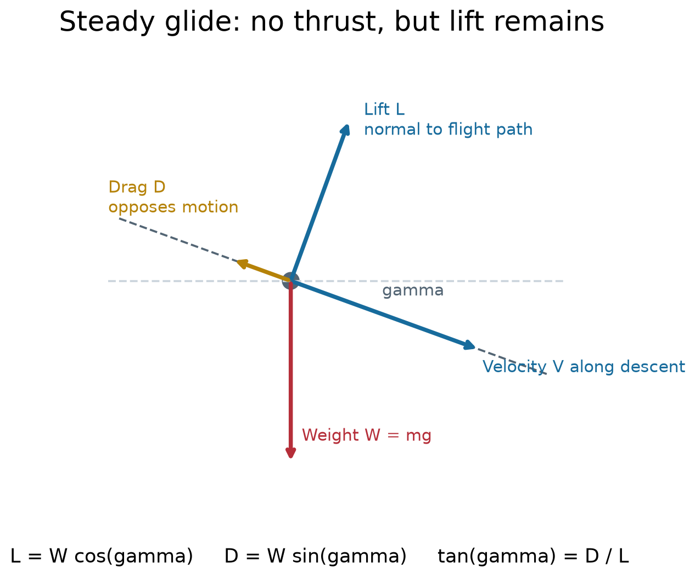
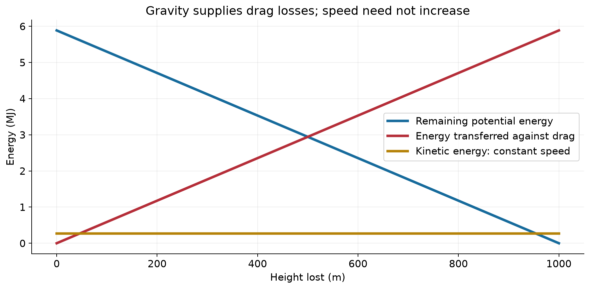
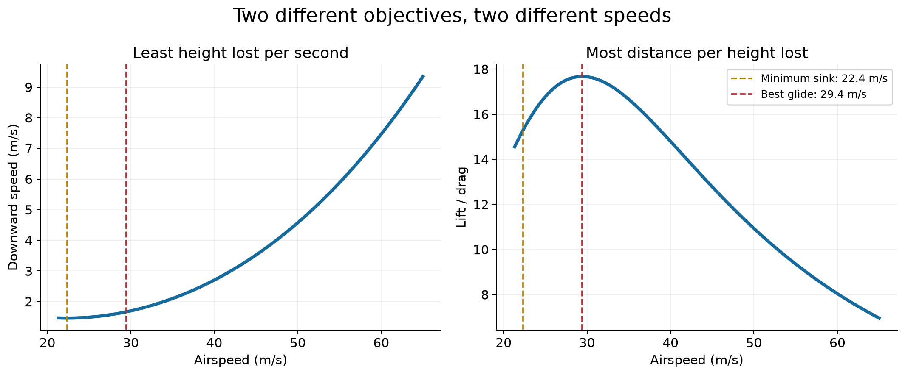
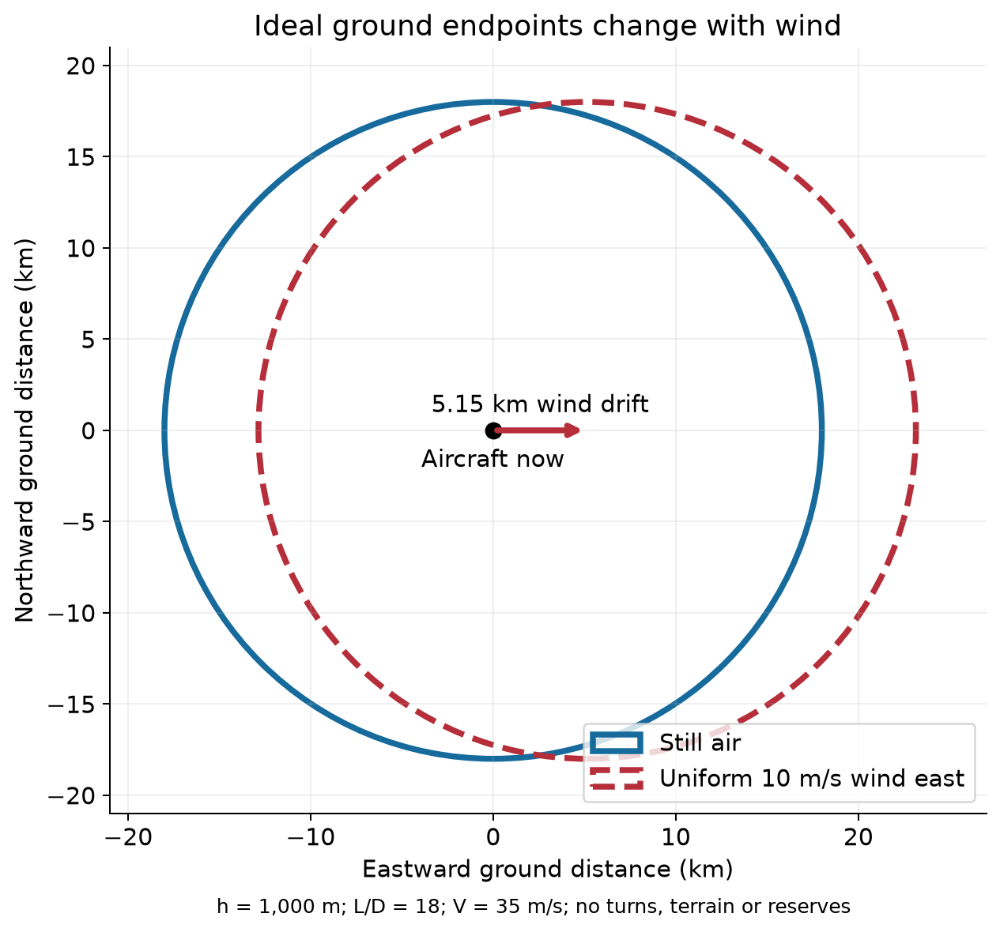
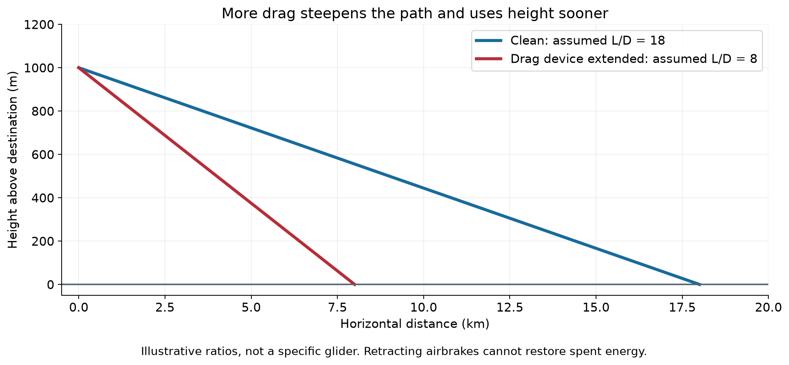
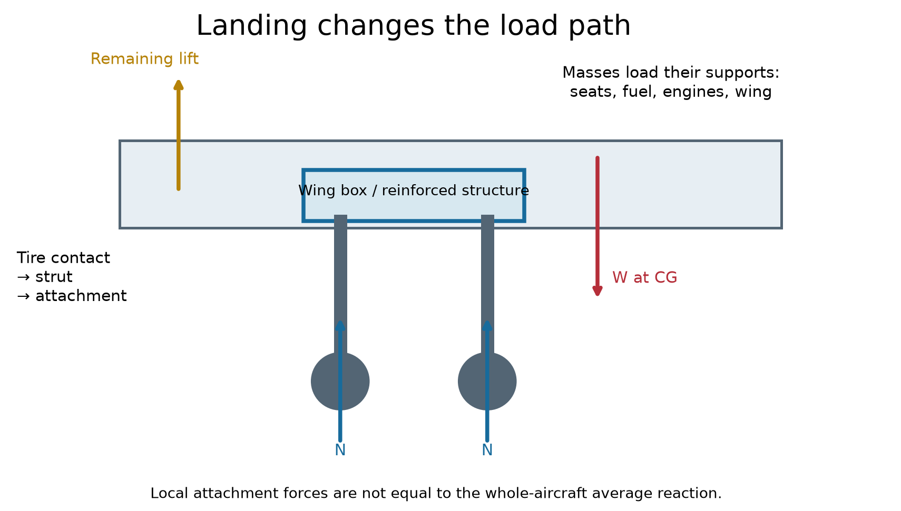
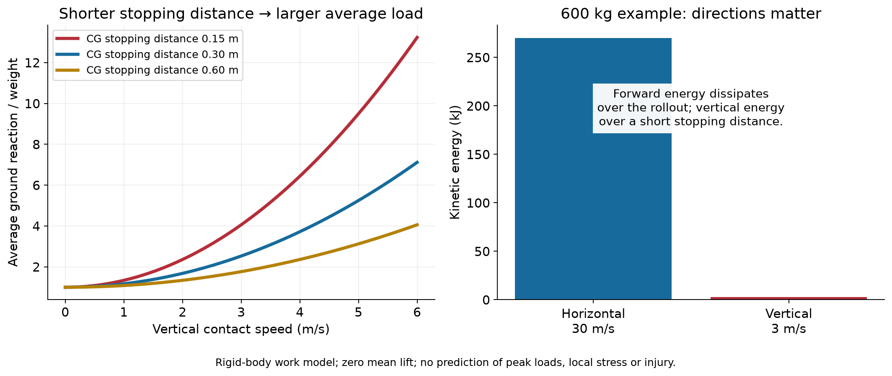
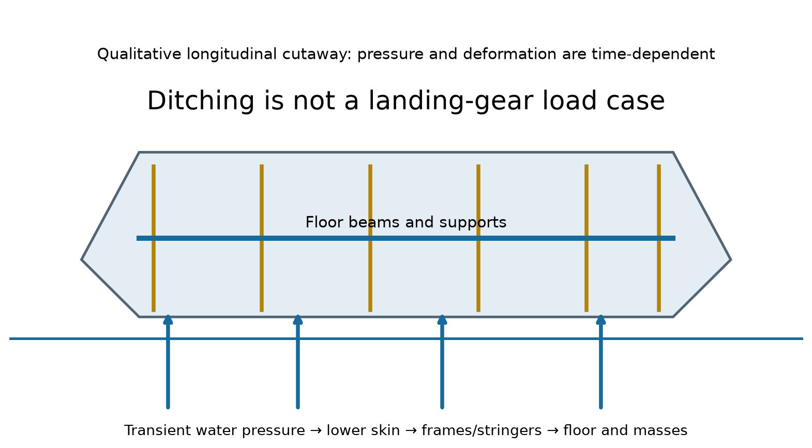

# Gliding, unpowered landing and structural loads

MIE 446 · Aerospace Structures · University of Massachusetts Amherst

An aircraft can lose thrust without immediately losing lift. Its remaining height and speed form an energy budget, but reaching the ground is only half the problem: the structure must also transfer and absorb the landing loads.

This reading connects Lectures 1–2 to the [Gimli Glider case study](GIMLI_GLIDER.md), [wing-structure lecture](notebooks/MIE446_Wing_Structure_Buckling_Materials_and_Flutter.ipynb) and [Wing Lab](https://ehsan-roohi.github.io/Aerospace-Structures/wing-lab.html). The numerical examples are classroom models, not operating instructions or aircraft-specific landing limits. Actual flight procedures and speeds come from the approved flight manual and trained flight crew.

## Reading map

- [English translation of the supplied article](#english-translation-of-the-supplied-article)
- [Forces and energy in a glide](#forces-and-energy-in-a-glide)
- [Range, sink rate and wind](#range-sink-rate-and-wind)
- [How a glider controls its landing](#how-a-glider-controls-its-landing)
- [Real aircraft and different outcomes](#real-aircraft-and-different-outcomes)
- [Wing loads before touchdown](#wing-loads-before-touchdown)
- [Landing loads and structural load paths](#landing-loads-and-structural-load-paths)
- [Water landing and crashworthiness](#water-landing-and-crashworthiness)
- [Classroom calculations and questions](#classroom-calculations-and-questions)

## English translation of the supplied article

**Source:** Zoomit, “اگر تمام موتورهای هواپیما وسط پرواز خاموش شوند، چه اتفاقی می‌افتد؟” (“What happens if all an aircraft’s engines stop during flight?”), by Amir Abdolmaleki, dated 21 Mehr 1405 / October 13, 2026 in the supplied text. The following translates the article body, excluding advertisements, navigation and comments. The supplied copy did not include a verified article URL. The engineering supplement below is separate from the translation. Original article photographs are not reproduced.

### What happens if all an aircraft’s engines stop during flight?

Do aircraft crash if every engine stops, or can they still land safely?

Imagine sitting eleven kilometres above the ground when the sound of the aircraft’s engines suddenly stops. The familiar roar is gone, and the aircraft must continue flying without thrust. Will you fall a few seconds later? Can the pilot restart the engines? If they will not restart, what will happen to the passengers?

Contrary to a common assumption, the shutdown of every engine does not necessarily cause an immediate crash. Passenger aircraft are designed to deal with such emergencies and, provided they retain sufficient speed, can glide without engine power. Nevertheless, this is a very dangerous situation. Its outcome depends on the aircraft’s altitude, the cause of the shutdown, the weather and the distance to a suitable landing place.

### How does an aircraft stay in the air without engines?

To understand this, we must distinguish thrust from lift. An aircraft’s engines supply the force needed to move forward, while its wings generate lift as air flows around them. As long as the aircraft has sufficient speed, the wings can support it in flight even when the engines produce no force.

When the engines stop, the aircraft behaves like a glider.

In these conditions, the aircraft acts as a large glider: it gradually gives up height to maintain the speed needed to continue flying. The pilot must adjust the speed and flight path so that the aircraft can cover as much distance as possible, leaving time to restart the engines or reach a landing site.

A passenger may initially notice only that the engine noise has stopped. The flight crew, however, immediately faces a serious emergency. Losing engine power can also affect electricity from the generators and other aircraft systems. Passenger aircraft nevertheless have backup systems that help the pilots retain control.

In many aircraft, a ram air turbine, or RAT, extends from the fuselage when needed. Air flowing past turns this device, which supplies some of the electrical power or hydraulic pressure required by essential systems. A RAT does not replace an aircraft engine, and its output is limited. Its purpose is to help maintain control in an emergency.

### Can the pilot restart engines that have stopped?

Yes. In many circumstances, engines can be restarted during flight. This process, called an in-flight engine restart, forms part of passenger aircraft emergency procedures. Pilots train to carry it out, and manufacturers provide aircraft-specific instructions.

One method uses the airflow. As the aircraft continues moving forward, air passes through an engine and can turn its rotating components. If conditions are suitable and the engine has not suffered serious damage, the pilot can follow the relevant procedure to restore combustion.

Another method uses the aircraft’s electrical system and auxiliary equipment. Many passenger aircraft have an auxiliary power unit, or APU: a small system normally located near the rear of the fuselage that can provide electricity and compressed air for certain equipment. Under suitable conditions, it can also help restart an engine. The precise starting method depends on the aircraft model, altitude, speed and engine condition.

The key point is that an engine shutdown does not always mean permanent engine damage. Fuel exhaustion, bird ingestion or severe weather can sometimes stop an engine. If the cause can be removed and the engine has not suffered serious damage, a restart may be possible. If it has sustained severe mechanical damage, however, attempts to restart it may not succeed.

### Two real accidents showing that aircraft can land without engines

One of the best-known examples is Air Transat Flight 236 in 2001. This Airbus A330 was flying from Toronto to Lisbon when a fuel leak gradually emptied its tanks. First the right engine and then the left engine stopped, leaving the aircraft over the Atlantic Ocean without thrust.

The pilots guided the aircraft in a glide and landed at Lajes Airport in the Azores approximately nineteen minutes later. It travelled about 120 kilometres without engine power, and all 306 occupants survived. The incident demonstrated that, under suitable conditions and with appropriate pilot handling, a large passenger aircraft can travel a considerable distance without engines.

Another famous example is US Airways Flight 1549 in 2009. This Airbus A320 struck a flock of Canada geese only a few minutes after taking off from New York’s LaGuardia Airport. Birds entered both engines, and almost all thrust was lost.

The pilots attempted to restart the engines but were unsuccessful. With little altitude and limited time available, returning to the airport was not possible. Captain Chesley Sullenberger decided to land on the Hudson River. The aircraft touched down on the water, and all 155 occupants survived, although some passengers and crew were injured.

These accidents illustrate an important difference. An engine shutdown at cruise altitude usually leaves more time to diagnose the problem, attempt a restart and choose a landing place. At low altitude, such as shortly after takeoff, a pilot may have only a few minutes—or even less—to decide what to do.

If every engine fails, the outcome depends on several factors: altitude and speed, the cause of the failure, whether the engines can be restarted and whether a suitable landing site exists. An aircraft can fly without its engines, but it loses height and has limited time for action. Pilots must therefore prepare for an emergency landing while also attempting to restart the engines.

---

## Forces and energy in a glide

The remainder is an engineering supplement, not part of the translated article.

### Lift does not require engine thrust

Lift depends on the relative airflow, geometry and angle of attack. Removing thrust does not instantly remove that airflow. However, **airspeed alone is not the stall criterion**: stall occurs when the relevant critical angle of attack is exceeded. The aircraft must also retain usable controls and systems. The FAA discusses gliding forces in [Glider Flying Handbook, Chapter 3](https://www.faa.gov/regulations_policies/handbooks_manuals/aviation/glider_handbook/gfh_chapter_3.pdf).



*Figure 1. Lift is perpendicular to the flight path, not necessarily vertical. Drag opposes motion relative to the air. The descent angle is exaggerated for visibility.*

Define a positive descent angle γ below the horizontal. For straight, constant-speed flight through still air, neglecting thrust:

$$
L-W\cos\gamma=0,
\qquad
W\sin\gamma-D=0.
$$

Dividing the second equation by the first gives:

$$
\tan\gamma=\frac{D}{L},
\qquad
\frac{\text{horizontal distance}}{\text{height lost}}=\frac{L}{D}.
$$

There is no unbalanced force in this steady case. The component of weight along the descending path balances drag. An engine is unnecessary for this equilibrium because the aircraft is spending gravitational potential energy.

### Descending does not mean continuously accelerating

For a point-mass aircraft in still air, with no thrust:

$$
E=mgh+\frac{1}{2}mV^2,
\qquad
\frac{dE}{dt}=-DV.
$$

Lift does no work in this idealization because it is perpendicular to velocity. Drag removes mechanical energy. At constant speed, kinetic energy stays constant, so:

$$
mg\left(-\frac{dh}{dt}\right)=DV.
$$



*Figure 2. A 600 kg classroom aircraft descends at constant 30 m/s. Potential energy decreases, while kinetic energy remains 0.270 MJ. The rising red curve is accumulated energy transferred against drag—not energy remaining onboard.*

If the aircraft accelerates, some potential-energy loss increases kinetic energy and the rest supplies drag losses. If it decelerates, kinetic energy also contributes. A soaring glider can climb in rising air: that introduces an external atmospheric energy source, outside the still-air model. Do not summarize all gliding as “height turns into more speed.”

## Range, sink rate and wind

### Best glide and minimum sink answer different questions

**Best glide** maximizes distance through the air per unit height lost. **Minimum sink** minimizes height lost per second. Those speeds generally differ. The FAA explains this distinction using performance polars in [Chapter 5](https://www.faa.gov/regulations_policies/handbooks_manuals/aviation/glider_handbook/gfh_chapter_5.pdf).

For a simple small-descent-angle model with a parabolic drag polar:

$$
C_D=C_{D0}+kC_L^2,
\qquad
C_L\approx\frac{2W}{\rho V^2S}.
$$

Maximizing lift-to-drag ratio gives:

$$
C_{L,\,\mathrm{best\ glide}}=\sqrt{\frac{C_{D0}}{k}}.
$$

Minimizing the approximate downward speed $V D/W$ gives:

$$
C_{L,\,\mathrm{minimum\ sink}}=\sqrt{\frac{3C_{D0}}{k}}.
$$



*Figure 3. Assumed values: W = 6,000 N, S = 16 m², density = 1.225 kg/m³, CD0 = 0.02 and k = 0.04. Best glide is approximately 29.43 m/s and minimum sink 22.36 m/s. A chosen CL limit of 1.4 excludes the stalled region. These are not speeds for any actual aircraft.*

At a fixed optimal lift coefficient, required speed scales with the square root of wing loading $W/S$. In this ideal polar, increasing weight changes optimal speed and sink rate, but not the maximum L/D itself. Real aircraft have configuration, Reynolds-number and other effects that this model omits.

### A reachability circle is only a first estimate

In still air, with constant L/D and height h above the destination:

$$
R=h\frac{L}{D}.
$$

At h = 1,000 m and L/D = 18, the ideal straight-path range is 18 km. This is not a guarantee: turns, terrain, configuration changes, delayed decisions and an arrival-height reserve reduce practical options.

Wind changes ground velocity, not the definition of airspeed:

$$
\mathbf{V}_{\mathrm{ground}}=\mathbf{V}_{\mathrm{air}}+\mathbf{V}_{\mathrm{wind}}.
$$



*Figure 4. For the stated constant-speed model, descent takes about 515 s. A uniform 10 m/s easterly-directed wind translates the ideal endpoint circle about 5.15 km east. This geometric illustration assumes an immediately established straight path in any heading; it is not a flight-planning footprint.*

Use altitude **above the landing site**, not automatically altitude above sea level. A headwind can sharply reduce ground range even while aerodynamic L/D remains unchanged. Changes in wind with height invalidate this simple translation.

## How a glider controls its landing

A glider pilot manages a finite energy budget. There is no conventional engine-powered go-around to replace energy already spent. The FAA treats approach and recovery techniques in [Chapter 7](https://www.faa.gov/regulations_policies/handbooks_manuals/aviation/glider_handbook/gfh_chapter_7.pdf); exact procedures remain aircraft-specific.

| Control or action | Aerodynamic effect | What the student should notice |
|---|---|---|
| Elevator | Changes pitching moment, attitude and angle of attack; speed and flight path respond together | It does not create energy. Pulling up can exchange speed for height temporarily. |
| Ailerons and rudder | Command roll and yaw; establish and coordinate changes of direction | A turn uses part of the available energy budget and changes loads. |
| Spoilers or airbrakes | Increase drag and may reduce lift, depending on design | They help dispose of excess height; they are not an engine or a source of lift reserve. |
| Flaps, where fitted | Change the lift/drag characteristics and pitching moment | There is no universal “flaps improve glide” rule across configurations. |
| An approved sideslip | Changes lateral airflow and often increases drag | Aircraft-specific limitations matter; a schematic is not permission to slip every aircraft. |
| Flare | Changes trajectory to reduce vertical speed before contact | It is a transient motion, not steady-glide equilibrium. |



*Figure 5. Higher drag steepens the ideal path. Retracting a drag device improves subsequent glide performance, but cannot restore height already lost. The ratios shown are illustrative.*

The engineering objective is not merely “arrive at the runway.” The aircraft needs an appropriate combination of speed, height, alignment and configuration for the approach, flare and touchdown. Too little energy restricts reach; excess energy must be dissipated without creating unacceptable speed or loads.

### Real airbrakes on a real wing


*Photo A. The raised plates are Schempp-Hirth airbrakes on a Slingsby Capstan—not trailing-edge flaps or ailerons. Photo: TSRL, June 25, 2012; [source](https://commons.wikimedia.org/wiki/File:Airbrakes_on_Capstan.jpg), [CC BY-SA 3.0](https://creativecommons.org/licenses/by-sa/3.0/). Image unchanged.*

The raised device exposes area to the flow and changes the wing's aerodynamic loading. The resulting drag makes the descent path steeper at a maintained reference speed. “Airbrake,” “dive brake” and “spoiler” names cover different designs: some act mainly through drag; others also substantially reduce lift. Identify the actual mechanism rather than treating the words as identical.

The structure carries the device's loads through its supports and control mechanism into the wing. Its opening interrupts the surrounding skin layout, so local reinforcement and load transfer matter. This is a structural interpretation of the visible mechanism, not a drawing of this particular wing's internal attachments.

For a modern training example, the manufacturer describes large upper-surface dive brakes on the **Schleicher ASK 21**. That real aircraft shows why a pilot needs a controllable drag device on an otherwise efficient wing. It does not mean every glider uses the same device, deployment limit or control linkage. [Schleicher ASK 21 manufacturer page](https://www.alexander-schleicher.de/en/flugzeuge/ask-21/).

### What the pilot actually sees and operates


*Photo B. DG-101G ELAN cockpit. The blue handle on the left operates the airbrakes. Source: [Glidercockpit.JPG](https://commons.wikimedia.org/wiki/File:Glidercockpit.JPG), uploaded by Jmcc150 with the photographer's permission; the page does not name the photographer. [CC BY-SA 3.0](https://creativecommons.org/licenses/by-sa/3.0/). Image unchanged.*

Read this photograph as a set of separate functions. The black stick commands pitch and roll; pedals command rudder. The blue handle commands airbrakes. The green trim control eases sustained pitch-control force; it is not a source of energy. The yellow tow-release control is for releasing the tow connection, not for stopping the glider. Handle arrangements must be identified from the actual aircraft, not transferred from a photograph to another cockpit. [Photo identification and description](https://commons.wikimedia.org/wiki/File:Glidercockpit.JPG).

| Information source | What it tells the pilot | What it does not establish |
|---|---|---|
| Airspeed indicator | Indicated speed associated with pitot/static pressure | Groundspeed or guaranteed distance to a runway |
| Altimeter | Altitude relative to its pressure reference | Automatic terrain clearance |
| Variometer | Climb/sink information; some systems compensate for energy changes | A substitute for airspeed, alignment or outside visual assessment |
| Yaw string on the canopy | Local indication of lateral airflow and coordination | A direct angle-of-attack or stall warning |
| Map or flight computer | Position and, with model inputs, estimated arrival conditions | A guaranteed reachable landing site |

These instruments inform decisions; they do not add lift or energy. Speed, altitude, sink and ground position answer different questions. [FAA Glider Flying Handbook, Chapter 4](https://www.faa.gov/regulations_policies/handbooks_manuals/aviation/glider_handbook/gfh_chapter_4.pdf).

### Airbrakes are not wheel brakes


*Photo C. A real Schleicher K 8b D-5852 landing view. Compare the long wing, fuselage and landing wheel with the simplified load-path drawing below. Photo: Stahlkocher; [source](https://commons.wikimedia.org/wiki/File:Schleicher_K_8b_D-5852_Landung.jpg), [CC BY-SA 3.0](https://creativecommons.org/licenses/by-sa/3.0/). Image unchanged.*

An **airbrake** acts on airflow before and after contact. A **wheel brake** acts through wheel/ground contact during rollout. Some gliders link both functions to parts of one handle's travel; other arrangements differ. A main wheel can be fixed or retractable, with additional skids or wheels depending on design. A gear-position check is therefore distinct from choosing aerodynamic drag. [FAA Chapter 2, landing gear and wheel brakes](https://www.faa.gov/regulations_policies/handbooks_manuals/aviation/glider_handbook/gfh_chapter_2.pdf).

Once on the ground, tire normal force and available friction limit braking. Lift still carried by the wing reduces the tire normal reaction; surface conditions also matter. The brake system's force enters the fuselage through the gear attachment, while tire and suspension deformation accommodate vertical motion. Thus “landing safely” requires both a controlled approach and a structure capable of handling contact and rollout loads.

**For class:** identify each visible control, predict whether it changes aerodynamic force, pilot workload, information or ground reaction, then trace its effect through the energy and load-path diagrams. This is an equipment-identification exercise, not a flight checklist; actual approach settings and limitations require the applicable flight manual and instruction.

### Backup power and restarting are a separate problem

A RAT extracts energy from the airflow for selected systems and therefore adds drag; it does not provide propulsive thrust. An APU, batteries and remaining hydraulic sources can support different functions on different aircraft. Their availability and limits cannot be inferred from the presence of lift. See the electrical/hydraulic discussion in the [Flight 1549 investigation, section 1.6.5](https://www.ntsb.gov/investigations/accidentreports/reports/aar1003.pdf).

One qualification to the translated article is essential: **a restart needs a usable fuel supply**. Fuel exhaustion cannot be reversed merely by windmilling or starting the APU. Severe engine damage may also prevent a restart even if electricity and fuel remain available.

## Real aircraft and different outcomes

| Aircraft / event | What makes it useful in this course | Primary documentation |
|---|---|---|
| Air Transat 236, Airbus A330, 2001 | Altitude provided time and reach after fuel exhaustion; remaining distance is not a measured glide polar | [Portuguese investigation 22/ACCID/2001, hosted copy](https://www.fss.aero/accident-reports/dvdfiles/PT/2001-08-24-PT.pdf) |
| US Airways 1549, Airbus A320, 2009 | Very limited time; water impact and survivability must be distinguished | [NTSB AAR-10/03](https://www.ntsb.gov/investigations/accidentreports/reports/aar1003.pdf) |
| Air Canada 143, Boeing 767, 1983 | Fuel-unit discipline, emergency systems and changed load paths after nose-gear collapse | [FAA-hosted investigation](https://www.faa.gov/sites/faa.gov/files/2024-12/AirCanada143_C-GAUN.pdf); [course case study](GIMLI_GLIDER.md) |
| TACA 110, Boeing 737, 1988 | A dual-engine flameout in severe weather followed by an unpowered levee landing | [FAA lessons learned](https://www.faa.gov/lessons_learned/transport_airplane/accidents/N75356) |
| Space Shuttle orbiter | Unpowered approach was planned, not an unexpected engine-failure emergency | [NASA aeronautics account](https://www.nasa.gov/centers-and-facilities/langley/the-aeronautics-of-the-space-shuttle/) |

**Air Transat qualification.** The investigation records the second engine flameout at 06:26, at FL345 and 65 nautical miles from Lajes; landing followed at 06:45. Sixty-five nautical miles equals approximately 120 km, but it is the remaining distance at that instant, not an exact reconstructed flight-path length. Do not divide that distance by pressure altitude to claim a measured A330 L/D. The report also notes a 19-minute interruption of recorder data. All 306 occupants survived. [Investigation, synopsis and history of flight](https://www.fss.aero/accident-reports/dvdfiles/PT/2001-08-24-PT.pdf).

**Flight 1549 qualification.** All 155 occupants survived, but five sustained serious injuries and the aircraft suffered substantial damage. Simulator returns initiated immediately did not reproduce real recognition time; a return trial incorporating a 35-second delay failed. A successful immediate simulation does not prove an airport return was feasible for the actual crew. [NTSB, printed pp. 50 and 89](https://www.ntsb.gov/investigations/accidentreports/reports/aar1003.pdf).

**Shuttle comparison.** NASA describes a steep initial approach followed by a shallower final approach and flare. A single quoted glide ratio cannot represent every phase. Compare its trajectory and energy management with a sailplane, rather than assuming all unpowered aircraft have the same performance. [NASA](https://www.nasa.gov/centers-and-facilities/langley/the-aeronautics-of-the-space-shuttle/).

### Air Transat 236 and the A330 that reached the Azores


*Photo D. **C-GITS is the actual A330 involved in Flight 236**, but this photograph was taken on August 6, 2012—not during the 2001 emergency landing. Photo: Lord of the Wings©; [source](https://commons.wikimedia.org/wiki/File:Air_Transat_Airbus_A330-243_C-GITS_102_%287731004188%29.jpg), [CC BY-SA 2.0](https://creativecommons.org/licenses/by-sa/2.0/). Image unchanged.*

Look at the physical scale: this was a transport aircraft with substantial fuselage, fuel-system and landing-gear mass, not a lightweight sailplane. Its wings still produced lift after the loss of thrust. Height made an unpowered runway arrival possible; runway contact then created a separate gear, tire and braking load case. The 19-minute interval is evidence of this event's outcome, not a universal engine-out endurance.

**Connect the photograph to the models:** Figure 1 explains support during the glide; Figures 6–7 explain why arrival speed, vertical speed and stopping distance matter after contact. A photograph cannot reveal internal stress, and the classroom numbers are not a reconstruction of this A330 landing. The event timing and distances are documented in the [investigation synopsis](https://www.fss.aero/accident-reports/dvdfiles/PT/2001-08-24-PT.pdf).

### US Airways 1549 and the A320 in the Hudson


*Photo E. **The actual accident aircraft, N106US, after the Hudson ditching on January 15, 2009.** Unlike Photo D, this is a photograph of the emergency's aftermath. Photo: Greg L; [source and existing crop](https://commons.wikimedia.org/wiki/File:US_Airways_Flight_1549_(N106US)_after_crashing_into_the_Hudson_River_(crop_4).jpg), [CC BY 2.0](https://creativecommons.org/licenses/by/2.0/). The published crop is reproduced unchanged.*

Read the picture together with Figure 8: water contact loads the lower fuselage rather than entering only through landing-gear fittings. The visible aircraft and evacuation scene do not establish an undamaged underside. Occupant survival, structural damage and post-impact evacuation are separate engineering outcomes; see the documented damage discussion below.

### Compare the two landing environments

| Question | A330 runway arrival | A320 water arrival |
|---|---|---|
| Where does the initial contact force enter? | Tire and landing-gear assemblies | Wetted external surfaces, with evolving contact |
| How is the vertical motion arrested? | Tire/gear deformation and aircraft response | Fluid pressure and coupled airframe/fluid response |
| What becomes a structural concern? | Concentrated attachment loads, gear and tire capacity, braking forces | Distributed transient pressure, skin/frame deformation, openings and flooding |
| What must not be inferred? | A reached runway guarantees an undamaged landing | All occupants surviving means the structure stayed intact |

This table compares physical load paths; it does not assign measured loads to either accident or rank the sites' safety independently of the actual circumstances.

## Wing loads before touchdown

### Engine failure does not unload the wing

In a shallow steady glide, $L=W\cos\gamma$ is still close to weight. The wing continues to carry aerodynamic pressure, bending, shear and torsion. Its own mass, fuel and attached equipment also load the structure. Losing thrust mainly changes the energy balance; it does not make spars and ribs unnecessary.

For an upward spanwise load $q(y)$, the familiar outboard free body gives resultant magnitudes:

$$
V(y)=\int_y^b q(s)\,ds,
\qquad
M(y)=\int_y^b q(s)(s-y)\,ds.
$$

Here b is semi-span and q is force per unit span. A chordwise offset between load and shear centre also produces torsion. Spars, skins, ribs and stringers still transfer these loads during an unpowered glide.

### Load factor needs a stated definition

The aerodynamic load factor is commonly written:

$$
n=\frac{L}{W}.
$$

For a straight steady glide, $n=\cos\gamma$. The familiar $n=1/\cos\phi$ relation applies to an ideal coordinated **level** turn, not automatically to every descending turn. During a flare, the flight-path direction changes, so steady-glide force balance no longer applies. Landing contact introduces additional external forces; ground reaction divided by weight must not be mislabeled as aerodynamic L/W.

## Landing loads and structural load paths

### The new force enters through the landing gear



*Figure 6. A simplified load path: ground → tire → strut → attachment → reinforced wing/fuselage structure. Arrows show external forces; component names indicate internal transfer. Actual gear locations differ by aircraft.*

Before contact, lift supports the aircraft through the wings. After contact, the ground reaction enters through a much smaller set of attachments. The structure must accelerate the supported masses: fuselage, wings, fuel, engines, passengers and cargo.

Follow one wheel reaction through the structure:

1. **Tire:** contact pressure and tire deformation distribute the runway force.
2. **Shock strut or elastic gear:** stroke and damping extend the stopping process and dissipate energy.
3. **Trunnion and attachment fittings:** concentrated bearing, shear and bending loads enter reinforced structure.
4. **Wing box or fuselage frames:** loads spread through spars, webs, skins, ribs and joints.
5. **Mass supports:** floor beams, seats, engine mounts and fuel-tank structure transmit inertial loads from the masses they carry.

These are engineering load-path concepts, not a claim that every aircraft uses the illustrated layout. Transport landing-load substantiation is addressed in [FAA AC 25-21, Certification of Transport Airplane Structure](https://www.faa.gov/documentLibrary/media/Advisory_Circular/AC25-21.pdf); its requirements should not be transferred directly to a sailplane or the printed classroom wing.

### Why vertical speed matters so much

Vertical kinetic energy at contact is:

$$
E_z=\frac{1}{2}mV_z^2.
$$

Doubling vertical contact speed multiplies this energy by four. The energy must be accommodated by tire/gear deformation, damping, structural motion and possibly damage. Peak forces depend on the force–displacement and force–time histories, not just total energy.

For a transparent first model, use a rigid body moving downward through an effective **CG stopping distance** s. Let the displacement-averaged total upward ground reaction be N̄ and the corresponding average lift be L̄. Work–energy gives:

$$
\left(\overline{N}+\overline{L}-mg\right)s
=\frac{1}{2}mV_z^2.
$$

Therefore:

$$
\overline{N}=mg-\overline{L}+\frac{mV_z^2}{2s}.
$$

**Read each term:** weight adds downward work; remaining lift reduces required ground work; the last term stops the downward motion. This is an average total reaction, not a peak force, individual-wheel force, local stress or certification result. CG travel is not automatically the shock-strut stroke: tire deflection, geometry, pitch and flexible motion also matter.

### Worked classroom example

Assume m = 600 kg, g = 9.81 m/s², vertical speed = 3 m/s, effective stopping distance = 0.30 m and zero average lift during stopping:

$$
E_z=\frac{1}{2}(600)(3)^2=2{,}700\ \mathrm{J}.
$$

$$
\overline{N}=600(9.81)+\frac{600(3)^2}{2(0.30)}
=14{,}886\ \mathrm{N}.
$$

$$
\frac{\overline{N}}{W}=2.529.
$$

At 6 m/s, vertical energy becomes 10,800 J and the dynamic reaction increment becomes four times larger. **The total reaction does not become exactly four times larger**, because the weight term remains unchanged. Here N̄ becomes 41,886 N, or 7.116 times weight.



*Figure 7. Average reaction for three assumed CG stopping distances, and separate horizontal/vertical energies. Larger average reaction does not specify where the first structural failure occurs.*

At a forward speed of 30 m/s, the same 600 kg aircraft has 270,000 J of horizontal kinetic energy—100 times its 3 m/s vertical kinetic energy. That does not imply a hundredfold vertical force: forward energy normally dissipates over a much longer rollout through braking and drag. Directions and stopping distances must remain separate.

### Why the attachments can be critical

A wing under flight loading is a distributed-load beam. A landing-gear attachment introduces a concentrated force and often a moment. The resulting local stress can exceed a simple section-average estimate. Nearby doublers, fittings, ribs and webs spread the load; bolt holes and geometry changes can concentrate it.

A landing model therefore needs more than the flight bending diagram. Ask:

- Where does each wheel reaction enter, and what moment arm does it have?
- Which structure supports each significant mass?
- Does a local fitting, panel or joint govern before global bending does?
- Can a compressive skin panel buckle or a web lose stability?
- Does loss of one attachment reroute loads through structure not intended to carry them?

“Stress is always highest at the root” is not a general landing rule. Root bending may govern a flight-load case; a gear fitting, floor support or contact-damaged region may govern a landing case.

### Asymmetric contact adds roll, yaw and side loads

If one main wheel touches first, the reactions need not divide equally. Unequal vertical forces create a rolling moment. Tire side forces create additional bending and torsion in gear legs and attachments. Braking introduces longitudinal forces; an off-centre reaction introduces a yawing moment. Pitch motion also changes how nose and main gear share load.

It is therefore incorrect to take a whole-aircraft reaction and simply divide it by the number of wheels for every case. A defensible model needs force and moment balance, geometry, stiffness and contact sequence. The [FAA rolling-load guidance, AC 25.491-1](https://www.faa.gov/regulations_policies/advisory_circulars/index.cfm/go/document.information/documentid/22655) illustrates why transport structural substantiation includes cases beyond symmetric vertical impact.

## Water landing and crashworthiness



*Figure 8. Water impact applies time-dependent pressure over the lower fuselage rather than through wheel attachments. This is a qualitative load-path sketch, not a pressure or stress reconstruction of Flight 1549.*

Water is not a soft substitute for a runway. Hydrodynamic loads depend on speed, attitude, hull geometry, contact growth and fluid motion. Lower skin, frames and stringers transfer pressure into the rest of the structure; floor beams and supports carry occupant and cargo inertia. Local damage can open leak paths and change both flotation and subsequent loading.

For Flight 1549, the NTSB reports a vertical contact rate of **12.5 ft/s (3.81 m/s)**, versus **3.5 ft/s** in the referenced certification assumptions. Aft-fuselage pressures exceeded the demonstrated values; frames and floor supports collapsed and lower skin cracked. [NTSB, printed pp. 48 and 78](https://www.ntsb.gov/investigations/accidentreports/reports/aar1003.pdf).

For equal mass, the ratio of vertical kinetic energies associated with those two speeds is:

$$
\frac{E_{z,1}}{E_{z,2}}
=\left(\frac{12.5}{3.5}\right)^2
\approx12.76.
$$

This is **not** a measured pressure ratio, stress ratio or universal load multiplier. A fluid–structure impact cannot be reconstructed from one speed and one average stopping distance.

Crashworthiness asks whether the structure, restraint systems and exits help preserve survivable conditions during and after impact. It does not require an undamaged aircraft. Keep three questions separate: **Did the aircraft reach the site? Did the airframe remain intact? Did occupants survive and evacuate?** A positive answer to the last question does not imply a positive answer to the second.

## Classroom calculations and questions

### A 45–60 minute teaching sequence

1. **Predict, 5 minutes.** Engines stop: which force disappears immediately? Which energy source remains? Students sketch forces before seeing Figure 1.
2. **Derive, 10 minutes.** Resolve weight along and normal to the flight path; obtain L/D = range/height in still air.
3. **Compare, 10 minutes.** Use Figures 3–5 to distinguish best glide, minimum sink and ground range. Ask why retracting airbrakes cannot restore lost height.
4. **Change the load path, 15 minutes.** Sketch flight and touchdown free bodies. Calculate the 600 kg example and vary contact speed and stopping distance.
5. **Judge, 10 minutes.** Compare a runway landing, a nose-gear collapse and a ditching. Identify what each simple model cannot predict.

### Short problems with checks

| Problem | Check value | Required explanation |
|---|---|---|
| 1,000 m height, L/D = 18, still air | 18 km ideal range | Height is above destination; no reserve or turns included. |
| Reserve 200 m of that height | 14.4 km ideal usable range | A reserve spends part of the available geometric reach. |
| 600 kg, vertical speed 3 m/s | 2.7 kJ vertical energy | Mass is kg; weight is N. |
| Double vertical speed | 10.8 kJ | Square-law energy is not a prediction of peak stress. |
| Stop over 0.60 m instead of 0.30 m, no mean lift | 10,386 N average total reaction | Dynamic increment halves; weight does not. |
| Original 0.30 m case, mean lift equals half weight | 11,943 N | Remaining lift participates in the stopping work. |

**Wing Lab connection:** apply the same total distributed load in two different spanwise shapes and compare root bending. Then add a concentrated load at an illustrative gear location and inspect the moment change. This is a load-path exercise only: Wing Lab's beam/section model is not a landing-impact, fitting, fluid-impact or crashworthiness solver. It cannot establish safe landing limits.

**Discussion:** Why can an unpowered aircraft retain near-weight wing lift? Why does minimum sink not maximize distance? Why can fuel exhaustion defeat a restart despite functioning electrics? Why can a small vertical energy be structurally severe? Which additional inputs would an impact finite-element model need—contact, damping, material plasticity, mass distribution, gear characteristics and initial conditions? What evidence would validate it?

### Reproducible figures and limits

All eight engineering figures are original course diagrams generated by [build_gliding_figures.py](scripts/build_gliding_figures.py). Photos A–E are separate real photographs with source and license credits beside each image. They are remotely embedded from Wikimedia Commons, so viewing them requires access to that host; each source link also opens the photograph's description page. The script creates PNG and SVG versions of the original diagrams and checks the polar speeds and worked impact numbers. Run with Python, NumPy and Matplotlib:

```text
python scripts/build_gliding_figures.py
```

The force/energy models assume still air unless stated; the polar uses a shallow-glide approximation; the landing model is a rigid-body work calculation. None provides an accident reconstruction, certified performance envelope or detailed local stress field. Historical outcomes are documented above; calculated classroom values are explicitly assumed examples. The translated article remains attributed to its author and publisher and is not relabeled as original course writing.

[Back to the course](README.md) · [Gimli Glider and changing load paths](GIMLI_GLIDER.md) · [Lecture 2](notebooks/MIE446_Lecture_02_Finite_Wings_and_Load_Paths.ipynb)
