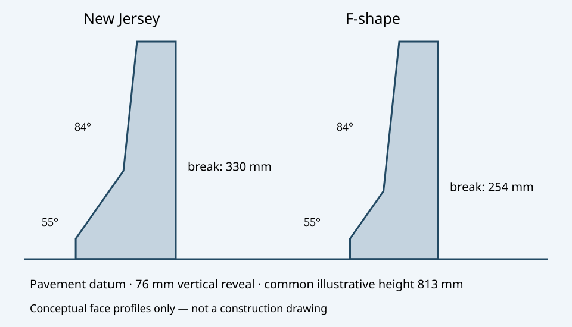
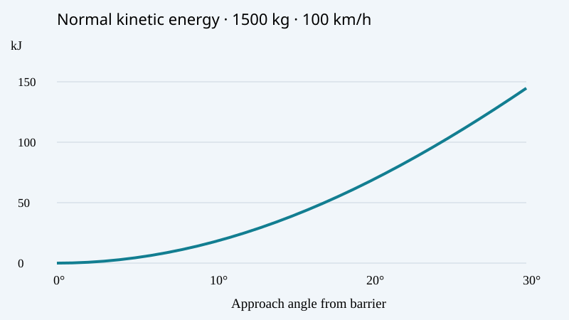

# Jersey Barriers: Geometry, Impact Loads and Aerospace Crashworthiness

**MIE 446 · Aerospace Structures · UMass Amherst**  
Engineering enrichment reading · 8 November 2026

[Illustrated web reading](https://ehsan-roohi.github.io/Aerospace-Structures/case-studies/jersey-barrier/) · [Course readings](READINGS.md) · [BeamLab](https://ehsan-roohi.github.io/Aerospace-Structures/wing-lab.html)

## 1. Why study a highway barrier in an aerospace structures course?

A concrete median barrier is a lesson in load-path design. Its job is to contain and redirect a vehicle while controlling consequences for its occupants. A very strong barrier can still produce an undesirable vehicle response. This is the same distinction aerospace engineers make between structural integrity and crashworthiness: a structure must transmit loads, preserve survival space and manage the force history experienced by people.

This original lesson was prompted by Amir Abdolmaleki's [Zoomit article on Jersey barriers](https://www.zoomit.ir/zoomplus/470631-jersey-barrier-highway-design-history/), published 8 November 2026. It is an independent engineering treatment, rather than a translation. Historical and hardware statements below are tied to transportation-agency sources; calculations are explicitly illustrative.

**Learning objectives:** resolve oblique impact velocity; estimate impulse and energy; distinguish temporary energy storage from irreversible dissipation; interpret contact geometry and rollover tradeoffs; connect impact loads to beam bending and aircraft energy absorbers.

## 2. History and the importance of the slope break

NJDOT's historical timeline records the scientifically designed median barrier in 1959 [1]. The name refers to New Jersey, not to the material. The starting article also describes earlier development in the 1950s; the 1959 milestone is the date independently supported here. Not every concrete divider has the New Jersey profile.

The conventional safety shape begins with an approximately 76 mm vertical reveal. A lower face at approximately 55 degrees to the horizontal meets a nearly vertical upper face at approximately 84 degrees. The conventional New Jersey slope break is about 330 mm above pavement; for the F-shape it is about 254 mm. These heights include the reveal [2,3]. Confusing the lower sloped-face height with its elevation above the roadway gives an incorrect drawing.

*Figure 1. Original face-profile schematic, with slopes and breakpoint elevations based on [2,3]. Both profiles are drawn to a common illustrative 813 mm height and common top-face position. Widths, reinforcement and foundations are not specified; this is not a construction drawing.*

The F-shape lowers the slope break to reduce vehicle lifting and rollover propensity. FHWA discusses both this improvement and alternatives such as single-slope barriers [2]. Shape is only one system parameter: installation, joints, anchorage, height, vehicle geometry and available deflection space also matter. A free-standing precast barrier does not have the same boundary conditions as an embedded continuous barrier.

## 3. Oblique impact: the relevant velocity component

Let $x$ run along the barrier and $y$ point toward it. Let the approach angle $\theta$ be measured **from the barrier direction**, not from its normal. A vehicle of mass $m$ and speed $v$ has

$$v_x=v\cos\theta,\qquad v_n=v\sin\theta. \tag{1}$$

The initial translational energy separates into

$$K=\frac12mv^2=K_x+K_n,\qquad K_n=\frac12mv^2\sin^2\theta. \tag{2}$$

Thus a shallow-angle encounter does not require eliminating the entire forward kinetic energy to redirect the vehicle. At 10 degrees, the normal component accounts for only about 3.0% of the translational energy; at 25 degrees it is about 17.9%. Nevertheless, increasing speed or angle can sharply increase impact severity.

For this simplified two-dimensional impact, define an effective normal restitution coefficient $e$ by $v_{y,\mathrm{out}}=-e v_n$. Then the magnitude of the normal impulse is

$$J_n=\left|m(v_{y,\mathrm{out}}-v_n)\right|=m(1+e)v_n,
\qquad \overline F_n=\frac{J_n}{\Delta t}. \tag{3}$$

Equation (3) is a momentum balance, not a peak-force prediction. Real vehicle contact involves yaw, roll, distributed contact and time-varying forces. A rebound with $e>0$ requires more normal impulse than simply removing the incoming normal velocity. The effective $e$ is a teaching parameter, not a universal barrier property.

## 4. Worked example: speed, angle and contact duration

Use an illustrative $m=1500$ kg vehicle, $v=100$ km/h, $e=0$, and $\Delta t=0.15$ s. These are classroom inputs, not a specification or a crash-test record.

| Approach angle | Normal speed | Initial normal energy | Mean normal force |
|---|---:|---:|---:|
| 10 degrees | 4.82 m/s | 17.45 kJ | 48.2 kN |
| 25 degrees | 11.74 m/s | 103.36 kJ | 117.4 kN |

The total initial kinetic energy is 578.70 kJ in both cases. The 25-degree case has about 5.92 times the normal energy of the 10-degree case. Halving the assumed contact duration doubles the mean force in this impulse model. Neither mean force can be used directly as an occupant injury metric; seats, restraints, vehicle deformation and the acceleration pulse determine occupant response.

*Figure 2. Original calculation from Equation (2), for the stated 1500 kg, 100 km/h example. This is a parameter study, not measured barrier performance.*

## 5. What the sloped face does—and where the energy goes

For a locally planar face inclined at $\alpha$ above the road, a frictionless normal reaction $N$ on the vehicle has outward horizontal and upward vertical magnitudes

$$F_h=N\sin\alpha,\qquad F_z=N\cos\alpha,
\qquad \frac{F_z}{F_h}=\cot\alpha. \tag{4}$$

The ratio is about 0.700 at 55 degrees and 0.105 at 84 degrees. The lower face can therefore provide a larger lifting component relative to its horizontal component. This is a **local force decomposition**, not a complete tire-contact or rollover model. Friction, tire compliance and changing contact points modify the resultant.

Raising the vehicle's center of mass by $\Delta h$ stores gravitational energy

$$\Delta U_g=mg\Delta h. \tag{5}$$

For the 1500 kg example, a hypothetical 0.10 m center-of-mass rise stores 1.47 kJ, about 8.4% of the 10-degree normal energy. The assumed rise is not inferred from the barrier slope-break height: a tire climbing 0.10 m does not mean the whole vehicle's center of mass rises by that amount.

**Lifting is energy conversion, not irreversible dissipation.** As the vehicle descends, gravitational energy can return to motion. A useful mechanical energy accounting is

$$K_{\rm in}+U_{\rm in}=K_{\rm out}+U_{\rm out}+E_{\rm diss}. \tag{6}$$

Include vehicle and barrier translational/rotational kinetic energies in $K$, and gravitational and recoverable elastic energies in $U$. Dissipation includes plastic deformation, friction, damping, fracture and other irreversible processes. Barrier displacement can also transfer energy to the pavement and connected segments. The concrete does not need to crush extensively for the overall collision to dissipate energy.

## 6. Why lifting can become a rollover problem

A lateral contact force acting at a height produces a roll moment, while vertical contact forces can also create a moment through their lateral lever arm. The general roll balance about the vehicle center of mass is

$$I_x\ddot\phi=\sum_i(y_iF_{z,i}-z_iF_{y,i})+M_{\rm suspension}. \tag{7}$$

Here $y_i,z_i$ locate each contact relative to the center of mass, $I_x$ is roll inertia, and $\phi$ is roll angle. Tire unloading, suspension travel and contact migration make this a transient multibody problem.

A separate, elementary static tipping analogy for a rigid vehicle on level ground gives

$$\frac{a_y}{g}\approx\frac{b}{2h_{\rm CG}}, \tag{8}$$

where $b$ is track width and $h_{\rm CG}$ is center-of-mass height. This follows by equating the lateral inertial overturning moment $ma_yh_{\rm CG}$ with the gravitational restoring moment $mg b/2$. **It is not a Jersey-barrier rollover criterion.** An impact changes the support geometry and introduces angular momentum; a barrier can trip a vehicle in ways Equation (8) does not represent. This distinction explains why geometry comparisons require full-scale testing and validated vehicle models [2,4].

## 7. From contact force to bending, joints and foundations

The load path is vehicle → contact face → reinforced concrete segment → connections/anchorage → pavement or foundation. For one highly idealized horizontal barrier span of length $L$, simply supported at its ends and loaded by a central transverse force $P$,

$$M_{\max}=\frac{PL}{4},\qquad \delta_{\max}=\frac{PL^3}{48EI},
\qquad \sigma_{\rm elastic}=\frac{M_{\max}c}{I}. \tag{9}$$

This is a useful **BeamLab surrogate**, not a model of a particular installed barrier. For lateral bending, use the second moment of area about the vertical bending axis. Real concrete cracking, reinforcement, shear, connection slip, distributed pavement contact and dynamic inertia can invalidate the uncracked elastic model.

A local linear dynamic representation is

$$\mathbf M\ddot{\mathbf u}+\mathbf C\dot{\mathbf u}+\mathbf K\mathbf u=\mathbf f(t). \tag{10}$$

The ratio of pulse duration to the relevant natural period helps determine whether a static approximation is defensible. A suddenly applied force is not interchangeable with a slowly applied force of the same magnitude. For temporary barriers, segment connections and deflection clearance are central parts of the system; do not assume zero lateral displacement just because the material is concrete.

## 8. The aerospace connection: managing a force–displacement curve

Aircraft subfloors, landing gear and seats manage energy through different mechanisms, but the governing work relation is shared:

$$E_{\rm abs}=\int_0^s F(\delta)\,d\delta,\qquad
\overline F=\frac{E_{\rm abs}}{s}. \tag{11}$$

For an absorber that arrests a selected mass with initial relative speed $v_0$, with gravity and other work neglected, $E_{\rm abs}=mv_0^2/2$. Increasing available stroke $s$ can reduce the required mean force. This energy-based force average over displacement is different from the time average in Equation (3). For a constant-force idealization,

$$a=\frac{v_0^2}{2s}. \tag{12}$$

An illustrative 300 kg effective mass at 6 m/s has 5.4 kJ of kinetic energy. A 0.30 m stroke requires an 18 kN mean resisting force; a 0.10 m stroke requires 54 kN. These correspond to 6.12 and 18.35 times $g$ for the idealized net deceleration. They are not occupant limits or aircraft certification results. For a downward vertical crush, gravitational work must be included: $\overline F_{\rm contact}s=mv_0^2/2+mgs$ under the constant-force model.

NASA's 2022 eVTOL subfloor study uses component- and vehicle-level finite-element analysis to develop lightweight energy absorbers and plan validation [5]. Its 2026 technical memorandum documents a combined test-and-analysis development approach [6]. These are direct aerospace research connections: design the deformation mechanism, evaluate the load pulse and survival space, and validate the model experimentally.

| Highway-barrier question | Aerospace counterpart |
|---|---|
| Can the system contain and redirect the vehicle? | Can the structure maintain a survivable load path and cabin volume? |
| Does the profile induce unacceptable roll or rebound? | Does asymmetric crushing create pitch, roll or local intrusion? |
| How do connections and anchorage transmit impact? | How do floor beams, joints and seat attachments transmit loads? |
| How much deflection space is available? | How much crush or landing-gear stroke is available? |
| Does a full-scale test support the model? | Do component and aircraft-level impact tests support predictions? |

The analogy concerns mechanics, not interchangeability of design standards.

## 9. What counts as evidence of a safe system?

FHWA evaluates barrier test performance through structural adequacy, occupant risk and post-impact vehicle trajectory [4]. Passing one selected test does not establish safe behavior for all vehicles, approach angles, installations or impact speeds. Distinguish a rigid embedded barrier from a portable connected system, and a water-filled channelizing device from a specifically tested containment barrier [2]. Exposed ends and transitions also need appropriate treatment.

Our equations estimate components of the response. They do not replace the prescribed test matrix or a validated nonlinear impact simulation. In an FE study, report material models, reinforcement, tire/contact assumptions, mesh sensitivity, connections, boundary conditions, energy balance and comparison with experimental force/acceleration/displacement histories. A plausible animation alone is weak validation.

## 10. Classroom activity: impact loads and BeamLab

Work in teams. Use the [course BeamLab](https://ehsan-roohi.github.io/Aerospace-Structures/wing-lab.html) as an elastic beam comparison tool; do not interpret its output as a barrier crash simulation.

1. Recalculate the table for 80 and 120 km/h. Explain the different speed scaling of impulse and energy.
2. At 100 km/h and 10 degrees, compare $e=0$ and $e=0.2$ with the same 0.15 s duration. State what physical information is missing before choosing either restitution value.
3. Build a simply supported 3 m beam with a central 10 kN force. Use $E=30$ GPa and a rectangular surrogate section 0.20 m wide in the loading direction and 0.80 m high. For lateral bending, $I=0.80(0.20)^3/12$. Predict the maximum moment and deflection before checking BeamLab. These dimensions are fictional and not a barrier section.
4. Halve the span, then double the loading-direction width. Predict each deflection ratio from Equation (9). Discuss why joints and pavement contact may dominate a real installation.
5. Sketch an aircraft energy absorber's force–displacement curve with the same area but a lower peak force. Identify the extra stroke required and possible constraints.

**Instructor check:** the beam surrogate gives $I=5.333\times10^{-4}$ m$^4$, $M_{\max}=7.50$ kN m, $\delta_{\max}=0.352$ mm and an extreme-fiber elastic stress of 1.41 MPa. Halving $L$ reduces deflection by eight; doubling section width in the loading direction increases $I$ by eight. These checks assume the same material and load.

## References and further reading

1. **New Jersey Department of Transportation**, [Transportation Firsts](https://www.nj.gov/transportation/about/50thanniversary/firsts.shtm). Official historical timeline; the 1959 Jersey-barrier milestone.
2. **Federal Highway Administration**, [Frequently Asked Questions: Barriers, Terminals, Transitions, Attenuators, and Bridge Railings](https://highways.fhwa.dot.gov/safety/rwd/reduce-crash-severity/frequently-asked-questions-barriers-terminals-transitions-attenuators-and). See concrete-profile comparison, portable barriers and channelizers. Agency guidance; terminology and installation context.
3. **FHWA** (23 April 2013), [Cast-In-Place Concrete Barriers](https://safety.fhwa.dot.gov/roadway_dept/countermeasures/docs/Concrete_Apr2013Saferlogo.pdf). Profile geometry and historical test-level information. Use for geometry, not as proof that every installation meets present requirements.
4. **FHWA** (2011), [Safety Eligibility Letter B-225](https://highways.dot.gov/safety/rwd/reduce-crash-severity/hardware-eligibility-letters/safety-eligibility-letter-b-225). A specific crash-test assessment illustrating structural adequacy, occupant risk and vehicle-trajectory evaluation; not a blanket approval of all Jersey barriers.
5. **Jacob Putnam / NASA Langley** (2022), [Development of Energy Absorbing Subfloor Concepts to Improve Crashworthiness of eVTOL Aircraft](https://ntrs.nasa.gov/citations/20220006968). VFS 78 presentation; NTRS 20220006968. Aerospace primary research.
6. **NASA** (2026), [Combined Test and Analysis Approach to Develop Energy Absorbing Systems for eVTOL Aircraft](https://ntrs.nasa.gov/citations/20260000121), NASA/TM-20260000121. [DOI: 10.64631/OLAI1113](https://doi.org/10.64631/OLAI1113). Aerospace technical memorandum.
7. **Charles F. McDevitt** (2000), *Basics of Concrete Barriers*, FHWA, Public Roads 63(5). [TRB bibliographic record and abstract](https://trid.trb.org/View/651882). Useful historical technical reading; the original FHWA web route currently redirects to a site-maintenance page.
8. **Amir Abdolmaleki / Zoomit** (8 November 2026), [Starting popular-science article](https://www.zoomit.ir/zoomplus/470631-jersey-barrier-highway-design-history/). Motivation for this lesson; not the source of the original calculations.

*All numerical examples are educational calculations. No crash simulations or physical experiments were performed for this lesson. Original diagrams and calculations accompany the page.*
