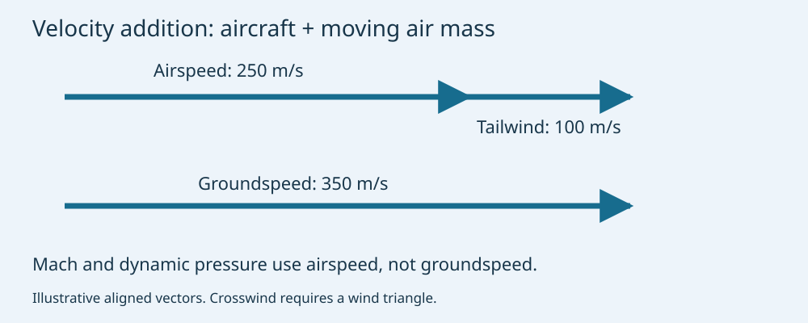
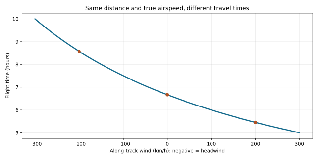
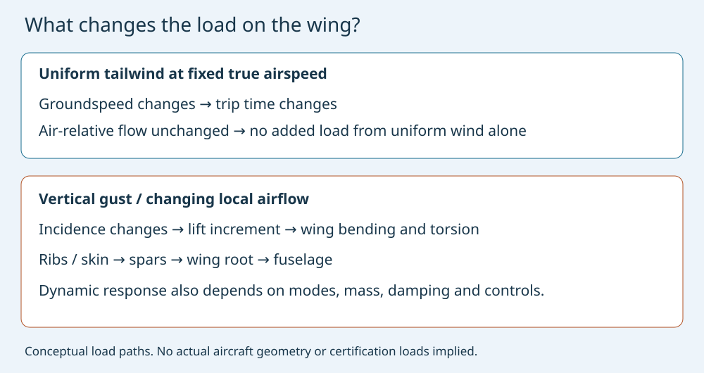

# Jet Streams: Faster Flights, Subsonic Airliners and Gust Loads

**MIE 446 · Aerospace Structures · UMass Amherst**  
Engineering case study · 11 November 2026

[Illustrated web reading](https://ehsan-roohi.github.io/Aerospace-Structures/case-studies/jet-streams/) · [Course readings](READINGS.md) · [BeamLab](https://ehsan-roohi.github.io/Aerospace-Structures/wing-lab.html)

## 1. The news and the engineering question

Pete Syme's [Business Insider report of 10 November 2026](https://www.businessinsider.com/supercharged-jet-streams-long-haul-high-speeds-shorter-flight-times-2026-11) describes unusually fast Pacific crossings: United Flight 2 reportedly reached 767 mph groundspeed, while Flight 876 exceeded 785 mph. Flight 2 arrived 85 minutes ahead of schedule. These are attributed news figures, not independently reconstructed flight records. The article distinguishes the wind-assisted ground motion from supersonic flight [1].

This reading develops the underlying mechanics independently. It is not a translation or reproduction of the news article. The central questions are: What velocity determines Mach number? Why can the return flight be slower? When does the atmosphere change structural loads? How should a wind-assisted flight be compared with a gust encounter?

**Learning objectives:** use velocity addition; distinguish true airspeed from groundspeed; calculate Mach number and flight time; explain jet-stream formation and shear; estimate a vertical-gust load increment; connect aerodynamic loads to beam bending and dynamic response.

## 2. Three velocities, two reference frames

For an aircraft, air mass and Earth,

$$\boldsymbol V_g=\boldsymbol V_a+\boldsymbol U,$$

where $\boldsymbol V_g$ is aircraft velocity relative to the ground, $\boldsymbol V_a$ is aircraft velocity relative to the local air and $\boldsymbol U$ is wind relative to the ground [2]. For perfectly aligned tailwind,

$$V_g=V_a+U.$$

A ground observer sees the aircraft's progress over Earth. The wing encounters the local airflow, so lift, drag, compressibility and local Mach number depend on air-relative motion. A uniform moving air mass does not become an additional headwind at the wing simply because an observer changes reference frame.

*Figure 1. Original velocity-addition diagram for an illustrative airspeed of 250 m/s and aligned tailwind of 100 m/s. The result is 350 m/s groundspeed. It is not a reconstruction of either reported flight.*

True airspeed (TAS), indicated airspeed and equivalent airspeed are also different quantities. This lesson uses TAS in the wind triangle and actual local density in aerodynamic force equations. Indicated airspeed must not be substituted without the appropriate air-data corrections.

### Crosswind requires vector addition

Choose $x$ along the intended ground track and $y$ across it. For wind components $(U_x,U_y)$ and a heading adjusted to hold that track,

$$V_{a,y}=-U_y,\qquad V_g=U_x+\sqrt{V_a^2-U_y^2}.$$

This forward-going solution assumes $|U_y|\le V_a$ and positive along-track groundspeed. At $V_a=250$ m/s, $U_x=80$ m/s and $U_y=60$ m/s, groundspeed is about 322.7 m/s, rather than 330 m/s. Some airspeed is used to counter crosswind; scalar addition is valid only for aligned vectors.

## 3. Why a high groundspeed does not mean supersonic flight

The relevant Mach number is

$$M=\frac{V_a}{a},\qquad a=\sqrt{\gamma RT}.$$

For an illustrative dry-air state $T=216.65$ K, $\gamma=1.4$ and $R=287.05$ J/(kg·K), the sound speed is about 295.1 m/s. An aircraft with $V_a=250$ m/s has $M\approx0.847$. Add a 100 m/s tailwind: groundspeed becomes 350 m/s, about 783 mph, while air-relative Mach remains 0.847.

Comparing groundspeed with the sound speed at sea level mixes reference frames and atmospheric states. Groundspeed divided by local sound speed would be about 1.19 in this example, but that number is not the aircraft's aerodynamic Mach number. Sound also travels with the moving air mass. A high groundspeed alone is therefore not evidence of a sonic boom.

Dynamic pressure makes the same distinction explicit:

$$q_\infty=\frac12\rho V_a^2,\qquad L=q_\infty SC_L,\qquad D=q_\infty SC_D.$$

At an **assumed** $\rho=0.38$ kg/m³ and $V_a=250$ m/s, dynamic pressure is 11.875 kPa. Incorrectly using the 350 m/s groundspeed would give 23.275 kPa, an overestimate of 96%. The uniform tailwind does not nearly double wing loading. At steady level flight, total lift remains approximately equal to weight.

## 4. What creates a jet stream?

Jet streams are concentrated bands of upper-level wind. Their midlatitude flow is generally eastward, but their paths meander and their local direction can differ substantially. NOAA relates their strength and position to the boundaries between warm and cold air, with especially strong jets in winter [3]. Uneven heating and Earth's rotation both matter; “warm air rises” alone is not a complete explanation of a predominantly horizontal current.

At large scales away from the equator, geostrophic balance relates horizontal pressure gradients to wind:

$$f\,\boldsymbol k\times\boldsymbol U_g=-\frac1\rho\nabla_h p.$$

Here $f=2\Omega\sin\varphi$ is the Coriolis parameter, and $\boldsymbol k$ points upward. Combining approximate geostrophic and hydrostatic balance yields the thermal-wind relation in pressure coordinates:

$$\frac{\partial\boldsymbol U_g}{\partial\ln p}=-\frac{R}{f}\boldsymbol k\times\nabla_p T.$$

For eastward velocity $u_g$ and northward coordinate $y$,

$$\frac{\partial u_g}{\partial\ln p}=\frac{R}{f}\frac{\partial T}{\partial y}.$$

In a Northern Hemisphere region where temperature decreases northward, the right-hand side is negative. Pressure also decreases upward, so eastward wind tends to strengthen with height. This sign check is useful. Thermal wind describes **vertical shear of the geostrophic wind**, not a separate physical wind added to it [4]. Tropical, curved, rapidly accelerating and small-scale flows require more care than this balanced approximation.

## 5. Watch the jet move: official NASA visualization

*Figure 2. Credit: NASA/Goddard Space Flight Center Scientific Visualization Studio. This animation uses MERRA data for June–July 1988; it is an educational historical visualization, **not the November 2026 wind field** [5].*

**[Watch on NASA SVS](https://svs.gsfc.nasa.gov/3864/)** · [Official YouTube version linked by NASA](https://www.youtube.com/watch?v=m0TuC34WSR8) · [NASA MP4](https://svs.gsfc.nasa.gov/vis/a000000/a003800/a003864/jetstream.mp4)

While watching, identify a ridge, a trough and a strong wind corridor. Explain why an aircraft could gain more from a slightly longer curved track than from the shortest geographic path. The web reading includes a video player; the links remain available if embedded playback is blocked.

## 6. Flight time, fuel and the slow return journey

For constant airspeed, aligned constant wind and fixed ground distance $D$,

$$t=\frac{D}{V_a+U}.$$

For an illustrative 6,000 km leg at 900 km/h TAS:

| Along-track wind | Groundspeed | Idealized flight time |
|---|---:|---:|
| 200 km/h headwind | 700 km/h | 8.57 h |
| Calm | 900 km/h | 6.67 h |
| 200 km/h tailwind | 1,100 km/h | 5.45 h |

These examples exclude climb, descent, routing changes, taxi time and changing winds. A peak groundspeed is not an average speed for the whole route. Scheduled early arrival also depends on departure timing and timetable padding; it cannot be attributed entirely to wind.

*Figure 3. Original calculation for the table's assumed distance and TAS. The same wind magnitude costs more time as a headwind than it saves as a tailwind.*

For equal-distance outbound/return legs with the same wind magnitude $U<V_a$,

$$t_{round}=\frac{D}{V_a+U}+\frac{D}{V_a-U}=\frac{2DV_a}{V_a^2-U^2}>\frac{2D}{V_a}.$$

Thus opposing wind effects do not cancel in total travel time. Actual routes and winds need not be symmetric.

At roughly unchanged cruise fuel flow, less time aloft reduces trip fuel. A schematic cost integral is

$$m_f\approx\int_{route}\frac{\dot m_f(s)}{V_{g,track}(s)}\,ds.$$

The route length, wind, fuel flow, altitude, aircraft mass, temperature and airspeed all change together in real flight planning. A detour benefits fuel only if the resulting time and fuel-flow savings outweigh added distance and other constraints. The atmosphere provides favorable transport; the aircraft still needs thrust to overcome air-relative drag. This is not an engine-efficiency improvement caused by groundspeed.

## 7. Strong wind and turbulence are different quantities

**Uniform wind:** moving through a spatially uniform, steady air mass at fixed TAS does not create an additional aerodynamic force solely because the air mass is moving relative to Earth.

**Wind shear:** spatial or temporal changes in wind can change the air-relative velocity seen by the aircraft. Shear also provides energy for some atmospheric instabilities.

**Turbulent gusts:** unsteady three-dimensional velocity fluctuations can change incidence and pressure distribution, producing transient forces and moments.

The National Weather Service identifies jet-adjacent shear as an important clear-air turbulence environment [6]. A high wind-speed core is not automatically the most turbulent location, and crossing a jet boundary does not guarantee a specific turbulence severity. Vertical shear, stability, waves and the local flow structure matter.

One idealized stability indicator is the gradient Richardson number,

$$Ri=\frac{N^2}{(\partial U/\partial z)^2+(\partial V/\partial z)^2},\qquad N^2=\frac{g}{\theta}\frac{\partial\theta}{\partial z}.$$

$\theta$ is potential temperature and $N$ the buoyancy frequency for the dry stratified model. Strong shear lowers $Ri$, while stable stratification raises it. In idealized inviscid parallel-flow theory, $Ri>1/4$ everywhere is a sufficient stability condition under specific assumptions; $Ri<1/4$ somewhere does not prove turbulence will occur. This is not an operational turbulence forecast.

Prosser et al. (2023) analyzed reanalysis-based clear-air-turbulence diagnostics over 1979–2020 and reported increases in several regions [7]. Such climatological evidence is distinct from attributing this particular November 2026 wind event to climate change. Diagnosed turbulence trends also are not a direct record of structural damage or passenger injuries.

## 8. How a vertical gust reaches the wing structure

For a simplified sharp-edged vertical gust of speed $w_g$ and forward TAS $V_a$, a small-angle estimate is

$$\Delta\alpha\approx\frac{w_g}{V_a},\qquad \Delta C_L\approx a_L\Delta\alpha,$$

$$\Delta L\approx\frac12\rho V_a S a_L w_g,\qquad \Delta n\approx\frac{\rho V_a a_L w_g}{2(W/S)}.$$

$a_L=dC_L/d\alpha$ is per radian, $W/S$ is wing loading in N/m² and $n=L/W$. The sign follows gust direction. This is a linear, quasi-steady illustration, not a transport-aircraft gust certification calculation. It omits unsteady aerodynamics, gust penetration, gust shape, compressibility corrections, structural flexibility, control response and gust alleviation.

With **assumed** $\rho=0.38$ kg/m³, $V_a=250$ m/s, $a_L=5.0$ rad⁻¹, $w_g=5$ m/s and $W/S=6,000$ N/m²,

$$\Delta\alpha\approx0.020\ \mathrm{rad}=1.15^\circ,\qquad\Delta n\approx0.198.$$

The simplified lift-equivalent increment is about 0.20g. If $S=100$ m², the baseline weight is 600 kN and the gust lift increment is 118.75 kN. These are invented classroom inputs, not Boeing 787 specifications or measurements of the reported flights.

*Figure 4. Original conceptual load-path diagram. Uniform tailwind changes ground motion; a vertical gust changes incidence and can perturb lift, bending and torsion. Arrow lengths and wing shape are schematic.*

The incremental spanwise load $\Delta\ell(y)$ creates an incremental root bending moment

$$\Delta M_{root}=\int_0^{b/2}y\,\Delta\ell(y)\,dy.$$

If the full-wing increment is uniformly distributed, $\Delta M_{root}=\Delta L\,b/8$ per root. Taking an **assumed** span $b=30$ m gives 445.3 kN·m. A real wing also has distributed mass, engine inertia, torsion, elastic deformation and an aerodynamic load shape; the value is not a stress prediction without section geometry and material data.

A representative structural model is

$$M_s\ddot{\boldsymbol\eta}+C_s\dot{\boldsymbol\eta}+K_s\boldsymbol\eta=\boldsymbol F_g(t).$$

$\boldsymbol\eta$ contains structural degrees of freedom or modal amplitudes. The frequency content and spatial coherence of the gust determine which modes are excited. FAA's dynamic-gust guidance explicitly concerns aircraft and engine responses [8]; it provides the appropriate context beyond the simple static estimate. Repeated load cycles can also contribute to fatigue, so peak bending moment alone does not describe lifetime effects.

## 9. Optional BeamLab activity

Use [BeamLab](https://ehsan-roohi.github.io/Aerospace-Structures/wing-lab.html) for a **generic equivalent semispan**, not a model of the aircraft in the article.

1. Choose a 15 m cantilever. Apply the illustrative gust increment as a uniform upward load of $\Delta L/b=3,958.3$ N/m. If the interface uses downward-positive loads, reverse signs consistently.
2. Check the incremental root shear: 59.375 kN. Check the incremental root moment: 445.313 kN·m. These are gust increments; add a separately defined baseline load for total response.
3. Use an **assumed** constant $EI=2\times10^8$ N·m². The Euler–Bernoulli tip-deflection increment is $q\ell^4/(8EI)\approx0.125$ m.
4. Double $w_g$ in the linear gust model. The load, bending moment and deflection increments double. Double $EI$: deflection halves, while cantilever reactions remain unchanged.
5. Keep TAS, density and the gust fixed while changing a uniform tailwind from 0 to 100 m/s. Explain why this static aerodynamic load model gives unchanged gust loads but different travel times. A real gust field's encounter frequency requires its spatial/temporal definition and advection, not groundspeed alone.
6. Discuss what is missing: wing mass/inertia relief, aeroelasticity, controls, lift distribution, joint stresses, torsion and fatigue. A static BeamLab result cannot certify a turbulence encounter.

Submit a free-body diagram, a table of assumptions, incremental shear/moment/deflection plots and a short explanation of the velocity used in each equation. This is optional enrichment, not a new graded assignment.

## 10. References and provenance

Sources checked 11 November 2026. News figures are attributed; all numerical classroom examples and schematic figures are original calculations. This reading is educational, not a substitute for aircraft-specific operating or certification procedures.

1. Pete Syme, [If you're catching a long-haul flight this week, get ready for some serious speed](https://www.businessinsider.com/supercharged-jet-streams-long-haul-high-speeds-shorter-flight-times-2026-11), *Business Insider*, 10 November 2026. Starting news report; flight numbers and measured-speed claims are not independently reconstructed here.
2. NASA Glenn Research Center, [Relative Velocity](https://www1.grc.nasa.gov/beginners-guide-to-aeronautics/relative-velocity/). Air-relative and ground-relative velocity; see also [Cruise Conditions](https://www1.grc.nasa.gov/beginners-guide-to-aeronautics/cruise-conditions/).
3. NOAA, [The Jet Stream](https://www.noaa.gov/jetstream/global/jet-stream). Structure, seasonal behavior and air-mass boundaries.
4. NOAA Physical Sciences Laboratory, [Climate Glossary: thermal wind](https://psl.noaa.gov/enso/glossary.html). Temperature gradients and vertical wind differences. The signed pressure-coordinate equations above are the standard geostrophic/hydrostatic derivation, with axes explicitly stated.
5. NASA/Goddard Space Flight Center Scientific Visualization Studio, [The Polar Jet Stream, ID 3864](https://svs.gsfc.nasa.gov/3864/), released 3 October 2011. NASA MERRA-based historical animation and credited still; source page supplies official video links.
6. National Weather Service, [Turbulence training](https://www.weather.gov/source/zhu/ZHU_Training_Page/turbulence_stuff/turbulence/turbulence.htm). Shear and clear-air turbulence near jets; see also [Turbulence safety overview](https://www.weather.gov/zme/safety_turb).
7. M. C. Prosser, P. D. Williams, G. J. Marlton and R. G. Harrison, “Evidence for Large Increases in Clear-Air Turbulence Over the Past Four Decades,” *Geophysical Research Letters* **50**, e2023GL103814 (2023). [DOI: 10.1029/2023GL103814](https://doi.org/10.1029/2023GL103814). Reanalysis/diagnostic trend evidence; not an attribution study of the event in [1].
8. FAA, [AC 25.341-1: Dynamic Gust Loads](https://www.faa.gov/regulations_policies/advisory_circulars/index.cfm/go/document.information/documentID/1024906), issued 12 December 2014; listed active when checked. Guidance on dynamic gust and continuous-turbulence loads; the classroom formula here is not a substitute for its analysis.

**Theory background:** J. D. Anderson, *Introduction to Flight* (relative velocity, Mach number and aerodynamic loads); J. R. Holton and G. J. Hakim, *An Introduction to Dynamic Meteorology* (geostrophic/thermal-wind balance and stratified shear); T. H. G. Megson, *Aircraft Structures for Engineering Students* (beam bending, dynamics and aeroelastic load paths).
