# Leaves on rails: contact mechanics, chemistry and the limits of friction

**MIE 446 · Aerospace Structures · UMass Amherst**  
Extended illustrated engineering chapter · 7 November 2026

**Length:** approximately 7,600 words · 17 visuals · 23 numbered equations.

**Suggested use:** two 75-minute class sessions plus a team assignment. Prerequisites: statics, elementary beam theory, energy and basic statistics. The chapter moves from observable railway behavior to contact mechanics, chemical intervention experiments, moisture measurements and aerospace design implications.

[Illustrated reading](https://ehsan-roohi.github.io/Aerospace-Structures/case-studies/leaves-on-rails/) · [Course home](README.md)

## 1. The engineering question

How can a thin layer of crushed leaves disable a train whose engine and brakes are working? The useful answer is a force-path problem: the motor supplies torque, but the wheel–rail interface must transmit the corresponding tangential force. A contaminated interface can support the normal load while transmitting very little tangential load. This distinction connects contact mechanics with landing gear, friction joints and structural load paths.

This original teaching note critically develops the supplied [Zoomit feature](https://www.zoomit.ir/engineering/470667-autumn-leaves-stop-train-featured/) [1] using the full texts of Watson et al. (2020) [2] and Jaffé et al. (2026) [3]. It does not reproduce the feature. Operational claims are checked against primary railway sources [5–7].

**Learning goals:** derive traction and stopping limits; distinguish mean and maximum contact pressure; explain the experimental evidence for tannins and moisture; distinguish measured correlations from established mechanisms; and transfer these ideas to aerospace structures without equating steel–steel and tire–runway contacts.

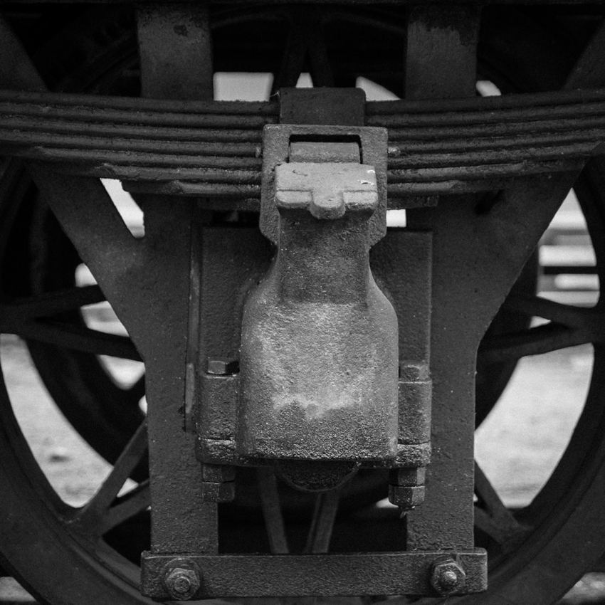

*Photograph A. Railway wheel and axle assembly. Johan Hansson from Gävle, Sweden; CC BY 2.0. [Original and license record](https://commons.wikimedia.org/wiki/File:Train_wheel_(14848807387).jpg). Resized; no crop. The photograph shows hardware, not an experimentally measured leaf film.*

### Reading the evidence at three different scales

A practical explanation must connect three scales. At the vehicle scale, a torque command is converted into a longitudinal force and a stopping distance. At the millimetre-scale contact, the bodies deform and a third-body layer changes how normal and tangential tractions are supported. At the chemical scale, soluble plant compounds, iron species and water alter the material separating the solids. Evidence at one scale does not automatically determine behavior at another.

A black material in a beaker is evidence of a reaction. A lower friction reading with that material links the reaction to contact performance. A shorter stopping distance in passenger service is evidence about an installed system. The strength of the research comes from connecting these observations while retaining the differences in test configuration, rather than calling all of them the same experiment.

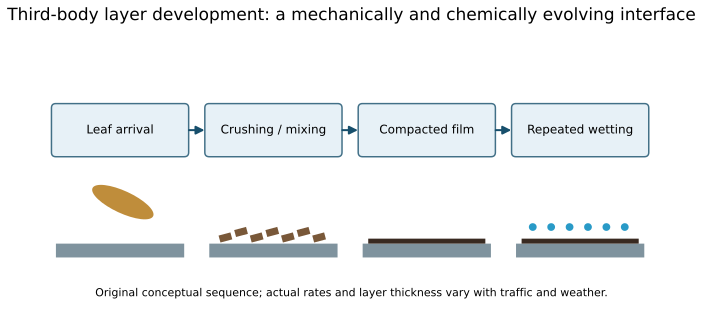

*Figure 1. Original conceptual sequence. Leaf deposition, mechanical processing and environmental conditioning interact. A railway layer is continually renewed, displaced and chemically modified; it is not a permanent uniform coating.*

## 2. Normal load survives while tangential capacity collapses

For one contact, let $N$ be normal force and $F_t$ tangential force. Define the measured coefficient of traction as $\mathrm{CoT}=F_t/N$ at the instrument's particular speed, slip and contact condition. Its measured value is not automatically the peak adhesion available to a full train.

An elementary limiting-force model is

$$|F_t|\leq\mu N,\qquad |T|\leq\mu NR. \tag{1}$$

Here $R$ is wheel radius and $T$ is wheel torque. A real rolling contact develops force through creepage, with partial slip and a traction curve. Equation (1) is a useful envelope, not a full rolling-contact constitutive law. Low adhesion is not zero friction: a sliding wheel can still slow the train, but much less effectively.

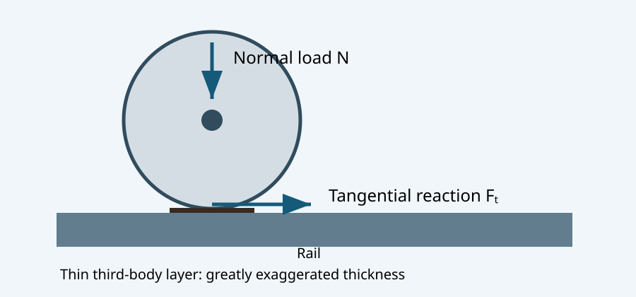

*Figure 2. Original schematic, not to scale. A thin third-body layer changes tangential transmission without removing the normal reaction.*

A nominal 1–2 cm² patch refers to an individual wheel contact, not the entire train. The train has many wheels, and their loads need not be equal. For an **illustrative**, not measured, wheel load of 70 kN and contact area 150 mm²,

$$\bar p=N/A=467\ \mathrm{MPa}. \tag{2}$$

For an ideal Hertz elliptical pressure distribution with semiaxes $a,b$,

$$p(x,y)=p_0\sqrt{1-x^2/a^2-y^2/b^2},\quad A=\pi ab,\quad p_0=\frac{3N}{2\pi ab}=1.5\bar p.\tag{3}$$

The example gives $p_0=700$ MPa. Area is an input here, not a Hertz prediction: predicting it requires elastic properties and both principal relative curvatures. Rail profile, wear, plasticity, roughness and contamination can invalidate the ideal elastic model. The 2026 study's portable instruments used nominal contact pressures of 660 and 700 MPa; its layer-generation rig applied 70 kN [3, p.191]. These are different devices, not interchangeable loading conditions.

Small area explains high local stress and the importance of surface condition. It does not by itself explain a small friction force: in the elementary Coulomb model the force limit depends on $N$ and $\mu$, with no explicit apparent-area term.

### Hertz pressure is spatially distributed

Integrating Eq.(3) over an ellipse gives the load rather than assuming uniform pressure:

$$N=\int_A p\,dA=\int_0^{2\pi}\int_0^1p_0\sqrt{1-r^2}\,ab\,r\,dr\,d\phi
=\frac{2\pi abp_0}{3}.\tag{4}$$

The substitution $x=ar\cos\phi$, $y=br\sin\phi$ supplies the Jacobian $ab r$. Since $\int_0^1r\sqrt{1-r^2}\,dr=1/3$, the maximum pressure is 1.5 times the area average. A pressure reported as “Hertzian” must therefore be checked: is it a maximum, an average, or a nominal device specification?

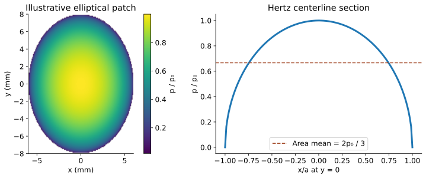

*Figure 3. Original ideal Hertz reconstruction with illustrative semiaxes. The colored map represents normalized pressure; its semiaxes are not measured from the supplied studies. The spatial mean is two-thirds of the peak.*

The effective elastic modulus for two isotropic contacting bodies is

$$\frac{1}{E^*}=\frac{1-\nu_1^2}{E_1}+\frac{1-\nu_2^2}{E_2}.\tag{5}$$

For two identical steels with illustrative $E=210$ GPa and $\nu=0.30$, $E^*=115.4$ GPa. In the simpler sphere-on-half-space problem,

$$a_H=\left(\frac{3NR^*}{4E^*}\right)^{1/3},\qquad
p_0=\frac{3N}{2\pi a_H^2}.\tag{6}$$

This circular special case demonstrates the scaling $a_H\propto N^{1/3}$ and $p_0\propto N^{1/3}$. It is not the general wheel–rail solution: a railway wheel and crowned rail usually produce different principal relative curvatures and an elliptical patch. Using the wheel rolling radius alone in Eq.(6) would silently replace the real geometry by another contact problem.

The limits of Hertz theory also matter. It assumes small-strain elastic solids, smooth nonconforming surfaces and a contact much smaller than the characteristic radii. A compliant, water-rich layer may carry part of the load and change stress transmission; severe asperity pressures can cause local plastic deformation. A nominal Hertz pressure is consequently a useful test descriptor but not a complete description of a contaminated interface.

### Creepage is not a synonym for gross wheel spin

A torque-transmitting rolling contact cannot be understood by imagining only perfectly rolling or completely locked states. Define one convenient longitudinal creepage convention as

$$\xi=\frac{R\omega-v}{v},\qquad v>0.\tag{7}$$

Positive $\xi$ corresponds to a driven wheel rotating faster than its pure-rolling value; negative $\xi$ corresponds to braking. Elastic deformation permits adhesion and microslip regions within the patch. At small creepage the tangential response is often approximated as linear; it approaches a limit as more of the patch slips. Changes in third-body properties alter the attainable traction and sometimes the shape of the curve.

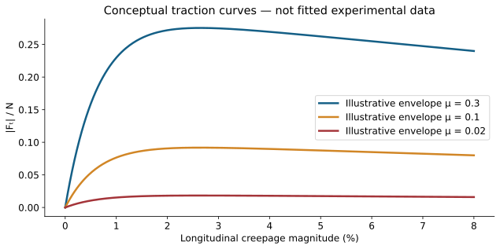

*Figure 4. Illustrative curves only. They show a low-slip rising region and an adhesion-limited envelope; the peak positions and post-peak shapes are not measurements or fits to either paper.*

A laboratory slide–roll ratio must be distinguished from the vehicle creepage convention. A common laboratory definition is

$$\mathrm{SRR}=\frac{2(u_1-u_2)}{u_1+u_2}\times100\%.\tag{8}$$

A stationary flat and a moving ball surface give a 200% magnitude by this definition, while two rotating discs at nearly equal surface speeds can give 3%. The percentages cannot be interchanged without the underlying definitions. A measured CoT at 5% creep is one point on an apparatus-dependent response, not automatically a vehicle's maximum available friction coefficient.

For a braking wheel, a simple angular momentum balance in a chosen positive rolling convention is

$$I_w\dot\omega=F_tR-T_b.\tag{9}$$

If applied brake torque $T_b$ exceeds what contact traction can balance, the wheel decelerates rotationally faster than the vehicle and slip grows. Wheel-slide protection reduces brake torque to manage that mismatch; it cannot create a contact force that the surface cannot support. This is why “the brakes worked” can coexist with “the train did not stop within the available distance.”

## 3. Why extra train mass does not guarantee grip

On level track, assuming every wheel can brake at the same constant adhesion limit and neglecting drag, rotational inertia and brake-system delays,

$$m\dot v=-\mu mg,\quad a_b=\mu g,\quad t_s=\frac{v_0}{\mu g},\quad s_s=\frac{v_0^2}{2\mu g}.\tag{10}$$

Mass cancels under these assumptions. At 80 km/h ($v_0=22.222$ m/s), the following are **idealized calculations**, not measured train stopping distances:

| Assumed constant $\mu$ | Deceleration (m/s²) | Stop time (s) | Stop distance (m) |
|---|---:|---:|---:|
| 0.30 | 2.943 | 7.55 | 83.9 |
| 0.10 | 0.981 | 22.65 | 251.7 |
| 0.05 | 0.4905 | 45.31 | 503.4 |
| 0.01 | 0.0981 | 226.53 | 2517.0 |

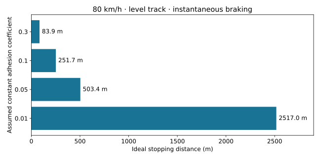

*Figure 5. Equation (10), level track, instantaneous braking and constant adhesion. This is not an operational braking curve.*

A delay $t_d$ adds approximately $v_0t_d$ before deceleration begins. On a downhill gradient $\theta$, this ideal braking magnitude becomes $g(\mu\cos\theta-\sin\theta)$; when nonpositive, adhesion-limited wheel braking alone cannot hold or decelerate the train in this model.

For uphill traction, the available normal load belongs to **driven wheels**, whereas gravity acts on the entire consist. If their supported mass fraction is $f_d$ and resistance other than gravity is $F_r$,

$$F_{\mathrm{drive,max}}=\mu f_dmg\cos\theta,\qquad
\tan\theta\leq\mu f_d-\frac{F_r}{mg\cos\theta}.\tag{11}$$

At $\mu=0.01$, even $f_d=1$ only gives a 1% ideal gradient ceiling before additional resistance; a locomotive hauling unpowered wagons has a smaller $f_d$. Adding weight over powered axles can help, so the mass-cancellation argument must not be generalized to every traction scenario.

### Energy and sensitivity: the same stopping result in another form

Kinetic energy is $K=mv^2/2$. Constant limiting braking does work $W=\mu mg s$. Equating $W$ to the initial energy recovers Eq.(10). The fact that both energy and available friction scale with mass explains the cancellation in this ideal level-track case. In contrast, changing which axles are braked, brake thermal capacity or the distribution of normal load can invalidate the simple cancellation.

For a small relative error in a constant assumed adhesion coefficient,

$$\frac{\Delta s}{s}\simeq2\frac{\Delta v_0}{v_0}-\frac{\Delta\mu}{\mu}.\tag{12}$$

A 10% speed underestimate produces about a 20% first-order distance underestimate; a 20% adhesion overestimate produces about a 20% first-order underestimate. The exact effects are nonlinear for large changes. This makes a single optimistic friction value a poor basis for a safety conclusion.

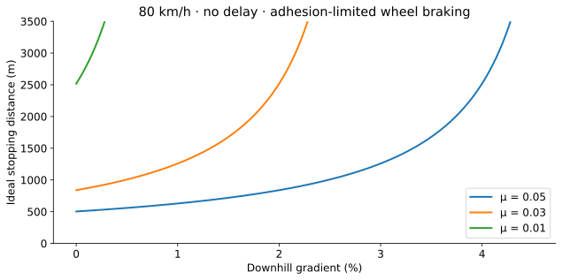

*Figure 6. Calculated from the downhill extension of Eq.(10), excluding drag and delays. Curves terminate where net deceleration is nonpositive and are clipped at 3500 m for readability. The growing distance near the limiting grade is a mathematical sensitivity, not a measured railway event.*

If adhesion varies along the track, the corresponding energy balance is

$$\frac{v_0^2}{2}=g\int_0^{s_s}\mu(x)\,dx\quad\text{(level track, ideal wheel braking).}\tag{13}$$

Thus an arithmetic average of friction over time is generally not the right input to a distance-based energy model. Braking control, gradients and transitions add further complications. A short exceptionally poor patch encountered at high speed can be more consequential than a mean coefficient suggests.

**Worked example: a 2 s delay at 80 km/h.** The extra distance is $22.222\times2=44.44$ m. At $\mu=0.05$, the ideal total is $44.44+503.39=547.84$ m. At $\mu=0.01$, it is $44.44+2516.96=2561.40$ m. Reducing delay is useful, but a large contact-performance loss can dominate this simple comparison.

## 4. What the 2020 chemistry study actually did

Watson et al. [2] studied aqueous extracts of naturally fallen brown sycamore leaves. Leaves were milled, extracted at 1 g per 50 mL water for 60 hours, then filtered to 0.49 µm. The filtered solution had pH 4.8. Fresh extracts were tested on the day of preparation because they degraded during storage [2, §§4a–b].

The causal intervention was removal of polyphenols, including tannins, using PVPP. The authors compared untreated extract, treated extract, water and, in selected tests, tannic acid or tannic-acid replacement. Adding ferric chloride to extract produced a black precipitate. Spectroscopic and elemental evidence (FTIR, XPS, CHNS, ICP-MS and XRF) supported identification as an iron–tannin complex, termed iron tannate. Removal of polyphenols reduced precipitate yield by an average 82% (three repeats, reported $p=0.00038$) [2, §2b].

The dry precipitate had reported nanoindentation hardness $352\pm2$ MPa and modulus $6.90\pm0.29$ GPa. These are properties of the prepared, dried material; they are not the effective stiffness or strength of a wet in-service rail film.

Three friction configurations provided an important test of relevance:

| Configuration | Key reported settings | What it establishes |
|---|---|---|
| Reciprocating ball on flat | 10 N; 1.55 GPa Hertz pressure; 12 repeats/condition | Removing tannins increased friction in pure sliding. |
| Mini traction, ball on ring | 44 N; 1 GPa; 50% slide–roll ratio; four repeats | Tannin-containing solutions had lower friction than water; replacement tests strengthened attribution. |
| Twin-disc rolling/sliding | 2720 N; 0.9 GPa; 3% slide–roll ratio; six repeats | More representative kinematics reproduced very low friction and the tannin-removal effect. |

In twin-disc tests, the treated extract was not significantly different from water (reported $p=0.92$ for mean and 0.54 for minimum friction). This is not proof of exact equality. Untreated extract differed from water/treated extract; the study reports $p=0.015$ for mean and 0.032 for minimum [2, §2d].

The experimental design controlled order and sample effects, randomized tests and blinded operators until application. Twin-disc tests reused specimens, with possible cross-contamination explicitly acknowledged. These details matter more than merely detecting a chemical in a field sample.

**Evidence versus proposed mechanism.** Tannins can cause low friction, and cellulose is not necessary for that experimental result. The authors proposed a cross-linked hydrogel that expels water under compression and produces dynamic lubrication. They explicitly left confirmation of the detailed lubrication mechanism to future work and did not claim to exclude all other mechanisms in the open railway environment [2, §3].

### Why the chemistry evidence is stronger than a list of detected compounds

A field film can contain cellulose fragments, lignin, pectin, phenolics, rust, wear debris, dust and pollutants. Detecting one component does not show that it causes low friction. Watson et al. instead asked what changes when a candidate component is selectively removed. The combination of chemical subtraction and friction testing is the methodological center of the paper.

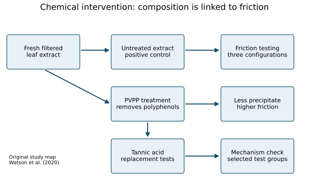

*Figure 7. Original evidence map of the 2020 study. The tannic-acid replacement groups were used in selected configurations, not indiscriminately in every test. PVPP removes a class of compounds; it is not a perfect molecular on/off switch.*

The extraction was repeated three times by mixing PVPP with extract at 1 g per 10 mL, stirring for 10 minutes, then filtering. This makes the intervention reproducible, but it also prompts a critical question: could treatment alter something besides tannin abundance? Replacement with tannic acid helps address that concern, while not reconstructing every naturally occurring tannin species. Concentrations for replacement solutions were adjusted colorimetrically; an optical match is not chemical identity.

The iron experiment helps establish whether iron is merely a catalyst or part of the solid product. Addition of dissolved iron produced a precipitate, and analysis found iron in the washed solid. FTIR supplied evidence of functional groups and changes consistent with complexation; XPS supplied surface-sensitive elemental and bonding information; CHNS measured bulk elemental contributions; ICP-MS assessed iron remaining in solution. These methods constrain the interpretation together. None supplies a complete molecular structure of every component in a natural rail film.

### Three configurations prevent one-rig overinterpretation

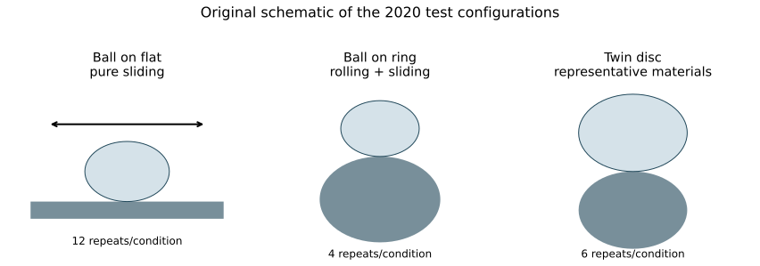

*Figure 8. Original simplified test-rig schematics. Shapes illustrate kinematics, not exact specimen dimensions or laboratory photographs. The repeats per condition are reported in [2, Table 3].*

The ball-on-flat configuration isolates sliding behavior and makes clear that tannin-containing extracts can affect friction even without railway rolling kinematics. The mini-traction configuration introduces rolling and sliding with different geometry and speed. The twin-disc configuration uses rail and wheel materials with a 0.9 GPa maximum Hertz pressure and a 3% SRR, moving closer to wheel–rail contact conditions. Convergence of the treatment trend across these setups is more persuasive than a single low number.

However, “closer” does not mean identical to a full train. Disc curvature, roughness history, replenishment, contamination quantity and temperature differ from service. The twin-disc lubricant was applied as a 300 µL dose after dry running had brought traction to approximately 0.4; the experiment continued until traction recovered to that level. Dry running between applications could change surface roughness. The authors included application-order permutations to address possible carryover while acknowledging that specimen reuse permits cross-contamination.

The reported inferential tests controlled for order and sample effects. A statistically significant difference supports an effect under the specified design; it does not quantify a universal railway friction change. Conversely, the absence of a significant difference between treated extract and water does not demonstrate exact equivalence. The paper's small sample sizes and its designed statistical power are relevant to both claims.

### A physically plausible hydrogel interpretation

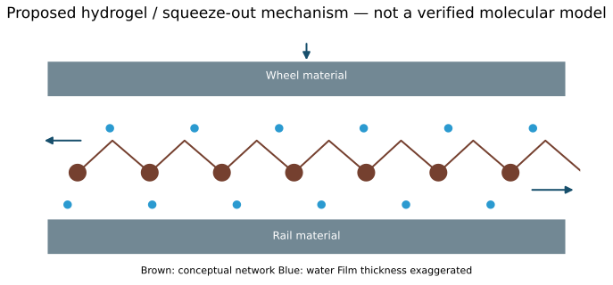

*Figure 9. Original conceptual illustration of the proposed network/water-release mechanism. The figure is not microscopy, chemical spectroscopy or an atomistic simulation. The supplied studies do not establish this drawing as the unique field mechanism.*

A cross-linked water-bearing network can resist removal from the surface while allowing relatively easy shear or release of water in the loaded region. The normal stress needed to carry a wheel is not the same material property as the shear resistance that limits traction. There is therefore no paradox in a layer being firmly attached, compressed and relatively hard when dry, yet associated with low tangential resistance when wet.

One useful bookkeeping model separates the load carried by solid contacts and fluid-supported regions:

$$N=N_s+N_f,\qquad F_t\approx\mu_sN_s+\tau_fA_f.\tag{14}$$

This is a conceptual load partition, not a fitted equation from either paper. As the share supported through easy-shearing material or fluid changes, the ratio $F_t/N$ may decrease even if the total $N$ is unchanged. Predicting $N_s$, $N_f$ and fluid shear $\tau_f$ would require film geometry, rheology, transport and a coupled contact model. The chapter does not infer these unmeasured quantities from the friction curve alone.

The 2020 study argues that dynamic lubrication is consistent with its test trends. It does not establish that an ordinary Newtonian water film of known thickness explains all field observations. “Hydrogel,” “boundary film,” “mixed lubrication” and “hydrodynamic support” describe different aspects of possible behavior; using them interchangeably would erase the research question.

## 5. What the 2026 moisture study adds

Jaffé, Tomlinson and Lewis [3] combined controlled climate-chamber testing, laboratory-generated layers and natural layers on narrow-gauge railways. Generated layers used R260 rail, approximately 1 mm ground leaf particles, water, a full-size wheel, 70 kN normal load and 3% slip. Generation-rig CoT was 0.038 for contaminated rail versus 0.308 for the control [3, p.191]. Later portable-instrument readings must not be treated as the same measurement.

The OnTrak instrument was used in the climate chamber; a Rivelin Rail instrument was used in later uncontrolled and field work. Both operated at 5% creep, but their loads, speeds and angles of attack differed. The authors discuss instrument-dependent traction results and notably did **not** measure CoT below 0.1 on contaminated rails in the chamber [3, pp.198–199].

Layer moisture was held within a high range of roughly 30–45% while air temperature and humidity varied. The contaminated-rail CoT showed little relation to those environmental variables ($R^2=0.0981$ and 0.011). This supports moisture as the more direct descriptor within the tested conditions. It does not prove that temperature has no independent effect for all temperatures, contaminants, speeds or instruments.

**Essential unit warning:** the Testo 606-1 output is **%WME (wood moisture equivalent)**, an instrument response referenced to wood in moisture equilibrium. It is not a direct gravimetric water fraction of the leaf film. Its reading range was 8.8–54.8%WME; out-of-range readings were censored at the limits. The reported approximately 20–25%WME transition is therefore an empirical instrument- and dataset-specific indicator, not a universal water-content safety threshold.

The fitted relationship for the created-layer dataset was [3, Eq.1 and Appendix II]

$$\mathrm{CoT}(M)=1.306e^{-0.2017M}+0.04757e^{0.008406M},\tag{15}$$

with $R^2=0.8195$, RMSE 0.035 and 42 degrees of freedom. $M$ is the numerical %WME reading (e.g. 25, not 0.25). The fit is descriptive, not a constitutive law.

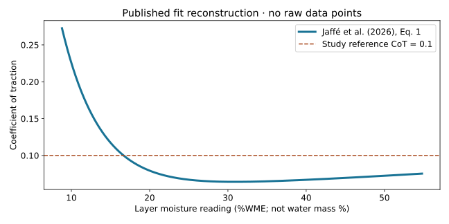

*Figure 10. Reconstruction of published Eq.1 over the instrument range; no raw data digitized or invented. The dashed 0.1 line is the study's low-adhesion reference, not a general operating certificate. This curve does not represent a controlled flooding experiment.*

In open/wooded conditions, humidity and layer moisture often varied together. In deep cuttings at Kirklees Light Railway, very high relative humidity could coexist with relatively dry layers and higher traction; local rail–air temperature differences helped interpret this. Relative humidity alone was an unreliable proxy. Condensation physically depends on surface temperature relative to dew point; a rail–air temperature difference alone is not a sufficient condensation criterion.

The study supports a rapid adhesion drop as moisture rises across roughly 10–25%WME, followed by degraded conditions across much of the measurable range. The distinction between an absorbed wet film and **free surface water/flooding** is vital. One must not infer the Water-Trak flooding response by simply extrapolating Eq.(15).

### Follow the four measurement pathways separately

The 2026 paper's test program has four complementary components: generation of realistic layers on movable rail sections; chamber testing with moisture approximately maintained; deliberate moisture variation under stable ambient conditions; and field tracking of local weather, moisture and traction. Each resolves a different ambiguity.

| Pathway | What varies or is observed | Main inference | Main caution |
|---|---|---|---|
| Full-scale layer generation | Repeated loaded wheel passes over ground leaf/water mixture | Creates rail sections with low adhesion for subsequent testing | Generation-rig traction is not a portable-instrument result |
| Climate chamber | Air conditions vary; layer moisture held in a high band | Weak direct environmental trend when layer wetness is constrained | Manual spraying and 30–45%WME variation limit isolation |
| Deliberate wetting/drying | Layer moisture changes with relatively stable ambient conditions | Rapid CoT decline across the transition range | Descriptive fit and device limits do not establish a universal law |
| Field tracking | Natural layers and local microclimates | High humidity alone can misidentify actual wetness | Limited sites/days, heterogeneous layers and instruments |

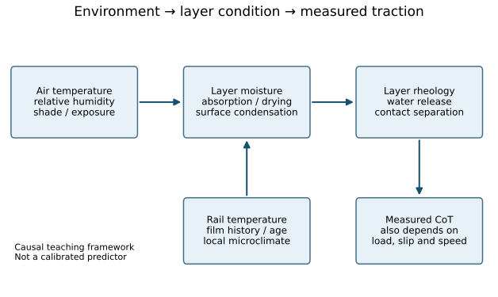

*Figure 11. Original causal framework based on the study design. Arrows indicate physically plausible pathways, not identified numerical transfer functions. Instrument and contact settings affect the final measurement as well as the layer itself.*

### Instrument details are part of the result

The paper reports the following portable-instrument settings [3, Table 1]:

| Setting | OnTrak | Rivelin Rail |
|---|---:|---:|
| Normal force | 45 N | 100 N |
| Contact pressure | 660 MPa | 700 MPa |
| Angle of attack | 50 mrad | 30 mrad |
| Creep | 5% | 5% |
| Speed | 145 mm/s | 200 mm/s |
| CoT accuracy | ±0.005 | ±0.005 |

Equal nominal creep does not make the measurements equivalent. The layer may respond differently to pressure, contact size, duration and sliding direction. The authors discuss why OnTrak readings on contaminated layers were higher than expected in the chamber, including the possibility that its chosen slip/load settings did not access the lowest adhesion state. Rivelin comparisons with the full-scale rig and historical instrumented-train results provide useful reassurance, not a perfect calibration of every field condition.

The paper reports air temperature accuracy ±0.5°C, relative humidity accuracy ±3.5%, and rail temperature probe accuracy ±1.5°C. Thus a small reported rail–air temperature difference should not be interpreted without measurement uncertainty. The moisture meter's quoted ±0.05%WME device accuracy also does not include all uncertainty in converting heterogeneous leaf-layer response into physical water content. Resolution, calibration basis, local contact and sampling variation are different issues.

### Censored readings are inequalities, not boundary values

When the meter displays its upper limit, the correct interpretation is $M\geq54.8$%WME rather than $M=54.8$%WME. At the lower boundary the interpretation is $M\leq8.8$%WME. Replacing every censored value by an exact endpoint can compress variability, distort a fit and conceal how much water is present once free surface water appears.

The paper represents these observations with arrows. A professional reproduction must preserve that meaning; inventing precise moisture coordinates for censored points would create information the instrument never measured. For this reason, Figure 10 reconstructs the published equation rather than drawing a fabricated scatter cloud.

### What the fitted equation says mathematically

Differentiation of Eq.(15) gives

$$\frac{d\mathrm{CoT}}{dM}=-0.2634202e^{-0.2017M}
+0.00039987342e^{0.008406M}.\tag{16}$$

This function falls sharply at small $M$ and has a shallow minimum near 30.9%WME, where the fitted CoT is approximately 0.0642. A shallow fitted upturn at higher readings is not proof that a layer has entered a well-characterized flooded state. The authors discuss the limited meter range and additional datasets when considering a broader “bucket” of adhesion values.

The fitted curve crosses CoT = 0.1 at approximately 16.7%WME, whereas the narrative discusses transitions around 20–25%WME across datasets. That distinction is worth teaching: a regression crossing is not identical to a robust decision threshold derived from many variable layers. The paper's rounded moisture statements should not be replaced by an apparently precise safety boundary obtained from a single fitted curve.

Its RMSE of 0.035 is also substantial relative to fitted values near 0.06–0.08. $R^2=0.8195$ indicates that the descriptive fit captures much of the variation in the fitted dataset; it does not imply 81.95% correct operational risk classification. An operational predictor would need independent validation, calibrated measurement and consequences of false classifications.

### Condensation, sorption and why local conditions matter

Relative humidity is a ratio involving water-vapor pressure and the saturation vapor pressure at the air temperature. Cooling a surface below the local dew point can produce condensation, while hygroscopic materials can exchange moisture with air even without visible liquid droplets. Solar heating, shade, rail thermal inertia, airflow and local topography therefore affect layer wetness through different pathways.

In a sheltered cutting, local temperature and humidity histories can differ from a weather station's daily cycle. The KLR observations illustrate this: humidity was not a reliable monotonic predictor of layer moisture at every location. The important design implication is to measure a state closer to the contact mechanism, or to validate a model that predicts that state. It is not to assume that humidity is irrelevant.

A future prediction workflow could use weather and rail temperature as inputs, estimate layer moisture and free-water state, then estimate a distribution of traction conditional on contamination and instrument/vehicle settings. The studies motivate that architecture but do not provide a validated universal forecasting model.

## 6. Why adding water can help, and what it does not prove

Network Rail reports Water-Trak trials in autumn 2021 and 2022, including more than 12% shorter stopping distances for two electric trains in the 2021 low-adhesion trial [5]. This is a trial-specific observation, not a universal guaranteed reduction.

The developer reports dosing of 1–4 mL per metre of rail and activation through wheel-slide detection, with water applied ahead of the leading axle [6]. This differs from the feature's simplified description of front wheels detecting slip and nozzles necessarily serving only later wheels. Hardware configuration and control timing should be checked for the particular installation.

Water addition moves the interface away from a particularly unfavorable lightly wetted contaminated condition. Dilution, redistribution and removal can contribute; the two attached papers do not isolate every mechanism in an installed Water-Trak system. Saying the device “tricks the chemistry” is a metaphor, not demonstrated reaction kinetics.

High-pressure treatment is a different intervention. Network Rail describes pumps delivering 1500 bar and optional gel/sand/steel-or-iron-shot adhesion modifier [7]. The pump pressure is 150 MPa; it is not the Hertz pressure under a wheel. The jet removes contamination, while controlled on-train wetting changes the interface condition. Neither method establishes that every wet rail is safer than every damp one.

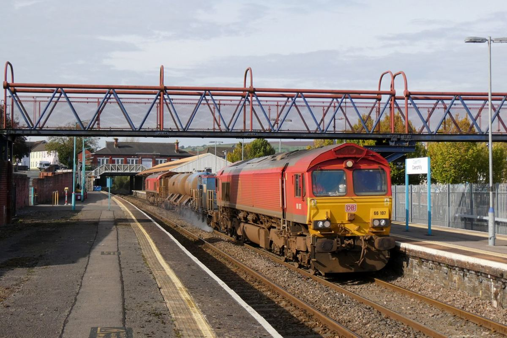

*Photograph B. Rail-head treatment train at Caerphilly, 17 October 2023. Gareth James / Geograph, CC BY-SA 2.0. [Original and license record](https://commons.wikimedia.org/wiki/File:Rail-Head_Treatment_Train_at_Caerphilly_-_geograph.org.uk_-_7632460.jpg). Resized; no crop. The photograph identifies equipment type and scale; it is not a photograph of the Water-Trak trial.*

### Dosage, flow rate and why speed must enter the design

A dose per track length must be converted into a flow rate for a moving train. For dose $q_\ell$ per metre per rail and speed $v$,

$$Q_{\mathrm{one\ rail}}=q_\ell v,\qquad Q_{\mathrm{two\ rails}}=2q_\ell v.\tag{17}$$

At 80 km/h and $q_\ell=2$ mL/m, one rail requires 44.44 mL/s while the system treating both rails requires 88.89 mL/s, or 5.33 L/min during active dispensing. Treating 1 km continuously at this dose would use 4 L for two rails. These are dimensional calculations using the developer's dose scale, not measurements of actual duty cycle or tank consumption.

A controller applying constant volumetric flow while the train slows would increase dose per metre. A length-based dosing strategy must account for speed, activation duration and delivery delay. Nozzle placement, spray capture, wind, wheel passage and the spatial extent of poor adhesion further complicate the conversion between a pump setting and the water reaching a particular contact.

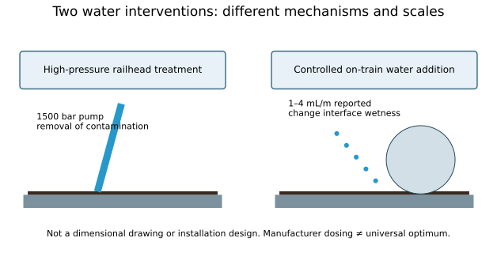

*Figure 12. Original comparison of intervention principles. The 1500 bar figure is an equipment pressure specification; the 1–4 mL/m range is developer-reported dosing. They measure different physical quantities and cannot be compared as competing efficiency numbers by themselves.*

### Mechanism, control and complementary treatments

| Approach | Immediate target | Useful distinction | Evidence boundary |
|---|---|---|---|
| High-pressure water jetting | Remove adhered material | Infrastructure cleaning intervention | Pump pressure alone does not specify removal efficiency |
| Controlled water addition | Change an unfavorable contaminated/water state | Train-borne intervention during low adhesion | Dosing and benefit depend on conditions |
| Sand / adhesion modifier | Introduce material that changes contact response | Can complement other measures | Delivery, wear and electrical shunting matter |
| Wheel-slide protection | Regulate brake torque when wheel behavior indicates slip | Control cannot exceed surface traction | Performance depends on sensing and response time |
| Cryogenic cleaning | Disrupt/remove contamination with dry-ice delivery | No liquid-water dosing as the intended treatment | Trial announcements are not universal service validation |

Northern announced a Cryogrip trial in September 2025 using equipment developed at Sheffield [8]. It describes dry-ice pellets delivered in an air stream, with freezing and disruption of the leaf material. This supports the existence and intended action of the trial; it does not establish that every rail is left moisture-free under all atmospheric conditions or that the approach replaces the wider mitigation system.

The popular feature also mentions laser and enzyme treatments. Those are separate technology routes; neither attached paper is a comparative field trial demonstrating their superiority. They should be presented as research/development topics unless supported by their own operating conditions, outcome measures and independent evaluation.

The 12% stopping-distance reduction reported by Network Rail [5] concerns a particular operational trial. If an illustrative constant-deceleration model had identical initial speeds and no delays, a distance ratio $s_2/s_1=0.88$ would imply $a_2/a_1=1/0.88=1.136$, approximately 13.6% higher deceleration. This algebra does not identify the actual trial's friction change because operating speed, control response and spatially varying conditions may differ.

### Signaling is a second, distinct interface problem

Track circuits use electrical continuity through wheelsets to help detect occupancy. A nonconductive contaminant can interfere with shunting even when a train still mechanically loads the rails. Sand increases mechanical grip but is itself nonconductive; Network Rail describes adhesion modifiers containing steel or iron particles to help contact through contamination [7].

It is essential to distinguish an impaired physical measurement pathway from the behavior of the signaling system as a whole. Protective design, detection architecture, maintenance and operating rules affect the system-level result. The phrase “invisible train” is memorable but incomplete: neither supplied tribology paper is a safety validation of a signaling architecture.

## 7. Audit of the starting feature

| Popular statement | Research-based correction or qualification |
|---|---|
| The whole train rests on a fingernail | Each wheel has a small patch; normal load is distributed across many contacts. |
| Friction disappears or braking no longer slows the train | Very low, nonzero traction reduces braking; it need not eliminate it. |
| Cellulose, lignin and pectin react under extreme heat and pressure to make the key material | The supplied 2020 paper specifically tests tannin–iron complexation and shows cellulose is unnecessary in those experiments. It does not require wheel-generated extreme heat to create precipitate. |
| The RSC paper is the attached 2020 study | They are different papers: the RSC study is Ishizaka et al. (2018) [4]; Watson et al. is Proceedings of the Royal Society A (2020) [2]. |
| A dry leaf layer always has excellent grip | Dry layers can still degrade adhesion; condition, history and instrument matter. |
| A 25% moisture threshold predicts dangerous rail everywhere | The 2026 threshold is approximately 25%WME within tested layers and instruments. |
| More water always improves adhesion | No; small additions can first worsen it. Layer wetness and flooding must be distinguished. |
| Black film makes trains invisible | Electrical shunting can be impaired, but signaling includes protective design. Do not infer inevitable undetected occupancy or collision. |

The 2018 RSC paper [4] reported synthesized black material and multiple plausible chemical contributors, with pin-on-flat CoF 0.08–0.14. It should not be read as the same intervention study as [2], or its numerical coefficients compared directly across different rigs.

## 8. Connections to aerospace structures

**Landing gear:** wheel braking is also limited by surface traction, while the strut and airframe must carry the resulting forces and moments. Rubber–runway behavior, hydroplaning and anti-skid control differ from steel–rail chemistry; a rail dosing strategy is not an aircraft recommendation.

**Friction joints:** a bolted joint can retain clamp force while contamination reduces slip resistance. With $n$ identical bolts of preload $P_b$, an elementary single-interface estimate is

$$F_{\mathrm{slip}}\leq\mu nP_b.\tag{18}$$

For four bolts at 10 kN each, reducing assumed friction from 0.30 to 0.05 reduces the estimate from 12 to 2 kN. Real design requires preload scatter, multiple interfaces, surface treatment, joint separation, bearing and fatigue checks. Frictional slip is not equivalent to immediate bolt fracture.

**Load paths:** for an ideal cantilever landing-gear surrogate of length $L$ loaded laterally by contact force $F_t$,

$$V=F_t,\quad M_{\mathrm{root}}=F_tL,\quad
\delta=\frac{F_tL^3}{3EI}.\tag{19}$$

At $N=70$ kN, $L=0.8$ m and assumed $\mu=0.30$, the traction envelope is 21 kN and root moment 16.8 kN·m. At $\mu=0.01$ these become 0.70 kN and 0.56 kN·m. A smaller transmitted load can reduce structural demand while severely worsening stopping performance. Strength and controllability are different requirements. This beam surrogate omits the actual gear geometry, tire compliance, axial load and dynamics.

*Photograph C. Airbus A350-941 F-WWCF MSN002 main landing gear at ILA Berlin 2016; Julian Herzog, CC BY 4.0. [Original and license record](https://commons.wikimedia.org/wiki/File:Airbus_A350-941_F-WWCF_MSN002_main_landing_gear_ILA_Berlin_2016_04.jpg). Resized; no crop. The visible assembly is not modeled dimensionally by the cantilever surrogate below.*

### Ground contact, aerodynamic lift and aircraft braking

An aircraft differs from the ideal train model because aerodynamic lift can continue to reduce wheel normal load after touchdown. In a simplified level-ground vertical balance,

$$N_{\mathrm{wheels}}\approx mg-L_{\mathrm{aero}},\qquad
F_{\mathrm{wheel\ brake}}\leq\mu N_{\mathrm{braked\ wheels}}.\tag{20}$$

The available braked-wheel load can be smaller than the total wheel load, depending on gear arrangement and load transfer. Drag and reverse thrust supply additional forces through separate paths. A structure therefore needs to carry braking, vertical, side and torsional loads, while the contact/control system must maintain useful longitudinal and lateral authority.

NASA aircraft anti-skid experiments explicitly evaluated dry, damp and flooded surfaces and the effects of normal load, yaw angle and tread condition [9]. FAA runway research explains that water drainage and surface grooving help preserve tire–pavement contact [10]. These primary sources support the aerospace connection while emphasizing why rail wetting must not be transferred into a general aircraft braking strategy.

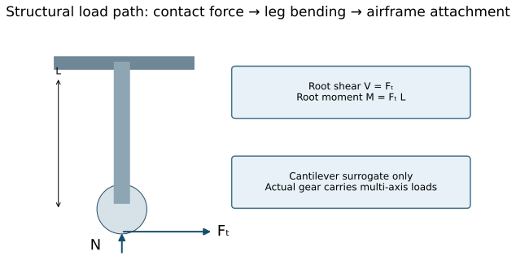

*Figure 13. Original statics schematic. The cantilever isolates lateral bending; real gear assemblies have braces, offsets, joints, oleo struts, tires and multi-axis load cases. It is not a certified design model.*

### A complete beam calculation with stress and deflection

Take the deliberately idealized straight tubular leg with $L=0.8$ m, outer diameter $D=0.12$ m, inner diameter $d=0.10$ m and $E=70$ GPa. Its second moment and section modulus are

$$I=\frac{\pi}{64}(D^4-d^4)=5.2700\times10^{-6}\ \mathrm{m^4},
\qquad Z=\frac{I}{D/2}=8.7834\times10^{-5}\ \mathrm{m^3}.\tag{21}$$

Use the §8 lateral forces $F_t=21$ kN and 0.70 kN, obtained from the same illustrative 70 kN normal load with two assumed adhesion values. For end loading,

$$\sigma_{\mathrm{bend,max}}=\frac{F_tL}{Z},\qquad
\delta=\frac{F_tL^3}{3EI}.\tag{22}$$

The larger force gives approximately 191.3 MPa bending stress and 9.72 mm tip deflection; the smaller gives 6.38 MPa and 0.324 mm. Their ratios are 30 because the linear beam model is homogeneous in load. No allowable stress or fatigue spectrum has been specified, so these values do not establish adequacy. Axial stress from the normal force, combined stress, stability, local stress concentrations and actual gear kinematics have also been omitted.

The central lesson is that low contact traction can reduce one structural load component while making vehicle operation less controllable. A component-strength assessment and a stopping-performance assessment answer different questions. Increasing structural strength alone cannot restore a missing frictional load path.

### Friction joints: preload is necessary but insufficient

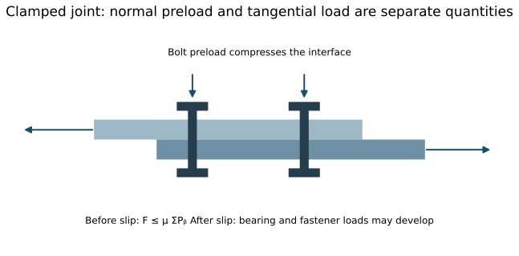

*Figure 14. Original single-interface friction-joint schematic. It illustrates clamp force, interfacial traction and applied shear; it does not specify a joint design or establish fastener load distribution after slip.*

For the four-bolt example, suppose the demanded shear is 5 kN. With a total nominal preload of 40 kN, the elementary required friction coefficient is

$$\mu_{\mathrm{required}}=\frac{5}{40}=0.125.\tag{23}$$

An assumed 0.30 coefficient clears this elementary nominal check; 0.05 does not. A 20% preload loss reduces the available total to 32 kN and raises the required coefficient to 0.15625. This is why a joint drawing that lists bolt diameter but omits preload retention and surface condition is an incomplete friction-slip design description.

After slip, bearing against bolt shanks and hole edges may supply another load path. That does not mean the event is harmless: fretting, joint movement, fatigue and load redistribution can be unacceptable before ultimate fracture. Surface chemistry belongs in structural engineering because it can change when and how those paths engage.

### A comparison that preserves the physical differences

| System | Normal support | Tangential mechanism | Relevant degradation | What the analogy teaches |
|---|---|---|---|---|
| Steel wheel / rail | Small elastic or elastoplastic contact | Rolling-contact traction through surface/third body | Leaf layer, moisture, oxides, contamination | High normal load does not guarantee force transmission |
| Tire / runway | Deforming rubber and pavement contact | Rubber friction with water/drainage effects | Flooding, texture loss, contamination, tire state | Surface state and control determine usable braking |
| Preloaded joint | Bolt clamp force across interfaces | Interfacial friction before slip | Preload loss, surface changes, lubricant | Clamp force and shear capacity are separate design inputs |
| Beam attachment | Internal shear and bending at a connection | Material and joint load transfer | Slip, clearance, local damage | Trace the reaction force all the way into the structure |

## 9. Team exercise and instructor checks

1. Draw a train or aircraft wheel free-body diagram. Identify applied torque, normal load and tangential reaction. Explain why large engine torque cannot enforce a reaction above the traction limit.
2. Recalculate Table 1 at 100 km/h. Derive the speed-squared scaling and add a 2 s delay. Expected multiplier for braking distance alone: 1.5625; delay distance: 55.56 m.
3. For $f_d=0.20$, $\mu=0.05$ and negligible extra resistance, find the uphill gradient ceiling from Eq.(11). Expected: approximately 1%, not 5%.
4. Evaluate Eq.(15) at $M=10,20,25,40$. Discuss why using 0.10 in place of 10 is a unit error. Expected CoT: approximately 0.226, 0.0794, 0.0671, 0.0670.
5. Use a cantilever beam model (or the course [BeamLab](https://ehsan-roohi.github.io/Aerospace-Structures/wing-lab.html)) to compare the two lateral loads in §8 using identical $E,I,L$. Report root moment and deflection ratio (30). This is a structural surrogate, not a wheel-contact simulation.
6. Write a 150-word evidence statement separating the tannin-removal result, the proposed hydrogel mechanism, the moisture correlation and the operational Water-Trak trial. Identify one limitation for each.

Submit one team report with calculations, labeled diagrams and citations. No experiments on real railway infrastructure are part of this activity.

### Suggested two-session teaching sequence

In the first session, begin with the vehicle free-body diagram and ask students to predict whether doubling train mass doubles stopping distance. Derive the limiting model and identify where its mass cancellation fails. Then move into contact pressure, creepage and the chemical intervention experiment. Students should leave able to distinguish a normal-support path from a tangential-transmission path and to explain why a detected chemical is weaker evidence than a controlled removal experiment.

In the second session, examine moisture measurement and the field/chamber distinction. Have students identify the unit, censoring and instrument differences before looking at a fitted curve. Finish with the aircraft gear and friction-joint examples. The desired outcome is not to memorize “add water”; it is to decide which state variables, interventions and limitations belong in a defensible engineering argument.

### Expanded assignment deliverables and marking guide

Submit a 5–7 page team report plus calculation appendix. Include a contact free-body diagram, one pressure calculation, one stopping/grade sensitivity calculation, an evidence table for both papers, a moisture-unit and censoring explanation, and a beam or joint application. Every plotted curve must be labeled as measured, reconstructed from a published equation, or illustrative.

| Assessment component | Weight | Expected evidence |
|---|---:|---|
| Mechanics and assumptions | 30% | Correct equations, units, driven/braked load distinction and model limits |
| Interpretation of the two studies | 25% | Intervention logic, instrument differences, %WME and mechanism uncertainty |
| Figures and calculation quality | 20% | Labeled axes, stated inputs, source attribution and reproducible values |
| Aerospace application | 15% | Traceable load path and explicit limits of the analogy |
| Technical writing and citations | 10% | Accurate paraphrasing, original explanation and complete references |

**Instructor discussion prompts.** Why can a dry precipitate's indentation modulus not predict wet rail traction? Does a higher $R^2$ establish causality? Why might the device at 5% creep miss a minimum measured by another apparatus? What additional measurements would distinguish a softened solid film from fluid-supported lubrication? Which quantities would need to be known before recommending a field dosing rate?

## 10. References and reading guide

1. Pourmohammad, P. (2026). [Zoomit engineering feature](https://www.zoomit.ir/engineering/470667-autumn-leaves-stop-train-featured/), 7 November. Starting popular account; supplied text reviewed.
2. Watson, M., White, B., Lanigan, J., Slatter, T. & Lewis, R. (2020). **The composition and friction-reducing properties of leaf layers.** *Proceedings of the Royal Society A*, 476, 20200057. [doi:10.1098/rspa.2020.0057](https://doi.org/10.1098/rspa.2020.0057). Full supplied PDF reviewed; see §§2–4 and Figures 1–2.
3. Jaffé, J., Tomlinson, K. & Lewis, R. (2026). **Moisture: The most important factor in leaf low adhesion?** *Tribology – Materials, Surfaces & Interfaces*, 20(3), 189–205. [doi:10.1177/17515831261434461](https://doi.org/10.1177/17515831261434461). Full supplied PDF reviewed; see pp.191–201, Eq.1 and appendices.
4. Ishizaka, K., Lewis, S.R., Hammond, D. & Lewis, R. (2018). **Chemistry of black leaf films synthesised using rail steels and their influence on the low friction mechanism.** *RSC Advances*, 8, 32506–32521. [doi:10.1039/C8RA06080K](https://doi.org/10.1039/C8RA06080K). Publisher abstract and introduction checked for the distinction from [2].
5. Network Rail (2023). [Tackling leaves on the line using Water-Trak](https://www.networkrail.co.uk/stories/tackling-leaves-on-the-line-using-water-trak/), 14 November. Operational trial report.
6. Water-Trak. [Frequently Asked Questions](https://www.water-trak.com/faq). Developer account of dosing and activation; not independent validation.
7. Network Rail. [Seasonal track treatment and weather support fleet](https://www.networkrail.co.uk/our-work/looking-after-the-railway/our-fleet-machines-and-vehicles/seasonal-track-treatment-and-weather-support-fleet/). Pump pressure, modifier and signaling context.

8. Northern (2025). [New technology which freezes fallen leaves to clear the way for customers will be trialled this autumn](https://www.northernrailway.co.uk/news/new-technology-which-freezes-fallen-leaves-clear-way-customers-will-be-trialled-autumn), 3 September. Operator announcement of the Cryogrip trial; not a completed comparative performance study.
9. NASA (1977). [Behavior of aircraft antiskid braking systems on dry and wet runway surfaces: A slip-ratio-controlled system with ground speed reference from unbraked nose wheel](https://ntrs.nasa.gov/citations/19770026206). Primary aircraft braking investigation; abstract reviewed for load, yaw, tread and wet-surface findings.
10. Federal Aviation Administration. [Rubber Deposits Removal](https://www.airporttech.tc.faa.gov/Airport-Safety/Runway-Surface-Safety-Technology/Rubber-Deposits-Removal). Runway surface texture, friction restoration and water drainage context.

Web sources checked 7 November 2026. Numbered diagrams and analytical plots are original teaching graphics; photographs retain their individual attribution and licenses. No paper figures, full PDFs or Zoomit images are redistributed. Numerical outputs are illustrative models or a reconstruction of the explicitly cited published equation, not new experimental observations.

## خلاصهٔ فارسی

برگ‌ها نیرویی برای متوقف‌کردن قطار ایجاد نمی‌کنند؛ لایهٔ حاصل از آن‌ها ظرفیت انتقال نیروی مماسی بین چرخ و ریل را کاهش می‌دهد، در حالی که نیروی عمودی همچنان منتقل می‌شود. مقالهٔ ۲۰۲۰ با حذف تانن‌ها از عصارهٔ برگ نشان می‌دهد که ترکیبات تاننی و برهم‌کنش آن‌ها با آهن نقش مهمی در کاهش اصطکاک دارند؛ سازوکار دقیق روانکاری هنوز کاملاً اثبات نشده است. مقالهٔ ۲۰۲۶ نشان می‌دهد رطوبت خود لایه نسبت به رطوبت نسبی هوا شاخص مستقیم‌تری است، اما واحد آن «معادل رطوبت چوب» است و نباید درصد جرمی آب تلقی شود. افزودن کنترل‌شدهٔ آب در شرایط مشخص می‌تواند مفید باشد؛ این نتیجه به معنی مفیدبودن هر مقدار آب روی هر ریل نیست. ارتباط با سازه‌های هوایی در مسیر انتقال نیرو، تماس، ترمز چرخ، اتصالات اصطکاکی و تفکیک مقاومت سازه از قابلیت کنترل وسیله است.

## Image provenance and reproducibility

The figure set combines three openly licensed real photographs with fourteen original schematics/analytical graphics. Their functions differ: photographs show actual hardware, schematics explain a mechanism or experimental design, and plots calculate a declared mathematical model. None of the original conceptual figures is experimental imaging.

[Image attribution records](docs/case-studies/leaves-on-rails/image-credits.json) list exact creators, source pages, licenses and changes. [Reproducible calculation and plot script](docs/case-studies/leaves-on-rails/calculations.py) regenerates the numerical plots and writes checked example outputs without requiring the research PDFs. The site uses local images so the reading does not depend on third-party hotlinks.

### Photograph credits

- **treatment-train.jpg:** Gareth James. [CC BY-SA 2.0](https://creativecommons.org/licenses/by-sa/2.0); [source page](https://commons.wikimedia.org/wiki/File:Rail-Head_Treatment_Train_at_Caerphilly_-_geograph.org.uk_-_7632460.jpg). Resized to fit 1200 × 850 pixels; JPEG recompressed; no crop.
- **rail-wheel.jpg:** Johan Hansson from Gävle, Sweden. [CC BY 2.0](https://creativecommons.org/licenses/by/2.0); [source page](https://commons.wikimedia.org/wiki/File:Train_wheel_(14848807387).jpg). Resized to fit 1200 × 850 pixels; JPEG recompressed; no crop.
- **landing-gear.jpg:** Julian Herzog (Website). [CC BY 4.0](https://creativecommons.org/licenses/by/4.0); [source page](https://commons.wikimedia.org/wiki/File:Airbus_A350-941_F-WWCF_MSN002_main_landing_gear_ILA_Berlin_2016_04.jpg). Resized to fit 1200 × 850 pixels; JPEG recompressed; no crop.
