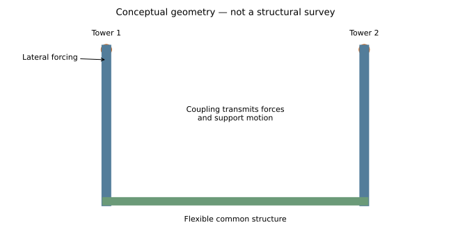
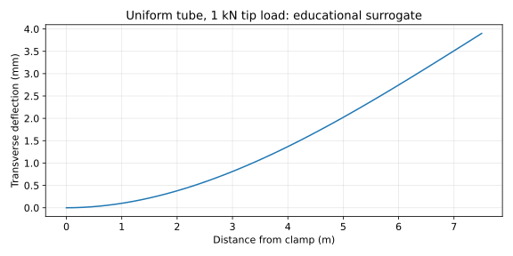
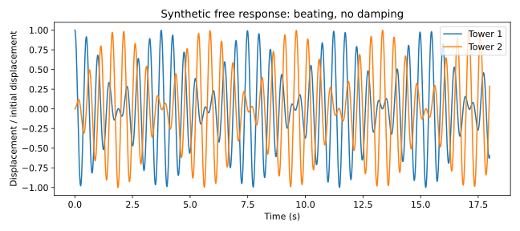
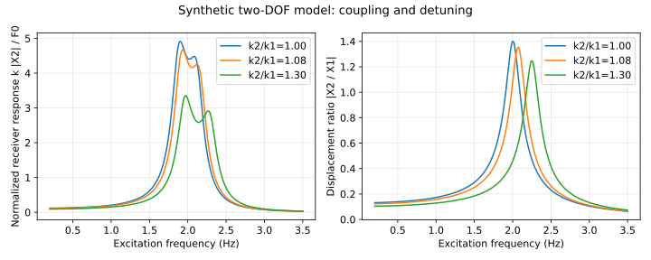
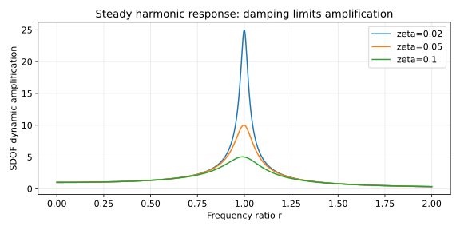

# Menar Jonban: coupled vibration, flexible supports and aerospace structures

**MIE 446 · Aerospace Structures · UMass Amherst**  
Engineering enrichment reading and BeamLab activity · 7 November 2026

[Illustrated reading](https://ehsan-roohi.github.io/Aerospace-Structures/case-studies/menar-jonban/) · [BeamLab](https://ehsan-roohi.github.io/Aerospace-Structures/wing-lab.html) · [Course home](README.md)

## 1. From a historical monument to a structural question

What connects two towers when a force applied to one makes the other move? Menar Jonban in Isfahan gives students an unusually memorable way to investigate that question. The useful engineering ideas extend to twin fins, flexible payload mounts, instrument brackets and appendages attached to a common airframe.

This original lesson was prompted by Masoud Yousefnejad's [Kojaro article](https://www.kojaro.com/history-art-culture/311157-menar-jonban-isfahan-shaking-minarets/), published 7 November 2026 [1]. It develops independent calculations and exercises rather than translating or reproducing the article. Its central physical explanation is reasonable: flexible components exchange forces through the structure joining them. However, “resonance” alone is an incomplete model. We must identify the force path, the support compliance, the masses, the damping and the excitation.

**Learning objectives.** Calculate beam compliance and natural frequency; distinguish a component mode from an assembled-system mode; derive a coupled oscillator model; explain why a quiet-looking support can transmit vibration; and separate a measured result from an illustrative calculation.



*Figure 1. Original teaching schematic. It identifies the transmission path but does not represent surveyed joints, member sizes or foundation restraints.*

## 2. What the research establishes

The following compact evidence summary refers to the papers, not new measurements.

Hosseinzadeh's 2011 journal study [2] and Hosseinzadeh and Hosseinzadeh's 2012 conference paper [3] describe field testing and simplified models of the monument. These are related publications, not independent replications. The conference paper reports eight accelerometers and forced/free records of 20/15 seconds. Its principal observed modes are near 2 and 5.5 Hz, with approximately 5% damping. Under one reported condition, the driven tip moved about ±5 cm and the other about 35% as much. The isolated cantilever and connected U-frame predictions differ; the reported roughly 80% contribution from roof deformation is model dependent. Reduced-section joint modeling changed the predicted frequencies little. The first mode is lateral bending; the higher observed mode includes torsion. These findings support considering the whole assembly rather than a fixed-base tower alone [3].

| Reading | Evidence type and how to use it |
|---|---|
| Hosseinzadeh (2011) [2] | Direct monument study; journal antecedent to the conference account. |
| Hosseinzadeh & Hosseinzadeh (2012) [3] | Public full paper with test layouts and idealized models; start with §§4–6 and Figures 5, 10–13. |
| Roozbahan & Turan (2023) [4] | Conference study using a three-degree-of-freedom example; useful for parameter sensitivity, not an independent field campaign. |
| Oliveira et al. (2012) [5] | Ambient tests and numerical models of other historical minarets; useful comparison, not Menar Jonban measurements. |
| Sallam et al. (2026) [6] | Database/regression study of masonry minaret periods; useful context for variability and uncertainty. |

The 2023 paper [4] illustrates how the mass, stiffness and damping of towers and their supporting structure affect the response. Its numerical example is a general mechanism demonstration. Statements about historical design intent or remaining elastic during earthquakes require historical evidence and a monument-specific structural assessment; an illustrative oscillator calculation cannot establish either.

Oliveira et al. [5] report low-amplitude damping around 0.5–1% for their tested historical minarets. This differs from the value reported in [3]. Neither number is a universal masonry property: amplitude, construction, joints, condition and identification procedure matter. Sallam et al. [6] use a database of 111 minarets and distinguish ambient-test records from finite-element-only records when fitting period relationships. A frequency estimate has uncertainty even when the geometry is known.

## 3. Audit of the popular explanation

| Idea in the starting article | Engineering assessment |
|---|---|
| Resonance helps produce visible motion | Sound in principle. The forcing frequency must be compared with modes of the assembled system. |
| The common building transmits motion | Essential: without mechanical coupling, equal frequencies do not cause motion in an unforced second oscillator. |
| Timber belts and gaps may influence flexibility | Plausible mechanisms; their existence does not quantify their contribution. Separate observation from identified stiffness. |
| Most tip motion can originate in the supporting structure | Supported as an interpretation of the simplified model in [3], not a universal displacement partition. |
| The two towers have similar frequencies | Helpful for strong interaction, but exact equality is unnecessary; different towers can still respond. |
| The phenomenon resembles a tuned mass damper | A useful analogy for coupled dynamics, but a damper is designed to reduce a chosen response. Visible motion does not demonstrate vibration control. |
| Historical intent and earthquake resistance remain uncertain | Appropriate caution. Dynamic resemblance does not establish purpose, capacity or current condition. |

The small effect of the simplified joints in [3] is especially instructive. A visually distinctive feature is not necessarily the dominant parameter in a particular model. Conversely, replacing contact or a gap by a reduced elastic section may omit opening, closing and friction. A weak sensitivity in that model cannot prove that real joint behavior is irrelevant.

## 4. Single-tower bending: compliance before dynamics

We first replace one tower by a uniform hollow circular Euler–Bernoulli beam. This is an educational surrogate: the actual tower tapers, contains stairs, has masonry joints and sits on a flexible building. Let the beam coordinate run from the clamp to its free tip. A transverse beam drawing may be rotated conceptually to represent a vertical tower under lateral loading; the transverse-only model omits axial gravity and geometric stiffness.

For outer diameter $D$, inner diameter $d=D-2t$, and thickness $t$,

$$A=\frac{\pi}{4}(D^2-d^2),\qquad I=\frac{\pi}{64}(D^4-d^4).\tag{1}$$

A tip force of magnitude $P$ gives the deflection magnitude

$$v(x)=\frac{Px^2(3L-x)}{6EI},\qquad \delta=v(L)=\frac{PL^3}{3EI}.\tag{2}$$

Thus the tip-coordinate static stiffness is

$$k_t=\frac{P}{\delta}=\frac{3EI}{L^3}.\tag{3}$$

Moment magnitude grows linearly toward the root and shear magnitude is constant. In BeamLab's convention for a positive downward tip force, $V=P$ and $M=-P(L-x)$; the fixed-support reactions are $R_y=-P$ and $C=-PL$. A reaction couple is an external action, while internal moment acts on a cut face. Preserve the app's convention rather than reversing the shear plot to resemble the reaction.

The extreme bending stress magnitude is

$$|\sigma_{\max}|=\frac{PL(D/2)}{I}.\tag{4}$$

This is nominal elastic bending stress. It omits stress concentrations, axial preload, cracking and masonry tension limits. A visually small deflection is not a masonry strength criterion.



*Figure 2. Original closed-form calculation, not monument displacement data.*

## 5. Natural frequency and effective mass

For a uniform clamped-free beam with distributed mass $\rho A$, the first bending frequency is

$$f_1=\frac{\beta_1^2}{2\pi L^2}\sqrt{\frac{EI}{\rho A}},\qquad \beta_1=1.875104\ldots\tag{5}$$

The governing eigenproblem follows from

$$EI\frac{\partial^4 v}{\partial x^4}+\rho A\frac{\partial^2 v}{\partial t^2}=0.\tag{6}$$

Use clamped conditions $v=v'=0$ at the root and zero bending moment and shear at the free end. Equation (5) is a uniform-beam result; use a variable-section FE model for taper.

Students often put the entire tower mass into $\sqrt{k/m}$. That mixes a tip-coordinate stiffness with a mass moving uniformly, although the beam displacement varies along its length. For a single-coordinate surrogate that matches both static tip compliance and the exact first frequency, define

$$m_{\mathrm{eff}}=\frac{k_t}{(2\pi f_1)^2}=\frac{3}{\beta_1^4}\rho AL\simeq0.2427\rho AL.\tag{7}$$

This particular coefficient is a matching choice, not a universal modal mass. A modal mass requires a declared shape and normalization. A static tip-shape Rayleigh approximation instead gives $33/140$ of the total mass and a slightly different frequency.

For the prescribed classroom values $L=7.5$ m, $D=1.1$ m, $t=0.2$ m, $E=600$ MPa and $\rho=1800$ kg/m³:

| Quantity | Calculated value |
|---|---:|
| Area | 0.56548668 m² |
| Second moment of area | 0.06008296 m⁴ |
| Static tip stiffness | 256,353.96 N/m |
| Tip deflection under 1 kN | 3.900856 mm |
| First bending frequency | 1.87219982 Hz |
| Matched effective mass | 1,852.58 kg |

**All values in this table belong to the chosen uniform surrogate.** Their proximity to a published monument frequency is not a calibration or validation. Multiple combinations of support compliance, effective modulus and mass can produce similar frequencies.

At fixed geometry and density, $\delta\propto E^{-1}$ and $f_1\propto E^{1/2}$. At fixed section, $\delta\propto L^3$ and $f_1\propto L^{-2}$. Frequency and static deflection therefore provide complementary information.

## 6. A flexible base can dominate tip motion

Suppose a tower has bending compliance $L^3/(3EI)$ and its support has an equivalent rotational stiffness $K_\theta$. A lateral tip load produces a support moment $PL$ and base rotation $\theta_b=PL/K_\theta$. The tip receives an additional displacement $L\theta_b$:

$$\delta=P\left(\frac{L^3}{3EI}+\frac{L^2}{K_\theta}\right).\tag{8}$$

If support rotation contributes 80% of the total in this deliberately simplified series-compliance model,

$$\frac{L^2/K_\theta}{L^3/(3EI)+L^2/K_\theta}=0.8
\quad\Rightarrow\quad K_\theta=\frac{3EI}{4L}.\tag{9}$$

This calculation explains a mechanism; it does not identify the monument's support stiffness. The real roof may bend, twist and translate. Rotational flexibility can yield large tip motion even if a point near the base translates little. Small support displacement also does not imply zero transmitted force.

BeamLab has ideal fixed/pin/roller supports, not a finite rotational spring. Students calculate equation (8) separately; replacing the clamp by a pin would introduce a mechanism rather than the desired spring stiffness.

## 7. Two coupled towers: what “resonance” must include

For an instructional model, let $x_1,x_2$ be absolute tip-like coordinates and connect two masses to ground through $k_1,k_2$ and to each other through $k_c$. The coupling spring is an effective representation of a transmission path, not a literal spring stretched between the minaret tips.

$$\mathbf M\ddot{\mathbf x}+\mathbf C\dot{\mathbf x}+\mathbf K\mathbf x=\mathbf F(t),\tag{10}$$

$$\mathbf M=\begin{bmatrix}m_1&0\\0&m_2\end{bmatrix},\quad
\mathbf K=\begin{bmatrix}k_1+k_c&-k_c\\-k_c&k_2+k_c\end{bmatrix}.\tag{11}$$

For equal masses and grounding stiffnesses, the undamped modes are in phase and out of phase:

$$\omega_-^2=\frac{k}{m},\quad \boldsymbol\phi_-=[1,1]^T;
\qquad\omega_+^2=\frac{k+2k_c}{m},\quad\boldsymbol\phi_+=[1,-1]^T.\tag{12}$$

In the in-phase mode the coupling spring has no extension. In the out-of-phase mode it is strongly engaged, increasing the frequency. Thus even two identical components form an assembly with two frequencies. These modes are a property of the simplified two-coordinate model; they must not be equated automatically to the measured bending and torsional modes in §2.

For undamped free motion with $x_1(0)=a$, $x_2(0)=0$ and zero initial velocities,

$$x_1(t)=\frac a2[\cos(\omega_-t)+\cos(\omega_+t)],\quad
x_2(t)=\frac a2[\cos(\omega_-t)-\cos(\omega_+t)].\tag{13}$$

The beating pattern comes from superposing modes with different frequencies. Energy exchanges between coordinates. It is not evidence that a structure creates energy. Sustained forced oscillation draws energy from the person or actuator; damping dissipates it.



*Figure 3. Exact undamped teaching solution. It does not predict a historical test record or the damping of the monument.*

For harmonic forcing $\mathbf F(t)=\Re\{\hat{\mathbf F}e^{i\Omega t}\}$,

$$\hat{\mathbf X}=(\mathbf K-\Omega^2\mathbf M+i\Omega\mathbf C)^{-1}\hat{\mathbf F}.\tag{14}$$

With forcing only on oscillator 1 and diagonal damping, the second row gives

$$\frac{\hat X_2}{\hat X_1}=\frac{k_c}{k_2+k_c-m_2\Omega^2+i\Omega c_2}.\tag{15}$$

Both amplitude and phase depend on frequency. The displacement ratio can exceed unity near a receiver resonance; it is not an energy fraction. A ratio measured at one frequency does not determine $k_c$ uniquely. If $k_c=0$, an initially stationary, unforced receiver stays stationary even when the two uncoupled natural frequencies are identical. Detuning changes transmission but does not generally eliminate it.



*Figure 4. Original two-DOF sweep with $k_c=0.15k_1$, equal masses and reference damping of 5%. These are declared teaching parameters. The reported historical displacement ratio has not been fitted.*

## 8. Resonance, damping and the limits of amplification

For a single damped oscillator under a harmonic force, with $r=\Omega/\omega_n$,

$$\frac{X}{F_0/k}=\frac{1}{\sqrt{(1-r^2)^2+(2\zeta r)^2}}.\tag{16}$$

At $r=1$, this factor is $1/(2\zeta)$, or 10 for $\zeta=0.05$. The exact displacement peak occurs at $r=\sqrt{1-2\zeta^2}$ when $\zeta<1/\sqrt2$. A finite forcing duration may not reach steady state, and a multi-mode system requires modal participation as well as frequency matching.



*Figure 5. Original analytical response curves. A factor of ten is a conditional SDOF result, not a universal multiplier for every load and displacement in the monument.*

For a clean, lightly damped single-mode free decay, peaks separated by $n$ cycles give

$$\Lambda=\frac1n\ln\left|\frac{u_j}{u_{j+n}}\right|,\qquad
\zeta=\frac{\Lambda}{\sqrt{4\pi^2+\Lambda^2}}.\tag{17}$$

A beating signal can invalidate a naive successive-peak estimate. Select a dominant mode, inspect bandwidth and noise, and disclose filtering. Frequencies and damping may change with amplitude when gaps, friction, cracking or geometric effects matter. A linear model should be presented with an amplitude range, not promoted into a proof of seismic safety.

## 9. Aerospace connections

| Monument concept | Aerospace counterpart | Engineering consequence |
|---|---|---|
| Two flexible towers joined through a roof | Two fins or appendages joined through a fuselage | Component frequencies alone do not predict coupled modes. |
| Support rotation contributes to tip displacement | Flexible wing-box root or equipment mounting frame | A rigid-clamp assumption can overpredict stiffness and frequency. |
| Damping and small frequency mismatch affect transfer | Instrument mounts and flexible payloads | Evaluate response over a frequency band, not at one nominal frequency. |
| Changes in joints change the model | Bolted or bonded aerospace attachments | Boundary-condition uncertainty can rival material uncertainty. |
| Modal testing informs model choice | Ground vibration testing | Compare frequencies, shapes, mass assumptions and excitation locations. |

A tuned mass damper introduces a deliberately selected secondary system to reduce a stated primary response. Our two-tower example teaches the underlying coupling, but two components moving together is not itself evidence of successful vibration suppression. Likewise, an ordinary structural resonance is not flutter: flutter requires aerodynamic feedback and a stability analysis of the aeroelastic system.

## 10. BeamLab activity: from a cantilever to a coupled-system hypothesis

**Suggested format:** teams of three; 50–60 minutes plus a short report. This is a proposed enrichment activity, with no new deadline or change to course assessment. The core activity runs in the existing BeamLab. The coupled-oscillator extension uses the supplied Python calculation or equations, because BeamLab does not solve a two-tower frame, torsion or a forced time history.

### A. Predict and build the baseline

Before solving, predict the shear and moment shapes, the sign of the support force and couple, and how a 20% reduction in $E$ affects deflection and frequency.

Open [BeamLab](https://ehsan-roohi.github.io/Aerospace-Structures/wing-lab.html). Use the beam workspace. Clear existing supports and loads, switch self-weight off, and enter:

| Input | Value in BeamLab units |
|---|---:|
| Length | 7500 mm |
| Young's modulus | 600 MPa |
| Density | 1.8 g/cm³ |
| Section | Circular tube |
| Outer diameter | 1100 mm |
| Wall thickness | 200 mm |
| Mesh | 40 elements |
| Root | Fixed at x = 0 |
| Other end | Free |
| Point force | +1000 N at x = 7500 mm |

The horizontal diagram represents lateral bending of the idealized tower. Self-weight is off because turning it on applies a transverse distributed load to the horizontal beam; it would not reproduce vertical tower gravity. The undamped bending modes still include density when self-weight is off.

For a reproducible starting point, import [baseline.json](docs/case-studies/menar-jonban/baseline.json) through the study-file control. The JSON is editable and contains a note identifying the idealization. It is generated by the same public engine used in BeamLab.

### B. Verify equilibrium, compliance and the first mode

1. Solve and record the signed root reactions, tip displacement, maximum moment magnitude and first bending frequency.
2. Check $R_y=-1000$ N, $C=-7.5\times10^6$ N·mm, $V=1000$ N and root internal $M=-7.5\times10^6$ N·mm using the app convention.
3. Compare tip deflection with equation (2) and frequency with equation (5). Calculate the percentage difference using the analytical value as denominator.
4. Inspect the first mode. A normalized mode amplitude is arbitrary; it is not a predicted displacement under 1000 N. The static load does not determine the undamped linear natural frequency.
5. Repeat with 20 and 80 elements. Tabulate frequency convergence; explain why exact nodal static values under a tip load can coexist with a numerical modal discretization error.

### C. Detune a second tower model

Save the baseline as Tower A. Create Tower B with the same geometry and density, first with $E=480$ MPa and then with $E=720$ MPa. Importable versions are [softer.json](docs/case-studies/menar-jonban/softer.json) and [stiffer.json](docs/case-studies/menar-jonban/stiffer.json).

| Case | Expected tip deflection (mm) | Expected first frequency (Hz) |
|---|---:|---:|
| A: 600 MPa | 3.900856 | 1.872200 |
| B: 480 MPa | 4.876071 | 1.674546 |
| B: 720 MPa | 3.250714 | 2.050892 |

Explain why the deflection ratios are $1/0.8$ and $1/1.2$, whereas the frequency ratios are $\sqrt{0.8}$ and $\sqrt{1.2}$. **These are three separate single-beam solves; they do not simulate vibration transfer.**

### D. Estimate a missing support compliance by hand

From the baseline, obtain $k_t=P/\delta$ in N/m. Add the rotational support term in equation (8), first for $K_\theta\to\infty$ and then for the 80% illustrative case in equation (9). Report the total static displacement and the support-rotation contribution.

Can the same BeamLab clamp model represent both cases merely by changing density? Explain why density changes the dynamic mass but not linear static stiffness. Can reducing $E$ mimic support flexibility in a single scalar measurement while giving the wrong deformation shape? Identify a second measurement that would distinguish the hypotheses.

### E. Optional coupled-response extension

Run [teaching_calculations.py](docs/case-studies/menar-jonban/teaching_calculations.py) with Python, NumPy and Matplotlib. It uses $k=P/\delta$, the matched mass in equation (7), $k_c=0.15k$ and diagonal damping $c=2(0.05)\sqrt{km}$. It generates Figures 1–5.

Use equations (11)–(15) to compare $k_c/k=0$, 0.05 and 0.15. Keep the forcing on oscillator 1. Then increase $k_2/k_1$ from 1 to 1.08 and 1.30. Identify a response peak, inspect the receiver/driven displacement ratio and explain how detuning changes the curve. Do not assume the ratio decreases monotonically at every fixed frequency.

For the equal baseline with $k_c=0.15k$, predict the modal frequencies $f_-=f_1$ and $f_+=\sqrt{1.3}f_1$ before running. Explain why these are synthetic oscillator modes and cannot be identified with the monument's observed torsional mode.

### F. Team deliverable and discussion

Submit a 2–3 page team report when requested by the instructor: a stated model and unit table; one BeamLab screenshot with restraints and load visible; signed equilibrium checks; the mesh-convergence table; the three stiffness cases; and a paragraph identifying what must be added to model the actual two-tower assembly. Attach the editable study JSON. If completing the extension, add one frequency-response figure with its assumed coupling and damping.

Conclude by answering: **What measurement would distinguish “the tower itself bends” from “the support rotates”?** Propose sensor locations and measured quantities. Do not claim that a matching frequency alone validates the model.

Suggested discussion weighting: modeling/units 20%, analytical checks 30%, sensitivity/convergence 20%, physical interpretation and model limits 30%.

## 11. Reproducibility and scope

[verify_beamlab.cjs](docs/case-studies/menar-jonban/verify_beamlab.cjs) runs the existing BeamLab solver for the three cases, checks closed-form tip deflection and frequency, and round-trips the share-link serialization. Run from a repository checkout:

```bash
node docs/case-studies/menar-jonban/verify_beamlab.cjs
python docs/case-studies/menar-jonban/teaching_calculations.py
```

The Python script checks the zero-coupling receiver limit and the free-response initial condition. [beamlab_checks.json](docs/case-studies/menar-jonban/beamlab_checks.json) records numerical results. Calculations and vector figures are original teaching material; no journal figures or Kojaro photographs have been reproduced. For actual monument photographs and measured mode diagrams, consult Figures 1–3 and 10 of [3] at the linked source.

The baseline is straight, uniform, homogeneous, elastic and small-deflection, with an ideal clamp. It omits taper, stairs, masonry cracking, contact, timber details, axial weight, geometric stiffness, foundation compliance and torsion. The two-DOF supplement omits an explicit roof mass; a three-DOF support/towers model or a calibrated spatial FE model is a natural next step. These models explain mechanisms and sensitivities, not heritage conservation capacity or seismic performance.

## 12. References and reading guide

1. **Yousefnejad, M. (2026).** [The engineering mystery of Isfahan's Menar Jonban](https://www.kojaro.com/history-art-culture/311157-menar-jonban-isfahan-shaking-minarets/), Kojaro, 7 November. Starting popular article; original Persian title: «راز مهندسی منارجنبان اصفهان؛ چرا دو برج آجری با هم می‌لرزند؟».
2. **Hosseinzadeh, N. (2011).** “Vibration Mechanism of 13th Century Historical Menar-Jonban Monument in Iran.” *International Journal of Engineering*, 24(4), 313–324. [DOI: 10.5829/idosi.ije.2011.24.04b.02](https://doi.org/10.5829/idosi.ije.2011.24.04b.02). Journal metadata verified; the detailed test account used here is the openly available conference paper below. Historical wording in the title is not an independent dating assessment.
3. **Hosseinzadeh, N., & Hosseinzadeh, M. (2012).** “On the Vibration Mechanism of Historical Menar-Jonban Monument in Iran.” *15th World Conference on Earthquake Engineering*, Lisbon, paper 2856. [Full paper, 10 pages](https://www.iitk.ac.in/nicee/wcee/article/WCEE2012_2856.pdf). Main direct source for the compact field-test summary; read §§4–6.
4. **Roozbahan, M., & Turan, G. (2023).** “A simple explanation of the vibration phenomenon in minarets of Monar Jonban.” *7th International Conference on Researches in Science & Engineering / 4th International Congress on Civil, Architecture and Urbanism in Asia*, Bangkok. [Author-uploaded paper](https://www.researchgate.net/publication/368289864_A_simple_explanation_of_the_vibration_phenomenon_in_minarets_of_Monar_Jonban). Read the three-DOF model and numerical example; distinguish model conclusions from historical inference.
5. **Oliveira, C., Çaktı, E., Stengel, D., & Branco, M. (2012).** “Minaret behavior under earthquake loading: The case of historical Istanbul.” *Earthquake Engineering & Structural Dynamics*, 41(1), 19–39. [DOI: 10.1002/eqe.1115](https://doi.org/10.1002/eqe.1115) · [University publication record and abstract](https://avesis.bogazici.edu.tr/yayin/ff66e779-575d-4ec8-9fa2-355eaa3294cc/minaret-behavior-under-earthquake-loading-the-case-of-historical-istanbul). Abstract-level comparison used here.
6. **Sallam, M. A., Fasan, M., Hassan, H. M., Bedon, C., Smiroldo, G., & Abdel Hafiez, H. E. (2026).** “Dynamic characterization of masonry minarets using regression models.” *Bulletin of Earthquake Engineering*, 8917–8943. [DOI: 10.1007/s10518-026-02554-1](https://doi.org/10.1007/s10518-026-02554-1) · [University record](https://arts.units.it/handle/11368/3149858). Record/abstract consulted; no coefficients from an inaccessible full text are used.
7. **Course BeamLab documentation.** [Model, units, supports, section library and mode limitations](computational/printed-wing-solver/web/BEAM_LAB.md). Software reference for the activity; the app's modes are undamped bending eigenmodes, not forced-response animations.

## خلاصهٔ فارسی

منارجنبان نمونه‌ای جذاب برای آموزش ارتعاش سازه است: نیروی وارد بر یک مناره از مسیر سازهٔ مشترک به منارهٔ دیگر منتقل می‌شود. تشابه فرکانس‌ها به انتقال مؤثر کمک می‌کند، اما بدون اتصال مکانیکی کافی نیست. برای تحلیل باید جرم، سختی، میرایی، فرکانس تحریک و انعطاف تکیه‌گاه را هم‌زمان دید.

در تمرین، دانشجویان ابتدا یک منارهٔ ساده‌شده را با تیر یک‌سرگیردار و مقطع لوله‌ای در BeamLab مدل می‌کنند؛ تغییرمکان و فرکانس را با روابط تحلیلی کنترل می‌کنند و اثر تغییر مدول الاستیسیته را می‌سنجند. سپس سهم چرخش تکیه‌گاه را دستی محاسبه می‌کنند. بخش تکمیلی با مدل دو درجهٔ آزادی نشان می‌دهد کوپل مکانیکی چگونه پاسخ منارهٔ دوم را ایجاد می‌کند. این مدل آموزشی، بازسازی دقیق بنای تاریخی یا اثبات مقاومت آن در زلزله نیست.
