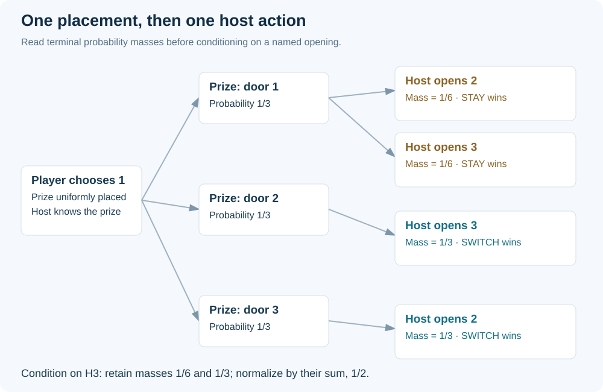
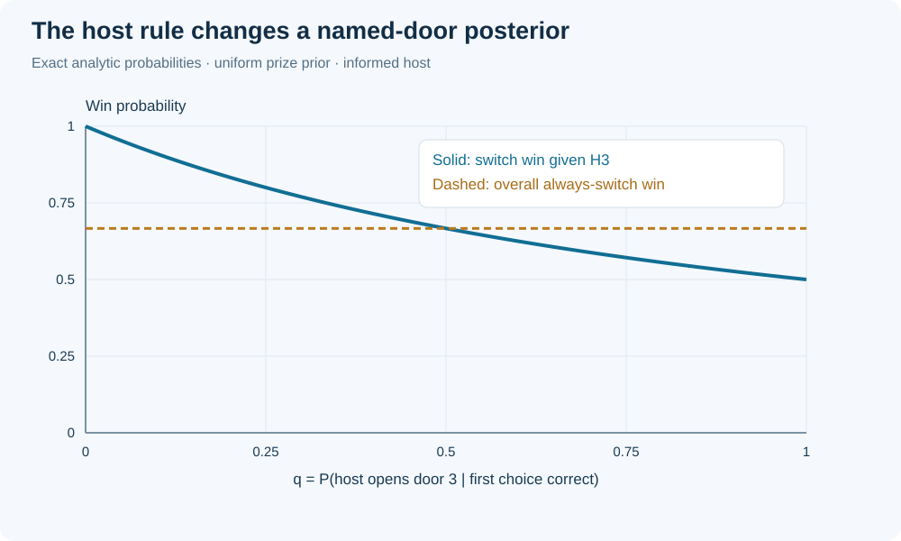
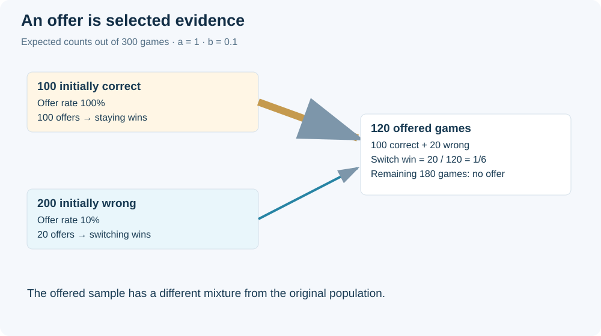
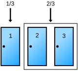
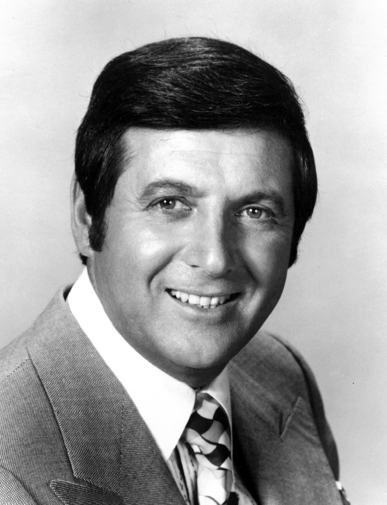
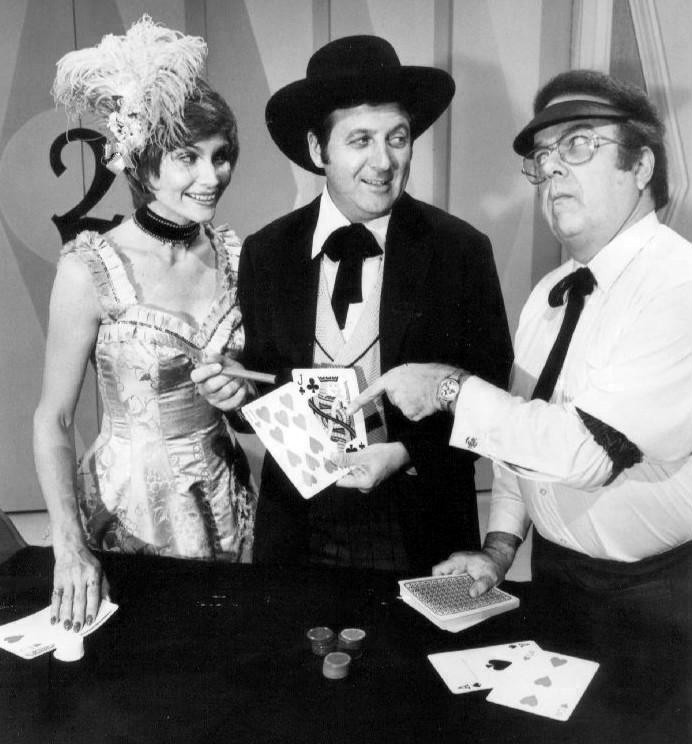

# Monty Hall: conditional probability, selection and engineering judgment

MIE 446 · Aerospace Structures · Optional mathematical enrichment · 31 October 2026

[Course home](README.md) · [Illustrated reading](https://ehsan-roohi.github.io/Aerospace-Structures/case-studies/monty-hall/) · [Python simulation](docs/case-studies/monty-hall/simulation.py)

<div lang="fa" dir="rtl">

### خلاصهٔ فارسی

در مسئلهٔ استاندارد مونتی هال، جایزه با احتمال برابر پشت یکی از سه در است. شما یک در انتخاب می‌کنید؛ مجری جایزه را می‌داند، همیشه یک در انتخاب‌نشدهٔ بدون جایزه را باز می‌کند و همیشه اجازهٔ تعویض می‌دهد. ماندن با احتمال یک‌سوم و تعویض با احتمال دوسوم می‌برد. دلیل اصلی این است که تعویض دقیقاً وقتی برنده است که انتخاب اول اشتباه بوده باشد.

اگر مجری تصادفی و بدون اطلاع دری را باز کند، یا فقط در بعضی وضعیت‌ها پیشنهاد تعویض بدهد، پاسخ تغییر می‌کند. در مهندسی نیز نتیجهٔ آزمایش را باید همراه با روش انتخاب نمونه و گزارش داده‌ها تفسیر کرد. این متن، توضیح و محاسبات مستقلی با الهام از مقالهٔ زومیت است؛ ترجمهٔ کامل آن نیست. مطالعهٔ تکمیلی نشان می‌دهد برتری کبوترها بر انسان‌ها در یک آزمایش را نمی‌توان به هوش عمومی تعمیم داد.

</div>

## 1. Define the experiment before calculating

The supplied Zoomit feature [[1]](#ref-1) introduces the puzzle and its psychological appeal. This reading develops the probability model and adds reproducible calculations and a structural-inspection analogy. Selvin's 1975 letter [[2]](#ref-2) explicitly discusses the host's knowledge and choice rule; a television show's actual bargaining rules need not match this idealized experiment.

Assume one prize is uniformly assigned to three doors, independently of the player's first choice. The host knows its location, never opens the chosen door or the prize door, always opens one losing door, and always offers a switch. For calculations conditioned on **which particular door** is opened, additionally specify that the host selects equally between the two losing doors when the player initially chose the prize.

The last assumption is unnecessary for the overall success rate of always switching. It is necessary for the familiar symmetric posterior after observing a named door. Distinguishing these two questions prevents a common hidden modeling error.

## 2. An exact proof in three rows

Without loss of generality choose door 1. Prize positions are equally likely.

| Prize | Host opens | Stay | Switch |
|---|---|---|---|
| Door 1 | Door 2 or 3 | Win | Lose |
| Door 2 | Door 3 | Lose | Win |
| Door 3 | Door 2 | Lose | Win |

Switching wins if and only if the first choice was wrong. Therefore

$$P(\mathrm{stay\ wins})=\frac13,\qquad P(\mathrm{switch\ wins})=1-\frac13=\frac23.$$

This is a proof about the experiment, not an estimate from repeated play. One unlucky switch cannot refute it; even an optimal strategy loses one third of its games.

## 3. Bayes' theorem: account for how evidence is produced

Let $C_i$ mean the prize is behind door $i$, and $H_3$ mean the host opens door 3, after the player picks door 1. Under fair tie breaking,

$$P(H_3\mid C_1)=\tfrac12,\quad P(H_3\mid C_2)=1,\quad P(H_3\mid C_3)=0.$$

Thus $P(H_3)=1/2$ and

$$P(C_1\mid H_3)=\frac{(1/2)(1/3)}{1/2}=\frac13,\qquad P(C_2\mid H_3)=\frac{1(1/3)}{1/2}=\frac23.$$

Two closed doors do not imply equal probabilities: the host deliberately protected the prize. For a biased host define $q=P(H_3\mid C_1)$. Then

$$P(C_1\mid H_3)=\frac{q}{1+q},\qquad P(C_2\mid H_3)=\frac{1}{1+q}.$$

For $q=1$, this particular observation gives equal probabilities; for $q=0$, door 2 is certain. Nevertheless, the unconditional always-switch strategy still wins two thirds of games. A posterior conditional on a named observation and a strategy's average success are different quantities.

## 4. Change the host, change the answer

| Protocol | Conditioning event | Stay wins | Switch wins |
|---|---|---:|---:|
| Informed, always offers | A losing door is opened | 1/3 | 2/3 |
| Uninformed, uniformly opens an unchosen door | Opened door happens to be losing | 1/2 | 1/2 |
| Offers only when first choice is correct | A switch is offered | 1 | 0 |
| Offers only when first choice is wrong | A switch is offered | 0 | 1 |

In the uninformed case, exposing the prize ends the game; those trials must be counted and then excluded from the conditional denominator. Initially correct choices survive with probability 1, initially wrong choices survive with probability 1/2. Each contributes probability 1/3 to the surviving sample, giving equal posteriors.

More generally let $a$ be the probability of offering a switch when the first choice is correct, and $b$ its probability when the first choice is wrong. Assume an informed host reveals a losing door and that these offer rates depend only on initial correctness. Averaging over opened-door identities,

$$P(\mathrm{switch\ wins}\mid\mathrm{offer})=\frac{2b}{a+2b},\qquad a+2b>0.$$

For $a=1,b=0.1$, switching wins only $1/6$ of offered games. Observing an offer is itself selected evidence. With an unknown protocol, a unique numerical answer may be unjustified.

## 5. Many doors and expected value

With $n$ equally likely doors, if the informed host always reveals $n-2$ losing doors, always switching to the single remaining unchosen door wins with probability $(n-1)/n$. At 100 doors that is 99%, versus 1% for staying. If more than one alternative stays closed, this formula does not directly give the success rate for switching to just one of them.

For prize value $V$ and a fee $c$ charged every time the player switches, with zero payoff for losing, the standard game's expected net values are

$$E_{\rm stay}=V/3,\qquad E_{\rm switch}=2V/3-c.$$

A risk-neutral player prefers switching when $c<V/3$. Maximizing win probability and maximizing net value coincide only when the costs and payoffs support that objective.

## 6. What do the pigeon studies establish?

Herbranson and Schroeder [[3]](#ref-3) used repeated, rewarded key choices in pigeons and a corresponding human task. Their birds learned near-optimal strategies, whereas human participants did not consistently do so. This demonstrates learning under a particular reinforcement procedure; it does not establish that birds understand Bayes' theorem or possess greater general intelligence.

Mazur and Kahlbaugh [[4]](#ref-4) subsequently compared pigeons, college students and preschoolers. College students began switching on a majority of trials sooner than pigeons, and most individuals did not reach the optimal strategy in the standard condition. When switching paid off 90% of the time, all students and all but one pigeon learned nearly always to switch. Protocol and reward discriminability matter. A broad headline about pigeons defeating mathematicians is therefore stronger than the combined evidence supports.

There is also a distinction between **probability matching** and maximizing reward. If a player independently switches with probability $s$, the standard game's win probability is

$$P(\mathrm{win})=s\frac23+(1-s)\frac13=\frac{1+s}{3}.$$

Choosing $s=2/3$ wins $5/9$ of games, below $2/3$ for $s=1$. Matching the action frequencies to reward probabilities is not the same as selecting the better action every time. These calculations describe an idealized fixed strategy, not a fitted model of every experimental participant.

## 7. Connection to aerospace structures: inspection is selected evidence

The lesson for structures is conditional reasoning, not a literal mapping from doors to aircraft. Consider a hypothetical fleet of coupons with prior crack prevalence 1%, inspection sensitivity 90%, and false-positive rate 5%. These are assumed classroom values, not measured aircraft inspection performance or approval criteria. Let $D$ denote a crack and $+$ a positive indication.

$$P(D\mid +)=\frac{0.90(0.01)}{0.90(0.01)+0.05(0.99)}=\frac{2}{13}\approx15.38\%.$$

Among 10,000 expected inspections, 100 coupons have cracks, producing 90 true positive indications; 9,900 uncracked coupons produce 495 false positives. The positive sample contains 585 coupons, of which 90 are cracked. Sensitivity $P(+\mid D)$ is not the posterior $P(D\mid +)$.

This low posterior does not justify ignoring indications. Consequences, confirmatory inspection, crack growth and applicable maintenance procedures govern action. If coupons were deliberately selected for suspicious features, the original 1% prior may no longer apply. Likewise, reporting only specimens that passed a screening test changes the population behind an apparently favorable strength result.

Before interpreting any experiment ask: What population was sampled? What was screened out? Could the measurement process depend on the underlying state? Were all outcomes reported? These questions complement equilibrium, compatibility and material modeling rather than replacing them.

## 8. Reproduce and audit the calculation

Run the standard-library-only source:

```bash
python docs/case-studies/monty-hall/simulation.py
```

The fixed seed is 446 and there are 100,000 trials per protocol. The source explicitly chooses a prize, first door, host action and remaining alternative. It records discarded prize-revealing trials for the uninformed host. An independent exact enumeration uses rational arithmetic to verify both protocols and the biased-host posterior. Output is saved to [results.json](docs/case-studies/monty-hall/results.json). Synthetic simulation results are not animal-behavior observations.

Figure 1 compares simulated win rates with exact predictions; sampling error explains small differences. Staying and switching are evaluated on the same rounds and are complementary, so their errors are not independent.


**Figure 1.** Original visualization generated by the supplied Python program. The uninformed results use only rounds where the host revealed a losing door; the retained count is in the numerical record.

### Classroom activities

1. Predict both protocols before running the source. Explain why their denominators differ.
2. Derive the biased-host posterior at $q=0.2$, then explain why overall switching still wins two thirds.
3. Compute the offered-game switching success for $a=0.8,b=0.2$ and explain the selection mechanism.
4. Repeat the inspection example at 10% prevalence. Keep sensitivity and false-positive rate fixed.
5. Explain why a correct simulation of the wrong host protocol fails to validate the intended mathematical model.

**Answer checks:** 2: staying $1/6$, switching $5/6$ after observing $H_3$; 3: $1/3$; 4: $2/3$. For item 5, distinguish implementation verification from validation of assumptions.

## 9. Read the sample space as a weighted tree

A probability tree is useful because it records two different random mechanisms: where the prize was placed and what the host did after seeing that placement. Combining them prematurely into a list of visible doors loses the information that makes the puzzle interesting. Figure 2 keeps those mechanisms separate. Start at the left with the player's fixed choice of door 1. Each prize branch has probability one third. Only the first branch splits again, because only there does the informed host have a choice between two losing doors.



**Figure 2.** Original weighted tree for an informed host with fair tie breaking. Terminal masses are 1/6, 1/6, 1/3 and 1/3. The rows where door 3 is opened have total mass 1/2. Within those rows, staying wins on mass 1/6 and switching wins on mass 1/3.

The four leaves are not equally likely. This point deserves emphasis because enumerating four outcomes and assigning each one probability one quarter gives a wrong answer even though every physically possible outcome is listed. A correct sample space consists of outcomes **and their probability measure**. The two host actions in the initially correct branch divide an existing probability mass; they do not create additional prize placements.

For clarity, write every retained leaf as an ordered pair $(C,H)$, where $C$ is the prize door and $H$ is the opened door. The joint probability table is

| Prize and host action | Joint probability | Compatible with opening door 3? | Winning strategy |
|---|---:|---|---|
| $(1,2)$ | $1/6$ | No | Stay |
| $(1,3)$ | $1/6$ | Yes | Stay |
| $(2,3)$ | $1/3$ | Yes | Switch |
| $(3,2)$ | $1/3$ | No | Switch |

The columns sum to one over the complete experiment. Conditioning is the operation of restricting this table to compatible rows and renormalizing their weights. After observing door 3, divide the two surviving weights by their sum. Nothing mystical transfers probability from an opened door to an unopened door; a conditional distribution is calculated from a joint model.

An especially useful classroom exercise is to redraw the same tree with a biased host. Replace the two half-probabilities in the first branch by $1-q$ and $q$. The terminal masses become $(1-q)/3$, $q/3$, $1/3$ and $1/3$. Opening door 3 now has probability $(1+q)/3$. Summing all switching leaves still gives two thirds, but renormalizing only the door-3 leaves gives the posterior in Section 3. This one diagram resolves the apparent disagreement between the two answers.

## 10. A generative model that can actually be audited

A complete probabilistic model can be specified by a prior distribution and a host kernel. Let $\pi_j=P(C=j)$ and let $K(h\mid j,c)$ denote the probability that the host opens door $h$ given prize door $j$ and initial choice $c$. Then

$$P(C=j,H=h\mid c)=\pi_jK(h\mid j,c),$$

$$P(C=j\mid H=h,c)=\frac{\pi_jK(h\mid j,c)}{\sum_k\pi_kK(h\mid k,c)}.$$

These equations separate the assumptions cleanly. The prior encodes what is known before observing the host. The kernel encodes the observation mechanism. Bayes' theorem does not supply either ingredient by itself. It tells us how to combine them once they are supplied. If the denominator vanishes, the observation is impossible under the proposed model and the posterior formula is undefined; silently dividing by zero cannot be interpreted as evidence for a particular prize door.

For an informed host and choice $c=1$, a convenient matrix has prize positions as rows and host actions $h=2,3$ as columns:

$$K=\begin{pmatrix}1-q&q\\0&1\\1&0\end{pmatrix}.$$

Every row sums to one. The zero entries have a physical meaning: the informed host cannot open the prize. When the prior is uniform and $q=1/2$, multiplying each row by one third reproduces the joint table above. This is also an implementation specification: tests should check the row sums, nonnegativity and forbidden actions before checking a final win percentage.

Now remove uniform placement. Suppose the prize prior is $(0.6,0.3,0.1)$ and the player picks door 1. With fair host tie breaking, opening door 3 is equally compatible in mass with $C=1$ and $C=2$: the respective joint masses are $0.6/2=0.3$ and $0.3$. Both closed doors then have posterior one half. Yet always staying wins 60% over complete games and always switching wins 40%. The standard two-thirds result requires its stated prior; it is not a property of any collection of three doors.

This example is useful for engineering because priors often differ between populations. A component taken from a heavily used fleet may have a different damage prevalence from a new production batch. Borrowing an inspection posterior from one population while keeping the other population's observation history is analogous to changing prize placement without updating the Monty Hall calculation.

## 11. Posterior odds and likelihood ratios

Bayes' theorem becomes particularly transparent when expressed as odds. After the host opens door 3, the only compatible prize hypotheses are $C_1$ and $C_2$. Their posterior odds satisfy

$$\frac{P(C_2\mid H_3)}{P(C_1\mid H_3)}=\frac{P(C_2)}{P(C_1)}\frac{P(H_3\mid C_2)}{P(H_3\mid C_1)}.$$

The first factor is the prior odds. The second is a likelihood ratio, sometimes called a Bayes factor when comparing specified hypotheses. In the symmetric model those factors are 1 and 2, producing posterior odds of two to one. The host's action supports door 2 more strongly because it was mandatory if door 2 contained the prize but only one of two possible actions if door 1 contained it.

For a biased host the likelihood ratio is $1/q$. At $q=1/4$, opening door 3 produces posterior odds four to one in favor of door 2. A rare but permissible action under one hypothesis can be strong evidence against that hypothesis when it is more common under another. However, an event's rarity alone is insufficient: both hypotheses might predict it equally rarely, in which case its likelihood ratio is one.

This distinction prevents another common reasoning error. Students sometimes say that an unusual host action must indicate that the initially chosen door is wrong. That conclusion requires a comparison of conditional probabilities. Without a model for the action under both possibilities, the word “unusual” has no quantitative inferential content. The same applies to an unusual strain-gauge reading, an unexpected residual pattern or a surprisingly accurate machine-learning prediction.

In a measurement problem the odds form also explains why highly accurate detection can still produce uncertain positive indications when the underlying condition is rare. The prior odds may be very small. Multiplying them by a substantial likelihood ratio can increase the probability considerably while leaving it below one half. Neither the detector nor Bayes' theorem is malfunctioning; the calculation is combining two pieces of information with different roles.

## 12. How much information did the host provide?

Information theory offers a compact way to quantify the uncertainty removed by the host, but only after the protocol is fixed. For a discrete prize variable $C$, Shannon entropy in bits is

$$\mathcal H(C)=-\sum_jP(C=j)\log_2P(C=j).$$

Before the host acts, the uniform three-door prior has entropy $\log_2 3\approx1.58496$ bits. Under the fair informed protocol, either observed opening leaves posterior probabilities $(1/3,2/3)$ on the two remaining doors. The posterior entropy is therefore

$$\mathcal H(C\mid H)= -\tfrac13\log_2\tfrac13-\tfrac23\log_2\tfrac23\approx0.91830\ \mathrm{bits}.$$

The mutual information between prize position and opened-door identity is the difference, exactly $2/3$ bit. Figure 3 shows why reducing uncertainty does not require producing certainty or an equal split. The host provides useful information while a residual uncertainty remains. Entropy describes uncertainty in the full probability distribution; it does not by itself choose a strategy or incorporate the value of a prize.



**Figure 3.** Exact analytic curves. The solid curve is the probability of winning by switching conditional on observing door 3. The horizontal dashed line is the unconditional success rate of always switching. Different conditioning events explain the difference between the curves.

In the fair model, consider only whether the player's initial choice was correct. Let $W$ be that binary event. The host opens either unchosen door with probability one half both when $W$ holds and when it does not. Consequently, opened-door identity carries no information about $W$ itself, even though it carries information about which *other* door contains the prize. The player's own probability remains one third, while uncertainty about the alternatives is reduced.

This is a subtle but valuable distinction. “The host gave information” and “the host increased the probability of my selected door” are different statements. Information can resolve uncertainty in some coordinates of a problem while leaving another marginal probability unchanged. A structural experiment can similarly constrain stiffness ratios without identifying an absolute modulus, or constrain a mode shape without fixing the mass scale. The appropriate question is which parameter combination the observation actually identifies.

## 13. Unknown host bias and learning across games

Suppose the player knows the host is informed and always offers a switch, but does not know $q$. The overall always-switch strategy still wins two thirds under uniform prize placement. For the posterior after a named opening, however, uncertainty about $q$ matters. If a prior distribution for $q$ is independent of prize placement, marginalizing the likelihood replaces $q$ by its prior mean in the door-3 calculation:

$$P(C_2\mid H_3)=\frac{1}{1+E[q]}.$$

This expression should not be confused with $E[1/(1+q)]$, which generally differs. Bayes' theorem requires integrating the joint likelihood before normalizing. Averaging already-normalized posteriors without the appropriate evidence weights is a different operation. This small example illustrates a general rule for latent-variable models.

Learning the host's tie-breaking rule requires observations from games in which the first choice was correct, since only those games allow the host a free choice. If prize positions are revealed after every game, let $n_3$ and $n_2$ count those informative games in which the host opened door 3 and door 2. With a beta prior $q\sim\mathrm{Beta}(\alpha,\beta)$, the posterior is

$$q\mid\mathrm{history}\sim\mathrm{Beta}(\alpha+n_3,\beta+n_2),\qquad E[q\mid\mathrm{history}]=\frac{\alpha+n_3}{\alpha+\beta+n_2+n_3}.$$

For an initially uniform beta prior and informative counts $n_3=8,n_2=2$, the posterior mean becomes $9/12=0.75$. For a new game where door 3 is opened, the predictive switch success is $1/(1+0.75)=4/7$. There is no contradiction with the two-thirds long-run success of switching across all host openings. The question again specifies a narrower observed event.

If prizes are never revealed, or if the host changes strategy in response to the player, the simple beta update is not justified. A model can be mathematically tidy and still fail to describe the data-generating process. Before adding computational sophistication, establish whether the quantities being estimated are observable and whether a stationary protocol is plausible. In engineering experiments this is often more consequential than selecting a more elaborate optimizer.

## 14. Generalize carefully to many doors

The most intuitive generalization retains exactly one unchosen alternative. A player selects one of $n$ equally likely doors; an informed host opens $n-2$ losing doors; the player switches to the only other closed door. Switching wins exactly when the initial choice was wrong, so its probability is $(n-1)/n$ without needing any assumptions about how the host chooses among losing doors.

A different experiment leaves several alternatives closed. Suppose the host opens $k$ losing doors, always offers a switch, and the player chooses uniformly from the $n-k-1$ remaining unchosen doors without using their identities. If the initial choice was wrong, the prize is among those alternatives and the random switch hits it with probability $1/(n-k-1)$. Hence

$$P(\mathrm{random\ switch\ wins})=\frac{n-1}{n(n-k-1)},\qquad0\le k\le n-2.$$

This generalization also appears in Selvin's discussion [[2]](#ref-2). At $n=10,k=1$, the result is $9/80=0.1125$, a modest improvement over staying at 0.1. At $n=10,k=8$, it becomes 0.9, a dramatic improvement. The difference is how much the host narrows the alternative set, not a change in the probability of the original selection.

If the player uses the identities of remaining doors or the host's nonuniform selection rule, a more detailed posterior may improve on uniform random switching. The formula above is a strategy-specific average, not a claim that every remaining door always has equal posterior probability after every possible history. This is precisely the same distinction encountered in the three-door biased-host example.

An effective classroom demonstration uses twenty index cards and a concealed coin. Assign a host who knows the coin location and a player who commits to a strategy before play. First remove just one losing card, then repeat while removing eighteen. Record the protocol on the board. Without that record, observers can attribute the improvement to an intuitive story rather than the exact reduction in the number of available alternatives.

## 15. Sequential opening and premature switching

Opening doors one at a time introduces an additional modeling question: when may the player change their choice, and how does the host respond? It is tempting to reuse the final two-door result after every intermediate opening, but a sequence of decisions is not automatically equivalent to one final decision. A policy must specify an action at each possible history.

Consider four doors and a host who first opens one losing unchosen door uniformly. The player has not yet switched. Staying retains prior win probability one quarter when averaged over host actions. A uniform switch to one of the two remaining unchosen doors wins with probability $(3/4)(1/2)=3/8$. If the host subsequently removes another losing door while preserving the original chosen door, waiting and then switching to the last alternative wins with probability three quarters.

However, if the host instead treats the player's *new* door as protected after an intermediate switch, the subsequent conditional process differs. The player cannot simply carry over the original one-quarter prior for the newly selected door. Its probability was produced by a previous decision and observation. One must update the distribution over prize locations and apply the host's new kernel to that updated state.

A general dynamic-programming representation uses the information state $b$, a vector of posterior prize probabilities, and the set of unopened doors $U$. At a decision point, compare available actions through

$$V(b,U)=\max_a\sum_oP(o\mid b,U,a)\,V\bigl(T(b,U,a,o),U'(a,o)\bigr),$$

where $T$ denotes the Bayesian update and terminal values are prize probabilities or monetary utilities. This equation is a framework, not a solved claim for every sequential variant. It tells us which additional rules must be supplied before a numerical answer is meaningful. The parallel to adaptive testing is direct: inspecting one region can change which subsequent measurement is most informative.

## 16. Simulation uncertainty is quantifiable

A computer simulation checks a probability model numerically. It does not eliminate sampling variation or prove that the model represents a real host. If $X_i$ indicates a switching win in independent standard-protocol rounds, then $X_i$ is Bernoulli with parameter $p=2/3$. For $N$ rounds, the estimated win fraction $\widehat p=N^{-1}\sum_iX_i$ has

$$E[\widehat p]=p,\qquad\mathrm{Var}(\widehat p)=\frac{p(1-p)}{N},\qquad\mathrm{SE}(\widehat p)=\sqrt{\frac{p(1-p)}{N}}.$$

At $N=100000$, the standard error is approximately 0.001491, or 0.149 percentage points. The observed informed-host switching fraction in the supplied run is 0.66835, about 1.13 standard errors above two thirds. Such a difference is entirely ordinary under the idealized sampling model. A normal approximation gives a rough 95% interval using $\widehat p\pm1.96\sqrt{\widehat p(1-\widehat p)/N}$; for small samples, a Wilson interval is preferable to this simple approximation.

The uninformed simulation has a random number $M$ of retained rounds, because prize-revealing rounds are discarded from its conditional calculation. Given the retained sample and the stated independent protocol, its win fraction fluctuates around one half with standard error approximately $1/(2\sqrt M)$. Use the retained denominator, not the number of attempted rounds. Reporting only a fraction without its denominator can hide this difference.

For a conservative nonasymptotic bound, Hoeffding's inequality for independent Bernoulli rounds gives

$$P(|\widehat p-p|\ge\varepsilon)\le2\exp(-2N\varepsilon^2).$$

To make this bound at most 0.05 for an absolute error of 0.01, one needs $N\ge\log(40)/(2\times0.01^2)$, or 18,445 rounds after rounding upward. This is a sufficient bound, not a sharp minimum. It applies to the relevant independent retained observations for a conditional fraction, not automatically to every attempted round in a different sampling scheme.

A fixed random seed makes a particular computational record reproducible. It does not create statistical independence by itself, and it should not be chosen after searching for a visually appealing result. The independent rational enumeration in the source provides a stronger exact check of the mathematical expectation than any single large simulation.

## 17. Compare strategies with paired outcomes

The source evaluates staying and switching on the same prize placement and host opening. Exactly one of those two strategies wins every retained three-door round. Therefore their estimated fractions sum to one. Treating them as two unrelated experiments wastes information and gives the wrong covariance model for their difference.

If $X_i$ is the switching-win indicator, the corresponding staying indicator is $1-X_i$. The paired advantage is $D_i=X_i-(1-X_i)=2X_i-1$, which takes values $+1$ or $-1$. Consequently,

$$E[D_i]=2p-1,\qquad\mathrm{Var}(\overline D)=\frac{4p(1-p)}{N}.$$

Under the standard protocol the expected advantage is one third. The covariance between switching and staying indicators is negative, specifically $-p(1-p)$. A comparison using independent-game formulas would omit that dependence. This is not merely a statistical detail: it is a useful example of why pairing must be documented in computational experiments.

In structures, evaluating two solvers on identical load realizations is also a paired experiment. A comparison of deflections should examine differences under the same loads, rather than blending load variability with solver differences. The numerical analogy does not imply that all structural errors behave like Bernoulli variables. It transfers the experimental-design principle while leaving the underlying physical uncertainty model to be specified separately.

For the classroom simulation, paired evaluation is especially efficient because no physical player must make both incompatible choices. The simulator can compute their counterfactual outcomes from the fully known game state. In real observational data, the unchosen action's outcome may not be observable. Confusing simulator counterfactual access with real-world measurement access leads to overly optimistic claims about policy evaluation.

## 18. Selection bias, causal questions and identifiability

Figure 4 illustrates a selected-offer experiment. The host sees whether the original selection is correct and uses that information to decide whether to offer a switch. Looking only at offered games changes the mixture of initially correct and initially wrong choices. The visible offer is therefore part of the evidence, rather than an innocuous invitation appended to an otherwise unchanged game.



**Figure 4.** Original probability-flow illustration for offer rates $a=1$ and $b=0.1$. Of 300 expected original rounds, 100 initially correct rounds and 20 initially wrong rounds receive an offer. Switching wins 20 of the 120 offered rounds. Counts are expected teaching values, not an experimental dataset.

The formula $2b/(a+2b)$ follows by dividing the expected offered-and-wrong mass $(2/3)b$ by the total offered mass $(1/3)a+(2/3)b$. A sample containing only offered games may identify this ratio if final prizes are revealed, but it does not separately identify $a$ and $b$ without information about nonoffered rounds. Many combinations of host rates can generate the same selected sample.

This is an example of identifiability: different parameter values can imply the same observable distribution. More selected data may estimate the observable ratio more precisely while doing nothing to identify the two underlying rates. Additional measurements, such as recording all rounds and initial correctness, address the missing information. A more flexible model alone cannot manufacture observations that were never collected.

It is also helpful to distinguish prediction from intervention. Predicting the prize after observing a host offer asks about a conditional distribution. Forcing the host to offer in every round changes the protocol and asks about another experiment. Conditioning on an offer generated selectively is not the same as intervening to make offers universal. Their outcomes differ because the first operation selects rounds and the second changes the rule.

For structural testing, an analogous mistake occurs when a study of specimens sent for follow-up inspection is interpreted as the crack prevalence of the entire fleet. The referral process is not random. One needs the selection rule, a representative sample or an appropriate model for the referral mechanism before generalizing. This argument is a statistical teaching analogy and does not prescribe maintenance decisions.

## 19. An inspection decision with a value-of-information calculation

The posterior calculation in Section 7 can be extended into a simple decision problem. Suppose a hypothetical coupon may be cracked, replacing it costs $C_R$, and leaving a cracked coupon in service produces an expected loss $C_F$. Assume replacement removes that loss and that uncracked coupons create none. If the posterior crack probability is $p$, a risk-neutral expected-cost comparison recommends replacement when

$$C_R<pC_F,\qquad\text{equivalently}\qquad p>\frac{C_R}{C_F}.$$

For an illustrative replacement cost of 100 units and expected crack loss of 10,000 units, the threshold is 1%. A positive-screen posterior of 15.38% is far above that threshold, even though most positive indications in the assumed population are false positives. Thus “less than half are cracked” does not imply “do nothing.” Probability and consequence belong in the same decision calculation.

Now imagine a second, perfect laboratory test costing 20 units after the positive screen. It reveals crack presence without error and replacement is then performed only for cracked coupons. Its expected cost is $20+pC_R$. At $p=2/13$, this is approximately 35.38 units, below the immediate-replacement cost of 100. Under these restrictive assumptions, confirmation is worth paying for. A perfect free test's value relative to immediate replacement would be $C_R(1-p)$, approximately 84.62 units; the actual test must cost less than that amount to improve the decision.

Real testing is not perfect, delay can be consequential, and a cracked component's failure loss is not a universally fixed number. Mandatory procedures may require action regardless of an analyst's simplified expected cost. The purpose of the example is to expose the roles of posterior probability, loss function and additional information, not to provide an aircraft dispatch rule. A calculation becomes more useful when its assumptions are explicit enough to challenge.

This decision perspective also returns us to Monty Hall. Without a switching fee, maximizing win probability favors switching. With a fee, a different risk attitude or a nonuniform prize value, the action can change although the posterior calculation remains correct. In applied engineering, a probability model is one ingredient of judgment, not a complete decision policy.

## 20. A reproducible classroom experiment without computers

Prepare three opaque envelopes, one prize card and two blank cards. A host must inspect the contents before play. A player chooses an envelope and announces either “always stay” or “always switch” before the host reveals anything. The host opens one unchosen blank envelope and always offers the designated choice. A recorder logs the prize position, initial selection, opened envelope and final outcome on every round.

Randomize the prize placement independently each round. Cycling through a predictable sequence or avoiding repetition because it looks insufficiently random changes the experiment. Use a shuffled deck of placement cards or an agreed random-number source, and record that method. The host should not silently introduce theatrics, selective offers or extra advice, because those behaviors can change the observation mechanism.

Run a second session with an uninformed host who selects one unchosen envelope randomly without inspecting it. Count every attempted round. Mark prize-revealing rounds as terminated, rather than quietly replacing them with another draw. Compute both the retention fraction and the conditional win fraction among retained rounds. The change in denominator is part of the lesson, not a data-cleaning inconvenience.

Before examining results, ask each group to write its predicted probabilities, assumptions and sample-size expectations. Afterward, require an explanation of discrepancies that considers sampling variability before inventing a new psychological mechanism. If the host violated the protocol, keep those records and classify them transparently. Deleting inconvenient rounds after seeing their outcomes creates an uncontrolled selection rule.

A useful lab report has four components: a precise protocol, a complete count table, a calculation of expected probabilities, and a comparison between observed and expected frequencies. Students should be able to reconstruct the fractions from the count table alone. An attractive plot without the underlying denominator is insufficient evidence. The same reporting discipline improves computational mechanics reports, where load cases, meshes and excluded points must be recoverable.

## 21. Common wrong arguments and how to repair them

**“There are two doors, so each has probability one half.”** The number of visible alternatives does not determine their probabilities. Repair the argument by calculating how each alternative could have survived the host's selection rule. Equal posterior probabilities require equal weighted likelihoods, not merely equal-looking doors.

**“My first choice must become more likely because one wrong choice disappeared.”** Elimination alone does not determine the change. Under the uninformed protocol, conditioning on a losing reveal does increase the initially selected door's probability to one half. Under the informed fair protocol, that same probability remains one third. The difference is the mechanism that generated the reveal.

**“The host moved the eliminated door's probability to the remaining door.”** This can be a mnemonic for the standard result, but it is not a general inference rule. With biased tie breaking, nonuniform placement or selected offers, the mnemonic can fail. Repair it by writing joint probabilities and then normalizing on the observation.

**“A simulation of a million rounds proves that switching is always best.”** The simulation supports a particular implemented protocol. It does not establish every host policy, every payoff structure or every real television bargain. Repair the statement by giving the protocol, exact expected result, observed rate and scope of the comparison.

**“If I switch and lose, switching was the wrong decision.”** A good decision under uncertainty can produce a bad outcome. Under the standard protocol, switching loses whenever the initial selection was correct. Repair the evaluation by comparing policies over their possible outcomes rather than judging the strategy from one realized game.

**“The original choice has psychological ownership, so the probability changes.”** Feelings can change behavior and perceived regret, but they do not change the prize-placement mechanism. They enter a behavioral model or a utility function, not the physical prior unless there is an explicit causal connection. Repair the analysis by keeping mathematical probabilities, subjective beliefs and preferences in separate variables.

## 22. Worked problem set with reasoning

**Problem A: Nonuniform prior.** The prize probabilities are $(1/2,1/3,1/6)$. The player chooses door 1. An informed host opens door 3 with probability $q=1/4$ when either unchosen door is eligible. What is the posterior chance of winning by switching after door 3 opens?

The compatible masses are $(1/2)(1/4)=1/8$ for door 1 and $1/3$ for door 2. Their sum is $11/24$. Dividing the door-2 mass by this sum gives $8/11$. Notice that the third prior probability does not appear in the numerator because an informed host cannot open a prize-bearing door 3. It still belongs in the complete prior normalization.

**Problem B: Selective offers.** A host offers with probability 0.4 when the first choice is correct and 0.7 when it is wrong. What fraction of offered games reward switching, and how frequently are offers made?

Under uniform placement the offer probability is $(0.4+2\times0.7)/3=0.6$. The probability of an offered game that rewards switching is $(2/3)0.7=7/15$. The conditional success rate is $(7/15)/(3/5)=7/9$. These are three different quantities: offer frequency, joint success-and-offer frequency, and conditional success frequency. A report should name which one it is displaying.

**Problem C: Many alternatives.** There are twelve doors and the host opens eight losing unchosen doors, leaving three unchosen alternatives. A uniformly random switch wins with probability $11/(12\times3)=11/36$. Staying wins with probability $1/12$. The improvement is real, but it is not $11/12$, because the host did not reduce the alternative set to a single door.

**Problem D: Cost and utility.** A standard-game prize is worth 900 units and switching costs 250 units regardless of outcome. Staying has expected net payoff 300; switching has expected net payoff 350. A risk-neutral player switches. If the fee rises to 350, switching yields 250 and staying becomes preferable. The probabilities have not changed; the comparison changes because the action changes the payoff.

**Problem E: Detection threshold.** Repeat the coupon example with prior prevalence 10%, sensitivity 90% and false-positive rate 5%. The true-positive mass is 0.09 and the false-positive mass is 0.045, giving posterior $0.09/0.135=2/3$. A tenfold increase in prevalence does not simply multiply the posterior by ten because the denominator changes too.

For an oral explanation, require students to identify an event, a probability measure and a denominator in each answer. The arithmetic is short; the main intellectual work is deciding what experiment the symbols represent. A memorized fraction earns little credit if the student cannot explain which host protocol or inspection population makes it valid.

## 23. Verification record and figure provenance

The expanded numerical source adds exact checks of the biased posterior, selective offers, many-door switching, entropy, sampling uncertainty and inspection decisions. Exact rational identities are used wherever the inputs are rational. Floating-point evaluations are reserved for logarithms, square roots and plot coordinates. Assertions stop execution if a mathematical identity or expected range fails.

The figures are original educational drawings or computed analytic plots, apart from the explicitly attributed public-domain door illustration. None is presented as a photograph of an actual game or as measured animal behavior. Figure 5 provides the visual setup; its purpose is to orient the reader before studying the weighted tree, not to establish a numerical result by appearance.



**Figure 5.** Cepheus, *Monty closed doors*, public domain, via [Wikimedia Commons](https://commons.wikimedia.org/wiki/File:Monty_closed_doors.svg). Source SVG redistributed without intentional changes. The original illustration is independent of the calculations in this report.

A reproducible calculation is most valuable when another reader can change an assumption and predict the effect before rerunning it. Try replacing the informed kernel with an uninformed one, changing the prior, or selecting only offered games. If the result changes, identify which probability in the derivation changed first. That practice connects intuition, algebra and code and avoids treating the computer output as an authority beyond inspection.

## 24. A notation guide and a final protocol check

Throughout this reading, $C_i$ names a prize-location event, $H_i$ names an opened-door event, and $q$ specifies a tie-breaking probability only when the first choice was correct. The letters $a$ and $b$ describe selective offer rates; they are not door labels in that experiment. Keeping these roles distinct avoids importing an assumption from one variant into another simply because the same physical doors appear in both.

Before applying any displayed result, check four items. First identify the prior over prize placements. Next identify whether the host knows the prize and which actions are forbidden. Then identify when an offer is made. Finally state whether the question averages over all games or conditions on a specific visible event. Changing any of these items can change the relevant probability, so an answer without a protocol is incomplete even if its arithmetic is correct.

For a numerical implementation, preserve two kinds of counts: attempted rounds and rounds compatible with the observation being analyzed. A rejected observation is not a computational error when the model allows it; it is part of the experiment. For example, an uninformed host exposing the prize is expected behavior under that protocol. Silently replacing the round converts the intended experiment into another sampling process.

The central transferable habit is to make the observation mechanism visible. In a mechanics project, an observation might be a sensor reading, a solver result, a selected specimen or an AI-generated candidate. Each arrives through a process with assumptions and possible exclusions. Asking how the evidence was produced often clarifies the problem before any difficult calculation begins.

## 25. The historical host and the mathematical host

Figure 6 shows the real television presenter whose name became associated with the puzzle, and Figure 7 shows a publicity photograph of the program. These images provide historical context. They do not document the exact conditional protocol used in this report's calculations. A television format can permit negotiations, cash offers and discretionary choices that are excluded by the idealized mathematical experiment.



**Figure 6.** ABC Television publicity photograph, approximately 1968–1976 according to the source description, via [Wikimedia Commons](https://commons.wikimedia.org/wiki/File:Monty_hall_abc_tv.JPG). Listed there as public domain in the United States because of publication without a copyright notice under the applicable historical rules. Redistributed without intentional changes.



**Figure 7.** ABC Television, *Let's Make a Deal*, source photograph bearing a March 1974 date stamp, via [Wikimedia Commons](https://commons.wikimedia.org/wiki/File:Lets_make_a_deal_1974.JPG). Source lists public-domain status in the United States. Redistributed without intentional changes.

Selvin's original discussion [[2]](#ref-2) is valuable because it identifies the host's knowledge and choice behavior explicitly. A famous person's name is not a replacement for those assumptions. If a classroom host bargains differently, students should analyze that new rule rather than force the observed game into a familiar fraction. The photograph tells us who the presenter was; the conditional probability table tells us which mathematical experiment has been solved.

## References

All entries are cited above. The starting feature is credited; the mathematics, simulation and engineering example are independently developed here. No article images or full translated text are reproduced.

1. <a id="ref-1"></a> Pooyesh Pourmohammad, [Zoomit feature on the Monty Hall problem](https://www.zoomit.ir/human-science/470231-monty-hall-problem-explained-featured/), 31 October 2026. Starting reading.
2. <a id="ref-2"></a> Steve Selvin, “On the Monty Hall Problem,” *The American Statistician* **29**(3), 134 (1975). [Public transcription of the original letter](https://www.montyhallproblem.com/as.html). Historical statement and host assumptions.
3. <a id="ref-3"></a> Walter T. Herbranson and Julia Schroeder, “Are Birds Smarter Than Mathematicians? Pigeons (Columba livia) Perform Optimally on a Version of the Monty Hall Dilemma,” *Journal of Comparative Psychology* **124**(1), 1–13 (2010). [doi:10.1037/a0017703](https://doi.org/10.1037/a0017703); [full author manuscript](https://pmc.ncbi.nlm.nih.gov/articles/PMC3086893/).
4. <a id="ref-4"></a> James E. Mazur and Patricia E. Kahlbaugh, “Choice Behavior of Pigeons (Columba livia), College Students, and Preschool Children (Homo sapiens) in the Monty Hall Dilemma,” *Journal of Comparative Psychology* **126**(4), 407–420 (2012). [doi:10.1037/a0028273](https://doi.org/10.1037/a0028273); [full author manuscript](https://pmc.ncbi.nlm.nih.gov/articles/PMC3435463/).
