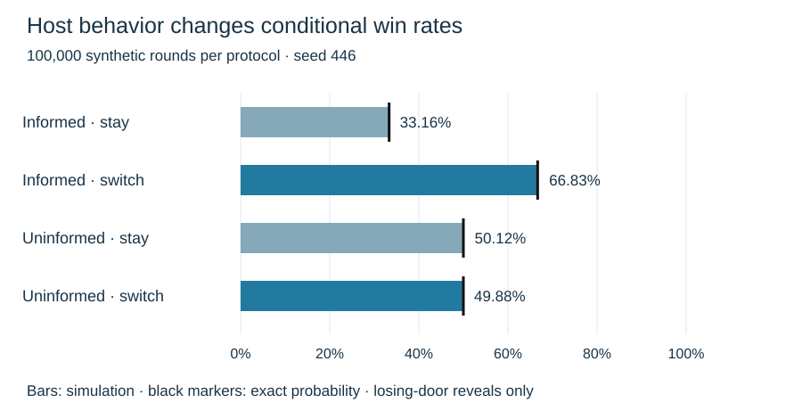

# Monty Hall: conditional probability, selection and engineering judgment

MIE 446 · Aerospace Structures · Optional mathematical enrichment · 31 October 2026

[Course home](README.md) · [Illustrated reading](https://ehsan-roohi.github.io/Aerospace-Structures/case-studies/monty-hall/) · [Python simulation](docs/case-studies/monty-hall/simulation.py)

<div lang="fa" dir="rtl">

### خلاصهٔ فارسی

در مسئلهٔ استاندارد مونتی هال، جایزه با احتمال برابر پشت یکی از سه در است. شما یک در انتخاب می‌کنید؛ مجری جایزه را می‌داند، همیشه یک در انتخاب‌نشدهٔ بدون جایزه را باز می‌کند و همیشه اجازهٔ تعویض می‌دهد. ماندن با احتمال یک‌سوم و تعویض با احتمال دوسوم می‌برد. دلیل اصلی این است که تعویض دقیقاً وقتی برنده است که انتخاب اول اشتباه بوده باشد.

اگر مجری تصادفی و بدون اطلاع دری را باز کند، یا فقط در بعضی وضعیت‌ها پیشنهاد تعویض بدهد، پاسخ تغییر می‌کند. در مهندسی نیز نتیجهٔ آزمایش را باید همراه با روش انتخاب نمونه و گزارش داده‌ها تفسیر کرد. این متن، توضیح و محاسبات مستقلی با الهام از مقالهٔ زومیت است؛ ترجمهٔ کامل آن نیست. مطالعهٔ تکمیلی نشان می‌دهد برتری کبوترها بر انسان‌ها در یک آزمایش را نمی‌توان به هوش عمومی تعمیم داد.

</div>

## 1. Define the experiment before calculating

The supplied Zoomit feature [1] introduces the puzzle and its psychological appeal. This reading develops the probability model and adds reproducible calculations and a structural-inspection analogy. Selvin's 1975 letter [2] explicitly discusses the host's knowledge and choice rule; a television show's actual bargaining rules need not match this idealized experiment.

Assume one prize is uniformly assigned to three doors, independently of the player's first choice. The host knows its location, never opens the chosen door or the prize door, always opens one losing door, and always offers a switch. For calculations conditioned on **which particular door** is opened, additionally specify that the host selects equally between the two losing doors when the player initially chose the prize.

The last assumption is unnecessary for the overall success rate of always switching. It is necessary for the familiar symmetric posterior after observing a named door. Distinguishing these two questions prevents a common hidden modeling error.

## 2. An exact proof in three rows

Without loss of generality choose door 1. Prize positions are equally likely.

| Prize | Host opens | Stay | Switch |
|---|---|---|---|
| Door 1 | Door 2 or 3 | Win | Lose |
| Door 2 | Door 3 | Lose | Win |
| Door 3 | Door 2 | Lose | Win |

Switching wins if and only if the first choice was wrong. Therefore

$$P(\mathrm{stay\ wins})=\frac13,\qquad P(\mathrm{switch\ wins})=1-\frac13=\frac23.$$

This is a proof about the experiment, not an estimate from repeated play. One unlucky switch cannot refute it; even an optimal strategy loses one third of its games.

## 3. Bayes' theorem: account for how evidence is produced

Let $C_i$ mean the prize is behind door $i$, and $H_3$ mean the host opens door 3, after the player picks door 1. Under fair tie breaking,

$$P(H_3\mid C_1)=\tfrac12,\quad P(H_3\mid C_2)=1,\quad P(H_3\mid C_3)=0.$$

Thus $P(H_3)=1/2$ and

$$P(C_1\mid H_3)=\frac{(1/2)(1/3)}{1/2}=\frac13,\qquad P(C_2\mid H_3)=\frac{1(1/3)}{1/2}=\frac23.$$

Two closed doors do not imply equal probabilities: the host deliberately protected the prize. For a biased host define $q=P(H_3\mid C_1)$. Then

$$P(C_1\mid H_3)=\frac{q}{1+q},\qquad P(C_2\mid H_3)=\frac{1}{1+q}.$$

For $q=1$, this particular observation gives equal probabilities; for $q=0$, door 2 is certain. Nevertheless, the unconditional always-switch strategy still wins two thirds of games. A posterior conditional on a named observation and a strategy's average success are different quantities.

## 4. Change the host, change the answer

| Protocol | Conditioning event | Stay wins | Switch wins |
|---|---|---:|---:|
| Informed, always offers | A losing door is opened | 1/3 | 2/3 |
| Uninformed, uniformly opens an unchosen door | Opened door happens to be losing | 1/2 | 1/2 |
| Offers only when first choice is correct | A switch is offered | 1 | 0 |
| Offers only when first choice is wrong | A switch is offered | 0 | 1 |

In the uninformed case, exposing the prize ends the game; those trials must be counted and then excluded from the conditional denominator. Initially correct choices survive with probability 1, initially wrong choices survive with probability 1/2. Each contributes probability 1/3 to the surviving sample, giving equal posteriors.

More generally let $a$ be the probability of offering a switch when the first choice is correct, and $b$ its probability when the first choice is wrong. Assume an informed host reveals a losing door and that these offer rates depend only on initial correctness. Averaging over opened-door identities,

$$P(\mathrm{switch\ wins}\mid\mathrm{offer})=\frac{2b}{a+2b},\qquad a+2b>0.$$

For $a=1,b=0.1$, switching wins only $1/6$ of offered games. Observing an offer is itself selected evidence. With an unknown protocol, a unique numerical answer may be unjustified.

## 5. Many doors and expected value

With $n$ equally likely doors, if the informed host always reveals $n-2$ losing doors, always switching to the single remaining unchosen door wins with probability $(n-1)/n$. At 100 doors that is 99%, versus 1% for staying. If more than one alternative stays closed, this formula does not directly give the success rate for switching to just one of them.

For prize value $V$ and a fee $c$ charged every time the player switches, with zero payoff for losing, the standard game's expected net values are

$$E_{\rm stay}=V/3,\qquad E_{\rm switch}=2V/3-c.$$

A risk-neutral player prefers switching when $c<V/3$. Maximizing win probability and maximizing net value coincide only when the costs and payoffs support that objective.

## 6. What do the pigeon studies establish?

Herbranson and Schroeder [3] used repeated, rewarded key choices in pigeons and a corresponding human task. Their birds learned near-optimal strategies, whereas human participants did not consistently do so. This demonstrates learning under a particular reinforcement procedure; it does not establish that birds understand Bayes' theorem or possess greater general intelligence.

Mazur and Kahlbaugh [4] subsequently compared pigeons, college students and preschoolers. College students began switching on a majority of trials sooner than pigeons, and most individuals did not reach the optimal strategy in the standard condition. When switching paid off 90% of the time, all students and all but one pigeon learned nearly always to switch. Protocol and reward discriminability matter. A broad headline about pigeons defeating mathematicians is therefore stronger than the combined evidence supports.

There is also a distinction between **probability matching** and maximizing reward. If a player independently switches with probability $s$, the standard game's win probability is

$$P(\mathrm{win})=s\frac23+(1-s)\frac13=\frac{1+s}{3}.$$

Choosing $s=2/3$ wins $5/9$ of games, below $2/3$ for $s=1$. Matching the action frequencies to reward probabilities is not the same as selecting the better action every time. These calculations describe an idealized fixed strategy, not a fitted model of every experimental participant.

## 7. Connection to aerospace structures: inspection is selected evidence

The lesson for structures is conditional reasoning, not a literal mapping from doors to aircraft. Consider a hypothetical fleet of coupons with prior crack prevalence 1%, inspection sensitivity 90%, and false-positive rate 5%. These are assumed classroom values, not measured aircraft inspection performance or approval criteria. Let $D$ denote a crack and $+$ a positive indication.

$$P(D\mid +)=\frac{0.90(0.01)}{0.90(0.01)+0.05(0.99)}=\frac{2}{13}\approx15.38\%.$$

Among 10,000 expected inspections, 100 coupons have cracks, producing 90 true positive indications; 9,900 uncracked coupons produce 495 false positives. The positive sample contains 585 coupons, of which 90 are cracked. Sensitivity $P(+\mid D)$ is not the posterior $P(D\mid +)$.

This low posterior does not justify ignoring indications. Consequences, confirmatory inspection, crack growth and applicable maintenance procedures govern action. If coupons were deliberately selected for suspicious features, the original 1% prior may no longer apply. Likewise, reporting only specimens that passed a screening test changes the population behind an apparently favorable strength result.

Before interpreting any experiment ask: What population was sampled? What was screened out? Could the measurement process depend on the underlying state? Were all outcomes reported? These questions complement equilibrium, compatibility and material modeling rather than replacing them.

## 8. Reproduce and audit the calculation

Run the standard-library-only source:

```bash
python docs/case-studies/monty-hall/simulation.py
```

The fixed seed is 446 and there are 100,000 trials per protocol. The source explicitly chooses a prize, first door, host action and remaining alternative. It records discarded prize-revealing trials for the uninformed host. An independent exact enumeration uses rational arithmetic to verify both protocols and the biased-host posterior. Output is saved to [results.json](docs/case-studies/monty-hall/results.json). Synthetic simulation results are not animal-behavior observations.

Figure 1 compares simulated win rates with exact predictions; sampling error explains small differences. Staying and switching are evaluated on the same rounds and are complementary, so their errors are not independent.



**Figure 1.** Original visualization generated by the supplied Python program. The uninformed results use only rounds where the host revealed a losing door; the retained count is in the numerical record.

### Classroom activities

1. Predict both protocols before running the source. Explain why their denominators differ.
2. Derive the biased-host posterior at $q=0.2$, then explain why overall switching still wins two thirds.
3. Compute the offered-game switching success for $a=0.8,b=0.2$ and explain the selection mechanism.
4. Repeat the inspection example at 10% prevalence. Keep sensitivity and false-positive rate fixed.
5. Explain why a correct simulation of the wrong host protocol fails to validate the intended mathematical model.

**Answer checks:** 2: staying $1/6$, switching $5/6$ after observing $H_3$; 3: $1/3$; 4: $2/3$. For item 5, distinguish implementation verification from validation of assumptions.

## References

All entries are cited above. The starting feature is credited; the mathematics, simulation and engineering example are independently developed here. No article images or full translated text are reproduced.

1. Pooyesh Pourmohammad, [Zoomit feature on the Monty Hall problem](https://www.zoomit.ir/human-science/470231-monty-hall-problem-explained-featured/), 31 October 2026. Starting reading.
2. Steve Selvin, “On the Monty Hall Problem,” *The American Statistician* **29**(3), 134 (1975). [Public transcription of the original letter](https://www.montyhallproblem.com/as.html). Historical statement and host assumptions.
3. Walter T. Herbranson and Julia Schroeder, “Are Birds Smarter Than Mathematicians? Pigeons (Columba livia) Perform Optimally on a Version of the Monty Hall Dilemma,” *Journal of Comparative Psychology* **124**(1), 1–13 (2010). [doi:10.1037/a0017703](https://doi.org/10.1037/a0017703); [full author manuscript](https://pmc.ncbi.nlm.nih.gov/articles/PMC3086893/).
4. James E. Mazur and Patricia E. Kahlbaugh, “Choice Behavior of Pigeons (Columba livia), College Students, and Preschool Children (Homo sapiens) in the Monty Hall Dilemma,” *Journal of Comparative Psychology* **126**(4), 407–420 (2012). [doi:10.1037/a0028273](https://doi.org/10.1037/a0028273); [full author manuscript](https://pmc.ncbi.nlm.nih.gov/articles/PMC3435463/).
