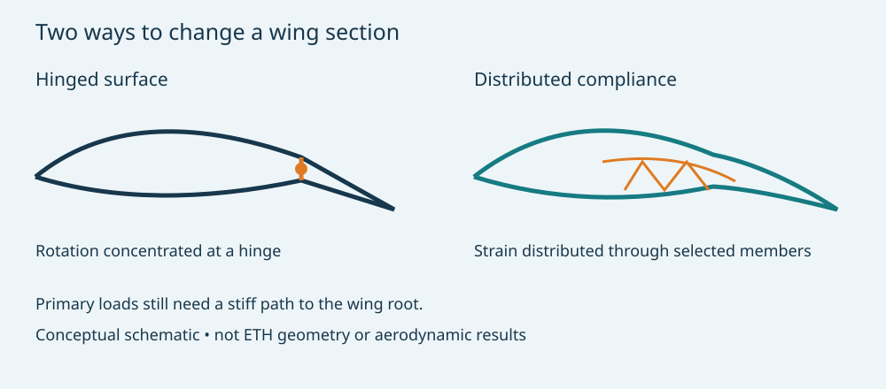

# Morphing composite wings: stiff enough to fly, flexible enough to steer

**MIE 446 · Aerospace Structures · University of Massachusetts Amherst**  
Engineering case study · 14 November 2026

[Illustrated web edition](https://ehsan-roohi.github.io/Aerospace-Structures/case-studies/morphing-wing/) · [Course readings](READINGS.md) · [Wing Lab](https://ehsan-roohi.github.io/Aerospace-Structures/wing-panel-stress-analyzer/)

## 1. The aircraft behind the social-media post

This is a 2019–2020 ETH Zurich/9T Labs research demonstrator, not a newly announced aircraft. Leo Baumann developed it with Dominic Keidel and Urban Fasel in Paolo Ermanni’s CMASLab. The associated paper describes a 2 m-span drone with additively manufactured composite primary and morphing structures [1–3].

The ETH account reports a continuous wing skin, eight wing servos and up to 48 mm trailing-edge travel. The wing and V-tail provide three-axis control. Static checks preceded a three-minute maiden flight with rolls and loops. The wing skin was an exception to the printed structure; electronics were not printed. Thermoplastic parts allow reheating and joining; carbon-fibre placement provides directional stiffness [1].

These observations demonstrate manufacture and flight control. They do not establish a certified load envelope, fatigue life or a measured whole-aircraft drag-reduction percentage.

*Figure 1. ETH Zurich photograph, linked from its original news page [1]. Credit and copyright remain with the original rights holder. The geometry is actual project hardware.*

## 2. Watch the demonstrator

**[3D printed morphing composite drone — project video](https://www.youtube.com/watch?v=RuSsGf7qe4c)**. This video is linked from coauthor Urban Fasel’s composite-structures project page [3]. Watch the skin deform continuously, then distinguish ground actuation from flight footage. A successful manoeuvre demonstrates control authority at that condition; it does not measure efficiency against a hinged-wing comparator. The web edition includes a video player and a direct playback link.

## 3. How a wing can be both stiff and compliant

A wing needs different stiffnesses for different motions. Global bending stiffness supports aerodynamic loads. Torsional stiffness helps maintain incidence and avoid control reversal or aeroelastic instability. Local chordwise compliance permits commanded camber change. Making every part flexible would compromise the first two requirements.

In a conventional control surface, motion is concentrated at a hinge. In a compliant mechanism, strain is distributed through selected members and the skin. The load path is still lift → skin/ribs → spar/root → fuselage. The actuator introduces an additional load path through its mount and the compliant region. Compatibility between these paths determines the actual shape.

*Figure 2. Original teaching schematic, not an ETH drawing or a computed aerodynamic solution. Curves indicate the geometric idea only.*

For a linear beam approximation,

$$EI\,w''''(y)=q(y),\qquad M=EI\kappa,\qquad \sigma_x=Mz/I.$$

Here $E$ is an effective modulus, $I$ the section second moment, $q$ the distributed load and $\kappa$ the curvature. A composite lattice and deforming skin generally need a richer anisotropic, possibly nonlinear model. A single beam cannot resolve local member strain or skin wrinkling.

For a thin compliant strip in simple bending, the outer-fibre strain is approximately

$$\epsilon_{max}\simeq\frac{t}{2R}.$$

A smaller bend radius $R$ or thicker strip $t$ increases strain. Compliance achieved through geometry must still satisfy strain, fatigue and manufacturing limits. This formula is a small-strain kinematic illustration, not an allowable for the printed material.

## 4. Why fibre direction matters

Continuous fibres carry load efficiently along their direction; a polymer-rich region is comparatively compliant. Designers can align reinforcement with primary loads while leaving selected directions more deformable. Printed fibre continuity, turn radius, voids, interlayer adhesion, temperature and joints can govern performance as strongly as nominal fibre modulus.

Classical laminate theory expresses the coupling as

$$\begin{bmatrix}\mathbf N\\\mathbf M\end{bmatrix}=\begin{bmatrix}\mathbf A&\mathbf B\\\mathbf B&\mathbf D\end{bmatrix}\begin{bmatrix}\boldsymbol\epsilon^0\\\boldsymbol\kappa\end{bmatrix}.$$

The laminate matrices describe membrane stiffness, bending stiffness and their coupling. They should not be confused with aerodynamic drag $D$. Coupling can help create a desired deformation, but an unsymmetric layup can also produce unwanted twist or thermal warpage. Laminate theory requires material properties and an appropriate homogenisation model before it can represent a printed structure.

## 5. Aerodynamics: when smooth deformation helps

A continuous surface avoids a sharp hinge-line change and can reduce gap-related losses. Variable camber also allows adaptation to lift demand. It does not follow that every deflection lowers total drag: camber changes pressure gradients, transition, separation and pitching moment. Deflected conventional surfaces do not account for a fixed substantial fraction of drag on every aircraft.

At matched flight conditions,

$$L=\tfrac12\rho V^2SC_L,\qquad D=\tfrac12\rho V^2SC_D,\qquad P_{shaft}=DV/\eta_p.$$

An efficiency comparison must match lift, speed, Reynolds number and trim. A change in $C_D$ at unmatched lift is not a fair aircraft comparison. Actuator mass, electrical power, skin strain energy and maintenance also belong in the system assessment. The source material reviewed here does not justify inserting an arbitrary drag-saving percentage.

Distributed actuation can reshape spanwise lift. For semispan $\ell$,

$$M_{root}=\int_0^\ell y\,q(y)\,dy.$$

At fixed total lift, moving load inboard reduces this bending moment, but the associated induced drag, trim and stall margins must also be considered. Load alleviation and minimum drag need not select the same shape.

## 6. Actuation, control and aeroelasticity

For a simplified deformation coordinate $\delta$, equilibrium can be written

$$F_{act}=k_{eff}\delta+F_{aero}(\delta,V).$$

This is a conceptual static relation with signed generalized forces. It shows why unloaded ground displacement is insufficient to predict flight displacement. Increased airspeed changes aerodynamic stiffness and actuator demand. Motors must provide force, travel and bandwidth; the structure must retain control authority under load.

Symmetric and differential wing commands can influence lift and roll, while a V-tail mixes pitch and yaw commands. Actual control mixing depends on the aircraft derivatives and coupling. Flexible control surfaces also introduce modes: $\mathbf K\phi=\omega^2\mathbf M\phi$ describes the structural problem, while flutter requires unsteady aerodynamic coupling. A static test alone cannot establish flutter clearance.

## 7. What an engineering qualification would require

| Question | Evidence needed |
|---|---|
| Does the intended shape occur under load? | Actuation/shape measurements at representative pressure distributions |
| Is strength adequate? | Defined limit and ultimate loads, strain measurements and failure criteria |
| Will the skin remain smooth? | Wrinkling, local buckling and manufacturing-tolerance checks |
| Does it remain controllable? | Loaded control derivatives, actuator saturation and failure response |
| Is it durable? | Repeated morphing, joint degradation, creep and environmental exposure |
| Does it save energy? | Matched-lift/trim drag comparison and mission-level actuation/mass accounting |

These are general assessment questions, not claims that the ETH team omitted every corresponding analysis. A short flight video cannot answer them by itself.

## 8. Optional classroom exercise

Use a generic cantilever in Wing Lab, not a reconstructed ETH wing. Assume a 1 m semispan, $q=20$ N/m and $EI=100$ N·m². The magnitudes are

$$V_{root}=20\ \mathrm N,\quad M_{root}=10\ \mathrm{N\,m},\quad w_{tip}=q\ell^4/(8EI)=0.025\ \mathrm m.$$

Halving $EI$ doubles deflection while reactions remain unchanged for this statically determinate model. Explain why that does not demonstrate a better morphing wing: compliance must be provided in the commanded deformation mode while retaining adequate stiffness elsewhere.

For an independent strip example, $t=0.5$ mm and $R=100$ mm give $\epsilon_{max}\approx0.25\%$. This is a calculated strain, not a material safety margin. Submit a load-path sketch, two beam comparisons and a paragraph identifying what the beam model cannot establish. This is optional enrichment, not a new graded assignment or flight-build instruction.

## References and media provenance

1. ETH Zurich D-MAVT, [Take-off for a composite morphing aircraft](https://mavt.ethz.ch/news-and-events/d-mavt-news/2020/01/take-off-for-a-composite-morphing-aircraft.html), 28 January 2020. Source for aircraft photograph, actuation and reported flight observations.
2. U. Fasel, D. Keidel, L. Baumann, G. Cavolina, M. Eichenhofer and P. Ermanni, *Composite additive manufacturing of morphing aerospace structures*, **Manufacturing Letters 23**, 85–88 (2020). [DOI](https://doi.org/10.1016/j.mfglet.2019.12.004) · [ETH repository](https://www.research-collection.ethz.ch/items/185790f6-5d05-4fad-bdde-164ee1a3e788) · [Author-hosted paper](https://spaces-cdn.owlstown.com/blobs/hii8sa1dii95euermjffs3cklqzt). Online publication was December 2019; journal issue was 2020.
3. Urban Fasel, [Composite structures](https://www.urbanfasel.com/projects/842-composite-structures) and [Morphing wings](https://www.urbanfasel.com/projects/841-morphing-wings). Author-maintained context and video provenance.
4. SCCER Mobility / ETH, [Morphing composite drone](https://www.sccer-mobility.ethz.ch/aboutus/sccer_events/Morphing-composite-drone/index.html), 24 February 2020.

**Theory background:** T. H. G. Megson, *Aircraft Structures for Engineering Students* (beam mechanics); R. M. Jones, *Mechanics of Composite Materials* (laminate mechanics); J. D. Anderson, *Introduction to Flight* (lift, drag and aircraft performance). Equations, schematic and classroom examples above are independent teaching explanations. External media are attributed and linked, not relicensed as original course artwork. Sources checked 14 November 2026.
