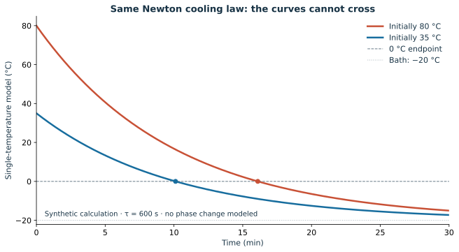
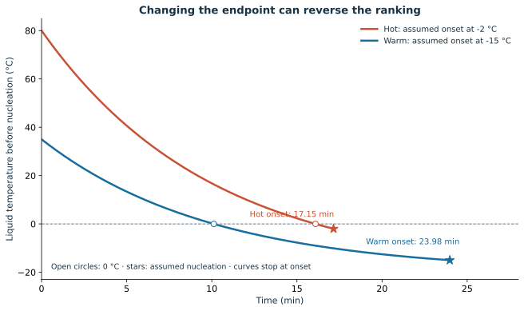
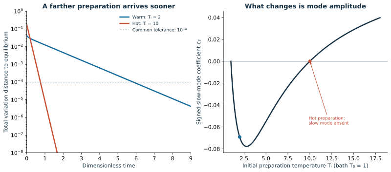

# The Mpemba Effect: Freezing Water, Nonequilibrium Relaxation and Thermal History

**MIE 446 · Aerospace Structures · University of Massachusetts Amherst**  
Optional interdisciplinary reading · 30 October 2026 · Original synthesis prepared with AI assistance and primary-source checking

[Course home](README.md) · **[Illustrated reading page](https://ehsan-roohi.github.io/Aerospace-Structures/case-studies/mpemba/)** · [Reproducible calculations](docs/case-studies/mpemba/teaching_calculations.py)

## The engineering question

Can a system that starts farther from its final state arrive sooner? Sometimes it can, but the answer depends on the complete initial state, the subsequent dynamics and what counts as arrival. This reading develops that question from freezing water to stochastic dynamics, kinetic theory and material processing.

The starting point is Pouyesh Pourmohammad's Persian [Zoomit feature](https://www.zoomit.ir/fundamental-science/470176-mpemba-effect-mysteries-featured/), published on 30 October 2026. It introduces Mpemba's story and the distinction between water experiments and modern relaxation studies. The account below is an independent, expanded analysis, rather than a translation of that article. Research claims are linked to the original papers. [1](#ref-1)

**What the evidence supports:** anomalous relaxation is reproducible in particular controlled systems. Water-freezing outcomes remain sensitive to the apparatus, preparation and endpoint. There is no general rule that a hotter cup always freezes first. A mechanism established for a colloidal particle or a qubit is not automatically an explanation for a household freezer.

<div lang="fa" dir="rtl">

### چکیدهٔ فارسی

اثر امپمبا به این معنا نیست که آب داغ همیشه زودتر از آب سرد یخ می‌زند. باید بین «رسیدن به صفر درجه»، «آغاز تشکیل یخ»، «انجماد کامل» و «رسیدن یک سامانه به تعادل» تفاوت گذاشت. آزمایش‌های آب به همرفت، تبخیر، تماس ظرف، ابرسرمایش و نوسان شرایط محیط حساس‌اند. در بعضی سامانه‌های کنترل‌شده، حالت اولیهٔ دورتر از تعادل می‌تواند سهم کمتری از کندترین مُد واهلش داشته باشد و زودتر به تعادل برسد. برای درس سازه، نکتهٔ مهم نقش تاریخچهٔ حرارتی، متغیرهای حالت، تبلور و تنش حرارتی است. نمودارهای این گزارش محاسبات آموزشی‌اند؛ دادهٔ آزمایشگاهی نیستند و دستورالعملی برای سامانهٔ ضدیخ هواپیما ارائه نمی‌کنند.

</div>

### Learning objectives

After this reading, students should be able to:

1. Separate cooling, nucleation, solidification and distributional equilibration.
2. Prove why identical scalar cooling models cannot produce a temperature crossing.
3. Identify the additional state variables and boundary conditions a water experiment needs.
4. Explain slow-mode suppression without invoking a violation of thermodynamics.
5. Connect thermal history to crystallization and constrained thermal strain.
6. Design a comparison with a declared endpoint, uncertainty and reproducible calculations.

## 1. From an observation to a testable claim

In their 1969 paper, **Erasto B. Mpemba and Denis G. Osborne** described the observations that made Mpemba's name associated with anomalous freezing. The paper includes Mpemba's account of preparing an ice-cream mixture and subsequent water investigations, alongside Osborne's experimental discussion. The useful scientific legacy is the question and the attempt to test it, not a universal instruction to preheat water. An ice-cream mixture and pure water are also different material systems. [2](#ref-2)

The title *Cool?* is memorable; the experimental specification matters more. A useful modern statement must identify sample mass, initial preparation, container, thermal environment, measurement location and the event being timed. A shorter observed time is not meaningful until those quantities are controlled or reported.

## 2. Four different finish lines

| Quantity being compared | Operational definition | What it does not establish |
|---|---|---|
| Cooling to a target | First time a declared temperature measure reaches, for example, $0\,^{\circ}\mathrm C$ | That ice has nucleated, or that the entire sample is at that temperature |
| Onset of freezing | First detected nucleation or a specified recalescence/optical signature | Complete solidification |
| Progress or completion of freezing | Time to a stated ice fraction or enthalpy threshold | Necessarily the same ranking as first nucleation |
| Relaxation to equilibrium | Time for the full state or distribution to enter a stated tolerance around equilibrium | A literal water-freezing process |

Recalescence is the temperature rise associated with latent heat released after nucleation in a supercooled liquid. A probe's first $0\,^{\circ}\mathrm C$ crossing can occur before nucleation; a later return toward zero can occur after nucleation. These events must not be interchanged. Brownridge's freezing experiments and Burridge and Linden's cooling study address different parts of this distinction. [3](#ref-3) [4](#ref-4)

For two preparations with $T_h>T_w>T_b$, define a common endpoint and compare

$$
\Delta t=t_h-t_w.
$$

A negative value means that the initially hotter preparation arrives first **for that protocol and endpoint**. In a spatially nonuniform sample, specify whether temperature means a local measurement, a volume average or an enthalpy-equivalent value. A crossing of two local probe records is weaker evidence than a controlled reversal of a clearly defined bulk endpoint.

## 3. What Newton cooling proves—and what it assumes

For a single well-mixed temperature, constant bath temperature and identical thermal time constant,

$$
\frac{dT}{dt}=-\frac{T-T_b}{\tau},\qquad
T(t)=T_b+(T_i-T_b)e^{-t/\tau}.
$$

The difference between initially hot and warm solutions is

$$
T_h(t)-T_w(t)=(T_h-T_w)e^{-t/\tau}>0.
$$

Thus the curves cannot cross. For the same target $T_*>T_b$,

$$
t(T_i\rightarrow T_*)=\tau\ln\!\left(\frac{T_i-T_b}{T_*-T_b}\right),\qquad
t_h-t_w=\tau\ln\!\left(\frac{T_h-T_b}{T_w-T_b}\right)>0.
$$

**A larger instantaneous heat-loss rate is not enough to make the hotter sample win.** It also starts with more energy to remove. Figure 1 illustrates this ordering with identical model parameters.



*Figure 1. Original classroom calculation, not measured water data. Initial temperatures are 80 and 35 °C, the bath is −20 °C and $\tau=600$ s. The curves extend as a mathematical liquid-only model; no freezing process is simulated.*

The restriction is broader than constant-coefficient Newton cooling. If both samples follow the same autonomous scalar law $\dot T=-g(T)$ with positive $g$ on the relevant interval and unique solutions, their target-time difference is

$$
t_h-t_w=\int_{T_w}^{T_h}\frac{dT}{g(T)}>0.
$$

Simply making a heat-transfer coefficient depend on instantaneous temperature does not evade this result. A reversal requires a missing state variable, different forcing or parameters, a different endpoint, or a failure of the scalar-model assumptions. In real water, the missing variables can include temperature gradients, fluid motion, composition, contact conditions and nucleation state.

## 4. An energy balance with room for the missing physics

An illustrative, well-mixed open-container balance is

$$
m c_p\frac{dT}{dt}
=-hA(T-T_\infty)
-\epsilon\sigma A_r(T^4-T_{\rm sur}^4)
-L_v\dot m_e+\dot Q_{\rm support}.
$$

Here $\dot m_e\geq0$ is evaporative mass loss; $L_v$ is the vaporization enthalpy at the liquid temperature; and $\dot Q_{\rm support}$ is positive when the support transfers heat into the sample. Radiation temperatures are in kelvin. The expression assumes a consistent mass/enthalpy balance and neglects several effects; it is not a calibrated freezer model. During freezing, a phase-fraction or enthalpy description is needed as well.

For an **assumed** 0.25 kg sample with constant $c_p=4180$ J kg$^{-1}$ K$^{-1}$, starting at 80 rather than 35 °C adds

$$
\Delta Q=0.25(4180)(80-35)=47{,}025\ \mathrm J.
$$

With an assumed fusion enthalpy of 334 kJ kg$^{-1}$, freezing that mass requires another 83.5 kJ after reaching the phase-change condition. These are energy-accounting examples. Faster arrival remains possible if the heat-transfer history or the event definition changes; no energy has disappeared.

For a spatial model, temperature alone becomes a field rather than one number. A conjugate heat-transfer calculation may need liquid convection, container conduction, external airflow, evaporation and moving phase boundaries. Reproducing a temperature trace by adjusting $h$ does not independently identify which of those mechanisms caused it.

## 5. Competing mechanisms in water

| Mechanism | Why it can matter | Measurement needed to distinguish it |
|---|---|---|
| Evaporation | Removes latent heat and changes the remaining mass | Weigh each sample before and after; record lids, humidity and exposed area |
| Natural convection and stratification | Change surface temperatures and internal transport | Multiple probe locations or a resolved temperature field; controlled geometry |
| Container/support contact | A hot container can change an icy or imperfect contact | Characterize the support and contact resistance; avoid uncontrolled frost |
| Supercooling and nucleation | Liquid can remain below zero before ice appears | Record subzero history and independently detect ice onset |
| Dissolved species, particles and surface condition | Can change interfacial processes and nucleation | Water preparation, chemistry, container cleaning and repeatability records |
| Fluctuating external airflow | Changes the effective heat-transfer coefficient between runs | Local bath/air measurements, randomized positions and blocked repeats |

These mechanisms can interact. None should be promoted to the single explanation for every reported observation. Brownridge provides evidence for a supercooling route in a selected protocol; Burridge and Linden emphasize cooling definitions and measurement sensitivity; Janni and colleagues identify fluctuating cooling rates and variable supercooling in their experiments. [3](#ref-3) [4](#ref-4) [5](#ref-5)

The word **memory** means that the variables retained in a simplified description are insufficient to determine the future. It does not establish a mysterious permanent molecular memory of water. A model with a full state can remain Markovian even when its temperature-only projection appears history-dependent.

## 6. What the water experiments establish

| Primary study | Reported result | Scope of the conclusion |
|---|---|---|
| Brownridge, 2011 [3](#ref-3) | In selected conditions with substantially deeper supercooling of the initially cold sample, hot-first freezing was observed in 28 of 28 attempts | Supports a controlled nucleation/supercooling route; not universal hot-first cooling to zero |
| Burridge and Linden, 2016 [4](#ref-4) | Did not find convincing hot-first cooling under their definition; demonstrated sensitivity to experimental comparison and temperature-measurement position | A strong critique of cooling claims, not a proof excluding every nucleation-based outcome |
| Janni, Botero Ampudia and Dahlberg, 2026 [5](#ref-5) | Reported 46 instances under a cooling-to-zero definition and 58 under a definition accounting for freezing onset, across 176 measurements | A protocol-dependent set of observations; the two counts are neither identical endpoints nor a universal occurrence probability |

The 2026 paper was first published on **16 January 2026** in *RSC Applied Interfaces*. The authors connect observations to variability in effective cooling rates and supercooling. Their counts span different sample/container conditions. Treating 46/176 or 58/176 as the probability that an arbitrary hot cup beats a cold cup would overstate the result. [5](#ref-5)

The difference between the endpoints can be demonstrated without inventing an anomalous cooling law. In Figure 2, both samples follow the same Newton law. The initially hot liquid reaches zero **later**, yet begins nucleation **earlier**, because different nucleation temperatures have been imposed.



*Figure 2. The assumed nucleation thresholds are −2 °C for the hot preparation and −15 °C for the warm preparation. Circles mark zero crossings; stars mark onset. Curves stop at nucleation: recalescence and complete freezing are not simulated. The thresholds are teaching inputs, not measured values or a prediction that heating necessarily changes nucleation this way.*

| Synthetic calculation | Initially 80 °C | Initially 35 °C |
|---|---:|---:|
| Time to zero | 16.09 min | 10.12 min |
| Time to assumed nucleation | 17.15 min | 23.98 min |

## 7. The modern statistical-mechanics question

Lu and Raz formulated a Markovian version of anomalous relaxation: a system initially prepared at a higher equilibrium temperature can approach the same colder equilibrium faster. Their theory explicitly distinguishes its general mechanism from an established microscopic explanation of freezing water. It also predicts an inverse heating effect. [6](#ref-6)

Let $\mathbf p$ be a column probability vector over configurations and let $R$ be the common post-quench generator:

$$
\dot{\mathbf p}=R\mathbf p,\qquad
R_{ij}\geq0\ (i\ne j),\qquad \sum_iR_{ij}=0,\qquad R\boldsymbol\pi=0.
$$

Here $R_{ij}$ is the transition rate from $j$ to $i$; $\boldsymbol\pi$ is equilibrium at bath temperature $T_b$. For reversible dynamics,

$$
R_{ij}\pi_j=R_{ji}\pi_i.
$$

With decaying modes $\lambda_2>\lambda_3>\cdots$ below the stationary eigenvalue zero,

$$
\mathbf p(t)-\boldsymbol\pi
=\sum_{k\geq2}c_k(T_i)\mathbf v_k e^{\lambda_k t}.
$$

The important quantity is the initial projection onto each mode. A farther initial distribution can have a smaller coefficient of the slowest mode. If $c_2(T_i)=0$ while the initial state is still different from equilibrium, the long-time decay begins with a faster mode: the **strong Mpemba effect**. The eigenvalues of the shared generator have not changed; its slow mode was not excited by that preparation. The spectral picture and strong-effect classification are developed in [6](#ref-6) and [7](#ref-7).

This resembles modal analysis in structures: a large initial displacement need not imply a large amplitude in the slowest relevant mode. The analogy concerns state projection, not an identity between overdamped thermal relaxation and oscillatory beam dynamics.

To make arrival quantitative, this reading uses total variation distance,

$$
D_{\rm TV}(\mathbf p,\boldsymbol\pi)=\frac12\sum_i|p_i-\pi_i|,
\qquad t_\varepsilon=\inf\{t:D_{\rm TV}(t)\leq\varepsilon\}.
$$

Specify the distance, tolerance and preparation protocol. Mean energy alone need not reveal how probability is distributed among slow-relaxing configurations.

## 8. A fully reproducible three-state example

Figure 3 is an original teaching construction with $k_B=1$, bath temperature 1 and energy levels $(0,0.3,8.3)$. Both preparations subsequently evolve under **exactly the same** reversible generator. The warm preparation has $T_i=2$; the hot one has $T_i=10$. The generator is deliberately constructed so that the latter has zero slow-mode coefficient.

For the common tolerance $D_{\rm TV}=10^{-4}$, the dimensionless arrival times are **0.7501 for the hot preparation** and **5.8349 for the warm one**, although their initial distances are 0.18105 and 0.04145, respectively.



*Figure 3. Synthetic probability dynamics, not water data and not a reproduction of a published experiment. The nonstationary eigenvalues are −1 and −10 in dimensionless time. Left: distance to the same equilibrium. Right: signed slow-mode amplitude versus preparation temperature. The zero at $T_i=1$ is equilibrium; the zero at $T_i=10$ is a nontrivial strong-effect preparation.*

The accompanying [script](docs/case-studies/mpemba/teaching_calculations.py) records the complete generator, initial distributions, mode amplitudes and target times in [calculations.json](docs/case-studies/mpemba/calculations.json). It checks positive transition rates, column sums, stationarity, detailed balance, probability normalization, agreement with an independent matrix exponential, and contraction of both total variation and relative entropy. No parameters are fitted to measurements.

**Thermodynamic consistency:** faster relaxation does not mean spontaneous heat flow from a cold bath into a hotter sample. In this detailed-balance model, the relative entropy $\sum_i p_i\ln(p_i/\pi_i)$ decreases for each evolving probability distribution. Ordering two different preparations by their arrival times is a separate question from whether each satisfies the relaxation constraints.

## 9. Experimental and theoretical evidence beyond water

### A colloidal particle: controlled preparation and controlled dynamics

Kumar and Bechhoefer demonstrated reproducible anomalous relaxation in 2020 using a colloidal particle in an engineered potential. The surrounding water served as a bath; the evolving object of interest was the particle's position distribution. Preparing that distribution at different effective temperatures allowed a quantitative comparison with theory, including the strong effect. This did not involve two cups of water freezing. [8](#ref-8)

### Granular fluids: temperature is not the whole velocity distribution

Lasanta and colleagues predicted Mpemba behavior in homogeneous granular fluids and checked it with molecular dynamics and Monte Carlo simulations. Their examples do not require spatial convection or a freezing transition. Granular temperature measures fluctuation energy, while additional features of the velocity distribution affect its subsequent relaxation. Inelastic collisions and any driving must be included in the energy balance. [9](#ref-9)

This is a useful kinetic-theory lesson: two distributions with similar second moments need not share higher moments or relaxation paths. A temperature-only closure can omit precisely the information needed to predict the ordering.

### Quantum systems: keep the measured quantity explicit

| Study | What was observed | Interpretation boundary |
|---|---|---|
| Joshi et al., 2024 [10](#ref-10) | Faster symmetry restoration from a more symmetry-broken preparation in a trapped-ion quantum simulator | The diagnostic includes entanglement asymmetry; it is not simply hotter water losing heat |
| Aharony Shapira et al., 2024 [11](#ref-11) | An inverse effect in a single trapped strontium-ion qubit, including accelerated heating under suitable coherence | An engineered quantum relaxation experiment, not a generic statement about every cold object |
| Zhang et al., 2025 [12](#ref-12) | Strong-effect relaxation in a single trapped-ion system by preparing a state without the slowest decaying mode | A state-engineering result within its open-system dynamics |

The common thread is preparation and relaxation pathways. The words *hotter*, *farther*, *more asymmetric* and *more coherent* describe different comparisons and should not be substituted without specifying the experiment.

### A more demanding way to compare states

Vu and Hayakawa's 2025 **thermomajorization Mpemba effect** addresses the ambiguity associated with selecting a particular distance measure. It compares relaxation through thermomajorization, linking the ordering to a family of monotone measures rather than one convenient curve. This is a stronger theoretical criterion, not a proof that any chosen water experiment must exhibit an effect. [13](#ref-13)

For a broad map of the theory, experiments and open questions, Teza and colleagues' review appeared as a preprint in 2025 and in *Physics Reports* in 2026. It treats Markovian, kinetic, phase-transition and quantum settings as related but distinct problems. It also separates demonstrated relaxation effects from proposed applications. [14](#ref-14)

## 10. Why this belongs in an aerospace structures course

### 10.1 Thermal history and material state

Temperature is often only one coordinate of a material's state. Crystallinity, degree of cure, residual strain, moisture and microstructure can affect later response. Equal current temperatures therefore need not imply equal stiffness, stress-free configuration or future evolution. This is an engineering connection, not a claim that all such effects are Mpemba effects.

A relevant materials example is Liu and colleagues' 2023 study of **polybutene-1 crystallization**. They used calorimetry and X-ray scattering to study preparation-dependent crystallization and reported Mpemba behavior in specified polymer states, proposing differences in chain conformation and relaxation as an explanation. The result should not be transferred directly to PLA printing or an aerospace composite without material-specific evidence. [15](#ref-15)

For a printed wing or a thermoplastic component, the useful question is: which thermal and structural variables must be retained to predict the final shape and properties? A single surface-temperature reading cannot supply that complete state.

### 10.2 Free thermal expansion versus constrained thermal stress

For a uniform, linear elastic bar with tension-positive convention,

$$
\varepsilon_{\rm total}=\frac{\sigma}{E}+\alpha\Delta T.
$$

A freely expanding bar has $\sigma=0$ and $\varepsilon=\alpha\Delta T$. An ideally, completely restrained bar has zero total strain and

$$
\sigma=-E\alpha\Delta T.
$$

With **assumed classroom constants** $E=70$ GPa, $\alpha=23\times10^{-6}$ K$^{-1}$ and heating by 50 K, the ideal restraint stress is **−80.5 MPa**, i.e. compression. These values are not a material allowable or a component stress prediction. A temperature gradient can additionally create bending; real joints, yielding and viscoelastic relaxation alter the constraint response.

The lesson shared with the Mpemba problem is model completeness: geometry, boundary conditions and state history determine the result. “Hotter” alone cannot determine freezing order, and “a 50 K change” alone cannot determine structural stress.

### 10.3 Icing and thermal protection

Aircraft icing involves droplet collection, convection, evaporation, latent heat, surface conduction and often runback water. A container-freezing result does not specify how those coupled processes behave on an airfoil. The useful transfer is the discipline of declaring a phase-change endpoint and resolving the relevant heat and mass balances. No performance improvement for an aircraft anti-icing system is established by this reading.

## 11. A classroom investigation that could distinguish mechanisms

Treat this as a proposed supervised experiment, not a report of measurements.

1. **Declare two outcomes separately:** time to a specified temperature measure and independently detected nucleation. Add a solidification-fraction endpoint only if the instrumentation can measure it.
2. Use matched containers and **initial mass**, document water preparation, probe positions and mounting, and measure evaporative mass loss. Equal volume is not identical mass at different temperatures.
3. Log the local environment and several sample temperatures. Record how rapidly samples are inserted and whether the freezer cycles or changes with load.
4. Randomize or exchange container positions within repeated blocks. Neighboring samples can influence each other's airflows and thermal environment; placing both in one freezer does not guarantee identical boundary conditions.
5. Separate comparisons with and without lids or with controlled contact as additional protocols. Change one intended factor while recording the others.
6. Retain every run, including failures to nucleate within the observation window. Report paired $\Delta t$ values, their spread and measurement uncertainty; choose replication after a pilot-based precision assessment.
7. State whether the temperature difference between preparations exceeds probe uncertainty and within-protocol variability. Fit cooling coefficients as diagnostics, without treating a fitted coefficient as proof of a unique mechanism.

A repeatable ranking under matched conditions is stronger evidence than a single dramatic video. A model should predict a change of protocol that discriminates between explanations, rather than merely reproduce the trace used to tune it.

## 12. Short exercises and reproducibility

1. **Scalar ordering.** Derive the target-time difference for any common autonomous $g(T)>0$. Explain why a steeper initial slope alone cannot establish a crossing.
2. **Endpoint audit.** Use the Figure 2 inputs to recover both rankings. Which additional observation would be needed to compare complete freezing?
3. **Mode audit.** Run the three-state calculation. Change the hot preparation from 10 to 8 while keeping the generator fixed. Does the slow-mode coefficient still vanish? Avoid rebuilding the generator when testing a different preparation.
4. **Structural analogy.** Compare a free bar, a fully restrained bar and a bar with one compliant support. Which assumptions produced −80.5 MPa, and which would fail for a thermally graded wing skin?
5. **Evidence audit.** Choose one source and list its system, preparation, dynamics, measured observable and endpoint. Identify an application that its results do not yet establish.

Run the calculations from the repository root:

```bash
python -m pip install numpy scipy matplotlib
python docs/case-studies/mpemba/teaching_calculations.py
```

The script generates three SVG figures and the numerical record beside it. All plotted curves are original synthetic calculations. No experimental curves have been digitized, no paper figures have been copied, and no new laboratory experiment has been performed. The HTML reading page presents the same report with larger display equations.

## References and further reading

<a id="ref-1"></a>
**[1]** Pourmohammad, P. (30 October 2026). Persian feature on the Mpemba effect. *Zoomit*. [Starting article](https://www.zoomit.ir/fundamental-science/470176-mpemba-effect-mysteries-featured/). Journalistic starting point; research claims above use the primary papers below.

<a id="ref-2"></a>
**[2]** Mpemba, E. B. & Osborne, D. G. (1969). *Cool?* **Physics Education 4**, 172. [DOI: 10.1088/0031-9120/4/3/312](https://doi.org/10.1088/0031-9120/4/3/312). [Text hosted by the Royal Society of Chemistry](https://edu.rsc.org/download?ac=13093).

<a id="ref-3"></a>
**[3]** Brownridge, J. D. (2011). *When does hot water freeze faster then cold water? A search for the Mpemba effect.* **American Journal of Physics 79**, 78–84. [DOI: 10.1119/1.3490015](https://doi.org/10.1119/1.3490015). The spelling “then” is retained from the published title.

<a id="ref-4"></a>
**[4]** Burridge, H. C. & Linden, P. F. (2016). *Questioning the Mpemba effect: hot water does not cool more quickly than cold.* **Scientific Reports 6**, 37665. [DOI: 10.1038/srep37665](https://doi.org/10.1038/srep37665).

<a id="ref-5"></a>
**[5]** Janni, A., Botero Ampudia, S. & Dahlberg, E. D. (2026). *An experimental investigation of the Mpemba effect.* **RSC Applied Interfaces 3**, 442–449. First published 16 January 2026. [DOI: 10.1039/D5LF00296F](https://doi.org/10.1039/D5LF00296F). [Authors' institutional publication record](https://experts.umn.edu/en/publications/an-experimental-investigation-of-the-mpemba-effect/).

<a id="ref-6"></a>
**[6]** Lu, Z. & Raz, O. (2017). *Nonequilibrium thermodynamics of the Markovian Mpemba effect and its inverse.* **PNAS 114**, 5083–5088. [DOI: 10.1073/pnas.1701264114](https://doi.org/10.1073/pnas.1701264114). [Open full text](https://pmc.ncbi.nlm.nih.gov/articles/PMC5441807/).

<a id="ref-7"></a>
**[7]** Klich, I., Raz, O., Hirschberg, O. & Vucelja, M. (2019). *Mpemba Index and Anomalous Relaxation.* **Physical Review X 9**, 021060. [DOI: 10.1103/PhysRevX.9.021060](https://doi.org/10.1103/PhysRevX.9.021060).

<a id="ref-8"></a>
**[8]** Kumar, A. & Bechhoefer, J. (2020). *Exponentially faster cooling in a colloidal system.* **Nature 584**, 64–68. [DOI: 10.1038/s41586-020-2560-x](https://doi.org/10.1038/s41586-020-2560-x). [Public experimental dataset](https://doi.org/10.6084/m9.figshare.12203021.v1).

<a id="ref-9"></a>
**[9]** Lasanta, A., Vega Reyes, F., Prados, A. & Santos, A. (2017). *When the Hotter Cools More Quickly: Mpemba Effect in Granular Fluids.* **Physical Review Letters 119**, 148001. [DOI: 10.1103/PhysRevLett.119.148001](https://doi.org/10.1103/PhysRevLett.119.148001).

<a id="ref-10"></a>
**[10]** Joshi, L. Kh. et al. (2024). *Observing the Quantum Mpemba Effect in Quantum Simulations.* **Physical Review Letters 133**, 010402. [DOI: 10.1103/PhysRevLett.133.010402](https://doi.org/10.1103/PhysRevLett.133.010402). [Author manuscript](https://arxiv.org/abs/2401.04270).

<a id="ref-11"></a>
**[11]** Aharony Shapira, S. et al. (2024). *Inverse Mpemba Effect Demonstrated on a Single Trapped Ion Qubit.* **Physical Review Letters 133**, 010403. [DOI: 10.1103/PhysRevLett.133.010403](https://doi.org/10.1103/PhysRevLett.133.010403).

<a id="ref-12"></a>
**[12]** Zhang, J. et al. (2025). *Observation of quantum strong Mpemba effect.* **Nature Communications 16**, 301. Published 6 January 2025. [DOI: 10.1038/s41467-024-54303-0](https://doi.org/10.1038/s41467-024-54303-0).

<a id="ref-13"></a>
**[13]** Vu, T. V. & Hayakawa, H. (2025). *Thermomajorization Mpemba Effect.* **Physical Review Letters 134**, 107101. [DOI: 10.1103/PhysRevLett.134.107101](https://doi.org/10.1103/PhysRevLett.134.107101). [Author manuscript](https://arxiv.org/abs/2410.06686).

<a id="ref-14"></a>
**[14]** Teza, G., Bechhoefer, J., Lasanta, A., Raz, O. & Vucelja, M. (2026). *Speedups in nonequilibrium thermal relaxation: Mpemba and related effects.* **Physics Reports 1164**, 1–97. [DOI: 10.1016/j.physrep.2025.10.009](https://doi.org/10.1016/j.physrep.2025.10.009). [Open preprint, first posted in 2025](https://arxiv.org/abs/2502.01758).

<a id="ref-15"></a>
**[15]** Liu, J., Li, J., Liu, B., Hamley, I. W. & Jiang, S. (2023). *Mpemba effect in crystallization of polybutene-1.* **Soft Matter 19**, 3337–3347. [DOI: 10.1039/D3SM00309D](https://doi.org/10.1039/D3SM00309D). [Author manuscript](https://arxiv.org/abs/2211.07827).
