# Navigation Without GPS: Sensors, Uncertainty and the Structural Connection

**MIE 446 · Aerospace Structures · University of Massachusetts Amherst**  
Supplementary engineering reading · 5 November 2026

[Course home](README.md) · [Illustrated web edition](https://ehsan-roohi.github.io/Aerospace-Structures/case-studies/navigation-without-gps/)

## 1. From the news question to an engineering question

A vehicle can move without receiving GPS, but maintaining a trustworthy estimate of its motion is a separate engineering problem. A navigation system estimates quantities such as position, velocity and orientation from imperfect measurements. The answer is therefore not a single replacement instrument: different physical measurements supply different pieces of information, with different weaknesses.

This original English lesson was prompted by Oleg Chernysh's BBC Persian article, [“How do drones fly without GPS in enemy territory?”](https://www.bbc.com/persian/articles/cr5y5n8vx90no), published 4 November 2026. **The news report concerns wartime systems; this lesson develops general scientific principles and civilian aerospace/planetary examples.** It does not provide an operational design for the systems described in the news.

**What the BBC reports, in brief.** The article discusses disrupted satellite navigation, inertial and visual alternatives, magnetic references and terrestrial radio beacons. It reports a claimed 15–20 cm accuracy for the Russian Ariadna prototype, versus 50–150 m errors described by a representative of a different Ukrainian development. These are attributed statements about different systems and conditions, not comparable independent benchmarks. The article also discusses infrastructure, weather and maintenance constraints. Its broader message is that navigation may rely on several sources rather than one universal substitute [1].

For structures students, the important extension is physical: a sensor is attached to a deformable, vibrating, thermally expanding vehicle. Software cannot make a flexible camera bracket rigid. A good measurement model must remain compatible with the mechanical system that carries the sensor.

**Learning goals:** distinguish navigation from control and communication; explain absolute and relative information; recognize why inertial measurements drift; compare sensor limitations; calculate simple structural and optical sensitivities; and assess the evidence behind a performance claim.

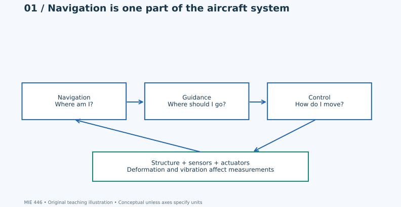

*Figure 1. Navigation estimates the state; guidance defines intended motion; control commands forces and moments. Structure and instrumentation influence all three. Arrows show conceptual relationships, not an implemented flight architecture.*

## 2. GPS, GNSS and four different jobs

**GPS** is one satellite navigation system; **GNSS** is the broader category that includes GPS, Galileo, GLONASS and BeiDou. A GNSS receiver interprets signals from external references to estimate position and time. The basic educational distinction is between knowing where a reference is, measuring something related to distance, and accounting for clock uncertainty [2].

**Navigation** asks where the vehicle is and how it is moving. **Guidance** asks what motion is desired. **Control** produces the forces and moments needed to follow that motion. **Communication** exchanges commands or information with another system. Losing a communication link and losing a position reference are different failures, even if they happen together.

A familiar civilian example is a camera-equipped inspection robot in a building. It may keep estimating local motion after it leaves satellite reception. That does not automatically mean it knows its global map coordinates, remains connected to its operator, or can safely complete every task.

A conceptual state description is

$$\mathbf{x}=\begin{bmatrix}\mathbf{p}^{T}&\mathbf{v}^{T}&\boldsymbol{\theta}^{T}\end{bmatrix}^{T}. \tag{1}$$

Here $\mathbf p$ is position, $\mathbf v$ velocity, and $\boldsymbol\theta$ a local orientation parameterization. This is a list of physical quantities, not a complete estimator. Some orientation parameterizations have singularities; real software must address that separately.

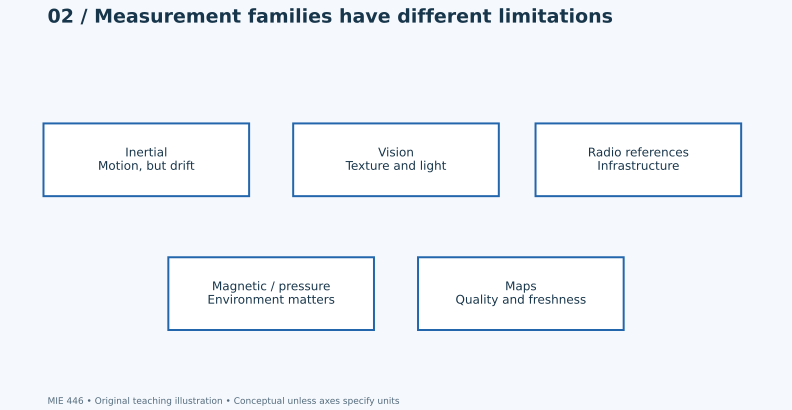

*Figure 2. Measurement families provide complementary information. A map is stored reference information rather than a physical sensor.*

## 3. Absolute information, relative information and observability

A relative estimate describes change: “I moved from here to there.” An absolute estimate connects the vehicle to an external reference frame. A local trajectory can be smooth and internally consistent while its global position is wrong. Similarly, excellent short-term angular measurements do not establish a global position.

**Observability** is the question of whether the available measurements and motion contain enough information to distinguish the quantities being estimated. More numerical output does not necessarily mean more physical information. For example, a pressure measurement may constrain height approximately, but it cannot determine horizontal location by itself. Seeing the same uniform surface repeatedly does not reveal as much motion as seeing a rich, stable scene.

Every position estimate should be interpreted with an uncertainty description and assumptions. Accuracy refers to agreement with a reference; precision describes spread or repeatability. An uncertainty reported by an estimator is conditional on its model, calibration and noise assumptions. It is not a guarantee that all possible faults are covered [3].

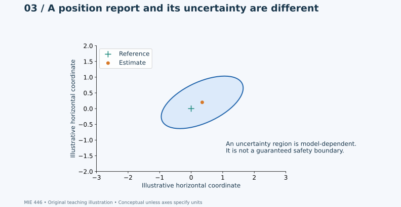

*Figure 3. The ellipse is illustrative and has no assigned probability. It must not be read as a measured confidence boundary or a certified containment region.*

## 4. Inertial sensing: useful motion measurements, accumulating error

An inertial measurement unit typically combines accelerometers and gyroscopes. An accelerometer measures **specific force**, not global translational acceleration directly. Orientation and gravity matter when interpreting its output. A gyroscope measures angular rate. Biases, temperature sensitivity, scale errors and vibration affect these measurements.

For a deliberately simplified, one-dimensional classroom model, suppose acceleration is known in a fixed frame and has a constant error $b_a$. With zero initial velocity and position errors,

$$\Delta v=b_a t, \tag{2}$$

$$\Delta p=\tfrac12 b_a t^2. \tag{3}$$

These expressions illustrate integration; they are not a realistic navigation error budget. They omit changing attitude, gravity projection errors, random noise, changing bias and external corrections. They also do not imply that every inertial device has the same drift.

For the hypothetical value $b_a=0.01\ \mathrm{m/s^2}$, Eq. (3) gives 0.5 m after 10 s and 18 m after 60 s. The lesson is the time dependence, not those particular numbers. A small persistent measurement error may become consequential after integration.

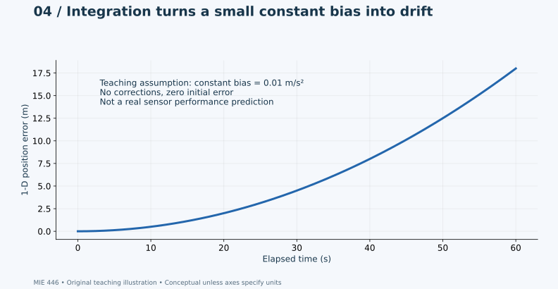

*Figure 4. Analytical teaching curve using Eq. (3). It is neither measured hardware data nor a prediction for any named aircraft.*

## 5. Vision: relative motion is different from recognizing a mapped location

A camera measures image intensity over an array of pixels. Motion estimation can exploit how visible features change between images. Matching a view to a geographically referenced map is a different task: it seeks an external position reference. Recognizing an object, classifying a scene and determining camera motion are also distinct problems.

Several effects complicate the relationship between images and physical motion: unknown depth, occlusion, illumination changes, weak texture, repetitive patterns, reflections, moving objects and image blur. A camera may be functioning perfectly while the scene contains little useful geometric information.

A basic pinhole-camera relation is

$$u=f_{\mathrm{px}}\frac{X}{Z}, \qquad v=f_{\mathrm{px}}\frac{Y}{Z}. \tag{4}$$

$X,Y,Z$ are coordinates in the camera frame, with $Z>0$; $u,v$ are image coordinates relative to the principal point; $f_{\mathrm{px}}$ is focal length in pixels. Equation (4) omits distortion and assumes an idealized projection. It explains why a pixel change alone does not uniquely establish physical displacement: depth also matters.

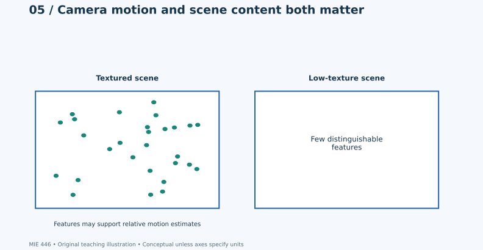

*Figure 5. Synthetic scene-content illustration. The dots are drawing elements, not extracted features from an experiment.*

Artificial intelligence may help interpret images, but it does not create information absent from the measurements. A convincing demonstration on one landscape is not evidence of equal performance in another season, lighting condition or camera configuration. Validation should separate the scenes used during development from the scenes used for evaluation.

## 6. A real non-GPS example: Ingenuity on Mars

NASA's Ingenuity offers a particularly clear educational example because terrestrial GNSS reception is not an available navigation source on Mars. NASA describes its use of inertial measurements, a downward-looking navigation camera and a laser range finder. Its sensor discussion also shows that losing one instrument does not mean all remaining measurements become useless [4]. This is an example of planetary engineering, not evidence for the performance of the systems in the BBC story.

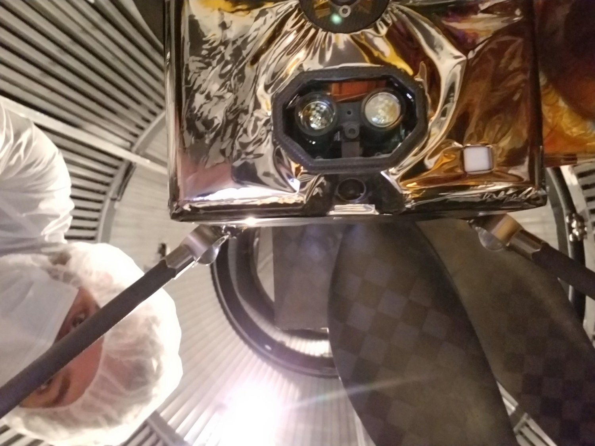

*Photo 1. Real ground-test photograph of the underside of Ingenuity. Credit: NASA/JPL-Caltech, PIA23969. [Source and instrument identification](https://science.nasa.gov/photojournal/bottom-of-ingenuity-mars-helicopter/). Resized without cropping. The visible hardware helps connect sensor concepts to actual packaging and attachment.*

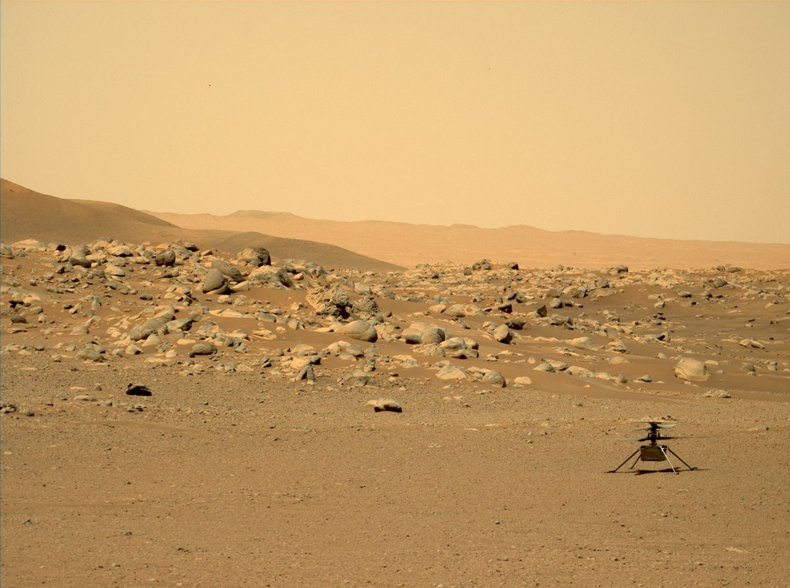

*Photo 2. Real Mastcam-Z image from Perseverance, 15 June 2021, showing Ingenuity at Airfield D. Credit: NASA/JPL-Caltech/ASU/MSSS, PIA25213. [Source](https://science.nasa.gov/blog/keeping-our-sense-of-direction-dealing-with-a-dead-sensor/). Resized without cropping.*

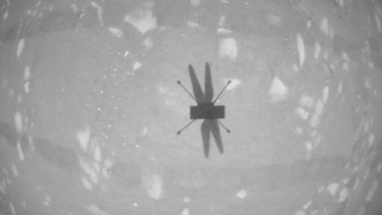

*Photo 3. Real navigation-camera image from Ingenuity's second experimental flight, 22 April 2021. Credit: NASA/JPL-Caltech. [Source](https://science.nasa.gov/blog/what-were-learning-about-ingenuitys-flight-control-and-aerodynamic-performance/). Resized without cropping. This is a sensor image, not a computer-generated landscape.*

NASA's flight-performance account explains that dust can initially obstruct the camera, making inertial information especially important during that phase [5]. The general lesson is temporal: a sensor can be useful during one part of an activity and less useful during another. The photograph alone cannot establish the accuracy of the corresponding motion estimate.

## 7. Radio references: infrastructure and measurement are separate questions

Terrestrial navigation references long predate satellite navigation. However, the word “beacon” does not specify a unique measurement method. A system might measure an angle, a travel-time-related quantity or another signal property. Its available information depends on the actual measurement type and reference infrastructure.

A conceptual range-like observation may include geometric separation, clock effects and propagation errors. Knowing the transmitter's coordinates is only part of the problem. Synchronization, calibration, reflected paths, obstruction and reference stability can matter. A single reference does not generally establish a unique unconstrained three-dimensional position.

For critical reading, ask what a published demonstration actually measured: a range error, a horizontal position error, a vertical error, or repeatability at one point? Were references surveyed independently? Were results collected in open space, indoors or near reflective structures? These questions assess evidence without assuming that every beacon network is equivalent.

Two popular shortcuts deserve correction. First, a ground-based signal is not automatically immune to disruption. Second, increasing the separation of references does not universally improve position accuracy. Measurement geometry and measurement quality both matter; a changed arrangement may improve one sensitivity while reducing coverage or worsening another [3]. No deployment geometry or operational network design follows from this conceptual discussion.

## 8. Magnetic and pressure references: environmental information has limits

A magnetic compass primarily supplies heading-related information. Magnetic map matching is a different idea: it compares local measurements with spatial variations in a reference field. Earth's field has regional structure and changes with time; NOAA provides models, surveys and magnetic anomaly resources [6]. A field model is not automatically a sufficiently detailed or current local navigation map.

The vehicle itself may introduce magnetic disturbances through motors, electrical currents or nearby ferromagnetic material. A reading that changes when electrical equipment switches on may reflect the vehicle rather than a change in geographic location. Anomalies can also be insufficiently distinctive to resolve location uniquely. Therefore “magnetic navigation” should not be treated as one universally mature substitute for GPS.

Pressure provides another environmental constraint. Under local hydrostatic balance,

$$\frac{dp}{dz}=-\rho g. \tag{5}$$

For a small pressure change and approximately constant density,

$$\Delta z\simeq-\frac{\Delta p}{\rho g}. \tag{6}$$

Pressure-derived height depends on atmospheric conditions and the pressure actually sampled by the installation. Static-port location and surrounding flow can change the reading. Equation (6) is a local physical approximation, not a globally valid atmosphere model or an absolute height guarantee.

## 9. Combining information does not eliminate shared errors

Complementary sensors can constrain different quantities and provide useful cross-checks. Yet two sensors may share a fault source: temperature, power, time stamps, structural motion or a common reference map. Their errors are then not independent.

A scalar classroom uncertainty identity is

$$\operatorname{Var}(aX+bY)=a^2\sigma_X^2+b^2\sigma_Y^2+2ab\operatorname{Cov}(X,Y). \tag{7}$$

For the average of two equally noisy measurements, each with standard deviation $\sigma$ and correlation coefficient $\rho_c$,

$$\sigma_{\mathrm{avg}}=\sigma\sqrt{\frac{1+\rho_c}{2}}. \tag{8}$$

If the errors are independent, averaging reduces their standard deviation by $\sqrt2$. If they are perfectly correlated, it gives no reduction. Neither result removes a common bias. These are elementary measurement-statistics examples, not a sensor-fusion implementation.

Mechanical integration therefore affects both the magnitude and dependence of errors. Two instruments on one flexible panel may experience a common vibration. Two cameras may share the same obscured view. Counting sensors is an inadequate substitute for understanding the information they provide.

## 10. The structural connection: alignment and flexibility

A structural model may describe an aircraft as a rigid body for one purpose while treating a sensor support as flexible for another. These approximations are compatible only if their neglected motions are small enough for the measurement task.

A small angular change $\delta\theta$ in a camera's pointing direction changes the image approximately by

$$\delta u\simeq f_{\mathrm{px}}\,\delta\theta, \tag{9}$$

near the optical axis and for small angles. A mount can therefore produce a noticeable image displacement without a large visible translation. This relation describes geometric sensitivity; it does not say that every image displacement becomes the same navigation error.

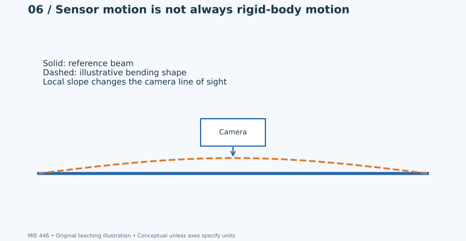

*Figure 6. Exaggerated conceptual bending shape. A camera attached to a flexible structure can rotate relative to the reference airframe.*

There are several different alignment questions: manufacturing alignment, static deformation under load, dynamic motion, and changes after maintenance or thermal cycling. A calibration obtained under one condition may not describe another. Conversely, a flexible structure is not automatically unacceptable: the relevant question is whether deformation is understood and remains within the measurement assumptions.

## 11. Equipment mounting and vibration

An elementary mass–spring–damper model illustrates why adding a soft mount is not a universal improvement [7]. For absolute equipment displacement $x$ and base displacement $y$,

$$m\ddot x+c(\dot x-\dot y)+k(x-y)=0. \tag{10}$$

The natural frequency and damping ratio are

$$\omega_n=\sqrt{k/m},\qquad \zeta=\frac{c}{2\sqrt{km}}. \tag{11}$$

For sinusoidal steady-state base excitation, with frequency ratio $r=\omega/\omega_n$, the absolute displacement transmissibility is

$$T=\left|\frac{X}{Y}\right|=\sqrt{\frac{1+(2\zeta r)^2}{(1-r^2)^2+(2\zeta r)^2}}. \tag{12}$$

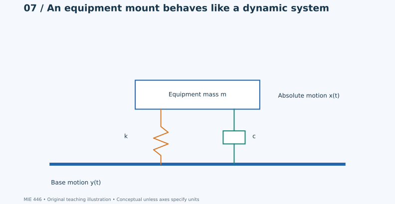

*Figure 7. Linear teaching model. Real assemblies may have multiple modes, rotational coupling, nonlinear behavior and attachment compliance.*

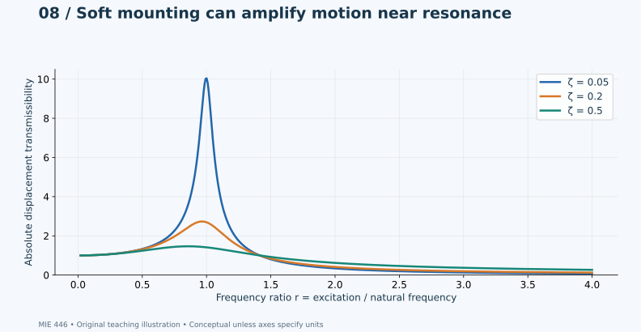

*Figure 8. Curves calculated from Eq. (12), not measured aircraft data. Low damping produces strong amplification near resonance. Damping and stiffness influence different frequency regions differently.*

This model is valuable because it exposes a tradeoff, not because it selects a flight-qualified mount. Relative travel, cable stiffness, mechanical stops, temperature and fatigue are additional considerations. The frequency and amplitude content of the actual excitation must also be understood before the model can be evaluated against hardware.

## 12. A bracket calculation: the path from load to line of sight

Consider a stationary laboratory camera bracket subjected to a prescribed equivalent transverse acceleration. The camera produces an inertial load

$$F=ma,\qquad M_{\mathrm{root}}=FL. \tag{13}$$

For an ideal prismatic cantilever with a transverse end force,

$$I=\frac{bt^3}{12}, \tag{14}$$

$$\delta_{\mathrm{tip}}=\frac{FL^3}{3EI},\qquad
\theta_{\mathrm{tip}}=\frac{FL^2}{2EI}, \tag{15}$$

$$\sigma_{\max}=\frac{M_{\mathrm{root}}(t/2)}{I}. \tag{16}$$

Here $b$ is width and $t$ the dimension through the bending depth. These expressions assume small deflection, linear elasticity, a fixed root, and a slender beam. They omit fastener flexibility, stress concentration, torsion and dynamic amplification.

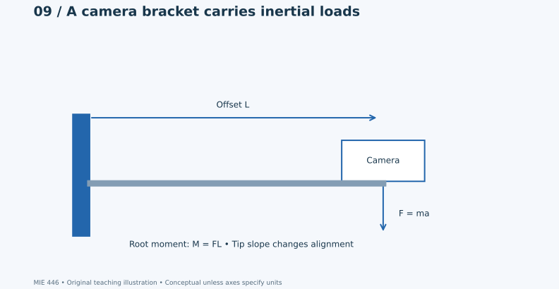

*Figure 9. Simplified bracket free-body concept. The dimensions and boundary conditions for the numerical example are specified below.*

**Hypothetical laboratory example.** Let $m=0.10$ kg, $a=2$ m/s², $L=0.10$ m, $b=0.020$ m, $t=0.003$ m and $E=70$ GPa. Then $F=0.20$ N, $M=0.020$ N·m and $I=4.50\times10^{-11}$ m⁴. The ideal beam predicts $\delta_{\mathrm{tip}}=0.0212$ mm, $\theta_{\mathrm{tip}}=0.000317$ rad and $\sigma_{\max}=0.667$ MPa. With an illustrative $f_{\mathrm{px}}=600$ pixels, Eq. (9) gives approximately 0.190 pixel displacement.

This calculation makes an important distinction: a low nominal bending stress does not automatically imply negligible optical motion. Strength, stiffness and instrument alignment are different requirements. It is a static sensitivity example, not a camera design recommendation or a reconstruction of any reported vehicle.

Thermal effects create another source of geometric change:

$$\Delta L=\alpha L\Delta T. \tag{17}$$

For two unrestrained members of equal initial length,

$$\Delta L_1-\Delta L_2=(\alpha_1-\alpha_2)L\Delta T. \tag{18}$$

In a constrained assembly, compatibility and load sharing determine stresses; free-expansion expressions alone cannot establish them. An uneven temperature field may additionally cause curvature.

## 13. How to assess the article's performance claims

A centimeter figure and a hundred-meter figure should not be placed on a common ranking without compatible definitions. A comparison needs the measured quantity, reference method, probability level, operating conditions, duration and failure handling. “Better than GPS” is also incomplete unless the GPS mode and comparison conditions are identified.

| Question | Why it changes the interpretation |
|---|---|
| Horizontal, vertical, three-dimensional, or range error? | These are different quantities. |
| Mean, RMS, standard deviation, percentile, or observed maximum? | The same dataset can yield very different numbers. |
| Independent truth reference? | A shared reference can conceal common errors. |
| How long, and under what conditions? | Short demonstrations may not expose drift or intermittent failures. |
| What happened when the estimate was unavailable? | Reporting only successful outputs can hide outages. |
| Was the test independent of development data? | Familiar scenes or tuned conditions can inflate apparent generality. |
| Were mounting and thermal conditions documented? | Mechanical changes can invalidate calibration assumptions. |

For errors $\mathbf e_i$ relative to an independently established reference,

$$\mathrm{RMSE}=\sqrt{\frac1N\sum_{i=1}^{N}\|\mathbf e_i\|^2}. \tag{19}$$

A mean error vector describes bias, whereas the spread around that mean describes another aspect of performance. An observed maximum in a finite experiment is not a mathematical bound on all future errors.

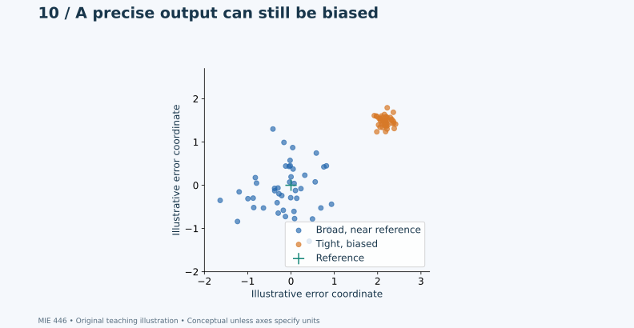

*Figure 10. Seeded synthetic samples illustrating precision and bias. These are not experimental navigation measurements.*

The correct conclusion from the supplied article is that several approaches are being discussed and developed. Its attributed statements alone do not establish interchangeable systems, universal accuracy, immunity to interference or a validated performance envelope. The independent principles in this lesson explain why those distinctions matter.

## 14. Classroom activities and discussion

**Activity A — Separate the jobs.** In teams, describe a museum inspection robot that loses GNSS reception indoors. Identify which tasks involve navigation, guidance, control and communication. Explain which information can remain available and which conclusions would require an external reference. Submit one annotated diagram and a short explanation of assumptions.

**Activity B — Check the bracket model.** Recalculate the laboratory example. Keep material and load fixed and double thickness; then independently double length. Compare the factors affecting stress, tip displacement and tip slope. Explain why changing stiffness cannot be assessed using stress alone. State where the small-deflection cantilever assumptions could fail.

**Activity C — Interpret a plot.** Use Figure 8 to explain the difference between resonance amplification and isolation. Identify which curve has the largest peak. Discuss why a claim that a mount “reduces vibration” is incomplete without a frequency range.

**Activity D — Audit an accuracy statement.** Write a paragraph assessing “our system is accurate to 20 cm.” List the missing definitions and evidence. Do not invent test conditions. Propose what information a civilian measurement report should disclose so that the statement can be evaluated.

**Discussion:** Can two sensors have independent electronics but correlated errors? Can a strong bracket still have inadequate pointing stiffness? Can a precise-looking position output be inaccurate? Which limitations arise from physics, which from environment, and which from missing evidence?

## 15. Reproducibility and figure provenance

This reading contains **13 visual items: ten original SVG teaching figures and three real NASA photographs**. Figure 4 and Figure 8 are analytical plots; Figure 10 is synthetic statistical data; the remaining original figures are conceptual diagrams. None is presented as measured wartime system performance. Photos retain separate credits and source links and were resized without cropping. NASA imagery is used for educational/editorial illustration under its [images and media guidance](https://www.nasa.gov/nasa-brand-center/images-and-media/); no endorsement is implied.

- [Figure-generation source](scripts/build_navigation_figures.py)
- [Laboratory calculations](docs/case-studies/navigation-without-gps/teaching_calculations.py)
- [Calculation output](docs/case-studies/navigation-without-gps/calculations.json)
- [Photo provenance](docs/case-studies/navigation-without-gps/photos/credits.json)
- [Web-edition build script](scripts/build_navigation_reading.py)

The calculations reproduce elementary examples only. They do not estimate a real aircraft's navigation performance. The web edition uses MathJax for equations and needs internet access to load that renderer; all figures and photographs are stored in this repository.

## 16. References and further reading

1. Oleg Chernysh, BBC Persian/BBC Ukrainian, 4 November 2026. [Supplied news report](https://www.bbc.com/persian/articles/cr5y5n8vx90no). Source of the attributed news claims, not an independent technical validation.
2. ESA Navipedia. [GPS](https://gssc.esa.int/navipedia/index.php/GPS) and [GPS Receivers](https://gssc.esa.int/navipedia/index.php/GPS_Receivers). Satellite-navigation terminology and measurement principles.
3. ESA Navipedia. [Accuracy](https://gssc.esa.int/navipedia/index.php/Accuracy) and [Positioning Error](https://gssc.esa.int/navipedia/index.php?title=Positioning_Error). Error definitions, uncertainty and geometry.
4. NASA/JPL. [Keeping Our Sense of Direction: Dealing With a Dead Sensor](https://science.nasa.gov/blog/keeping-our-sense-of-direction-dealing-with-a-dead-sensor/), 2022. Planetary sensor example and Photo 2.
5. NASA/JPL. [What We're Learning About Ingenuity's Flight Control and Aerodynamic Performance](https://science.nasa.gov/blog/what-were-learning-about-ingenuitys-flight-control-and-aerodynamic-performance/), 2021. Environmental limits during flight and Photo 3.
6. NOAA NCEI. [Magnetic Declination, Models, Data and Services](https://www.ngdc.noaa.gov/geomag/maps/) and [Geomagnetic Field Models](https://www.ngdc.noaa.gov/geomag/models.shtml). Field models, navigation uses and spatial/temporal variation.
7. MIT OpenCourseWare, J. Kim Vandiver. [Introduction to Mechanical Vibration, Engineering Dynamics](https://ocw.mit.edu/courses/2-003sc-engineering-dynamics-fall-2011/resources/lecture-19-introduction-to-mechanical-vibration-1/). Introductory SDOF dynamics.
8. NASA/JPL-Caltech. [Bottom of Ingenuity Mars Helicopter, PIA23969](https://science.nasa.gov/photojournal/bottom-of-ingenuity-mars-helicopter/). Instrument identification and Photo 1.
9. NASA. [Images and Media Usage Guidelines](https://www.nasa.gov/nasa-brand-center/images-and-media/). Educational/editorial imagery context.

## خلاصهٔ فارسی

پرواز بدون GPS به معنی داشتن موقعیت دقیق و قابل‌اعتماد در همهٔ شرایط نیست. حسگر اینرسی حرکت را اندازه می‌گیرد، اما خطا پس از انتگرال‌گیری رشد می‌کند. دوربین به نور، بافت صحنه و کیفیت تصویر وابسته است. مرجع رادیویی به زیرساخت و نوع اندازه‌گیری وابسته است؛ دادهٔ مغناطیسی و فشار هم محدودیت‌های محیطی خود را دارند. ترکیب چند حسگر می‌تواند اطلاعات مکمل فراهم کند، ولی خطاهای مشترک را خودبه‌خود حذف نمی‌کند.

ارتباط اصلی با درس سازه‌های هوایی در نصب حسگر است: خمش و ارتعاش پایهٔ دوربین می‌توانند راستای دید را تغییر دهند. کم‌بودن تنش لزوماً به معنی کافی‌بودن سختی یا ثبات زاویه نیست. مثال تیر یک‌سرگیردار و نمودار انتقال ارتعاش این تفاوت را نشان می‌دهند. عکس‌های واقعی اینجنیوتی نیز نمونه‌ای علمی و غیرنظامی از ناوبری بدون GPS هستند. اعداد دقت در خبر، گفته‌های منتسب به سامانه‌های متفاوت‌اند و بدون تعریف خطا و شرایط آزمون نباید با هم مقایسه شوند.
