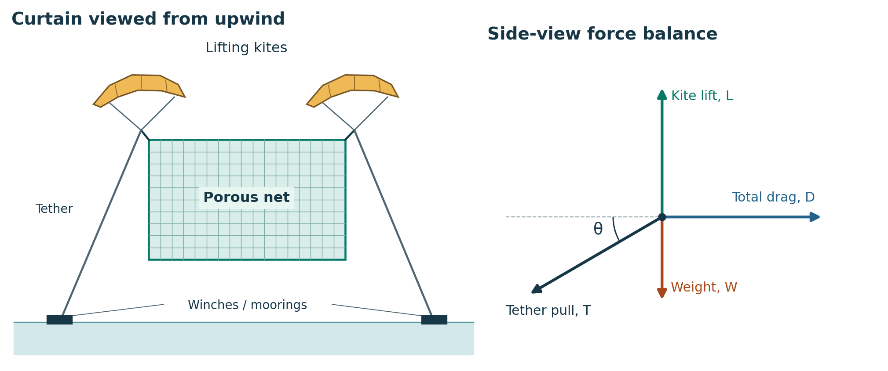
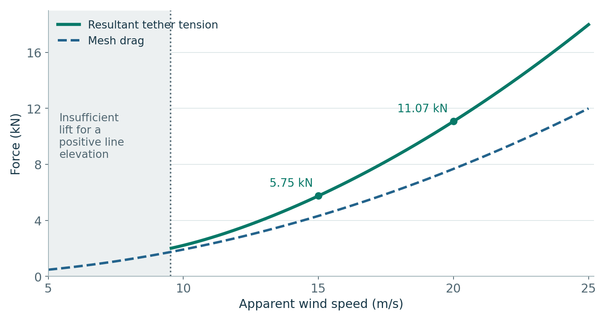
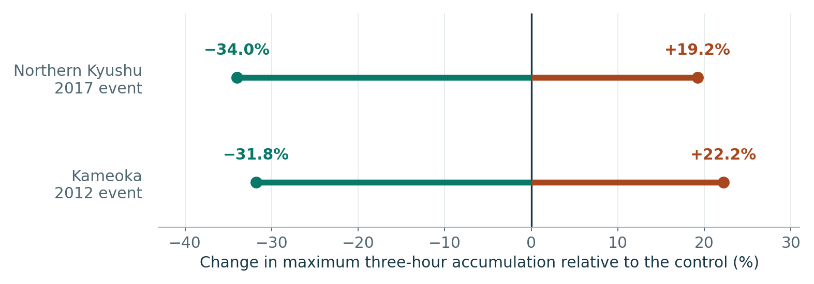

# Can a kite change where heavy rain falls?

**MIE 446 · Aerospace Structures · University of Massachusetts Amherst**  
Japan’s Offshore Curtain project · 19 November 2026

**[Watch the original BBC TechXplore film (2 min 50 s)][bbc]** · [Illustrated lesson and load calculator][web] · [Course readings](READINGS.md)

A yellow inflatable wing flies across the screen. The harder engineering question comes a few seconds later, when the researchers explain what they want it to carry. A mesh curtain suspended offshore would exert drag on humid air moving toward a rainband. The equal and opposite force must travel through fabric, attachment points and tethers to a mooring. Could a curtain that a kite can actually hold create a wake strong enough to change a storm?

## Watch the film

In [*Japan’s using giant kites to change the weather*][bbc], BBC TechXplore presenter Paul Carter follows the Japanese team’s proposal. These three moments connect the footage to the mechanics below.

| Approximate time | What to look for | Question for the viewer |
|---|---|---|
| 0:55–1:05 | The report introduces the Kyoto researcher and shows an airborne kite. | Where does the force opposing the wind come from? |
| 1:29–1:50 | The researchers explain the proposed mesh payload and identify compressed air as part of the kite structure. | Which part produces lift, which part adds drag, and which part maintains the wing’s shape? |
| About 2:24 | The closing discussion describes the limited role envisioned for the intervention. | What field measurement would support a claim about rain falling on a community? |

BBC presents a **20–30% reduction in heavy rain as an aim**. Toyota’s related, earlier flight programme provides a different kind of evidence. In a February 2024 trial at Fukushima Sky Park, its instrumented kite stayed aloft for **12 h 26 min**. Winds occasionally exceeded 30 m/s near 600 m during the day, and the flight ended when the wind subsided. That trial documents the behaviour of the carrier. The rainfall numbers below come from weather models. [BBC film][bbc] · [Toyota flight report, Movies 2–4 and Figs. 6–9][toyota-flight]

## What the studies measured

| Investigation | Quantity and scale | What the result supports |
|---|---|---|
| Toyota Mothership flight tests | An early inflatable prototype had about **7 m²** of wing area. The programme reached **1,000 m above ground in May 2020**. The 2024 endurance trial was a separate flight. | A tethered inflatable carrier can operate aloft. Its wind envelope, attitude control, joints and electrical supply matter. [Toyota materials and flight history][toyota-fabric] |
| Kyoto wind tunnel | **0.25 m × 0.25 m** net specimens. The main comparison used **5.0 m/s**. Researchers measured velocity at multiple downstream positions and also tested inclined nets. | The net creates a measurable wake. Among the nets compared, lower solidity could move the point of minimum mean speed farther downstream. [Wind-tunnel study, Table 1 and Figs. 3–4][tunnel] |
| JST engineering design study | One proposed configuration lists a **102 m span**, **1,500 m²** kite planform, **800 kg** per kite and a **1 km × 1 km** mesh of **10.8 t**. Its preliminary model assumed **99.99% open area**. | These are design-study inputs. Flight and wake measurements at this scale would be needed to connect them to a rainfall prediction. [JST presentation, “Engineering design” slide][design] |
| Kyoto weather simulations | Researchers reconstructed historical rainbands and introduced a parameterized momentum loss upstream. The response changed with placement and event. | The calculations test how a rainband responds to an assumed disturbance. They also identify cases in which the peak rainfall increases. [Northern Kyushu study][kyushu] · [Kameoka study][kameoka] |

## From mesh pressure to the mooring

*Figure 1. The front view shows one possible support arrangement. The side view combines the airborne components into a single free body. Its tension arrow represents the resultant of the ground-line forces. The two drawings have different viewing directions and schematic dimensions.*

The wind loads the strands. Their tensile forces collect at the reinforced edges, corner fittings and bridles. The lifting wings carry the hanging weight and maintain altitude while the tethers transmit the resultant load to the winches and moorings. A line pulls along its local tangent. A slack segment cannot share load until it straightens. A symmetric front view alone gives too little information to divide the total tension equally between physical lines. [Project hardware description][project] · [NASA kite force balance][nasa]

### How much drag does the net add?

Let $U$ be the horizontal apparent wind speed at the hardware and $\rho$ the air density. For a stationary, face-on panel with approximately uniform inflow, define the effective mesh drag coefficient $C_{D,m}$ using the **gross outline area**, $A_m$, including its openings. With dynamic pressure $q$,

$$
q=\tfrac12\rho U^2,\qquad D_m=q C_{D,m} A_m,\qquad \bar p_m=D_m/A_m .
$$

Here $\bar p_m$ is the equivalent mean load per unit outline area. A measured coefficient based on gross area already includes the effect of the openings. Multiplying by the solid fraction a second time would underestimate drag. A coefficient determined using yarn area needs conversion to the chosen reference area. An inclined or billowing net also changes the direction of the load and the area exposed to the wind.

For a flat square mesh with clear opening $a$ and projected yarn width $d$, the open-area fraction is $\phi=[a/(a+d)]^2$ and the solidity is $1-\phi$. For example, $a=5.0$ mm and $d=0.9$ mm give **71.82% open area** and **28.18% solidity**, matching specimen 6 in Kyoto’s table. To infer drag, measure the net force as well as the geometry. Wake measurements downstream reveal how quickly faster surrounding air mixes back in. [Kyoto wind-tunnel study, Eq. 4 and Table 1][tunnel]

A scale check exposes the main design trade-off. Over a square kilometre, even **1 Pa** of mean effective pressure produces **1 MN** of force. The 1 Pa is a unit-load example. The key missing measurement at full scale is the pressure a realizable mesh sustains while giving the desired velocity deficit.

### Global equilibrium and the minimum wind for lift

Let $S_k$ be the total lifting planform, $C_L$ and $C_{D,k}$ the kite coefficients, and $m$ the airborne mass represented at the bridle. Neglect vertical aerodynamic force on the screen, line sag, line drag and acceleration. For horizontal wind,

$$
L=q S_k C_L,\qquad D_k=q S_k C_{D,k},\qquad W=mg .
$$

For a taut, straight equivalent tether making an angle $\theta$ above the horizontal from the anchor to the kite, equilibrium gives

$$
H=D_m+D_k,\qquad V=L-W,\qquad T=\sqrt{H^2+V^2},\qquad \tan\theta=V/H .
$$

The mooring feels a downwind pull $H$ and an upward pull $V$. A positive line elevation requires $L>W$, which gives $U>\sqrt{2mg/(\rho S_k C_L)}$ for constant positive $C_L$. There is a second requirement for steady flight: the aerodynamic, weight and bridle moments must balance. A real wing can pitch, change angle of attack or lose lift even when the force calculation allows an equilibrium. [NASA force balance][nasa] · [NASA kite torque][torque]

**Can the proposed wings lift the mesh mass?** Use two 1,500 m² wings in the published design sketch and count 800 kg per wing plus the 10,800 kg net. Those components weigh **121.6 kN**. As an explicit classroom assumption, take $C_L=0.80$, uniform horizontal wind and $\rho=1.20$ kg/m³. At 10 m/s the two wings produce **144.0 kN** of lift, leaving only **22.4 kN** for all further downward loads. At 8 m/s the same estimate gives **92.2 kN**, below even the stated component weight. For a specified angle the requirement is $L=W+D\tan\theta$; tether weight, line drag and uncounted fittings tighten that budget. The published wing and mesh dimensions make this lower-bound calculation possible. A measured lift curve and full-system test would be needed to establish an actual operating envelope. [JST design sketch][design]

### Worked example: a gust and the anchor load

Use a **classroom system** with $\rho=1.20$ kg/m³, $g=9.81$ m/s², $A_m=100$ m², $S_k=40$ m², $C_{D,m}=0.32$, $C_L=0.90$, $C_{D,k}=0.12$ and $m=200$ kg. Both aerodynamic coefficients for the kite use $S_k$. The assumed coefficients belong only to this example. Each table row is a new quasi-steady equilibrium.

| Wind | Dynamic pressure | Mesh drag | Kite drag | Lift | Horizontal pull | Upward pull | Resultant tension | Line elevation |
|---|---:|---:|---:|---:|---:|---:|---:|---:|
| 15 m/s | 135 Pa | 4.320 kN | 0.648 kN | 4.860 kN | 4.968 kN | 2.898 kN | **5.751 kN** | **30.3°** |
| 20 m/s | 240 Pa | 7.680 kN | 1.152 kN | 8.640 kN | 8.832 kN | 6.678 kN | **11.072 kN** | **37.1°** |

At 15 m/s, $W=1.962$ kN, so the vertical component is $4.860-1.962=2.898$ kN. The 33% rise in speed increases mesh drag by **78%** and total tension by **93%**. Weight stays constant while lift rises, so the line steepens. Below **9.53 m/s** this model has insufficient lift for a positive tether elevation. A sudden gust also excites motion, so the 20 m/s row cannot establish the transient peak.

*Figure 2. The dashed line is the aerodynamic drag of a panel held face-on. Below the lift threshold it still describes a supported panel, while the assumed airborne equilibrium is unavailable.*

[Explore wind speed and mesh drag in the load calculator][calculator].

## Fabric, edge cables and transient loads

**The inflatable wing.** Toyota describes a gas-holding inner membrane and a textile outer structure. Internal pressure puts the fabric in tension, helping the tube keep the section that gives the wing its aerodynamic shape. For a closed, straight cylindrical segment of radius $r$ at gauge pressure $p_i$, an axial cut gives the hoop membrane force per unit length $N_\theta=p_i r$. A cut across the tube gives the axial membrane force $N_z=p_i r/2$. At an illustrative $p_i=30$ kPa and $r=0.15$ m, the resultants are **4.50 kN/m around the tube** and **2.25 kN/m along it**. Stitching transfers these loads across seams. Toyota documented yarn movement at stitched joints during early trials. Bending, local wrinkles and seam direction require separate checks. [Toyota fabric development][toyota-fabric] · [Thin-wall equilibrium, Purdue][pressure]

**The edge cable.** Consider a 10 m span with supports level in the plane of loading. Suppose it carries the pressure from a 2 m tributary strip of net. At 15 m/s the equivalent pressure from the worked example is 43.2 Pa, giving a transverse load $w=86.4$ N per metre of projected span. Let $f$ be sag in the direction of the applied load. Equilibrium of a flexible cable under uniform load per projected length gives

$$
H_e=\frac{w\ell^2}{8f},\qquad R_e=\frac{w\ell}{2},\qquad
T_e=\sqrt{H_e^2+R_e^2}.
$$

With $f=0.50$ m, the chordwise component is **2.160 kN**, the transverse component at each end is **0.432 kN**, and the attachment tension is **2.203 kN**. Halving sag to 0.25 m doubles $H_e$ and raises the end tension to **4.342 kN** under the same net pressure. Tying the panel flatter has a measurable cost for its fittings. These are internal load-path forces. They are already accounted for when the entire assembly is isolated as a free body. [Parabolic cable derivation][cables]

**A gust, a lull and a moving anchor.** The real tether carries distributed weight and aerodynamic drag, so its end tangents and tensions can differ. Its elastic extension is approximately $\Delta\ell=\int T(s)/(EA)\,ds$, where $EA$ is measured axial stiffness. A lull can let a branch slacken, and a subsequent gust can retension it rapidly. A vessel’s heave changes the boundary motion as well. A useful next model couples tension-only line elements, a deforming net, wing attitude and winch motion. Synchronized measurements of tether tension, wind, line angle and net shape would distinguish a quasi-steady load increase from a short retensioning peak. [NASA control-line sag][sag] · [Toyota flight instrumentation][toyota-flight]

## From a wake to a rainband

The mesh allows humid air to pass through its openings and around its edges. It transfers momentum to the structure, changes local wind speed and can redirect flow. Define a **fixed vertical sampling area** $\mathcal A$ with landward normal $\mathbf n$. Its landward vapour transport is

$$
\dot m_v=\int_{\mathcal A}\rho\,q_v\,(\mathbf u\cdot\mathbf n)\,dA ,
$$

where $q_v$ is specific humidity in kg of vapour per kg of moist air. For a uniform 100 m² patch with $\rho=1.20$ kg/m³ and $q_v=0.014$, a decrease in normal speed from 10 to 8 m/s lowers the flux from **16.80 to 13.44 kg/s**. The 3.36 kg/s difference is a local transport change. Air can bypass that sampling patch, and the vapour remains in the atmospheric water budget.

A **back-building rainband** repeatedly forms new convective cells on its upstream side. A change in the location or timing of low-level convergence can change which ground locations receive repeated showers. For a whole atmospheric volume, change in stored water depends on all inflows and outflows, surface evaporation and precipitation. Determining rainfall therefore requires physics for vertical motion, condensation and the transport and fallout of hydrometeors, as well as the inflow change. [Kyushu model, Figs. 3-3 and 5-1 to 5-4][kyushu] · [Kameoka model][kameoka]

**How can a weather grid represent a net smaller than its cells?** A class model can apply an opposing force per unit volume in a cell of volume $V_c$. For a planar screen of outline area $A_m$ with unit normal $\mathbf n$ and incident normal speed $u_n$, one possible approximation is

$$
\mathbf s_m=-\frac{\rho}{2}\, C_{D,m}\,\frac{A_m}{V_c}\,|u_n|u_n\,\mathbf n .
$$

The units are N/m³. Integrating this source over the cell gives the drag on the air, equal and opposite to the mesh load in face-on flow. For a screen spread over cells, assign each cell its share of area to conserve total force. The approximation still needs a velocity convention and calibration against an inclined, deformable screen. Kyoto’s original weather study used a resistance model developed for wind-turbine wakes. The subsequent wind-tunnel paper identifies net inclination and the spatial distribution of the wake as reasons to improve that representation. [Kyushu model][kyushu] · [Wind-tunnel study, §1.1][tunnel]

### What does a 30% reduction mean?

Use the spatial maximum of accumulated rain over the study region during a specified three-hour interval. Compute the percentage difference from the control run as $100(P_{\mathrm{curtain}}-P_{\mathrm{control}})/P_{\mathrm{control}}$. A negative value means that **the regional peak accumulation was lower**. The peak can move between grid cells.

| Modelled historical event | Control peak | Lower peak in the trials | Reported range as placement varied |
|---|---:|---:|---:|
| Northern Kyushu, July 2017 | 115.2 mm | 76.0 mm | **−34.0% to +19.2%**. The upper endpoint was 137.3 mm. [Study, §5 and Fig. 5-2][kyushu] |
| Kameoka, 2012 | 190.9 mm | 130.3 mm | **−31.8% to +22.2%**. The study also examined intervention timing. [Study, Figs. 2–5][kameoka] |

*Figure 3. Endpoints of the published placement experiments. The lines show the span between tested outcomes. The studies give these endpoints without assigning probabilities to them.*

For the Kyushu case, $(76.0-115.2)/115.2=-0.340$ to three significant figures. Reporting only that favourable case would hide both a **possible increase** and a difference between the meteorological metric and the public concern. A basin can still flood if a shifted rain core falls over a vulnerable tributary. Evaluating exposure requires the rain maps, catchment response and uncertainty across forecast members. [Kyushu study][kyushu] · [JST research programme][jst]

## What experiment would connect these scales?

| Question | Measurement or comparison | Decision the evidence could support |
|---|---|---|
| Can the hardware reproduce the resistance assumed by the weather model? | Measure screen-normal force, shape and wake velocity simultaneously for several incidences and solidities. Report the reference area, turbulence, yarn Reynolds number and tunnel blockage. | Calibrate a momentum-loss model against both force and wake recovery. A single centreline reading cannot determine total drag. |
| Will a suspended net retain that wake in changing winds? | Combine synchronized upwind/downwind wind profiles with net shape, angle, tether tension and mooring motion. Compare with matched periods without the screen. | Determine whether the required resistance and the available structural and lift margins coexist. |
| Does a reduction in the targeted peak benefit the surrounding catchments? | Compare ensembles with and without the intervention under matched initial conditions. Track peak and basin-mean accumulation, timing, neighbouring basins and runoff. | Estimate how often a reduction at one site accompanies an increase elsewhere. Field evaluation also needs an independently justified comparison for what the weather would have done without intervention. |

## Classroom exercises

1. **Infer a coefficient.** A load cell measuring only a face-on, 100 m² screen reads 3.00 kN at 15 m/s in air of density 1.20 kg/m³. Find the gross-area $C_{D,m}$. Explain which additional forces you would have to subtract if you used an anchor load cell instead.
2. **Trade drag for altitude margin.** At 15 m/s, halve the example mesh coefficient to 0.16, keeping projected area, weight and kite coefficients fixed. Predict which way the tether angle moves before computing the new tension. Would this change alone justify a claim about rainfall?
3. **Inspect a load path.** A fitting can carry 3.00 kN in the idealized edge-cable problem. Solve for the minimum sag consistent with that limit under the stated uniform load. Identify a measurement needed before applying the result to a fabric assembly.
4. **Interpret a displaced peak.** Sketch two catchments and a rain core moving from one to the other. Construct an example in which the regional maximum decreases but the second catchment receives more rain. Name two additional metrics you would show a flood manager.

**Numerical checks.** (1) $C_{D,m}=0.222$. (2) $H=2.808$ kN, $V=2.898$ kN, $T=4.035$ kN and $\theta=45.9^\circ$. (3) $H_{e,\max}=\sqrt{3000^2-432^2}$ N and $f_{\min}\approx0.364$ m. The prescribed load, allowable fitting load and load sharing would all need experimental support.

## خلاصهٔ فارسی

ویدئوی BBC طرح دانشگاه کیوتو و تویوتا را نشان می‌دهد. بادبادک با نیروی برآ یک پردهٔ توری را در هوا نگه می‌دارد. نیروی پسا از تارهای توری به کابل‌های لبه، سپس به طناب‌های مهار و تکیه‌گاه منتقل می‌شود. هدف این است که تغییر سرعت و مسیر هوای مرطوبِ ورودی، محل یا شدت بارش سنگین را تغییر دهد. در مثال آموزشی، افزایش باد از ۱۵ به ۲۰ متر بر ثانیه کشش معادل مهار را از ۵٫۷۵ به ۱۱٫۰۷ کیلونیوتن می‌رساند.

عدد ۲۰ تا ۳۰ درصد در ویدئو هدف پروژه است. در بازسازی عددی رخداد کیوشو، بیشینهٔ بارش انباشتهٔ سه‌ساعته در محدودهٔ بررسی، بسته به جای پرده، از ۳۴٫۰ درصد کاهش تا ۱۹٫۲ درصد افزایش تغییر کرد. برای ارزیابی طرح باید هم بار وارد بر مهار و هم تغییر بارش در حوضه‌های همسایه اندازه‌گیری شود. [فیلم اصلی BBC][bbc] · [مقالهٔ کیوتو][kyushu]

## Sources and films

- BBC TechXplore, Paul Carter, 18 November 2026. [Original BBC Reel, 2:50][bbc] · [BBC’s syndicated listing][syndicated].
- Kyoto University and Toyota Frontier Research Center. [Shizumeru Task 1-4, system architecture and feasibility objective][project].
- K. Yamaguchi, S. Nishimura and E. Nakakita (2024). [Weather Modification Simulation of Line-Shaped Convective System Torrential Rainfall by Introducing Offshore Curtain][kyushu]. *DPRI Annuals*, 67 B, 156–167.
- K. Yamaguchi, K. Suzuki, K. Nishijima and E. Nakakita (2025). [Wind Tunnel Experiment of the Wind Velocity Field behind a Square Net][tunnel]. *DPRI Annuals*, 68 B, 206–212.
- S. Nishimura, K. Yamaguchi and E. Nakakita. [Placement Design of Offshore Curtain for Controlling Heavy Rainfall from Line Shaped Convective System][kameoka]. Kyoto DPRI research presentation B304, 2026.
- Japan Science and Technology Agency. [2025 symposium slides, including the engineering design study][design] · [Moonshot Goal 8 progress report, July 2026][jst].
- Toyota Frontier Research Center. [Inflatable construction, seams and early altitude trial][toyota-fabric] · [Fukushima endurance flight, instrumentation and original footage][toyota-flight].
- NASA Glenn Research Center. [Forces on a kite][nasa] · [Moments about the bridle][torque] · [Distributed line weight and sag][sag].
- Purdue University and Engineering LibreTexts. [Thin cylindrical pressure vessels][pressure] · [Cable equilibrium under distributed load][cables].

Figures 1 and 2 are original teaching illustrations. Figure 3 plots the reported numerical endpoints from the two Kyoto studies. The BBC and Toyota host their respective films.

[bbc]: https://www.bbc.com/reel/video/p0pkcgx1/watch
[web]: https://ehsan-roohi.github.io/Aerospace-Structures/case-studies/offshore-curtain/
[calculator]: https://ehsan-roohi.github.io/Aerospace-Structures/case-studies/offshore-curtain/#load-calculator
[syndicated]: https://www.yahoo.com/news/videos/japans-using-giant-kites-change-100000820.html
[project]: https://rain-c.dpri.kyoto-u.ac.jp/en/list/1-4/
[kyushu]: https://www.dpri.kyoto-u.ac.jp/nenpo/no67/ronbunB/a67b0p14.pdf
[tunnel]: https://www.dpri.kyoto-u.ac.jp/nenpo/no68/ronbunB/a68b0p23.pdf
[kameoka]: https://www.dpri.kyoto-u.ac.jp/hapyo/26/pdf/B304.pdf
[design]: https://www.jst.go.jp/moonshot/sympo/20251030/pdf/22_yamaguchi.pdf
[jst]: https://www.jst.go.jp/moonshot/en/program/goal8/appeal/83_yamaguchi_ap01.html
[toyota-fabric]: https://www.toyota-global.com/innovation/partner_robot/news/202201_01.html
[toyota-flight]: https://global.toyota/en/mobility/frontier-research/41355237.html
[nasa]: https://www1.grc.nasa.gov/beginners-guide-to-aeronautics/four-forces-on-a-kite/
[torque]: https://www.grc.nasa.gov/www/k-12/airplane/kitetor.html
[sag]: https://www.grc.nasa.gov/www/k-12/airplane/kitesag.html
[pressure]: https://www.purdue.edu/freeform/me323/wp-content/uploads/sites/2/2019/11/Lecture30_annotated.pdf
[cables]: https://eng.libretexts.org/Bookshelves/Mechanical_Engineering/Introduction_to_Aerospace_Structures_and_Materials_%28Alderliesten%29/02%3A_Analysis_of_Statically_Determinate_Structures/06%3A_Arches_and_Cables/6.02%3A_Cables
