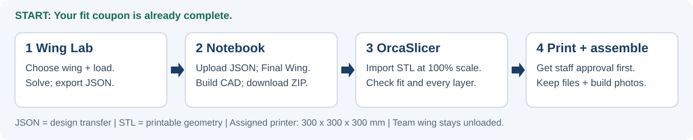
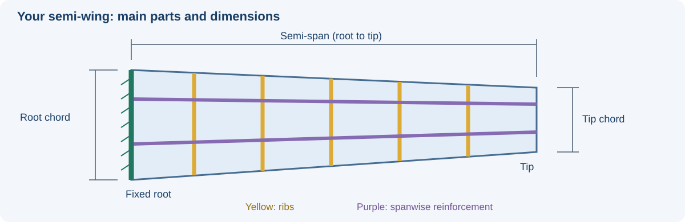

# Wing Project: Design Your Wing and Build It

MIE 446 Aerospace Structures | Project guide

**Wing Lab: design, analyze and download STL → OrcaSlicer: prepare the print → Print and assemble.**

## 1. Wing Lab: design, analyze and download STL
Open [Wing Lab](https://ehsan-roohi.github.io/Aerospace-Structures/wing-lab.html#wing) and name your project with your team and revision. Follow the controls in this order.

**Airfoils & planform.** For a simple starting geometry, use NACA 2412 at the root and NACA 0012 at the tip (root eta = 0, tip eta = 1), taper ratio 0.7 (tip chord = 0.7 × root chord), zero sweep, zero dihedral, and zero incidence. Wing span can vary between 350 and 600 mm. These are suggested starting choices. You can change them if you want. 

**Structure dimensions and Materials.** Set the skin thickness between 1 and 2 mm, choose your ribs and use the same material for the spar and the rest of the wing. Prepare three layouts, keeping all other inputs unchanged:

- No spar.
- One full-span bonded spar at 25% chord.
- The same spar at 40% chord.

Our printer is **300 x 300 x 300 mm**. Choose 1 piece only if the actual CAD fits, or split the wing into 2 or 3 modules. Keep the final plastic mass at or below **300 g**.

**A semi-wing is sufficient; using Full wing · mirror is optional.**

**Load.** Apply an upward distributed lift of **5 N total** at **x/c = 0.25** and enable **Include wing self-weight**. With the aircraft-mass option, use **1 kg** and **n = 1**, giving **4.905 N per semi-wing** (approximately 5 N in steady, level cruise). Use the same load for all three layouts and record the software's semi-wing mass and downward weight. Wing Lab does not automatically calculate lift from the chosen airfoils.

**Solve and compare.** Check the fixed root support, then press **Solve** for each layout. Review warnings and record mass, tip displacement, tip twist and maximum nominal stress. Briefly justify your choice and build only the selected design after the CAD and print checks. These loads are for computer analysis only; keep the printed wing unloaded.

*Illustration only. Choose your own dimensions and internal layout in Wing Lab.*

**Download STL.** Solve the final design, then click **Download STL** in Wing Lab. The app builds the **undeformed** skin, ribs, integral spars and any rod sleeves/holes, then checks the mesh, printed-plastic mass and printer envelope.

- **1 printed module:** download one `.stl` file.
- **2 or 3 printed modules:** download the ZIP and extract the module STL files before slicing.

If a check fails, correct the stated dimensions, thickness or interface; no automatic scaling is applied.

## 2. OrcaSlicer: prepare the print

If you downloaded a ZIP, extract a working copy. In **OrcaSlicer**, import the STL for every module. Use the assigned **Creality K2 Pro, 0.4 mm nozzle and staff-approved PLA Pro profile**. Check millimetres, **100% scale**, orientation, actual dimensions, space for supports/brim, every layer, mass and print time.

## 3. Print, assemble and document

Obtain staff approval before printing. Use the assigned printer procedure and supervise the first layers. Keep the team wing unloaded: it is a non-flying fabrication model, not an airworthy structure.

Save the STL file(s), short design/comparison report, slicer project and photographs of the finished parts/assembly. Label them with the same team and revision. Measure semi-span, root/tip chord and actual mass; record the fit of any rods/module joints.

**Your result: your own designed and printed semi-wing, with the files needed to reproduce it.** Please submit a short PDF report with images from Wing-Lab and photos of the fabricated wing.
In your report, include a short **Design basis**: why you chose this wing, the load magnitude/direction/distribution and chord position, your displacement target, and whether the result meets it. Include a screenshot of the load and result. Give force in N and line-load intensity in N/mm.
