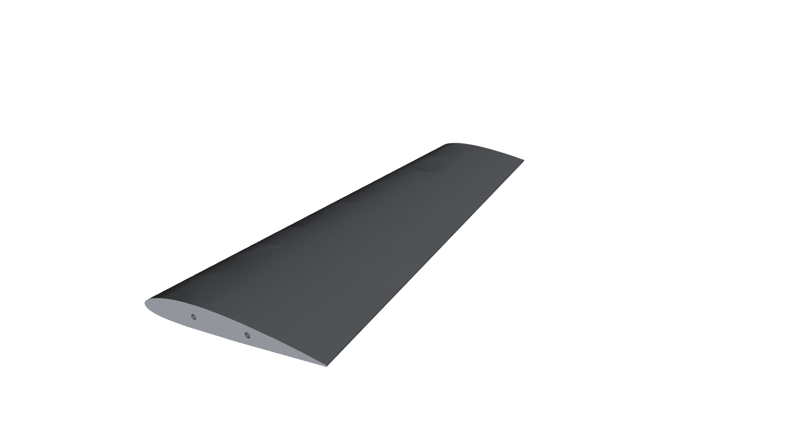

# MIE 446 · Aerospace Structures

**University of Massachusetts Amherst · Fall 2026** 
Tuesday & Thursday · 11:30 a.m.–12:45 p.m. · ELAB 323 
Dr. Ehsan Roohi Golkhatmi · Gunness Laboratory, Room 1 · [roohie@umass.edu](mailto:roohie@umass.edu)

This is the classroom home for released MIE 446 learning materials. Start with the syllabus and numbered lecture notebooks; use the software for worked studies, then find assignments and supplementary readings below.

## Software tools used in class

**Wing versions:** [Wing v1.3 · current workspace](https://ehsan-roohi.github.io/Aerospace-Structures/wing-lab.html#wing) · [Wing v1 · preserved course interface](https://ehsan-roohi.github.io/Aerospace-Structures/wing-lab-v1.html#wing). The current workspace downloads STL directly; no notebook is required for the wing project. The [Code-to-Print notebook](https://colab.research.google.com/github/Ehsan-Roohi/Aerospace-Structures/blob/main/notebooks/MIE446_Code_to_Print_Wing.ipynb) remains an optional CAD/coupon route and reads legacy and expanded study JSON.

1. **[Software 1 · Beam, Truss and Wing v1.3](https://ehsan-roohi.github.io/Aerospace-Structures/wing-lab.html)** — start with cantilever, fixed–fixed and simply supported beams; then compare skin-only, reinforced, ribbed and modular wings. Apply point or distributed loads and explore reactions, stress, deflection and modes. No installation; internet access is required for the wing's 3-D graphics library. [Learning pathway and model limits](computational/printed-wing-solver/README.md#progressive-learning-pathway).

2. **[Software 2 · Dewoitine D.520 — French aircraft wing](https://ehsan-roohi.github.io/Aerospace-Structures/wing-lab.html#d520)** — the scanned 1940 manual of the French fighter, translated and rebuilt as a [3-D model you can explore](https://ehsan-roohi.github.io/Aerospace-Structures/d520/), with SolidWorks/ANSYS CAD, a shell finite-element stress analysis and a **[full-scale metal-wing mode in Wing Lab](https://ehsan-roohi.github.io/Aerospace-Structures/wing-lab.html#d520)**: lifting-line loads, two-cell thin-walled sections, shear centre, tapered spar, skin buckling and post-buckling collapse, checked against the shell model.

## Course information

- **[Syllabus](SYLLABUS.md)** — course requirements and assessment.
- Use the current [online syllabus](SYLLABUS.md); Canvas carries authoritative deadlines and announcements.
- **[Lecture topics](SYLLABUS.md#lecture-topics)**

## Lecture notebooks

| Lecture | What we study | Open and run |
|---|---|---|
| **01 · Aircraft forces and airfoils** | Flight-path equilibrium, CG/trim/static margin, airfoil/NACA geometry and wing/empennage load paths; Lilienthal tail and tip controls; modern UAV photo atlas (MQ-9, X-48B, X-36, X-47B), MAGMA blown-air control and interactive elevon mixing · Multi-session lecture |  |
| **02 · Finite wings and load paths** | Span, chord, taper, aspect ratio, sweep, dihedral, induced drag, distributed loads and root reactions · 75 min |  |
| **03 · Beam reactions, stress, strain and deflection** | Physical beam and separate free-body diagram; reactions for cantilever, pin–roller and fixed–fixed beams; normal/shear stress, strain, section properties and deflection · 90 min | [Open Lecture 03 in Colab](https://colab.research.google.com/github/Ehsan-Roohi/Aerospace-Structures/blob/main/notebooks/MIE446_Lecture_03_Beam_Reactions_Stress_and_Deflection.ipynb) |
| **04 · Mohr’s circle, virtual work and unit loads** | Stress transformation; unit force versus unit couple; solve the Lecture 03 fixed–fixed beam by compatibility; compare flexibility, direct stiffness and Beam Virtual Lab · 90 min · [Reading view](https://ehsan-roohi.github.io/Aerospace-Structures/lecture04-virtual-work.html) | [Open Lecture 04 in Colab](https://colab.research.google.com/github/Ehsan-Roohi/Aerospace-Structures/blob/main/notebooks/MIE446_Lecture_04_Mohr_Circle_Virtual_Work_and_Unit_Load.ipynb) |
| **Independent lecture · Wing structure, buckling, materials and flutter** | Spars, ribs, stringers and skins; clear displacement views; Wright wings; Horikoshi's 7-Shi, 9-Shi and Zero; built-up/extruded spars, duralumin and aeroelastic energy. Historical photographs, original schematics and short numerical activities. |  |
| **Numerical wing structural design** | Two teaching sessions + design studio: theory, schematics, signed load cases, bending/shear/torsion, cap buckling, whole-span fit, independent beam FEM, Pareto search, uncertainty and downloadable CAD/report data. No lab or Excel required. |  |
| **Printed-wing structural solver** | Analyse your team's as-printed semi-wing: exact shell/sleeve/rod section, 2-D FE torsion and shear centre, lift or tip-force loads, V–M–T, deflection, twist, skin buckling, rod and seam checks, natural frequencies and assembly comparison. [Launch Wing Lab 3-D app](https://ehsan-roohi.github.io/Aerospace-Structures/wing-lab.html) (runs directly in your browser) · [SolidWorks cross-check guide](SOLIDWORKS_SIMULATION_GUIDE.md) |  |

**Wing project — [design in Wing Lab and download STL directly](PROJECT.md).** Save the editable JSON, Solve, then click **Download STL**. One module gives an STL; multiple modules give a ZIP with the STLs and print record. Import the geometry in OrcaSlicer in millimetres at 100% scale. The app checks watertightness, connected material, a **300 × 300 × 300 mm** envelope and **300 g** printed-plastic limit; staff approval and slicer-layer inspection remain required.

The [Code-to-Print notebook](https://colab.research.google.com/github/Ehsan-Roohi/Aerospace-Structures/blob/main/notebooks/MIE446_Code_to_Print_Wing.ipynb) is optional. Numerical beam-mesh resolution does not change printable geometry. Expanded structural results are a spatial beam approximation, not shell/solid FEA or an aerodynamic lift prediction.

The expanded Wing workspace uses a six-DOF spatial beam for nonzero sweep, dihedral and incidence, not a 3-D solid or aerodynamic solver. Read the [model scope and reproducible validation checks](computational/printed-wing-solver/web/SPATIAL_BEAM_VALIDATION.md) before interpreting a new design. Beam and Truss also provide **Open JSON / Save JSON** for editable working studies, including valid unfinished drafts.

The browser study is an analysis input record, not an STL or a printing approval. Printer-envelope, mass, connected-solid, coupon (when rods exist), and slicer checks still apply. Loads, material cards, joint assumptions and a source SHA-256 are retained in `wing_lab_transfer.json` inside the final package; they do not become printer settings. CAD and beam discretisations differ, so compare the CAD mass and inventory and inspect every slicer layer. Module joints must be assembled consistently with the analysed assumptions.

Lectures 01, 02, 03 and 04 and the independent wing-structure lecture are released. Later lecture notebooks will appear here when ready; the [syllabus schedule](SYLLABUS.md#lecture-topics) describes the full semester, not a list of already-published notebooks.

### Your classroom workflow

1. Click **Open in Colab** and choose **File → Save a copy in Drive**.
2. Run the setup cell, then proceed from top to bottom.
3. Record a prediction **before** revealing the result. Change the marked inputs and rerun the affected cells.
4. Explain the result using **Claim — Evidence — Check — Confidence — Limitation**.
5. Keep your own notebook; submit only through the assigned Canvas link.

[Notebook index and troubleshooting](notebooks/README.md)

## Homework and wing design / fabrication

- **[All homework and submission information](ASSIGNMENTS.md)**
- **[Homework 1 — questions (PDF)](assignments/homework-01/MIE446_HW1_Surface_Pressure.pdf)**
- **[Homework 1 — data (Excel)](assignments/homework-01/MIE446_HW1_NACA2412_Data.xlsx)**

**Homework 1 solutions are available:** [download the solution (Word)](https://raw.githubusercontent.com/Ehsan-Roohi/Aerospace-Structures/main/assignments/homework-01/solutions/MIE446_HW1_solution.docx) · [download the solution workbook (Excel)](https://raw.githubusercontent.com/Ehsan-Roohi/Aerospace-Structures/main/assignments/homework-01/solutions/MIE446_HW1_NACA2412_Data.xlsx) · [solution overview](assignments/homework-01/README.md#released-solutions).

**Homework 2 is split into two submissions — do not complete all five parts for HW 2A.**

- **HW 2A: Parts 1 and 3 only · 35 points · due October 20, 2026.** [Guide (PDF)](assignments/homework-02/HW2A/MIE446_HW2A_Evidence_and_Moment_Geometry.pdf) · [Student ZIP](assignments/homework-02/MIE446_HW2A_Student_Pack.zip).
- **HW 3: Three beams under distributed loads · 65 points · due November 5, 2026.** [Instructions](assignments/homework-03/README.md) · [PDF](assignments/homework-03/MIE446_HW3_Three_Beams.pdf) · [Word](assignments/homework-03/MIE446_HW3_Three_Beams.docx) · [Student notebook](notebooks/MIE446_HW3_Three_Beams.ipynb) · [Student ZIP](assignments/homework-03/MIE446_HW3_Student_Pack.zip).

[All homework instructions](ASSIGNMENTS.md). Use Canvas for exact submission times.

## Wing project — design, download STL, then print

**[Open the project instructions](PROJECT.md)** · **[Open Wing Lab](https://ehsan-roohi.github.io/Aerospace-Structures/wing-lab.html#wing)**

| Stage | Resource | Team output |
|---|---|---|
| **1 · Design and compare** | Wing Lab · [project guide](PROJECT.md#1-design-and-analyze-your-wing) | Save the editable JSON and a short design basis; compare the three layouts under the same lift and self-weight. |
| **2 · Create print files** | Wing Lab → **Download STL** | One-piece STL, or module-STL ZIP; save the print record. Confirm the physical fit-coupon record if using external rods. |
| **3 · Slice and obtain approval** | [OrcaSlicer guide](PRINTING.md) | Import in millimetres at 100% scale; review supports/brim, every layer, mass and time with staff. |
| **4 · Print and document** | Assigned supervised printer slot | Print and assemble the unloaded model; retain the slicer project, measurements and photographs. |

Bring the STL files, slicer project and any rod-fit record to the laboratory. **Wing Lab creates geometry; OrcaSlicer creates printer-specific G-code.** The [coupon/CAD notebook](https://colab.research.google.com/github/Ehsan-Roohi/Aerospace-Structures/blob/main/notebooks/MIE446_Code_to_Print_Wing.ipynb) remains available as an optional tool.

Earlier preparation schedule and printable planning sheets

#### Assigned teams and October build

Three-person teams are already assigned. **Three meetings remain before the October 13 build: October 1, 6 and 8.** Finish Lecture 1 and the seven-rib R01 layout on October 1; use October 6 for geometry/load checks and coupon evidence; complete R02 and slicer review on October 8. See the [three-meeting teaching plan](SYLLABUS.md#class-plan-before-october-fabrication) and [project milestones](SYLLABUS.md#5-project-workflow-and-deliverables). Physical coupon printing/testing requires an earlier authorized appointment; if the first printer access is October 13, start with the coupon, not final wing modules. Canvas assigns supervised ELab slots.

#### September 29 wing-design packet

Use the fillable worksheet and fit/release record below, retaining a copy for your team. **Their original timing is superseded by the October 1/6/8 plan above.** On R01, mark all seven baseline ribs using the updated [project explanation](PROJECT.md). The September 29 instructor guide is retained as a previous lesson plan, not the current timetable. Canvas remains authoritative for submissions and supervised appointments.

- [Team Wing Layout — R01 (student worksheet)](docs/course-packets/2026-09-29/MIE446_Team_Wing_Layout_R01.pdf)
- [September 29 Wing Lecture Guide (instructor)](docs/course-packets/2026-09-29/MIE446_September_29_Instructor_Guide.pdf)
- [Coupon Fit and R02 Release Record (team and staff form)](docs/course-packets/2026-09-29/MIE446_Coupon_Fit_and_R02_Release_Record.pdf)

Teams of three design and analyze a semi-wing in Wing Lab, download printable STL directly, confirm any rod-fit coupon, build approved modules and document the assembled result. Students may use AI for code assistance, but must understand and independently verify the work.

Every team then performs an **unloaded, non-contact dimensional inspection** with a shared **Seeed Studio reComputer Super J3011 (NVIDIA Jetson Orin Nano 8GB)** and USB camera station. In a separate instructor-led activity, teams analyze force–deflection, vibration and crack evidence collected before and after controlled damage to a sacrificial wing-box specimen.

**Student-built wings are not loaded, cracked, flown or tested to failure.** Assessment focuses on reproducibility, geometry, calibrated inspection, diagnostic reasoning, uncertainty, fabrication evidence, revision and individual understanding.

[Optional legacy CAD/coupon notebook](https://colab.research.google.com/github/Ehsan-Roohi/Aerospace-Structures/blob/main/notebooks/MIE446_Code_to_Print_Wing.ipynb)

#### Project resources

- **[Project guide and code documentation](PROJECT.md)**
- **[Printed-wing structural solver](notebooks/MIE446_Printed_Wing_Structural_Solver.ipynb)**
- **[SolidWorks cross-check](SOLIDWORKS_SIMULATION_GUIDE.md)**
- **[Project rubric](SYLLABUS.md#4-project-brief--code-to-print-wing--fabrication-machine-vision-inspection-and-damage-diagnostics)**
- **[OrcaSlicer and USB guide](PRINTING.md)** — [Word download](docs/OrcaSlicer_Offline_USB_3D_Printing_Guide.docx) or [PDF download](docs/OrcaSlicer_Offline_USB_3D_Printing_Guide.pdf).
- **[AI-use log template](AI_USE_LOG_TEMPLATE.md)**

#### Download the printing examples

Use these files to practice the STL-to-G-code workflow and to inspect a successful reference output:

- **[Download the sample STL](https://raw.githubusercontent.com/Ehsan-Roohi/Aerospace-Structures/main/docs/printing/examples/reference-glider-model.stl)**
- **[Download the matching reference G-code](https://raw.githubusercontent.com/Ehsan-Roohi/Aerospace-Structures/main/docs/printing/examples/reference-k2pro-orcaslicer.gcode)**

The G-code is provided for inspection only. Do not send it directly to a printer; import the STL into OrcaSlicer and generate new G-code using the validated profile for the exact printer, nozzle and material.

## Engineering readings and case studies

**[Boeing 737-800 Split Scimitar Winglets: aerodynamics, structures and aeroelasticity](SPLIT_SCIMITAR_WINGLETS.md)** — a detailed case study based on the supplied workshop video: induced drag, nonplanar loading, wing-root moments, thin-walled torsion, fastener groups, reinforcement and mass, flutter, fatigue and an FAA integration example. Includes the [25-second video](docs/case-studies/split-scimitar/linkedin-video.mp4), six real photographs/video frames, reproducible Python calculations, a claim-by-claim fuel-saving audit and 14 linked references.

**[Fermat’s Last Theorem: from integer triangles to modularity and machine-checked proof](FERMATS_LAST_THEOREM.md)** — extended mathematical enrichment reading: a complete exponent-four descent proof, Frey curves, modular forms, the Wiles–Taylor–Wiles argument, a sourced assessment of the 2026 Lean formalization, and reproducible Python activities linking exact arithmetic with structural model verification. Includes exercises, a glossary and primary references; optional reading, not a syllabus change.

**[Speed Tape and Aircraft Repairs](SPEED_TAPE_AND_AIRCRAFT_REPAIRS.md)** — [complete illustrated reading](https://ehsan-roohi.github.io/Aerospace-Structures/case-studies/speed-tape/): foil/adhesive construction, peel versus shear, aerodynamic loads, thermal mismatch, a documented rejected repair proposal, claim checks and classroom calculations. Explains why a surface cover is not a structural joint and catalogue data are not aircraft repair authorization.

### Wright flight controls and structural flexibility

[Open the illustrated Wright and Langley reading](WRIGHT_FLIGHT_CONTROLS.md): homes and bicycle shops, Chanute's biography and gliders, Langley's successful 1896 unpiloted flights, controls and structural failures, clearly qualified funding charts, later Flyers, and four real historical factory-interior photographs. Includes the free 286-page NPS factory report with a reading guide, classroom calculations and the NPS replica demonstration video.

**[Gliding, unpowered landing and structural loads](GLIDING_AND_UNPOWERED_LANDING.md)** includes the English translation of the supplied Zoomit article, eight original engineering diagrams and five real photographs: the Air Transat A330, the Hudson A320, glider airbrakes, a cockpit and a glider landing. It explains glide energy, performance, practical landing equipment and documented aircraft examples. An expanded structures section follows landing-gear and water-impact load paths, derives a transparent impact-energy example and distinguishes occupant survival from an undamaged airframe.

**[Dewoitine D.520: from a 1940 manual to a stressed wing](computational/d520-wing/README.md)** reconstructs a complete fighter from its scanned maintenance manual (168 pages, every number traced to a page), exports CAD for SolidWorks and ANSYS, analyses the stressed-skin wing with a 41 066-element shell model ([report](computational/d520-wing/stress/REPORT.md)) and repeats the analysis in the browser with Wing Lab's full-scale metal-wing mode.

**[Aircraft windows and the Comet fatigue failures](COMET_WINDOWS_AND_FATIGUE.md)** explains cabin-pressure load paths, rounded corners, fastener-hole crack origins and the two 1954 accidents. Includes two licensed historical images, seven original teaching diagrams, documented 296.5–315.1 MPa local stress estimates, a reproducible analytical stress-map example and modern damage-tolerance lessons.

**[Why did early Boeing 747s carry uranium counterweights?](BOEING_747_MASS_BALANCE.md)** distinguishes whole-aircraft CG from local control-surface mass balance, explains compact dense weights and flutter, follows attachment load paths, and compares tungsten substitution with modern aeroelastic validation. Includes three real photographs, three original teaching diagrams, transparent numerical examples, discussion questions and official FAA/NRC/Airbus sources.

**[Stipa-Caproni: when the fuselage becomes a duct](STIPA_CAPRONI.md)** connects the unusual ducted-propeller aircraft to pressure forces, lift, thrust, wooden shell construction, wire-braced wing load paths and structural tradeoffs. Includes original schematics, a historical construction-photo link, archival video and NACA sources, a worked numerical example and an AI-audit discussion.

**[How did OpenAI solve Navier–Stokes in 88 hours? — full Zoomit translation](NAVIER_STOKES_AI.md)** presents the complete English translation of the supplied Zoomit article, credited to Pooyesh Pourmohammad, with all 11 article visuals, including seven diagrams redrawn entirely in English. A separate technical supplement derives the energy scaling, clarifies the Euler result, updates the data-use discussion and links the original video player, English lectures, proof and Lean repository.

**[The Gimli Glider: an aerospace-structures case study](GIMLI_GLIDER.md)** follows Air Canada Flight 143 from a failed fuel-quantity defense to a 17-minute unpowered glide and emergency landing. It connects unit discipline, system redundancy, landing loads, changing load paths, local damage, crashworthiness and occupant survival. The reading includes licensed historical photographs, original engineering diagrams, discussion questions, the official investigation report and video links.

**[Turkish Airlines Flight 981 and structural failure propagation](TURKISH_AIRLINES_FLIGHT_981.md)** — [illustrated reading](https://ehsan-roohi.github.io/Aerospace-Structures/case-studies/flight-981/). Examines cargo-door restraint, over-center latch geometry, transient floor-pressure loads and common-cause damage to flight controls. Includes five original figures, an explicitly assumed two-compartment pressure model, a floor-beam calculation, official inquiry/FAA/NTSB sources and a correction to the starting Zoomit narrative.

## Assessment and course support

| Component | Course weight | Details |
|---|---:|---|
| Six individual homeworks | 52.5% total; 8.75% each | [Checklist, dates and oral-check format](ASSIGNMENTS.md) |
| One individual midterm | 17.5% | October 27; [exam policy](SYLLABUS.md#midterm) |
| Team wing project and presentation | 30% | [Milestones, evidence and individual defense](SYLLABUS.md#5-project-workflow-and-deliverables) |

There is no final examination. See the [full syllabus](SYLLABUS.md) for grading, extensions, accommodations, academic integrity and University statements.

AI use is **permitted with disclosure and verification**, except during the midterm or another explicitly restricted component. The course develops teamwork, hands-on experience, creativity, empathy, human communication, critical thinking and lifelong learning. [Read the complete AI statement](SYLLABUS.md#ai-statement-learning-and-engineering-judgment-in-the-age-of-ai).

[Teaching team and contacts](SYLLABUS.md#2-people-communication-and-resources) · [Guest events](SYLLABUS.md#guest-learning-events) · [Course overview](COURSE.md)

## What stays in Canvas

Use GitHub for classroom navigation, the web syllabus, released notebooks, project code, public checklists and instructor-released solutions. Use Canvas for announcements, authoritative deadline changes, assignment question sheets and answer keys until released here by the instructor, submissions, grades, office-hour updates, oral-check rotations, printer reservations and private access information. No student submissions or room access codes are published here.

## Code and maintenance

[Source package](src/mie446_wing) · [Tests](tests) · [Project troubleshooting](PROJECT.md#11-troubleshooting-the-guided-notebook) · [Final ZIP contents](PROJECT.md#step-6-export-and-download-the-submission)

