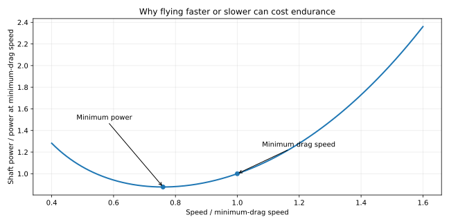
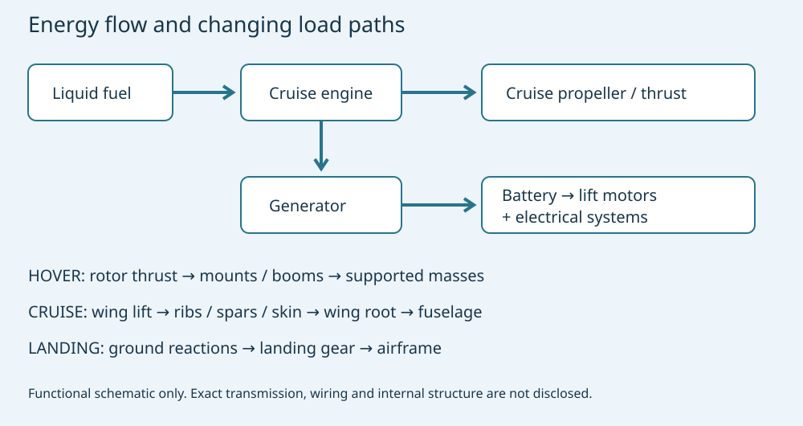

# Skyreach: Why a Hybrid Cargo Drone Can Fly for 18 Hours

**MIE 446 · Aerospace Structures · UMass Amherst**  
Independent engineering case study · 11 November 2026

[Web reading](https://ehsan-roohi.github.io/Aerospace-Structures/case-studies/skyreach/) · [Course readings](READINGS.md) · [BeamLab](https://ehsan-roohi.github.io/Aerospace-Structures/wing-lab.html)

## 1. The question behind the headline

How can an aircraft take off like a multicopter yet remain airborne far longer than a typical battery drone? The answer is a division of labor: electric rotors provide vertical lift briefly; a wing supports the aircraft during cruise; liquid fuel supplies cruise energy. An onboard generator replenishes the lift battery, but does not create energy.

This original lesson was prompted by [Zoomit's Skyreach article](https://www.zoomit.ir/aviation-aerospace/470952-skyways-skyreach-cargo-drone-unveiled/). The article was retrieved directly after the initial search-service access failed; this is an original engineering treatment, not a translation. Aircraft-specific statements below come from the manufacturer [1–3], while equations and examples are independent classroom analysis. Manufacturer performance figures are design claims, not independently validated measurements.

**Learning goals:** explain hover versus wingborne power; distinguish fuel from payload; derive drag and power trends; trace loads through an airframe; assess engine–generator–battery coupling; distinguish endurance from range.

*Figure 1. Official Skyways product visualization [2]. External appearance does not establish internal spar geometry, materials or structural margins.*

## 2. What has actually been announced?

Skyways announced Skyreach on 9 November 2026, with customer flights planned for December. Its earlier development name was V3 Block 2 [1]. The distinction matters: experience with earlier aircraft does not independently demonstrate every performance claim of the new model.

| Published quantity | US units | SI conversion |
|---|---:|---:|
| Maximum gross takeoff mass | 360 lb | 163.3 kg |
| Estimated empty mass [3] | 255 lb | 115.7 kg |
| Useful load | 100+ lb | 45.4+ kg |
| Fuel capacity | 86 lb | 39.0 kg |
| Wingspan | 22 ft | 6.706 m |
| Length | 9.5 ft | 2.896 m |
| Cargo volume | 7.0 ft³ | 0.198 m³, about 198 L |
| Nominal cruise speed | 70 knots | 36.0 m/s, 129.6 km/h |
| Maximum endurance claim | 18+ h | Mission-dependent |

Sources: product page [2] and dated specification sheet [3]. Masses are published in pounds; the corresponding weight force is mass multiplied by gravitational acceleration.

**Useful load is not all cargo.** Fuel and cargo share the available mass budget. Batteries and installed equipment must be counted consistently with the manufacturer's empty-weight definition; that definition is not fully itemized publicly. Subtracting the rounded empty mass from maximum mass gives about 105 lb, broadly consistent with the advertised 100+ lb, but not a precision loading instruction.

| Cargo | One-way design range | Primary source |
|---|---:|---|
| 10 lb / 4.54 kg | 1,300+ mi / 2,092+ km | [1–3] |
| 50 lb / 22.68 kg | 780+ mi / 1,255+ km | [3] |
| 80 lb / 36.29 kg | 280+ mi / 451+ km | Launch release [1] |
| 90 lb / 40.82 kg | 140+ mi / 225+ km | Product page [2] |

These are different loading points, not conflicting estimates for the same cargo. Do not join them into a certified performance curve. The dated sheet specifies 70 KTAS, 2,000 ft density altitude, no wind and a 45-minute fuel reserve, and explicitly says the aircraft remains in flight test and figures may change [3]. A round trip without refueling must budget both legs and reserve.

## 3. Watch the aircraft and its development

The following titles and identifiers were checked against the [official Skyways YouTube channel](https://www.youtube.com/@skyways_official/videos). Promotional or development footage is not a test report. GitHub Markdown provides clickable thumbnails; the web edition includes players and fallback links.

**[Introducing Skyways Skyreach](https://www.youtube.com/watch?v=KROJ9-dUIqk)** — identify lift rotors, cruise propeller, wing, cargo bay and landing gear. Which components are useful primarily during takeoff?

**[V3 B2: Stress Testing — Chapter 4](https://www.youtube.com/watch?v=HduWl_6-BH4)** — distinguish a visible test setup from evidence of load magnitude, instrumentation, calibration and acceptance criteria. The title alone does not establish qualification.

**[V3 B2: Integration to Hops — Chapter 3](https://www.youtube.com/watch?v=r0Hmt6UIwP4)** — examine the transition from integrated hardware to early flight testing. Earlier development configuration should not automatically be treated as the final production configuration.

**Further official videos:** [Taking Shape — Chapter 2](https://www.youtube.com/watch?v=1PA-A6q-2bg) and [Building Blocks — Chapter 1](https://www.youtube.com/watch?v=WGRif-oXg68). The manufacturer's [media folder](https://drive.google.com/drive/folders/1-Qo-XoGFlgmJzzSXi3s8fScj5YpxenCU) is linked from its launch announcement [1].

## 4. Aerodynamics and fluids: why wings change the energy budget

In steady level cruise, lift approximately balances weight and thrust balances drag:

$$L=W=mg,\qquad T=D,\qquad L=\tfrac12\rho V^2SC_L.$$

Air accelerated downward produces lift, whether by a wing or rotor. A wing benefits from forward motion and distributes its aerodynamic loading over its span. A hovering aircraft must continuously generate all lift through its rotors.

A useful preliminary drag model is

$$C_D=C_{D0}+kC_L^2,\qquad k=\frac{1}{\pi e\,AR},\qquad AR=\frac{b^2}{S},$$

$$D(V)=\tfrac12\rho V^2SC_{D0}+\frac{2kW^2}{\rho V^2S},\qquad P_{shaft}=\frac{DV}{\eta_p}.$$

Here $S$ is wing reference area, $e$ span efficiency and $\eta_p$ propeller efficiency. The first term is the simplified parasite drag; the second is induced drag. Slow flight raises the induced contribution; fast flight sharply raises parasite power. A larger span can reduce induced drag at fixed lift and speed, but brings bending, mass and stiffness penalties. Published span alone does not determine aspect ratio: wing area is also required.

For constant propeller efficiency and fuel consumption per shaft energy, propeller-aircraft endurance favors minimum power, approximately maximum $C_L^{3/2}/C_D$. Still-air range favors minimum drag, approximately maximum $C_L/C_D$. They occur at different speeds. For the parabolic polar, minimum drag has $C_L=\sqrt{C_{D0}/k}$, while minimum power has $C_L=\sqrt{3C_{D0}/k}$, subject to stall and operational limits.

*Figure 2. Original analytical illustration: $P/P_0=(r^3+1/r)/2$, where $r=V/V_{MD}$ and $P_0$ is power at minimum-drag speed. This normalized parabolic-polar model is not measured Skyreach performance. Minimum power occurs at $r=3^{-1/4}\approx0.760$.*

### Hover and transition

Ideal actuator-disk momentum theory gives

$$v_i=\sqrt{\frac{T}{2\rho A}},\qquad P_{i}=Tv_i=\frac{T^{3/2}}{\sqrt{2\rho A}}.$$

$A$ is effective disk area. Coaxial rotors have overlapping flow fields: counting each rotor disk as fully independent area gives an optimistic estimate. Real power additionally includes blade profile drag, interference and motor/controller losses.

At an illustrative 163.3 kg, $\rho=1.225$ kg/m³ and **assumed**, nonoverlapping effective area $A=4$ m², ideal hover power is about 20.5 kW. Actual Skyreach disk area and measured hover power are not supplied here. This calculation demonstrates scaling, not its specification. Doubling area reduces ideal induced power by $1/\sqrt2$.

During transition, wing lift grows with speed and rotor thrust can decrease. The total vertical force must continue to support weight; pitching moments, rotor–wing interference and control authority also matter. An idealized cruise calculation cannot validate this transient phase. Air density changes affect rotor power, stall margin and engine performance simultaneously.

## 5. Engines and electrical power: what “hybrid” means here

The product page describes eight electric lift motors and a two-stroke heavy-fuel cruise engine with an integrated generator. The generator recharges the lift battery in flight [2]. Heavy-fuel compatibility refers to fuel chemistry; burning Jet A does **not** make this a turbojet. The public description identifies an engine, not a disclosed engine model, displacement, rated power or complete transmission schematic.

*Figure 3. Original functional schematic based on [1–3]. The engine provides cruise propulsion and generator power; the precise mechanical/electrical arrangement is not specified. Generator charging ultimately consumes fuel. Load-path sketch is conceptual.*

A bookkeeping equation is

$$P_{engine}\gtrsim P_{cruise,shaft}+\frac{P_{electrical}}{\eta_g},$$

where generator efficiency is $\eta_g$. Charging, avionics, payload systems and cooling all impose demands. Conversion losses cannot be ignored or credited twice. An advertised electrical payload-power capability does not mean it can be used continuously without reducing range.

A two-stroke cycle offers a power event each crankshaft revolution and can support compact power plants, but installed performance depends on scavenging, combustion, lubrication, cooling, vibration and generator loading. Those general principles do not establish Skyreach's brake efficiency. Recharging the battery while cruising can restore energy needed for landing; sufficient state of charge, thermal margin and reserve must be maintained throughout the mission.

## 6. Why endurance is so long

Four effects work together:

1. **Wingborne cruise:** the rotors need not support full weight for the entire mission.
2. **Liquid fuel:** a large chemical-energy store can be carried for a given mass.
3. **Small cargo at maximum range:** more of the allowable takeoff mass remains available for fuel.
4. **Moderate cruise speed:** avoiding excessive speed limits parasite power; the operating optimum depends on the full aircraft and engine maps.

For transparent order-of-magnitude reasoning, assume fuel lower heating value $43$ MJ/kg and a battery pack specific energy $0.20$ kWh/kg. These are illustrative inputs, **not measured Skyreach values**. Fuel contains $43/3.6\approx11.94$ kWh/kg chemically. At an assumed 25% shaft efficiency this becomes about 2.99 kWh/kg; a battery at assumed 90% electrical-to-shaft efficiency yields about 0.18 kWh/kg. The ratio is about 16.6 for these assumptions, before engine, tank, generator and battery packaging masses. Comparing fuel chemical energy directly with battery delivered shaft energy would exaggerate the advantage.

An assumed 39 kg of fuel stores about 466 kWh chemically or 116 kWh at the assumed shaft efficiency. Dividing by 18 h gives approximately 6.5 kW. This is an energy-budget plausibility illustration, not a prediction: reserve fuel, climb, VTOL, charging, changing weight and actual engine efficiency must all be accounted for.

For an ideal propeller aircraft at constant $L/D$, propeller efficiency and shaft-specific fuel consumption,

$$R=\frac{\eta_p}{g c_P}\frac{L}{D}\ln\left(\frac{m_i}{m_f}\right),$$

where $c_P=\dot m_f/P_{shaft}$ in kg/J. Using a weight-based consumption definition changes where $g$ appears. Replacing fuel with cargo reduces the fuel fraction and therefore range even if takeoff mass stays constant. Real performance must be integrated over a mission with engine and propeller maps.

Multiplying 70 knots by 18 h gives 1,260 nautical miles, about 2,334 km. This does not prove a contradiction with a 2,092+ km headline range: published maxima need not refer to the same profile, usable fuel or reserve convention. Range depends on groundspeed; endurance depends on time aloft. Headwind reduces distance covered per hour without improving stored energy.

## 7. Structural engineering: the loads change with flight phase

| Phase | Dominant load path | Engineering question |
|---|---|---|
| Hover | Rotor thrust → mounts/booms → primary structure → supported masses | Local bending, fasteners, thrust asymmetry and vibration |
| Cruise | Distributed wing lift → ribs/skin/spars → wing root → fuselage | Bending, shear, torsion and aeroelastic deformation |
| Transition | Combined wing, rotor and inertia loads | Which combination governs attachments? |
| Landing | Ground reactions → gear attachments → airframe | Impact energy, local crushing and load redistribution |
| Cargo handling | Restraints/floor/interface → primary structure | Concentrated loads and center-of-mass limits |

No public internal structural drawing, laminate schedule or allowable-stress dataset was found in the cited sources. Composite construction, exact spar dimensions and numerical safety factors must not be invented from a photograph.

For a semispan $\ell$, coordinate $y$ outward from the root and net transverse load $q(y)$,

$$V_{root}=\int_0^\ell q(y)\,dy,\qquad M_{root}=\int_0^\ell yq(y)\,dy.$$

A first beam model uses $\sigma_x=Mz/I$ and $EIw''''=q$; an offset load also gives torque $\mathcal T=Fe$ and twist rate $d\theta/dy=\mathcal T/(GJ)$. Wing mass and mounted hardware provide inertia relief in maneuver loading and also add local loads. Rotor mounts may govern in hover even when aerodynamic lift governs in cruise.

For uniform lift with total $L=nW$, a massless-wing illustration gives $M_{root}=nWb/8$ per wing. At 163.3 kg and 6.706 m span, this is about 1.34 kN·m at $n=1$ and 2.68 kN·m at **assumed** $n=2$. The latter is a classroom case, not a published aircraft load factor. Elliptical lift instead gives $M_{root}=nWb/(3\pi)$, about 1.14 kN·m at $n=1$. Load distribution matters even at identical total lift.

A longer wing increases bending lever arm. Increasing section depth can improve bending stiffness efficiently, but packaging, airfoil thickness, buckling, joints and manufacturing constrain it. A light structure also needs torsional stiffness. NASA's adaptive-wing discussion [4] illustrates why aerodynamic efficiency and aeroelastic response must be considered together; it does not describe Skyreach's actual aeroelastic design.

Dynamic modes satisfy $K\phi=\omega^2M\phi$. Engine and rotor harmonics can excite structural modes. Checking one natural frequency cannot establish flutter clearance: flutter couples aerodynamic forces, inertia and elasticity and requires appropriate analysis and test.

## 8. Cargo, fuel burn and balance

The aircraft center of mass is

$$x_{CG}=\frac{\sum_i m_i x_i}{\sum_i m_i}.$$

Fuel burn changes both numerator and denominator. Cargo installation or release can abruptly change balance. For a retained aircraft of mass $m_a$ at $x_a$ carrying cargo $m_c$ at $x_c$,

$$x_{CG,before}=\frac{m_ax_a+m_cx_c}{m_a+m_c},\qquad x_{CG,after}=x_a.$$

As an illustrative example, 10 kg located 0.5 m ahead of the retained 150 kg aircraft's center shifts the combined center forward by 31 mm; releasing it reverses that shift. Actual allowable limits are unavailable here. Pitch trim and static margin require aerodynamic-center and stability information as well as mass balance.

A cargo-bay opening interrupts the shell load path; frames, reinforced edges and closures must transfer loads around it. Heavy compact cargo and low-density bulky cargo challenge different constraints: mass limit and 198 L volume are separate restrictions. Repeated VTOL cycles, vibration, moisture and marine exposure introduce fatigue, corrosion and inspection considerations even for flights that remain within static limits.

## 9. BeamLab activity and answer checks

Use [BeamLab](https://ehsan-roohi.github.io/Aerospace-Structures/wing-lab.html) to study a **generic equivalent semispan**, not a reconstructed Skyreach wing.

1. Select a cantilever of length 3.3528 m; use constant illustrative $EI=50,000$ N·m².
2. Apply an upward uniform load totaling $W/2\approx800.7$ N, or $q\approx238.8$ N/m. If the interface requires downward-positive load, reverse all force signs consistently.
3. Compare root shear and moment with $q\ell$ and $q\ell^2/2$. The magnitudes should be about 800.7 N and 1,342 N·m.
4. Compare tip displacement with $q\ell^4/(8EI)\approx0.0754$ m. Explain the constant-stiffness, small-deflection and massless-wing assumptions.
5. Double loading: shear, moment and linear deflection should double. Double $EI$: deflection halves but statically determinate reactions do not change.
6. Add an **assumed** 5 kg hardware mass at 2 m from the root as a downward 49 N gravity load in the 1g case. Root moment changes by about 98 N·m. Then discuss why hover thrust at the same mount creates a different case.
7. Draw a separate torsion free-body diagram for an assumed 200 N force offset by 0.15 m: torque is 30 N·m. A bending-only beam calculation cannot report the resulting twist without $GJ$ and a torsion model.

Submit one free-body diagram, input table, shear/moment/deflection plots and a short explanation of how the model differs from the actual aircraft. This is optional enrichment, not a new graded assignment.

## 10. What remains unknown?

A defensible performance reconstruction requires wing area and polar, propeller map, actual engine fuel-consumption map, usable fuel/reserves, battery usable energy, hover duration and measured mission data. Structural assessment additionally needs material properties, section geometry, joints, mass distribution and load envelopes. The headline and video do not supply these.

A separate FAA announcement [5] authorizes a specified offshore operation using the **V2**, not blanket certification of Skyreach or proof of its maximum range. Likewise, lower-cost claims require a named comparator, utilization and maintenance accounting before they can be used in an engineering cost model.

## References and media provenance

All online sources checked 11 November 2026. Manufacturer data retain their qualification as design specifications.

1. Skyways, [Skyreach launch announcement](https://www.skyways.com/newsroom/skyways-launches-skyreach-begins-customer-flights), 9 November 2026. Launch timing, development name and mission/loading statements.
2. Skyways, [Skyreach product page](https://www.skyways.com/skyreach). Architecture, current specifications and official product visualization.
3. Skyways, [Skyreach specification sheet, dated 4 November 2026](https://www.skyways.com/downloads/Skyways%20Spec%20Sheet%202026-11-04.pdf), two pages. Empty weight, range conditions, reserve and flight-test caveat. The dated sheet and live product page may change independently.
4. NASA, [NASA, Boeing Test How to Improve Performance of Longer, Narrower Aircraft Wings](https://www.nasa.gov/aeronautics/nasa-boeing-test-aircraft-wings/), 18 December 2025. General aerodynamic–structural tradeoffs, not Skyreach validation.
5. FAA, [Authorization for long-range offshore drone operations](https://www.faa.gov/newsroom/faa-advances-american-drone-dominance-first-its-kind-authorization-long-range-drone), 9 November 2026. Aircraft-specific scope: V2.
6. Skyways, [official video channel](https://www.youtube.com/@skyways_official/videos). Video titles/IDs listed in Section 3; external playback availability can change.
7. Zoomit, [starting article](https://www.zoomit.ir/aviation-aerospace/470952-skyways-skyreach-cargo-drone-unveiled/). User-supplied starting article, retrieved directly on 11 November 2026.

**Equation background:** J. D. Anderson, *Introduction to Flight* (lift, drag and propeller-aircraft performance); J. G. Leishman, *Principles of Helicopter Aerodynamics* (actuator-disk hover theory); T. H. G. Megson, *Aircraft Structures for Engineering Students* (beam and thin-walled structural models). These textbook references identify standard theory; aircraft-specific inputs above are sourced separately. Original figures and calculations are teaching models, not manufacturer drawings.
