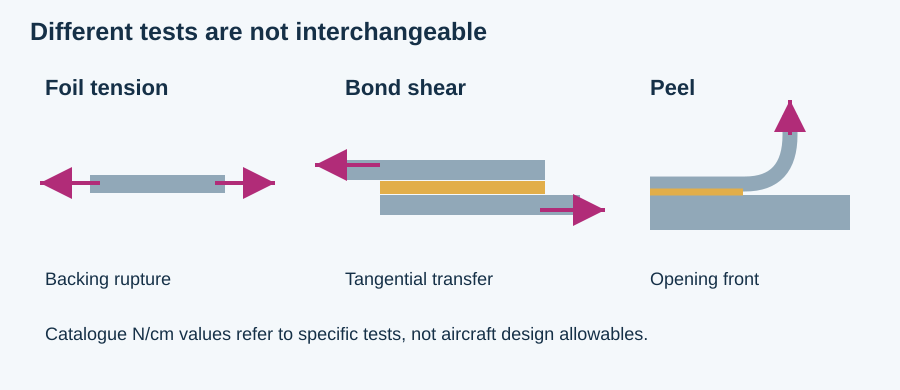

# Speed Tape and Aircraft Repairs

MIE 446 · Aerospace Structures · University of Massachusetts Amherst

**[Read the complete illustrated report](https://ehsan-roohi.github.io/Aerospace-Structures/case-studies/speed-tape/)** · [HTML source](docs/case-studies/speed-tape/index.html) · [Course home](README.md)

A silver surface patch is not automatically a structural joint. This reading explains foil and pressure-sensitive adhesive construction, peel versus shear and tensile rupture, aerodynamic loading, thermal mismatch, and the distinction between material properties and aircraft-specific repair authorization.

The report includes four original diagrams, four worked classroom calculations, a claim-by-claim assessment of common speed-tape claims, a documented Airbus rejection of a proposed tape repair, discussion questions, a Persian summary, and seven primary sources. It distinguishes the typical September 2024 English-US 3M 425 data from design allowables and explains why N/cm tape-test values must not be used as MPa strengths in the Virtual Labs.

Educational mechanics only: not maintenance instructions, repair sizing or flight authorization. The full report is printable from the browser and preserves the limitations beside each numerical example.
