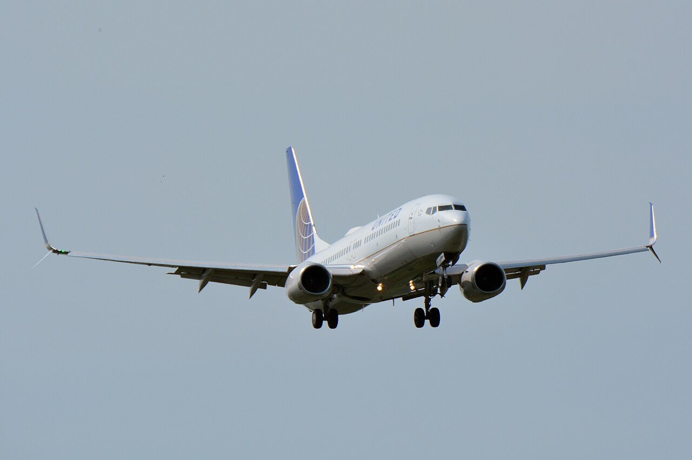
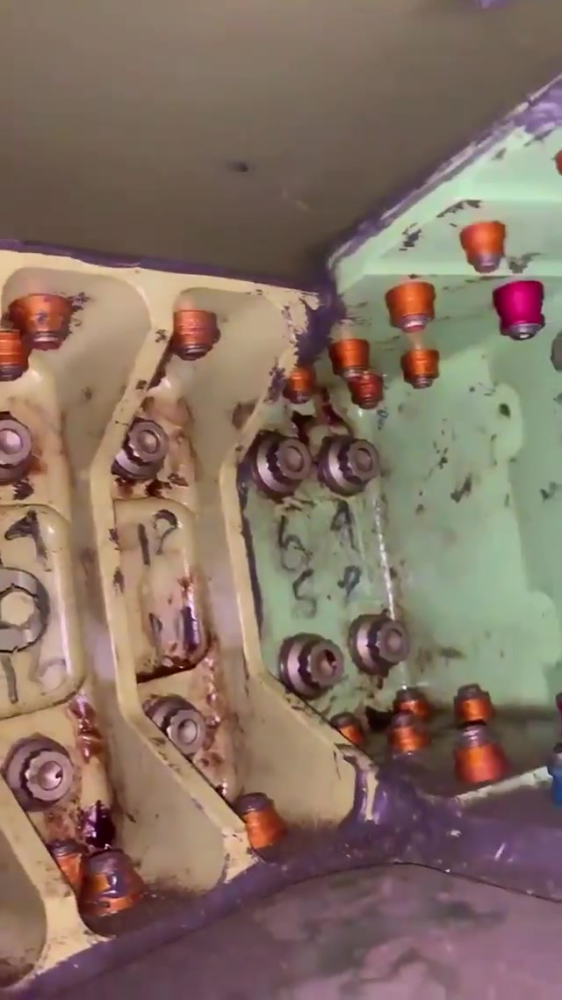
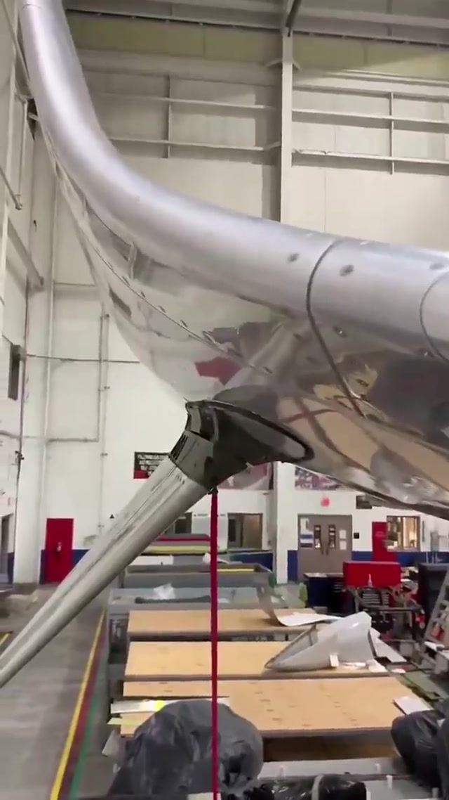

# Boeing 737-800 Split Scimitar Winglets: Aerodynamics, Structures and Aeroelasticity

**MIE 446 · Aerospace Structures · University of Massachusetts Amherst**  
Course case study · 28 October 2026 · Prepared with AI assistance and source checking

[Course home](README.md) · [Video supplied for this case study](docs/case-studies/split-scimitar/linkedin-video.mp4) · [Original LinkedIn post](https://lnkd.in/p/erwyJSpp)

## Overview

A winglet is a lifting surface attached to a flexible lifting surface. Its aerodynamic benefit and its structural cost must therefore be evaluated together. The Boeing 737-800 Split Scimitar Winglet (SSW) provides a useful example: a retrofit changes the three-dimensional wingtip loading while also requiring strengthened structural members, additional mass and aircraft-specific integration work.

This report starts with Vladimir Gantovnik's 28 October 2026 post, **“Inside the Boeing 737-800 Split Scimitar Winglet!”** The accompanying approximately 25-second workshop video shows exposed internal structure, rows of fasteners and the external split-tip arrangement. It illustrates a real load-transfer problem, but it is not a dimensioned drawing or a structural substantiation record. Aircraft identity is taken from the post; no visible serial number independently establishes the installation's configuration. [1]

**Central engineering result:** a reduction in induced drag does not imply a reduction in wing-root bending, attachment load or flutter risk. The design objective is a favorable aircraft-level trade between mission fuel, structural mass, stiffness, life, operability and certification constraints.

### Learning objectives

After this reading, students should be able to:

1. Explain why a nonplanar wingtip can reduce induced drag without eliminating the trailing wake.
2. Resolve winglet forces and moments into a wing attachment and a wing-root free body.
3. Explain the roles of skins, spar caps, webs, ribs and fastener groups.
4. Distinguish static strength, buckling, fatigue, damage tolerance and aeroelastic stability.
5. Audit fuel-saving percentages by identifying their reference configuration and mission.
6. Design a reproducible aerodynamic–structural comparison without inventing proprietary geometry.

## 1. What is established, and what remains unknown?

The evidence categories used below are **observed**, **documented**, **engineering interpretation**, and **illustrative calculation**. The last two are not claims about proprietary APB design details.

| Question | Evidence and conclusion |
|---|---|
| Which winglet is discussed? | The post identifies the Boeing 737-800 SSW developed by Aviation Partners Boeing (APB). [1] |
| What can be seen? | Repeated fasteners, internal load-carrying members, protective-looking surface finishes and the external upper/lower arrangement. Their appearance alone does not identify alloy, laminate, fastener specification or allowable loads. |
| Is reinforcement merely inferred from the video? | No. APB's 2014 certification announcement explicitly describes strengthened spars in a retrofit retaining the existing Blended Winglet structure. [2] |
| Is the retrofit only a lower fin? | No. Public descriptions identify scimitar tips, a ventral strake and, in API's overview, trailing-edge wedges. [2,3] |
| Does this establish the exact joint in the footage? | No. The public material does not locate every visible member or establish individual fastener functions. |
| What engineering data are unavailable here? | Approved drawings, exact airfoils, skin gauges, laminate schedules, material allowables, fastener preload, load envelopes, stiffness/mass matrices and certified inspection schedules. |

**Do not diagnose corrosion, looseness, cracking or workmanship from color and video compression.** The markings and finishes are visible; their engineering significance needs inspection records and material identification.

## 2. Geometry, development and comparison with other tips

The SSW is an evolution of the 737NG Blended Winglet. Its recognizable features are a curved upward member with a swept, pointed tip and an additional downward/outward ventral surface. “Scimitar” describes the swept tip form; it is not a different physical law of lift. The transition, airfoil loading, sweep, cant, toe and twist all matter.

APB announced the 737-800 certification on 6 February 2014 after a program launched in 2013. The announcement describes reusing the Blended Winglet structure while adding strengthened spars, new tips and a ventral strake. United records the first commercial SSW flight on 18 February 2014. These dates describe certification announcement and service entry, respectively. [2,4]

| Tip concept | Aerodynamic design variable | Structural/integration consequence |
|---|---|---|
| Bare planar tip | Planform and spanwise circulation | Reference wing; still has a trailing vortex system |
| Planar tip extension | Greater span and revised circulation | Outboard loading has a long root lever arm; span/gate constraints matter |
| Blended Winglet | Nonplanar loading with a smooth transition | Side force, vertical force, local bending/torsion and added inertia |
| Split Scimitar | Interacting upper and lower lifting surfaces | Additional attachment loads and mass; whole-wing integration must be reassessed |
| 737 MAX Advanced Technology winglet | Boeing's distinct dual-feather design | A different installation; its data cannot be substituted for a 737NG SSW retrofit |

Boeing identifies the MAX tip as an Advanced Technology winglet. Visual resemblance does not make it interchangeable with the APB retrofit. [5]

*Figure 1. Actual Split Scimitar Winglet on an Aeromexico 737-800. Photo: Mnts; crop/levels by Altair78, via [Wikimedia Commons](https://commons.wikimedia.org/wiki/File:B737-800_Split_Winglet_WP_20141110_001.jpg), [CC BY-SA 4.0](https://creativecommons.org/licenses/by-sa/4.0/). Commons thumbnail reproduced without further edits.*

*Photo: jounigripen, Boeing 737-8K2 PH-HXC, via [Commons](https://commons.wikimedia.org/wiki/File:Split_Scimitar_Winglets_(51329381972).jpg), [CC BY 2.0](https://creativecommons.org/licenses/by/2.0/). Thumbnail reproduced without further edits.*

*Aircraft context: United N37293. Photo: Masakatsu Ukon, via [Commons](https://commons.wikimedia.org/wiki/File:United_Airlines,_Boeing_737-800_N37293_w_Split_Scimitar_Winglet_NRT_(18596425018).jpg), [CC BY-SA 2.0](https://creativecommons.org/licenses/by-sa/2.0/). Thumbnail reproduced without further edits.*

## 3. Aerodynamics: what actually reduces drag?

### 3.1 Circulation, downwash and the trailing wake

A finite wing supports a pressure difference and a spanwise-varying circulation. The resulting trailing vortex sheet rolls up downstream. Its induced velocity tilts the local aerodynamic force backward, giving induced drag. A winglet changes the circulation and induced-velocity field of the **combined wing–winglet system**. It does not simply block air from moving around the tip, and it does not remove all vortices. NASA's winglet and induced-drag explanations provide the introductory foundation. [6,7]

For a planar-wing teaching approximation,

$$
q_\infty=\tfrac12\rho V^2,\qquad C_L=\frac{L}{q_\infty S},\qquad AR=\frac{b^2}{S},
$$

$$
C_{D_i}=\frac{C_L^2}{\pi e AR},\qquad
D_i=\frac{L^2}{\pi e q_\infty b^2}.
$$

Here $b$ is span, $S$ is the stated wing reference area, and $e$ is a span-efficiency parameter. Keep the same reference area when comparing coefficients. An effective $e$ fitted to a nonplanar system need not obey the planar-wing interpretation or its usual upper bound; it is not a complete SSW prediction.

The second equation exposes the design opportunity: for prescribed lift, improving the induced-flow distribution can reduce drag even without a proportional increase in horizontal span. However, the winglet adds wetted area and can introduce interference, separation and transonic penalties.

### 3.2 Why two surfaces?

The upper winglet and lower strake interact with the wing and with each other. Their positions and loading give more freedom to shape the wake than a single tip surface. This is an **engineering interpretation of nonplanar lifting-system behavior**; the public sources do not disclose the circulation distribution of the exact filmed installation.

Changing cant alters the lateral/vertical force split. Changing toe and twist alters incidence relative to the local velocity, which includes wing-induced flow. Sweep and airfoil thickness also affect compressibility and separation. A favorable geometry at one lift coefficient may be less favorable at another. It is therefore misleading to assign one fixed portion of the saving to each visible surface without an isolated-component study.

### 3.3 Is the winglet producing thrust?

In the locally inclined wingtip flow, a component of the winglet's aerodynamic force can point forward relative to the aircraft axis. That is a useful force-resolution picture. It is not propulsion or energy creation. Compute the force on the **whole aircraft** and the far-wake momentum/energy balance: the engine must still supply the positive net drag in steady level flight.

### 3.4 The appropriate comparison

Compare aircraft at the same weight, altitude, Mach number and trim, with consistent reference area and fully converged force extraction. At the mission level, include the changed empty weight and climb/cruise/descent schedule. In transonic cruise, a lifting-line or vortex-lattice model cannot establish shock losses or viscous interference. It is a useful screening tool, followed by suitable viscous/compressible CFD, tunnel evidence and flight validation.

Whitcomb's 1976 investigation explicitly compared winglets and tip extensions at approximately matched increases in root bending moment. That is the right kind of comparison for a structures course: aerodynamic gain under a structural constraint. It is historical evidence for the method, not a performance measurement of this SSW. [8]

## 4. A quantitative drag example

**All inputs in this section are assumed classroom values, not Boeing/APB data.** Let $C_L=0.50$, $AR=9.5$, $C_{D,\mathrm{other}}=0.020$, and let effective $e$ change from 0.80 to 0.86 while holding $C_L$ and $AR$ fixed.

| Quantity | Baseline | Modified idealization |
|---|---:|---:|
| $C_{D_i}$ | 0.010471 | 0.009740 |
| Total $C_D$, before added parasitic drag | 0.030471 | 0.029740 |
| $L/D$ | 16.41 | 16.81 |

The induced component falls by **6.98%**, but total drag falls by only **2.40%**. If the added surface/interference contributes $\Delta C_{D,\mathrm{other}}=0.00025$, total drag becomes 0.029990 and the net reduction is **1.58%**. These are algebraic examples, not SSW fuel predictions.

More generally, if induced drag is fraction $f_i$ of baseline total drag and falls by fraction $r_i$,

$$
\frac{D_0-D_1}{D_0}=f_i r_i-\frac{\Delta D_{\mathrm{other}}}{D_0}
$$

at fixed lift and operating condition. The equation shows why “20% less induced drag” cannot be read as “20% less fuel.” Added mass also changes the required lift, so even this fixed-lift comparison is only one step in a mission analysis.

## 5. Structural mechanics: from pressure to the fuselage

### 5.1 A consistent free body

Use right-handed axes: $x$ aft (downstream), $y$ toward the right wingtip and $z$ upward. In this convention a drag force has positive $F_x$. About a chosen attachment reference point $A$, integrate aerodynamic traction $\mathbf t$ over the winglet surface:

$$
\mathbf F_A=\int_{S_w}\mathbf t\,dS,\qquad
\mathbf M_A=\int_{S_w}(\mathbf r-\mathbf r_A)\times\mathbf t\,dS.
$$

For a resultant at $\mathbf r=(x,y,z)$ relative to the reference,

$$
M_x=yF_z-zF_y,\quad M_y=zF_x-xF_z,\quad M_z=xF_y-yF_x.
$$

Add a free aerodynamic couple if the distributed traction is replaced by a point force. Include weight and acceleration loads consistently. The structural reaction balances these applied resultants; it has the opposite sign on the isolated component. Root loads also include the **change in loading over the entire main wing**, not just the added winglet force.

*Figure 2. Actual internal members and fastener rows, extracted at 0.5 s from the supplied video linked in reference 1. The footage does not establish material specifications or individual fastener loads.*

*Fastener detail at 5 s in the same video.*

*Workshop exterior at 23 s in the same video. These frames preserve the source appearance and are not manufacturer drawings.*

### 5.2 Why the root can be highly loaded

Take a hypothetical right-tip resultant at $(x,y,z)=(0,17,1)$ m with $(F_x,F_y,F_z)=(0.8,2,4)$ kN. The wing-root moment contribution is

$$
(M_x,M_y,M_z)=(66,0.8,-13.6)\ \mathrm{kN\,m}.
$$

For the same forces at a **local attachment** with offset $(0,0,1)$ m, the moment is $(-2,0.8,0)$ kN m. Different reference points answer different questions. The large $yF_z$ root term and the local $-zF_y$ term should never be conflated.

Under maneuver or gust loading these resultants vary; the example is not a load case for a real aircraft. Left/right side forces may cancel in the whole-aircraft force sum while still loading both wing structures.

### 5.3 What the structural members do

The following is a **generic thin-walled airframe interpretation**, not a bill of materials for the footage.

| Element | Typical mechanical role | Checks that matter |
|---|---|---|
| Skin or shell | Carries pressure, membrane force and shear; contributes to torsional stiffness | Local buckling, damage, discontinuities and load transfer |
| Spar caps/flanges | Separated axial-force paths resist bending | Tension/compression, crippling, attachment and fatigue |
| Spar webs | Transfer transverse shear and participate in torsion | Shear buckling, cutouts and end load introduction |
| Ribs/diaphragms | Preserve section shape and distribute concentrated loads | Web stability, local joints and distortion |
| Fittings/doublers | Spread attachment loads into surrounding structure | Bearing, net section, shear-out, prying and stiffness mismatch |
| Fasteners | Transfer load between components | Combined shear/tension, bearing, slip, preload effects and fatigue |

For a separated-cap idealization, $N_{\mathrm{cap}}\simeq M/h$, where $h$ is the distance between cap centroids. A smaller structural depth requires larger cap force for the same bending moment. For a single closed thin-walled cell, Bredt–Batho gives

$$
q_s=\frac{T}{2A_m},\qquad \tau=\frac{q_s}{t}.
$$

With assumed $T=2$ kN m, enclosed median area $A_m=0.08$ m² and wall thickness $t=2$ mm, $q_s=12.5$ kN/m and $\tau=6.25$ MPa. This is uniform-cell torsion theory; an open access panel, multicell section or joint needs a different model. No stress margin follows without actual allowables and load cases.

## 6. What do the rows of fasteners accomplish?

The post correctly draws attention to attachments. Many fasteners can distribute load and provide a broad moment-transfer region, but their individual loads are generally unequal. Connection stiffness, fit, friction, local flexibility and load eccentricity matter.

For an **ideal rigid, equal-stiffness fastener group in one plane**, direct shear is $\mathbf V/n$. A moment $M$ normal to the plane adds a tangential contribution,

$$
\mathbf f_i^{(M)}=\frac{M}{J_f}(-y_i,x_i),\qquad
J_f=\sum_j(x_j^2+y_j^2),
$$

where coordinates are measured from the group centroid. Add direct and moment-induced vectors before finding the maximum load. Out-of-plane moments require a separate tension/compression and contact model; the in-plane formula cannot resolve prying.

For a deliberately simple example, four fasteners at $(\pm50,\pm40)$ mm carry 20 kN shear in the $y$ direction and 1 kN m in-plane moment. Then $J_f=16,400$ mm² and each fastener's moment contribution has magnitude 3.90 kN. The most highly loaded fasteners carry **8.41 kN**, obtained from components $(2.439,8.049)$ kN. Dividing the total shear by four gives only 5 kN and misses the eccentric moment.

If an assumed fastener diameter is 8 mm and plate thickness is 3 mm, the associated nominal bearing stress $F/(td)$ is approximately **350 MPa**. This value is not an allowable or a pass/fail result. Actual joint design must also check net-section tension, shear-out, fastener strength, edge distance, countersinks, secondary bending and fatigue. The filmed fasteners have not been identified as 8 mm parts.

## 7. Materials, manufacturing and the weight penalty

A green finish is not proof of an aluminum alloy, and a curved outer surface does not prove a carbon-fiber laminate. A transport-aircraft tip assembly can combine different material systems and metallic fittings. Exact material identification requires drawings and specifications. For any composite–metal interface, engineers must consider anisotropy, bearing/bypass interaction, interlaminar damage, galvanic isolation and thermal-expansion mismatch. These are general design considerations, not verified features of this installation.

The public APB 737-800 SSW page lists the following **per-airplane installation weight impacts**, separated by aircraft line number. Preserve its configuration labels when using these numbers. [9]

| APB line-number category | Listed total increase |
|---|---:|
| Before 778 | 296.6 lb / 134.5 kg |
| 778–5063 | 302.2 lb / 137.1 kg |
| 5064 onward | 329.2 lb / 149.3 kg |

The same table includes wing modifications and ballast, illustrating that the retrofit is more than exposed aerodynamic surface mass. Its first-kit “Winglet Mod” row contains **47.6 lb and 8.0 kg**, an inconsistent unit pair; the pound component sum also conflicts with the listed total. Do not silently repair that row or use it for detailed mass accounting. The totals above are transcribed as published, not independently validated measurements. [9]

The presence of ballast makes mass distribution an important question. The public table alone does not establish its location or exact design purpose. Added tip mass can lower a structural frequency or change mode coupling even when static stresses remain acceptable.

## 8. Aeroelasticity: stiffness and mass are part of the aerodynamics

**Static coupling:** aerodynamic load bends and twists the structure; the deformed shape changes the aerodynamic load. A favorable unloaded tip angle is insufficient if the loaded structure twists unfavorably. Divergence is a static instability of this coupled system.

**Dynamic coupling:** flutter arises when aerodynamic energy input overcomes damping in a coupled motion. Relevant changes include tip inertia, bending/torsional stiffness, attachment flexibility and unsteady aerodynamic forces. “It is small” and “the bolts are strong” do not establish a flutter margin.

A teaching representation is

$$
\mathbf M\ddot{\boldsymbol\eta}+\mathbf C\dot{\boldsymbol\eta}+\mathbf K\boldsymbol\eta
=\mathbf Q_a(\boldsymbol\eta,\dot{\boldsymbol\eta};V,\rho,M_\infty).
$$

Here $\boldsymbol\eta$ contains generalized structural coordinates and $M_\infty$ is Mach number, distinct from mass matrix $\mathbf M$. Real unsteady aerodynamic models may require frequency dependence or additional aerodynamic states. A dry modal calculation determines natural frequencies and shapes, not flutter speed.

For intuition only, $f\sim(2\pi)^{-1}\sqrt{k/m}$: increasing effective mass by 10% at fixed effective stiffness lowers this scalar frequency by 4.65%. A real distributed wing has multiple coupled modes, so this is not a flutter prediction. FAA AC 25.629-1C provides transport-airplane aeroelastic substantiation guidance; it is not evidence of the exact certification basis of every historical retrofit. [10]

## 9. Fatigue, damage tolerance and service integration

A static-strength check answers whether a specified load can be carried. Fatigue asks how repeated load histories initiate and grow damage. Damage tolerance asks whether damage can be detected and the remaining structure can safely carry the required loads until intervention.

For an educational crack-growth model,

$$
\Delta K=Y\Delta\sigma\sqrt{\pi a},\qquad
\frac{da}{dN}=C(\Delta K)^m.
$$

This Paris-law form is only a limited growth-regime approximation. Hole geometry, crack shape, residual stress, load sequence, threshold behavior, corrosion and small-crack effects can invalidate a naive use. Visible fastener count cannot establish inspectability or crack-arrest capability. FAA AC 25.571-1D is an appropriate starting reference. [11]

### A documented integration lesson: FAA AD 2019-22-06

The FAA documented inadequate clearance between an FQIS tank unit and a reinforcement angle introduced by a split-winglet modification. The stated applicability is specific: 737-800 line numbers **4919–5063**, modified under STC **ST00830SE** and listed in APB Service Bulletin **AP737-57-020**. The concern was a potential fuel-tank ignition source, and the directive required inspection and corrective action where needed. [12]

This is a documented example of structural reinforcement interacting with an aircraft system. It does **not** establish a defect in all SSWs or in the filmed assembly. It shows why “stronger structure” is only one part of successful integration. This historical discussion is not an aircraft-specific determination of current AD compliance.

## 10. Auditing the LinkedIn performance claims

| Claim in the starting post | Assessment against primary evidence |
|---|---|
| Significant bending, shear and torsion must be transferred into the wing | Mechanically sound; APB confirms strengthened spars. The video does not quantify load magnitude. [2] |
| 2013 launch and 2014 certification | Supported by APB's 2014 announcement. [2] |
| Roughly 5–5.5% saving versus roughly 3–3.5% for Blended Winglets | Southwest's 9 April 2014 release states approximately 3.5% for Blended Winglets and 5–5.5% after upgrading. These are operator estimates, not universal measured results. [13] |
| About 200,000 liters annually | Plausible as an operator/utilization-dependent estimate. An APB-issued Alaska release estimated 58,000 US gal additional annual savings, approximately 219,554 L. It does not establish the saving for every aircraft. [14] |
| More than 1,600 orders/options by late 2014 | The February 2014 APB release reports 1,461. The later 1,600 figure is not independently established by the specific primary documents used here. [2] |

### Percentage points versus incremental saving

Let $F_0$ be annual fuel for the common reference aircraft and interpret 3.5% and 5.5% as savings relative to it. Then $F_B=0.965F_0$ and $F_S=0.945F_0$. The upgrade gives **2 percentage points** against $F_0$, but

$$
\frac{F_B-F_S}{F_B}=\frac{0.020}{0.965}=2.073\%.
$$

For the 5.0% endpoint, the corresponding incremental saving is 1.554%. The common reference configuration must be checked in the underlying operator study before combining headline percentages. Do not call 5.5% the incremental SSW-over-Blended saving. API separately describes a roughly 2% or greater long-range aerodynamic benefit for the retrofit; mission range, drag and annual block fuel are different metrics. [3]

At an **assumed** 10 million liters baseline annual consumption, a 2-percentage-point saving corresponds to 200,000 liters. Changing utilization changes that annual quantity. The assumption is illustrative and does not describe a measured 737 operating year.

## 11. A defensible aerodynamic–structural analysis workflow

| Step | Method | Evidence required before interpreting a benefit |
|---|---|---|
| 1. Define configurations | Bare tip, blended tip and split tip; documented reference areas and mass accounting | Same aircraft baseline and explicit geometry provenance |
| 2. Screen aerodynamics | Nonplanar lifting-line or vortex-lattice model | Discretization convergence; matched lift and trim; consistent far-wake drag |
| 3. Resolve real-flow effects | Compressible viscous CFD where appropriate | Mesh/domain convergence, turbulence sensitivity and validation |
| 4. Transfer loads | Integrate surface tractions and conservatively map them to structure | Force and moment conservation about the same reference point |
| 5. Analyze structure | Wing beam/shell model plus detailed local joint model | Appropriate boundary flexibility; member, buckling and attachment checks |
| 6. Couple deformation | Iterate loads and deformation | Convergence of twist, loads and aerodynamic benefit |
| 7. Evaluate dynamics/life | Modal, aeroelastic and fatigue/damage analyses | Correlated stiffness/mass and justified operating spectra |
| 8. Assess aircraft mission | Weight-dependent performance with climb/cruise/descent and reserves defined | Consistent dispatch assumptions and uncertainty |

For load mapping, verify $\sum\mathbf f_k=\mathbf F$ and $\sum\mathbf r_k\times\mathbf f_k=\mathbf M$ to stated tolerances. A visually smooth mapped load is insufficient if either balance fails. A model clamped at the winglet foot cannot establish whole-wing behavior unless that constraint represents the actual attachment flexibility.

A useful optimization statement is: minimize mission fuel subject to strength, stability, fatigue, flutter, mass, span and clearance constraints. Aerodynamic benefit alone is not the objective function of the completed airplane. Report uncertainty and avoid presenting assumed geometry as reverse-engineered certified hardware.

## 12. Classroom activities and checkable answers

1. **Video observation:** list five visible features and three unavailable quantities. Label every statement as observation or inference. Why is an alloy designation unavailable from finish color?
2. **Drag accounting:** reproduce Section 4. At what added $\Delta C_D$ is the ideal induced-drag benefit completely lost? **Answer:** approximately 0.000731.
3. **Force and moment:** reproduce Section 5's cross product. Change $F_y$ from +2 to −2 kN. **Answer:** $M_x$ changes from 66 to 70 kN m; the other two components stay +0.8 and −13.6 kN m.
4. **Fastener group:** reproduce Section 6 and compare maximum load to the 5 kN equal-share estimate. **Answer:** approximately 8.41 kN, 68.2% above equal share.
5. **Mass sensitivity:** reproduce the scalar frequency estimate for +10% mass. **Answer:** $1/\sqrt{1.1}=0.95346$. Explain why that ratio does not give flutter margin.
6. **Source audit:** convert 58,000 US gallons using 3.785411784 L/US gal. **Answer:** 219,553.9 L. State which operator and type of estimate the source describes.
7. **Design discussion:** compare a tip extension and a winglet at equal additional root bending, rather than equal visible size. What additional stiffness and mission data are needed?

The companion [Python calculation file](docs/case-studies/split-scimitar/teaching_calculations.py) reproduces the numerical examples using only the standard library. It is a teaching calculator, not an SSW design or certification tool.

## 13. Conclusions for aerospace structures

The workshop footage connects an aerodynamic device to familiar structural mechanics: pressure becomes shear and bending; a finite joint must transfer moments; a long wing amplifies outboard vertical loads; and thin-walled closed sections carry torsion efficiently only when their load paths remain intact.

The public record supports strengthened spars and aircraft-dependent installation weight. It also shows that performance claims need a mission and a reference configuration. A successful retrofit combines aerodynamic improvement with strength, stiffness, durability, system clearance and aeroelastic substantiation. The exact internal materials, margins and inspection life of the filmed unit cannot be recovered from the video.

## References and source notes

Links checked 28 October 2026. Product descriptions and operator releases are identified as such; headline benefits are not treated as independent experimental datasets. General derivations and assumed examples in this report are original teaching synthesis.

1. **Vladimir Gantovnik**, “Inside the Boeing 737-800 Split Scimitar Winglet!”, LinkedIn, 28 October 2026. [User's short link](https://lnkd.in/p/erwyJSpp) · [Resolved post](https://www.linkedin.com/posts/gantovnik_inside-the-boeing-737-800-split-scimitar-ugcPost-7521162503867990016-q7EY/). Source of the starting narrative and footage context; not an approved engineering document.
2. **Aviation Partners Boeing**, “Aviation Partners Boeing Receives FAA Certification for Split Scimitar Winglets,” 6 February 2014. [APB-issued release](https://www.prnewswire.com/news-releases/aviation-partners-boeing-receives-faa-certification-for-split-scimitar-winglets-244007951.html). Structural modification description, launch chronology and contemporary orders/options.
3. **Aviation Partners**, [Winglet types](https://www.aviationpartners.com/winglet-types/). Retrofit elements and long-range performance description; manufacturer information.
4. **United Airlines**, “United Airlines is the First to Fly with New, Fuel-Efficient Split Scimitar Winglets,” 19 February 2014. [Operator release](https://united.mediaroom.com/2014-02-19-United-Airlines-is-the-First-to-Fly-with-New-Fuel-Efficient-Split-Scimitar-Winglets). Reports service entry the previous day.
5. **Boeing**, [737 MAX Airplane Characteristics for Airport Planning, Revision E](https://www.boeing.com/content/dam/boeing/boeingdotcom/commercial/airports/acaps/737MAX_RevE.pdf). Identifies the distinct Advanced Technology winglet; a historical revision, not the latest planning manual.
6. **NASA Glenn Research Center**, [Winglets](https://www1.grc.nasa.gov/beginners-guide-to-aeronautics/winglets/). Introductory aerodynamic explanation.
7. **NASA Glenn Research Center**, [Induced drag coefficient](https://www1.grc.nasa.gov/beginners-guide-to-aeronautics/induced-drag-coefficient/). Planar-wing drag relation and reference definitions.
8. **R. T. Whitcomb**, *A Design Approach and Selected Wind Tunnel Results at High Subsonic Speeds for Wing-Tip Mounted Winglets*, NASA TN D-8260, 1976. [NTRS record and free PDF](https://ntrs.nasa.gov/citations/19760019075). Historical aerodynamic/load comparison; not an SSW test.
9. **Aviation Partners Boeing**, [737-800 SSW product page](https://www.aviationpartnersboeing.com/products_737_800SSW.php). Configuration-dependent weight table; inconsistent first-kit row explicitly flagged in Section 7.
10. **FAA**, [AC 25.629-1C: Aeroelastic Stability Substantiation of Transport Category Airplanes](https://www.faa.gov/regulations_policies/advisory_circulars/index.cfm/go/document.information/documentID/1043057). General substantiation guidance.
11. **FAA**, [AC 25.571-1D: Damage Tolerance and Fatigue Evaluation of Structure](https://www.faa.gov/regulations_policies/advisory_circulars/index.cfm/go/document.information/documentid/865446). General durability/damage-tolerance guidance.
12. **FAA**, AD 2019-22-06, 84 FR 64723–64725, 25 November 2019. [Published rule](https://www.federalregister.gov/documents/2019/11/25/2019-25474/airworthiness-directives-the-boeing-company-airplanes). Aircraft-specific reinforcement/FQIS clearance example; exact applicability must be preserved.
13. **Southwest Airlines**, “Southwest Airlines Launches New Era of Fuel Savings and Emissions Reduction with Its First Aircraft Featuring Split Scimitar Winglets,” 9 April 2014. [Operator-issued release](https://www.prnewswire.com/news-releases/southwest-airlines-launches-new-era-of-fuel-savings-and-emissions-reduction-with-its-first-aircraft-featuring-split-scimitar-winglets-254619541.html). Source of the 3.5% and 5–5.5% annual estimates.
14. **Aviation Partners Boeing**, “Split Scimitar Winglets Will Save Alaska Airlines $20 Million in Annual Fuel Costs,” 28 October 2013. [APB-issued release](https://www.prnewswire.com/news-releases/split-scimitar-winglets-will-save-alaska-airlines-20-million-in-annual-fuel-costs-229493041.html). Source of the operator-specific 58,000-US-gallon incremental annual estimate.

### Media and reuse

A compressed, full-length copy of the supplied video (with audio) is retained for the requested course case study with attribution to the linked post. The post may itself be a repost; original filming authorship and a redistribution license are not established. The video remains third-party material and is not represented as covered by the repository's code or teaching-material license. Photographs retain their individual licenses and credits above. Video frames are extracted from the supplied clip and retain its third-party status.
