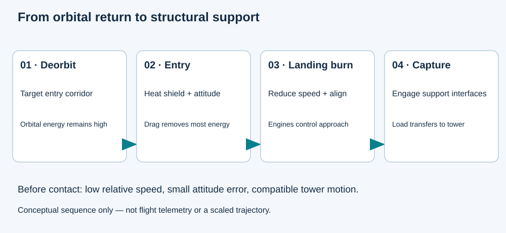
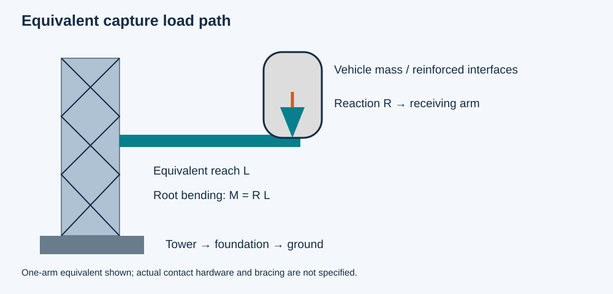
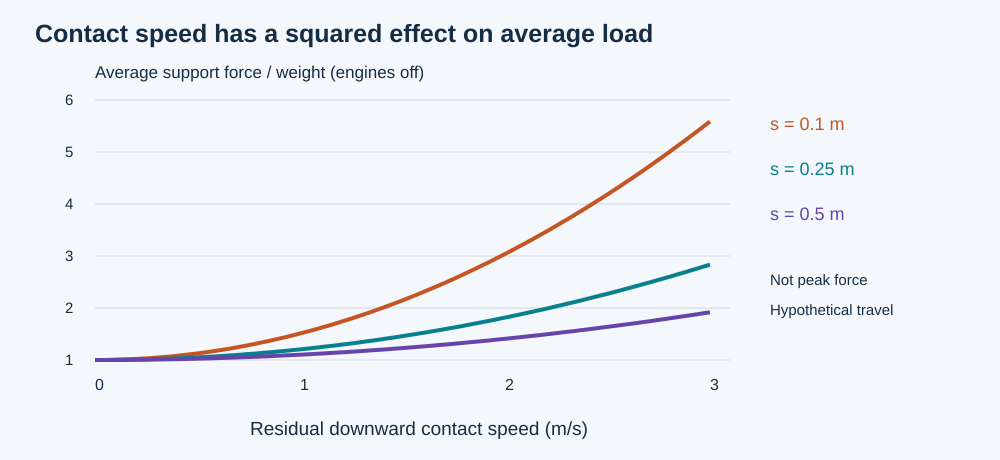

# Catching Starship: guidance, contact loads and the launch-tower structure

**MIE 446 · Aerospace Structures · University of Massachusetts Amherst**  
Engineering case study · Updated 14 November 2026 (US Eastern time)

[Illustrated web edition](https://ehsan-roohi.github.io/Aerospace-Structures/case-studies/starship-catch/) · [Course readings](READINGS.md)

## 1. What happened, and what has not yet been demonstrated

Zoomit's linked report describes the first tower-arm catch of Starship's upper stage on Flight 15 [1]. Contemporary reporting places the catch at approximately 4:20 p.m. EST on 14 November, after about 22.5 hours and 14 orbits. The upper stage returned to Starbase; the Super Heavy booster did not complete its planned tower recovery [3]. This is a milestone in upper-stage recovery, not evidence that both stages were recovered on this mission or that routine, low-maintenance reuse has already been achieved.

SpaceX's mission plan identified 26 Starlink V3 payloads and an upper-stage return conditional on vehicle health. It also described heat-shield inspection imagery and improvements to tile retention and gap heating [2]. Distinguish the plan on the mission page from the observed result in the dated reporting. The milestone is the tower catch of an orbital upper stage; sweeping claims that no spacecraft or orbital vehicle had previously returned intact would be incorrect.

## 2. Watch the hardware, then identify the stages

**[Flight 15 official mission page and webcast](https://www.spacex.com/launches/starship-flight-15)** — current mission context and playback access [2].

**[SpaceX Flight 5 official video](https://www.youtube.com/watch?v=hI9HQfCAw64)** — a clearly labelled historical comparison: this shows the Super Heavy booster catch on 13 October 2024, not the Flight 15 upper-stage catch [4].

*Video thumbnail links to SpaceX's original footage; rights remain with its owner. For Flight 15 imagery, use the official mission page above.*

Super Heavy is the first-stage booster. Ship is the upper stage that reaches orbital speed and experiences atmospheric entry on return. Recovering Ship couples orbital targeting, thermal protection, aerodynamic control, engine restart and structural capture. A booster recovery and an orbital upper-stage recovery therefore share a tower concept but have different flight histories, thermal states and load envelopes.

## 3. The sequence: remove energy before touching the tower

*Figure 1. Original educational schematic; not a SpaceX trajectory, scale drawing or reconstruction of flight telemetry.*

1. **Target the return corridor.** A deorbit manoeuvre changes the orbit so that the vehicle encounters the atmosphere at the intended location. Landing-site access depends on orbital geometry and timing; it is not simply a vertical fall back to the launch pad.
2. **Manage atmospheric entry.** Drag dissipates most of the orbital kinetic energy. The heat shield protects the underlying structure while aerodynamic surfaces control attitude and trajectory. Peak heating and peak aerodynamic load need not occur together.
3. **Transition to powered vertical descent.** Aerodynamic control authority decreases with dynamic pressure. Engine thrust and attitude control must establish a low-speed, near-vertical final approach. The exact Flight 15 control laws and timing are not published in the sources reviewed here.
4. **Enter the capture envelope.** Vehicle position, lateral velocity, attitude, vertical speed and tower readiness must all be compatible. If they are not, a safe diversion is preferable to forcing contact.
5. **Transfer load.** The engines reduce the remaining descent speed; the receiving interfaces and tower then support the vehicle. Engine shutdown, contact and support engagement form a coupled transient.

**The arms do not stop a rocket arriving at orbital speed.** For an illustrative orbital speed of 7.8 km/s, specific kinetic energy is about 30 MJ/kg. At 1 m/s it is only 0.5 J/kg. Atmosphere and propulsion must remove almost all of the incoming energy before structural capture.

## 4. Flight mechanics and control–structure interaction

NASA gives the rocket-thrust relation and aerodynamic force definitions [5–7]. For a simplified near-vertical descent, with upward positive,

$$m\dot v_z=T_z+D_z+R_z-mg,$$

where $R_z=0$ before contact and represents tower support after contact. Aerodynamic force is signed; it opposes the relative airflow, not necessarily a fixed axis. Thrust is approximately

$$T=\dot m_p v_e+(p_e-p_a)A_e,$$

and aerodynamic scales are

$$q=\tfrac12\rho V^2,\qquad D=qC_DA,\qquad M_a=qA\ell C_m.$$

The vehicle and tower form a moving-target problem: the rocket translates and rotates, while the arms and tower deflect under wind and load. A lateral offset $e$ combined with support force $F$ introduces an additional moment of order $Fe$. A nominally vertical approach can therefore generate torsion, lateral bending and unequal contact reactions.

A conceptual capture condition is $|e|+\ell|\theta|+u_{\rm tower}+\epsilon_{\rm sensing}<c$, where $c$ is available clearance, $\ell|\theta|$ is the small-angle displacement from attitude error, $u_{\rm tower}$ is tower motion, and $\epsilon_{\rm sensing}$ is an uncertainty allowance. This conservative teaching expression is not SpaceX's actual guidance criterion. No certified capture tolerance is inferred from video.

## 5. Follow the load all the way into the ground

*Figure 2. Original equivalent load-path model. Contact geometry, support hardware and stiffness values are schematic; this is not a disclosed SpaceX engineering drawing.*

The engineering load path is vehicle structure → designated capture interfaces → arms and their supporting carriage/mechanisms → tower → foundation → ground. The heat-shield surface is not an assumed primary support interface. Concentrated reactions require local reinforcement and must connect to load-carrying structure; global strength alone cannot establish local bearing, attachment or shell-buckling safety.

For an ideal two-support model separated by $b$, a total vertical reaction $F$ with eccentricity $e$ gives

$$R_L=\frac F2-\frac{Fe}{b},\qquad R_R=\frac F2+\frac{Fe}{b}.$$

Thus equal sharing requires a centred load. Contact at one side first can generate a larger temporary imbalance than this static model predicts. For a cantilever-like equivalent arm of reach $L$ carrying reaction $R$,

$$M_{\rm root}=RL,\quad \sigma_{\rm bend}=\frac{M_{\rm root}c}{I},\quad \delta=\frac{RL^3}{3EI}.$$

Actual arms are three-dimensional assemblies: joint compliance, bracing, torsion, mechanisms and dynamic amplification matter. These formulas teach the consequences of reach and stiffness; they do not certify the tower. Doubling reach doubles root bending moment and increases elastic deflection eightfold if load and section stiffness are unchanged.

## 6. Why contact speed and stopping distance matter

During a short capture interval, approximate mass as constant and neglect aerodynamic force. If residual downward speed $v_c$ is removed over effective downward stopping travel $s$, work–energy gives an average upward support load

$$\bar F=mg-\bar T+\frac{mv_c^2}{2s}.$$

Here $\bar T$ is an appropriately work-averaged upward thrust during the stroke. With engines off, $\bar F/(mg)=1+v_c^2/(2gs)$. The effective travel may include structural deflection and motion in receiving hardware; **no particular damper design or stroke is claimed for SpaceX**. Peak force depends on the force–displacement law and can exceed this average.

*Figure 3. Engine-off average load factor from the equation above. These are classroom parameters, not measured Starship contact speeds or hardware travels.*

**Worked example:** assume $m=120{,}000$ kg, $v_c=1$ m/s and $s=0.25$ m, with no residual thrust. Weight is 1.177 MN and average support force is 1.417 MN, or 1.20 times weight. Two ideal equal supports each carry about 0.709 MN. Increasing speed to 2 m/s gives 2.137 MN total, or 1.82 times weight. These masses and strokes are assumptions, not Flight 15 measurements.

For an assumed 10 m equivalent arm reach, the first case produces about 7.09 MN·m root moment per arm. A peak contact history, section properties, attachment allowables and fatigue spectrum would still be required for design.

## 7. Thermal recovery is also a structural problem

The returning Ship is thermally nonuniform. A freely expanding member has $\Delta L=\alpha L\Delta T$; a fully restrained, uniform, linear-elastic member has an ideal thermal stress magnitude $E\alpha\Delta T$. Real restraint is partial, temperature changes through thickness, and hot material properties differ from room-temperature values. Thermal distortion changes local clearances and contact alignment.

Heat-shield integrity, attachment loads, flap actuation and tank/skin temperature are coupled. Passing entry does not automatically establish remaining structural life. Inspection must consider tile damage, local deformation, attachment condition, welds, residual strain and the cumulative ascent/entry/catch load cycle. The classroom distinction is **successful recovery versus demonstrated turnaround and repeatable life**.

## 8. Why use a tower instead of landing legs?

Moving part of the landing-support function to the ground can reduce carried landing hardware and facilitate handling at the launch site. However, the vehicle still needs catch interfaces and reinforcement. The benefit must be evaluated against tower cost, inspection, availability, weather limits and the possibility that an unsuccessful approach damages shared ground infrastructure.

A tower catch is a systems trade: airborne mass, structural margins, guidance accuracy and operational reliability are exchanged against one another. A successful demonstration does not by itself determine cost per flight. That requires measured refurbishment work, component life, launch cadence and failure/repair statistics.

## 9. MIE 446 exercise

Use the worked example to compare $v_c=0.5,1,2$ m/s and $s=0.1,0.25,0.5$ m. Calculate total reaction, equal-share reactions and root moments. Then introduce $e/b=0.1$ and quantify how far each reaction moves from equal sharing. Clearly distinguish average and peak force.

In Beam Lab, represent one arm as an equivalent cantilever and compare reach and stiffness effects. In a truss model, apply support reactions to load-carrying joints and trace axial force to the tower. State which real effects each simplification omits: contact timing, plasticity, torsion, connection flexibility, temperature and vehicle–tower motion. Finally explain why conservation of energy alone cannot give peak contact force.

## Sources and media

1. [Zoomit: linked Flight 15 report](https://www.zoomit.ir/aviation-aerospace/471141-spacex-chopsticks-catch-starship-upper-stage-flight-15/). Read in Persian; this lesson is an original engineering synthesis, not a translation or reproduction.
2. [SpaceX: Flight 15 mission plan and webcast](https://www.spacex.com/launches/starship-flight-15). Primary source for planned sequence, readiness checks and heat-shield provisions.
3. [Space.com: Flight 15 live updates, 14 November 2026](https://www.space.com/news/live/spacex-starship-flight-15-live-updates-nov-14-2026-starship-first-double-landing-attempt). Dated reporting of the catch and booster diversion; early explanations of the booster anomaly evolved and should not be treated as a final investigation.
4. [SpaceX: Flight 5 mission report](https://www.spacex.com/launches/starship-flight-5) and [official video](https://www.youtube.com/watch?v=hI9HQfCAw64). Historical booster comparison only.
5. [NASA Glenn: rocket thrust equation](https://www1.grc.nasa.gov/beginners-guide-to-aeronautics/rocket-thrust-equation/).
6. [NASA Glenn: drag equation](https://www1.grc.nasa.gov/beginners-guide-to-aeronautics/drag-equation/).
7. [NASA Glenn: rocket aerodynamics](https://www1.grc.nasa.gov/beginners-guide-to-aeronautics/rocket-aerodynamics/).

All three engineering figures are original course schematics. Public sources do not provide enough information to infer certified catch loads, allowable stresses, capture tolerances or fatigue life; numerical examples above are explicitly hypothetical.
