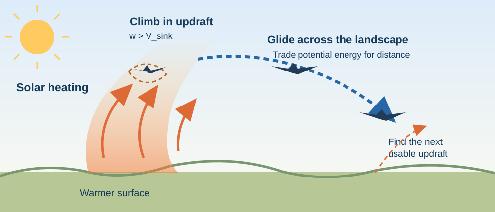
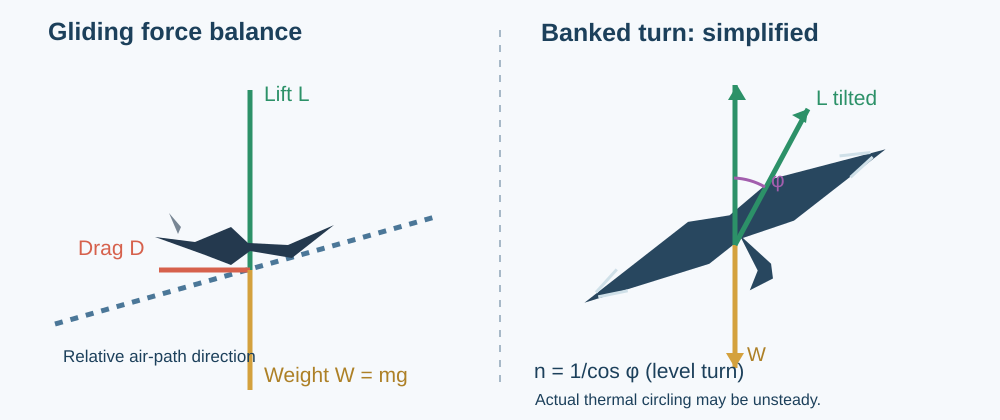

# The Turkey Vulture: Soaring Flight as a Natural Thermofluid System

**MIE 446 · Aerospace Structures · University of Massachusetts Amherst**  
**Field case:** a soaring bird above Amherst, Massachusetts, observed 8 November 2026  
**Scientific focus:** gliding aerodynamics, atmospheric boundary-layer flows, structural loads, migration and carrion foraging

[← Course home](README.md) · [← Engineering readings](READINGS.md)

> **What allows a heavy bird to remain aloft for minutes without flapping?** The answer is not that drag has disappeared. A soaring vulture exchanges energy with the atmosphere: its wings convert relative air motion into lift, while thermals and other localized rising flows can replenish the altitude otherwise lost to drag.

## 1. Field observation: a nearly motionless pair of wings

During a cool November morning in Amherst, a large dark bird was photographed flying above leafless trees. Over several minutes it flew long, nearly straight stretches, lost some altitude, made partial and irregular turns, and occasionally flapped. There was generally light wind, with occasional stronger gusts. The original field photographs are part of the observation record supplied by the instructor; **this document does not assume that a still photograph is a calibrated measurement of speed, altitude, wind or species identity**.

The broad wings, fingered primaries, comparatively small head, relatively long tail and extended nonflapping flight are **consistent with a Turkey Vulture (*Cathartes aura*)**. Confirmation would benefit from a sharply resolved underside: Turkey Vultures have dark wing linings, distinctly paler flight feathers and a shallow V-shaped (dihedral) soaring posture. Red-tailed Hawks and other large raptors are possible alternatives when viewed only as distant silhouettes [1].

*Figure 1. Adult Turkey Vulture in flight. Photograph credited to the U.S. Fish and Wildlife Service, public domain; [image record](https://commons.wikimedia.org/wiki/File:TurkeyVultureInFlight.JPG). This is a **reference photograph**, not the Amherst bird.*

*Figure 2. Turkey Vulture in flight, photograph by Kram Eclod, CC0 1.0; [image record and licensing](https://commons.wikimedia.org/wiki/File:Turkey_Vulture_in_Flight.jpg). Compare the fingered primary feathers and wing planform with the Amherst silhouettes.*

*Figure 3. Original conceptual diagram, showing energy gained in an updraft and spent during a glide. Not to scale.*

### What the observed turns could mean

A nearly complete circle is not necessary. A bird may briefly bank to remain in a patch of lift, move into stronger lift, reverse direction along an air boundary or transition to another air mass. **Neither the presence of a light surface wind nor the shape of an incomplete circle proves that a thermal was operating at the bird's altitude.** Thermal convection, terrain-enhanced upward flow and shear-generated turbulence are distinct hypotheses.

Mallon, Bildstein and Katzner [2] documented **“contorted soaring”** in Turkey and Black Vultures. At low altitude, particularly along forest edges and in weak-thermal conditions, the birds made tortuous, vertically variable paths that appeared to exploit small-scale turbulent uplift. This is a particularly relevant alternative explanation for the irregular Amherst flight. In their observations, almost all such flights were below 50 m above ground level; that result **must not** be treated as a measured altitude for the Amherst bird.

## 2. Wings still produce lift when they do not flap

The essential reference velocity is **airspeed relative to the surrounding air**, not speed relative to the ground. For a wing of reference area $S$, the usual aerodynamic definitions are

$$
L=\frac{1}{2}\rho V_a^2 S C_L,\qquad
D=\frac{1}{2}\rho V_a^2 S C_D,
$$

where $\rho$ is local air density, $V_a$ is airspeed, and $C_L$ and $C_D$ depend on wing shape, angle of attack, Reynolds number, deformation and flow state. The relative airflow is maintained by the bird's motion through the air. There is **no need for continuous wing motion** to create lift.

For a steady, straight glide in still air, with flight path angle $\gamma<0$ measured below the horizontal,

$$
L=W\cos|\gamma|,\qquad D=W\sin|\gamma|,\qquad
\tan|\gamma|=\frac{D}{L}.
$$

Thus the horizontal distance flown per vertical distance lost is

$$
G=\frac{\Delta x}{-\Delta h}=\cot|\gamma|=\frac{L}{D}.
$$

In the shallow-glide approximation,

$$
V_{\mathrm{sink}}\simeq V_a\frac{D}{L}
=\frac{V_a}{L/D}.
$$

**Important distinction:** glide ratio is a ratio of *air-relative horizontal distance* to height lost in steady still-air conditions. A tailwind can improve ground range, and a headwind reduces it; neither changes the basic aerodynamic glide ratio at fixed airspeed and configuration.

### 2.1 Why these wings are effective

Broad wings lower wing loading, while separated outer primaries and adjustable feathering help a bird manage induced drag, stability and maneuvering. For a simple finite-wing approximation,

$$
C_D \approx C_{D,0}+\frac{C_L^2}{\pi e\,AR},
\qquad
AR=\frac{b^2}{S},\qquad
\frac{W}{S}=\frac{mg}{S},
$$

where $b$ is wingspan, $AR$ aspect ratio, $e$ an aerodynamic efficiency factor, and $C_{D,0}$ a lumped zero-lift drag coefficient. **This idealized polar is not a fitted or measured Turkey Vulture polar.** Actual birds change body posture, feather spacing and camber continuously.

Cornell Lab reports a typical Turkey Vulture wingspan around **1.70–1.78 m** and an indicative mass around **2.0 kg** [1]. For a *hypothetical* wing area $S=0.55\ \mathrm{m^2}$ and wingspan $b=1.75\ \mathrm{m}$, the corresponding illustrative values are

$$
\frac{W}{S}\approx\frac{(2.0)(9.81)}{0.55}
=35.7\ \mathrm{N\,m^{-2}},\qquad
AR\approx\frac{1.75^2}{0.55}=5.57.
$$

Because that area is an **assumption**, neither value should be attributed to the photographed individual.

*Figure 4. Original engineering diagram: lift, weight, drag, relative wind and the mechanics of a banked turn.*

### 2.2 The fluid–structure connection

The lift is spatially distributed. If $l(y)$ denotes the lift per unit span on one wing, then an idealized local shear force and bending moment can be written

$$
V(y)=\int_y^{b/2} l(\eta)\,d\eta,\qquad
M(y)=\int_y^{b/2} l(\eta)(\eta-y)\,d\eta,
$$

ignoring distributed wing inertia and weight for this simplified model. The wing must resist bending, shear and torsion while retaining an aerodynamic shape. Its structure is not a rigid plate: feathers and joints permit morphing and aeroelastic response.

A coordinated *level* turn illustrates a load penalty:

$$
n=\frac{L}{W}=\frac{1}{\cos\phi},
\qquad R\approx\frac{V_a^2}{g\tan\phi},
$$

for bank angle $\phi$, steady speed and negligible wind. At $\phi=30^\circ$, the load factor is $1.155$. Real thermal turns are often climbing and unsteady, so these equations are pedagogical limiting cases, **not** measured instantaneous vulture loads. The bird trades turn radius, induced drag, structural loading and position inside the updraft.

## 3. How the atmospheric boundary layer supplies energy

### 3.1 Solar heating and thermal updrafts

On a sunlit day, the surface heats nonuniformly. Warm parcels can rise when their virtual potential temperature is greater than the surrounding air. A simple buoyancy estimate is

$$
B\approx g\,\frac{\theta_v'}{\overline{\theta_v}},
$$

where $\theta_v'$ is the parcel's virtual-potential-temperature anomaly. Buoyancy drives convection, but the actual vertical flow $w(x,y,z,t)$ also depends on stratification, turbulent mixing, entrainment, shear and surface heat flux. A cool day **can** still develop solar thermals over sufficiently heated surfaces; low ambient temperature alone does not rule them out.

Take upward velocity as positive. The vertical ground-referenced trajectory of a gliding bird can be approximated by

$$
\boxed{\frac{dh}{dt}\approx w_{\mathrm{updraft}}-V_{\mathrm{sink}}}
$$

when horizontal wind components, airframe configuration and speed changes are considered separately. Hence:

| Local upward air motion | Net result with $V_{\mathrm{sink}}=0.8\ \mathrm{m/s}$ |
|---|---|
| $w=0$ | Bird descends at $0.8\ \mathrm{m/s}$ |
| $w=0.5\ \mathrm{m/s}$ | Bird descends at $0.3\ \mathrm{m/s}$ |
| $w=0.8\ \mathrm{m/s}$ | Approximately maintains height |
| $w=1.2\ \mathrm{m/s}$ | Bird climbs at $0.4\ \mathrm{m/s}$ |

*All numbers in this table are an **illustrative scenario**, not measurements in Amherst.*

A useful mechanical-energy bookkeeping equation is

$$
\frac{d}{dt}\left(mgh+\frac12 mV_a^2\right)
\approx mgw_{\mathrm{updraft}}-DV_a+\mathcal{W}_{\mathrm{shear}},
$$

where $\mathcal{W}_{\mathrm{shear}}$ represents any additional exchange with spatially or temporally varying air motion; the equation is a deliberately simplified model with assumptions about the air-relative reference frame. In a steady constant updraft and near-constant speed, the updraft's energy gain can offset aerodynamic losses.

### 3.2 Why mild wind may be enough

A weak mean horizontal wind does not automatically create usable lift. However, **local** flow may differ dramatically from an observer's surface impression: gusts, buildings, tree lines, slope geometry and vertical wind shear alter the flow field. Rising flow may come from (i) convection, (ii) wind deflected upward by terrain or an obstacle, or (iii) structured turbulence and shear. One should not conflate these mechanisms.

In eastern North America, GPS-based migration analysis by Bohrer and colleagues [3] concluded that Turkey Vultures relied predominantly on **thermal lift** during migration, whereas Golden Eagles relied more on **orographic lift**. During local foraging, Turkey Vultures may additionally exploit the turbulent uplift identified by Mallon and colleagues [2]. These findings are complementary, not contradictory: atmospheric use depends on scale, terrain, weather and behavioral context.

Rader and Hedrick [4], using 3D videography, found that Turkey Vultures adjust airspeed in response to lower air density, while maintaining comparable glide geometry and without a clear compensating increase in flapping. This provides an elegant example of behavioral adaptation to the local fluid environment.

## 4. How many minutes — or kilometers — can it fly without flapping?

There is **no fixed clock limit** determined by the species. The result depends on altitude, sink polar, available updrafts, air density, wind, thermal spacing and the bird's choices.

**Worked example A: one glide in still air.** Assume constant airspeed $V_a=10\ \mathrm{m/s}$, natural sinking speed $V_{\mathrm{sink}}=0.8\ \mathrm{m/s}$, and $h_0=240\ \mathrm{m}$ above the intended end level:

$$
t_{\mathrm{glide}}\approx\frac{240}{0.8}
=300\ \mathrm{s}=5\ \mathrm{min},
$$

$$
G\approx\frac{10}{0.8}=12.5,\qquad
R_{\mathrm{air}}\approx10(300)=3{,}000\ \mathrm{m}.
$$

These are **chosen teaching values**; a glide ratio of 12.5 has **not** been established here as the Turkey Vulture's measured maximum or typical glide ratio. Any headwind, tailwind or changing sink speed changes the actual ground track.

**Worked example B: sustained lift.** Suppose the same bird encounters upward flow of $w=1.2\ \mathrm{m/s}$. It then climbs at about $0.4\ \mathrm{m/s}$ and in five minutes could gain **120 m** without a wingbeat:

$$
\Delta h=(1.2-0.8)(300)=120\ \mathrm{m}.
$$

It can later exchange this altitude for another long glide. Repeating this **thermal climb → glide → thermal climb** pattern permits extended unpowered travel. The bird is extracting energy from atmospheric motion, not violating conservation of energy.

**Measured research, not extrapolation:** Rader and Hedrick [4] report extended predominantly gliding behavior in Turkey Vultures; Mandel and colleagues [5] used satellite tracking and heart-rate measurements to show comparatively low added effort during long migratory days. For a separate, larger species, Williams and colleagues [6] recorded an **Andean Condor** traveling roughly **172 km in more than five hours without flapping**. That is an Andean Condor result; **it must not be presented as a demonstrated Turkey Vulture record**.

### Why does it occasionally flap?

A flap provides positive mechanical work when lift is insufficient, helps at takeoff, supports maneuvering or compensates for an unfavorable energy state. Flapping is metabolically costly; using thermals can increase useful travel per unit food energy. A vulture is therefore not trying to minimize *every* wingbeat, but to optimize its flight in a moving, uncertain atmosphere.

## 5. Feeding ecology: soaring is part of the search strategy

Turkey Vultures primarily eat **carrion**: dead mammals and also birds, reptiles, amphibians and fish. They are not specialized hunters of healthy live prey. Carrion is geographically patchy, short-lived and hard to predict. Thus an ability to search expansive terrain cheaply is valuable.

Unlike many other raptors, Turkey Vultures have an exceptional **sense of smell**. Comparative anatomical research found markedly enlarged olfactory bulbs relative to Black Vultures [7]. Smell and sight can work together in locating food.

A simplified **foraging energy budget** is

$$
E_{\mathrm{net}}=
E_{\mathrm{food\,acquired}}
-E_{\mathrm{flight}}
-E_{\mathrm{other\,costs}}.
$$

A bird that spends less energy covering a search area needs a smaller energy return per kilometer traveled. It can investigate dispersed odor plumes and search large landscapes before landing at a carcass. Soaring and olfaction are consequently ecological complements.

Turkey Vultures play an important role as **scavengers** in decomposition and nutrient cycling. The species' ecological niche helps explain why light wing loading, accessible atmospheric lift, sensory specialization and broad geographic range are so tightly associated.

*Figure 5. Flying Turkey Vulture from the side. Photograph by Kpts44, CC0 1.0; [file and license](https://commons.wikimedia.org/wiki/File:Turkey_Vulture_flying_profile.jpg).*

## 6. Where do Turkey Vultures migrate, and why?

Turkey Vultures are **partial migrants**. The species ranges widely from Canada through the Americas; not all individuals migrate.

According to Cornell Lab of Ornithology [1], birds from the **northeastern United States** commonly migrate relatively short distances south, with wintering areas from **North Carolina to Louisiana**. Some western populations migrate substantially farther through Mexico and Central America, with some reaching **Venezuela, Colombia or Ecuador**. These are population-level tendencies: **we cannot determine where the individual above Amherst was going**, or whether it was on migration at all, without a tag, band or repeated tracking.

**Seasonal pattern (schematic, not a track):**

| Season | Northeast population: typical tendency | Physical/ecological benefit |
|---|---|---|
| Spring | Return north to breeding range | Breeding opportunities and changing seasonal resources |
| Summer | Breeding/foraging in Massachusetts and elsewhere | Access to carrion; soaring as conditions permit |
| Autumn | Some move south toward the southeastern U.S. | Milder conditions and more accessible winter forage |
| Winter | Some in Carolinas, Gulf Coast states or other areas | Reduced exposure to severe northern winter conditions |

Both food access and the atmospheric cost of travel matter. Snow/ice can make carrion harder to access; shortening days and weaker convection can narrow the window for efficient soaring. A cold morning in Amherst does not itself establish that the photographed bird was migrating.

Dodge and colleagues [8] studied nearly ten years of GPS data from **24 satellite-tracked Turkey Vultures** in four populations, finding that migration and seasonal ranges relate to temperature, thermal uplift and proxies for food resources. Mandel and colleagues [5] found migration distances associated with atmospheric boundary-layer turbulence and observed only modest changes in mean heart rate as daily migration distance increased.

There is a strong thermofluid interpretation: **the atmosphere governs not only how fast a bird can travel, but also when a long journey is energetically affordable.** Birds may wait for favorable daytime uplift or adjust their route and timing.

## 7. Why has the species evolved these wings?

Natural selection favors combinations of anatomy and behavior that improve survival and reproduction under environmental constraints. For a mobile scavenger, broad adaptable wings, efficient gliding, keen olfaction and responsive control can make scattered carrion energetically accessible.

This is not evidence that a bird has zero flight cost: maintaining physiological function, positioning in airflow, turning, climbing and taking off still require energy. The remarkable result is that **external atmospheric work reduces the amount of muscular work required**.

Old World and New World vultures also illustrate **convergent evolution**: broadly similar scavenging and soaring adaptations appeared in lineages that are not each other's closest relatives. A theological interpretation of the beauty or purpose of nature can coexist as a philosophical perspective; the testable scientific explanation uses selection, biomechanics and environmental physics.

## 8. What would students measure to turn this into research?

The Amherst observation is compelling but **not instrumented**. A quantitative field study could combine:

1. Video timestamps and calibrated camera geometry to reconstruct the bird's heading, bank angle and changes in angular position.
2. Local wind and temperature profiles, terrain maps and solar heating, ideally with vertical-air-motion measurements or suitable atmospheric models.
3. Bird identification by clear underwing photographs, rather than silhouette alone.
4. A glide-polar model with uncertainty bounds and wind-corrected airspeed estimates.
5. A comparison between circling and irregular turns in predicted lift regions, avoiding the assumption that every irregular turn is thermal soaring.

### Questions for MIE 446

1. Derive the steady glide relationship $\tan|\gamma|=D/L$ from the force balance.
2. At $V_a=9\ \mathrm{m/s}$ and $L/D=12$, estimate the still-air sinking speed.
3. If the bird enters a $1.0\ \mathrm{m/s}$ updraft, does it climb under the assumptions of Question 2?
4. How does induced drag change as bank angle increases in a coordinated, constant-altitude turn?
5. Which wing structures carry spanwise bending and torsion under nonuniform lift?
6. Suggest one observation that would distinguish thermals from forest-edge shear-induced turbulence.
7. Why does a 5 m/s ground wind not tell us the bird's airspeed?
8. Explain why a long nonflapping flight is **not** evidence for zero drag or perpetual motion.

## 9. Conclusions

A vulture can remain aloft without continuous wingbeats because **gliding transfers gravitational potential energy into forward flight**, while **soaring exploits atmospheric energy to offset the inevitable sink**. Thermal convection is important, but localized turbulent and terrain-induced uplift can also be useful depending on conditions. Wing structure, dihedral posture and feather control complement the fluid dynamics. The result is an economical search and migration strategy for an animal that must find unpredictable, scattered carrion.

The bird photographed over Amherst on November 8, 2026 is probably a Turkey Vulture based on its silhouette and flight style, **not a conclusively confirmed identification or an instrumented aerodynamic experiment**.

---

## References and image credits

[1] Cornell Lab of Ornithology, *All About Birds: Turkey Vulture* — [identification](https://www.allaboutbirds.org/guide/Turkey_Vulture/id), [life history/food](https://www.allaboutbirds.org/guide/Turkey_Vulture/lifehistory), [migration map](https://www.allaboutbirds.org/guide/Turkey_Vulture/maps-range).

[2] Mallon, J. M., Bildstein, K. L., & Katzner, T. E. (2016). “In-flight turbulence benefits soaring birds.” *The Auk*, **133**(1), 79–85. https://doi.org/10.1642/AUK-15-114.1. [USGS record](https://pubs.usgs.gov/publication/70160610).

[3] Bohrer, G., et al. (2012). “Estimating updraft velocity components over large spatial scales: contrasting migration strategies of golden eagles and turkey vultures.” *Ecology Letters*, **15**, 96–103. https://doi.org/10.1111/j.1461-0248.2011.01713.x.

[4] Rader, J. A., & Hedrick, T. L. (2024). “Turkey vultures tune their airspeed to changing air density.” *Journal of Experimental Biology*, **227**, jeb246828. https://doi.org/10.1242/jeb.246828. [Open access](https://pmc.ncbi.nlm.nih.gov/articles/PMC11418199/).

[5] Mandel, J. T., et al. (2008). “Movement ecology of migration in turkey vultures.” *Proceedings of the National Academy of Sciences*, **105**, 19102–19107. https://doi.org/10.1073/pnas.0801789105. [Open access](https://pmc.ncbi.nlm.nih.gov/articles/PMC2614722/).

[6] Williams, H. J., et al. (2020). “Physical limits of flight performance in the heaviest soaring bird.” *Proceedings of the National Academy of Sciences*, **117**, 17884–17890. https://doi.org/10.1073/pnas.1907360117. **Andean Condor study**, not Turkey Vulture. [Open access](https://pmc.ncbi.nlm.nih.gov/articles/PMC7395523/).

[7] Grigg, N. P., et al. (2017). “Anatomical evidence for scent guided foraging in the turkey vulture.” *Scientific Reports*. [PubMed](https://pubmed.ncbi.nlm.nih.gov/29234134/) and [open access](https://pmc.ncbi.nlm.nih.gov/articles/PMC5727128/).

[8] Dodge, S., et al. (2014). “Environmental drivers of variability in the movement ecology of turkey vultures (*Cathartes aura*) in North and South America.” *Philosophical Transactions of the Royal Society B*, **369**, 20130195. https://doi.org/10.1098/rstb.2013.0195. [Open access](https://pmc.ncbi.nlm.nih.gov/articles/PMC3983930/).

**Figure credits:** Figure 1: USFWS, public domain via Wikimedia Commons. Figure 2: Kram Eclod, CC0 1.0 via Wikimedia Commons. Figure 5: Kpts44, CC0 1.0 via Wikimedia Commons. Figures 3–4: original instructional vector schematics. **The user-supplied Amherst photographs have not been uploaded as publicly hosted files**; the narrative describes them accurately without substituting a reference photo for the actual observation.
