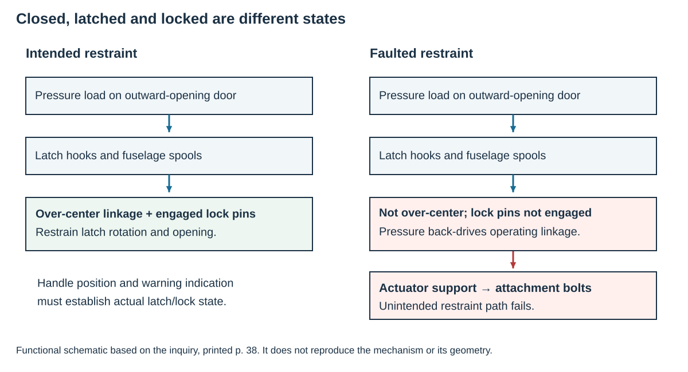
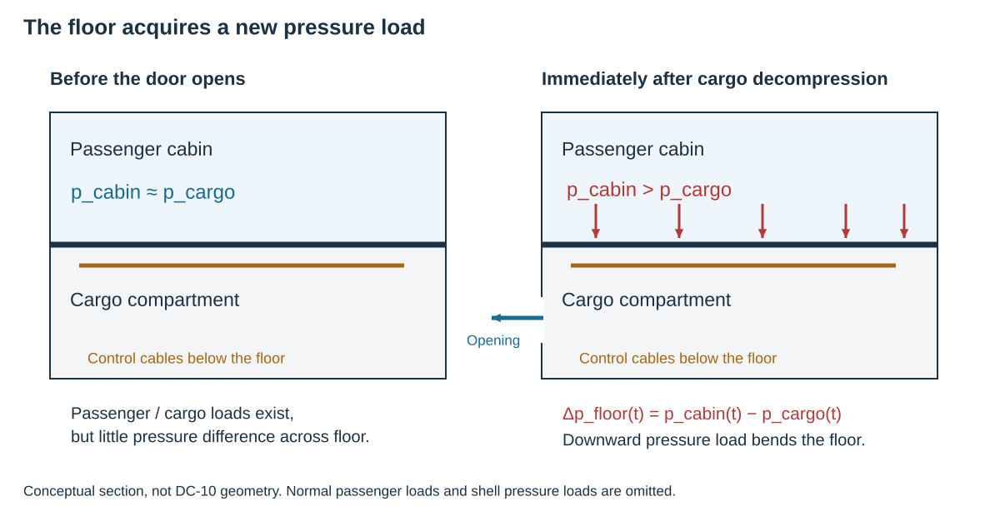
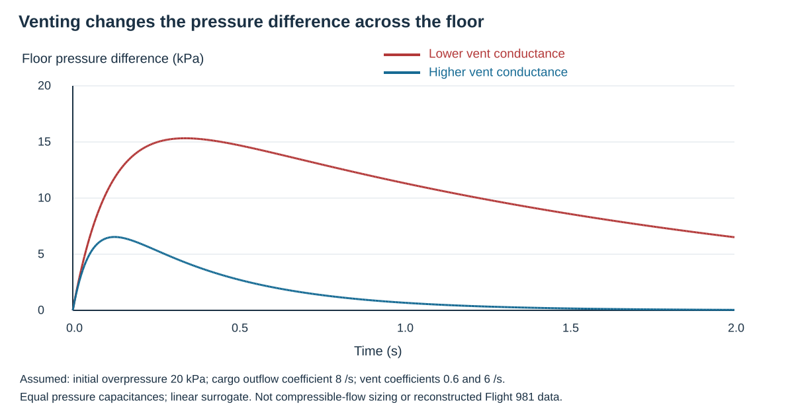
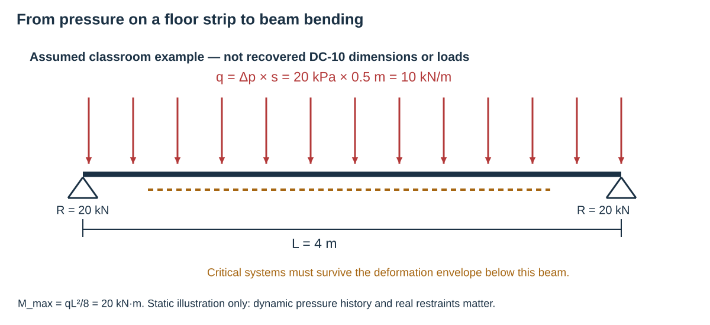
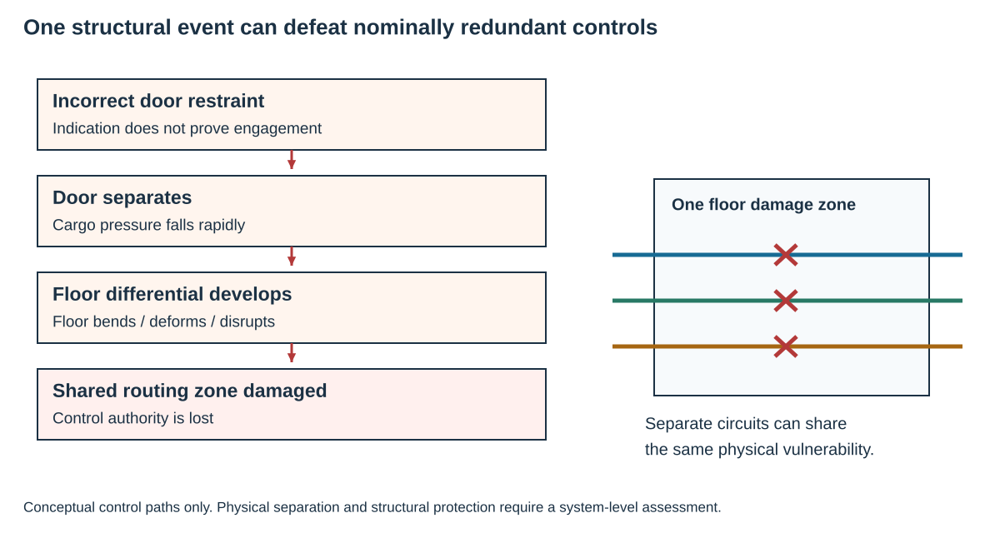

# Turkish Airlines Flight 981 and the structure of a preventable failure

**MIE 446 · Aerospace Structures · University of Massachusetts Amherst**  
**Case:** McDonnell Douglas DC-10-10, TC-JAV · Ermenonville, France · 3 March 1974

[Open the illustrated web edition](https://ehsan-roohi.github.io/Aerospace-Structures/case-studies/flight-981/) · [Course readings](README.md#engineering-readings-and-case-studies)

A pressure-loaded door, its latch geometry, a cabin floor and flight-control cables formed one interconnected safety problem. Studying each component in isolation misses the failure path that made this accident unrecoverable.

On the Paris–London leg of Flight 981, the aft left cargo door separated during the climb. Decompression damaged the passenger floor and the controls beneath it. The aircraft struck the Ermenonville forest 77 seconds later; all 346 occupants died. The French investigation identified incorrect door-latch engagement, enabled by the mechanism design, as the initiating condition. [BEA accident summary][bea]

**Reading origin.** Amir Abdolmaleki’s [Zoomit article][zoomit] prompted this case study. The following is an original English engineering reading, not a line-by-line translation. Historical findings are checked against the inquiry and FAA/NTSB records; original schematics and explicitly assumed calculations explain the mechanics.

## 1. Pressure needs a continuous load path

For a uniform pressure difference across a flat projected area,

F = Δp A

The force is normal to the surface. It does not disappear because a handle is flush or a light is off. Door panels, stiffeners, hinges, latches, fittings and the surrounding fuselage must provide an equilibrium path for it. The actual reaction at each fitting depends on geometry, stiffness, deformation and contact; equal sharing is an assumption, not a default result.

An outward-opening cargo door relies on mechanical restraint against the pressure load. By contrast, pressure can seat an appropriately designed plug-type door against its frame. Neither concept eliminates the need for a complete structural and operating-system assessment. The engineering question is **which physical contacts and constraints exist in the as-operated configuration?**

*Figure 1. Original functional schematic informed by the inquiry’s printed p. 38. This is a load-path explanation, not a dimensioned drawing of the DC-10 mechanism.*

## 2. A small kinematic error can create a different structural system

The inquiry’s mechanism illustration contrasts correct over-center closure with a reversible, incompletely closed arrangement. The recovered actuator extension was 277.5 mm rather than the 297 mm associated with full extension. The lock pins were not engaged. The pressure-induced load could therefore back-drive the operating linkage; failure of the actuator attachment bolts released the restraint. [Inquiry, printed p. 38][mechanism]

The implication is deeper than “the bolts needed to be stronger.” A linkage on the wrong side of its intended position changes the direction in which load tends to move it. A strength calculation for the correctly constrained assembly does not verify an assembly with missing contact or incomplete engagement.

Use two separate checks:

- **Kinematics:** can pressure loading move the mechanism toward release?
- **Strength:** can the members and joints carry the loads when the intended restraints are present?

A finite-element model with the latch artificially fixed can answer the second question while concealing the first. Contact, clearance, travel, tolerance stack-up and realistic boundary conditions must represent the state being assessed.

### Closed, latched and locked are not synonyms

The required support-plate modification had not been completed, and the inquiry found incorrect lock-pin and warning-switch adjustment. Tests allowed the handle and vent door to reach apparently normal positions without abnormal operating force even though the door was not securely locked. [Inquiry, §§5.1–5.2][conclusions]

The FAA account also notes that the maintenance record indicated installation of a support plate that investigators did not find on the aircraft. [FAA lessons learned][faa]

A maintenance entry records an action; it does not carry load. A warning switch records the variable it actually senses; it does not automatically establish engagement of every restraint. Acceptance evidence must connect the indication to the mechanical state, including deformation and misadjustment.

## 3. Why losing a cargo door loaded the passenger floor

Both compartments normally contain pressurized air. The floor carries passenger, seat and other service loads, but normally has little cabin-to-cargo pressure difference. A large opening in the lower compartment can change that balance rapidly: cargo pressure falls before cabin pressure has time to equalize through available flow paths.

Δpfloor(t) = pcabin(t) − pcargo(t) Ffloor(t) = ∫ Δpfloor(x,y,t) dA

A positive differential loads the floor **downward**. This is not merely the ordinary fuselage skin pressure load applied to a different drawing; it is a transient load across an internal partition.

*Figure 2. Original conceptual section. Pressure arrows show the additional floor load after lower-compartment depressurization. Passenger loads and detailed shell geometry are omitted.*

The inquiry identified inadequate intercompartment pressure relief and the concentration of flight-control cables beneath the affected floor as vulnerabilities in the sequence. [Inquiry, §5.2 and recommendations][conclusions]

Stronger flooring and faster pressure equalization address different parts of the problem. Increasing floor strength raises resistance; increasing effective intercompartment flow can reduce the applied differential. A valid design considers both the pressure history and the structural response, including the routes through which air can actually pass.

## 4. A transparent transient model

The following curves are **not accident measurements**. They are calculated from an assumed, linear two-compartment surrogate with equal pressure capacitances. Let u and v be cabin and cargo overpressures divided by an assumed initial overpressure p₀:

du/dt = −kv(u − v) dv/dt = kv(u − v) − kov u(0) = v(0) = 1; Δpfloor = p₀(u − v)

The vent term transfers pressure between compartments; the opening term depressurizes the cargo compartment. Use p₀ = 20 kPa, kₒ = 8 s⁻¹ and compare kᵥ = 0.6 with 6 s⁻¹. The calculated differential starts at zero, rises and then decays. More effective venting lowers its peak in this model.

*Figure 3. Original calculation with explicitly assumed parameters. [CSV data](docs/case-studies/flight-981/pressure-transient.csv) · [Model inputs](docs/case-studies/flight-981/pressure-model.json) · [Reproduction script](scripts/build_flight981_case_study.py).*

This model isolates a mechanism; it cannot size a real vent or reconstruct Flight 981. Large-opening compressible flow, possible choking, unequal compartment volumes, air temperature, obstructions, vent-panel opening and spatial pressure gradients require a more complete analysis. The time constants here are assigned, not fitted to the aircraft.

## 5. From pressure to floor-beam bending

**Assumed classroom example:** take Δp = 20 kPa. A 2 m² projected door area would carry 40 kN. This is a force scale, not the accident’s reconstructed door load.

For an illustrative floor beam, assume tributary width s = 0.5 m and a simply supported span L = 4 m. Uniform differential pressure produces

q = Δp s = 20 kPa × 0.5 m = 10 kN/m R = qL/2 = 20 kN at each end Mmax = qL²/8 = 20 kN·m

*Figure 4. Original teaching idealization. The dimensions, supports and pressure are assumed; no actual floor-beam allowable is inferred.*

The beam equation establishes demand, not a failure verdict. Bending stress additionally needs section properties; joints, local buckling, fasteners and frame attachments need separate checks. Real floor continuity and dynamic response can change the result substantially.

Compare the pressure-pulse duration with the relevant structural vibration periods. A quasi-static peak-pressure calculation is insufficient when inertia matters. Conversely, applying a universal “dynamic factor of two” is not justified: that familiar value belongs to a particular undamped linear step-load idealization, not every decompression history.

## 6. Structural damage became a control-system failure

The critical question is not only whether a floor remains attached. Ask what its deformation can strike, pull, jam or sever. If several control routes pass through one damage zone, counting them as separate circuits does not establish independence.

*Figure 5. Original failure-chain diagram. The three drawn routes illustrate common-cause exposure; they are not the actual number or layout of DC-10 circuits.*

For structural-system integration, define a damage and deformation envelope around the floor. Then check routing, separation, residual control authority and whether damage to one command path can obstruct another. Hydraulic actuators can remain capable of producing force yet be unusable if their command paths are disabled. More hydraulic capacity does not by itself replace lost commands.

## 7. The earlier event was evidence, not reassurance

On 12 June 1972, American Airlines Flight 96 experienced aft cargo-door separation near Windsor, Ontario. Floor damage impaired controls, but the crew returned to **Detroit Metropolitan Airport**. The NTSB report and its recommendations addressed both the locking arrangement and floor pressure relief. [NTSB AAR-73-02][ntsb]

This corrects the Zoomit article’s statement that the aircraft landed in Windsor. The accident location and the recovery airport are different.

The FAA comparison reports that the floor damage in Flight 981 was more severe and that its seating configuration increased the consequences of decompression. [FAA comparison of the two events][faa]

Survival in one occurrence does not establish adequate margin in every configuration. A heavier floor loading, a different obstruction or a less favorable damage pattern can expose the same shared vulnerability. A corrective-action program must verify what was installed, how it was adjusted and whether it addresses propagation as well as initiation.

## 8. What current design requirements ask

Modern **14 CFR 25.365(e)–(g)** addresses sudden pressure-release conditions, combinations with flight loads, intercompartment venting and deformation that could compromise continued safe flight and landing. This connects the pressure boundary, internal floors and safety-critical systems rather than treating them as unrelated components. [Current §25.365][pressure-rule]

Modern **§25.783(c)–(f)** addresses prevention of unsafe pressurization with an unsecured door, latch/lock integrity, reliable indications and direct inspection. These are present-day requirements, including later amendments—not a claim that today’s wording was the DC-10’s 1974 certification basis. [Current §25.783][door-rule]

The design lesson is to protect both sides of the event: prevent unintended opening, and preserve survivability if a pressure boundary is nevertheless lost.

## Questions for an aerospace structures class

1. For the assumed floor beam, how does Mₘₐₓ change if the beam spacing is halved? What additional information is needed to judge whether the revised floor survives?
2. A door model is safe with fully fixed latches. Which contacts, gaps, linkage positions and indication checks must be added before the result represents the faulted assembly?
3. Two designs have identical component reliability but different control routing. Why can their vulnerability to one floor failure differ?

**Connection to the course tools:** Beam Lab can check the assumed static floor strip and support sensitivity. Truss Lab can illustrate an idealized bracing load path. Neither reconstructs a deforming latch, compressible decompression or the coupled failure of a DC-10 floor and its flight controls.

## Sources and figure provenance

1. [Zoomit article by Amir Abdolmaleki][zoomit] — starting narrative, read in Persian; the recovery-airport claim is corrected above.
2. [French Commission of Inquiry, official English report hosted by BEA][report] — printed p. 38 for latch geometry; pp. 46–49 for conclusions and recommendations. PDF pages are offset by five: printed p. 38 is PDF page 43.
3. [BEA accident record][bea] — official event summary and consequences.
4. [FAA Lessons Learned, TC-JAV][faa] — mechanism explanation, maintenance findings and precursor comparison.
5. [NTSB AAR-73-02, American Airlines Flight 96][ntsb] — precursor investigation and recommendations A-72-97/98.
6. [14 CFR 25.365][pressure-rule] and [14 CFR 25.783][door-rule] — present-day regulatory text, checked 25 October 2026.

All five figures are original educational schematics or explicitly idealized calculations. They are not accident photographs, recovered-component drawings or validated aircraft simulations. The numerical examples do not establish a repair, retrofit or certification finding.

[zoomit]: https://www.zoomit.ir/aviation-aerospace/469794-turkish-airlines-flight-981-crash/
[bea]: https://bea.aero/en/investigation-reports/notified-events/detail/accident-to-the-mcdonnell-douglas-dc10-registered-tc-jav-operated-by-turkish-airlines-on-03-03-1974-at-ermenonville/
[report]: https://bea.aero/fileadmin/user_upload/FinalReportinEnglish.pdf
[mechanism]: https://bea.aero/fileadmin/user_upload/FinalReportinEnglish.pdf#page=43
[conclusions]: https://bea.aero/fileadmin/user_upload/FinalReportinEnglish.pdf#page=51
[faa]: https://www.faa.gov/lessons_learned/transport_airplane/accidents/TC-JAV
[ntsb]: https://www.faa.gov/sites/faa.gov/files/Windsor-LocksReportAAR73-02.pdf
[pressure-rule]: https://www.ecfr.gov/current/title-14/chapter-I/subchapter-C/part-25/subpart-C/subject-group-ECFR6a00bd0351bd07e/section-25.365
[door-rule]: https://www.ecfr.gov/current/title-14/chapter-I/subchapter-C/part-25/subpart-D/subject-group-ECFR9bfdfe36b332e4a/section-25.783
