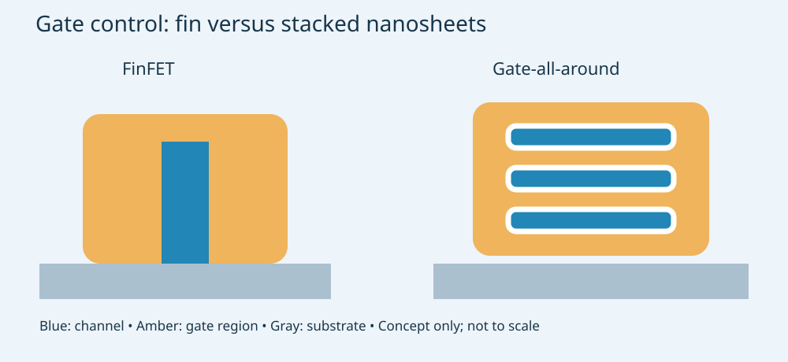
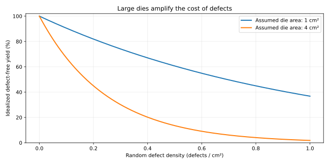

# The 2 nm Challenge: Why Taiwan Leads, and What Holds Back China and Japan

**Engineering technology and manufacturing · Separate enrichment section**  
Evidence checked: 11 November 2026 · MIE 446, UMass Amherst

[Web reading](https://ehsan-roohi.github.io/Aerospace-Structures/case-studies/2nm-chips/) · [Course readings](READINGS.md)

## 1. Start with the correct comparison

“Taiwan can make 2 nm chips, but China and Japan cannot” compresses several different achievements into one sentence. A working transistor, a functioning SRAM array, a complete customer chip, high-volume manufacturing and profitable production are different milestones. The evidence supports a lead by Taiwan's **TSMC in commercial process manufacturing**, not a claim that Taiwanese scientists alone invented every underlying technology or that other countries cannot eventually manufacture it.

| Manufacturer / location | Publicly supported status as of this reading | What cannot be inferred |
|---|---|---|
| TSMC / Taiwan | Company states N2 entered volume production in Q4 2025 [1] | Exact yield for every customer product or fab |
| Rapidus / Japan | Working 2 nm GAA transistor prototypes announced July 2025; pilot and process development continue [4,5] | Qualified, profitable volume production of complete chips |
| SMIC / mainland China | Physical teardown documents N+3 as an evolution of its 7 nm-class process [7] | Evidence of a commercial 2 nm process |

No primary evidence of Chinese high-volume 2 nm logic production was located for this reading. That is an evidence boundary, not proof that no undisclosed experiment exists. Equally, Japanese companies' strengths in materials, equipment, memory and other semiconductor categories should not be confused with Rapidus's present leading-edge logic-foundry status. This is a comparison of particular production capabilities, not national intelligence or scientific worth.

The starting point is [Zoomit's 11 November report](https://www.zoomit.ir/processor/470853-rapidus-2nm-chip-delay/), which summarizes Bloomberg reporting on Rapidus's SRAM difficulties. The source chain and official response are separated below rather than treating an unnamed-source report as a published process qualification result.

## 2. What does “2 nanometers” actually mean?

A nanometer is $10^{-9}$ m, but a **node name is a technology-generation label**, not a promise that the gate length, transistor width and metal spacing all equal 2 nm. IBM's 2021 research demonstration, for example, used a reported 12 nm gate length within a process called the 2 nm node [2]. Therefore “only a few atoms across” is misleading when applied to the entire transistor from the node name alone.

Compare processes using measured logic density, SRAM density, speed at stated power, power at stated speed, routing rules, reliability, yield and cost. Different foundries' naming conventions do not make nominally equal node names physically identical. A smaller label also does not guarantee a better complete product: architecture, memory, packaging, software and thermal constraints matter.

### From FinFET to gate-all-around

A transistor controls current between source and drain by changing gate voltage. As the channel becomes shorter, the drain increasingly interferes with the gate's control. Leakage and variability make continued planar scaling difficult. FinFETs place the channel in a raised fin, with gate control on multiple faces. Stacked nanosheet gate-all-around (GAA) devices wrap the gate around sheet-shaped channels, improving electrostatic control and allowing useful channel-width choices.

*Figure 1. Original conceptual cross-sections through the gated region. Blue is semiconductor channel; amber is the surrounding gate region. Dielectric interfaces are simplified. Source/drain are out of the page. Not to scale, and not a reconstruction of any company's proprietary dimensions.*

This geometry requires extremely selective material removal, conformal film deposition and precise gate formation. GAA solves important electrostatic problems; it also adds fabrication and variability challenges. IBM's published work with Rapidus on selective nanosheet layer reductions illustrates the detailed integration work involved [3]. Copying the visual shape does not reproduce an industrial recipe.

Dynamic switching power is approximately

$$P_{dynamic}=\alpha C V_{DD}^{2} f,$$

where $\alpha$ is activity factor, $C$ effective switched capacitance and $f$ frequency. Lower capacitance or voltage can save energy, but voltage cannot be reduced indefinitely because timing and noise margins fail. Leakage, interconnect resistance/capacitance and data movement remain important. “Faster at the same power” and “lower power at the same speed” are alternative comparisons, not improvements to add together without qualification.

## 3. The lithography bottleneck: EUV helps, but is not a complete factory

Photolithography transfers a mask pattern to photoresist, followed by processing such as etching. ASML describes ArF DUV light at 193 nm and EUV at 13.5 nm [8]. Resolution is commonly summarized as

$$CD\approx k_1\frac{\lambda}{NA},$$

where $CD$ is critical dimension, $\lambda$ wavelength, $NA$ numerical aperture and $k_1$ a process-dependent factor [9]. This optical resolution relation is **not an equation converting light wavelength directly to a marketing node**. Computational lithography and repeated patterning can produce pitches beyond those of a simple single exposure.

With DUV multi-patterning, a dense layout is divided among multiple patterning operations. Extra steps create more opportunities for overlay error, contamination, process variation and increased cycle time. It is inaccurate to say DUV makes every small-node transistor physically impossible; it is equally inaccurate to assume unlimited repeated patterning remains economical or achieves acceptable yield.

EUV is also difficult. Photon statistics, resist chemistry, stochastic defects, mask defects, optics, source power and uptime all matter. Initial 2 nm-class production should not be conflated with a requirement for the newest high-NA EUV generation. EUV exposure alone cannot guarantee good transistors, functioning SRAM, reliable interconnects or a manufacturable customer design.

## 4. Why Japan can make a transistor but still struggle with SRAM

Rapidus announced transistor prototypes with electrical characteristics in July 2025 and reported EUV exposure at IIM-1 in April 2025 [4]. Its April 2026 release described continued work on yield, production systems, PDKs and packaging toward a 2027 mass-production target [5]. Those milestones are meaningful but do not establish that a large memory array or customer processor has passed production qualification.

A conventional 6T SRAM cell uses six transistors: two cross-coupled inverters hold a bit, and two access transistors connect it to bit lines. Without refresh, it can retain its value while powered, but it is volatile when power is removed. SRAM is central to processor caches and other on-chip storage.

Three constraints compete:

- **Hold:** retain the bit despite noise and leakage.
- **Read:** sense the bit without disturbing it.
- **Write:** overpower the previous state and reliably store the new bit.

Device matching, threshold-voltage variation, supply voltage, contact resistance and layout parasitics affect all three. A transistor can have attractive individual current–voltage characteristics while a six-transistor cell fails at low voltage or a large array has too many weak cells.

An illustrative independent-cell model makes the scale visible. If each cell fails with probability $p$ and an array has $N$ cells,

$$P(\text{no failures})=(1-p)^N\approx e^{-Np}.$$

For **assumed** $N=10^8$ and $p=10^{-8}$, the probability is about 36.8%; at $p=10^{-9}$ it is about 90.5%. These are teaching values, not Rapidus measurements. Actual arrays use redundancy, repair, assist circuits and sometimes error correction; failures can be correlated. The model explains why showing a few working devices is insufficient.

### What the current delay report does—and does not—establish

Takashi Mochizuki's Bloomberg report of 10 November, available as a syndicated article [6], attributes missed SRAM and cleanroom milestones to unnamed sources. It also records Rapidus maintaining its target of mass production in the second half of fiscal 2027 and declining to disclose technical details. This is credible reporting of a risk, but not public electrical data or a company-announced cancellation. No current measured yield is supplied in this reading.

Japan's fiscal 2027 runs from April 2027 through March 2028; its second half is October 2027–March 2028. Thus “fiscal 2027” and “by March 2028” can describe the same deadline. A reported possible slip should not be rewritten as an officially confirmed revised date.

## 5. Why TSMC had the stronger starting position

TSMC's annual report states that N2 reached high-volume manufacturing in Q4 2025 [1]. Its established foundry business, founded in 1987, reported 534 customers and 305 process technologies in 2025 [10]. These facts support an organizational contrast with a new entrant; they do not directly measure a causal contribution from each factor.

The following is an engineering and industrial interpretation of the documented differences:

1. **Cumulative process learning.** Advancing through prior nodes develops expertise in defect detection, statistical control, integration and equipment matching. Each new node is difficult, but the surrounding production organization already exists.
2. **Customer feedback and design infrastructure.** Design kits, validated IP, device models, extraction, timing tools and customer tape-outs expose problems before and during volume ramp. A process is valuable when customers can repeatedly design working products for it.
3. **High utilization and reinvestment.** Broad demand helps fund equipment and experiments. More production can accelerate learning, provided measurements and corrective action identify the right problems.
4. **Supplier integration.** A leading foundry combines internationally sourced lithography, deposition, etch, inspection, materials and software. Taiwan's success does not mean Taiwan independently manufactures every tool.
5. **Execution across many coupled steps.** Device performance, interconnect reliability, SRAM yield and packaging must meet targets together. Optimizing one isolated transistor is a much smaller task.

*Figure 2. Original Poisson-defect illustration, $Y=e^{-AD_0}$, with assumed die areas 1 and 4 cm². Not a yield estimate for TSMC, Rapidus or SMIC. Real defect clustering, systematic failures and parametric yield require richer models.*

A simplified good-die cost is

$$C_{good}\approx\frac{C_{wafer}}{N_{gross}Y},$$

before packaging, test and development amortization. With all else fixed, improving yield from an assumed 40% to 80% halves this wafer-cost contribution. A small population of working dies can therefore coexist with an uneconomic process. Yield percentages are not comparable without specifying die area, test coverage, voltage/speed bins and repair policy.

## 6. Why China's challenge is different

China has strong chip-design and manufacturing capabilities, and physical analysis documents progress. TechInsights' own structural measurements identify SMIC N+3 in Kirin 9030-family processors as a scaled evolution of 7 nm-class technology, still less scaled than leading commercial 5 nm processes in its reported comparison [7]. The N+3 label should not be mistaken for TSMC's N3 naming or evidence of 2 nm production.

Access constraints are a major additional burden. ASML's published statements document restrictions on EUV sales and expanding license requirements for advanced DUV systems [11]. US BIS documents restrictions extending beyond lithography to selected deposition, etch, metrology, inspection and software categories [12]. These sources establish real supply constraints; they do not prove sanctions are the only cause of the gap or allow an exact number of years of delay to be calculated.

**Interpretation:** a catch-up effort must improve fabrication while also qualifying substitutes, suppliers, maintenance and process integration under restricted access. A domestic EUV light-source experiment or laboratory exposure system would not, by itself, establish a reliable scanner with industrial throughput and overlay. Similarly, an advanced chip-design announcement is not proof of domestic fabrication at that node.

China may keep improving DUV-based processes, domestic equipment, packaging and architecture. These can produce useful competitive systems without immediately matching the leading node. The correct benchmark remains repeatable performance, yield, capacity and cost—not whether a single impressive sample exists.

## 7. Why Japan's equipment access has not made the problem disappear

Japan's Rapidus has access to EUV equipment [4] and technology collaboration with IBM [3]. That directly shows why “no EUV” cannot explain Japan's current difficulty. It is building a new production organization, transferring technology into a new fab, controlling contamination, qualifying integrated devices and developing a customer ecosystem concurrently.

Its October 2026 CORE announcement established an initial group of 17 design-support partners [13]. That is evidence of ecosystem construction, not the same thing as demonstrated production orders or a mature design platform. Government support can finance facilities and learning, but cannot instantly produce stable process windows or decades of tacit operating knowledge.

| Dimension | TSMC | SMIC / mainland-China catch-up | Rapidus |
|---|---|---|---|
| Starting position | Established leading-edge volume foundry | Established manufacturer facing additional access constraints | New leading-edge foundry project |
| Key evidence here | N2 volume-production declaration | Measured N+3 device structures | GAA prototypes and pilot-line progress |
| Principal challenge emphasized | Continued scale, yield and customer delivery | Process progress plus equipment/supplier restrictions | Integrated process qualification, yield and customer adoption |
| EUV explanation sufficient? | No; integration still required | No; important constraint among several | No; EUV is already installed |
| What would demonstrate further progress? | Sustained production and qualified products | Measured advanced processes with disclosed production evidence | Qualified SRAM/logic, customer silicon and repeatable volume output |

This table is a causal synthesis, not a numerical ranking of national capability. Detailed yields and internal process data are not public enough here to assign quantitative weights to each cause.

## 8. The connection to mechanical and aerospace engineering

The factory problems are also mechanical, thermal, fluid and materials problems:

- **Fluid mechanics and contamination:** gas delivery, filtration, purge flow and particle transport affect defect formation. A cleanroom class alone does not describe contamination at the wafer or inside a process chamber.
- **Heat transfer:** wafer temperature uniformity, tool thermal drift and package cooling affect process control and operation. Higher transistor density does not guarantee lower heat flux.
- **Precision mechanics:** stages, vibration isolation, thermal expansion and alignment interact with overlay tolerances.
- **Materials and structures:** thin-film residual stress, wafer bow, adhesion, thermal-expansion mismatch and package warpage can compromise reliability.
- **Reliability engineering:** a research prototype resembles a successful laboratory component; volume production resembles a repeatably qualified system with a controlled process and supply chain.

In aircraft electronics, the newest node is not automatically the best choice. Radiation tolerance, temperature range, lifetime, verification, availability and cost may favor an established process. AI accelerators and high-end processors have different optimization priorities from long-lived safety-critical controllers.

## 9. Questions for critical reading

1. Does a claimed “2 nm breakthrough” demonstrate a transistor, memory array, integrated chip or commercial production?
2. Is yield defined for a tiny test structure or a large customer product? At what voltage and frequency?
3. Does the comparison refer to a node label, measured dimensions or system performance?
4. Are the tool, maintenance, materials, software and customer-design ecosystems available?
5. Is a delay an official schedule revision, a sourced report, or an analyst inference?

The evidence supports TSMC's present manufacturing lead, a distinct equipment-access burden for China, and a process-integration and ramp challenge for Rapidus. None establishes permanent national inability.

## References and evidence register

All online references checked 11 November 2026. Manufacturer statements identify company-reported milestones; physical-analysis reports identify measured hardware; reporting based on confidential sources remains attributed.

1. TSMC, [2nm Technology](https://www.tsmc.com/english/dedicatedFoundry/technology/logic/l_2nm). N2 volume-production start in Q4 2025. See also [2025 annual report](https://investor.tsmc.com/static/annualReports/2025/english/index.html).
2. IBM Research, [Introducing the world's first 2 nm node chip](https://research.ibm.com/blog/2-nm-chip), 6 May 2021. Node naming, nanosheets and reported 12 nm gate length; research demonstration, not a commercial foundry-production declaration.
3. IBM Research, [Rapidus and IBM move closer to scaling out 2 nm chip production](https://research.ibm.com/blog/rapidus-ibm-move-closer-to-scaling-out-2-nm-chip-production). Selective nanosheet layer reductions and technology collaboration.
4. Rapidus, [Prototyping of leading-edge 2nm GAA transistors](https://www.rapidus.inc/en/news_topics/information/rapidus-achieves-significant-milestone-at-its-state-of-the-art-foundry-with-prototyping-of-leading-edge-2nm-gaa-transistors/), 18 July 2025. Prototype electrical characteristics, EUV exposure and IIM-1 progress.
5. Rapidus, [NEDO approves FY2026 plan and budget](https://www.rapidus.inc/en/news_topics/information/nedo-approves-rapidus-fy2026-plan-and-budget-for-2nm-semiconductor-projects/), 11 April 2026. Pilot-line progress, yield-development work and 2027 target.
6. Takashi Mochizuki, Bloomberg, [Japan's Rapidus is said likely to miss mass production deadline](https://www.bloomberg.com/news/articles/2026-11-10/japan-s-rapidus-is-said-likely-to-miss-mass-production-deadline), 10 November 2026. [Syndicated full report in The Edge Malaysia](https://theedgemalaysia.com/node/825119). Original reporting and company response; not a technical test publication. Used only for the attributed current-status report.
7. TechInsights, [HiSilicon Kirin 9030 Pro (SMIC N+3) Process Flow Analysis](https://www.techinsights.com/blog/smic-n3-kirin-9030-pro-process-flow-analysis). First-hand structural/process analysis; public summary does not disclose the full paid dataset.
8. ASML, [Light and lasers](https://www.asml.com/en/technology/lithography-principles/light-and-lasers). DUV and EUV wavelengths.
9. ASML, [The Rayleigh criterion for resolution](https://www.asml.com/en/technology/lithography-principles/rayleigh-criterion). Optical resolution and its parameters.
10. TSMC, [2025 annual report](https://investor.tsmc.com/static/annualReports/2025/english/index.html). Foundry history, customer count and process portfolio. These corporate counts are not node-specific yield data.
11. ASML, [Dutch export-control statement](https://www.asml.com/news/press-releases/2023/statement-regarding-export-control-regulations-dutch-government), 30 June 2023; [updated restrictions statement](https://www.asml.com/news/press-releases/2024/asml-expects-impact-of-updated-export-restrictions-to-fall-within-outlook-for-2025), 2 December 2024. Documents restrictions; not a complete current legal-compliance guide.
12. US Bureau of Industry and Security, [Advanced-semiconductor export-control announcement](https://www.bis.gov/press-release/commerce-strengthens-export-controls-restrict-chinas-capability-produce-advanced-semiconductors-military), 2 December 2024. Scope of controlled equipment/software categories. Later regulations may change implementation.
13. Rapidus, [Rapidus CORE ecosystem announcement](https://www.rapidus.inc/en/news_topics/information/20261005-2/), 5 October 2026. Initial 17 design-support associates and planned ecosystem expansion.
14. Amir Abdolmaleki, Zoomit, [Rapidus SRAM-delay article](https://www.zoomit.ir/processor/470853-rapidus-2nm-chip-delay/), 11 November 2026. Starting article, retrieved directly; its technical-delay account traces to [6]. This reading is an original analysis, not a full translation.

**Further technical paper:** G. Yeap et al., [2nm Platform Technology featuring Energy-efficient Nanosheet Transistors and Interconnects co-optimized with 3DIC for AI, HPC and Mobile SoC Applications](https://research.tsmc.com/page/transistor-structure/59.html), 2024. TSMC's research abstract provides process-specific SRAM and logic qualification context; its test-chip yields must not be generalized to all commercial products.
