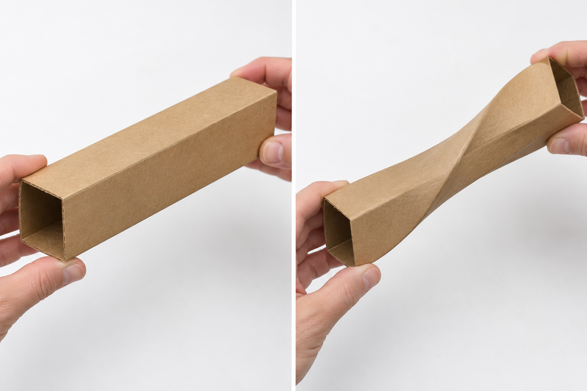
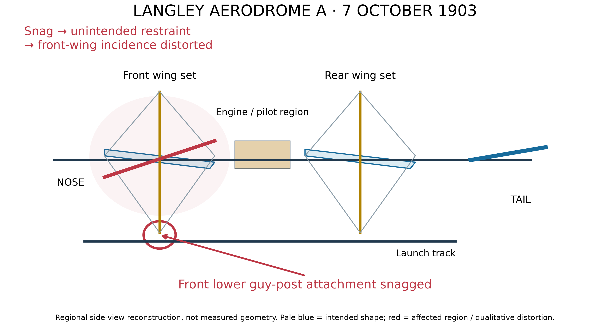
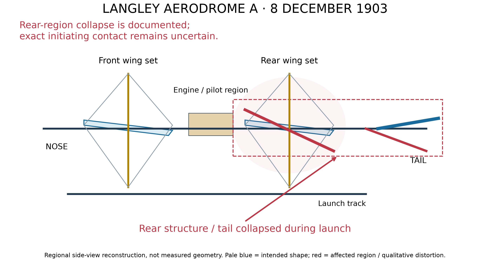
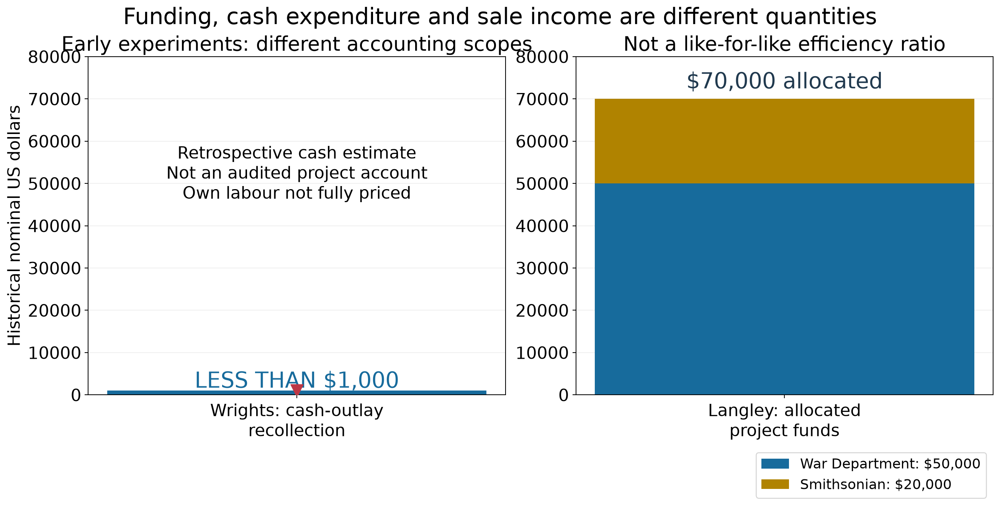
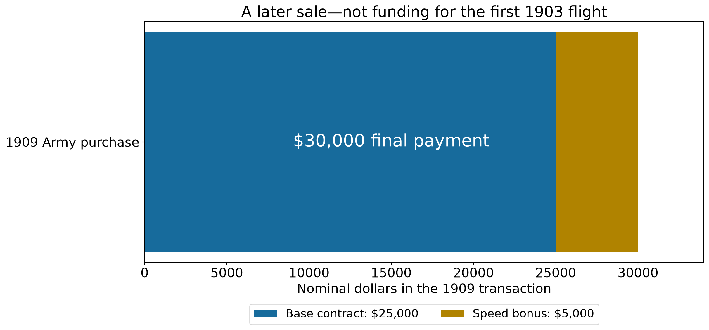
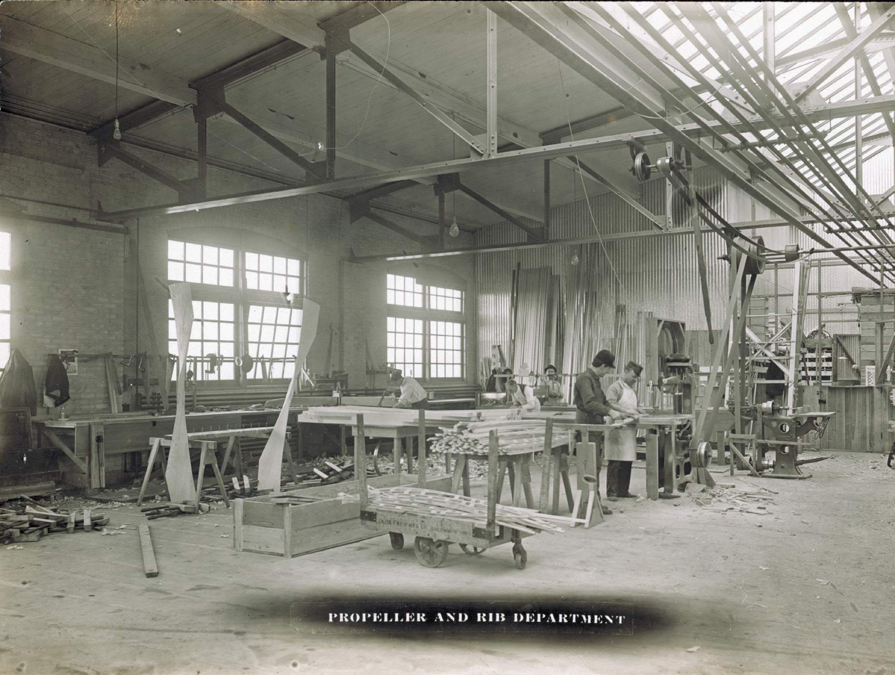
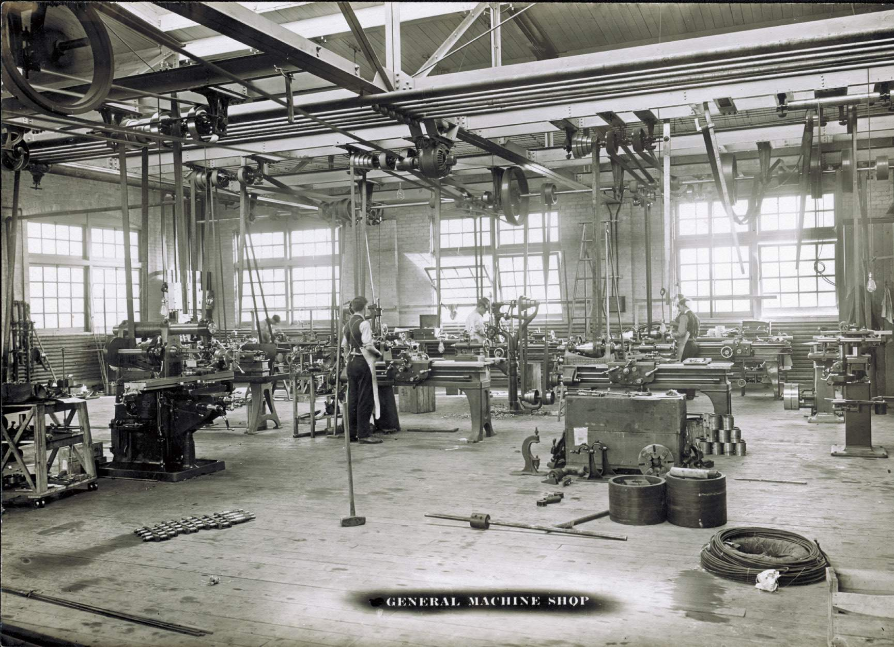
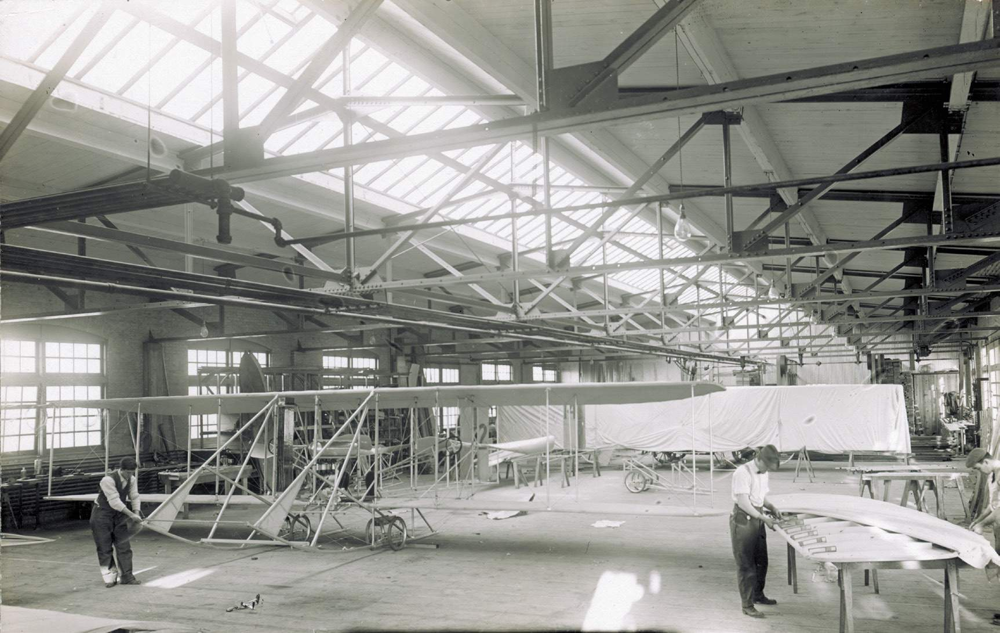
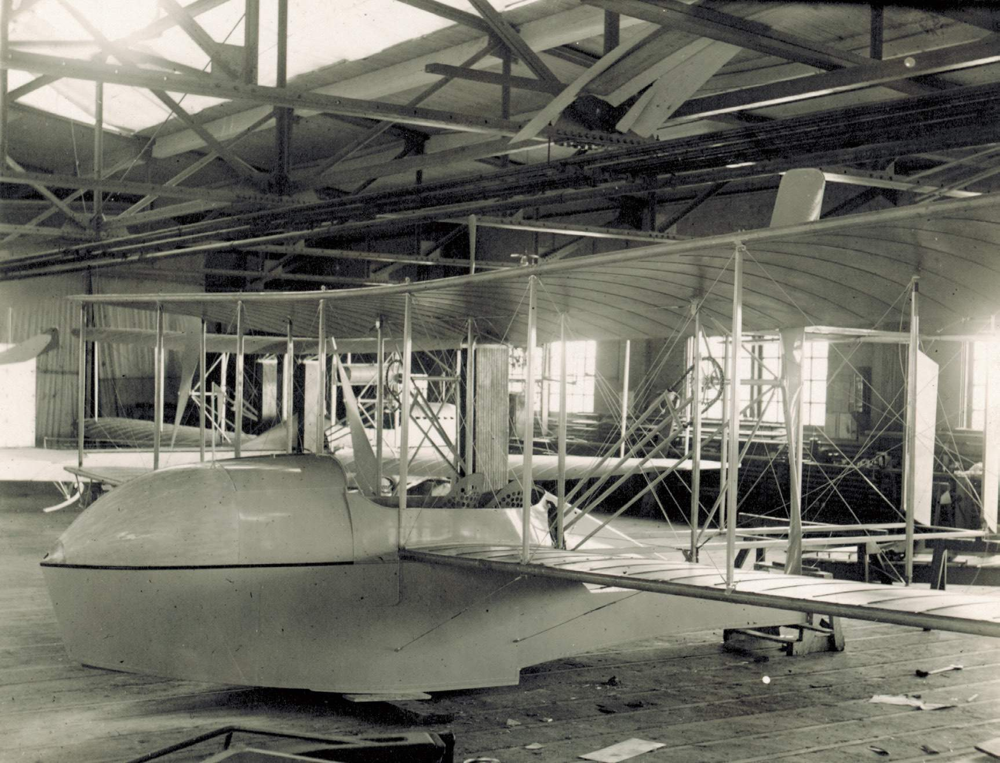
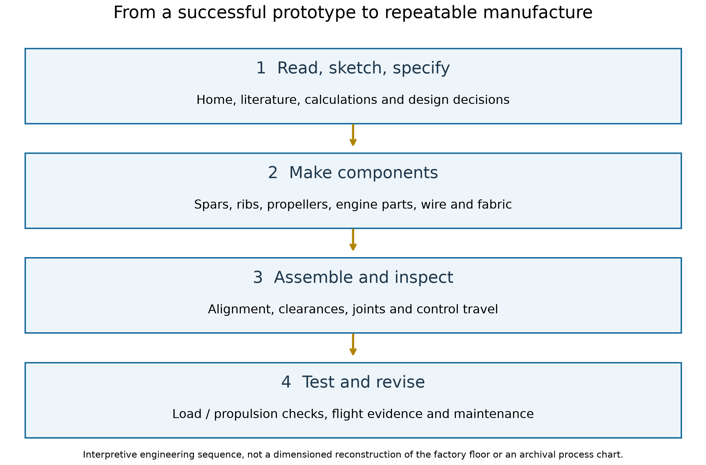

# The Wright brothers and Langley from workshop experiments to aircraft production

MIE 446 · Aerospace Structures · University of Massachusetts Amherst

| Wilbur and Orville Wright | Samuel Pierpont Langley |
| --- | --- |
|  |  |
| Wilbur **left**, Orville **right**, Dayton, June 1909. Smithsonian NASM photograph, photographer unattributed; [public-domain image record](https://commons.wikimedia.org/wiki/File:Wright_Brothers_at_home,_1909.jpg). | Astronomer and Smithsonian Secretary; portrait by R. H. Lord, Smithsonian image SI-87-17019h; [public-domain image record](https://commons.wikimedia.org/wiki/File:Samuel_Pierpont_Langley_SI-87-17019h_original.jpg). |

The Wright brothers treated an aircraft as a machine that a pilot must **control**, not simply a wing that must produce lift. Two choices make this especially clear: a movable horizontal surface ahead of the wings for pitch, and deliberate wing twisting for roll. The second choice made structural flexibility part of the control system.

The story connects homes, workshops, published knowledge, measurements, flight practice and production. It distinguishes Langley's successful unpiloted models from his unsuccessful piloted Aerodrome A, and the Wrights' 1899 kite, gliders, successive Flyers and production aircraft. Money is discussed separately as experimental expenditure, allocated funding, prizes, sales and company ownership.

### Reading map

- [The home, bicycle shops and family](#the-home-bicycle-shops-and-family)
- [Pressure distributions and CP motion](#how-a-pressure-distribution-produces-a-force-and-a-moment)
- [Wind tunnel, balances and model geometry](#the-wind-tunnel-turning-disagreement-into-measurements)
- [The rear horizontal tail and stability](#why-put-the-horizontal-tail-behind-the-wing)
- [Chanute, Langley and documented correspondence](#chanute-langley-and-the-wrights-an-exchange-of-evidence)
- [Aerodrome failures, launch loads and scaling](#langleys-aerodrome-why-a-successful-model-did-not-guarantee-a-successful-airplane)
- [How the Wrights addressed structure and control](#how-the-wright-approach-addressed-structure-and-control)
- [Later Flyers and the factory](#after-1903-the-wright-aircraft-kept-changing)
- [Money and the transition to a company](#money-experiments-sales-prizes-and-company-ownership)
- [Inside the factory and its free historical report](#inside-the-factory-and-the-free-historical-report)

## The home bicycle shops and family

### 7 Hawthorn Street was a place of learning and design

*The Wright family home, **7 Hawthorn Street, Dayton, about 1900**—not the later Hawthorn Hill mansion. Photograph attributed to Wilbur and/or Orville Wright, Library of Congress, reproduced by [NPS](https://home.nps.gov/articles/dayton-landscapes-in-aviation-history.htm). The bicycle beside the fence connects the family setting with their mechanical work.*

The home mattered as well as the shop. Reading, argument, sketches and design decisions could happen at home; component manufacture needed tools and working space. The family encouraged learning and practical work. Katharine, their college-educated sister, and their father Milton belonged to this setting, not merely the background of a story about two isolated inventors. [The Henry Ford: home and shop foundational materials, pp. 4–8](https://www.thehenryford.org/documents/default-source/default-document-library/wright-brothers-foundational-materials.pdf?sfvrsn=2).

### Bicycle work supplied income skills and tools

*Wilbur working in the bicycle shop, **1897**. Library of Congress photograph, via [NPS](https://home.nps.gov/articles/dayton-landscapes-in-aviation-history.htm). This is historical working space, not the later aircraft factory.*

Repairing and making bicycles supplied income for experiments and experience with mechanisms, alignment and fabrication. Their shop included a lathe, drill press and band saw. Airplane components were made there and transported for assembly; a complete Flyer required more space than the small shop allowed. [The Henry Ford, p. 8](https://www.thehenryford.org/documents/default-source/default-document-library/wright-brothers-foundational-materials.pdf?sfvrsn=2).

For an aerospace structures student, the connection is practical: a correct drawing is not enough. Wood must be shaped, joints made, wires attached and moving parts aligned. A small fit or clearance error can undermine an otherwise sound load-path idea. Charlie Taylor's machining and engine-building contribution belongs in this story alongside the brothers' aerodynamic and control work. [Smithsonian: designing the propulsion system](https://airandspace.si.edu/explore/stories/researching-wright-way).

### Which Wright shop is in the photograph

| Place | Role and identity |
| --- | --- |
| 7 Hawthorn Street, Dayton | Family home during the experimental years; later relocated to Greenfield Village. |
| 22 South Williams Street, Dayton | An earlier bicycle-shop location, preserved within Dayton Aviation Heritage National Historical Park. |
| 1127 West Third Street, Dayton | Last bicycle shop and the important early-aircraft workshop; relocated to Greenfield Village, Dearborn. |
| Wright Company factory, Dayton | Purpose-built manufacturing buildings from 1910–11; not the bicycle shop. |
| Hawthorn Hill, Oakwood | Later residence associated with Orville; not the small family home where the experiments began. |

*Modern photograph of the **relocated last bicycle shop at Greenfield Village**. Rmhermen, [image record](https://commons.wikimedia.org/wiki/File:Wright_cycle_shop.jpg), [CC BY-SA 3.0](https://creativecommons.org/licenses/by-sa/3.0/), unmodified. Its present location is not its original Dayton street.*

*Modern museum interior at **Dayton Aviation Heritage National Historical Park**, not the Greenfield Village interior. Chris Light, [image record](https://commons.wikimedia.org/wiki/File:Wright_Cycle_Shop_P2110012.JPG), [CC BY-SA 4.0](https://creativecommons.org/licenses/by-sa/4.0/), unmodified. A museum display does not establish that every displayed object is an original experimental tool.*

Henry Ford acquired the last shop and family home in 1936; they were dismantled, moved and reconstructed in Dearborn. Orville and Charlie Taylor helped with the restoration record. The relocated buildings were dedicated on **16 April 1938**. The move concerns these buildings, **not the Wright aircraft factory**. [NPS history, Chapter 12](https://npshistory.com/publications/daav/honious/chap12.htm), [The Henry Ford: photographic documentation and reconstruction](https://www.thehenryford.org/collections/explore/artifact/393713).

This also explains why a historic-place photograph needs three labels: **what the building was, where it is now, and whether the picture shows its working period or a museum restoration**.

## Identify the real components first

*Historical photograph of the 1903 Flyer. Credit: Wilbur and Orville Wright, via the [National Park Service](https://www.nps.gov/articles/wrightflyer.htm). Locate the forward horizontal elevator and rear vertical rudder before discussing the controls; this is not the 1900 glider.*

| Motion | Wright mechanism | What changes |
|---|---|---|
| Pitch: nose up/down | Forward horizontal elevator, now described as a canard | Aerodynamic force ahead of the CG and its pitching moment |
| Roll: one wing rises, the other falls | Opposite twisting of the wing ends | Local incidence, lift and drag on the two sides |
| Yaw: nose left/right | Movable rear vertical rudder | Lateral aerodynamic force and yawing moment |

In the 1903 Flyer, the prone pilot's hip cradle operated wing warping and the linked rudder; a hand lever controlled the elevator. Earlier arrangements differed. The period expression **forward rudder** refers to a horizontal pitch-control surface, not the modern vertical yaw rudder. [NPS, The Wright Flyer](https://www.nps.gov/articles/wrightflyer.htm).

## Why put the horizontal surface in front?

### Active pitch control rather than weight shift alone

A force applied away from the centre of gravity produces a moment. The forward surface gave the pilot a means of changing that moment without relying only on moving body weight.

*Figure 1. An added upward force ahead of CG produces a nose-up moment; the same increment behind CG produces a nose-down moment. These are force increments, not complete trim states.*

The Wrights' concern about dangerous pitching and the consequences of a stall influenced their preference for a forward surface. NASA's historical review connects that preference to concern about Lilienthal's fatal loss of control; it also emphasizes the limited documentation of the early machines' stall behaviour. Treat this as a historical design motivation—not proof that every canard is safer than every rear-tail aircraft. [NASA TM 88354, historical overview, printed pp. 7–8](https://ntrs.nasa.gov/api/citations/19870013196/downloads/19870013196.pdf).

Their important contribution was to pursue controllable aerodynamic moments alongside lift and propulsion. The location also made the forward surface and its supporting structure part of the load path: surface pressure → ribs/spars → supporting members and joints → main airframe. Hinge and control-linkage loads must be carried as well as the net lift force.

### A simple moment calculation

Take x increasing aft, upward force positive and nose-up pitching moment positive. For a vertical force at position x:

$$
\Delta M=L(x_{CG}-x).
$$

If a canard is 1.5 m ahead of CG and its upward force increases by 40 N:

$$
\Delta M=40(1.5)=60\ \mathrm{N\,m}
\quad\text{nose up}.
$$

The same force increment 1.5 m aft produces −60 N m, nose down. These are assumed classroom dimensions and forces, not measured Wright values.

### Do not confuse incidence with lift direction

The discussion of a small negative setting relative to the main wing concerns **geometric incidence**. It does not establish that the forward surface always pushes downward. A simplified local relation is:

$$
\alpha_c=\alpha+i_c+\epsilon_c,
\qquad
L_c\approx q_cS_ca_c(\alpha_c-\alpha_{L=0,c}).
$$

Here εc represents the signed local-flow-angle correction under the chosen convention. Local dynamic pressure, geometry and flow interference also matter. A negative relative incidence can coexist with positive lift at a sufficiently positive local angle of attack. Do not assign a historical lift direction from incidence alone.

## Trim is not stability

Pitch trim means that the net pitching moment vanishes at a particular flight condition:

$$
C_m(\alpha_0,\delta_e)=0.
$$

Local longitudinal static stability, with controls fixed and nose-up moment positive, requires:

$$
\left.\frac{\partial C_m}{\partial\alpha}\right|_{\delta_e}<0.
$$

*Figure 2. Start from trim, then impose the same small nose-up disturbance with controls fixed. Dashed grey is the starting attitude; dark is the disturbed attitude. A rear-surface force increment gives a restoring contribution; the same increment ahead of CG gives a nose-up contribution. Arrows at the nose indicate motion tendency, not another applied force. These are contributions to stability, not complete aircraft models.*

If an increase in angle of attack increases upward force on a surface ahead of CG, that surface's incremental moment tends to be nose up. A comparable increment on a rear surface tends to be nose down. **That is one component's contribution**, not a verdict on the whole aircraft. The wing, CG position, surface size, local flow and control setting determine the combined response.

Dynamic stability is another question: does a disturbed motion decay over time? Inertia, aerodynamic damping and coupling enter that analysis. A pilot can actively control an aircraft that does not possess a strong passive restoring response; control authority and pilot workload must then be considered.

### Why did later designs use rear horizontal tails?

A rear surface can supply a useful restoring contribution and a long pitching lever arm. But there is no universal rule that “moving the elevator aft automatically solves stability.” Geometry, wing pitching moment, downwash, CG and control power must be designed together. Modern canard aircraft can also be stable when designed appropriately.

For historical comparisons, identify the particular Wright model and year before discussing a configuration change. A photograph of a later machine must not be presented as evidence of the 1903 Flyer's layout.

NASA's retrospective also discusses the high pitch-control workload and subsequent measures to improve stability, eventually including an aft movable horizontal surface. This connects the historical evolution to the restoring-moment argument above, without assuming that one layout alone explains every improvement. [NASA TM 88354, printed pp. 8–10](https://ntrs.nasa.gov/api/citations/19870013196/downloads/19870013196.pdf).

## The bicycle-inner-tube box and the wing-warping idea

The relevant object was **the cardboard package for a bicycle inner tube**, not the rubber tube itself. The NPS account describes Wilbur twisting such a box and relating its deformation to twisting wing ends in opposite directions. Bird observations were also part of the development; the box was an analogy, not a finished aerodynamic design. [NPS teaching account](https://www.nps.gov/articles/wright-brothers-national-memorial-site-of-the-first-controlled-powered-flight-teaching-with-historic-places.htm).

*Figure 3. Original geometric illustration of the box analogy. Blue and red outlines distinguish the ends; dark lines indicate longitudinal edges. This is not the original historical box.*

*Classroom reconstruction: relaxed sleeve on the left, twisted sleeve on the right. **AI-generated realistic illustration, not a historical photograph or the Wrights' actual package.** Bring a real thin cardboard sleeve to class and repeat the motion gently. The [generation record](docs/assets/wright-controls/IMAGE_PROVENANCE.md) identifies the method and prompt.*

**What did the analogy reveal?** A light assembly can preserve much of its overall form while allowing different rotations at its ends. Rather than rotating the entire aircraft first, the pilot could change the wings' local aerodynamic angles and obtain a rolling moment.

**What did it not prove?** It did not give the required cable forces, torsional stiffness, aerodynamic effectiveness, fatigue life or stability. Those still required experiments and refinement.

For class, use a light open-ended cardboard package. Rotate its ends gently in opposite directions and observe how the edges and walls move. Compare this with a box restrained against twisting. The demonstration explains compliance; do not treat its stiffness or buckling behaviour as a scaled aircraft test.

## How wing twisting creates roll

*Figure 4. Rear-view lift comparison above; local chord sections below. Increased incidence on the left increases lift in this attached-flow example. Both sides can still have upward lift; unequal lift is enough to roll. Section rotation is exaggerated, not measured Flyer geometry.*

An incidence change changes local angle of attack. In an approximately linear, attached-flow range:

$$
\Delta C_l\approx a\,\Delta\alpha,
\qquad
\Delta L\approx qS_{\mathrm{patch}}a\,\Delta\alpha.
$$

Assume q = 100 N/m², a patch area of 1 m², a lift-curve slope a = 4 rad⁻¹ and opposite changes of ±2°:

$$
\Delta L\approx100(1)(4)\left(\frac{2\pi}{180}\right)
=13.96\ \mathrm{N}.
$$

One side gains about 14 N and the other loses about 14 N. If their lever arms are 3 m, the rolling-moment magnitude is approximately:

$$
|\Delta M_{\mathrm{roll}}|\approx2(3)(13.96)=83.8\ \mathrm{N\,m}.
$$

These numbers illustrate the mechanism only. A Wright biplane has interference, spanwise variation and structural coupling that this two-patch model omits. Near stall, a linear lift law may fail.

Warping therefore means **twisting the section and changing incidence**, not merely moving a wingtip vertically. Vertical displacement can accompany deformation, but tip height alone does not define its aerodynamic effect.

## What the uprights and wires actually do

*NASA photograph of a Wright wing model with covering removed; not a photograph of the 1903 flight. Long members and repeated ribs show the structural framework. [NASA wing-geometry explanation](https://www1.grc.nasa.gov/beginners-guide-to-aeronautics/wing-geometry/).*

The interplane **uprights or struts** connect the upper and lower wings and help carry structural loads. **Bracing wires** support the assembly against prescribed deformations; **control cables** transmit pilot input. A line's appearance alone is insufficient to identify its function.

The 1899 kite was deliberately arranged to permit warping. Smithsonian describes an unbraced region between front and rear struts and four control lines operated through hand sticks. This supports a deformable wing assembly, **not an assertion that every strut joint was a freely rotating hinge**. [Smithsonian](https://airandspace.si.edu/explore/stories/researching-wright-way).

Cable tension and structural compliance work together. Struts and other members move as part of the deformation; the pilot does not simply pull one isolated upright to lift a rigid wing. Exact wire attachment points and joints must come from the particular aircraft's drawings.

There is a design tradeoff: too much torsional restraint demands large control effort or prevents useful warping; too little restraint permits unwanted deformation and weakens control precision. The aim is adequate load-carrying capability **and** the intended compliant motion. This is an engineering interpretation, not a measured stiffness estimate for the Flyer.

## Why a rolling command also needs rudder coordination

Differential twist changes drag as well as lift. In a typical positive-lift, attached-flow example, the side receiving more lift also receives more induced drag. If the left side gains lift, it tends to rise, producing a right bank; its greater drag tends to yaw the nose left—opposite the intended turn. This is **adverse yaw**.

*Figure 5. The 1903 linked-control functions. This is a functional flow diagram, not an installation drawing of cable routing.*

The rear movable rudder supplies a lateral force and yawing moment to address this coupled response. A rudder is not simply a device that “turns the aircraft by itself”; banking, lift direction and coordination are related. The linked hip-cradle arrangement is documented for the 1903 Flyer by [NPS](https://www.nps.gov/articles/wrightflyer.htm).

Watch the [NPS Wing Warping Demonstration](https://www.nps.gov/media/video/view.htm?id=EA3F8C52-B158-994C-521233B153517057), **7 minutes 31 seconds**, on a replica of the 1903 Flyer. Pause to identify pilot input, moving structure and rudder; distinguish replica demonstration from historical flight footage.

## A centre-of-pressure correction for the classroom

Use one consistent representation of a wing's aerodynamic loading:

1. Resultant at the **centre of pressure**, without adding the same wing's equivalent pitching couple again.
2. Resultant at the **aerodynamic centre**, with the corresponding aerodynamic-centre moment.

For the simplified vertical-force model using the second representation:

$$
M_{CG,w}=M_{ac,w}+L_w(x_{CG}-x_{ac,w}).
$$

The equivalent CP representation is:

$$
M_{CG,w}=L_w(x_{CG}-x_{CP,w}).
$$

For nonzero lift, equivalence gives:

$$
x_{CP,w}=x_{ac,w}-\frac{M_{ac,w}}{L_w}.
$$

This also explains why CP can become ill-conditioned near zero lift when a finite pitching moment remains. It should not be assumed fixed at the leading edge for every flat plate or airfoil. A forward elevator changes the **whole-aircraft moment balance**; it does not freeze the main wing's own CP. NASA explains the [force-plus-moment representation](https://www1.grc.nasa.gov/beginners-guide-to-aeronautics/center-of-pressure/).

## How a pressure distribution produces a force and a moment

Imagine many small upward forces along a wing section. Their sum is the section lift; their distances from a reference point determine the pitching moment. Let **x increase aft from the leading edge**, and use upward lift and nose-up moment as positive. For this thin-section, vertical-pressure-load teaching model, define Δp(x) as lower-surface pressure minus upper-surface pressure. Per unit span:

$$
L'=\int_0^c \Delta p(x)\,dx,
\qquad
M'_{LE}=-\int_0^c x\,\Delta p(x)\,dx.
$$

An upward force aft of the leading edge gives a nose-down moment about that edge, hence the minus sign. Equating this distributed loading to one resultant, **when L′ is nonzero**, gives:

$$
x_{CP}=\frac{\displaystyle\int_0^c x\,\Delta p(x)\,dx}
{\displaystyle\int_0^c \Delta p(x)\,dx}.
$$

*Figure 6. Two assumed pressure distributions, not measured Wright data. Both have the same integrated lift. The forward-loaded one acts at c/3; the aft-loaded one at 2c/3. A force alone therefore does not specify the pitching moment.*

Try the integration with Δp = 2p₀(1 − x/c), then with Δp = 2p₀x/c. Both give L′ = p₀c, but the moment magnitudes are p₀c²/3 and 2p₀c²/3. The pressure centroid moved even though the total force stayed the same. These are simplified examples; real pressure depends on geometry, angle of attack, Reynolds number and flow separation.

### Why the CP moves—and sometimes is not a useful point

Dividing the earlier force-plus-couple relation by chord gives:

$$
\frac{x_{CP}}{c}=\frac{x_{ac}}{c}-\frac{C_{m,ac}}{C_L}.
$$

*Figure 7. Illustrative constant-moment model: xac/c = 0.25 and Cm,ac = −0.05. At CL = 0.50 the CP is 0.35c; at CL = 0.10 it is 0.75c. At zero lift a nonzero couple cannot be represented by a single finite-location lift force. This is not a fitted historical airfoil curve.*

Do not teach “the CP always moves forward when angle of attack increases” as a universal law. It depends on how both lift and moment change, especially near stall. An equivalent CP outside the chord is possible when signed pressure contributions and their moment demand it; it is not a physical fitting on the wing. The aerodynamic centre is useful because its moment is approximately insensitive to angle of attack in the usual attached-flow, low-speed approximation; it is not the same as CG or CP.

**How would we measure CP?** Measure force **and pitching moment about a known reference**, or measure the pressure distribution and integrate it. Measuring lift alone is insufficient. Keep this separate from the Wright lift/drag balances described next: their standard output should not be presented as a direct CP measurement.

## The wind tunnel: turning disagreement into measurements

The Wrights moved from outdoor bicycle-mounted comparisons to controlled tunnel testing in 1901. A tunnel let them compare models under more repeatable conditions; full-scale glider flights still supplied a separate check. NASA shows a **replica**, not an original 1901 photograph, in its [wind-tunnel account](https://www.grc.nasa.gov/www/k-12/airplane/wrights/test1901.html).

The [NASA source page](https://www.grc.nasa.gov/www/k-12/airplane/wrights/test1901.html) includes a tunnel-replica photograph. A replica shows the layout; it is not an original photograph of the 1901 experiment.

*Figure 8. The experimental process. Model angle of attack α and instrument reading θ are different angles. “Data reduction” means converting a reading into an engineering quantity with a stated calibration.*

Their workshop-built balances used bicycle spokes and hacksaw-blade parts; the models were thin steel shapes. Many preliminary models were screened before roughly 30 received detailed testing. Comparing one variable at a time helped distinguish camber, aspect-ratio and configuration effects. [NASA: lift-balance design](https://www1.grc.nasa.gov/beginners-guide-to-aeronautics/lift-balance-design/).

### What the lift balance actually measured

It compared the model's lift with a reference plate's drag through opposing torques. Adjustment removed the unwanted model-drag torque; the actual linkage distributed forces among several arms. The following diagram is only an **equivalent torque explanation**, not a construction drawing. [NASA: lift-balance operation](https://www1.grc.nasa.gov/beginners-guide-to-aeronautics/lift-balance-operation/).

*Figure 9. Equal-arm torque reduction in an abstract instrument plane, not an aircraft side-view force diagram. θ denotes the balance reading, not the airfoil angle of attack. The two forces give opposing torques.*

*NASA's instrument-layout illustration: identify the wing model, reference plates and pointer. This is a design illustration, not a photograph of the original balance. [NASA source and credit](https://www1.grc.nasa.gov/beginners-guide-to-aeronautics/lift-balance-design/). The enlarged original torque diagram above explains the measurement separately from the linkage.*

$$
Ld=D_p d\sin\theta
\quad\Rightarrow\quad
\frac{L}{D_p}=\sin\theta.
$$

NASA describes the historical normalization with reference-plate coefficient equal to one, giving:

$$
c_{l,\mathrm{historical}}=\frac{A_p}{A_m}\sin\theta.
$$

For Ap = 8 in², Am = 6 in² and θ = 30°, this historical coefficient is 2/3. The common pressure/speed factor cancels in the ratio. **This does not mean a normal flat plate has modern drag coefficient exactly one.** With modern q = ½ρV² normalization, the correctly calibrated relation is:

$$
C_{L,m}=C_{D,p}\frac{A_p}{A_m}\sin\theta.
$$

The reference coefficient must match its geometry and test conditions. Calibration, friction, tunnel-flow quality and model-scale effects remain relevant. The separate drag balance is needed for drag measurements; the preceding sine relation is not a formula for the model's own L/D.

### Model 31 was a wing, not a NACA airfoil name

NASA identifies Model 31 as an **elliptical planform**, **parabolic section**, area 8 in² and aspect ratio 4.64. “Elliptical” describes its top view; “parabolic” describes its section. It approximated the geometry behind Lilienthal's data. Model 51 approximated Langley's configuration using information obtained through Chanute. These model numbers are not NACA series designations. [NASA: original wind-tunnel models](https://www.grc.nasa.gov/www/k-12/airplane/wrights/models.html).

The [NASA model catalogue](https://www.grc.nasa.gov/www/k-12/airplane/wrights/models.html) provides photographs credited to the Franklin Institute, including Models 30, 31 and 51. These historical specimens are distinct from our original instructional schematics.

The resulting lesson was not simply “Lilienthal was wrong.” Reproducing his wing geometry supported his data within its measurement accuracy, while applying it to a different wing planform produced different performance. The tests also exposed aspect-ratio, camber, stall and multi-wing interference effects. Recorded angles were reduced and plotted, rather than treated as final aerodynamic coefficients. [NASA: 1901 results](https://www.grc.nasa.gov/www/k-12/airplane/wrights/results.html).

**Class exercise:** compare two wings with the same section but different span. Predict which quantities could differ, then explain why a two-dimensional section coefficient is not automatically the coefficient of either complete wing. Testing a model at different angles is also not the same experiment as testing a complete aircraft's roll-control system.

## Why put the horizontal tail behind the wing?

The earlier canard diagram explains the lever-arm sign. Now ask a different question: after a small increase in angle of attack **with controls fixed**, does the aircraft develop a restoring nose-down increment?

For a rear tail a distance lt aft of CG, in the simplified vertical-force model:

$$
\Delta M_t=-l_t\,\Delta L_t.
$$

If its effective angle of attack increases, a normal attached-flow tail tends to gain upward force. Behind CG, that increment is nose-down. This can be stabilizing **even when the tail's trimmed force is downward**: the increment and the baseline force are different quantities. A front surface gaining upward force gives the opposite contribution. Neither contribution alone determines the stability of the entire aircraft.

A simplified rear-tail contribution to the moment slope is:

$$
C_{m_\alpha,t}=-\eta_t a_t
\underbrace{\frac{S_t l_t}{S\bar c}}_{V_H}
\left(1-\frac{d\epsilon}{d\alpha}\right).
$$

Here ηt is the tail-to-reference dynamic-pressure ratio, aₜ the tail lift-curve slope per radian, ε the downwash angle and VH the horizontal-tail volume coefficient. This is an instructional approximation: wing/body moment slope, CG, control constraints and interference must also be included. A long arm creates a larger moment for the same force, but brings structural weight and stiffness requirements.

$$
SM=\frac{x_{NP}-x_{CG}}{\bar c},
\qquad C_{m_\alpha}=-a\,SM
$$

For the stated linear, controls-fixed model, a positive lift-curve slope a and CG ahead of the neutral point give a negative, restoring moment slope. Moving a tail aft is therefore a design opportunity, **not proof that every aft-tail airplane is stable or every canard is unstable**.

The Wright transition was gradual. NASA's retrospective analysis discusses changes in wing camber, elevator hinge behaviour and CG as well as the later rear elevator; it should not be reduced to moving one surface and changing nothing else. [NASA TM-88354, historical longitudinal analysis](https://ntrs.nasa.gov/api/citations/19870013196/downloads/19870013196.pdf). The Model B transition around 1910 included trials with both forward and rear horizontal surfaces before the forward elevator disappeared. [Wright B Flyer organization: Model B history](https://www.wright-b-flyer.org/history/modelb/).

*Historical-layout comparison: a **modern Model B reproduction**, photographed at the Udvar-Hazy Center—not a 1910 flight photograph. Compare the aft horizontal surface with the forward elevator in the 1903 Flyer photograph above. Photo: Jarek Tuszyński; [source and attribution](https://commons.wikimedia.org/wiki/File:NASM_-_Wright_Model_B_-_reproduction.jpg), [CC BY-SA 4.0](https://creativecommons.org/licenses/by-sa/4.0/); unmodified.*

## Chanute, Langley and the Wrights: an exchange of evidence

### Who was Octave Chanute

*Octave Chanute, historical portrait, photographer unknown; [public-domain image record](https://commons.wikimedia.org/wiki/File:Octave_Chanute,_%22the_Father_of_Aviation%22.jpg). The commemorative nickname in the file title should not be read as a claim that he alone invented aviation.*

**Octave Chanute (1832–1910)** was a French-born American civil engineer with a major bridge and railway career. He became a collector and communicator of flight knowledge, publishing *Progress in Flying Machines* in **1894**. His group tested gliders on the Indiana dunes in **1896**, with younger experimenters including Augustus Herring and William Avery doing the flying. [NPS biography](https://www.nps.gov/people/chanute.htm).

*Chanute–Herring biplane glider, 1896 programme; pilot identified as **probably Herring** in the [image record](https://commons.wikimedia.org/wiki/File:Chanute-Herring_1896_hang_glider.jpg), public domain. Notice the vertically separated wings, posts and diagonal bracing; do not caption this as a Wright Flyer.*

The bridge-engineering connection is visible in the braced framework. A truss carries loads through connected members rather than relying on a single massive beam. Chanute's bracing arrangement influenced the Wright kite, while the Wrights developed a controllable warping system. He also advised on instruments: his correspondence offered the brothers an anemometer to measure wind. [Smithsonian: Chanute and the Richard anemometer](https://airandspace.si.edu/stories/editorial/octave-chanute-and-richard-anemometer).

Their relationship involved encouragement, criticism and later disagreement about publicity and protecting inventions. It was not a simple story of either complete independence or a teacher supplying a finished design. [NPS biography and correspondence history](https://www.nps.gov/people/chanute.htm).

Octave Chanute was an engineer and an important correspondent, not a substitute designer for the Wrights. Wilbur's **13 May 1900 letter** set out his interest in flight practice; Chanute replied with encouragement. Their sustained correspondence connected the brothers with earlier work and other experimenters. [Library of Congress: first letter](https://www.loc.gov/item/mcc.006/), [LOC: Wright correspondence context](https://www.loc.gov/collections/wilbur-and-orville-wright-papers/articles-and-essays/the-belief-that-flight-is-possible-to-man/).

Three primary documents make the chronology concrete:

| Date and document | What it establishes | What it does not establish |
| --- | --- | --- |
| [30 May 1899: Wilbur to the Smithsonian](https://siarchives.si.edu/history/featured-topics/stories/letter-dated-may-30-1899) | He requested publications and a bibliography, acknowledging earlier investigators. | That the Smithsonian designed his aircraft. |
| [20 October 1902: Wilbur to Langley](https://siarchives.si.edu/history/featured-topics/stories/letter-dated-october-20-1902) | Direct communication about a proposed camp visit and a possible Washington stop. | That a visit actually occurred or that the aircraft were co-designed. |
| [7 November 1902: Orville and Wilbur to Langley](https://siarchives.si.edu/history/featured-topics/stories/letter-dated-november-7-1902) | They explained the missed stop and referred to their surface-testing work and unpublished results. | That every tunnel measurement was public or that they tested a powered aircraft at Kitty Hawk that season. |

The correspondence corrects two opposite stories: they were neither inventing without outside knowledge nor merely assembling someone else's finished solution. For students, the useful sequence is **read prior work → identify an applicability problem → design a measurement → compare → test a controllable machine**. Published aerodynamic evidence and learning to pilot a glider answer different questions.

## Langley's Aerodrome: why a successful model did not guarantee a successful airplane

### First came genuinely successful unpiloted flights in 1896

Langley was not simply a man whose aircraft always failed. On **6 May 1896**, his **Aerodrome No. 5**, a small **unpiloted steam-powered** machine, made two successful flights after catapult launch from a houseboat on the Potomac. The Smithsonian gives distances of about **1,005 m** and **700 m**. The machine weighed about **11 kg** ready for flight. **Aerodrome No. 6** flew successfully on **28 November 1896**, about **1,460 m**. [Smithsonian: Aerodrome Number 5](https://www.si.edu/object/langley-aerodrome-number-5%3Anasm_A19050001000).

*Langley's **unpiloted No. 5** on its launching apparatus, historical published image, [public-domain record](https://commons.wikimedia.org/wiki/File:PSM_V79_D415_Aerodrome_5_on_the_launching_ways.png). This is not the full-sized piloted Aerodrome A of 1903.*

*Aerodrome No. 5 in flight, **6 May 1896**, photograph by **Alexander Graham Bell**, reproduced in the historical publication scan. [Image record and original publication](https://commons.wikimedia.org/wiki/File:Samuel_Pierpont_Langley%27s_steam_A%C3%ABrodrome_No._5_in_flight.png), public domain. The small airborne object is the unpiloted machine; it is not a photograph of Manly flying in 1903.*

The achievement showed that a powered heavier-than-air model could sustain flight. It did **not** yet demonstrate a human pilot controlling launch, turns, disturbances and landing. Small-model success was valuable evidence, but it left full-scale structure and operational control to be solved.

### The later piloted Aerodrome A was a different engineering task

His human-carrying **Aerodrome A** used tandem wings and an unusually capable Manly **gasoline** engine, about 52 hp. Do not confuse that engine with the steam-powered earlier models. The Smithsonian identifies deficiencies in scaling, structure, aerodynamics and control—not merely inadequate engine power. [Smithsonian: Aerodrome A collection record](https://www.si.edu/object/langley-aerodrome%3Anasm_A19180001000).

| Machine | Power and occupants | Demonstration |
| --- | --- | --- |
| No. 5 and No. 6, 1896 | Steam-powered, unpiloted models | Successful powered-model flights. |
| Aerodrome A, 1903 | Gasoline engine; Charles Manly aboard | Two unsuccessful full-scale launches, discussed below. |
| Wright Flyer, 1903 | Gasoline engine; Orville or Wilbur piloting | Controlled powered flights, not just an unpiloted trajectory. |

*Samuel Langley's **Aerodrome A**, before its second unsuccessful launch on **8 December 1903**, piloted by **Charles Manly**—not a Wright Flyer. Look for the fore-and-aft wing sets, bracing and houseboat launcher. NASA on The Commons, image NIX-EL-2001-00462, [image record](https://commons.wikimedia.org/wiki/File:The_Langley_Aerodrome_(4616323625).jpg); no known copyright restrictions. Unmodified.*

*Modern museum photograph of the displayed Langley Aerodrome. It helps identify the tandem layout and bracing; it is not the aircraft photographed during a 1903 launch. Rjcastillo, [image record](https://commons.wikimedia.org/wiki/File:Langley_Aerodrome_A74164420240329.jpg), [CC BY-SA 4.0](https://creativecommons.org/licenses/by-sa/4.0/), unmodified. The displayed machine's reconstruction history must not be confused with an untouched crash wreck.*

### Two failed launches, not two documented flutter accidents

| Attempt | Archival account | Engineering question to ask |
| --- | --- | --- |
| 7 October 1903 | The launch car snagged the piloted machine, which dropped into the Potomac. | Could the support/release interface clear every moving part while carrying acceleration loads? |
| 8 December 1903 | The tail dragged along the launch track and began to collapse; the machine again entered the river. Pilot Charles Manly escaped and was rescued. | How did contact loads and structural damage affect the release and subsequent motion? |

These descriptions come from the [Smithsonian Langley collection chronology](https://www.si.edu/object/archives/sova-nasm-xxxx-0494?edan_fq%5B0%5D=online_visual_material%3A%22false%22). They establish launch-related events; they are not instrumented reconstructions of each member's stress or a diagnosis of flutter. The museum's broader evaluation also questions the aircraft's structure and aerodynamic design. Neither “only the catapult was wrong” nor “the wings failed solely from high-speed flutter” follows from this evidence.

*Samuel Langley's **Aerodrome A**, first unsuccessful launch on **7 October 1903**, with **Charles Manly** as pilot—**not the Wright brothers' flight**. [Commons image record](https://commons.wikimedia.org/wiki/File:Samuel_Pierpont_Langley_-_Potomac_experiment_1903.jpeg), public domain in the United States; photographer unidentified. The Wright Flyer flights at Kitty Hawk occurred on **17 December 1903**.*

### Where the aircraft was affected during launch

*Figure 10A. Langley Aerodrome A, **7 October 1903**. Red circle marks the **front lower guy-post attachment to the launch car**, the region identified in the 1928 account. A guy post is a mast carrying bracing-wire attachments. The red chord line illustrates changed front-wing incidence; it is not a measured deflection or a spar fracture location.*

*Figure 10B. Langley Aerodrome A, **8 December 1903**. The dashed region marks the **rear wing/tail structure**, not an established first fracture point. Red lines show qualitative disruption of the intended geometry. The exact initiating contact/load is less certain than the observed rear-region collapse.*

The 1928 Smithsonian account describes the October snag at the front lower guy-post pin/lug and resulting front-wing incidence distortion. It separates that launch event from later water-impact and recovery damage. For December it describes rear collapse, but says the exact cause was not established; a gust-driven collision with a support was proposed, not proved. [Charles G. Abbot, *The Relations Between the Smithsonian Institution and the Wright Brothers*, Appendix II, printed p. 15](https://repository.si.edu/server/api/core/bitstreams/b978cc0e-1c63-40d5-9b9c-5592ade4c3f5/content). This retrospective document was written during the Smithsonian–Wright controversy; its causal interpretation is not an independent instrumented accident investigation.

**Structural interpretation:** an attachment intended to release becomes an unwanted restraint while the launcher continues moving the aircraft. That changes bending and bracing-wire forces. Distorted wing geometry can then change aerodynamic loading as well. A guy-post connection is therefore both a local detail and part of the global load path. The illustrations locate the reported regions; they do not assign a numerical failure stress.

**Do not combine three different damage stages:** the initiating launch damage, damage when the aircraft hit the water, and damage during recovery/towing. A broken member visible after recovery need not have been the first member to fail during launch.

### Launching equipment belongs in the structural model

*Figure 11. Original qualitative diagram, not Aerodrome force measurements. Before release, launcher contact and acceleration add loads and restraints. After clean release, those restraints disappear. A snag can create a very different load case from intended flight.*

A flight calculation alone can miss a launch failure. Engineers must examine support points, release clearances, bracing, joints, acceleration and off-design contact. The support arrangement changes bending moments and load paths. Treat the aircraft **and its launch interface** as a system; do not infer the exact historical fracture location from this sketch.

### The scaling trap: a classroom calculation

Let every length of an ideal same-material, same-density model grow by a factor λ. For a geometrically similar cantilever under its scaled distributed 1g weight:

$$
W\propto\lambda^3,\quad
M_{root}\sim W\ell\propto\lambda^4,\quad
I\propto\lambda^4,\quad
Z=\frac{I}{h/2}\propto\lambda^3.
$$

Therefore:

$$
\sigma\sim\frac{M}{Z}\propto\lambda,
\qquad
\delta\sim\frac{W\ell^3}{EI}\propto\lambda^2,
\qquad
\frac{\delta}{\ell}\propto\lambda.
$$

*Figure 12. An original similarity exercise, not a numerical failure model of Aerodrome A. Doubling size in this idealization multiplies weight by 8, root moment by 16, section modulus by 8, stress by 2 and absolute deflection by 4.*

The calculation assumes all member thicknesses scale too; an actual redesign need not do that. Aerodynamic similarity adds Reynolds number, flight speed and flow-regime requirements, so the weight-based relations cannot simply be applied to every aerodynamic load. The lesson is to **redesign and validate**, not enlarge a successful drawing and assume identical safety margins. Bracing tensions, joints, buckling and control stiffness also require separate checks.

### What later demonstrations can—and cannot—prove

In 1914 Curtiss tested a rebuilt Aerodrome with modifications, amid a dispute about priority. Flights of a changed machine do not establish that the original 1903 configuration could perform the same task. Keep original trials, later modifications and institutional claims separate. [Smithsonian: Langley experiments scrapbooks](https://airandspace.si.edu/collection-archive/langley-experiments-scrapbooks/sova-nasm-xxxx-0294).

The constructive comparison is not “scientist versus bicycle mechanic.” Langley's work advanced powered-model experimentation; the Wrights combined aerodynamic measurement, a workable control system and repeated pilot practice. A successful engine, a successful small model and a controllable full-scale aircraft are three different demonstrations.

## How the Wright approach addressed structure and control

Langley's aircraft also had bracing wires. The difference cannot be explained as “the Wrights added wires and Langley did not.” The useful comparison is how the entire structure, control system and launch procedure behaved together.

| Problem | Wright approach | Structural or control lesson |
| --- | --- | --- |
| Carry aerodynamic loads with a light framework | Wood members, ribs, interplane struts and wire bracing formed a braced biplane; fabric provided the aerodynamic surface. | Separated upper/lower load-carrying members and diagonal restraint can carry loads efficiently. A member or connection must be checked in its actual load path. |
| Keep a deliberate flexible control motion | Wing ends could twist under cable commands rather than being completely restrained against every deformation. | Intended compliance and unwanted deformation are different design requirements. |
| Control a turn, not just generate lift | The 1902 rudder became movable and was linked with warping after flight trials exposed turning problems. | Changing lift also changes drag; control axes interact. |
| Release cleanly from launching equipment | The 1903 Flyer used a ground rail and dolly, its own propulsion and a strong headwind. Later Dayton tests added a weight-driven catapult. | The Wrights did not “never use a catapult.” The aircraft–launcher interface must work in either system. |
| Improve through repeated operation | Glider practice preceded powered trials; later Flyers were repeatedly revised. | A flight programme tests handling, launch, landing and repeatability, not merely whether a model produces lift. |

The frame and covering are documented by [NPS: The Wright Flyer](https://www.nps.gov/articles/wrightflyer.htm); the linked-rudder development by [NPS: early flight experiments](https://www.nps.gov/articles/wright-brothers.htm); launch arrangements by [NPS: first flight](https://www.nps.gov/wrbr/learn/historyculture/thefirstflight.htm) and [NPS: Dayton testing](https://home.nps.gov/articles/dayton-landscapes-in-aviation-history.htm). The explanations in the last column are engineering interpretations of these arrangements, not calculated comparative safety factors.

### Their success did not eliminate structural accidents

On **17 September 1908**, the Fort Myer demonstration machine crashed after a propeller/wire failure sequence. Orville was seriously injured and passenger Lt. Thomas Selfridge died. The Air Force museum describes the right propeller fouling a guy wire and displays surviving wing ribs and propeller fragments. [National Museum of the USAF: Tragedy Strikes](https://www.nationalmuseum.af.mil/Visit/Museum-Exhibits/Fact-Sheets/Display/Article/197529/tragedy-strikes/).

The classroom point is the coupling: a rotating component and nearby bracing/control structure can interact catastrophically. Do not compare Langley's failed launches with an imaginary accident-free Wright programme. Reliable flight required clearance, structural integrity, handling and repeated improvements together.

## After 1903 the Wright aircraft kept changing

### Flyer II in 1904

*Wright **Flyer II**, Orville flying, **16 November 1904**, Huffman Prairie, Ohio, flight 85. This is not the 1903 Kitty Hawk machine. Photograph by the Wright brothers; Library of Congress LC-DIG-ppprs-00616, [image record](https://commons.wikimedia.org/wiki/File:1904-11-16_WrightFlyerII_OrvilleWright.jpg), public domain.*

Moving to Dayton meant working without Kitty Hawk's consistently strong winds. The Wrights developed a falling-weight launch assist on a ground track. That distinction matters: an engine-driven aircraft can still use external help to reach launch speed. [NPS: Huffman Prairie development](https://home.nps.gov/articles/dayton-landscapes-in-aviation-history.htm).

### Flyer III in 1905

*Wright **Flyer III**, Orville flying, **29 September 1905**, Huffman Prairie, flight 41; photograph by Wilbur Wright, Library of Congress, [image record](https://commons.wikimedia.org/wiki/File:1905_Wright_Flyer_III_(flight_41).jpg), public domain. **Nose is to the right:** the forward horizontal elevator is at right, rear vertical rudder at left.*

This machine developed into a practical airplane capable of longer flights and repeated take-offs and landings. Wilbur's **5 October 1905** flight lasted **39 minutes 23 seconds**. That date is different from the photograph's date. [NPS: Flyer III and the Dayton landscape](https://home.nps.gov/articles/dayton-landscapes-in-aviation-history.htm).

Ask students to locate the elevator and rudder in the photograph before comparing it with Model B. Flyer III still used a front elevator: the rear-tail transition had not yet occurred.

### Public demonstration and the 1909 Military Flyer

The aircraft demonstrated in 1908 and the **1909 Military Flyer** were not simply the 1903 prototype put back into service. The Army purchased the 1909 machine on **2 August 1909** as **Signal Corps Airplane No. 1**. Training, repairs and service use became part of the programme. [National Museum of the USAF: 1909 Military Flyer](https://www.nationalmuseum.af.mil/Visit/Museum-Exhibits/Fact-Sheets/Display/Article/196762/wright-1909-military-flyer/).

The USAF museum's displayed 1909 machine is a **1955 reproduction**, while the original is associated with the Smithsonian collection. A museum photograph must therefore be captioned with the particular object it shows; a reproduction is useful for inspecting layout but is not itself a photograph taken during the 1909 trials.

### Model B and the factory

Around 1910, Model B brought the rear horizontal elevator and wheels into the Wright production story. Return to the **Model B reproduction photograph above** and compare it with Flyer III: look for the missing front canard, the rear pitch-control surface and the landing arrangement. Do not confuse the three different machines because all have two wings and rear propellers. [Model B development](https://www.wright-b-flyer.org/history/modelb/).

*Wright Company factory, Dayton, **1911**, not the bicycle workshop. Photograph attributed to Wilbur and/or Orville Wright; [image record and original-image link](https://commons.wikimedia.org/wiki/File:Wright_Company_factory-Dayton_Ohio-1911.jpg), public domain. The file's modern upload/edit date is not the date the factory was photographed.*

The first purpose-built factory building dates to **1910**. Production introduced another engineering problem: repeatable manufacture of members, joints, engines and assemblies by skilled workers. A successful prototype must become a reproducible product; training and maintenance matter too. [NPS-authored Wright Company Factory historic structure report, archived full PDF](https://npshistory.com/publications/daav/hsr-wright-co-factory.pdf).

| Stage | What students should compare |
| --- | --- |
| 1902 glider | Aerodynamics and three-axis control before adding an engine. |
| 1903 Flyer | Powered, controlled flights and ground-rail launch. |
| 1904 Flyer II | Repeated local testing and launch assist at Dayton. |
| 1905 Flyer III | Longer flight, turning and repeated operation. |
| 1908–09 demonstrations / military machine | Passenger/service requirements, accidents, refinement and training. |
| Model B and the 1910–11 factory | Changed tail/landing layout and the challenge of repeatable production. |

Use these as separate development stages, not a claim that every later aircraft was superior in every structural or stability measure.

## Money experiments sales prizes and company ownership

### What the 1000 versus 70000 comparison means

Fred C. Kelly's retrospective account reports Orville's recollection that the early experiments involved **less than $1,000 in cash outlay**, including travel, while much of their own mechanical labour was not charged as a purchased service. It is a remembered estimate, **not an audited project total**. [Kelly, *They Wouldn't Believe the Wrights Had Flown*, published in *Harper's*, August 1955, reproduced here](https://www.wright-brothers.org/History_Wing/Aviations_Attic/They_Wouldnt_Believe/They_Wouldnt_Believe_the_Wrights_Had_Flown.htm).

Langley's full-scale programme received **$50,000 from the War Department's Board of Ordnance and Fortification**, supplemented by **$20,000 from the Smithsonian**. These add to **$70,000 allocated funding**. [Smithsonian 1928 historical account, Appendix II, printed pp. 14–15](https://repository.si.edu/server/api/core/bitstreams/b978cc0e-1c63-40d5-9b9c-5592ade4c3f5/content).

*Money comparison in nominal historical US dollars. Left: an upper-bound recollection of cash spending; right: allocated institutional funds. **Do not interpret the bar heights as an audited 70-to-1 efficiency ratio.** They differ in accounting scope and treatment of labour and facilities.*

A numerical comparison needs more than two labels saying “cost.” Ask whether a figure includes salaries, owner labour, travel, equipment, facilities and the duration of the programme. The experiments also pursued different milestones. Their budgets are useful historical context, not proof that less spending automatically produces better engineering.

The bicycle business helped fund the Wright experiments. Later income from contracts and investors belongs to a later phase; it should not be retroactively described as a grant financing their first 1903 flight. [The Henry Ford: cycle-shop income and experiments](https://www.thehenryford.org/documents/default-source/default-document-library/wright-brothers-foundational-materials.pdf?sfvrsn=2).

### Money the Wrights received later

| Transaction | Documented amount | What kind of money it was |
| --- | --- | --- |
| 1909 US Army airplane purchase | **$25,000 base + $5,000 speed bonus = $30,000** | Sale payment under performance requirements, not an early research grant. |
| 1909 American patent-rights transfer to Wright Company | **$100,000 cash, 40% of company stock, and a 10% royalty on machines built**, as recorded in the NASA chronology | Cash plus ownership and a contractual royalty; not three cash payments to add together. |
| Wilbur's 1908 Michelin award | **20,000 francs**; won 31 December 1908, presented January 1909 | A performance prize in another currency, not dollars or the Army sale. |

The Army's speed criterion was **40 mph**, with a bonus for exceeding it. The roughly **42.5 mph** demonstration earned the documented $5,000 increment. [Smithsonian: 1909 Military Flyer and contract terms](https://www.si.edu/object/1909-wright-military-flyer%3Anasm_A19120001000).

*The $30,000 sale is a later commercial milestone. It does not replace the early-expenditure figure and is not a measure of profit after costs.*

The patent-rights transaction and Michelin award are recorded in Arthur G. Renstrom's [*Wilbur & Orville Wright A Chronology*, NASA SP-2003-4532](https://ntrs.nasa.gov/api/citations/20040000754/downloads/20040000754.pdf): entries for **27 November 1909**, **31 December 1908** and **12 January 1909**. Stock value, royalty terms and cash receipts are different quantities; these transactions do not by themselves establish the brothers' final personal wealth.

The engineering connection is worth discussing. A performance-based purchase needs a demonstration method: payload, speed, endurance and handling must be specified and measured. A buyer is purchasing a useful system and training, not only an airfoil with a high lift coefficient.

## Inside the factory and the free historical report

The freely readable **2023 NPS Historic Structure Report**, prepared by **Raths, Raths & Johnson**, has **286 PDF pages**. Its two parts cover developmental history and preservation/condition assessment. [Read the full report](https://npshistory.com/publications/daav/hsr-wright-co-factory.pdf). Use the printed chapter-page numbers as well as the PDF viewer's page counter; they are not the same.

Building 1 was constructed in **1910**, Building 2 in **1911**. Before the purpose-built factory, assembly used rented **Speedwell Motor Car Company** space while engines were made at the former cycle shop. The report describes a **daylight factory** with large windows, open floor space and steel roof trusses; it also cautions that the 1911 publicity photographs may include staged scenes. [Report, printed pp. 1-11–1-19](https://npshistory.com/publications/daav/hsr-wright-co-factory.pdf#page=22).

### Real photographs of component manufacture

*Propeller and Rib Department, **1911**, Building 1. Wright State University Special Collections and Archives; reproduced in the NPS report, **Figure 1-12**, printed p. **1-16**, PDF p. **27**. Historical photograph extracted without AI modification.*

Read the photograph as a structural engineer. Repeated small wooden parts suggest a need for consistent shape and fit. A rib maintains section geometry, while a propeller must carry rotating loads and maintain its aerodynamic shape. The similar material does not make their loading identical. Look for benches, stacked components and the overhead drive system, rather than treating the picture as decoration.

*General Machine Shop, **1911**, Building 1. Wright State University Special Collections and Archives; NPS report **Figure 1-14**, printed p. **1-18**, PDF p. **29**. Unaltered historical photograph.*

Machining connects the design to the actual hardware. Consider a shaft and bearing: too much clearance permits movement; too little can raise friction or prevent assembly. Consider a cable attachment: its location, edge distance and alignment influence both local stress and control travel. These are engineering questions prompted by the photograph, not historical measurements inferred from it.

### Assembly of different aircraft

*Wright **Model B**, assembly in **1911**. Wright State University Special Collections and Archives; NPS report **Figure 1-15**, printed p. **1-19**, PDF p. **30**. Identify separate wing components and partially assembled structure.*

*Wright **Model F**, assembly in **1913**. Wright State University Special Collections and Archives; NPS report **Figure 1-16**, printed p. **1-20**, PDF p. **31**. This later machine has a visibly different body arrangement; it is not the 1903 Flyer.*

Compare the photographs without assuming every visible change improved safety. Ask what new structure must carry an occupant, engine or aerodynamic force; where it attaches to the wings; whether it changes the CG; and whether the pilot can still command the required moments. A different silhouette is evidence of a different configuration, not a numerical stress result.

*Original engineering teaching sequence. It is not a historical floor plan or a recovered factory process chart.*

For the class wing project, this sequence becomes concrete: define the geometry and loads; manufacture reproducible parts; check fit and alignment; verify control/assembly clearances; and compare the tested response with the prediction. Repeated parts need a consistent inspection method, not just a successful first print.

### A reading route through the free report

| Question | Printed pages / figures to consult |
| --- | --- |
| How did the company begin and find manufacturing space? | **1-11–1-15**. |
| How were departments and the open factory arranged? | **1-16–1-20**, Figures **1-12–1-17**. |
| How did the site change under later industrial owners? | **1-27–1-34**. |
| Where are the consolidated historical dates? | Chronologies beginning at **1-43**. |
| How is the building's own load-bearing condition examined? | Part 2, structural assessment beginning at **2-54**. |

The building's steel trusses and the aircraft's braced wings make a useful classroom comparison: both use member arrangements and connections to carry loads, but they face different weight, deformation and operating requirements. Do not use a factory-roof member size as an aircraft-design rule.

This is also a preservation report, not an aircraft stress-analysis manual. Its drawings and condition assessment document a historic building. The **2023 fire** changed the preservation context described in the report; older photographs should not be presented as evidence of the site's present condition. [NPS report, administrative summary](https://npshistory.com/publications/daav/hsr-wright-co-factory.pdf#page=9).

### The story after the first factory

Wilbur died in **1912**. Orville sold the Wright Company in **1915** and continued experimental work afterward. Those later activities belong to a different stage from the shared bicycle-shop programme. The factory, flying school, service machines and preserved museum artifacts together explain why aviation history extends beyond one first-flight photograph. [NASA chronology](https://ntrs.nasa.gov/api/citations/20040000754/downloads/20040000754.pdf).

### Free references for continuing the story

- [NPS factory report, complete PDF](https://npshistory.com/publications/daav/hsr-wright-co-factory.pdf): building history, archival photographs, construction and condition assessment.
- [NPS *What Dreams We Have*, Chapter 9](https://npshistory.com/publications/daav/honious/chap9.htm): company formation, demonstrations, factory and pilot training.
- [NPS *What Dreams We Have*, Chapter 12](https://npshistory.com/publications/daav/honious/chap12.htm): preservation, relocation and museum history.
- [NASA *Wilbur & Orville Wright A Chronology*](https://ntrs.nasa.gov/api/citations/20040000754/downloads/20040000754.pdf): dated events, financial transactions and flight records.
- [The Henry Ford foundational materials](https://www.thehenryford.org/documents/default-source/default-document-library/wright-brothers-foundational-materials.pdf?sfvrsn=2): home, bicycle shop and a photographic introduction to the experimental sequence.
- [Library of Congress Wright papers](https://www.loc.gov/collections/wilbur-and-orville-wright-papers/): original letters, diaries, photographs and notebooks.
- [Chanute's *Progress in Flying Machines*, Library of Congress](https://www.loc.gov/item/31015366/): the freely accessible historical book behind the correspondence network.
- [Smithsonian Langley collection finding aid](https://sirismm.si.edu/EADpdfs/NASM.XXXX.0494.pdf): correspondence, drawings and experimental records, including the 1896 photographs.

The [historical-image provenance list](docs/assets/wright-controls/HISTORY_IMAGE_SOURCES.md) records the four factory photo excerpts and the original chart assumptions.

## What students should take away

- Pitch control is a moment problem; useful lift alone is insufficient.
- The forward elevator was an active control choice, not a universal guarantee of passive stability or stall safety.
- Wing warping made deliberately permitted deformation perform a control function.
- Spars, ribs, struts, bracing and cables belong to a coupled load-carrying and control system.
- Unequal lift and unequal drag must both be considered; roll and yaw cannot be taught as unrelated mechanisms.
- A historical analogy can inspire a design, but measurements and repeated tests establish whether it works.
- CP, aerodynamic centre, CG and neutral point answer different questions; do not interchange them.
- An instrument reading needs a force/moment model and calibration before it becomes a coefficient.
- Model-scale success does not remove full-scale structural, control or launch-interface risks.

### A short teaching sequence

First identify surfaces in the historical photograph. Demonstrate the cardboard box, then show Figure 4 and ask which wing rises and why. Introduce adverse yaw and the linked rudder. Finally use Figures 1–2 to separate pitch-control moment, trim and stability.

Ask students: “If both wings keep positive lift, can the aircraft roll?” “Does negative incidence prove downward canard force?” “Can a machine have zero pitching moment yet be statically unstable?” “Which wire carries control input, and which restrains the structure?” Require an annotated sketch and a stated sign convention.

For a second lesson, integrate Figure 6's two pressure distributions, reduce the 30° balance reading, then discuss the rear-tail force **increment**. Finish with Langley: ask students to list launch loads separately from flight loads and calculate the consequences of doubling a geometrically similar model. Require them to label each statement as **documented historical fact**, **model assumption** or **engineering inference**.

## Sources and scope

The original diagrams have PNG and SVG versions. To regenerate the current set, run [build_wright_controls_figures.py](scripts/build_wright_controls_figures.py), then [build_wright_research_figures.py](scripts/build_wright_research_figures.py), and [build_wright_revision_figures.py](scripts/build_wright_revision_figures.py), which supplies the redesigned teaching views. The new finance/manufacturing charts and unchanged historical JPEG excerpts are generated or extracted by [build_wright_history_assets.py](scripts/build_wright_history_assets.py); supply the linked 2023 factory PDF to extract the four photographs. Geometry and calculation inputs are illustrative, not historical dimensioned reconstructions. Photographs are separately credited, reproductions are identified, and the generated cardboard illustration is labeled. No restricted museum drawings are republished.

The readable discussions **“توضیح سطح جلویی برادران رایت”**, the wing-warping response in **“توضیح اعضای عمودی Wright”**, and accessible questions/search excerpts from **“توضیح مکانیزم کایت رایت”** and **“چرا دم افقی عقب رفت”** informed this expanded reading. Historical claims are checked against the linked institutional sources; ChatGPT replies are not historical evidence. Several saved assistant responses did not load, so this is **not a complete transcript or full synthesis of every discussion**. Unsupported precise CP-reversal angles and single-cause crash diagnoses are deliberately not carried over.

The photographed page 69 is headed **“Learning the Art of Airplane Design.”** That chapter heading and pagination match Peter L. Jakab's *Visions of a Flying Machine: The Wright Brothers and the Process of Invention*, whose [published table of contents](https://books.google.com/books?id=tcJvDwAAQBAJ) places the chapter at page 63. This is a bibliographic identification from the visible page, not verification of the user's edition. The photographed page's relative-incidence discussion is addressed above; its full text is not reproduced. The separately attached *Wing Theory—Incompressible Fluids* is a different book.

[Back to the course](README.md) · [Wing structure, buckling, materials and flutter](notebooks/MIE446_Wing_Structure_Buckling_Materials_and_Flutter.ipynb)
