# Wright flight controls and the structure that made them possible

MIE 446 · Aerospace Structures · University of Massachusetts Amherst

The Wright brothers treated an aircraft as a machine that a pilot must **control**, not simply a wing that must produce lift. Two choices make this especially clear: a movable horizontal surface ahead of the wings for pitch, and deliberate wing twisting for roll. The second choice made structural flexibility part of the control system.

This reading develops the classroom discussions of the forward elevator, cardboard-box analogy, uprights, cables and rudder coordination, then connects them to pressure measurements, the wind tunnel, rear-tail evolution and Langley's failed launches. It distinguishes the 1899 kite, early gliders, 1903 Flyer and later Model B rather than combining their mechanisms into one imaginary aircraft.

### Reading map

- [Pressure distributions and CP motion](#how-a-pressure-distribution-produces-a-force-and-a-moment)
- [Wind tunnel, balances and model geometry](#the-wind-tunnel-turning-disagreement-into-measurements)
- [The rear horizontal tail and stability](#why-put-the-horizontal-tail-behind-the-wing)
- [Chanute, Langley and documented correspondence](#chanute-langley-and-the-wrights-an-exchange-of-evidence)
- [Aerodrome failures, launch loads and scaling](#langleys-aerodrome-why-a-successful-model-did-not-guarantee-a-successful-airplane)

## Identify the real components first

*Historical photograph of the 1903 Flyer. Credit: Wilbur and Orville Wright, via the [National Park Service](https://www.nps.gov/articles/wrightflyer.htm). Locate the forward horizontal elevator and rear vertical rudder before discussing the controls; this is not the 1900 glider.*

| Motion | Wright mechanism | What changes |
|---|---|---|
| Pitch: nose up/down | Forward horizontal elevator, now described as a canard | Aerodynamic force ahead of the CG and its pitching moment |
| Roll: one wing rises, the other falls | Opposite twisting of the wing ends | Local incidence, lift and drag on the two sides |
| Yaw: nose left/right | Movable rear vertical rudder | Lateral aerodynamic force and yawing moment |

In the 1903 Flyer, the prone pilot's hip cradle operated wing warping and the linked rudder; a hand lever controlled the elevator. Earlier arrangements differed. The period expression **forward rudder** refers to a horizontal pitch-control surface, not the modern vertical yaw rudder. [NPS, The Wright Flyer](https://www.nps.gov/articles/wrightflyer.htm).

## Why put the horizontal surface in front?

### Active pitch control rather than weight shift alone

A force applied away from the centre of gravity produces a moment. The forward surface gave the pilot a means of changing that moment without relying only on moving body weight.

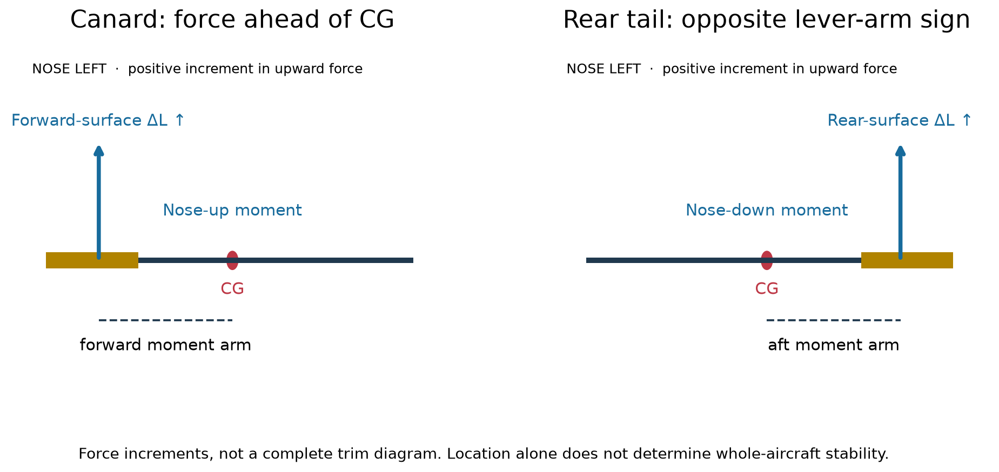

*Figure 1. An added upward force ahead of CG produces a nose-up moment; the same increment behind CG produces a nose-down moment. These are force increments, not complete trim states.*

The Wrights' concern about dangerous pitching and the consequences of a stall influenced their preference for a forward surface. NASA's historical review connects that preference to concern about Lilienthal's fatal loss of control; it also emphasizes the limited documentation of the early machines' stall behaviour. Treat this as a historical design motivation—not proof that every canard is safer than every rear-tail aircraft. [NASA TM 88354, historical overview, printed pp. 7–8](https://ntrs.nasa.gov/api/citations/19870013196/downloads/19870013196.pdf).

Their important contribution was to pursue controllable aerodynamic moments alongside lift and propulsion. The location also made the forward surface and its supporting structure part of the load path: surface pressure → ribs/spars → supporting members and joints → main airframe. Hinge and control-linkage loads must be carried as well as the net lift force.

### A simple moment calculation

Take x increasing aft, upward force positive and nose-up pitching moment positive. For a vertical force at position x:

$$
\Delta M=L(x_{CG}-x).
$$

If a canard is 1.5 m ahead of CG and its upward force increases by 40 N:

$$
\Delta M=40(1.5)=60\ \mathrm{N\,m}
\quad\text{nose up}.
$$

The same force increment 1.5 m aft produces −60 N m, nose down. These are assumed classroom dimensions and forces, not measured Wright values.

### Do not confuse incidence with lift direction

The discussion of a small negative setting relative to the main wing concerns **geometric incidence**. It does not establish that the forward surface always pushes downward. A simplified local relation is:

$$
\alpha_c=\alpha+i_c+\epsilon_c,
\qquad
L_c\approx q_cS_ca_c(\alpha_c-\alpha_{L=0,c}).
$$

Here εc represents the signed local-flow-angle correction under the chosen convention. Local dynamic pressure, geometry and flow interference also matter. A negative relative incidence can coexist with positive lift at a sufficiently positive local angle of attack. Do not assign a historical lift direction from incidence alone.

## Trim is not stability

Pitch trim means that the net pitching moment vanishes at a particular flight condition:

$$
C_m(\alpha_0,\delta_e)=0.
$$

Local longitudinal static stability, with controls fixed and nose-up moment positive, requires:

$$
\left.\frac{\partial C_m}{\partial\alpha}\right|_{\delta_e}<0.
$$

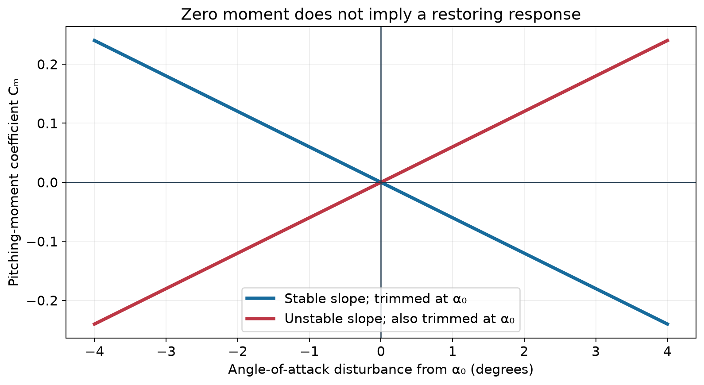

*Figure 2. Both curves pass through zero moment. Only the downward-sloping curve produces a restoring nose-down moment after a small increase in angle of attack. Slopes are illustrative, not Wright flight-test data.*

If an increase in angle of attack increases upward force on a surface ahead of CG, that surface's incremental moment tends to be nose up. A comparable increment on a rear surface tends to be nose down. **That is one component's contribution**, not a verdict on the whole aircraft. The wing, CG position, surface size, local flow and control setting determine the combined response.

Dynamic stability is another question: does a disturbed motion decay over time? Inertia, aerodynamic damping and coupling enter that analysis. A pilot can actively control an aircraft that does not possess a strong passive restoring response; control authority and pilot workload must then be considered.

### Why did later designs use rear horizontal tails?

A rear surface can supply a useful restoring contribution and a long pitching lever arm. But there is no universal rule that “moving the elevator aft automatically solves stability.” Geometry, wing pitching moment, downwash, CG and control power must be designed together. Modern canard aircraft can also be stable when designed appropriately.

For historical comparisons, identify the particular Wright model and year before discussing a configuration change. A photograph of a later machine must not be presented as evidence of the 1903 Flyer's layout.

NASA's retrospective also discusses the high pitch-control workload and subsequent measures to improve stability, eventually including an aft movable horizontal surface. This connects the historical evolution to the restoring-moment argument above, without assuming that one layout alone explains every improvement. [NASA TM 88354, printed pp. 8–10](https://ntrs.nasa.gov/api/citations/19870013196/downloads/19870013196.pdf).

## The bicycle-inner-tube box and the wing-warping idea

The relevant object was **the cardboard package for a bicycle inner tube**, not the rubber tube itself. The NPS account describes Wilbur twisting such a box and relating its deformation to twisting wing ends in opposite directions. Bird observations were also part of the development; the box was an analogy, not a finished aerodynamic design. [NPS teaching account](https://www.nps.gov/articles/wright-brothers-national-memorial-site-of-the-first-controlled-powered-flight-teaching-with-historic-places.htm).

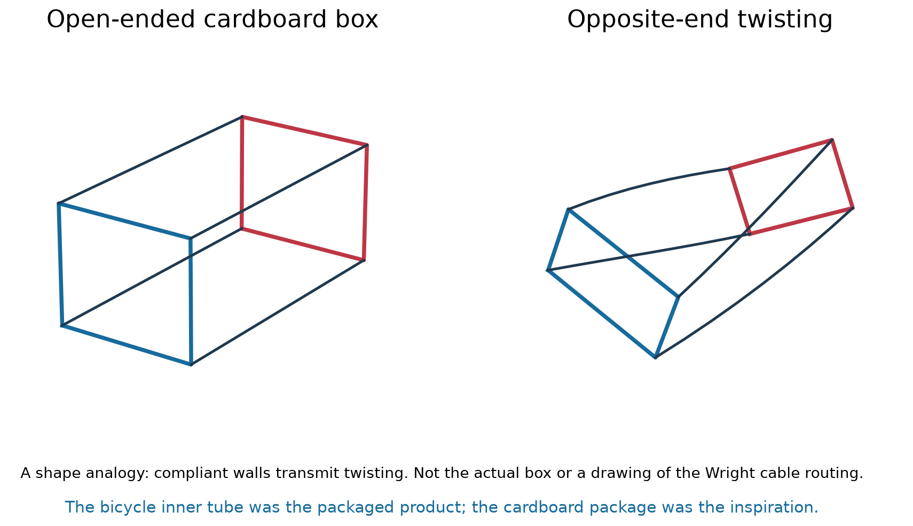

*Figure 3. Original geometric illustration of the box analogy. Blue and red outlines distinguish the ends; dark lines indicate longitudinal edges. This is not the original historical box.*

**What did the analogy reveal?** A light assembly can preserve much of its overall form while allowing different rotations at its ends. Rather than rotating the entire aircraft first, the pilot could change the wings' local aerodynamic angles and obtain a rolling moment.

**What did it not prove?** It did not give the required cable forces, torsional stiffness, aerodynamic effectiveness, fatigue life or stability. Those still required experiments and refinement.

For class, use a light open-ended cardboard package. Rotate its ends gently in opposite directions and observe how the edges and walls move. Compare this with a box restrained against twisting. The demonstration explains compliance; do not treat its stiffness or buckling behaviour as a scaled aircraft test.

## How wing twisting creates roll

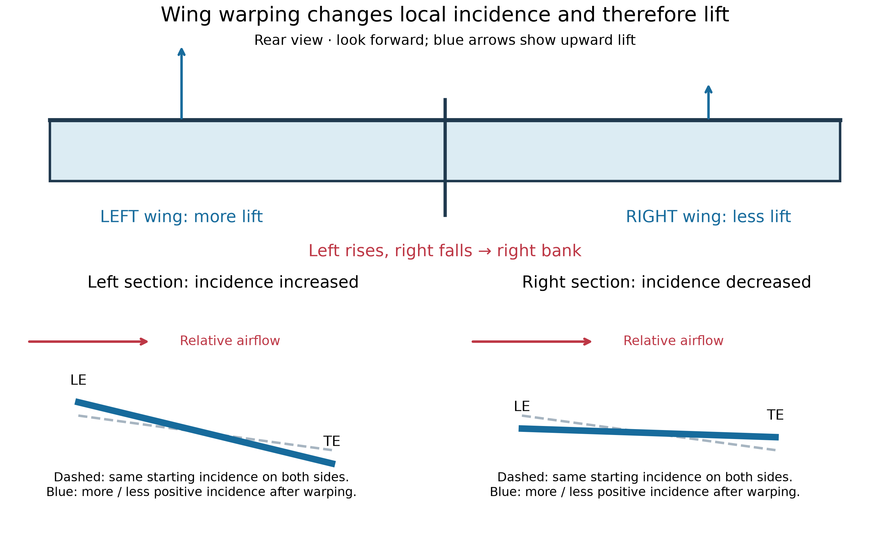

*Figure 4. Opposite local twists produce more upward lift on one side and less on the other in the illustrated attached-flow case. Both arrows remain upward: less lift is not automatically downward lift.*

An incidence change changes local angle of attack. In an approximately linear, attached-flow range:

$$
\Delta C_l\approx a\,\Delta\alpha,
\qquad
\Delta L\approx qS_{\mathrm{patch}}a\,\Delta\alpha.
$$

Assume q = 100 N/m², a patch area of 1 m², a lift-curve slope a = 4 rad⁻¹ and opposite changes of ±2°:

$$
\Delta L\approx100(1)(4)\left(\frac{2\pi}{180}\right)
=13.96\ \mathrm{N}.
$$

One side gains about 14 N and the other loses about 14 N. If their lever arms are 3 m, the rolling-moment magnitude is approximately:

$$
|\Delta M_{\mathrm{roll}}|\approx2(3)(13.96)=83.8\ \mathrm{N\,m}.
$$

These numbers illustrate the mechanism only. A Wright biplane has interference, spanwise variation and structural coupling that this two-patch model omits. Near stall, a linear lift law may fail.

Warping therefore means **twisting the section and changing incidence**, not merely moving a wingtip vertically. Vertical displacement can accompany deformation, but tip height alone does not define its aerodynamic effect.

## What the uprights and wires actually do

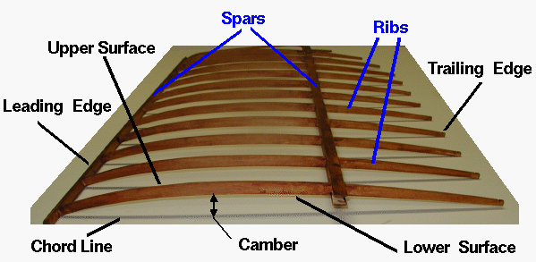

*NASA photograph of a Wright wing model with covering removed; not a photograph of the 1903 flight. Long members and repeated ribs show the structural framework. [NASA wing-geometry explanation](https://www1.grc.nasa.gov/beginners-guide-to-aeronautics/wing-geometry/).*

The interplane **uprights or struts** connect the upper and lower wings and help carry structural loads. **Bracing wires** support the assembly against prescribed deformations; **control cables** transmit pilot input. A line's appearance alone is insufficient to identify its function.

The 1899 kite was deliberately arranged to permit warping. Smithsonian describes an unbraced region between front and rear struts and four control lines operated through hand sticks. This supports a deformable wing assembly, **not an assertion that every strut joint was a freely rotating hinge**. [Smithsonian](https://airandspace.si.edu/explore/stories/researching-wright-way).

Cable tension and structural compliance work together. Struts and other members move as part of the deformation; the pilot does not simply pull one isolated upright to lift a rigid wing. Exact wire attachment points and joints must come from the particular aircraft's drawings.

There is a design tradeoff: too much torsional restraint demands large control effort or prevents useful warping; too little restraint permits unwanted deformation and weakens control precision. The aim is adequate load-carrying capability **and** the intended compliant motion. This is an engineering interpretation, not a measured stiffness estimate for the Flyer.

## Why a rolling command also needs rudder coordination

Differential twist changes drag as well as lift. In a typical positive-lift, attached-flow example, the side receiving more lift also receives more induced drag. If the left side gains lift, it tends to rise, producing a right bank; its greater drag tends to yaw the nose left—opposite the intended turn. This is **adverse yaw**.

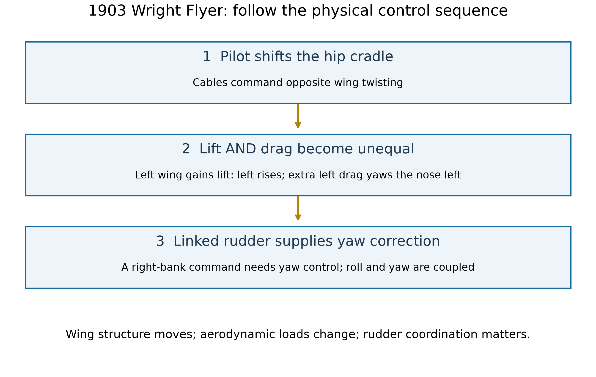

*Figure 5. The 1903 linked-control functions. This is a functional flow diagram, not an installation drawing of cable routing.*

The rear movable rudder supplies a lateral force and yawing moment to address this coupled response. A rudder is not simply a device that “turns the aircraft by itself”; banking, lift direction and coordination are related. The linked hip-cradle arrangement is documented for the 1903 Flyer by [NPS](https://www.nps.gov/articles/wrightflyer.htm).

Watch the [NPS Wing Warping Demonstration](https://www.nps.gov/media/video/view.htm?id=EA3F8C52-B158-994C-521233B153517057), **7 minutes 31 seconds**, on a replica of the 1903 Flyer. Pause to identify pilot input, moving structure and rudder; distinguish replica demonstration from historical flight footage.

## A centre-of-pressure correction for the classroom

Use one consistent representation of a wing's aerodynamic loading:

1. Resultant at the **centre of pressure**, without adding the same wing's equivalent pitching couple again.
2. Resultant at the **aerodynamic centre**, with the corresponding aerodynamic-centre moment.

For the simplified vertical-force model using the second representation:

$$
M_{CG,w}=M_{ac,w}+L_w(x_{CG}-x_{ac,w}).
$$

The equivalent CP representation is:

$$
M_{CG,w}=L_w(x_{CG}-x_{CP,w}).
$$

For nonzero lift, equivalence gives:

$$
x_{CP,w}=x_{ac,w}-\frac{M_{ac,w}}{L_w}.
$$

This also explains why CP can become ill-conditioned near zero lift when a finite pitching moment remains. It should not be assumed fixed at the leading edge for every flat plate or airfoil. A forward elevator changes the **whole-aircraft moment balance**; it does not freeze the main wing's own CP. NASA explains the [force-plus-moment representation](https://www1.grc.nasa.gov/beginners-guide-to-aeronautics/center-of-pressure/).

## How a pressure distribution produces a force and a moment

Imagine many small upward forces along a wing section. Their sum is the section lift; their distances from a reference point determine the pitching moment. Let **x increase aft from the leading edge**, and use upward lift and nose-up moment as positive. For this thin-section, vertical-pressure-load teaching model, define Δp(x) as lower-surface pressure minus upper-surface pressure. Per unit span:

$$
L'=\int_0^c \Delta p(x)\,dx,
\qquad
M'_{LE}=-\int_0^c x\,\Delta p(x)\,dx.
$$

An upward force aft of the leading edge gives a nose-down moment about that edge, hence the minus sign. Equating this distributed loading to one resultant, **when L′ is nonzero**, gives:

$$
x_{CP}=\frac{\displaystyle\int_0^c x\,\Delta p(x)\,dx}
{\displaystyle\int_0^c \Delta p(x)\,dx}.
$$

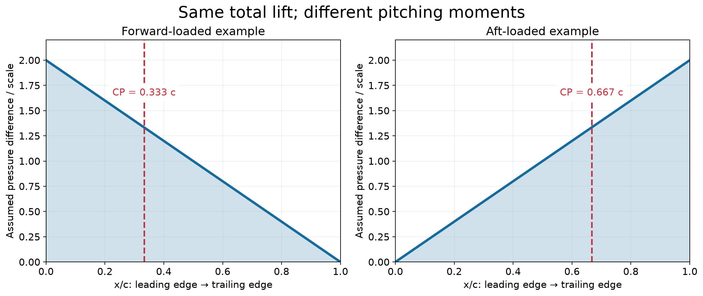

*Figure 6. Two assumed pressure distributions, not measured Wright data. Both have the same integrated lift. The forward-loaded one acts at c/3; the aft-loaded one at 2c/3. A force alone therefore does not specify the pitching moment.*

Try the integration with Δp = 2p₀(1 − x/c), then with Δp = 2p₀x/c. Both give L′ = p₀c, but the moment magnitudes are p₀c²/3 and 2p₀c²/3. The pressure centroid moved even though the total force stayed the same. These are simplified examples; real pressure depends on geometry, angle of attack, Reynolds number and flow separation.

### Why the CP moves—and sometimes is not a useful point

Dividing the earlier force-plus-couple relation by chord gives:

$$
\frac{x_{CP}}{c}=\frac{x_{ac}}{c}-\frac{C_{m,ac}}{C_L}.
$$

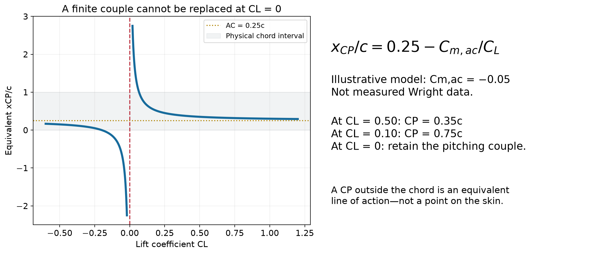

*Figure 7. Illustrative constant-moment model: xac/c = 0.25 and Cm,ac = −0.05. At CL = 0.50 the CP is 0.35c; at CL = 0.10 it is 0.75c. At zero lift a nonzero couple cannot be represented by a single finite-location lift force. This is not a fitted historical airfoil curve.*

Do not teach “the CP always moves forward when angle of attack increases” as a universal law. It depends on how both lift and moment change, especially near stall. An equivalent CP outside the chord is possible when signed pressure contributions and their moment demand it; it is not a physical fitting on the wing. The aerodynamic centre is useful because its moment is approximately insensitive to angle of attack in the usual attached-flow, low-speed approximation; it is not the same as CG or CP.

**How would we measure CP?** Measure force **and pitching moment about a known reference**, or measure the pressure distribution and integrate it. Measuring lift alone is insufficient. Keep this separate from the Wright lift/drag balances described next: their standard output should not be presented as a direct CP measurement.

## The wind tunnel: turning disagreement into measurements

The Wrights moved from outdoor bicycle-mounted comparisons to controlled tunnel testing in 1901. A tunnel let them compare models under more repeatable conditions; full-scale glider flights still supplied a separate check. NASA shows a **replica**, not an original 1901 photograph, in its [wind-tunnel account](https://www.grc.nasa.gov/www/k-12/airplane/wrights/test1901.html).

The [NASA source page](https://www.grc.nasa.gov/www/k-12/airplane/wrights/test1901.html) includes a tunnel-replica photograph. Its legacy image endpoint did not pass the publication-time availability check, so this report uses the reliable local process diagram below rather than a broken image embed.

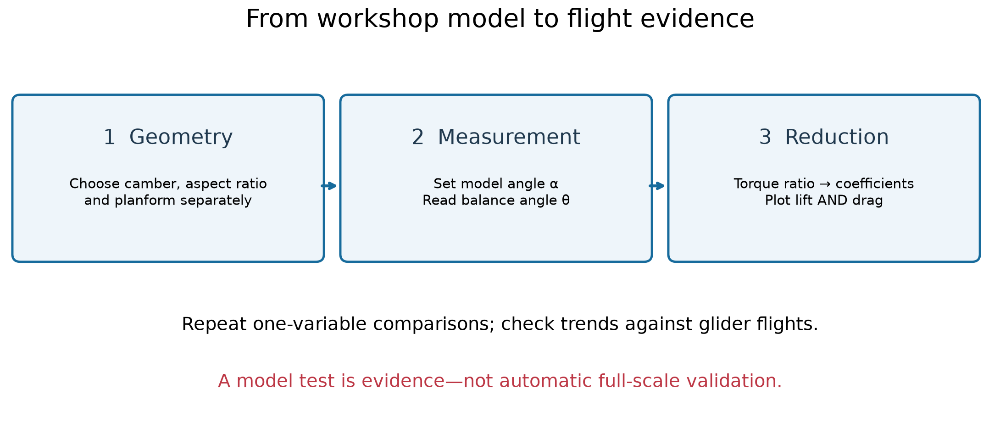

*Figure 8. The experimental process. Model angle of attack α and instrument reading θ are different angles. “Data reduction” means converting a reading into an engineering quantity with a stated calibration.*

Their workshop-built balances used bicycle spokes and hacksaw-blade parts; the models were thin steel shapes. Many preliminary models were screened before roughly 30 received detailed testing. Comparing one variable at a time helped distinguish camber, aspect-ratio and configuration effects. [NASA: lift-balance design](https://www1.grc.nasa.gov/beginners-guide-to-aeronautics/lift-balance-design/).

### What the lift balance actually measured

It compared the model's lift with a reference plate's drag through opposing torques. Adjustment removed the unwanted model-drag torque; the actual linkage distributed forces among several arms. The following diagram is only an **equivalent torque explanation**, not a construction drawing. [NASA: lift-balance operation](https://www1.grc.nasa.gov/beginners-guide-to-aeronautics/lift-balance-operation/).

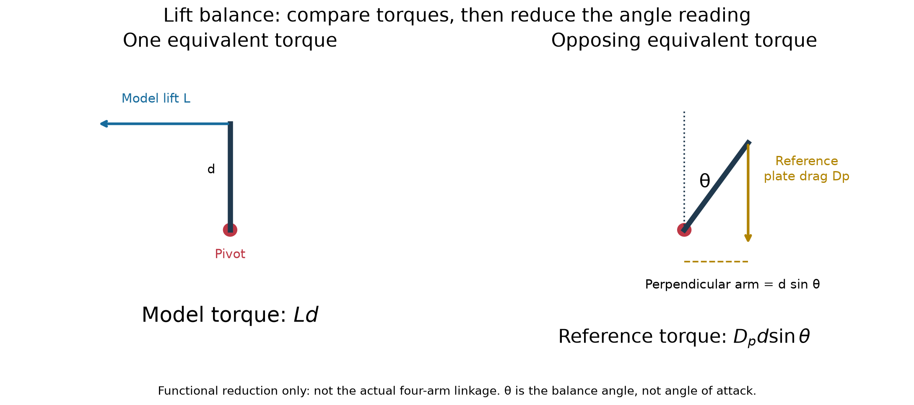

*Figure 9. Equal-arm torque reduction in an abstract instrument plane, not an aircraft side-view force diagram. θ denotes the balance reading, not the airfoil angle of attack. The two forces give opposing torques.*

$$
Ld=D_p d\sin\theta
\quad\Rightarrow\quad
\frac{L}{D_p}=\sin\theta.
$$

NASA describes the historical normalization with reference-plate coefficient equal to one, giving:

$$
c_{l,\mathrm{historical}}=\frac{A_p}{A_m}\sin\theta.
$$

For Ap = 8 in², Am = 6 in² and θ = 30°, this historical coefficient is 2/3. The common pressure/speed factor cancels in the ratio. **This does not mean a normal flat plate has modern drag coefficient exactly one.** With modern q = ½ρV² normalization, the correctly calibrated relation is:

$$
C_{L,m}=C_{D,p}\frac{A_p}{A_m}\sin\theta.
$$

The reference coefficient must match its geometry and test conditions. Calibration, friction, tunnel-flow quality and model-scale effects remain relevant. The separate drag balance is needed for drag measurements; the preceding sine relation is not a formula for the model's own L/D.

### Model 31 was a wing, not a NACA airfoil name

NASA identifies Model 31 as an **elliptical planform**, **parabolic section**, area 8 in² and aspect ratio 4.64. “Elliptical” describes its top view; “parabolic” describes its section. It approximated the geometry behind Lilienthal's data. Model 51 approximated Langley's configuration using information obtained through Chanute. These model numbers are not NACA series designations. [NASA: original wind-tunnel models](https://www.grc.nasa.gov/www/k-12/airplane/wrights/models.html).

The [NASA model catalogue](https://www.grc.nasa.gov/www/k-12/airplane/wrights/models.html) provides photographs credited to the Franklin Institute, including Models 30, 31 and 51. Their legacy direct-image endpoint was unavailable when checked; use the catalogue for the historical specimens rather than treating our original schematics as photographs of them.

The resulting lesson was not simply “Lilienthal was wrong.” Reproducing his wing geometry supported his data within its measurement accuracy, while applying it to a different wing planform produced different performance. The tests also exposed aspect-ratio, camber, stall and multi-wing interference effects. Recorded angles were reduced and plotted, rather than treated as final aerodynamic coefficients. [NASA: 1901 results](https://www.grc.nasa.gov/www/k-12/airplane/wrights/results.html).

**Class exercise:** compare two wings with the same section but different span. Predict which quantities could differ, then explain why a two-dimensional section coefficient is not automatically the coefficient of either complete wing. Testing a model at different angles is also not the same experiment as testing a complete aircraft's roll-control system.

## Why put the horizontal tail behind the wing?

The earlier canard diagram explains the lever-arm sign. Now ask a different question: after a small increase in angle of attack **with controls fixed**, does the aircraft develop a restoring nose-down increment?

For a rear tail a distance lt aft of CG, in the simplified vertical-force model:

$$
\Delta M_t=-l_t\,\Delta L_t.
$$

If its effective angle of attack increases, a normal attached-flow tail tends to gain upward force. Behind CG, that increment is nose-down. This can be stabilizing **even when the tail's trimmed force is downward**: the increment and the baseline force are different quantities. A front surface gaining upward force gives the opposite contribution. Neither contribution alone determines the stability of the entire aircraft.

A simplified rear-tail contribution to the moment slope is:

$$
C_{m_\alpha,t}=-\eta_t a_t
\underbrace{\frac{S_t l_t}{S\bar c}}_{V_H}
\left(1-\frac{d\epsilon}{d\alpha}\right).
$$

Here ηt is the tail-to-reference dynamic-pressure ratio, aₜ the tail lift-curve slope per radian, ε the downwash angle and VH the horizontal-tail volume coefficient. This is an instructional approximation: wing/body moment slope, CG, control constraints and interference must also be included. A long arm creates a larger moment for the same force, but brings structural weight and stiffness requirements.

$$
SM=\frac{x_{NP}-x_{CG}}{\bar c},
\qquad C_{m_\alpha}=-a\,SM
$$

For the stated linear, controls-fixed model, a positive lift-curve slope a and CG ahead of the neutral point give a negative, restoring moment slope. Moving a tail aft is therefore a design opportunity, **not proof that every aft-tail airplane is stable or every canard is unstable**.

The Wright transition was gradual. NASA's retrospective analysis discusses changes in wing camber, elevator hinge behaviour and CG as well as the later rear elevator; it should not be reduced to moving one surface and changing nothing else. [NASA TM-88354, historical longitudinal analysis](https://ntrs.nasa.gov/api/citations/19870013196/downloads/19870013196.pdf). The Model B transition around 1910 included trials with both forward and rear horizontal surfaces before the forward elevator disappeared. [Wright B Flyer organization: Model B history](https://www.wright-b-flyer.org/history/modelb/).

*Historical-layout comparison: a **modern Model B reproduction**, photographed at the Udvar-Hazy Center—not a 1910 flight photograph. Compare the aft horizontal surface with the forward elevator in the 1903 Flyer photograph above. Photo: Jarek Tuszyński; [source and attribution](https://commons.wikimedia.org/wiki/File:NASM_-_Wright_Model_B_-_reproduction.jpg), [CC BY-SA 4.0](https://creativecommons.org/licenses/by-sa/4.0/); unmodified.*

## Chanute, Langley and the Wrights: an exchange of evidence

Octave Chanute was an engineer and an important correspondent, not a substitute designer for the Wrights. Wilbur's **13 May 1900 letter** set out his interest in flight practice; Chanute replied with encouragement. Their sustained correspondence connected the brothers with earlier work and other experimenters. [Library of Congress: first letter](https://www.loc.gov/item/mcc.006/), [LOC: Wright correspondence context](https://www.loc.gov/collections/wilbur-and-orville-wright-papers/articles-and-essays/the-belief-that-flight-is-possible-to-man/).

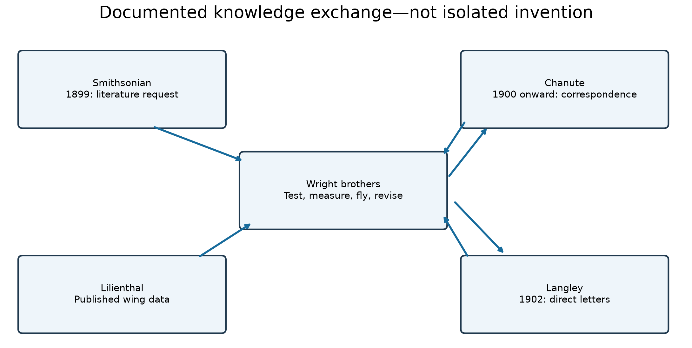

*Figure 10. Documented routes of information. An arrow means a literature or correspondence connection, not joint authorship of an aircraft or transfer of every design detail.*

Three primary documents make the chronology concrete:

| Date and document | What it establishes | What it does not establish |
| --- | --- | --- |
| [30 May 1899: Wilbur to the Smithsonian](https://siarchives.si.edu/history/featured-topics/stories/letter-dated-may-30-1899) | He requested publications and a bibliography, acknowledging earlier investigators. | That the Smithsonian designed his aircraft. |
| [20 October 1902: Wilbur to Langley](https://siarchives.si.edu/history/featured-topics/stories/letter-dated-october-20-1902) | Direct communication about a proposed camp visit and a possible Washington stop. | That a visit actually occurred or that the aircraft were co-designed. |
| [7 November 1902: Orville and Wilbur to Langley](https://siarchives.si.edu/history/featured-topics/stories/letter-dated-november-7-1902) | They explained the missed stop and referred to their surface-testing work and unpublished results. | That every tunnel measurement was public or that they tested a powered aircraft at Kitty Hawk that season. |

The correspondence corrects two opposite stories: they were neither inventing without outside knowledge nor merely assembling someone else's finished solution. For students, the useful sequence is **read prior work → identify an applicability problem → design a measurement → compare → test a controllable machine**. Published aerodynamic evidence and learning to pilot a glider answer different questions.

## Langley's Aerodrome: why a successful model did not guarantee a successful airplane

Langley's unpiloted Aerodromes achieved flights in 1896. His later human-carrying **Aerodrome A** used tandem wings and an unusually capable Manly gasoline engine, about 52 hp. Do not confuse that engine with the steam-powered earlier models. The Smithsonian identifies deficiencies in scaling, structure, aerodynamics and control—not merely inadequate engine power. [Smithsonian: Aerodrome A collection record](https://www.si.edu/object/langley-aerodrome%3Anasm_A19180001000).

*Real photograph before the **8 December 1903** attempt. Look for the two fore-and-aft wing sets, bracing and launcher; tandem wings are not a biplane's vertically stacked wings. NASA on The Commons, image NIX-EL-2001-00462, [image record](https://commons.wikimedia.org/wiki/File:The_Langley_Aerodrome_(4616323625).jpg); no known copyright restrictions. Unmodified.*

### Two failed launches, not two documented flutter accidents

| Attempt | Archival account | Engineering question to ask |
| --- | --- | --- |
| 7 October 1903 | The launch car snagged the piloted machine, which dropped into the Potomac. | Could the support/release interface clear every moving part while carrying acceleration loads? |
| 8 December 1903 | The tail dragged along the launch track and began to collapse; the machine again entered the river. Pilot Charles Manly escaped and was rescued. | How did contact loads and structural damage affect the release and subsequent motion? |

These descriptions come from the [Smithsonian Langley collection chronology](https://www.si.edu/object/archives/sova-nasm-xxxx-0494?edan_fq%5B0%5D=online_visual_material%3A%22false%22). They establish launch-related events; they are not instrumented reconstructions of each member's stress or a diagnosis of flutter. The museum's broader evaluation also questions the aircraft's structure and aerodynamic design. Neither “only the catapult was wrong” nor “the wings failed solely from high-speed flutter” follows from this evidence.

*Actual 7 October 1903 failure photograph; [Commons record](https://commons.wikimedia.org/wiki/File:Samuel_Pierpont_Langley_-_Potomac_experiment_1903.jpeg), public domain in the United States; photographer not identified in that record. A still photograph cannot reveal a unique aerodynamic cause.*

### Launching equipment belongs in the structural model

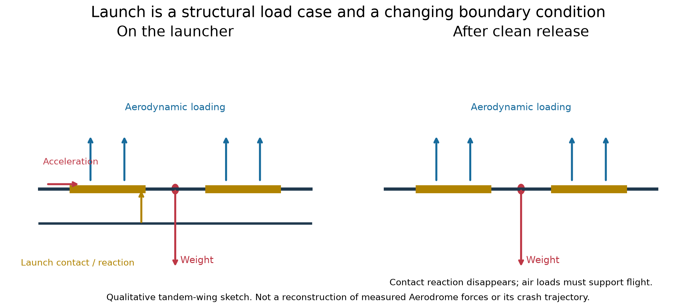

*Figure 11. Original qualitative diagram, not Aerodrome force measurements. Before release, launcher contact and acceleration add loads and restraints. After clean release, those restraints disappear. A snag can create a very different load case from intended flight.*

A flight calculation alone can miss a launch failure. Engineers must examine support points, release clearances, bracing, joints, acceleration and off-design contact. The support arrangement changes bending moments and load paths. Treat the aircraft **and its launch interface** as a system; do not infer the exact historical fracture location from this sketch.

### The scaling trap: a classroom calculation

Let every length of an ideal same-material, same-density model grow by a factor λ. For a geometrically similar cantilever under its scaled distributed 1g weight:

$$
W\propto\lambda^3,\quad
M_{root}\sim W\ell\propto\lambda^4,\quad
I\propto\lambda^4,\quad
Z=\frac{I}{h/2}\propto\lambda^3.
$$

Therefore:

$$
\sigma\sim\frac{M}{Z}\propto\lambda,
\qquad
\delta\sim\frac{W\ell^3}{EI}\propto\lambda^2,
\qquad
\frac{\delta}{\ell}\propto\lambda.
$$

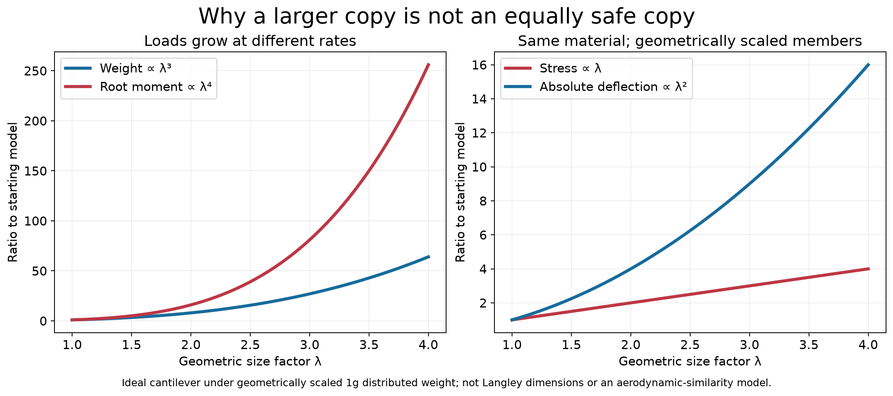

*Figure 12. An original similarity exercise, not a numerical failure model of Aerodrome A. Doubling size in this idealization multiplies weight by 8, root moment by 16, section modulus by 8, stress by 2 and absolute deflection by 4.*

The calculation assumes all member thicknesses scale too; an actual redesign need not do that. Aerodynamic similarity adds Reynolds number, flight speed and flow-regime requirements, so the weight-based relations cannot simply be applied to every aerodynamic load. The lesson is to **redesign and validate**, not enlarge a successful drawing and assume identical safety margins. Bracing tensions, joints, buckling and control stiffness also require separate checks.

### What later demonstrations can—and cannot—prove

In 1914 Curtiss tested a rebuilt Aerodrome with modifications, amid a dispute about priority. Flights of a changed machine do not establish that the original 1903 configuration could perform the same task. Keep original trials, later modifications and institutional claims separate. [Smithsonian: Langley experiments scrapbooks](https://airandspace.si.edu/collection-archive/langley-experiments-scrapbooks/sova-nasm-xxxx-0294).

The constructive comparison is not “scientist versus bicycle mechanic.” Langley's work advanced powered-model experimentation; the Wrights combined aerodynamic measurement, a workable control system and repeated pilot practice. A successful engine, a successful small model and a controllable full-scale aircraft are three different demonstrations.

## What students should take away

- Pitch control is a moment problem; useful lift alone is insufficient.
- The forward elevator was an active control choice, not a universal guarantee of passive stability or stall safety.
- Wing warping made deliberately permitted deformation perform a control function.
- Spars, ribs, struts, bracing and cables belong to a coupled load-carrying and control system.
- Unequal lift and unequal drag must both be considered; roll and yaw cannot be taught as unrelated mechanisms.
- A historical analogy can inspire a design, but measurements and repeated tests establish whether it works.
- CP, aerodynamic centre, CG and neutral point answer different questions; do not interchange them.
- An instrument reading needs a force/moment model and calibration before it becomes a coefficient.
- Model-scale success does not remove full-scale structural, control or launch-interface risks.

### A short teaching sequence

First identify surfaces in the historical photograph. Demonstrate the cardboard box, then show Figure 4 and ask which wing rises and why. Introduce adverse yaw and the linked rudder. Finally use Figures 1–2 to separate pitch-control moment, trim and stability.

Ask students: “If both wings keep positive lift, can the aircraft roll?” “Does negative incidence prove downward canard force?” “Can a machine have zero pitching moment yet be statically unstable?” “Which wire carries control input, and which restrains the structure?” Require an annotated sketch and a stated sign convention.

For a second lesson, integrate Figure 6's two pressure distributions, reduce the 30° balance reading, then discuss the rear-tail force **increment**. Finish with Langley: ask students to list launch loads separately from flight loads and calculate the consequences of doubling a geometrically similar model. Require them to label each statement as **documented historical fact**, **model assumption** or **engineering inference**.

## Sources and scope

The twelve original diagrams are generated by [build_wright_controls_figures.py](scripts/build_wright_controls_figures.py) and [build_wright_research_figures.py](scripts/build_wright_research_figures.py), with PNG and SVG versions. Geometry and calculation inputs are illustrative, not historical dimensioned reconstructions. Photographs are separately credited, and reproductions are distinguished from historical aircraft photographs. No restricted museum drawings are republished.

The readable discussions **“توضیح سطح جلویی برادران رایت”**, the wing-warping response in **“توضیح اعضای عمودی Wright”**, and accessible questions/search excerpts from **“توضیح مکانیزم کایت رایت”** and **“چرا دم افقی عقب رفت”** informed this expanded reading. Historical claims are checked against the linked institutional sources; ChatGPT replies are not historical evidence. Several saved assistant responses did not load, so this is **not a complete transcript or full synthesis of every discussion**. Unsupported precise CP-reversal angles and single-cause crash diagnoses are deliberately not carried over.

The photographed page 69 is headed **“Learning the Art of Airplane Design.”** That chapter heading and pagination match Peter L. Jakab's *Visions of a Flying Machine: The Wright Brothers and the Process of Invention*, whose [published table of contents](https://books.google.com/books?id=tcJvDwAAQBAJ) places the chapter at page 63. This is a bibliographic identification from the visible page, not verification of the user's edition. The photographed page's relative-incidence discussion is addressed above; its full text is not reproduced. The separately attached *Wing Theory—Incompressible Fluids* is a different book.

[Back to the course](README.md) · [Wing structure, buckling, materials and flutter](notebooks/MIE446_Wing_Structure_Buckling_Materials_and_Flutter.ipynb)
