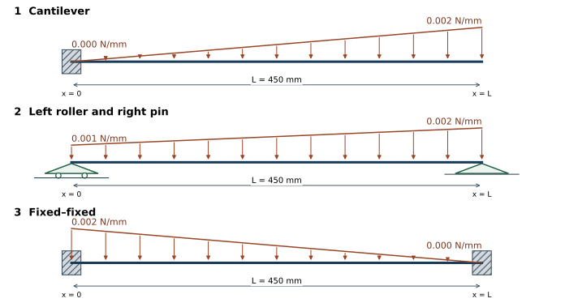

# HW 2B Three beams under distributed loads

**Download the handout:** [PDF](MIE446_HW2B_Three_Beams.pdf) · [Word](MIE446_HW2B_Three_Beams.docx)

MIE 446 Aerospace Structures, Fall 2026. **65 points.**

**Due: Thursday, November 5, 2026.** Submit through Canvas at the time shown there.

## Given data

- All three beams have L = 450 mm, E = 2200 MPa, rectangular width b = 16 mm and vertical depth h = 8 mm.
- Use I = bh³/12 and a constant EI. Neglect self-weight and shear deformation.
- Measure x from the left end. All distributed loads act downward and vary linearly between the stated endpoint intensities.
- For hand calculations, upward reactions and counterclockwise external reaction couples are positive. Use downward-positive displacement v, θ = v', and sagging-positive M.

## The three cases

1. **Cantilever, 20 points:** fixed at x = 0 and free at x = L. Triangular load increases from zero at the left end to 0.002 N/mm at the right end.
2. **Roller and pin, 20 points:** roller at x = 0 and pin at x = L. Trapezoidal load increases from 0.001 N/mm at the left end to 0.002 N/mm at the right end. The two circles identify the left roller.
3. **Fixed–fixed, 25 points:** fixed at both ends. Triangular load decreases from 0.002 N/mm at the left end to zero at the right end.

## A Analytical solution for each case

1. Calculate the resultant distributed force and its position.
2. Write force and moment equilibrium and calculate the support reaction forces and couples, including any zero components.
3. Where equilibrium is insufficient, use EI v'' = -M(x), θ = v' and the support displacement/rotation conditions to obtain the missing equations. Show the integration and conditions used; do not use only a tabulated answer.
4. Report vertical displacement v and rotation θ at every support. For Case 1 report the fixed end only; the free-end displacement is not requested.
5. For Case 2, calculate both nonzero end rotations; do not set the pin or roller rotation to zero. For Case 3, use v = θ = 0 at both clamps to determine the reactions.

## B Software solution and comparison

1. Open the [course beam software](https://ehsan-roohi.github.io/Aerospace-Structures/wing-lab.html?beamCase=l03-centre) and select the corresponding support condition for each case.
2. Set L, b, h and E to the values above, apply the dimensions, and clear all existing loads.
3. Add one full-length distributed segment from 0 to 450 mm with the endpoint intensities specified for that case. Use the correct downward sign; do not add a point force.
4. Run all three cases. The software's simply supported option has the same vertical-bending constraints as the roller–pin case; all horizontal reactions here are zero.
5. Submit one comparison table covering all three cases. For each support, list analytical and software vertical reaction force, reaction couple, v and θ, with units and consistent signs. Explain any discrepancy briefly.

## Submit

1. Submit **one PDF** containing the analytical calculations for the three cases and the comparison table.
2. No additional drawings, stress calculations, maximum-deflection search, mesh study, screenshots, slides or separate software files are required.
3. Use [Lecture 03](https://colab.research.google.com/github/Ehsan-Roohi/Aerospace-Structures/blob/main/notebooks/MIE446_Lecture_03_Beam_Reactions_Stress_and_Deflection.ipynb) for support conditions and integration/compatibility methods.
