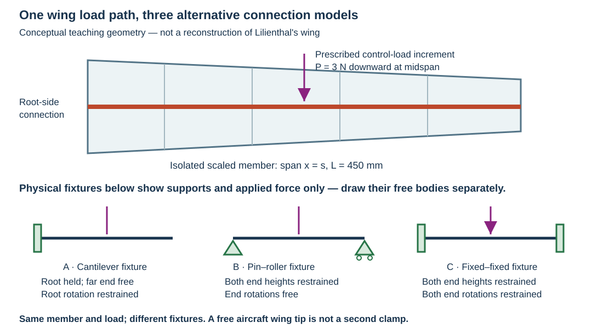

# HW 3B From Lilienthal wing control loads to beam bending

**Download the handout:** [PDF](MIE446_HW3B_Lilienthal_Wing_Beam_Analysis.pdf) · [Editable Word](MIE446_HW3B_Lilienthal_Wing_Beam_Analysis.docx)

MIE 446 Aerospace Structures, Fall 2026. This is **HW 3B**, separate from HW 2B. HW 2A and HW 2B are unchanged.

**Schedule:** part of the HW 3 portfolio, due November 12, 2026; Canvas supplies the exact time, submission slot and grading allocation. Do not submit this work in the HW 2B slot.

## Read before starting

[Lecture 03 in Colab](https://colab.research.google.com/github/Ehsan-Roohi/Aerospace-Structures/blob/main/notebooks/MIE446_Lecture_03_Beam_Reactions_Stress_and_Deflection.ipynb): Sections 2A–2C (supports and compatibility), 3 (cuts and V/M), 4 (stress and section properties), and 5 (strain, curvature and displacement).

Use **equilibrium and integration of the displacement/rotation equations**, not virtual work. Lecture 04 will introduce virtual work separately.

## One aircraft story across the assignments

In [HW 2A](../../homework-02/README.md), you identified Lilienthal's control devices and interpreted measured roll/yaw data. In HW 2B you turned a **prescribed teaching load law** into force increments and moments. Here you ask the next structural question: **when a control load reaches a wing member, how do its connections affect stress and deformation?**

Use the same Lilienthal photograph/annotated view you used in HW 2A. Identify what is actually visible; draw a separate conceptual load path from the aerodynamic load into the wing structure and its connections. Do not invent hidden member dimensions, materials or joint fixity from the photograph. Label the boundary between historical evidence and your engineering idealization.

The figure is an original teaching schematic, **not a reconstruction of Lilienthal's wing**. We isolate a scaled member inspired by that wing's load-transfer problem and test three alternative connection arrangements. Case A represents a root-held, free-ended member idealization. Cases B and C represent a member supported at both ends in alternative test/design fixtures, with either free or restrained end rotations. They are **not three claims about how the historical half-wing was attached**. A simply supported bay or fixed-ended bay must have real load-bearing connections at both ends; adding a second support changes the physical system.

Keep the aircraft question visible throughout: what can a connection transmit, where does the member bend, and what evidence would you need to choose a defensible model for the actual wing?

## Given model and conventions

Use a straight, constant-section, linearly elastic **scaled wing-member model**: L = 450 mm (the HW 2B teaching semi-span), b = 16 mm, h = 8 mm, E = 2200 MPa, with a downward point-force increment P = 3 N at a = L/2 = 225 mm. This is a prescribed downward control-load increment for a support-comparison experiment; it is **not the complete upward lift**, a measured Lilienthal force, or the resultant of HW 2B's load distribution. The rectangle and modulus are teaching inputs, not a historical material/section identification. Ignore self-weight and shear deformation in the hand Euler–Bernoulli calculation.

HW 2B used aircraft body axes. Here beam x runs outward along the right wing/member and beam z is upward across its depth: beam x corresponds to the earlier span coordinate s, **not aircraft-forward x**. Draw both conventions once. The retained transverse increment is positive downward; the drag increment and the real wing's other members, joints and bracing are outside this one-plane model.

Compare three supports under this **same** load: (A) left cantilever, (B) pin–roller, (C) fixed–fixed. The rectangle's vertical depth is h and its width is b. Calculate A, I = bh³/12 and c = h/2 before using any stress formula.

For the hand free body, upward forces and counterclockwise external couples are positive. Internal M is sagging-positive. Downward displacement v is positive:

$$\theta=\frac{dv}{dx},\qquad EI\frac{d^2v}{dx^2}=-M(x),\qquad
\sigma_{xx}=-\frac{M(x)z}{I}.$$

For transverse bending, a clamp supplies a vertical reaction and a couple; a pin/roller supplies a vertical reaction and no couple. There is no imposed axial load in these cases. The software uses its own force/couple signs: document the conversion before comparing numbers.

## 1 Predict and draw before calculating

For **each** support case draw two separate pictures:

1. Physical beam with its actual supports, dimensions and applied load only.
2. External free body: remove the supports and replace them with unknown reaction arrows/couples. Retain the applied load. Do not show a support symbol and its replacement reaction together.

On your Lilienthal image, mark where the conceptual member's load enters and where it would leave through its connections. Then predict which fixture has the greatest maximum displacement and which has the smallest maximum bending stress. Explain using constraints and load paths, not remembered numerical answers. A free wing tip must not become a clamp merely because the software offers that option.

Add a cross-section drawing showing b, h, z, the neutral axis and c. Add a bent-centreline sketch showing what displacement and tangent rotation each support permits.

## 2 Calculate reactions and displacement by hand

For each case write whole-beam force and moment equilibrium. Derive the piecewise internal moment on 0 ≤ x ≤ a and a ≤ x ≤ L from a cut; sketch V and M with units.

Integrate the curvature equation in each interval. Show your constants and the physical condition used to determine each one. At the point load, displacement and rotation remain continuous; shear jumps. A point force is not a hinge or an applied point couple.

| Case | Geometric conditions you must explain and use |
|---|---|
| A Cantilever | v(0) = θ(0) = 0; continuity at a. The unloaded outboard region has M = 0, so it remains straight but can be tilted. |
| B Pin–roller | v(0) = v(L) = 0; continuity at a. End rotations are free, not prescribed zero. |
| C Fixed–fixed | v(0) = θ(0) = v(L) = θ(L) = 0; continuity at a. Equilibrium alone cannot determine all four transverse reactions. |

For case C, identify the two missing equations as **compatibility**, not additional equilibrium. Starting from the zero displacement and slope at A, show why:

$$\theta(L)=-\frac{1}{EI}\int_0^L M(x)\,dx=0,\qquad
v(L)=-\frac{1}{EI}\int_0^L(L-x)M(x)\,dx=0.$$

Explain the remaining-distance factor L − x in one sentence. Substitute your piecewise M and solve for the reactions. Symmetry may check your result but is not a substitute for writing both compatibility equations.

Report all nonzero support reactions, signed end/centre internal moments, maximum absolute bending stress, displacement at the load, and maximum displacement with its location. Distinguish external support couples from internal end moments. Do not assume the cantilever maximum occurs under the centre load.

## 3 Verify using the course software

Open the corresponding **baseline lesson case** below. These links initially use the Lecture 03 defaults, **not the assessed values above**:

- [A Cantilever centre force](https://ehsan-roohi.github.io/Aerospace-Structures/wing-lab.html?beamCase=l03-centre)
- [B Simply supported centre force](https://ehsan-roohi.github.io/Aerospace-Structures/wing-lab.html?beamCase=l03-simple)
- [C Fixed–fixed centre force](https://ehsan-roohi.github.io/Aerospace-Structures/wing-lab.html?beamCase=l03-fixed)

In **Define your beam**, set L = 450 mm, b = 16 mm, h = 8 mm and E = 2200 MPa, then click **Apply beam dimensions**. Changing length can reset loads to the default tip force. Therefore set the load **after** applying geometry: use **Clear all loads**, add a single downward 3 N point load at 225 mm, and confirm the intended support. Do not leave the default 2 N tip force active. Confirm the displayed input summary and recalculate. This beam workspace uses mm, N and MPa.

Use **Download study record** for each solved case and include the records with your submission. In addition to the hand checks, use **Compare 10 / 20 / 40 elements** on one case. Explain why numerical convergence does not establish that a real clamp or material matches the model.

Capture the input panel and V/M, stress and displacement results. For each support, submit a table with **hand result, software result, sign/unit conversion and relative difference**. For a zero expected value use an absolute residual rather than dividing by zero. Include force and moment balance residuals and a check of the end displacements/rotations. Do not rely on a rounded display of 0.0000 as proof of exact zero.

Keep hand predictions even if wrong; explain corrections. If you cannot match a displayed input to the hand model, document the mismatch instead of silently changing your theory.

## 4 Bring the HW 2B aerodynamic load back into the member model

Keep case A, the same 450 mm member section/modulus and the same downward-increment convention. From the **given** HW 2B law use the transverse increment only:

$$\Delta f_z(s)=q\,c(s)A_zg(s),\qquad q=\frac12\rho V^2.$$

Use the released HW 2B inputs: ρ = 1.225 kg/m³, V = 15 m/s, root/tip chords 0.160/0.100 m, activation at 0.300 m, tip at 0.450 m, and A_z = 0.30. The chord is linearly tapered and g grows linearly from zero at activation to one at the tip. These remain an educational control-load law, not measured historical pressure data.

If HW 2B has not yet been completed, compute just this transverse load and its first moment for this section; a completed HW 2B submission is not a prerequisite. **Do not reuse aircraft roll/yaw moments as local hinge torques or beam end couples.** Re-derive the member-root reaction from this beam's free body.

1. Plot the given transverse load against s. Keep the zero-load region from 0 to 300 mm.
2. Represent 300–450 mm with three adjacent trapezoidal line-load segments, with endpoints at 300, 350, 400 and 450 mm. Evaluate the given law at each endpoint. Convert N/m to N/mm by dividing by 1000; coordinates in the app are mm.
3. Clear the point load and enter only those three distributed segments in the beam software. Preserve the actual model assumptions: tapered aerodynamic chord controls the load, while the isolated structural section remains constant.
4. Compare app force resultant and root moment against your integrals of Δf_z and sΔf_z, using consistent units. Refine to six segments. Explain the load-approximation error: chord times activation is generally quadratic, so a few straight segments do not reproduce it exactly.
5. Compare with a **single equivalent force** at s-bar = integral(sΔf_z ds)/integral(Δf_z ds), not automatically L/2. The equivalent force should reproduce total force and root moment within the load-discretization error; it need not reproduce internal moment everywhere or maximum displacement. Show one displacement comparison and explain why.

No full piecewise displacement integration of the multi-segment load is required; the hand displacement derivation is the centre-force comparison in Sections 1–2. This section carries your earlier aerodynamic-force calculation into a structural model rather than starting a disconnected problem.

## 5 Change the member design and explain what the model leaves out

**Depth study:** keep case A and the same load/material/length; change only h from 8 to 10 mm. Predict stress and displacement ratios using I = bh³/12 and c = h/2 before rerunning. Verify with the app; explain why greater depth changes stiffness without changing equilibrium reactions.

**Return to Lilienthal:** annotate your starting load-path sketch with what your solved member represents and what it omits. Explain which actual connection information would be needed before choosing a clamp, pin or elastic joint. Discuss why fabric, ribs, multiple members and any bracing identified in your cited source cannot automatically be replaced by a modern closed stressed-skin wing box.

**Optional modern comparison, not an additional required model:** open the app's printed-wing workspace and identify how its skin/member load path differs from your Lilienthal-inspired member. It is a different structure; do not present its stress plot as a prediction for Lilienthal's aircraft or as a full 3-D finite-element result.

Adding ribs is **not** required here. A short paragraph should distinguish global bending stiffness from rib functions such as section-shape retention and local skin support. This exercise does not approve a printed wing for loading or flight.

## Submit and explain

Submit one individually authored PDF through Canvas, including your sourced Lilienthal image and load-path sketch, predictions, separate system/free-body drawings, derivation, result/comparison tables, input/result screenshots, the HW 2B load-transfer/refinement study, depth study and model-limit discussion. Include any scripts/spreadsheets you actually used with a short README stating units, software version/date and how to reproduce your study. Do not publish student work here.

End with a brief process/AI-use note and answer:

- Why can two equilibrium equations solve the cantilever reactions but not the fixed–fixed reactions?
- Does zero end displacement imply zero end rotation for every support?
- Why does the outboard portion of the centre-loaded cantilever still move when its curvature is zero?
- What does software agreement verify, and what material or model assumptions remain unvalidated?
- Which parts of your model came from historical evidence, which came from HW 2B's prescribed load law, and which were deliberately assumed for this structural comparison?

Be ready to explain one compatibility equation and one discrepancy in a short individual defense.
