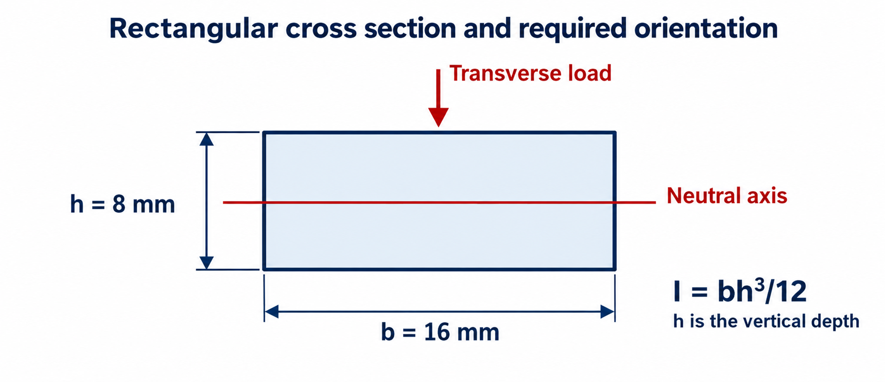
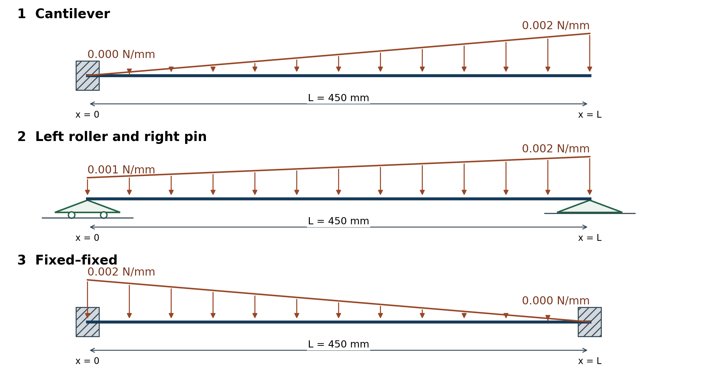

# HW 3 Three beams under distributed loads

MIE 446 Aerospace Structures, Fall 2026. **65 points.**

**Due Thursday, November 5, 2026.** Submit through Canvas at the time shown there.

[PDF handout](MIE446_HW3_Three_Beams.pdf) · [Word handout](MIE446_HW3_Three_Beams.docx) · [Student notebook](../../notebooks/MIE446_HW3_Three_Beams.ipynb) · [Open notebook in Colab](https://colab.research.google.com/github/Ehsan-Roohi/Aerospace-Structures/blob/main/notebooks/MIE446_HW3_Three_Beams.ipynb) · [Student ZIP](MIE446_HW3_Student_Pack.zip)

## Given data

- All beams: length L = 450 mm, modulus E = 2200 MPa, rectangular width b = 16 mm and vertical depth h = 8 mm. The h direction is parallel to the load.
- Use A = bh and I = bh³/12. Keep EI constant. Neglect self-weight and shear deformation.
- Measure x from the left end. Distributed loads act downward and vary linearly between the stated intensities.
- Use the software convention for hand work: downward reaction force and displacement positive; clockwise external reaction couple and rotation positive; internal bending moment M positive in sagging. θ = dv/dx and EI v″ = −M.

## The three cases

1. **Cantilever, 20 points:** fixed at x = 0, free at x = L. Triangular load increases from 0 to 0.002 N/mm.
2. **Roller and pin, 20 points:** roller at x = 0, pin at x = L. Trapezoidal load increases from 0.001 to 0.002 N/mm.
3. **Fixed–fixed, 25 points:** fixed at both ends. Triangular load decreases from 0.002 to 0 N/mm.

## Part A Analytical solution for each case

1. Calculate the resultant force and its position from the left end.
2. Write force and moment equilibrium and calculate support forces and external couples, including zero components. For the fixed–fixed beam, equilibrium alone does not determine all reactions.
3. Integrate EI v″ = −M(x) and θ = v′. Show the integration constants and displacement/rotation conditions used; do not give only a tabulated answer. For Case 3, impose v = θ = 0 at both clamps to determine the missing reactions.
4. Report these selected deformation quantities:
   - Case 1: v and θ at the free end x = L.
   - Case 2: θ at both supports and v at midspan x = L/2.
   - Case 3: v at midspan x = L/2.
5. State the prescribed v and θ conditions at every support. A pin or roller imposes v = 0 but leaves θ unknown; a clamp imposes both v = 0 and θ = 0.

## Part B Software solution and comparison

1. Open [Beam Lab without a preset load](https://ehsan-roohi.github.io/Aerospace-Structures/wing-lab.html). Choose the left and right supports explicitly:
   - Case 1: **Left fixed / Right free**.
   - Case 2: **Left roller / Right pin**.
   - Case 3: **Left fixed / Right fixed**.
2. Set L = 450 mm and E = 2200 MPa; choose **Solid rectangle**, b = 16 mm, h = 8 mm. Check A = 128 mm² and I ≈ 682.67 mm⁴. Remove all interior supports and internal hinges. Clear previous loads and leave **Include self-weight** unchecked.
3. Add exactly one full-span segment from 0 to 450 mm. Use **Triangular zero at start** for Case 1; **Trapezoidal** for Case 2; **Triangular zero at end** for Case 3. Enter the stated endpoint intensities as positive downward values in N/mm. Do not enter these intensities as total force in N and do not add a point force.
4. Inspect the live profile and confirm the interval and orientation. Confirm **Add load** and press **Solve**. Pending results do not belong to edited inputs. Interior supports are supported by the software but are not part of these three assigned models.
5. In **Support reactions and motion**, record reaction forces, couples and the required end rotations. In the station table enter x = L/2 or x = L for the deformation quantities specified in Part A4. Use the exact station table, not an estimated point read from a plot.
6. Submit one comparison table containing analytical and software reactions at every support, plus all selected deformation quantities from Part A4. Include units and consistent signs, and briefly explain discrepancies. The app solves transverse bending and does not report independent axial reactions; state their zero values analytically under the stated no-axial-load assumptions.

Optional setup checks, after completing your own model: [Case 1](https://ehsan-roohi.github.io/Aerospace-Structures/wing-lab.html?beamCase=hw3-cantilever) · [Case 2](https://ehsan-roohi.github.io/Aerospace-Structures/wing-lab.html?beamCase=hw3-roller-pin) · [Case 3](https://ehsan-roohi.github.io/Aerospace-Structures/wing-lab.html?beamCase=hw3-fixed). These links deliberately replace the current study with the assigned inputs and solve it.

## Submit

1. Submit **one PDF** with the three analytical solutions and the comparison table.
2. Include A and I. No additional drawings, stress calculations, full maximum-deflection search, mesh study, screenshots, slides, notebook submission or separate software files are required.
3. Use [Lecture 03](https://colab.research.google.com/github/Ehsan-Roohi/Aerospace-Structures/blob/main/notebooks/MIE446_Lecture_03_Beam_Reactions_Stress_and_Deflection.ipynb) for supports, integration and compatibility. The companion notebook is an optional workspace, not an extra deliverable.
