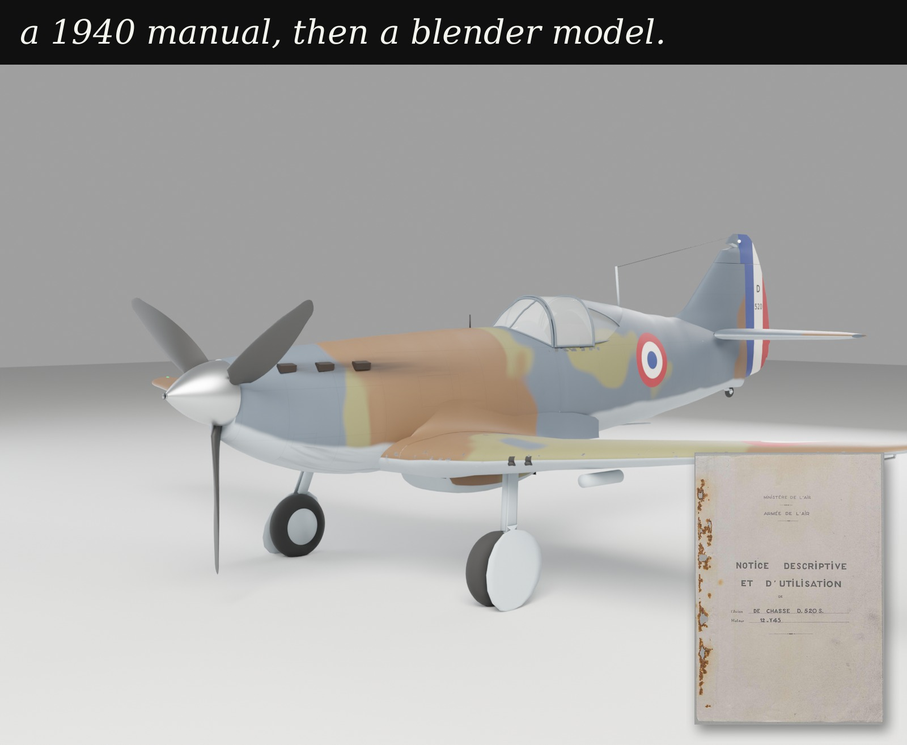

# Dewoitine D.520 S: from a 1940 manual to a stressed wing

[Course home](../../README.md) · [Wing Lab](../printed-wing-solver/README.md) · **[Open the 3-D viewer](https://ehsan-roohi.github.io/Aerospace-Structures/d520/)** · **[Analyse the wing in Wing Lab](https://ehsan-roohi.github.io/Aerospace-Structures/wing-lab.html#d520)**

A complete worked example for MIE 446: the scanned 168-page *Notice descriptive et d'utilisation de l'avion de chasse D.520 S* (1940) turned into

1. a full **transcription and English translation** of the manual,
2. a **parametric Blender model** of the aircraft in which every dimension is traced to a page, rigged to the manual's control travels,
3. **CAD** for SolidWorks and ANSYS (STEP solids of the outer mould line and a mid-surface model of the wing structure),
4. a **shell finite-element stress analysis** of the wing (CalculiX, with the same model as ANSYS APDL and NASTRAN decks),
5. a **full-scale metal-wing mode in Wing Lab** that analyses the same wing in the browser with beam and thin-walled section theory, checked against the shell model.

The rule throughout: every number comes from a source, and anything that does not is labelled a guess
(status codes PRINTED, SCALED, DERIVED, EXTERNAL, GUESS).



## What is where

| Folder | Contents | Start with |
|---|---|---|
| [`manual/`](manual) | English translation, French transcription and a bilingual version of all 168 pages; every number in the manual with page and quote (CSV); machine-readable page records | [`D520_manual_EN.md`](manual/D520_manual_EN.md) |
| [`model/`](model) | Parametric Blender model: geometry laws, build, texture bake, rig, validation against the manual, plate overlays, photograph matches, renders; `d520.blend` and `d520.glb` | [`model/README.md`](model/README.md) |
| [`stress/`](stress) | Loads, shell FE model and results, post-buckling strength, CAD export, ANSYS / NASTRAN / CalculiX decks, figures, the report | [`stress/REPORT.md`](stress/REPORT.md), [`stress/README.md`](stress/README.md) |
| [`../../docs/d520/`](../../docs/d520) | The interactive 3-D viewer (model with live controls, sources, checks, the manual page by page with its scans) | [viewer](https://ehsan-roohi.github.io/Aerospace-Structures/d520/) |
| [`../printed-wing-solver/web/metal_wing_engine.js`](../printed-wing-solver/web/metal_wing_engine.js) | Wing Lab's full-scale metal-wing engine with the D.520 preset; its tests compare it with this folder's results | [Wing Lab](https://ehsan-roohi.github.io/Aerospace-Structures/wing-lab.html#d520) |

## The wing in numbers (half wing, per g unless stated)

These are model predictions, not measured historical capacities or an airworthiness assessment. The shell values are archived supplied results. Live Wing Lab uses a corrected panel circumradius; its baseline stringer-crippling estimate is about 8.6 g, **below** the assumed 9 g ultimate demand. A higher approximate section-collapse peak does not make that failing check acceptable. See the report's correction note before using the archived values below.

| Quantity | Wing Lab (beam + thin-walled sections) | Shell FE, 41 066 elements | Note |
|---|---|---|---|
| Structural mass | 115.6 kg | 116.0 kg | plus 141.7 kg of fuel, guns and ammunition |
| Fitting reaction | 10.60 kN | 10.59 kN | lift minus all weights |
| Tip deflection at rib 1 | 12.6 mm | 12.3 mm | 75 mm at the assumed +6 g limit |
| Tip twist | 0.081° nose-up | 0.083° | |
| Spar boom stress, root to mid-span | 8–9.5 MPa | 7.6–9.6 MPa | within 9 %; beam theory over-predicts near the tip |
| Section collapse | 19.3 g | 19.4 g (Python section analysis) | at y = 2.35 m, where the boom steps down |
| Blade stringers cripple | 8.5 g | 8.5 g | just under the assumed 9 g ultimate |

The gauges, gross mass and load factors are not in the manual; they are labelled assumptions, and the sensitivity
runs (skin ±25 %, booms −40 %, stringers +50 %) bracket them. See [the report](stress/REPORT.md) for the full analysis
and its limits.

## For students

* **Viewer:** look at the aircraft, move its controls, and compare every dimension with the page it came from.
* **Wing Lab, full-scale mode:** the same chain as the printed-wing project (loads → V, M, T → section → stress →
  deflection → stability), on a real stressed-skin wing. Try the +6 g and −3 g cases, find the shear centre, see
  which skin panels buckle, switch off the tapered-beam effect and compare with the shell model.
* **SolidWorks / ANSYS:** [`stress/README.md`](stress/README.md) gives a step-by-step set-up of the same wing in
  SolidWorks Simulation (shells from `D520_wing_structure_surfaces.step`) and in ANSYS (APDL deck or the NASTRAN mesh),
  with the expected reaction, deflection and stresses to check your model against.

## Reproduce

```bash
# Blender model (bpy 4.2+ or Blender in background mode)
cd model && python3 scripts/make_params.py && python3 scripts/d520_build.py --out build/d520_base.blend
# wing loads, shell model, strength, CAD (Python 3, numpy/scipy, CalculiX 2.21, CadQuery 2.8)
cd ../stress && python3 scripts/common.py && python3 scripts/loads.py && python3 scripts/fe_model.py --r 3 --tag r3
# Wing Lab engine against these results (from the repository root)
node computational/printed-wing-solver/web/test_metal_wing.mjs
```

The source manual is held by the Archives départementales de la Haute-Garonne (their stamp is on every sheet);
the scans in the viewer are reproduced for teaching.
