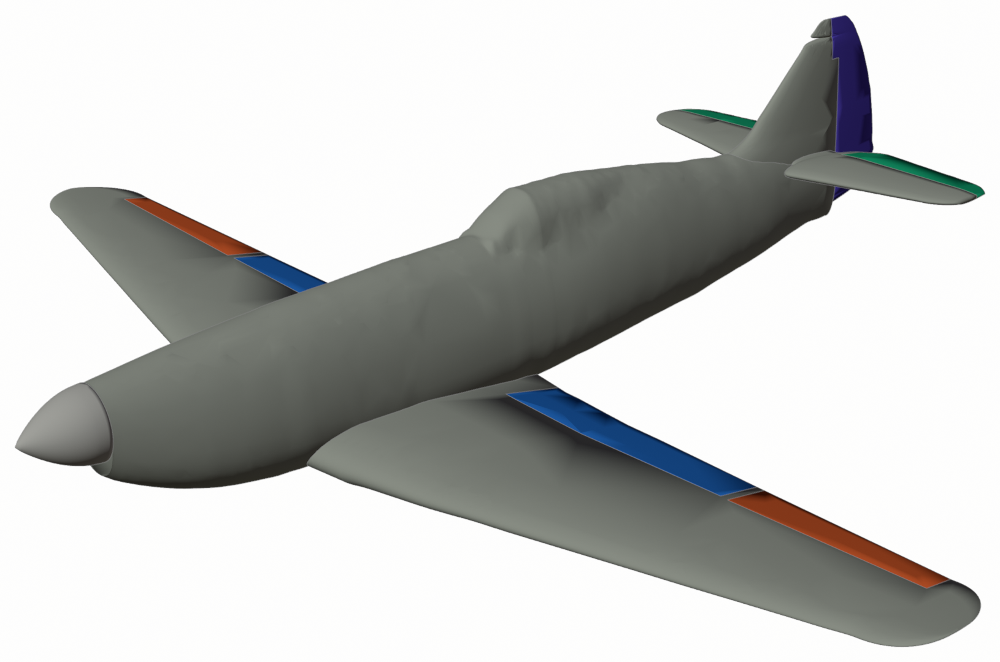
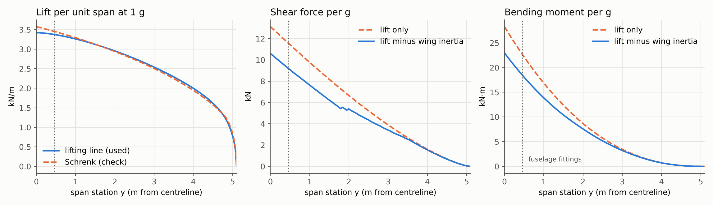
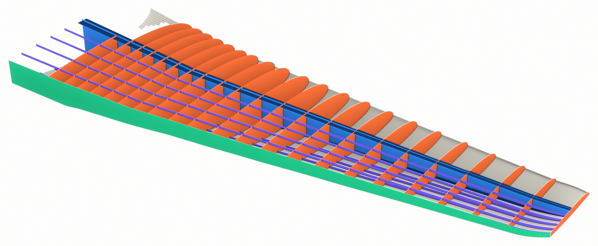
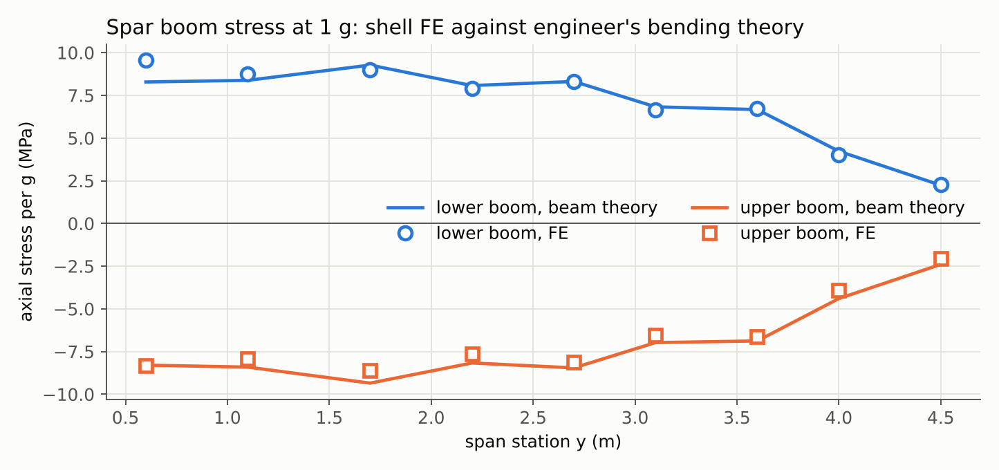
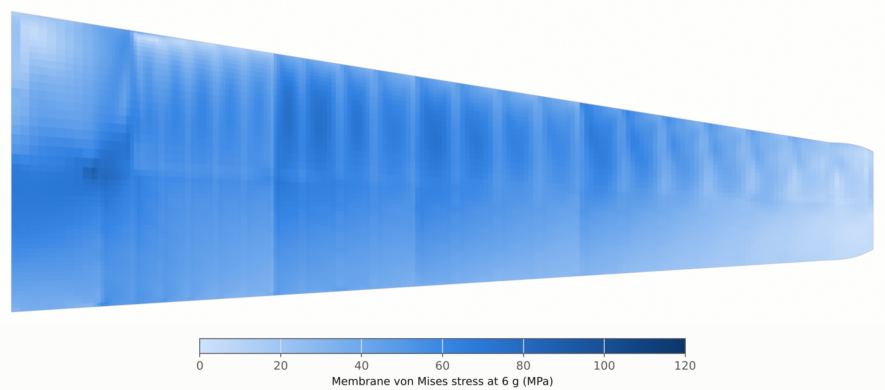
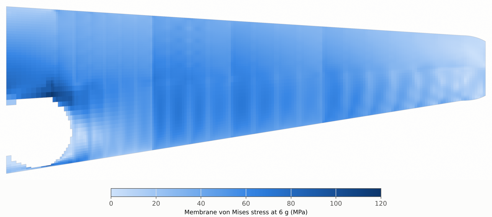
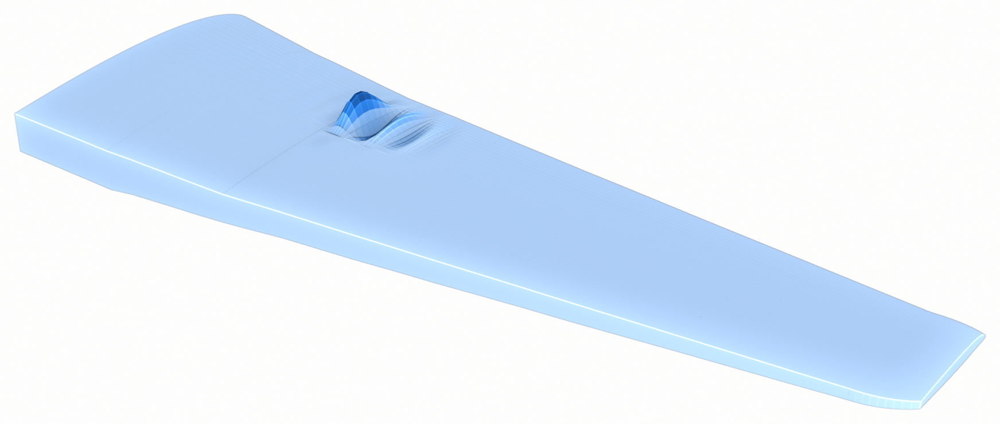
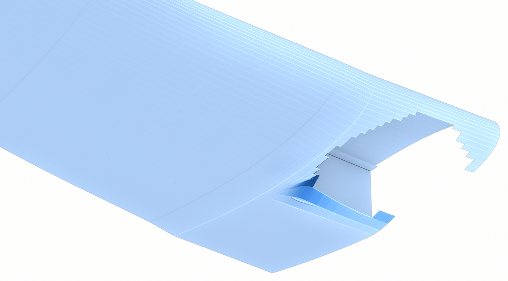
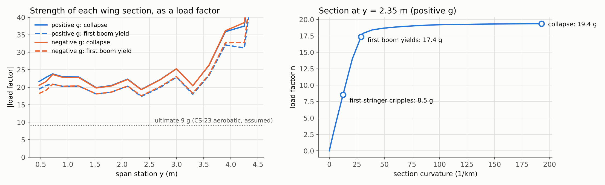

# D.520 wing stress analysis

October 2026 · MIE 446 Aerospace Structures, UMass Amherst · [D.520 project home](../README.md) · [Wing Lab version](https://ehsan-roohi.github.io/Aerospace-Structures/wing-lab.html#d520)

Rebuilt from the 1940 manual, the D.520 wing carries the 6 g limit load without yielding and collapses at about 19 g. Its thin leading-edge skin buckles elastically from about 2 g, the stringers start to cripple near 8.5 g (just under a 9 g ultimate load) and the spar booms yield near 17 g. The collapse figure rests mostly on the spar-boom size, scaled from a small drawing; with booms 40 % smaller it falls to about 14 g, still well above a 9 g ultimate load. The manual gives the wing's layout and material but no sheet gauges, weights or load factors, so those are labelled assumptions below.

This folder holds the CAD for SolidWorks and the ready-to-run ANSYS, NASTRAN and CalculiX models used here.

## Files for ANSYS and SolidWorks

Everything is in this folder (see [README](README.md)). CAD is in millimetres; solver decks are in N, m, kg and Pa. All files share one set of axes: X aft from the spinner tip, Y to starboard, Z up from the thrust axis.

| File | What it holds | Open it in |
| --- | --- | --- |
| `cad/D520_airframe_OML.step` | Whole aircraft as 13 named solids: fuselage with canopy, wing, flaps, ailerons, tailplane, elevators, fin, rudder, spinner, radiator | SolidWorks (File > Open), SpaceClaim, DesignModeler, any CAD |
| `cad/D520_<part>.step` | The same solids, one file each | Same |
| `cad/D520_wing_structure_surfaces.step` | Starboard half-wing structure as mid-surfaces, one body per part and gauge zone, thickness in each body name (e.g. `Skin_upper_box_Z2_t1.2mm`) | SolidWorks Simulation or Workbench shells |
| `ansys/D520_wing_r3.mac` | Complete ANSYS APDL model: 41,066 SHELL181 elements, supports, 1 g loads scaled by `NLF`, static solve, then linear buckling | Mechanical APDL `/INPUT`, or Workbench > Mechanical APDL > Add Input File |
| `ansys/D520_wing_r3.bdf` | The same model as NASTRAN SOL 101 | Workbench External Model, Femap, HyperMesh, Nastran |
| `ansys/D520_wing_r3_calculix.inp` | The CalculiX deck actually solved for this doc | CalculiX, PrePoMax |
| `ansys/D520_wing_r3_results_per_g.vtu` | Stresses and displacements per g | ParaView |
| [`README.md`](README.md) | Step-by-step set-up for SolidWorks Simulation, with the load table | Any text editor |

All 13 solids pass OpenCascade's validity and boolean checks. Their surfaces lie within 3.3 mm (wing), 2.0 mm (fuselage) and 7.8 mm (tailplane tip) of the manual-derived sections. The APDL and NASTRAN decks were read back, rebuilt and re-solved; they give the same reaction and tip deflection as the original run.

## Inputs: from the manual or assumed

The manual fixes the wing's layout and material but gives no sheet gauges, weights or load factors. Those are labelled guesses or outside values below, and the sensitivity runs further down vary the ones that matter.

| Input | Value used | Source |
| --- | --- | --- |
| Structure | One I-section main spar (booms + thick-sheet web), channel false spar, pressed ribs, smooth stressed skin, leading edge hinged to the spar | Manual p13 and Pl.1–Pl.6 |
| Rib stations | 22 ribs, from 0.51 m (rib 22) to 4.93 m (rib 1) | Scaled from Pl.1 |
| Spar positions | Main spar at 37 % chord, false spar at 73 % | Scaled from Pl.1 and Pl.6 |
| Spar booms | 110 × 30 mm at the root (3,300 mm²), area falling with bending moment ÷ depth, stepped at ribs 21, 16, 12, 8 and 4 | Root size scaled from the small Pl.1 section (low confidence); taper is a guess shaped by the manual's "thinner and narrower along the span" |
| Wheel well | Lower leading-edge skin cut away inboard, radius 0.37 m | Scaled from Pl.1 |
| Material | Duralumin 2017-T4 (AU4G): E = 72 GPa, yield 220 MPa, tensile 380 MPa (minimum values) | Manual p13 says duralumin; properties from [matmatch](https://matmatch.com/materials/mitf97-aa-2017-t4) |
| Gauges | Skin 1.6 mm root to 0.8 mm tip; spar web 3.0 to 1.0 mm; false spar 1.2 to 0.8 mm; ribs 1.0 mm (2.0 mm at the kink ribs 21 and 16); four 20 mm blade stringers per surface | Guess |
| Mass | 2,677 kg gross | [Wikipedia](https://en.wikipedia.org/wiki/Dewoitine_D.520) (the manual leaves it blank) |
| Load factors | Limit +6 g and −3 g, ultimate 1.5 × limit | Guess: the acrobatic-category values of [14 CFR 23.337](https://www.govinfo.gov/content/pkg/CFR-2011-title14-vol1/pdf/CFR-2011-title14-vol1-sec23-337.pdf); no D.520 value was found |
| Wing masses (per side) | Fuel 122 l = 88 kg between ribs 13 and 7; two 10.7 kg guns and 2 × 650 rounds | Manual p11 bis and p38; gun mass from [Wikipedia](https://en.wikipedia.org/wiki/MAC_1934) |
| Supports | Spar and false spar held at the fuselage side (y = 0.46 m), symmetry at the centreline | Manual p14 and Pl.14 |

## Loads

At 1 g each half-wing carries 13.1 kN, and the bending moment at the fuselage side is 18.4 kN·m once the wing's own inertia is subtracted. Lift is spread along the span by a lifting-line solution on the manual's planform; the period's Schrenk method gives the same curve within 5 %. The inertia relief comes from the modelled structure (116 kg per half-wing) plus fuel, guns and ammunition (142 kg). Every result below is per g and scales linearly up to the first buckle.

The lift is applied at the skin nodes with a flat-plate chordwise shape (centre of pressure at 25 % chord), two-thirds on the upper surface. Lift on the flaps and ailerons is passed to the false spar, as their hinges do.

## Finite-element model and checks

The starboard half-wing is modelled in shells: 41,066 elements in the reference mesh, solved with CalculiX. The wing is continuous through the fuselage (Pl.4), so the centreline is a symmetry plane, and the spar and false spar are held where the fittings of Pl.14 meet the fuselage side.

| Check | Result |
| --- | --- |
| Equilibrium at 1 g | Fitting reaction 10,592 N against 10,597 N of applied lift minus weight (0.05 %) |
| Boom stress against engineer's bending theory | Within 8 % over most of the span; 15 % beside the wheel well and at the tip, where the section is cut open or the stress is small |
| Tip deflection | 12.3 mm per g (beam theory, clamped at the fittings: 10.7 mm) |
| Mesh convergence | Tip deflection 12.20, 12.31, 12.31 and 12.34 mm per g on 5.8k, 19k, 41k and 71k elements; boom stresses within 0.4 % between the two finest meshes (1.4 % at the tip) |

## Stresses at the 6 g limit load

If nothing buckled, the highest stress at 6 g would be 133 MPa, in the spar web at the centre joint (where the real wing has doubled webs and steel splice plates, Pl.4), against a 220 MPa yield: a reserve factor of 1.66. The same linear model at the 9 g ultimate load stays below the 380 MPa tensile strength everywhere, with a reserve of 1.9. The skin does buckle well before 6 g (next section), so these numbers hold for the spars, booms and ribs but overstate what the skins carry above about 2 g.

The darkest spots are where the load path is interrupted: the corner of the wheel well and the kink in the lower surface at rib 21. Stresses within 0.1 m of the fuselage fittings are left out; the real fittings there were high-tensile steel (manual p14).

| Part | Membrane stress at 6 g (MPa) | With skin-panel bending (MPa) | Where (y, m) | Reserve on yield at 6 g | Reserve on rupture at 9 g |
| --- | --- | --- | --- | --- | --- |
| Spar web | 122 | 133 | 0.63 / 0.03 | 1.66 | 1.91 |
| Lower leading-edge skin | 99 | 130 | 0.56 / 0.58 | 1.69 | 1.94 |
| Upper leading-edge skin | 77 | 128 | 1.58 / 0.69 | 1.72 | 1.98 |
| Lower spar boom | 72 | 98 | 0.03 / 0.71 | 2.25 | 2.59 |
| Lower box skin | 83 | 96 | 0.56 / 0.03 | 2.29 | 2.63 |
| Upper box skin | 80 | 83 | 0.56 | 2.65 | 3.05 |
| Lower stringers | 68 | 69 | 0.03 | 3.19 | 3.67 |
| Upper spar boom | 61 | 68 | 0.03 / 1.49 | 3.23 | 3.72 |
| Upper stringers | 63 | 63 | 0.23 | 3.50 | 4.03 |
| Ribs | 56 | 60 | 0.70 | 3.67 | 4.22 |
| False spar | 56 | 59 | 0.67 / 0.03 | 3.75 | 4.32 |

Reserve factors use the higher stress (with bending) against 220 MPa yield and 380 MPa rupture. At 6 g the tip rises 74 mm and twists 0.5° nose-up.

## Buckling

The leading-edge skin is the first part to buckle, at about 2 g in either direction, between the ribs and ahead of the spar. Under positive g it buckles in the upper surface just outboard of rib 16, where the dihedral breaks. Under negative g it buckles in the lower surface beside the wheel well. These buckles are elastic: the skin springs back when the load comes off and the spars and stringers keep carrying it, as in other stressed-skin fighters of 1940. The manual's after-flight check says the same thing from the other side: "a wrinkle in the sheet metal indicates a permanent deformation and calls for a thorough check" (printed p47).

The buckling factor keeps falling as the mesh is refined, so the 2 g figure is an upper estimate; the finest uniform mesh (70,536 elements) did not fit in this machine's memory.

| Mesh | Elements | First buckle, +g | First buckle, −g |
| --- | --- | --- | --- |
| Coarse | 5,795 | 8.6 | 8.5 |
| Medium | 19,481 | 5.1 | 4.7 |
| Fine (used for the stresses) | 41,066 | 3.0 | 2.6 |
| Fine, leading edge refined 2× | 55,974 | 2.2 | not run |
| Fine, skin 25 % thinner | 41,066 | 2.3 | 1.9 |
| Fine, skin 25 % thicker | 41,066 | 3.8 | 3.3 |

The real wing was stiffer here than the model: its leading edge between ribs 13 and 7 was the fuel tank, and its ribs had pressed stiffening beads (Pl.5, Pl.6). The strength figures in the next section already assume the skin has buckled, so they do not depend on this number.

## Strength after the skin buckles

With the booms as drawn on Pl.1, the wing collapses at about 19 g; the first permanent damage is stringer crippling near 8 g, and the booms yield near 17 g. All three happen at y = 2.35 m, just outboard of rib 12, where the boom steps down from 29 to 22 mm. The analysis cuts the section into booms, stringers, skin panels and web strips and lets each follow its own law. Buckled panels keep only a von Kármán effective width next to each stiffener, stringers stop at their crippling stress, and booms yield at 220 MPa. This is the stressed-skin method of the period.

The boom size decides the answer. It is scaled from a section drawn a few centimetres high, so it is the least certain number in the model.

| Case | Stringers cripple, +g | Booms yield, +g | Collapse, +g | Collapse, −g |
| --- | --- | --- | --- | --- |
| Booms as scaled from Pl.1 (3,300 mm² at the root) | 8.5 | 17.4 | 19.4 | 19.3 |
| Booms 40 % smaller | 6.4 | 12.4 | 14.4 | 14.4 |
| Booms 30 % larger | 9.9 | 20.9 | 22.8 | 22.7 |
| Skin 25 % thinner | 7.8 | 16.3 | 17.9 | 17.9 |
| Skin 25 % thicker | 9.4 | 18.8 | 21.0 | 20.9 |
| Stringers 50 % thicker | 17.9 | 17.9 | 19.9 | 19.8 |

Even with booms 40 % smaller than drawn, the wing clears the assumed 9 g ultimate load by a wide margin. The guessed 1.0 mm stringers cripple first in every case; at 1.5 mm they hold until the booms yield.

## Limits of this analysis

- Sheet gauges and the stringer layout are guesses, and the boom size comes from a small drawing; the sensitivity runs bracket them, but a real drawing set would replace them.
- Only the wing is analysed, and only symmetric pull-ups and push-overs. Rolling pull-outs, gusts, dive torsion at the 825 km/h reached in tests, landing loads through the gear pivot on the spar, and the fuselage and tail are not covered.
- The fittings, the steel splice plates of the centre joint (Pl.4), rivets, fatigue and corrosion are not modelled; stresses within 0.1 m of the supports are left out.
- Ribs are modelled flat, without the stiffening beads of Pl.6, and the leading-edge fuel tank (ribs 13 to 7) as plain skin. Both make the predicted buckling earlier than in the real wing.
- A geometrically and materially non-linear run on the coarse mesh stalled at 9.1 g, at a local skin snap-through that load control cannot pass. The collapse figures therefore come from the section method, not from that run.

## Sources

- *Notice descriptive et d'utilisation de l'avion de chasse D.520 S, moteur 12 Y 45* (the scanned manual): p11 bis (fuel), p13 (wing structure), p14 (attachments), p38 (armament), Pl.1–Pl.6 and Pl.14
- [Dewoitine D.520](https://en.wikipedia.org/wiki/Dewoitine_D.520), Wikipedia: gross weight, dive speed
- [MAC 1934](https://en.wikipedia.org/wiki/MAC_1934), Wikipedia: gun mass
- [2017-T4 aluminium](https://matmatch.com/materials/mitf97-aa-2017-t4), matmatch: material properties
- [14 CFR 23.337](https://www.govinfo.gov/content/pkg/CFR-2011-title14-vol1/pdf/CFR-2011-title14-vol1-sec23-337.pdf): acrobatic-category load factors
