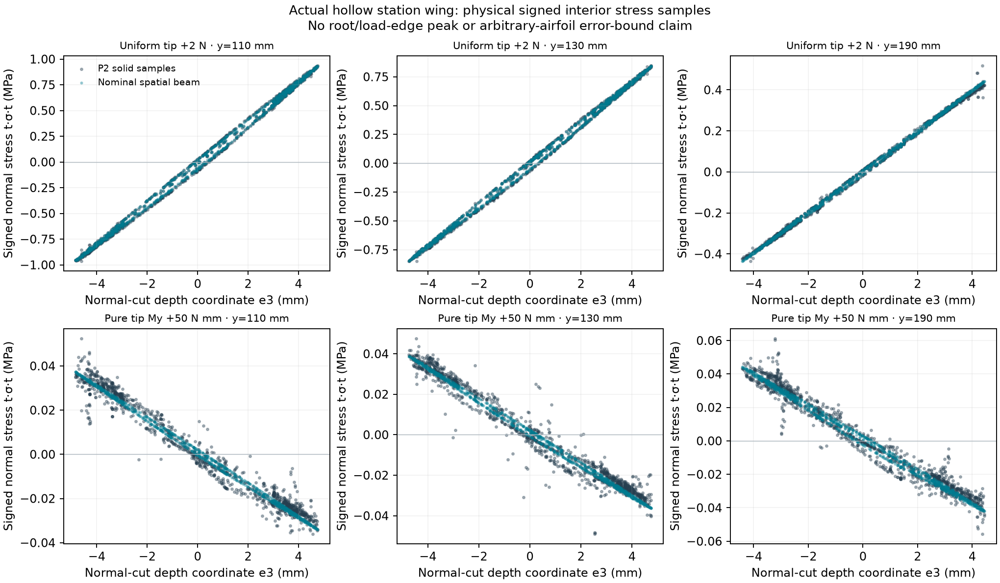

# Spatial wing beam: scope and verification

The expanded Wing workspace is a small-displacement structural beam in three-dimensional
space. It is not a three-dimensional solid/shell finite-element model, an aerodynamic solver,
or a complete wing-strength certification.

The intended use is teaching linear beam load paths, elastic coupling, geometry conventions
and discretization sensitivity under prescribed loads. It is not approval to manufacture,
load-test or fly a design. Analytical verification, comparison with an independently meshed
continuum model, and experimental validation of printed PLA are distinct forms of evidence.
Only the first two are provided here. Reported benchmark agreement applies to the identified
constructions and load channels, not every custom DAT profile or a guaranteed angular box.
This distinction follows the intended-use approach described in
[NASA's modeling and simulation guidance](https://public.ksc.nasa.gov/mns/faq/); no NASA
approval or standards-compliance certification is claimed.

## Model

Aircraft coordinates are x aft, y projected span and z up. Airfoil sections remain in aircraft
x–z planes. Positive sweep moves outboard sections aft; positive dihedral raises the tip;
positive incidence raises the leading edge. Incidence is absolute at each station, not an
increment added to the preceding section. Sweep and incidence have separately declared
chord-fraction references. Profile ordinates and incidence interpolate between stations.

The structural calculation projects locally prismatic sections onto cuts normal to the
reference-axis tangent. E-weighted axial and biaxial bending stiffness retain first moments
and product-of-inertia coupling about that reference. Saint-Venant torsion and shear-center
properties accompany a six-degree-of-freedom Euler–Bernoulli frame. Full-span bonded spar
caps/webs participate through a projected thin-wall shear-flow network. The root restrains
all six elastic degrees of freedom on the equivalent beam axis. This is not identical to
clamping every point of an oblique physical root face.

Prescribed forces act in global +z. Distributed intensity is N per mm of projected y, not
per mm of reference-axis arc length. Eccentric forces supply the vector moment r × F.
Twist or a changed airfoil does **not** automatically generate or redistribute aerodynamic lift.

Requested beam elements are selectable from 4 to 100. Mandatory load, section, rib and seam
stations may increase the actual count. JSON records `study.analysis.nElements`; that analysis
setting does not alter physical ribs, CAD geometry or STL tessellation.

## Reproducible checks

Run the JavaScript suites from the repository root with Node. DOM suites additionally require
jsdom, configured by `MIE446_JSDOM_MODULE` when it is not locally installed.

| Suite | Independent or regression evidence |
|---|---|
| `test_wing_geometry.mjs` | Coordinate transforms, inverse transforms, profile stations and sign conventions. |
| `test_wing_frame3d.mjs` | Analytical frame responses, transformations, rigid modes, energy and equilibrium. |
| `test_wing_frame_axial_compatibility.mjs` | Condensed axial mode, distributed virtual work and eccentric reference-axis invariance. |
| `test_wing_projected_spars.mjs` | Projected section stiffness and two-direction shear/torsion networks. |
| `test_wing_spatial_sections.mjs` | Analytical normal-cut properties and integrated wing responses. |
| `test_wing_spatial_review.mjs` | Independent aircraft-coordinate force/moment integration, sign reversal, stress-resultant integration, mesh refinement and small-angle continuity. |
| `test_wing_physical_normal_recovery.mjs` | Analytical normal-foot location and half-space resultants at actual physical surface points, including forward sweep and off-axis motion. |
| `test_wing_mapping_guard.mjs` | Unresolved surface mapping stays unknown; invalid physical load mapping remains rejected; the normal family does not depend on beam mesh count. |
| `test_wing_spatial_section_refinement.mjs` | Numerical section refinement independently of longitudinal element refinement. |
| `test_wing_mesh.mjs` | Requested versus actual count, mandatory nodes, strict count validation and unchanged omitted defaults. |
| `test_wing_spatial_ui.mjs` | Advanced JSON → Apply → Solve, displayed results, unavailable-result guards, mesh editing, Undo/Redo, JSON download/reopen and restart. Scene-graph stand-in; not a GPU-rendering test. |
| `verify_engine.mjs` | Existing straight-wing solver compared against 238 stored Python quantities. |

The independent section-stress integration checks the actual recovered N, M2 and M3, not only
the solver's own residual report. Global reaction balance, energy balance and convergence
are necessary numerical checks; they do not validate every physical assumption.

## Independent solid-model reference

The identified structural reference has a 240 mm projected span, 60/48 mm root/tip chords
(`L/rootChord = 4`), 12° quarter-chord sweep, 6° dihedral and incidence +2° to −2°.
The airfoil changes from NACA 23018 to NACA 0018. It has a closed 1.2 mm PLA skin,
two interior ribs and one full-span integral I-spar. Both models use E = 2000 MPa,
Poisson ratio 0.35, identical prescribed global force/moment wrenches and small-strain
isotropic elasticity. The solid fixes the actual root face; the beam fixes its root axis.

Independent Gmsh/scikit-fem solid meshes use quadratic displacement tetrahedra with
affine cell geometry, not the browser's beam elements. The final two meshes have 94,431
and 137,268 displacement DOFs. The finest-pair changes are 0.132% in vertical compliance
and 0.431% in torsional work rotation. Algebraic equilibrium, energy and independently
recomputed free residual checks pass the criteria recorded with the evidence.

| Observable | Finest solid | Refined beam | Beam − solid |
|---|---:|---:|---:|
| Vertical compliance, uniform 2 N tip traction (mm/N) | 1.58692170 | 1.60712842 | +1.273% |
| Work-conjugate rotation, pure global-y 50 N·mm couple (rad) | 0.003726227 | 0.003782544 | +1.511% |
| Fitted nominal normal-stress RMS at axis station 130 mm, vertical channel (MPa) | 0.50571298 | 0.50405011 | −0.329% |

The torque rotation is `(f · u)/My`, not an assumed rigid rotation of a warped solid tip.
Least-squares physical tip/ring rotations and their non-rigid residuals are separate diagnostics.
Normal stress uses the complete beam-normal planes at axis stations 110, 130 and 190 mm,
not the global-y tensor component or a streamwise surface station. The area-weighted
comparison of the **affine nominal stress component** is within 1.57% for these channels.

**Local torsional normal stress is not validated.** Comparing the beam directly with the
raw solid stress field in the pure-couple channel gives area-weighted relative L2 errors
17.46%, 22.33% and 15.22% at those three cuts. These do not meet a 15% raw-field target.
The beam omits non-affine torsional warping stress. A good fitted nominal component is
not evidence that the omitted local field is accurate. The contours must not be used as
a validated local strength or failure check. No stress mask or acceptance tolerance was
changed to conceal these discrepancies.

The signed profiles retain the actual solid sample coverage. The lower panels make the
non-affine torsional stress discrepancy visible; they are not an additional validation gate.

The predeclared nominal-model comparison gates are 10% for compliance/work rotation
and 15% for fitted nominal normal stress; solid refinement gates are 2% for compliance/
rotation and 5% for nominal stress. These are case-specific numerical comparisons, not
experimental validation or a guaranteed error bound for other airfoils, angles or construction.

[Raw numerical summary](../../../scripts/validation/results/initial_station_wing.json),
[reproduction commands and pinned optional dependencies](../../../scripts/validation/README.md),
and the extraction scripts preserve the load wrenches, solver versions, residuals, hashes,
refinement results and raw-field diagnostics. The optional corner-case definitions in those
scripts have not been run and are not claimed as additional evidence.

The end-to-end manufacturing reference is `tests/fixtures/wing_lab_station_browser.json`:
180 mm projected semi-span, 160/120 mm chords, Clark Y → NASA SC(2)-0412, 12° quarter-chord
sweep, 6° dihedral, incidence 2°/0°/−2°, two ribs and two integral PLA spars. It has been checked
through actual browser JSON download and the notebook's CAD/STL/3MF/ZIP pipeline. The
result is one connected valid solid with actual bounds about 168.212 × 180 × 31.797 mm and
fully dense plastic mass about 111.79 g, using adaptive B-rep volume integration. Internal rib/spar presence, watertight STL boundaries,
manifest file sizes and hashes are checked. Colab upload/download transport is simulated in
the automated notebook test; physical printing and an OrcaSlicer GUI session are not certified.

## Limits that must stay visible

- Linear reference-chord taper; 2–9 profile stations. This is not arbitrary aircraft CAD.
- Spatial analysis requires one piece or fully bonded seams, no external rods, and full-span
  bonded spars. Dry joints, slip, partial-span runouts and generated flight loads are not admitted.
- Normal beam stress and elastic displacement are available. Spatial natural frequencies,
  shear-failure margins, buckling, adhesive failure, flutter and overall factor of safety are not.
- Physical points must be located on their corresponding normal cut before recovering stress;
  using the streamwise station directly is incorrect for a swept wing. Truncated normal cuts
  at the root/tip and unresolved local load-introduction regions must not be reported as zero
  stress or included in an apparently validated peak envelope. A geometric end mask is only
  a minimum exclusion, not proof that fixture effects have decayed.
  Rapid profile transitions can also make a physical point's normal-plane mapping ambiguous
  or ill-conditioned. Those points are unresolved, not zero; a load needing an invalid mapping
  is rejected. The section-projection conditioning guard is not a physical validation envelope.
- Translation/span ≤5% and elastic section rotation ≤0.1 rad are screening limits, not proof
  of nonlinear accuracy. Exceedance is reported explicitly.
- Printed PLA cards are effective isotropic teaching inputs, not measured anisotropic laws.
- CAD uses a ruled loft through user stations and additional samples (incidence steps ≤2°).
  Inspect the resulting geometry. A coordinate profile or interpolation may be too thin for
  the specified cavity/walls and is then rejected rather than silently changed.
- A JSON download is not printer approval. Actual CAD bounds must fit the configured usable
  printer envelope; the default remains 300 × 300 × 300 mm. Slicer orientation, supports,
  brim, staff review and the course mass limit remain separate requirements.

Geometry conventions and profile references: [NASA OpenVSP wings](https://www.nasa.gov/reference/openvsp-wings/),
[NASA OpenVSP cross-sections](https://www.nasa.gov/reference/openvsp-cross-sections/),
[UIUC coordinate database](https://m-selig.ae.illinois.edu/ads/coord_database.html), and
[PDAS five-digit mean lines](https://www.pdas.com/naca456mean3.html).
Oblique-root load redistribution is a distinct physical effect; see
[Hovell, ARC R&M 2837, swept-back box-beam with perpendicular ribs](https://reports.aerade.cranfield.ac.uk/bitstream/handle/1826.2/3393/arc-rm-2837.pdf?isAllowed=y&sequence=1).
