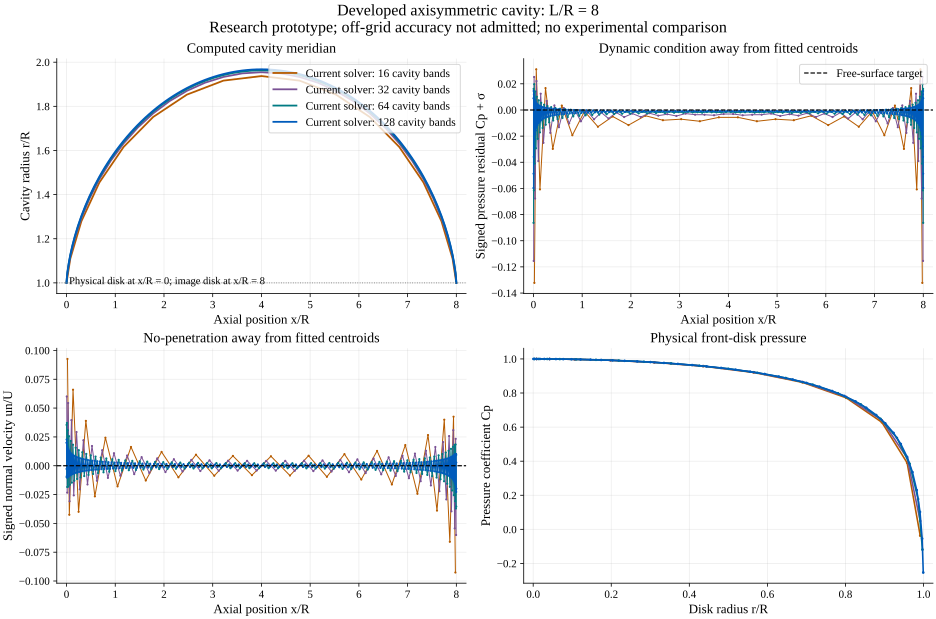
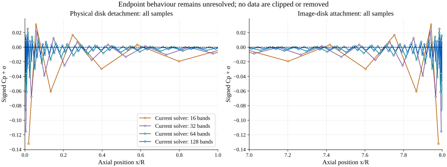

# Developed axisymmetric cavity: implementation and unresolved accuracy

This is a **research prototype**, distinct from the fully wetted axisymmetric verification. A converged nonlinear collocation system is available, but off-grid boundary errors still exceed the stated numerical admission limits. There is **no matched experimental validation** of this developed-cavity module.

## Geometry, unknowns and equations

The physical cavitator is a circular disk of radius R in axial flow. A downstream image disk gives the Riabouchinsky closure. The full separation of the physical and image disks is L; **the input L/R is the full length**, whereas some published half-domain formulations use half this value. Disk radius, speed, water density and cavity pressure set the dimensional scale. The solver prescribes L/R and computes cavitation number σ; it rejects an independently specified ambient pressure or σ rather than overconstraining this inverse problem.

The meridional contour comprises the front disk, a positive symmetric cavity surface and the image disk. Constant source density on each conical ring band solves the exterior Laplace equation. On every body/free-surface collocation point, the total normal velocity vanishes:

\[
\left(\tfrac12 I+K_n\right)s=-\boldsymbol U_\infty\cdot\boldsymbol n.
\]

The cavity shape coefficients are adjusted until its tangential speed q is constant. Bernoulli then gives

\[
\sigma=\left(q_c/U_\infty\right)^2-1,\qquad C_p=-\sigma,\qquad
p_\infty=p_c+\tfrac12\rho U_\infty^2\sigma.
\]

The positive, disk-symmetric shape is parameterized as

\[
\frac rR=1+[4t(1-t)]^{2/3}
\exp\left\{\sum_k c_kT_k\bigl(2[4t(1-t)]-1\bigr)\right\},
\quad t=\frac{1-\cos\theta}{2},\quad\frac xR=\frac LR t.
\]

The 2/3 exponent is a sharp-detachment ansatz. It is not a fitted universal law for arbitrary cavitators. A damped finite-difference Levenberg–Marquardt iteration fits the shape. Positivity, symmetry, nonintersecting geometry and monotone expansion toward mid-cavity are retained. The equations do not determine natural separation on a sphere, an asymmetric cavity, a re-entrant jet, viscosity, nuclei, surface tension, gravity or tunnel blockage.

The pressure drag of the **physical front disk** is

\[
C_D=\frac{1}{\pi R^2}\int_{\rm front}(C_p+\sigma)\,dA.
\]

The cancelling force on the artificial image disk is not subtracted from this physical drag. A zero net force on the symmetric equivalent closed body would be a misleading drag measure.

## Independent checks and refinement

Every free-surface band is tested at fractions 0.25 and 0.75 in addition to its fitted centroid. Analytic Cauchy subtraction evaluates each self-band at these points. These extra points are not used in fitting, and no endpoint bands are discarded. The declared numerical criteria are maximum off-grid normal velocity <= 0.01 U and maximum signed dynamic residual magnitude |Cp + σ| <= 0.02. These are numerical admission criteria, not a material law or experimental uncertainty estimate.

For full L/R = 8 with 32-point ring quadrature:

| Cavity bands | Computed σ | Maximum r/R | Physical disk CD | Max. off-grid normal magnitude / U | Max. off-grid dynamic residual magnitude |
|---:|---:|---:|---:|---:|---:|
| 16 | 0.30099450 | 1.93715351 | 1.07590110 | 0.0926193 | 0.1322123 |
| 32 | 0.30886088 | 1.95459562 | 1.09275359 | 0.0600778 | 0.1154242 |
| 64 | 0.31281067 | 1.96296673 | 1.09476281 | 0.0371109 | 0.0863032 |
| 128 | 0.31500005 | 1.96776886 | 1.09645969 | 0.0227389 | 0.0596875 |

Global shape, σ and disk drag stabilize with refinement, but **none of these meshes passes the off-grid criteria**. At 128 bands the fitted speed residual is about 2.4e-8 U. The much larger off-grid residual demonstrates why tiny nonlinear residuals must not be reported as overall accuracy. Endpoint profiles expose the remaining discretization error.

Increasing the independent sample quadrature from 40 to 96 points changes the 128-band maximum dynamic residual by approximately 5.4e-10 and the maximum normal residual by approximately 1.0e-10. The unresolved residual is therefore not removed by simply increasing integration order on the existing bands. The raw quadrature study is retained in `axisymmetric-cavity-offgrid-quadrature.json`.





`axisymmetric-cavity-independent.py` separately implements the source-ring formulation in Python/NumPy. It reproduces the 32-band JS σ, shape and drag to about 1e-7. This checks implementation consistency; it is not independent physical validation because the formulation is shared.

A separately implemented Morino potential representation was also evaluated on the source-fitted contours. At 128 bands it gives disk CD = 1.09203 versus source-ring CD = 1.09646, and mean free-surface σ = 0.31983 versus 0.31500. These global differences decrease under refinement, but the potential representation's maximum free-surface dynamic residual remains approximately 0.128. It therefore does **not** qualify the endpoint solution. The potential comparison uses an independently written research candidate, not a trusted external CFD code; its algebraic residual must not be interpreted as a physical error bound.

## Evidence, provenance and limits of the published comparison

- The checked-in `axisymmetric-cavity-L8-N*.json` files retain every node, centroid and quarter-band sample. The refinement and endpoint figures are generated directly by `axisymmetric-cavity-plot.py`.
- `axisymmetric-cavity-verification.json` distinguishes the 16 passing **implementation regressions** from the failing off-grid accuracy gate. Its scientific admission fields remain `NOT_PASSED` or `NOT_PERFORMED`.
- `axisymmetric-cavity-potential-comparison.json` records the potential-representation cross-check. It is not experimental evidence.
- Yas'ko's published boundary-element work is the closely matched disk/cone and Riabouchinsky-closure reference: [Boundary element method applied to axisymmetric cavitation flows (1993), DOI 10.2495/MB930161](https://doi.org/10.2495/MB930161). Its disk comparisons cannot be used quantitatively until the figure samples, cavity-length convention and drag normalization are recovered and matched. No ambiguous table numbers have been treated as standard frontal-area CD.
- [Brennen, *Cavitation and Bubble Dynamics*, chapter 8](https://media.library.caltech.edu/CaltechBOOK:1995.001/chap8.htm) explains developed cavities and alternative closure models. Published sphere measurements in a finite tunnel are not an unconfined disk reference and have not been substituted for one.

The next scientific step is a higher-order/smooth-surface or direct mixed-potential free-boundary formulation with verified edge treatment, followed by matching primary disk data. Adjusting σ, deleting endpoint samples, clipping the residual, or changing acceptance thresholds would conceal the unresolved issue.

## Reproduction and integration

```text
node docs/hydrofoil-cavitation-lab/validation/axisymmetric-cavity-verify.cjs
python docs/hydrofoil-cavitation-lab/validation/axisymmetric-cavity-independent.py
python docs/hydrofoil-cavitation-lab/validation/axisymmetric-cavity-plot.py
```

The plotting script requires NumPy and Matplotlib; `--deps PATH` can select an isolated dependency directory. The JS UMD module loads after `axisymmetric.js` and exports `AxisymmetricCavity.options`, `.iterate` and `.solve`. The generator yields shape iteration, Jacobian-column and independent-sampling progress. Typical local runtimes were approximately 0.25 s for 32 bands, 2 s for 64 and 31 s for 128; they are hardware dependent.

Returned `nodes.x/r` and `surface.x/r` are dimensional metres. `offCentroid.x/r` and geometric band length/area remain nondimensional in R units; velocity/source fields are normalized by U. The pressure field is dimensional Pa. Integration must preserve these units and the explicit research/unresolved status. A failure to qualify must not be displayed as an accepted cavitation prediction.
